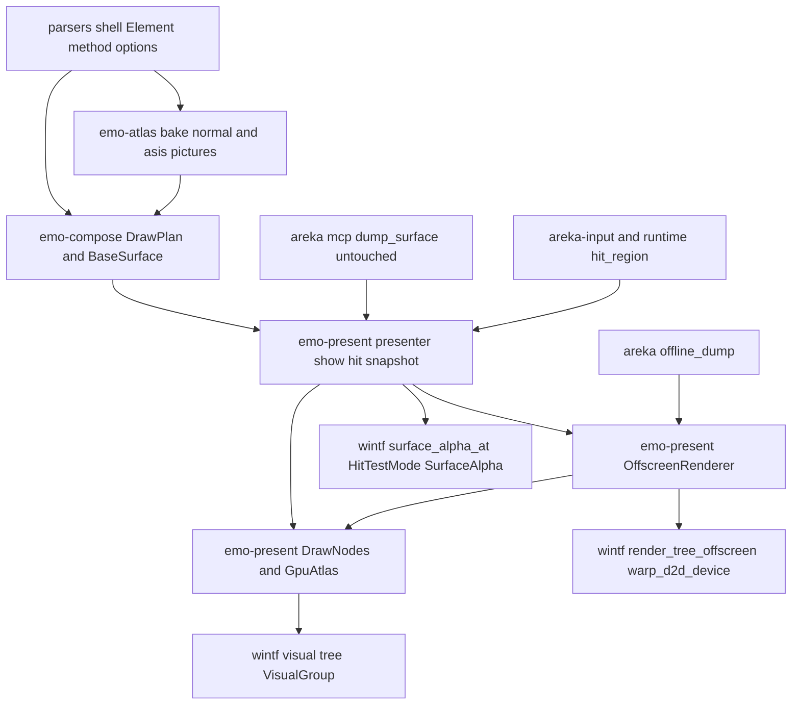
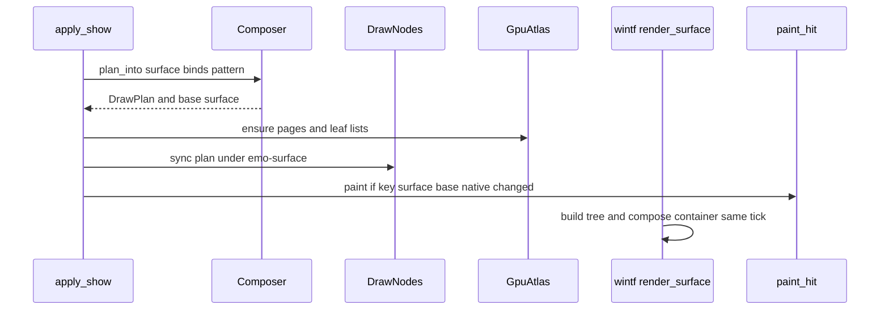
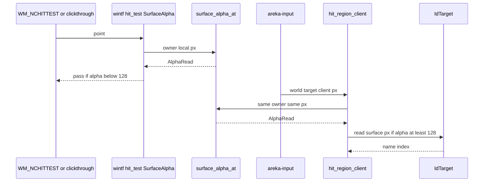
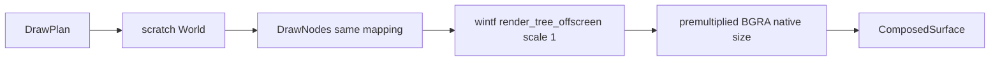

# 設計: draw-methods-canon

## Overview

**Purpose**: シェルの `surfaces.txt` の重ね方の描画メソッド（`overlay`・`overlay-fast`／`overlayfast`・`interpolate`・`replace`・`asis`・`reduce`）と pattern定義の `base` を、ukadoc の `descript_shell_surfaces` のとおりに描く。合成は CPU の整数の転写（`blit.rs`・`blit_rect.rs`）をやめ、wintf の描画の木（Direct2D・GPU）で行う。element ごとに重ね方を指した節を 1 つ置き、入れ子の面は透明から始まる 1 枚の層にまとめる。

**Users**: ゴーストの作者と利用者。部品・コマ・着せ替えが正典どおりに見え、透けて見える所ではクリックが下の窓へ通り、触った所の名前・MCP の `dump_surface`・`--offline-dump` が画面と同じ絵を読む。

**Impact**: 合成の段（`areka-emo-compose`）は画素を作らず「描く計画」（純粋な値）を作るだけになる。表示の段（`areka-emo-present`）が計画を描画の木の節へ写し、画面・画面の外の書き出し・WARP のテストが wintf の同じ描き方を通る。当たりの α は CPU の α マスクをやめ、合成の入れ物の 1 画素をその場で読む。wintf には、透明から始まり重ね方つきで親へ重なる「まとめの節」、描画の木を画面の外の絵へ描く口、WARP の装置、入れ物の α で決める当たりの形を足す。

### Goals

- 6 つの意味の重ね方と pattern定義の `base` を、element定義・通常のアニメーション・着せ替えで同じ規則で描く（2.1〜2.8・3.x・4.x）。
- 画面・`dump_surface`・`--offline-dump`・WARP の画素のテストが、wintf の 1 つの描き方を通る（7.8）。
- クリックの透過と名前の解決が、画面に出ている合成の答えの同じ 1 画素を読む（7.1・7.2・7.7）。
- `overlay` だけのシェルの答えは今と ±1 以内、更新の所要は今以下（8.1・8.2）。

### Non-Goals

- `blend-*` の画素の式（`draw-methods-blend`）。読み手は運び、合成は「描けない」と答える。
- `move` と、アニメーションを呼ぶ語（`seriko-pattern-calls`）・`auto`・element定義のオプションの働き（`element-clipping-option`）。
- 外形の求め方（`plan_extent.rs` の本体）・入れ物の f16 化（`compose-f16-precision`）。
- 「画素どおり」の申告（8.2 の測りで今より重くなったときだけ足す。この設計では足さない）。

## Boundary Commitments

### This Spec Owns

- 読み手の element定義の描画メソッドの欄とオプションの並びの欄（`Element.method`・`Element.options`）と、画像の element定義にする語の 1 か所（`blend-*` を含む完全一致の表）。
- 「描けるか」の 1 か所（`ComposeMethod::is_implemented`）と、語 → 重ね方（`Mix`）の 1 か所の写し（compose）と、`Mix` → D2D の重ね方の 1 か所の写し（emo-present）。
- 描く計画 `DrawPlan`（compose の純粋な値）と、その組み方の規則（ベースレイヤ・最初の element・入れ子のまとめ・`base` の置き換え・`replace` の範囲・`asis` の黒）。
- 「今の土台の面」を答える 1 か所（`EmoWorld::current_base_surface`）と、当たりの領域・ID の描き先の塗り直しの鍵がそれを引くこと。
- アトラスの `asis` 用の絵（乗算せず・透過色を抜かず・縁を切らない・α＝255）と、`seriko.use_self_alpha,0` の読みの直し。
- emo-present の計画 → 節の写し（`DrawNodes`）・アトラスの頁の GPU の絵と葉の命令の列（`GpuAtlas`）・画面の外の描き手（`OffscreenRenderer`）。
- wintf の 4 つの口: まとめの節（`VisualGroup`）・画面の外へ描く口（`render_tree_offscreen`）・WARP の装置（`warp_d2d_device`）・入れ物の α の読み（`surface_alpha_at`）と当たりの形（`HitTestMode::SurfaceAlpha`）。
- 決定論のテスト・網羅台帳の該当の行・`doc/COMPAT_ARCHITECTURE.md` §8・実機の確かめ。

### Out of Boundary

- `blend-*` の画素の式と台帳の `blend-*` の 55 行・旧い別名 2 行（`draw-methods-blend`）。
- 台本の側（`crates/areka-parsers/src/sakura/`・`crates/areka-sakura/`）・`plan_extent.rs` の本体・seriko の本体（`table.rs` のテストの期待 1 か所だけ直す）。
- `crates/wintf/src/api.rs`・`crates/wintf/src/ecs/world/thread_registry.rs`（`talk-thread-count-growth` の持ち分）。
- `crates/areka/src/mcp/dump_surface.rs`（`instant-to-interrupt-ticks` の持ち分）。`ComposedSurface` の形と `EmoPresenter` の書き出しの口 4 本の型を保ち、触らずに済ませる。
- `Cargo.toml`・`Cargo.lock`（依存も機能も足さない・`sylphya-sqlite-kvs` の席）。
- バルーンの背景色（`crates/areka-runtime/src/balloon_background.rs` の本体）。アトラスの頁を読むので変えない（7.5）。
- 表示の段の窓・スワップチェーンの作り。

### Allowed Dependencies

- 依存の向き: `areka-parsers` → `areka-emo-atlas` → `areka-emo-compose` → `areka-emo-present` → `wintf`。compose は wintf・`windows` に依存しない（`lib.rs` の決まりのまま）。D2D の値は emo-present だけが持つ。
- `crates/areka/src/offline_dump/` は wintf を直に使わず、emo-present の `OffscreenRenderer` を通す（`structure.md` の決まり）。
- WARP の装置は wintf の公開の口（`warp_d2d_device`・中で `wintf::com::d3d11::d3d11_create_device`）で作る。
- 完了 spec の決めをそのまま使う: `wintf-d2d-composite-rules`（節ごとの `MixMode`・層の旗・入れ物・1 画素と全体の読み戻し）・`wintf-visual-tree`・`wintf-visual-damage-redraw`（範囲だけの描き直しの計画）・`hit-id-pass`（ID の描き先・α 0.5 未満は当たり無し・読めないときは当たり無し）。

### Revalidation Triggers

- `DrawPlan`・`PlanItem`・`Mix` の形が変わる（`draw-methods-blend`・`element-clipping-option`・`compose-f16-precision` が乗る）。
- `Element` の欄（`method`・`options`）の形が変わる（`Element` を直に組む 17 ファイル・`element-clipping-option`）。
- wintf の `VisualGroup` の層の旗・閉じるときの重ね方・差分の範囲の規則が変わる（自動の上げ下げ・範囲だけの描き直し）。
- `surface_alpha_at` の答え（`AlphaRead`）と `HitTestMode::SurfaceAlpha` の閾値・読めないときの答えが変わる（`hit-id-pass` の申し送り・クリックの透過）。
- `EmoPresenter::hit_region_client` が `&World` を取る形（`areka-runtime::hit_region`・`areka-input`）。
- アトラスの鍵に絵の種類（通常・`asis`）が入る（`animated-image-import`・`balloon_background.rs` の引き方）。

## Architecture

### Existing Architecture Analysis

- 今は compose の `Composer` が平らな命令の列（`BlitOp`）を作り、CPU で乗算済み SourceOver を転写して `ComposedSurface` を作る。emo-present はそれを毎回 `CreateBitmap` で上げ、1 本の根の命令の列にして描画面 `emo-surface` に載せる。wintf は根の命令の列が替わるので毎回全部を描く（`FullReason::RootList`）。
- CPU の絵から 5 つの読み手が派生している（表示・α マスク・名前の解決・書き出し・窓を出さない書き出し）。合成を GPU へ移すと 5 つ同時に出どころを失うので、同じ spec で付け替える。
- 守る形: compose の純粋さ（wintf を持たない）・`apply_show` の単一漏斗・合成メモ（LRU 3）・`ComposedSurface` の形・`hit-id-pass` の ID の描き先・記録の 1 回の規則（`plan_issues.rs`・`shell_target.rs` の出口）。

### Architecture Pattern & Boundary Map



**Architecture Integration**:
- 選んだ形: 「計画（純粋な値）→ 節（描画の木）→ wintf の 1 つの描き方」。画面は生きた World の節を wintf の描く係が描き、画面の外は使い捨ての World に同じ写しで節を組み、wintf の画面の外の口で描く。
- 境目: 語の意味（どの語がどの重ね方か・ベースレイヤが何か）は compose、D2D の値と節の形は emo-present、描き方（層・重ね方・入れ物・読み戻し）は wintf。wintf の型は ukadoc と areka の語を持たない。
- 新しい部品の理由: `DrawPlan`＝画面と画面の外が同じ答えを出すための唯一の材料。`DrawNodes`＝計画を節にする 1 か所（画面と画面の外が共有）。`GpuAtlas`＝頁を装置ごとに 1 度だけ上げる。`OffscreenRenderer`＝offline・`dump_surface`・WARP のテストの共通の入口。wintf の 4 つの口＝要件 7.7・7.8 と入れ子の 1 枚（正典「element合成の結果が一枚の画像のように扱われる」）。
- steering の決まり: 描画と当たりの絵は GPU（CPU 案は出さない）・1 フレーム遅らせない・ファイルは 1,000 行の手前で分ける・失敗は `error!`＋`Err`・合成の画素のテストは WARP で ±1・GPU の在りかのテストは実 GPU。

### Technology Stack

| Layer | Choice / Version | Role in Feature | Notes |
|-------|------------------|-----------------|-------|
| 描画 | Direct2D（`windows` 0.62.2・ワークスペースの機能のまま） | 節の重ね方・まとめの層・画面の外の描画・読み戻し | 新しい依存なし |
| 装置 | D3D11 hardware／WARP（`wintf::com::d3d11::d3d11_create_device`） | 画面と offline は hardware、画素のテストは WARP | `Cargo.toml` 不変 |
| ECS | bevy_ecs 0.19 | 節の実体・使い捨ての World | 既存 |
| 画像の読み | WIC（`decode_unmultiplied`＝`32bppBGRA`） | `asis` 用の絵・`use_self_alpha,0` の直し | 既存の口 |

## File Structure Plan

### Directory Structure（新しいファイル）

```
crates/
├── areka-parsers/src/shell/
│   ├── element_method.rs           # 画像の element定義にする語の完全一致の表（overlay 系 7・base・blend-* の綴り・旧い別名 2）
│   └── element_method_tests.rs     # 表と 3 つの転記の分け方の檻
├── areka-emo-compose/src/
│   ├── draw_plan.rs                # DrawPlan・PlanItem・Mix（純粋な値）と語 → Mix の写し
│   ├── plan_mix.rs                 # 命令の段 → PlanItem（最初の項の読み替え・replace の範囲・asis の別の絵・まとめの要否）
│   ├── plan_base.rs                # pattern定義の base の置き換え（ルートの静的な層を置き換える段）
│   ├── base_surface.rs             # 今の土台の面を答える 1 か所
│   ├── plan_cap.rs                 # 画素の上限（blit.rs の cap_pixels・op_area を移す）
│   └── *_tests.rs                  # draw_plan・plan_mix・plan_base・base_surface の計画の値のテスト
├── areka-emo-atlas/src/
│   └── asis.rs                     # asis で参照される絵の集め方と asis 用の絵の作り方（乗算せず・抜かず・切らず・α＝255）
├── areka-emo-present/src/
│   ├── draw_nodes.rs               # DrawPlan → 節の実体（作る・差し替える・消す）と Mix → MixMode の写し
│   ├── gpu_atlas.rs                # 装置ごとの頁の ID2D1Bitmap1 と葉の命令の列の控え
│   ├── offscreen.rs                # OffscreenRenderer（使い捨ての World に節を組み、wintf の画面の外の口で描く）
│   ├── draw_methods_warp_tests.rs  # 語ごとの画素の檻（WARP・±1）
│   ├── draw_nodes_tests.rs         # 写しの檻（同じ項は版を上げない・形の変化の作り直し）
│   ├── surface_alpha_hit_tests.rs  # クリックの透過と名前の解決が同じ 1 画素を読む（実 GPU）
│   └── screen_offscreen_gpu_tests.rs # 画面の入れ物と画面の外の答えの一致（k＝1・実 GPU）・範囲だけと全部の一致
└── wintf/src/ecs/
    ├── graphics/visual/group.rs    # VisualGroup（透明から始まり、閉じるとき mix で親へ重なる節）
    ├── graphics/visual/draw/emit_group_tests.rs # まとめの節の画素（WARP）
    ├── graphics/offscreen.rs       # render_tree_offscreen・warp_d2d_device・OffscreenImage
    ├── graphics/offscreen_tests.rs # 画面の外の答えと描く係の入れ物の一致（WARP）
    └── layout/hit_test/surface_alpha_tests.rs # SurfaceAlpha の当たり（実 GPU）
```

### Modified Files

**読み手（areka-parsers）**
- `src/shell/model.rs` — `Element` に `method: DrawMethod`・`options: ElementOptions` を足す。
- `src/shell/decode.rs` — `is_image_element_method` を `element_method.rs` の表へ委ね、`decode_elements` が語と座標の後の並びを運ぶ。
- `src/shell/undrawn.rs`・`src/shell/parse.rs` — 述語の参照先（同じ 1 関数で外す・1.4）。行の型を `ElementLine` に改め、画像の element定義の行も原文のまま（見出しを展開せず）`ShellText.image_elements` へ写す。`undrawn` の中身は変えない（6.2）。
- `src/shell/mod.rs` — `element_method` を足す。
- `Element` を直に組むテスト 8 ファイル（`boxes_tests.rs`・`decode_charset_tests.rs`・`decode_tests_element_collision_tests.rs`・`decode_tests_lenient_input_tests.rs`・`decode_tests_skeleton_tests.rs`・`decode_tests_transcription_gap_tests.rs`・`parse_tests.rs`・`validation_tests.rs`）— 欄 2 つの機械的な直し。

**合成（areka-emo-compose）**
- `src/method.rs` — `is_implemented`・`is_implemented_name` を 7 つの意味（`Overlay`・`OverlayFast`・`Interpolate`・`Replace`・`Asis`・`Base`・`Reduce`）で真にする。`is_implemented_name` を公開し、読み込みの入口が element定義の行の「描けるか」を引く（6.1・6.2）。
- `src/lib.rs` — `Composer::plan_into`／`plan` を公開し、`compose`・`compose_into`・`compose_into_reusing`・`Recompose` を外す。`DrawPlan`・`PlanItem`・`Mix` を公開。
- `src/plan.rs` — 出力を `PlanItem` の列に替え、`push_direct` の `base` の分岐と段の後処理を `plan_base.rs`・`plan_mix.rs` へ渡す（830 行なので式は足さない）。
- `src/fold.rs` — `normalize_element` が `Element.method` から `ComposeMethod` を引く（element定義の `base` は `Overlay`・5.1）。
- `src/bind_steps.rs` — 着せ替えの pattern0 以外の `base` を `Overlay` へ読み替える（4.4）。
- `src/nesting.rs`・`src/plan_always.rs`・`src/plan_bounds.rs` — 門は同じ 1 関数のまま（答えが広がる）。
- `src/atlas_bind.rs` — `asis` 用の絵の `ElementId` の結び付け。
- `src/world.rs` — `EmoWorld::current_base_surface` を足す（中身は `base_surface.rs`）。
- `src/error.rs` — `ComposeError::Render { surface: u32, reason: String }` を足す（画面の外の描画の失敗・`#[non_exhaustive]`）。
- 削除: `src/blit.rs`・`src/blit_rect.rs`・`src/blit_rect_tests.rs`・`src/blit_transparent_alpha_tests.rs`・`examples/compose_timing.rs`（理由は Testing Strategy の取り下げの表）。
- テスト: `plan_test_support.rs`（`Element` の欄・`plan_of` の戻りを `DrawPlan`）・`golden_tests*.rs`・`composer_tests.rs`・`log_firing_tests.rs`・`work_limits_tests.rs`・`row_budget_tests.rs`（取り下げと移しの表）。

**画像の読み手（areka-emo-atlas）**
- `src/manifest.rs` — `asis` で参照される絵の集め方を `asis.rs` へ呼ぶ。
- `src/table.rs` — 鍵に絵の種類（`PictureKind::{Normal, Asis}`）を足し、`resolve_asis` を足す。`resolve` は通常の絵のまま。
- `src/lib.rs` — `bake_core` が `asis` の鍵を `asis.rs` の読みで作り、`use_self_alpha,0` の絵を乗算しない読みから作る。
- `src/normalize.rs` — `UseSelfAlpha::Off` の「α を 255」を乗算しない色に当てる（2.9）。
- `src/test_support.rs` — `Element` の欄。

**表示（areka-emo-present）**
- `src/mount.rs` — `emo-surface` を「根の命令の列を持たない描画面の持ち主（`OwnSurface`）＋子の節」にし、`HitTest::surface_alpha()` を付ける。`AlphaMaskResource` を外す。
- `src/presenter/show.rs` — 合成 → 計画 → `DrawNodes::sync`。CPU の α マスクの作り直しと `CreateBitmap` を外す。
- `src/presenter/budget.rs` — 表示の絵の席と α マスクの回しを外す（計画の席と節の数の数え）。
- `src/cache.rs` — `CacheEntry { plan: DrawPlan, snapshot: OnceCell<ComposedSurface> }`。
- `src/presenter/hit.rs` — `hit_region_client(&self, world: &World, ...)`。α は `surface_alpha_at`、領域は今の土台の面で引く。
- `src/presenter/hit_picture.rs` — 塗り直しの鍵を「面・今の土台の面・原寸」にする。
- `src/presenter/snapshot.rs`・`src/presenter/read.rs` — `OffscreenRenderer` で原寸に描く。型は今のまま。
- `src/presenter/refresh.rs` — 装置が替わったら `GpuAtlas` と節を作り直す。
- `src/presenter/hub.rs`・`src/presenter.rs` — 目標の欄（`shown_mask` を外し `gpu_atlas`・`nodes` を足す）。
- `src/display.rs` — `record_display`（CPU の絵の上げ）を外す。故障の差し込みは `GpuAtlas` の頁の上げへ移す。
- `src/shell_target.rs` — `base_image_surface` の `Element` の欄と、`image_elements` のうち `is_implemented_name` が偽の行を今の element定義の記録と同じ `warn!` に流すこと（6.2）。
- テスト: `presenter_test_support.rs`・`presenter_hit_test_support.rs`・`presenter_partial_recompose_gpu_tests.rs`・`presenter_keycolor_clickthrough_tests.rs`・`presenter_hit_picture_tests.rs`・`display_gpu_tests.rs`・`shell_target_element_base_tests.rs`（クローディアの 3 行・10.4）ほか、CPU の絵に頼るもの（取り下げと移しの表）。

**wintf**
- `src/ecs/graphics/visual/draw/command.rs`・`builder.rs`・`emit.rs` — まとめの節の開く・閉じる命令。
- `src/ecs/graphics/visual/draw/diff.rs` — まとめの節の範囲（`SOURCE_OVER` でなければ囲む矩形の切り抜きか全面）。
- `src/ecs/graphics/visual/promotion_shape.rs` — まとめの節の中は上げない（`ancestor_layer` と同じ扱い）。
- `src/ecs/graphics/visual/mod.rs`・`src/ecs/graphics/mod.rs` — 公開。
- `src/ecs/graphics/readback.rs` — `surface_alpha_at`・`AlphaRead`。
- `src/ecs/layout/hit_test/mod.rs` — `HitTestMode::SurfaceAlpha` と腕。
- `src/ecs/graphics/visual/draw/emit_test_support.rs` — WARP の装置を `warp_d2d_device` から取る。
- `src/ecs/graphics/visual/draw/README.md` — まとめの節・画面の外の口・入れ物の α の当たりの節。

**本体と周り（C28 の触る表の外を含む・下の「触る表の外」で明示）**
- `crates/areka/src/offline_dump/render.rs`・`mod.rs` — `OffscreenRenderer` で描く。
- `crates/areka/src/offline_dump/*_tests.rs`・`crates/areka/src/mcp/dump_surface_gpu_test_support.rs`（`dump_surface.rs` から `#[path]` で読むテストの支え・本体は触らない）— `Composer::compose` の置き換え。
- `crates/areka-runtime/src/hit_region.rs` — `resolve_hit_region(world, presenter, scope, x, y)`。
- `crates/areka-input/src/lib.rs` — `resolve_hit_owned` が持つ `world` を渡す。
- `crates/areka-placement/src/measure.rs` — 寸法を `Composer::plan` の外形から取る。
- `crates/areka-seriko/src/table.rs` — 853 行目の期待を「描ける」へ（10.5）。
- `Element` を直に組む残り: `crates/areka-emo-text/tests/support/mod.rs`・`crates/areka-placement/src/measure_first_frame_tests.rs`・`crates/areka-runtime/src/balloon_background_tests.rs`。
- 例: `crates/areka/examples/emo-present/*`・`crates/areka-emo-text/examples/emo-text-layer/setup.rs`・`crates/pilot/examples/pilot-balloon-asset-swap/main.rs`・`crates/areka-runtime/examples/collision-probe/pointer.rs`・`crates/areka-runtime/src/film_playback_e2e_tests.rs`。
- 文書: `doc/ukadoc-coverage/ledger/assets.toml`（element定義・`base`・`overlay-fast`・`overlayfast`・`interpolate`・`replace`・`asis`・`reduce`・`collisionex*` の α の書き方の行）・`doc/COMPAT_ARCHITECTURE.md` §8 と「色の絵の α と当たりの関係」の行。

### 触る表の外（C28 の約束から外れる所・討議で確かめる）

| ファイル | 訳 | 本質の理由 |
|---|---|---|
| wintf の `visual/group.rs` ほか（まとめの節・討議で足すと確定） | 要件の境界は wintf の足す口を 3 つ（当たりの形・画面の外の口・WARP）に挙げていた（討議の後に要件の境界へ足した）。入れ子の面を 1 枚にまとめ、重ね方つきで親へ重ねる口が wintf に無い | 正典「element合成の結果が一枚の画像のように扱われる」・開発者の決め「入れ子の面は透明から始まる 1 枚の層」。不透明度の層は 1.0 未満のときだけ積まれ、閉じるときは SourceOver しか持たない（OPEN QUESTION 1） |
| `areka-runtime/src/hit_region.rs`・`areka-input/src/lib.rs`・collision-probe の例（討議で確定・C28 と重なり 0） | 名前の解決が入れ物の画素を読むので `&World` が要る | 7.2（クリックの透過と同じ答え）。`resolve_hit_owned` はもう `&World` を持つ（OPEN QUESTION 2） |
| `areka-placement/src/measure.rs`・例 4 本・`film_playback_e2e_tests.rs`・`dump_surface_gpu_test_support.rs`（討議で確定・C28 と重なり 0） | CPU の合成の口 `Composer::compose` を外す | CPU の合成を残すと 7.8（描き方を 2 つ持たない）を破る（OPEN QUESTION 3） |

## System Flows

### 表示の 1 回（画面）



- 計画と節の差し替えは `apply_show` の中（今の `set_display` と同じ位置）で済み、wintf の描く係が同じ刻みで入れ物に描く（8.3・1 フレーム遅らせない）。
- 合成メモ（LRU 3）は計画を持つ。命中すれば計画を作り直さず、節の差し替えだけをする。

### 当たり（クリックの透過と名前）



- 2 つとも `surface_alpha_at` の 1 関数を通り、入れ物の同じ物理ピクセルを読む（7.1・7.2・7.7）。同じ座標・同じ世代の読み直しは wintf の控えが答え、GPU を待たない。

### 画面の外（`dump_surface`・`--offline-dump`・WARP のテスト）



- 画面と同じ `DrawNodes` で使い捨ての World に節を組み、wintf の描く係と同じ手順（`fill_world_visuals` → `build` → `emit`）で原寸に描く（7.3・7.4・7.8）。

## Requirements Traceability

| Requirement | Summary | Components | Interfaces | Flows |
|-------------|---------|------------|------------|-------|
| 1.1 | 語を画像の element定義にして運ぶ | ElementMethodWords・Element | `is_image_element_method`・`Element.method` | — |
| 1.2 | 完全一致・`overlay-fast`＝`overlayfast` | ElementMethodWords・Mix | `ComposeMethod::from_name` | — |
| 1.3 | 3 つの転記を漏れなく重なりなく | ElementMethodWords | `parse_undrawn_elements` | — |
| 1.4 | 広げた語を同じ答えで転記から外す | ElementMethodWords | 同じ 1 関数 | — |
| 1.5 | 未知・大文字・`add`・`bind` は描けない行 | ElementMethodWords | — | — |
| 1.6 | オプションの並びを原文のまま | Element | `Element.options` | — |
| 2.1 | `overlay` | Mix・DrawNodes | `Mix::SourceOver` | 表示 |
| 2.2 | `overlay-fast` | Mix | `Mix::SourceAtop` | 表示 |
| 2.3 | `interpolate` | Mix | `Mix::DestinationOver` | 表示 |
| 2.4 | `replace` の範囲 | PlanMix・DrawNodes | `PlanItem::Image.range`・切り抜きの節 | 表示 |
| 2.5 | `asis` は透過を無視して原寸 | AsisBake・PlanMix | `PictureKind::Asis` | 表示 |
| 2.6 | `reduce` | Mix | `Mix::DestinationIn` | 表示 |
| 2.7 | 入れ子の面の `asis` は黒 | PlanMix・DrawNodes | `PlanItem::Fill`＋まとめ | 表示 |
| 2.8 | 3 つの場面で同じ規則 | PlanBuilder | 同じ `plan_mix` | 表示 |
| 2.9 | `use_self_alpha,0` を暗くしない | AsisBake（読み） | `normalize` の Off | — |
| 3.1 | element定義は順に重ねる | PlanBuilder | 描く順 | 表示 |
| 3.2 | 着せ替えは土台から順に | PlanBuilder | 層 (ii) の順 | 表示 |
| 3.3 | 通常のアニメーションは ID の順・持ち越さない | PlanBuilder | 層 (ii) の並べ替え | 表示 |
| 3.4 | 最初の項は `base` と同じ（`asis` は透過色を表示） | PlanMix | 最初の項の読み替え | 表示 |
| 3.5 | はみ出しと外形は今のまま | PlanBuilder | `plan_extent.rs` を呼ぶだけ | — |
| 4.1 | `base` のコマで土台を置き換え・XY 無視 | PlanBase | `replace_root` | 表示 |
| 4.2 | `base` のコマごとに全面 | PlanBase・DrawNodes | 節の差し替え | 表示 |
| 4.3 | 着せ替えの pattern0 の `base` | PlanBase | 同上 | 表示 |
| 4.4 | pattern0 以外の `base` は `overlay` | BindSteps | 読み替え | — |
| 4.5 | 当たり判定を置き換え先へ・1 か所の答え | BaseSurface・Presenter hit | `current_base_surface` | 当たり |
| 4.6 | 終われば元へ | BaseSurface | 同上（状態を持たない） | 当たり |
| 4.7 | 無い・`-1` のサーフェス | PlanBase | 今の決まりのまま | — |
| 5.1 | element定義の `base` は `overlay` | Fold | `normalize_element` | — |
| 5.2 | 着せ替えの `add`・`bind` は `overlay` | Mix | `OVERLAY_WORDS` | — |
| 5.3 | `move` と呼ぶ語は今のまま | PlanBuilder | 変えない | — |
| 6.1 | 「描けるか」は 1 か所 | Method | `is_implemented` | — |
| 6.2 | 描けない語は読み込み 1 回 1 行 1 件 | PlanIssues・shell_target の出口 | `ShellText.image_elements`・`is_implemented_name`・`UndrawnPattern` | — |
| 6.3 | 合成のたびは `debug!` 以下 | PlanBuilder | 既存の `debug!` | — |
| 6.4 | 描けるようになった語は記録しない | Method・PlanIssues | 同上 | — |
| 7.1 | 画面の α が 0.5 未満なら透過 | SurfaceAlpha（wintf） | `HitTestMode::SurfaceAlpha` | 当たり |
| 7.2 | 名前も同じ答え | Presenter hit | `surface_alpha_at` | 当たり |
| 7.3 | `dump_surface` は画面と同じ画素・形は今のまま | OffscreenRenderer・Presenter snapshot | `last_shown`・`compose_*` | 画面の外 |
| 7.4 | `--offline-dump` は同じ描き方・emo-present を通す | OffscreenRenderer・OfflineDump | `OffscreenRenderer::render` | 画面の外 |
| 7.5 | バルーンの背景色は変えない | — | `AtlasTable::resolve`（通常の絵のまま） | — |
| 7.6 | 読めないときは `error!`・当たり無し | SurfaceAlpha・Presenter hit | `AlphaRead::Unreadable` | 当たり |
| 7.7 | 1 画素をその場で・前のフレームも CPU の表も使わない | SurfaceAlpha | `surface_alpha_at` | 当たり |
| 7.8 | 描き方を 1 つ・口と WARP を公開 | OffscreenRender（wintf）・OffscreenRenderer | `render_tree_offscreen`・`warp_d2d_device` | 画面の外 |
| 8.1 | `overlay` だけは ±1 | DrawNodes・テスト | WARP の見本 | — |
| 8.2 | 所要は今以下・範囲だけ＝全部 | 測り・テスト | `wintf::damage` の記録 | 表示 |
| 8.3 | 同じフレーム | Presenter show | `apply_show` の中で差し替え | 表示 |
| 9.1 | 語ごとの画素の檻 | テスト | `draw_methods_warp_tests.rs` | — |
| 9.2 | WARP・±1 | テスト・OffscreenRender | `warp_d2d_device` | — |
| 9.3 | 範囲だけ＝全部のバイト一致・所要の記録 | テスト | `screen_offscreen_gpu_tests.rs` | — |
| 9.4 | 透過と名前が同じ答え | テスト | `surface_alpha_hit_tests.rs` | — |
| 9.5 | 分け方の檻・記録の文面と件数 | テスト | `element_method_tests.rs`・`plan_issues_tests.rs` | — |
| 9.6 | 見本の移しと取り下げ | テスト | 取り下げの表 | — |
| 10.1 | 台帳の行 | 文書 | `assets.toml` | — |
| 10.2 | §8 の行 | 文書 | `COMPAT_ARCHITECTURE.md` | — |
| 10.3 | 「．さくら」の面 12・22 | 実機 | 読み込みの `warn!` 0 件 | — |
| 10.4 | クローディアの 3 行を外す | テスト | `claudia_base_surfaces_are_full_size_and_records_are_fixed` | — |
| 10.5 | seriko の期待 | テスト | `table.rs` 853 行目 | — |

## Components and Interfaces

| Component | Domain/Layer | Intent | Req Coverage | Key Dependencies | Contracts |
|-----------|--------------|--------|--------------|------------------|-----------|
| ElementMethodWords | parsers | 画像の element定義にする語の完全一致の表 | 1.1–1.5, 9.5 | — | Service |
| Element | parsers | 語とオプションの並びを運ぶ値 | 1.1, 1.6 | — | State |
| Method / Mix | compose | 描けるかの 1 か所・語 → 重ね方 | 1.2, 2.1–2.6, 5.2, 6.1, 6.4 | — | Service |
| PlanBuilder（plan・plan_mix・plan_base・plan_cap） | compose | 計画の組み立て | 2.4–2.8, 3.x, 4.1–4.4, 4.7, 5.3, 6.3 | atlas（P0） | Service |
| BaseSurface | compose | 今の土台の面の 1 か所 | 4.5, 4.6 | EmoWorld（P0） | Service |
| PlanIssues | compose | 描けない語の読み込みの記録 | 6.2, 6.4 | — | Service |
| AsisBake | atlas | asis 用の絵・Off の直し | 2.5, 2.9, 3.4 | WIC（P0） | Batch |
| VisualGroup | wintf | 透明から始まり mix で親へ重なる節 | 2.7, 2.8 | D2D（P0） | State |
| OffscreenRender | wintf | 描画の木を画面の外へ・WARP の装置 | 7.3, 7.4, 7.8, 9.2 | D2D（P0） | Service |
| SurfaceAlpha | wintf | 入れ物の 1 画素の α・当たりの形 | 7.1, 7.2, 7.6, 7.7 | 入れ物（P0） | Service |
| GpuAtlas | emo-present | 頁の GPU の絵と葉の命令の列 | 2.x, 8.2 | GraphicsCore（P0） | State |
| DrawNodes | emo-present | 計画 → 節の写し（画面と画面の外で共有） | 2.x, 4.2, 7.8, 8.3 | wintf 節（P0） | Service |
| OffscreenRenderer | emo-present | 画面の外の入口 | 7.3, 7.4, 7.8, 9.2 | OffscreenRender（P0） | Service |
| Presenter（show・hit・hit_picture・snapshot・read・refresh・cache・budget・mount） | emo-present | 単一漏斗・当たり・書き出し | 4.5, 7.1–7.6, 8.3 | 上の全部 | Service, State |
| OfflineDump | areka | `--offline-dump` を emo-present の口で | 7.4 | OffscreenRenderer（P0） | Batch |

### parsers

#### ElementMethodWords

| Field | Detail |
|-------|--------|
| Intent | element定義の第 2 欄を画像の element定義にするかを、綴りの完全一致で 1 か所で答える |
| Requirements | 1.1, 1.2, 1.3, 1.4, 1.5, 9.5 |

**Responsibilities & Constraints**
- 表は `overlay`・`overlay-fast`・`overlayfast`・`interpolate`・`replace`・`asis`・`reduce`・`base`・`blend-<種類>`・`blend-<種類>-fast`・`overlaymultiply`・`overlayscreen`。`<種類>` は ukadoc の `descript_shell_surfaces` の 27 種（`add`・`add-glow`・`color`・`color-burn`・`color-dodge`・`color-dodge-glow`・`darken`・`darker-color`・`difference`・`divide`・`exclusion`・`hard-light`・`hard-mix`・`hue`・`lighten`・`lighter-color`・`linear-burn`・`linear-light`・`luminosity`・`multiply`・`overlay`・`pin-light`・`saturation`・`screen`・`soft-light`・`subtract`・`vivid-light`）と `blend-dither`（`-fast` なし）。綴りの正本は網羅台帳の `descript_shell_surfaces:blend-*` の行。
- 大文字・未知の語・`add`・`bind`・`auto` は偽（描けない行のまま・1.5）。
- `parse_undrawn_elements` は同じ関数で外す（2 つの判定を持たない・1.4）。

##### Service Interface
```rust
pub(super) fn is_image_element_method(word: &str) -> bool;
pub const BLEND_ELEMENT_WORDS: &[&str]; // blend-* と旧い別名の完全一致の綴り
```
- Invariants: 画像の element定義・箱（`balloon`）・描けない行の 3 つは、どの行もちょうど 1 つに入る（1.3）。
- compose のテストで `BLEND_ELEMENT_WORDS` の綴りが `ComposeMethod::from_name` で `Blend(..)` か `Unknown`（`BlendKind` に無い 9 種・`draw-methods-blend` の持ち分）になり、7 つの重ね方の語へ化けないことを固める。

#### Element

```rust
pub struct Element {
    pub layer: u32,
    pub path: ElementPath,
    pub x: i64,
    pub y: i64,
    pub method: DrawMethod,      // 書かれた語の原文
    pub options: ElementOptions, // 座標の後の並びの原文（無ければ空）
}
pub struct ElementOptions(String); // new・as_str だけ（働きは element-clipping-option）
```

### compose

#### Method / Mix

| Field | Detail |
|-------|--------|
| Intent | 「描けるか」と語 → 重ね方の 1 か所 |
| Requirements | 1.2, 2.1–2.6, 5.2, 6.1, 6.4 |

| 語（`ComposeMethod`） | 描ける | `Mix` | D2D（emo-present の写し） |
|---|---|---|---|
| `Overlay`（`overlay`・`add`・`bind`・element定義の `base`） | 真 | `SourceOver` | `SOURCE_OVER` |
| `OverlayFast`（`overlay-fast`・`overlayfast`） | 真 | `SourceAtop` | `SOURCE_ATOP` |
| `Interpolate` | 真 | `DestinationOver` | `DESTINATION_OVER` |
| `Replace` | 真 | `Copy`（範囲つき） | 矩形の切り抜きの節の中で `SOURCE_COPY` |
| `Reduce` | 真 | `DestinationIn` | `DESTINATION_IN` |
| `Asis` | 真 | 絵は `SourceOver`（`asis` 用の絵）・入れ子は黒＋まとめ | `SOURCE_OVER` |
| `Base`（pattern定義） | 真 | 置き換え（`PlanBase`） | — |
| `Blend(..)`・`Auto`・`Unknown` | 偽 | — | — |

```rust
pub enum Mix { SourceOver, SourceAtop, DestinationOver, Copy, DestinationIn }
impl ComposeMethod { pub fn is_implemented(&self) -> bool; }
pub(crate) fn mix_of(method: &ComposeMethod) -> Option<Mix>; // 描けない語は None
```
- 正典の式との照合（`research.md` §10.2 の SSP の測りと一致）: `SOURCE_ATOP` は合成の後の α がベースの α のまま（2.2）・`DESTINATION_OVER` はベースの下へ差し込む（2.3・SSP の赤が半分になる癖は写さない）・`DESTINATION_IN` は α を掛け色はベースのまま、範囲の外は D2D が透明で広げるので 0（2.6）・`SOURCE_COPY` は切り抜きの中を透過も含めて置き換え、外は変えない（2.4）。

#### PlanBuilder と DrawPlan

| Field | Detail |
|-------|--------|
| Intent | 面・着せ替え・アニメーションの状態から、描く順・重ね方・範囲・まとめを持つ計画を作る |
| Requirements | 2.4, 2.5, 2.7, 2.8, 3.1–3.5, 4.1–4.4, 4.7, 5.3, 6.3 |

```rust
pub struct DrawPlan {
    pub surface_id: u32,
    pub base_surface: u32,   // 今の土台の面（BaseSurface と同じ答え）
    pub extent: Extent,      // plan_extent の答えのまま
    pub items: Vec<PlanItem>,
}
pub enum PlanItem {
    Image { element: ElementId, transform: Transform, mix: Mix, range: Option<IRect> },
    Fill { rect: IRect },                       // 黒の不透明（入れ子の asis の下地）
    GroupBegin { transform: Transform, mix: Mix }, // 透明から始まる 1 枚
    GroupEnd,
}
pub struct IRect { pub x: i64, pub y: i64, pub w: u32, pub h: u32 }
impl Composer {
    pub fn plan_into(&mut self, out: &mut DrawPlan, world: &EmoWorld, atlas: &AtlasTable,
        surface_id: u32, binds: &BindSet, pattern: &PatternState) -> Result<(), ComposeError>;
    pub fn plan(&mut self, world: &EmoWorld, atlas: &AtlasTable, surface_id: u32,
        binds: &BindSet, pattern: &PatternState) -> Result<DrawPlan, ComposeError>;
}
```

**規則**（どれも計画の値のテストで固める）
- 描く順は今の `build_plan`（層 (i) の静的な element → 層 (ii) の着せ替え・`always`・今のコマを ID の順）のまま。1 枚の層の上で順に重ねるので、element定義・着せ替え・コマのどれでも「先に描いたもの」がベースレイヤになる（3.1〜3.3・2.8）。前のコマの答えは状態として持たない（毎回計画から描く）。
- **最初の項の読み替え**（3.4）: 層（面の根か、まとめの中）の最初の項は、`asis` 以外の語を `Mix::SourceOver` にする（透明の上の `SourceOver`＝写し）。`asis` は `asis` 用の絵のまま（透過色を表示する）。「最初」は描くものが在る最初の項で決める（無い絵の項は数えない・仮定 A・SSP の測り `research.md` §12）。
- **`replace` の範囲**（2.4）: `range` は element の位置と `AtlasEntry.original`（縁を切る前の原寸）の矩形。emo-present は矩形の切り抜きの節の中に `SOURCE_COPY` の葉を置く。
- **`asis`**（2.5・2.7）: 絵（element定義の画像・element定義を持たない面のコマ）は `asis` 用の絵の `ElementId` を `SourceOver` で置く。element定義を持つ面を `asis` で部品にするときは、その面の外形の `Fill`（黒）を置き、その上に面を `SourceOver` のまとめで置く。
- **まとめ**（2.7・2.8・正典の「一枚の画像のように扱われる」）: 入れ子の面（`Enter`）は、中に `SourceOver` でない項が在るか、入れ子を指す語の `Mix` が `SourceOver` でないとき `GroupBegin`／`GroupEnd` で囲む。どちらでもなければ今と同じく平らに並べる（`SourceOver` の結合則で答えは同じ・±1）。
- **`base` の置き換え**（4.1〜4.3・`plan_base.rs`）: 面の今のコマ（通常のアニメーション）か ON の着せ替えの pattern0 が `base` なら、層 (i)（面の静的な element）を、そのコマが指す面の `Enter`（位置 (0,0)・XY は無視）に置き換える。ほかのアニメーションと着せ替えはその上に ID の順で重なる。置き換えが複数あるときは描く順の後のものが勝つ（仮定 B）。指す面が無い・`-1` なら置き換えず、今の決まりのとおりそのコマは何も描かない（4.7・仮定 C）。B・C と XY の無視は SSP の測りと一致（`research.md` §12）。
- **`base` の意味は 1 か所で決める**（4.1・4.2・6.1）: pattern定義の `base` の読み替え（XY を 0 にし、置き換えの印を付ける）は、pattern の正規化（`fold.rs`）で 1 度だけ行う。今のコマ・着せ替えの pattern0・`always` の休みのコマ（`plan.rs` の `always_rest_target`）・入れ子の面のコマ（`push_direct`・`nesting.rs` の 2 か所）・shell の外形（`plan_bounds.rs`）・外形（`plan_extent.rs`）は、どれもその結果を読むだけにする。こうすると `always` と入れ子の `base` も重ねでなく置き換えになり、外形と描いた絵が食い違わず、`plan_extent.rs` の本体にも触らずに済む。`always` と入れ子の `base` の計画の値のテストを足す。
- 着せ替えの pattern0 以外の `base` は `Overlay`（4.4・`bind_steps.rs`）。element定義の `base` は `Overlay`（5.1・`fold.rs`）。`move` と呼ぶ語は今の読み方のまま（5.3）。
- 画素の上限（`cap_pixels`・`PIXEL_FACTOR`）は `plan_cap.rs` へ移して同じ答えを保つ。外形は `plan_extent.rs` の答えをそのまま `extent` に入れる（3.5）。
- 合成のたびの記録は今の `debug!` のまま（6.3）。

#### BaseSurface

```rust
impl EmoWorld {
    /// 今の土台の面。base のコマも ON の着せ替えの pattern0 の base も無ければ surface_id。
    pub fn current_base_surface(&self, surface_id: u32, binds: &BindSet, pattern: &PatternState) -> u32;
}
```
- `PlanBase` と同じ判定を共有する（計画の `base_surface` はこの値）。状態を持たないので、コマが終われば・着せ替えが OFF になれば次の答えは元の面（4.6）。
- 当たりの領域（`hit_regions(base_surface)`）と ID の描き先の塗り直しの鍵がこの値で引く（4.5）。

#### PlanIssues

- element定義の行は畳んだ面の表からは数えない（見出しを展開すると 1 行が面の数だけになり、旧い別名の書かれた語も失う）。読み手の転記 `ShellText.image_elements`（見出し・element番号・書かれた語の原文・見出しは展開しない）のうち `is_implemented_name` が偽の行（`blend-*`・旧い別名）を、読み込みの入口が今の element定義の記録（「areka が描けない描画メソッドの element定義を描かない」・欄 `heading`・`element`・`method`）と同じ `warn!` で読み込み 1 回につき 1 行 1 件出す（6.2）。読み手の描けない行（未知の語・大文字・`add`・`bind`・`auto`）は今の出口のまま。描けるようになった語の行と pattern は記録しない（6.4）。`ShapeIssue` は pattern定義の記録だけを持つ。

### atlas

#### AsisBake

| Field | Detail |
|-------|--------|
| Intent | `asis` で参照される絵だけ、乗算せず・透過色を抜かず・縁を切らず・α＝255 の絵を焼く。`use_self_alpha,0` を乗算しない色から作る |
| Requirements | 2.5, 2.9, 3.4 |

**Contracts**: Batch
- Trigger: `bake_core`（シェルの読み込みの 1 回）。
- Input: element定義の語が `asis` の行の絵、pattern定義（通常のアニメーション・着せ替え）の語が `asis` のコマが指す、element定義を持たない面の絵（`bind_only_paths` と同じ歩き方）。
- Output: 鍵 `AtlasKey { set, rel_path, kind: PictureKind::Asis }` の絵。`decode_unmultiplied`（`32bppBGRA`）で読み、α を 255 にし、`clear_key_color` と `Trimmer` を通さず、`trim_offset (0,0)`・原寸で頁に載せる（α＝255 なので乗算済みの頁にそのまま置ける）。
- `resolve(set, rel_path)` は通常の絵だけを引く（バルーンの背景色の引き方は変わらない・7.5）。`resolve_asis` を足す。
- **`use_self_alpha,0` の直し**（2.9）: 今は `32bppPBGRA` で読んだ乗算済みの色に α＝255 を当てている（`normalize.rs:76`・`:135-145`。半透明の画素が暗く出る＝疑いは本当）。Off の静止画は `decode_unmultiplied` で読んでから α＝255・透過色（左上の乗算しない色）を抜く。α を持たない絵は答えが変わらない。
- 動く絵（APNG・動く WebP）の `asis` と Off: OPEN QUESTION 9（仮定: 動く絵の読みの腕が出す乗算しない各コマから同じ規則で作る）。

### wintf

#### VisualGroup（まとめの節）

| Field | Detail |
|-------|--------|
| Intent | 子孫を透明から始まる 1 枚に描き、閉じるとき `mix` で親の画素へ重ねる |
| Requirements | 2.7, 2.8 |

```rust
#[derive(Component, Clone, Copy, Debug, PartialEq)]
#[require(WorldVisual, VisualVersion)]
pub struct VisualGroup { pub mix: MixMode }
```
- 節にする（描画面の持ち主にしない）。同じ節の不透明度の層と切り抜きの外側に積む順は「不透明度 → まとめ → 切り抜き」。
- 描き方の約束: 中は透明から始まる（`D2D1_LAYER_OPTIONS1_NONE` と同じ答え）・中の重ね方は中で先に描いた画素にだけ効く・中は節の局所の座標（変換の前）の解像度で描き、閉じるとき節の変換を当てて `mix` で親へ重なる（emo の描画面の原寸のまとめが「原寸で合成してから k 倍」をこれで得る）。`SOURCE_OVER` なら不透明度 1 の層で足りる。それ以外は中間の絵を通す（命令の列か作業用の絵かは R1 の WARP の測りで決める・答えは同じ約束）。
- 差分の範囲: `SOURCE_OVER` なら部分木の範囲、それ以外は囲む矩形の切り抜きか全面（`SOURCE_OVER` でない件と同じ）。自動の上げ下げ: まとめの節の中は上げない（`ancestor_layer` と同じ・上げると層の外へ出て答えが変わる）。

#### OffscreenRender

```rust
pub struct OffscreenImage { pub width: u32, pub height: u32, pub bytes: Vec<u8> } // 乗算済み BGRA・stride＝width×4
pub fn render_tree_offscreen(device: &ID2D1Device, world: &mut World, root: Entity,
    size: (u32, u32), root_transform: Matrix3x2) -> windows::core::Result<OffscreenImage>;
pub fn warp_d2d_device() -> windows::core::Result<ID2D1Device>; // プロセスで 1 つ（MULTI_THREADED の工場）
```
- 根の下の木を、描く係と同じ順（`fill_world_visuals` → `build` → `emit`）で、透明に塗った `size` の的へ描いて読み戻す。視野は根の `Arrangement.size`。窓も WUC も要らない（使い捨ての World でよい）。
- 失敗は `error!` を残して `Err`（装置の失いを含む）。描く係の入れ物と同じ装置・同じ木なら答えはバイトで一致する（`offscreen_tests.rs` で固める）。
- `warp_d2d_device` は `d3d11_create_device(D3D_DRIVER_TYPE_WARP, BGRA_SUPPORT)` から作る。wintf の私有のテストの足場もこれを使う。

#### SurfaceAlpha

```rust
pub enum AlphaRead { Alpha(u8), Outside, Unreadable }
/// 描画面の持ち主の物理ピクセル (x, y) で、画面に出ている α（入れ物と、その下の自動の持ち主の入れ物を重ねた値）。
pub fn surface_alpha_at(world: &World, owner: Entity, x: u32, y: u32) -> AlphaRead;
pub enum HitTestMode { None, Bounds, AlphaMask, NamedRegions, SurfaceAlpha }
impl HitTest { pub fn surface_alpha() -> Self; }
```
- 入れ物から 1 画素をその場で読む（前のフレームの値・CPU の α の表を使わない・7.7）。同じ座標・同じ世代は控えが答える。emo の描画面の下はまとめの節 1 つで包む（下の「mount」）ので、まとめの中は自動で上げられず、画面の絵は `emo-surface` の入れ物 1 枚に揃う。一般の持ち主で自動で上げた子孫が在るときは、その入れ物も読み、α を `1-(1-a)(1-b)` で重ねる（上げられる部分木は `SOURCE_OVER` だけ・wintf の一般の約束）。
- 当たりの腕: `GlobalArrangement.bounds` から持ち主の物理ピクセルへ直し、`Alpha(a)` が `a < 128` なら当たらない（0.5 未満は透過・7.1）。`Outside` は当たらない。`Unreadable` は当たらない（`hit-id-pass` の「読めないときは当たり無し」・7.6）＋読めない間の最初の 1 回だけ `error!`（読めたら印を戻す）。
- UI スレッドで同期（`WM_NCHITTEST` とクリックの透過の係）。1 画素の待ちは中央値 516 µs（`wintf-d2d-composite-rules` の測り）。頻度の測りは R4。

### emo-present

#### GpuAtlas

```rust
pub(crate) struct GpuAtlas { /* 装置・頁ごとの ID2D1Bitmap1・ElementId ごとの葉の命令の列 */ }
impl GpuAtlas {
    pub(crate) fn new(device: &ID2D1Device, atlas: &AtlasTable) -> Result<Self, PresentError>;
    pub(crate) fn leaf(&mut self, element: ElementId) -> Result<&ID2D1CommandList, PresentError>;
    pub(crate) fn black_fill(&mut self, rect: IRect) -> Result<ID2D1CommandList, PresentError>;
    pub(crate) fn device(&self) -> &ID2D1Device;
}
```
- 頁は装置ごとに 1 度だけ上げる（今の毎回の `CreateBitmap` をやめる）。葉の命令の列は「頁の絵の `uv_rect` を `trim_offset`・原寸の位置へ `DrawBitmap`（LINEAR）」を 1 度記録して閉じたもの。縁の補間は R5。
- 装置が替わったら捨てて作り直す（`refresh.rs` の今の作り直しの点・ID の描き先と同じ）。失敗は `error!`＋`Err(PresentError::Device{..})`。

#### DrawNodes

```rust
pub(crate) struct DrawNodes { /* 根の実体・項ごとの実体の並び */ }
impl DrawNodes {
    pub(crate) fn new(root: Entity) -> Self;
    /// 計画を根の下の節へ写す。同じ位置の項が等しければ節を変えない（版を上げない）。
    pub(crate) fn sync(&mut self, world: &mut World, gpu: &mut GpuAtlas, plan: &DrawPlan) -> Result<(), PresentError>;
}
pub(crate) fn mix_mode_of(mix: Mix) -> D2D1_COMPOSITE_MODE; // Mix → D2D の 1 か所
```
- 項 → 節: `Image` は `(VisualDrawContent::new_ex(局所の矩形, 葉, LINEAR, mix), Visual, Arrangement{位置, 1, 寸法}, HitTest::none(), ChildOf)`。`range` が在れば矩形の切り抜きの節（`Visual.clip`＋`VisualTransform`）を親にする。`Fill` は黒の葉。`GroupBegin` は `VisualGroup { mix }`＋`VisualTransform` の節（子は `GroupEnd` まで）。
- 写しの規則: 先頭から同じ位置の項を比べ、同じなら残す・同じ種類なら中身だけ差し替える・種類か入れ子の形が違えばそこから後ろを作り直す。余った節は消す。子の順は描く順（`Children` の順）。
- 画面（生きた World の `emo-surface` の下）と画面の外（使い捨ての World の根の下）が同じ関数を使う（7.8）。

#### OffscreenRenderer

```rust
pub struct OffscreenRenderer { /* 装置・GpuAtlas の控え */ }
impl OffscreenRenderer {
    pub fn hardware() -> Result<Self, PresentError>;      // GraphicsCore と同じ hardware の装置
    pub fn warp() -> Result<Self, PresentError>;          // wintf::ecs::warp_d2d_device
    pub fn render(&mut self, world: &EmoWorld, atlas: &AtlasTable, surface_id: u32,
        binds: &BindSet, pattern: &PatternState) -> Result<ComposedSurface, PresentError>;
    pub(crate) fn render_plan(&mut self, gpu: &mut GpuAtlas, plan: &DrawPlan) -> Result<ComposedSurface, PresentError>;
}
```
- 使い捨ての World に根（`Arrangement{0, 1, extent}`）を置き、`DrawNodes::sync` で節を組み、`render_tree_offscreen(.., (w, h), 恒等)` で原寸に描く。答えは `ComposedSurface`（乗算済み BGRA・原寸）。
- `--offline-dump` と WARP のテストは `render`、presenter の書き出しは目標の `GpuAtlas`（画面と同じ装置）で `render_plan`。

#### Presenter の変更

- **show**（8.3）: `composer.plan_into` → 合成メモへ計画を入れる → `GpuAtlas` を用意 → `DrawNodes::sync`（`emo-surface` の下）→ `paint_hit`（鍵が変わったときだけ）。CPU の α マスク・表示の絵の席・`record_display` は無い。`ComposeError` の扱い（`EmptyComposition`・`ExtentTooLarge`・`SurfaceNotFound`）は今のまま。
- **mount**: `emo-surface` は `OwnSurface`・`Visual`・`Arrangement{0, k, native}`・`HitTest::surface_alpha()`（または `none`）・`ChildOf(window)`。根の命令の列を持たない（根の命令の列と描画の木の両持ちは変化のたびに全部になるため）。`emo-surface` の唯一の子は**原寸のまとめの節**（`VisualGroup { mix: SOURCE_OVER }`・原寸の座標・k 倍の変換）で、計画の節は全部その下に置く。今と同じ「原寸で合成してから拡大」になり、k が整数でないときも重なった縁と隣り合う部品の境が今と同じ答えになる（8.1・継ぎ目を出さない）。まとめの中は自動で上げられないので、画面の絵は `emo-surface` の入れ物 1 枚に揃い、書き出し・当たりの読みと食い違わない。まとめの節は原寸の解像度で中を描き、閉じるときに k 倍で親へ重ねる（wintf の約束）。`emo-surface` は窓の client の原点に置く（名前の解決が client 物理ピクセルをそのまま持ち主の物理ピクセルとして読む前提・テストで固める）。
- **hit**（4.5・7.2・7.6）: `hit_region_client(&self, world: &World, target, x, y)`。`surface_alpha_at(world, emo_surface, x, y)` が 128 未満・外・読めない → `None`（読めないは `error!` を読めない間に 1 回）。それ以上なら ÷k の点で ID の描き先を読み、`hit_regions(base_surface)` の名前を返す。`resolve_hit_region(world, presenter, scope, x, y)`（runtime）と `resolve_hit_owned`（input）が `world` を渡す。
- **hit_picture**（4.5）: `HitPicture { surface_id, base_surface, first, target }`。鍵が `(surface_id, base_surface, native)` で同じなら塗り直さない。塗る領域は `hit_regions(base_surface)`。
- **snapshot・read**（7.3）: 型は今のまま。`last_shown` は合成メモの項の `snapshot: OnceCell<ComposedSurface>` を、初めて読まれたとき `OffscreenRenderer::render_plan`（目標の `GpuAtlas`）で原寸に描いて満たし、その参照を返す。描けなければ `error!` を残して `Some((id, None))`（`dump_surface.rs` の今の分岐が `compose_last_shown` を呼び、その `Err(ComposeError::Render{..})` を返す）。`compose_alone`・`compose_last_shown` は新しい `Composer` の計画を `render_plan` で描く。`read_back` は `last_shown` と同じ絵のバイト。
- **refresh**: 装置が替わったら `GpuAtlas` を作り直し、節の葉を差し替え、合成メモの `snapshot` を空にする。
- **バルーンの目標**: バルーンの絵も同じ `apply_show` を通るので、同じく節で描く（語は `overlay` だけ）。`dump_balloon` は `last_shown` の今の分岐のまま同じ絵を読む（OPEN QUESTION 11）。文字の層（`emo-text-layer-slot`）は別の描画面のままで、`surface_alpha_at` は `emo-surface` だけを読む（今の α マスクと同じ範囲）。
- **cache・budget**: 合成メモの値は計画と書き出しの控え。予算は計画の席と節の数を数える（表示の絵 4 枚・α マスク 4 枚の回しは無くなる）。

### areka

#### OfflineDump

- `offline_dump/mod.rs` は `OffscreenRenderer::hardware()` を 1 度作り、`render.rs` の `render_surface` は `renderer.render(world, atlas, id, binds, &pattern)` の答えを今と同じく画布へ置いて PNG にする（7.4）。装置が作れない・描けないは `error!` を残し、今の終了コードの規則でその面を失敗にする。`wintf` を直に使わない。

## Data Models

### Domain Model

- `DrawPlan` は面 1 つの「描く順の項の列」。`GroupBegin`／`GroupEnd` は正しく入れ子になる（不変条件・テストで固める）。`Image.element` は通常の絵か `asis` 用の絵の `ElementId`。
- `current_base_surface` は状態を持たない関数（面・着せ替え・アニメーションの状態から決まる）。
- アトラスの鍵は `(set, rel_path, kind)`。`kind` は `Normal`（今の全部）と `Asis`（`asis` で参照される絵だけ）。

### Logical Data Model

- 合成メモ: 鍵 `(surface_id, BindSet, PatternState)`（今のまま）→ 値 `{ plan: DrawPlan, snapshot: OnceCell<ComposedSurface> }`。
- 節: `emo-surface`（持ち主）→ 子の節（項の順）。切り抜きの節とまとめの節は子を持つ。
- `ComposedSurface`（compose の型・欄も口も今のまま）は書き出しの値としてだけ残る。

## Error Handling

### Error Strategy

- 計画: `ComposeError` の今の 3 つのまま。描けない語は計画に入れず、読み込みの記録（6.2）と合成のたびの `debug!`（6.3）。
- GPU: 頁の上げ・葉の記録・節の差し替え・画面の外の描画・読み戻しの失敗は `error!` を残して `Err(PresentError::Device{..})` か `Err(ComposeError::Render{..})`。panic にしない。表示は前の絵のまま残し、次の表示の成立で作り直す。
- 当たり: 読めない → 当たり無し（クリックは下の窓へ・名前は `None`）＋読めない間の最初の 1 回の `error!`（7.6）。

### Monitoring

- 表示の 1 回の `debug!`（計画の項の数・まとめの数・節の作り直しの数・所要）を `presenter_perf_log` の行に足す。wintf の `wintf::damage` の行（描き方・理由・所要）で範囲だけか全部かを読む（8.2 の測り）。

## Testing Strategy

### Unit Tests（計画の値・純粋）

- `element_method_tests.rs`: 表の全部の綴りが画像の element定義・大文字／未知／`add`／`bind`／`auto` は描けない行・3 つの転記が全部の行をちょうど 1 つに分ける（1.1〜1.5・9.5）。`Element.options` が原文のまま（1.6）。
- `draw_plan_tests.rs`・`plan_mix_tests.rs`: 語ごとの `Mix`・最初の項の読み替え（`asis` は除く）・`replace` の範囲＝原寸の矩形・入れ子の `asis` の黒の `Fill`＋まとめ・まとめの要否・ID の順（3.3）・`BLEND_ELEMENT_WORDS` と `from_name` の照合（2.x・3.x）。
- `plan_base_tests.rs`・`base_surface_tests.rs`: `base` のコマで層 (i) が置き換わる・XY を無視・着せ替えの pattern0 だけ・終われば元・無い／`-1`・複数（4.1〜4.7）。
- `shell_target_element_base_tests.rs`: `blend-*`・旧い別名の element定義の行が展開する見出し（`surface0-3`・`surface.append0-9`）でも読み込み 1 回 1 行 1 件・書かれた語のまま・描けるようになった語は 0 件・文面（6.2・6.4・9.5）。`plan_issues_tests.rs`: 描けるようになった語の pattern は 0 件・合成を繰り返しても warn は増えない（6.3・6.4）。`areka-seriko/src/table.rs` の `base` の期待（10.5）。
- atlas: `asis` 用の絵が原寸・透過色の画素が本来の色・α＝255・参照されない絵には作らない。`use_self_alpha,0` の半透明の画素が乗算しない色（2.5・2.9）。

### Integration Tests（WARP・±1）

- `draw_methods_warp_tests.rs`（9.1・9.2）: 6 つの意味と pattern定義の `base` のそれぞれで、ベースが不透明・半透明（α 128）・全透明の点と、新規レイヤの範囲の外の点を `OffscreenRenderer::warp()` で描いて読む。期待値は `research.md` §10.1〜§10.3 の SSP の測り（正典と一致する所）と正典の式（`interpolate` の半透明＝赤 128・青 127）。element定義・通常のアニメーション（2 つ同時）・着せ替えの 3 つで同じ答え（2.8）。入れ子の `asis` の黒（2.7）。最初の element の答え（3.4・`asis` は透過色）。
- `overlay` だけのシェル（emo2 の surface0・surface1000 の着せ替え・まばたきのコマ）: 移す前の CPU の答えと WARP の答えの差の最大を 1 度測って記録し（8.1・R2）、以後は WARP の見本（±1）で固める。
- wintf `emit_group_tests.rs`: まとめの中の `DESTINATION_IN` が親の画素に効かない・閉じるときの 5 つの重ね方・不透明度との順。`offscreen_tests.rs`: 描く係の入れ物と画面の外の答えのバイト一致（同じ WARP の装置）。

### GPU-presence Tests（実 GPU）

- `screen_offscreen_gpu_tests.rs`（7.3・7.8・9.3）: k＝1 で画面の入れ物（`SurfaceReadback::read_all`）と `last_shown` の答えのバイト一致。k＝1.25 で、画面の入れ物と「原寸の答えを k 倍した絵」が一致し、隣り合う部品の境に継ぎ目（α の落ち込み）が無い。まばたきの 1 コマを替えたときの入れ物と、同じ状態を新しく全部描いた入れ物のバイト一致（範囲だけ＝全部）。
- `surface_alpha_hit_tests.rs`（7.1・7.2・7.6・9.4）: `reduce` で抜いた点・`replace` で透明に上書きした点・透過色の点で、`HitTestMode::SurfaceAlpha` が透過し、`hit_region_client` が `None`。不透明な点では両方が当たる。読めない（装置なし）で両方が当たり無し＋`error!` 1 件。wintf の `surface_alpha_tests.rs`（自動の持ち主の重ね）。
- `presenter_hit_picture_tests.rs`: `base` のコマで領域と ID の描き先が置き換え先の面になり、終われば戻る（4.5・4.6）。

### E2E（実機）

- 「．さくら」の `master` で `\s[12]`・`\s[22]`: `base` の土台が描かれ、読み込みの「描けない描画メソッド」の `warn!` が 0 件（10.3・`move` は `seriko-pattern-calls` と並べて見る）。
- クローディアの読み込みの檻: surface28・animation100 の 3 行を期待値から外す（10.4）。
- 透けて見える所のクリックが下の窓へ通り、`dump_surface` の絵が画面と同じ（`RUST_LOG=areka_emo_present=debug` の当たりの行）。

### Performance（8.2・9.3）

- 移す前に、emo2 の surface0 のまばたき 1 コマの更新の所要（`apply_show` の CPU の重ね直し＋上げ＋wintf の合成の `compose_us`・`present_us`）を k＝1 と 1.25 で測って記録する。移した後に同じ検体・同じ手順で測り、今以下を確かめて記録する。今より重ければ止めて報告する（「画素どおり」の申告を wintf に足すかを開発者と決める）。
- 当たりの 1 画素の読みの頻度と待ち（マウスを動かし続ける・`always` のアニメーション中に止める）を測って記録する（R4）。

### 取り下げと移し（9.6）

| ファイル | 扱い | 理由 |
|---|---|---|
| `golden_tests_surface0_base_tests.rs`・`_trim_equivalence_`・`_surface1000_bind_`（画素の点） | WARP の見本へ移す | 画素の値を固める |
| `golden_tests_determinism_budget_tests.rs`・`_frame_extent_`・`_blink_static_` | 計画の値のテストへ書き直す | 決定論・外形・着せ替え・静的な項の数は計画で言える |
| `blit.rs` のテスト・`blit_transparent_alpha_tests.rs`・`blit_rect_tests.rs` | 取り下げ | CPU の転写の式と範囲の重ね直しを固めるだけで、転写と一緒に消える |
| `presenter_partial_recompose_tests.rs` | 取り下げ | CPU の範囲の重ね直しの檻。範囲だけ＝全部は wintf の計画と `screen_offscreen_gpu_tests.rs` が持つ |
| `presenter_partial_recompose_gpu_tests.rs` | `screen_offscreen_gpu_tests.rs` へ書き直す | 入れ物の一致の檻に替える |
| `presenter_keycolor_clickthrough_tests.rs`・α マスクに頼る当たりのテスト | `surface_alpha_hit_tests.rs` へ書き直す | 出どころが入れ物の 1 画素に替わる |
| `presenter_budget_*`（表示の絵・α マスクの回し） | 計画の席の数えへ書き直す | 席が無くなる |
| `log_firing_tests.rs` の `blit::execute`・`row_budget_tests.rs` の `cap_pixels`・`work_limits_tests.rs` の `compose_into_reusing` | 計画の口へ付け替える | 同じ記録と上限を計画で固める |
| `examples/compose_timing.rs` | 取り下げ | CPU の合成の所要を測る例。所要の測りは Performance の手順が持つ |

## Performance & Scalability

- 今の 1 回: CPU の範囲の重ね直し＋原寸の絵を毎回 `CreateBitmap`＋根の命令の列が替わるので wintf は全部（`RootList`）。移した後: 計画＋節の差し替え＋wintf の合成。まばたきの節は下地の大きな絵の節と交わるので `CoversSurface` で全部になる見込み（今と同じく全部・毎回の上げは無くなる）。原寸のまとめの節の中は自動で上げないので、まばたきのコマを別の描画面へ上げる効きは使わない。測りで確かめる（8.2）。
- 頁の上げは装置ごとに 1 度。葉の命令の列は `ElementId` ごとに 1 度。
- 当たりの 1 画素の読みは UI スレッドで 0.3〜0.8 ms 待つ。同じ座標・同じ世代は 0。`always` のアニメーション中にカーソルを窓の上で止めると、世代が替わるたびに 1 回読む。

## Supporting References

### 仮定（設計の段で置いたもの）

- **A**: 「最初の element」は層の描く順で、描くものが在る最初の項（無い絵の項は数えない・SSP の測り `research.md` §12）。
- **B**: 置き換えの `base` が同時に複数あるとき、描く順の後のもの（ID の順の後）が勝つ（SSP と一致・§12）。
- **C**: `base` のコマが無い面・`-1` を指すときは置き換えず、そのコマは何も描かない（今の pattern定義の決まり・SSP と一致・§12）。
- **D**: 「element定義で合成したサーフェス」（2.7）は element定義を 1 行以上持つ面。ファイル名の慣習で置いた面の画像だけの面は絵として `asis` 用の絵で描く。
- **E**: 入れ子の `asis` の黒の範囲は、その面の外形（`plan_extent` の答え）。

### 研究の項目（実装の最初に測る）

- **R1**: まとめの節を `SOURCE_OVER` 以外で閉じる仕組み（命令の列を `DrawImage` するか、作業用の絵か）。約束（透明から始まる・中の重ね方は中だけ）を WARP で確かめて選ぶ。
- **R2**: CPU の `div255` の SourceOver と D2D（WARP）の差の最大（8.1）。
- **R3**: 更新の所要の前後（8.2）。
- **R4**: 当たりの 1 画素の読みの頻度と待ち。
- **R5**: （討議で解消）k が整数でないときは原寸のまとめの節で「原寸で合成してから拡大」を保つ。実装ではまとめの節の中間の絵の解像度が原寸になることを WARP と実 GPU で確かめる。

### 設計の討議へ渡す問い（OPEN QUESTIONS・仮定つき）

1. **（討議で確定・足す）wintf のまとめの節（`VisualGroup`）**: 入れ子の面と、emo の描画面の原寸の包みの両方に使う。 要件の境界が挙げる wintf の口 3 つの外。仮定＝足す（入れ子の面を 1 枚にして重ね方つきで重ねる口が wintf に無く、不透明度の層は 1.0 未満でしか積まれず SourceOver でしか閉じない）。代わりの道＝emo-present が入れ子の面を命令の列 1 本に記録して葉にする（中の重ね方が列の中だけに効くかは R1 次第）。
2. **（討議で確定・渡す。C28 のほかの 5 本と重なり 0）名前の解決に `&World` を渡す**: `areka-runtime/src/hit_region.rs`・`areka-input/src/lib.rs`・collision-probe の例を触る（C28 の触る表の外）。仮定＝渡す（`resolve_hit_owned` は既に `&World` を持つ）。
3. **（討議で確定・外して付け替える。C28 と重なり 0）CPU の合成の口 `Composer::compose` を外す**: `areka-placement/src/measure.rs`（寸法は計画の外形から）・例 4 本・`film_playback_e2e_tests.rs`・`dump_surface_gpu_test_support.rs` を触る。仮定＝外して付け替える（残すと描き方が 2 つになる）。
4. **読めないときのクリックの透過**: 要件 7.6 のとおり当たり無し（クリックは下の窓へ）。装置を失っている間はゴーストを押せない。仮定＝要件のまま＋`error!` を読めない間に 1 回。
5. **（討議で確定・原寸のまとめの節で包む。Presenter の mount）k が整数でないときの継ぎ目（R5）**: 以下は下書きの文。 element ごとに拡大して描くので、隣り合う部品の縁が今（原寸で合成してから拡大）と違いうる。仮定＝葉を LINEAR の `DrawBitmap` で描き、k＝1.25 で継ぎ目の有無を実 GPU で確かめる。継ぎ目が出るなら、面の根を原寸のまとめにして拡大する形（wintf のまとめの節の解像度の指定）を議題にする。
6. **「最初の element」の決め方**: （SSP で測って解消）描くものが在る最初の項（仮定 A・§12）。
7. **置き換えの `base` が重なるとき**: （SSP で測って解消）描く順の後が勝つ（仮定 B・§12）。
8. **`base` のコマが無い面・`-1` を指すとき**: （SSP で測って解消）置き換えず何も描かない（仮定 C・§12）。
9. **（討議で確定・仮定どおり）動く絵の `asis` と `use_self_alpha,0`**: 仮定＝動く絵の読みの腕が出す乗算しない各コマから同じ規則で作る（`decode_unmultiplied` は最初のコマだけなので、動く絵の腕に同じ読みを足す）。
10. **`last_shown` の控え**: 仮定＝合成メモの項に `OnceCell<ComposedSurface>` を持ち、初めて読まれたとき原寸に描いて満たす（`dump_surface.rs` を触らずに型を保つ）。
11. **（討議で確定・移す）バルーンも節で描く**: 同じ `apply_show` を通るので一緒に移る。仮定＝移す（語は `overlay` だけで見え方は ±1）。
12. **更新の所要の測り（8.2・R3）**: 検体＝emo2 の surface0 のまばたき 1 コマ・k＝1 と 1.25・`apply_show` から wintf の合成の終わりまで。今より重ければ止めて「画素どおり」の申告を議題にする。
13. **当たりの 1 画素の読みの頻度（R4）**: 決め ⑶ のとおりその場で読む。`always` のアニメーション中にカーソルを止めていると世代ごとに 0.3〜0.8 ms 待つ。仮定＝受け入れ、測って記録する。
