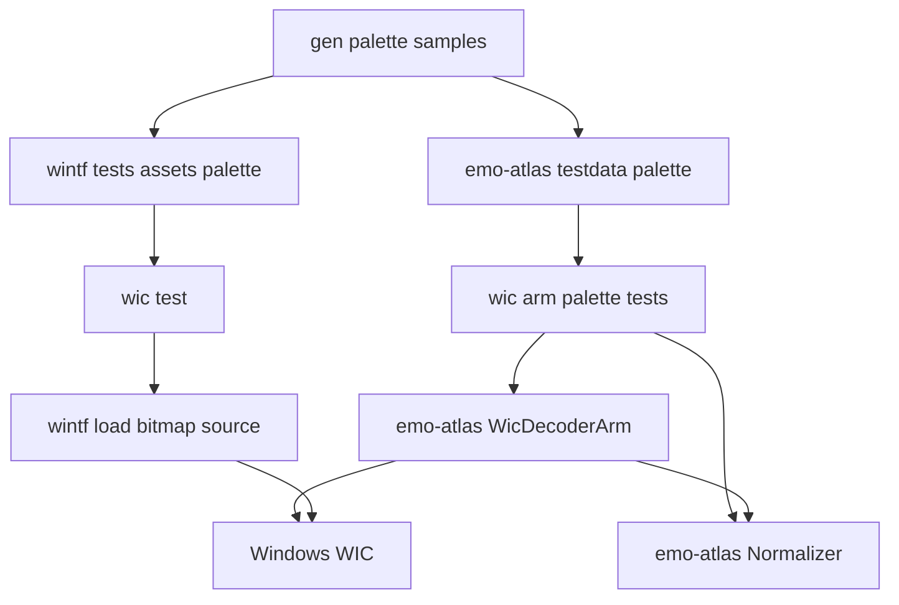
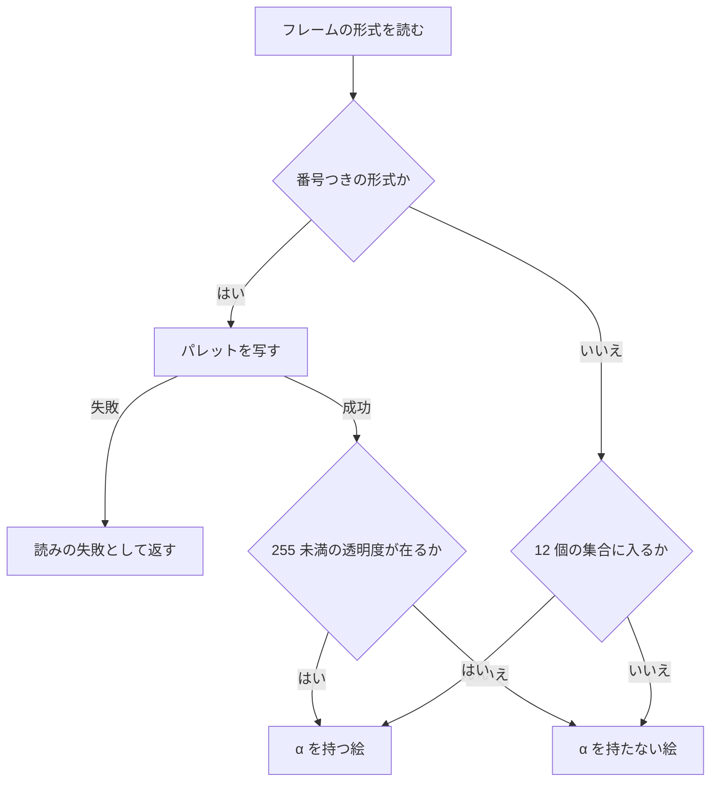

# 設計書: emo-atlas-palette-alpha

> 2026-10-31・本ブランチ（main `da020c10` の上）で、確定した `requirements.md`・`research.md`（ギャップ分析・§7 の要件の討議の決め・§9 の設計の段の調べ）と今のコードから組んだ。行番号はこの日の木のもの。実装の着手時に引き直すこと。

## Overview

**目的**: パレットの PNG に `tRNS` を付けて一部の番号だけを透明・半透明にした絵（と、同じ形で読まれる 8 ビット以下のグレーの PNG の `tRNS`・GIF の透明色）を、静止画の読み手が「α を持つ絵」として読むようにする。作者が透明にした番号だけが透け、左上の画素と同じ色の画素が抜き色で抜かれることも、`full` で透明の番号が不透明になることも無くなる。

**使う人**: シェルやバルーンの作者と、その絵を持つゴーストを areka で起こす利用者。wintf の絵の読み込みを使う開発者には、2 つの読み手が同じ絵について同じ「α の有無」を返すことを約束する。

**変わること**: 2 つの読み手（emo-atlas の WIC の腕・wintf の `load_bitmap_source`）の「読む前の α の有無」の判定に、「番号つきの形式なら、フレームのパレットに 255 未満の透明度が在るかで決める」分岐を 1 つ足す。正規化（`use_self_alpha` の読み替え）・抜き色・変換・動く絵の読み手は変えない。

### Goals

- 透明度を持つパレットの絵が、`use_self_alpha` の `1`／`true`・`full` で α の道を通る（要件 1）。
- 透明度を持たないパレットの絵・全部 255 のパレットの絵・パレットでない絵・`0`／宣言なしの働きは 1 バイトも変えない（要件 2）。
- 2 つの読み手の答えをそろえる（要件 3）。パレットが読めないときは推測せず失敗にする（要件 4）。
- 直す前に赤になる決定論のテストを、同じ検体で 2 つの crate に置く（要件 5）。
- `doc/COMPAT_ARCHITECTURE.md` §8 の 2 行を新しい前提に合わせる（要件 6）。

### Non-Goals

- 動く絵（APNG・動く WebP）の透明度の見分け（`image_arm.rs`・変更 0）。
- 抜き色の決め方・`.pna`・正規化の表（`normalize.rs` の本番のコード・変更 0）。
- パレットでない形式の 12 個の集合の見直し（例: `16bppBGRA5551` のような、集合に無い α つきの形式。要件 2.3 で今のまま）。
- wintf の `has_alpha` に本番の使い手を足すこと（`bitmap_source.rs:111` は `_has_alpha` で捨てたまま）。
- 焼き込みの全透明の判定と記録・合成・描画の層・完了 spec の文書。

## Boundary Commitments

### This Spec Owns

- **静止画の「α の有無」の判定のうち、番号つきの形式の枝**: emo-atlas の `decode/wic_arm.rs` と wintf の `com/wic.rs` の 2 か所。物差しは「フレームのパレットに透明度 255 未満の色が 1 つでも在るか」（WIC の `IWICPalette::HasAlpha` の定義そのもの）。
- **番号つきの形式の集合**: `GUID_WICPixelFormat{1,2,4,8}bppIndexed` の 4 個。この集合に入る形式だけがパレットを読む。
- **パレットの検体 6 本と、その作り手**: `crates/areka-emo-atlas/examples/gen_palette_samples.rs` が、同じバイト列を emo-atlas と wintf の 2 つの検体のフォルダへ書く。検体のバイト列の持ち主はこの作り手だけ。
- **赤のテスト**: emo-atlas の `decode/wic_arm_palette_tests.rs`、wintf の `tests/com/wic_test.rs` に足す分。
- **説明の書き直し**: emo2 の焼き込みのテストと golden の説明（要件 2.7）、正規化のテストの説明 2 か所（要件 2.8）、§8 の 2 行（要件 6）。

### Out of Boundary

- `normalize.rs` の本番のコード（`plan`・`apply`）。`has_alpha` が真になれば、要件 1.2〜1.4 は今の腕で満たされる。
- 抜き色の決め方（左上の 4 バイトの完全一致）・`use_self_alpha` の `0` と宣言なしの働き・`.pna`。
- 変換（PBGRA32 への `IWICFormatConverter`）とその引数。要件 3.4 の「画素を変えない」はこれを触らないことで守る。
- パレットでない形式の判定（12 個の集合）。
- 動く絵の読み手（`image_arm.rs`・`sniff.rs`）・`compose-f16-precision` が持つ変換の精度。
- emo2 の焼き込みのテストと golden の**判定の値**（失敗 0 件・原寸 382×547・`placement == None`・golden の 55 行）。
- 完了 spec の文書（`areka-P0-shell-implicit-surface` の要件 4.8 など）・§8 のほかの行。

### Allowed Dependencies

- `windows` 0.62.2 の今の機能だけ（`Win32_Graphics_Imaging` の `IWICImagingFactory::CreatePalette`・`IWICBitmapSource::CopyPalette`・`IWICPalette::HasAlpha`・`GUID_WICPixelFormat{1,2,4,8}bppIndexed`）。機能も依存も足さない。
- emo-atlas は wintf を参照しない（今のまま・判定は写しで持つ）。
- 作り手は std だけを使う（`image` も `png` も使わない）。
- テストの依存は今の dev-dependencies だけ（emo-atlas の `sample-ghost-kit`・wintf の `tests/com/common`）。

### Revalidation Triggers

- 2 つの判定のどちらかの形が変わる（集合の増減・パレットの読み方）→ もう片方と、2 つの crate のテストの期待値の表をそろえ直す。
- 作り手を走らせ直して検体のバイト列が変わる → 2 つのフォルダを同時に書き直したことを確かめる（作り手はいつも両方を書く）。
- `compose-f16-precision` が `wic_arm.rs` の変換を変える → 本 spec の判定（変換の前で決める）を取り込んでから設計する。
- `menu-thumbnail-preview` が同じ読み手でサムネイルを読む → 透明度を持つパレットの絵が α を持つ絵として届くことを前提にする。
- `crates/areka` の `placement/measure.rs` など `WicDecoderArm` の使い手 → `has_alpha` を直に読まないので形は変わらない。ただし透明度を持つパレットの絵の画素の扱い（抜き色→α）が変わる点は、焼き込みの結果として受け取る。

## Architecture

### Existing Architecture Analysis

- emo-atlas の WIC の腕は `decode_inner` で `CreateDecoderFromFilename → GetFrame(0) → GetPixelFormat → pixel_format_has_alpha → FormatConverter(PBGRA) → CopyPixels` の順に読む。`has_alpha` は変換の前のフレームの形式で決める（変換の後は必ず α つきになるため）。
- wintf の `load_bitmap_source` は同じ手順で、変換器の `IWICBitmapSource` と `has_alpha` を返す。emo-atlas の判定は wintf の判定の写しで、写しの理由（emo-atlas は wintf を参照できない）は `wic_arm.rs` 166〜169 行目の説明に在る。**この「写す」構造を保つ**（理由は下の「設計の決め」1）。
- `has_alpha` の本番の使い手は `normalize.rs` の `Normalizer::plan` の 2 行（`On if has_alpha`・`Full => !has_alpha`）だけ。焼き込み（`lib.rs` 133〜134 行目）は `plan` → `apply_to` をそのまま使う。
- 2026-10-31 に `windows` 0.62.2 から直に確かめた（research.md §9.1）: パレットの PNG（8・4 ビット）・8 ビットのグレーの PNG＋`tRNS`・GIF の透明色は、どれも変換前が `8bppIndexed` か `4bppIndexed` で、`HasAlpha` は透明度 255 未満の番号が在るときだけ真。番号つきでない絵のフレームに `CopyPalette` を呼ぶと `WINCODEC_ERR_PALETTEUNAVAILABLE`（`0x88982F45`）で失敗する。

### Architecture Pattern & Boundary Map



- **選んだ形**: 案 A（今の 2 つのファイルをそれぞれ広げる・写しを保つ）。判定はどちらのファイルでも同じ数行。
- **持ち場の分け方**: 判定は 2 つの読み手がそれぞれ持ち、同じ答えであることは「同じ作り手が書いた同じバイト列」と「2 つの crate のテストの同じ期待値の表」で見張る。
- **保つ形**: emo-atlas は wintf を参照しない・`windows` の WIC 型を直に使う・テストは兄弟のファイル・検体はコミットして作り手で作り直す（`testdata/animated/` と `gen_animated_samples.rs` の前例）。
- **新しく足すもの**: パレットを読む小さな関数（各 crate に 1 つ）・番号つきの形式の集合（各 crate に 1 つ）・作り手 1 つ・検体 6 本（2 か所）・emo-atlas のテストの兄弟 2 つ。
- **steering との合い方**: 外部クレートはそのまま使う・依存も機能も足さない・ログの無い失敗の道を作らない（`?` で今の失敗へつなぐ）・テストの本体を本番のファイルに書かない・テストは走る間にファイルを書かない。

### Technology Stack

| 層 | 選んだもの・版 | この spec での役目 | 備考 |
|---|---|---|---|
| 画像の読み | WIC（`windows` 0.62.2・`Win32_Graphics_Imaging`） | 番号つきの形式のフレームのパレットを写し、`HasAlpha` を聞く | 新しい機能・依存は無し |
| テストの検体 | std だけの作り手（example） | パレットの PNG・グレーの PNG・GIF を手で組んだバイト列で書く | zlib は無圧縮の 1 ブロック、CRC32 と Adler-32 は作り手の中の数行 |

## File Structure Plan

### Directory Structure

```
crates/areka-emo-atlas/
├── examples/
│   └── gen_palette_samples.rs        # 新規: 検体 6 本を 2 か所へ書く作り手（std だけ）
└── src/
    ├── decode/
    │   ├── wic_arm.rs                # 変更: 番号つきの枝・パレットを読む関数・テストの接続宣言 2 つ
    │   ├── wic_arm_test_support.rs   # 新規: 兄弟のテストが共有する with_arm（COM を張って腕を組む）
    │   ├── wic_arm_tests.rs          # 変更: with_arm を test_support から使う（中身は同じ）
    │   └── wic_arm_palette_tests.rs  # 新規: パレットの絵の判定・焼き込みの画素・失敗の道の檻
    └── testdata/
        └── palette/                  # 新規: 検体 6 本と README.md（作り直しの手順・中身の表）
crates/wintf/
├── src/com/wic.rs                    # 変更: 番号つきの枝・pub fn palette_has_alpha
└── tests/
    ├── assets/palette/               # 新規: emo-atlas と同じ検体 6 本（同じ作り手が書く）
    └── com/wic_test.rs               # 変更: 判定の表のテストと失敗の道のテストを足す
```

### Modified Files

- `crates/areka-emo-atlas/src/decode/wic_arm.rs` — `decode_inner` の `has_alpha` を「番号つきならパレット・それ以外は今の集合」にする。`INDEXED_FORMATS` と `palette_has_alpha` を足す。末尾に `#[cfg(test)] #[path = "wic_arm_test_support.rs"] mod test_support;` と `#[cfg(test)] #[path = "wic_arm_palette_tests.rs"] mod palette_tests;` を足す。モジュールと関数の説明の「変換前フレームのピクセルフォーマット由来の α 有無」を「…とパレット由来の」に直す。
- `crates/areka-emo-atlas/src/decode/wic_arm_tests.rs` — 自前の `with_arm` を消し、`super::test_support::with_arm` を使う（テストの中身は変えない）。structure.md の「テーマ間で共有するヘルパは `<stem>_test_support.rs` へ集約する」に従う。
- `crates/wintf/src/com/wic.rs` — `load_bitmap_source` の `has_alpha` に同じ枝を足す。`INDEXED_FORMATS`（非公開）と `pub fn palette_has_alpha` を足す。関数の説明の Returns を直す。
- `crates/wintf/tests/com/wic_test.rs` — 検体 6 本の `has_alpha` の表と、番号つきでない絵の `palette_has_alpha` が失敗することを足す。
- `crates/areka-emo-atlas/src/emo2_e2e.rs` — 説明 4 か所（80〜84・92〜93・168〜169・281〜282 行目）と定数名 `SHELL_KEY_COLOR_KEY` → `SHELL_NULL_PNG_KEY`（同じファイルの中の 9 か所だけ・値は同じ）（要件 2.7）。
- `crates/areka-emo-atlas/src/emo2_golden.rs` — 説明 2 か所（172〜173・200〜203 行目）（要件 2.7）。
- `crates/areka-emo-atlas/src/normalize_key_color_tests.rs` — 143〜145 行目の説明（要件 2.8）。
- `crates/areka-emo-atlas/src/normalize_rule_tests.rs` — 119〜120 行目の説明（要件 2.8）。
- `doc/COMPAT_ARCHITECTURE.md` — §8 の 273・274 行目（要件 6）。

新しいソースの本番のファイルは無い。触るファイルは roadmap の C14 の ④ の行（`wic_arm.rs`・`wic_arm_tests.rs`・wintf の `com/wic.rs`・`tests/com/wic_test.rs`・§8）に、新しい兄弟 2 つ・作り手・検体のフォルダ 2 つ・要件 2.7／2.8 の説明の 4 ファイルを足したもの。同じウェーブのほかの 6 本はどれも `crates/areka-emo-atlas/` と `crates/wintf/src/com/` に触らない。§8 はほかの spec も着地のときに行を足すが、本 spec は既存の 2 行をその場で書き直すだけなので、行の追加とは競合しない。

## System Flows



- 番号つきの形式かどうかを先に決め、パレットを読むのはその枝だけ。「どの形式でも `CopyPalette` を試し、`WINCODEC_ERR_PALETTEUNAVAILABLE` を『パレット無し』と読む」形は取らない（「読めなかった」と「無い」を失敗の種類で見分けることになり、要件 4 と合わない）。
- `HasAlpha` の失敗も読みの失敗にする。どちらの失敗も α の有無を推測で決めない。
- 判定の後の変換・正規化・抜き色は今のまま。

## Requirements Traceability

| 要件 | 中身 | 部品 | 契約 | 流れ |
|---|---|---|---|---|
| 1.1 | 透明度を持つパレットの絵を α を持つ絵に | WicArmJudgment | `palette_has_alpha` | 番号つきの枝 |
| 1.2 | `1`／`true` で左上を抜かず透明度 0 だけ透明 | WicArmJudgment・Normalizer（変更なし） | `Normalizer::plan` の `On if has_alpha` | 判定→正規化 |
| 1.3 | `full` で透明度 0 を透明のまま | WicArmJudgment・Normalizer（変更なし） | `Full => !has_alpha` | 判定→正規化 |
| 1.4 | 透明度 1〜254 は半透明のまま | WicArmJudgment・Normalizer（変更なし） | 同上 | 判定→正規化 |
| 1.5 | 桁によらない | INDEXED_FORMATS（1・2・4・8 ビット） | 集合 | 番号つきの枝 |
| 1.6 | 形式・元の色の型によらない | WicArmJudgment | WIC がグレーの `tRNS`・GIF もパレットで出す | 番号つきの枝 |
| 2.1 | 透明度を持たないパレットの絵は今のまま | WicArmJudgment | `HasAlpha` が偽 | 番号つきの枝 |
| 2.2 | 全部 255 は α を持たない | WicArmJudgment | `HasAlpha` が偽 | 番号つきの枝 |
| 2.3 | パレットでない形式は変えない | WicArmJudgment | 12 個の集合をそのまま残す | 番号つきでない枝 |
| 2.4 | `0` は今のまま | Normalizer（変更なし） | `plan` の `Off` は `has_alpha` を見ない | — |
| 2.5 | 宣言なしは今のまま | Normalizer（変更なし） | `plan` の `Undeclared` は `has_alpha` を見ない | — |
| 2.6 | emo2 の結果が同じ | 既存の emo2 のテスト 4 本 | 値を変えない | — |
| 2.7 | emo2 のテストと golden の説明 | Emo2TestDocs | 説明・定数名だけ | — |
| 2.8 | 正規化のテストの説明 | NormalizeTestDocs | 説明だけ | — |
| 3.1 | wintf が「有り」を返す | WintfJudgment | `load_bitmap_source` の 2 つ目の戻り値 | 番号つきの枝 |
| 3.2 | wintf が「無し」を返す | WintfJudgment | 同上 | 番号つきの枝 |
| 3.3 | wintf のパレットでない形式は変えない | WintfJudgment | 12 個の集合をそのまま残す | 番号つきでない枝 |
| 3.4 | wintf の画素を変えない | WintfJudgment | 変換器とその引数を触らない | — |
| 3.5 | 2 つの読み手が同じ答え | PaletteSamples・AtlasPaletteTests・WintfPaletteTests | 同じバイト列・同じ期待値の表 | — |
| 4.1 | emo-atlas はパレットが読めなければ失敗 | WicArmJudgment | `?` → `DecodeError::Decode { path }` | 失敗の枝 |
| 4.2 | wintf はパレットが読めなければ失敗 | WintfJudgment | `?` → `Err` | 失敗の枝 |
| 5.1 | `1`／`true` の赤のテスト | AtlasPaletteTests | 読み戻した画素 | — |
| 5.2 | `full` の赤のテスト | AtlasPaletteTests | 読み戻した画素 | — |
| 5.3 | 透明度を持たない・全部 255 の緑のテスト | AtlasPaletteTests | 読み戻した画素 | — |
| 5.4 | 8 ビットと 4 ビットの検体 | PaletteSamples | `idx8_mixed.png`・`idx4_mixed.png` | — |
| 5.5 | wintf の判定のテスト | WintfPaletteTests | `has_alpha` の表 | — |
| 5.6 | 決定論・GPU 不要・全体テストで毎回 | AtlasPaletteTests・WintfPaletteTests | WIC は CPU だけ・`#[ignore]` なし | — |
| 5.7 | 検体はコミット＋作り直しの手順・走る間に書かない | PaletteSamples | 作り手と README | — |
| 5.8 | グレーの PNG と GIF の赤のテスト | PaletteSamples・AtlasPaletteTests | `gray8_trns.png`・`trans.gif` | — |
| 6.1 | §8 の 273 行目の書き直し | CompatDocRows | 下の「§8 の書き直し」 | — |
| 6.2 | §8 の 274 行目の言い回し | CompatDocRows | 同上 | — |
| 6.3 | §8 のほかの行と完了 spec の文書を変えない | CompatDocRows | 2 行だけ | — |

## Components and Interfaces

| 部品 | 層 | 役目 | 要件 | 主な依存 | 契約 |
|---|---|---|---|---|---|
| WicArmJudgment | emo-atlas の読み手 | 番号つきの形式でパレットを見て `has_alpha` を決める | 1.1, 1.5, 1.6, 2.1, 2.2, 2.3, 4.1 | WIC（P0） | Service |
| WintfJudgment | wintf の COM 層 | 同じ判定の写し・`palette_has_alpha` を公開 | 3.1, 3.2, 3.3, 3.4, 4.2 | WIC（P0） | Service |
| PaletteSamples | テストの検体 | 6 本の検体を 2 か所へ同じバイト列で書く | 3.5, 5.4, 5.7, 5.8 | std（P2） | Batch |
| AtlasPaletteTests | emo-atlas のテスト | 判定・焼き込みの画素・失敗の道の檻 | 1.2〜1.6, 2.1, 2.2, 3.5, 4.1, 5.1〜5.4, 5.6, 5.8 | WicArmJudgment（P0）・Normalizer（P0） | — |
| WintfPaletteTests | wintf のテスト | 判定の表と失敗の道の檻 | 3.1, 3.2, 3.5, 4.2, 5.5, 5.6 | WintfJudgment（P0） | — |
| Emo2TestDocs | emo-atlas のテストの説明 | `null.png` の説明を事実に合わせる | 2.6, 2.7 | — | — |
| NormalizeTestDocs | emo-atlas のテストの説明 | 正規化のテストの説明の前提を直す | 2.8 | — | — |
| CompatDocRows | 文書 | §8 の 2 行の書き直し | 6.1, 6.2, 6.3 | — | — |

部品とファイル: WicArmJudgment＝`crates/areka-emo-atlas/src/decode/wic_arm.rs`・WintfJudgment＝`crates/wintf/src/com/wic.rs`・PaletteSamples＝`crates/areka-emo-atlas/examples/gen_palette_samples.rs` と 2 つの検体のフォルダ・AtlasPaletteTests＝`crates/areka-emo-atlas/src/decode/wic_arm_palette_tests.rs`（共有の `wic_arm_test_support.rs`）・WintfPaletteTests＝`crates/wintf/tests/com/wic_test.rs`・Emo2TestDocs＝`emo2_e2e.rs`・`emo2_golden.rs`・NormalizeTestDocs＝`normalize_key_color_tests.rs`・`normalize_rule_tests.rs`・CompatDocRows＝`doc/COMPAT_ARCHITECTURE.md`。

Normalizer（`normalize.rs`）は変えない。2.4・2.5・1.2〜1.4 は「`has_alpha` が正しくなれば今の `plan` がそのまま満たす」ことで満たす。

### 画像の読み手

#### WicArmJudgment（`crates/areka-emo-atlas/src/decode/wic_arm.rs`）

| 項目 | 中身 |
|---|---|
| 役目 | 静止画の `DecodedImage::has_alpha` を、番号つきの形式ではパレットで、それ以外は今の集合で決める |
| 要件 | 1.1, 1.5, 1.6, 2.1, 2.2, 2.3, 4.1 |

**責務と決まり**

- 番号つきの形式（`INDEXED_FORMATS` の 4 個）のときだけ `palette_has_alpha` を呼ぶ。それ以外は今の `pixel_format_has_alpha`（12 個の集合）をそのまま使う。
- `palette_has_alpha` の失敗は `?` で `decode_inner` から返し、今の `decode` の `map_err` で `DecodeError::Decode { path, source }` になる。推測の既定値（偽）へ落とさない。
- 変換（`CreateFormatConverter`・`Initialize` の引数）は触らない。

**依存**

- 外向き: WIC の `IWICImagingFactory::CreatePalette`・`IWICBitmapSource::CopyPalette`・`IWICPalette::HasAlpha`（P0）。
- 内向き: `ElementDecoder::decode` の使い手（焼き込み・`crates/areka` の配置の測り）。形は変わらない。

**Contracts**: Service [x]

##### Service Interface

```rust
/// 番号つきの形式（1・2・4・8 ビット）。この集合に入る形式だけパレットを読む。
const INDEXED_FORMATS: &[GUID] = &[
    GUID_WICPixelFormat1bppIndexed,
    GUID_WICPixelFormat2bppIndexed,
    GUID_WICPixelFormat4bppIndexed,
    GUID_WICPixelFormat8bppIndexed,
];

/// フレームのパレットに透明度 255 未満の色が 1 つでも在るか（`IWICPalette::HasAlpha`）。
/// パレットを作れない・写せない・聞けないときは WIC のエラーをそのまま返す。
fn palette_has_alpha(
    factory: &IWICImagingFactory2,
    source: &IWICBitmapSource,
) -> windows::core::Result<bool>;

// decode_inner の中（今の 79 行目を置き換える）
let has_alpha = if INDEXED_FORMATS.contains(&pre_format) {
    palette_has_alpha(&self.factory, &frame)?
} else {
    pixel_format_has_alpha(&pre_format)
};
```

- 事前条件: 呼び出しのスレッドで COM が初期化済み（今の `WicDecoderArm` と同じ）。
- 事後条件: 番号つきの形式では、戻り値はパレットの透明度だけで決まり、画素は見ない。番号つきでない形式の答えは今と同じ。
- 不変: `pixel_format_has_alpha` の 12 個の集合は変えない。GUID の比べ方は今と同じ集合の `.contains()`（`non_upper_case_globals` の警告を避ける今の理由のまま）。

**実装の注意**

- 結合: `frame`（`IWICBitmapFrameDecode`）は `IWICBitmapSource` へ参照外しで渡る。`factory` は `self.factory`（`IWICImagingFactory2` は `IWICImagingFactory` の `CreatePalette` を持つ）。
- 確かめ: AtlasPaletteTests の判定の表と失敗の道のテスト。
- 危険: 1 枚の絵ごとにパレット 1 つ（256 色以下）を作って写すだけで、重さは変わらない。

#### WintfJudgment（`crates/wintf/src/com/wic.rs`）

| 項目 | 中身 |
|---|---|
| 役目 | `load_bitmap_source` の 2 つ目の戻り値に同じ判定を写す |
| 要件 | 3.1, 3.2, 3.3, 3.4, 4.2 |

**責務と決まり**

- WicArmJudgment と同じ枝・同じ集合・同じ失敗の扱い。違いは `palette_has_alpha` を `pub` にすること（wintf のテストは `tests/` の結合テストで、非公開の関数を呼べないため。要件 4.2 の失敗の道を決定論で檻に入れるのに要る）。
- 変換器とその引数は触らない（要件 3.4）。戻り値の型 `Result<(IWICBitmapSource, bool)>` は変えない。

**Contracts**: Service [x]

##### Service Interface

```rust
/// フレームのパレットに透明度 255 未満の色が 1 つでも在るか（`IWICPalette::HasAlpha`）。
/// `load_bitmap_source` が番号つきの形式のときに使う。パレットを持たない絵では
/// WIC のエラー（`WINCODEC_ERR_PALETTEUNAVAILABLE`）をそのまま返す。
pub fn palette_has_alpha(
    factory: &IWICImagingFactory2,
    source: &IWICBitmapSource,
) -> Result<bool>;
```

- `INDEXED_FORMATS` は非公開（emo-atlas と同じ 4 個）。`load_bitmap_source` の今の 51 行目を emo-atlas と同じ形の `if` に置き換える。
- 呼び出しの書き方は今の `frame.GetPixelFormat()` と同じく `unsafe` の直の呼び出しにする（新しい Ext トレイトは足さない）。

### テストの検体

#### PaletteSamples（`crates/areka-emo-atlas/examples/gen_palette_samples.rs`）

| 項目 | 中身 |
|---|---|
| 役目 | 6 本の検体のバイト列を組み、2 つのフォルダへ同じものを書く |
| 要件 | 3.5, 5.4, 5.7, 5.8 |

**Contracts**: Batch [x]

##### Batch / Job Contract

- 起動: 人が `cargo run -p areka-emo-atlas --example gen_palette_samples` を走らせたときだけ（テストからは走らせない）。
- 入力: 無し（中身は作り手の中に書く）。
- 出力: `crates/areka-emo-atlas/src/testdata/palette/` と `crates/wintf/tests/assets/palette/` の 2 か所へ、下の表の 6 本を同じバイト列で書く。フォルダが無ければ作り、在れば上書きする。書き先は `CARGO_MANIFEST_DIR` からの相対で組む（作業木の中だけ）。
- 冪等: 圧縮しない（zlib の無圧縮の 1 ブロック）ので、何度走らせても、どの版の Rust でも同じバイト列になる。
- 作り方: PNG は `IHDR`・`PLTE`（パレットのときだけ）・`tRNS`（在るときだけ）・`IDAT`・`IEND` を手で組む。`IDAT` は行ごとにフィルタ 0 を付けた生の行を、zlib の見出し `78 01`・無圧縮の最後のブロック・Adler-32 で包む。CRC32 は作り手の中の数行（`gen_animated_samples.rs` の `crc32` と同じ形）。GIF は GIF89a・大域の色の表 4 色・図形の制御の拡張で透明の番号 1・LZW は最小の符号の長さ 2 で、符号ごとに消去の符号を挟んで 3 ビットのまま書く。
- README: `src/testdata/palette/README.md` に、作り直しの手順・下の表・「第三者の著作物は 0 件」を書く。wintf のフォルダには README を置かず、`wic_test.rs` の説明から作り手を名指しする。

## Data Models

### 検体（6 本・どれも 2×2）

座標は (x, y)・左上が (0, 0)。「出る画素」は WIC が PBGRA32 へ変換した値（乗算済み・B, G, R, A の順）。2026-10-31 に `windows` 0.62.2 から読んで確かめた値（research.md §9.1）。

| ファイル | 中身 | 画素の番号・値 (0,0) (1,0) (0,1) (1,1) | 出る画素 | `has_alpha`（直す前 → 後） |
|---|---|---|---|---|
| `idx8_mixed.png` | 8 ビットのパレット。番号 0＝赤 透明度 255・1＝緑 透明度 0・2＝青 透明度 128（`tRNS` は `ff 00 80`） | 0, 0, 1, 2 | `0,0,255,255`・`0,0,255,255`・`0,0,0,0`・`128,0,0,128` | 偽 → **真** |
| `idx4_mixed.png` | 同じパレットの 4 ビット | 0, 0, 1, 2 | 同上 | 偽 → **真** |
| `idx8_plain.png` | 8 ビットのパレット（赤・緑・青）・`tRNS` 無し | 0, 0, 1, 1 | `0,0,255,255`×2・`0,255,0,255`×2 | 偽 → 偽 |
| `idx8_opaque_trns.png` | 同じパレット・`tRNS` は `ff ff ff` | 0, 0, 1, 1 | 同上 | 偽 → 偽 |
| `gray8_trns.png` | 8 ビットのグレー・`tRNS` で値 0 を透明 | 255, 255, 0, 128 | `255,255,255,255`×2・`0,0,0,0`・`128,128,128,255` | 偽 → **真** |
| `trans.gif` | GIF89a・色の表 4 色（赤・緑・青・白）・透明の番号 1 | 0, 0, 1, 2 | `0,0,255,255`×2・`0,0,0,0`・`255,0,0,255` | 偽 → **真** |

- どの検体も、左上の画素が不透明で、同じ色の画素が (1,0) に在る。だから抜き色の道を通ると (1,0) も抜かれ、α の道との違いが 1 画素で読める。
- `idx8_mixed`・`idx4_mixed` は透明度 0 と 128 の番号を持つ（要件 5.1・5.4）。番号 3 種を持てない 1 ビットは作らない（要件 5.4 の但し書き）。

### 焼き込みの画素の期待値（`Normalizer` に通した後）

| 検体 | `On`（`1`／`true`） | `Full` | 直す前の `On` | 直す前の `Full` |
|---|---|---|---|---|
| `idx8_mixed`・`idx4_mixed` | 出る画素のまま | 出る画素のまま | (0,0)・(1,0) が `0,0,0,0`（赤） | (0,1) が `0,0,0,255`・(1,1) が `128,0,0,255`（赤） |
| `idx8_plain`・`idx8_opaque_trns` | (0,0)・(1,0) が `0,0,0,0`、下の行は緑のまま | 全部 α 255（出る画素のまま） | 同じ（緑） | 同じ（緑） |
| `gray8_trns` | 出る画素のまま | — | (0,0)・(1,0) が `0,0,0,0`（赤） | — |
| `trans.gif` | 出る画素のまま | — | (0,0)・(1,0) が `0,0,0,0`（赤） | — |

## Error Handling

### Error Strategy

- 新しい失敗の種類は作らない。パレットの読み（`CreatePalette`・`CopyPalette`・`HasAlpha`）の失敗は、今の WIC の失敗と同じ道を通る。
  - emo-atlas: `decode_inner` の `?` → `decode` の `map_err` → `DecodeError::Decode { path, source }`。焼き込みは今の読みの失敗と同じく、パス付きの失敗として結果の失敗の一覧に載り、今と同じ記録に出る（要件 4.1）。
  - wintf: `load_bitmap_source` の `?` → `Err`。使い手（`bitmap_source.rs`）の今の失敗の扱いのまま（要件 4.2）。
- `unwrap_or(false)`・`.ok()`・`unwrap` で失敗を「α を持たない」に読み替えることはしない（ログの無い失敗の道を作らない）。

### Monitoring

- 記録の行は足さない。失敗は今の `DecodeError::Decode` の記録にそのまま載る。

## Testing Strategy

### 赤を先に立てる順

1. 作り手と検体 6 本（2 か所）をコミットし、AtlasPaletteTests と WintfPaletteTests を足す。
2. 直す前に走らせ、下の「直す前に赤」の印のテストが赤になることを確かめて記録する（要件 5.1・5.2・5.5・5.8）。
3. 2 つの判定を直して緑にする。

### Unit Tests（emo-atlas・`decode/wic_arm_palette_tests.rs`・`with_arm` で COM を張る）

- **判定の表**（要件 1.1・1.5・1.6・2.1・2.2・3.5）: 6 本の検体を `WicDecoderArm::decode` で読み、`has_alpha` が上の表の「後」と一致する（真 4 本・偽 2 本）。真の 4 本は直す前に赤。
- **`On` の画素**（要件 1.2・1.4・5.1・5.4・5.8）: `idx8_mixed`・`idx4_mixed`・`gray8_trns`・`trans.gif` を読み、`Normalizer.normalize(img, AlphaParams { use_self_alpha: UseSelfAlpha::On })` の `pbgra` が出る画素のまま（左上と同じ色の (1,0) が不透明のまま・透明の番号が `0,0,0,0`・半透明の番号が `128,0,0,128`）。直す前に赤。
- **`Full` の画素**（要件 1.3・1.4・5.2）: `idx8_mixed`・`idx4_mixed` を `UseSelfAlpha::Full` で通し、(0,1) が `0,0,0,0`・(1,1) が `128,0,0,128` のまま。直す前に赤。
- **透明度を持たない絵は今のまま**（要件 2.1・2.2・5.3）: `idx8_plain`・`idx8_opaque_trns` を `On` で通し、(0,0)・(1,0) が `0,0,0,0`・下の行が `0,255,0,255` のまま。直す前も後も緑。
- **失敗の道**（要件 4.1）: 番号つきでない絵（emo2 の `online0.png`・`crate::sample_test_support::emo2_balloon_root()` から引く）のフレームを `arm.factory` で開き、`palette_has_alpha` が `Err`（コードは `WINCODEC_ERR_PALETTEUNAVAILABLE`）を返す。関数がパレットの読めない絵で偽を推測しないことを決定論で示す。`?` から `DecodeError::Decode { path }` へつながる所は、今の `non_image_file_yields_decode_error` が既に檻に入れている。
- 検体のパスは `CARGO_MANIFEST_DIR` の下の `src/testdata/palette/`（`wic_arm_tests.rs` の `sample` と同じ組み方）。テストは走る間にファイルを書かない。

### Integration Tests（wintf・`tests/com/wic_test.rs`）

- **判定の表**（要件 3.1・3.2・3.5・5.5）: 6 本の検体を `load_bitmap_source` で読み、2 つ目の戻り値が emo-atlas と同じ表（真 4 本・偽 2 本）と一致する。真の 4 本は直す前に赤（要件 5.5 の「1. と 8. の検体」）。
- **失敗の道**（要件 4.2）: 今の `decode_first_frame("test_8x8_rgba.png")` のフレームで `palette_has_alpha` が `Err` を返す。
- **パレットでない絵は今のまま**（要件 3.3）: 今の `bitmap_source_integration_test.rs` の `test_has_alpha_true_for_rgba_png`・`test_has_alpha_false_for_rgb_bmp` がそのまま緑であること（足さない）。
- 要件 3.4（画素を変えない）は、変換器とその引数の行が差分に現れないことで示す（静的な証跡）。

### 今のテストのままで確かめるもの（値を変えない）

- 要件 2.6: `emo2_shell_all_elements_baked`・`emo2_null_png_logs_debug_not_warn`・`emo2_balloon_same_bake_path_as_shell`（`emo2_e2e.rs`）と `emo2_shell_matches_golden`（`emo2_golden.rs`）が値を変えずに緑。`null.png` は直した後 `has_alpha` が真になり α の道を通るが、全画素が `0,0,0,0` なので出力は 1 バイトも同じ（research.md §2.2）。`crates/areka` の配置の golden も変わらない。
- 要件 2.4・2.5: `normalize_rule_tests.rs`・`normalize_key_color_tests.rs` が中身を変えずに緑（`plan` の `Off`・`Undeclared` は `has_alpha` を見ない）。
- 要件 5.6: どのテストも `#[ignore]` を付けず、GPU・実機・人の操作・排他の机を要らない（WIC は CPU だけ）。全体テストで毎回走る。

## 設計の決め（research.md §7 の持ち越しの答え）

1. **写しを保つ（案 A）**: 判定は 10 行前後で、葉の crate を足して 1 か所に寄せる（案 B）と依存の線と責務が増え、今の「emo-atlas は wintf を参照しない・同じ判定を写す」決めを覆す。釣り合わないので採らない。2 つが同じ答えであることはテストで見張る（決め 5）。
2. **判定の形**: 番号つきの 4 個の集合で入口を決め、その枝でだけパレットを読む（System Flows のとおり）。どの形式でもパレットを試す形は採らない（要件 4 と合わない）。
3. **検体の置き場と作り手の在処**: 検体はコミットし、作り手は emo-atlas の example 1 つ（`testdata/animated/` と `gen_animated_samples.rs` の前例）。作り手は std だけで、2 つの crate のフォルダへ同じバイト列を書く。テストの中でバイト列を組む形は、組み手を 2 つの crate に写すことになり（互いに参照できない）、写しの食い違いを生む余地が増えるので採らない。テスト専用の葉（`sample-ghost-kit`）に組み手を置く形は、その葉の役目（検体ゴースト／バルーンを名前で引く窓口）と違い、wintf に依存の行を足すことになるので採らない。テストが走る間にはファイルを書かない（要件 5.7）。
4. **要件 4 の失敗の道の檻**: 本物の WIC で、番号つきでない絵のフレームに `CopyPalette` を呼ぶと必ず `WINCODEC_ERR_PALETTEUNAVAILABLE` で失敗する（2026-10-31 に `windows` 0.62.2 で確かめた）。これを使い、`palette_has_alpha` が失敗を返すことを決定論で檻に入れる。emo-atlas では子のテストのモジュールから非公開の関数を呼ぶ。wintf では関数を `pub` にして結合テストから呼ぶ。
5. **要件 3.5 の確かめ方**: 同じ作り手が書いた同じバイト列を、2 つの crate のテストが同じ期待値の表で読む。両方に依存する `crates/areka` に突き合わせのテストを置く形は、触るファイルが本 spec の範囲の外へ広がるので採らない。
6. **emo-atlas のテストのファイル**: 新しい兄弟 `wic_arm_palette_tests.rs`（動く絵の檻の `wic_arm_tests.rs` とはテーマが違う）。共有する `with_arm` は structure.md の決まりどおり `wic_arm_test_support.rs` へ移す。焼き込みの画素は `WicDecoderArm`＋`Normalizer` で読む（焼き込みの本番は `lib.rs` で同じ `plan`→`apply_to` を通る）ので、読み手の兄弟に置く。wintf は roadmap が名指しした `tests/com/wic_test.rs`（`decode_first_frame` が手元に在る）。
7. **要件 2.8 の書き直しの中身**: `normalize_key_color_tests.rs` の `trns_like_semi_transparent_pixels_survive` の説明は「パレット＋`tRNS` の絵は、抜き色の腕へ α の掛かった画素として届く」を「読み手が α を持たないとした絵に α<255 の画素が混じって届いた場合の備え（パレットの番号ごとの透明度を持つ絵は、本 spec の後は `has_alpha` が真で、この腕へ来ない）」に直す。`normalize_rule_tests.rs` の `row4_full_without_alpha_flag_forces_translucent_pixels_opaque` の説明は「（パレットの PNG の透明の情報など）」を「（WIC の静止画の読み手からは、パレットの番号ごとの透明度を持つ絵はこの形で来ない。正規化器の単体の備え）」に直す。テストの名前・中身・期待値は変えない。
8. **要件 2.7 の書き直しの中身**: `emo2_e2e.rs`・`emo2_golden.rs` の「α チャンネルを持たない」「α 無し」「左上の色を抜く」「抜き色の腕を通って」を、「番号ごとの透明度を持つパレットの絵（番号 1 が透明度 0）として α の道を通り、全画素が透明」に直す。golden の説明の「抜き色の腕の追加によって 1 文字も変わらない（R5.4）」は残す（完了 spec の決めの記録で、本 spec の事実と食い違わない）。定数名 `SHELL_KEY_COLOR_KEY` は「抜き色の絵」を名乗るので `SHELL_NULL_PNG_KEY` に改める（値と使い方は同じ）。
9. **§8 の 274 行目の言い換え（要件 6.2）**: 決め（復号した後の 4 バイトの完全一致）は変えず、`tRNS` に触れた 2 か所だけを直す（下の「§8 の書き直し」）。
10. **wintf の `has_alpha` に本番の使い手が無いこと**: 本 spec は答えをそろえるだけで、wintf の本番の見た目は変わらない。要件 3 は檻で満たし、使い手は足さない（範囲外）。

## §8 の書き直し（要件 6・実装の着地のときに書く）

**273 行目（同じ位置で置き換える）**

- 項目: 「**パレット形式で番号ごとの透明度を持つ絵を α を持つ絵とするか**（正典が `use_self_alpha` で「透明度のある画像」と名指しするのは「アルファチャンネル付きPNG」だけで、パレットの `tRNS` には沈黙）」
- 裁量: 「**する**。番号の透明度が 1 つでも 255 未満なら α を持つ絵とし、`1`／`true`・`full` では抜き色の道へ来ない。全部 255（`tRNS` が無いものを含む）なら α を持たない絵のまま。番号の桁（1・2・4・8 ビット）によらず、8 ビット以下のグレーの PNG の `tRNS` と GIF の透明色も同じ物差し（WIC がどれも番号つきの形式とパレットで出す）」
- 根拠: 「⑴ 正典は `1`／`true` で α を使う絵を『透明度のある画像』と書き、番号ごとの透明度を持つ絵はそれに当たる ⑵ areka の原則（α 付きの絵を正しく使うのが原則・抜き色は譲歩）。抜き色で扱うと、左上が不透明の番号のとき作者が透明にしていない同じ色の画素まで抜け、`full` では透明の番号が不透明になる ⑶ 全部 255 を α を持たない絵のままにするのは、透明な所を持たない絵の抜き色の出方を守るため。動く絵の読み手（APNG）は『`tRNS` が在れば全部 255 でも α を持つ絵』とし（§8 の動く絵の節）、物差しが違う。動く絵の扱いは変えていない（記録だけ） ⑷ 検体でこの形の絵は `emo2` の `purple/a/null.png` の 1 枚だけで、全画素が透明の番号ゆえ結果は前と同じ（全画素が透明）。完了 `areka-P0-shell-implicit-surface` の要件 4.8 の決め（抜き色で扱うときに `tRNS` の透明度を生かす）を本 spec で置き換えた」
- 出典 spec: 「emo-atlas-palette-alpha（完了 areka-P0-shell-implicit-surface の要件 4.8 を置き換え）」

**274 行目（項目・決めの中身・出典は変えない）**

- 裁量の欄の「α も比較に入るため、`tRNS` で α が異なる画素は左上と色が同じでも別の画素として残る」を「α も比較に入るため、α を持たないとされた絵に α の異なる画素が混じって届いても、左上と色が同じだけの画素は別の画素として残る」に直す。
- 根拠の欄の「α を比較に入れるのは上の `tRNS` の裁量（透明度を生かす）と同じ帰結で、3 成分だけで比べると左上が完全透明のときに黒寄りの不透明な画素まで消えてしまう」を「α も比べるのは、α を持たないとされた絵に α<255 の画素が混じって届いた場合の備えで、3 成分だけで比べると左上が完全透明のときに黒寄りの不透明な画素まで消えてしまう（パレットの番号ごとの透明度を持つ絵は、上の行のとおり `1`／`true` で抜き色の腕へ来ない）」に直す。

§8 のほかの行（動く絵の節の「透明度を持つかの見分け」を含む）と、完了 spec の文書は変えない（要件 6.3）。
