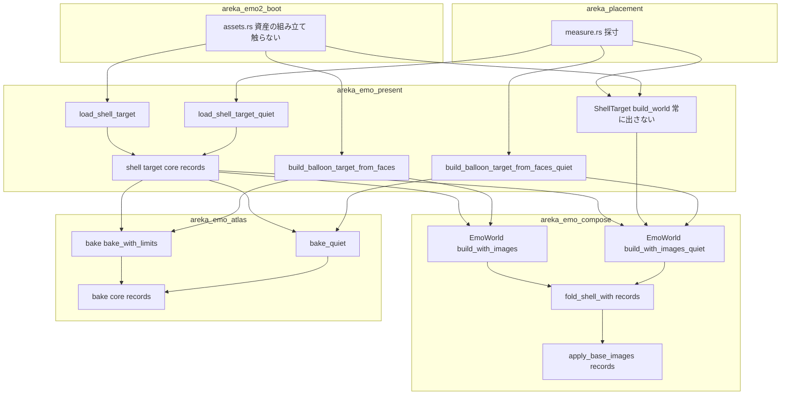
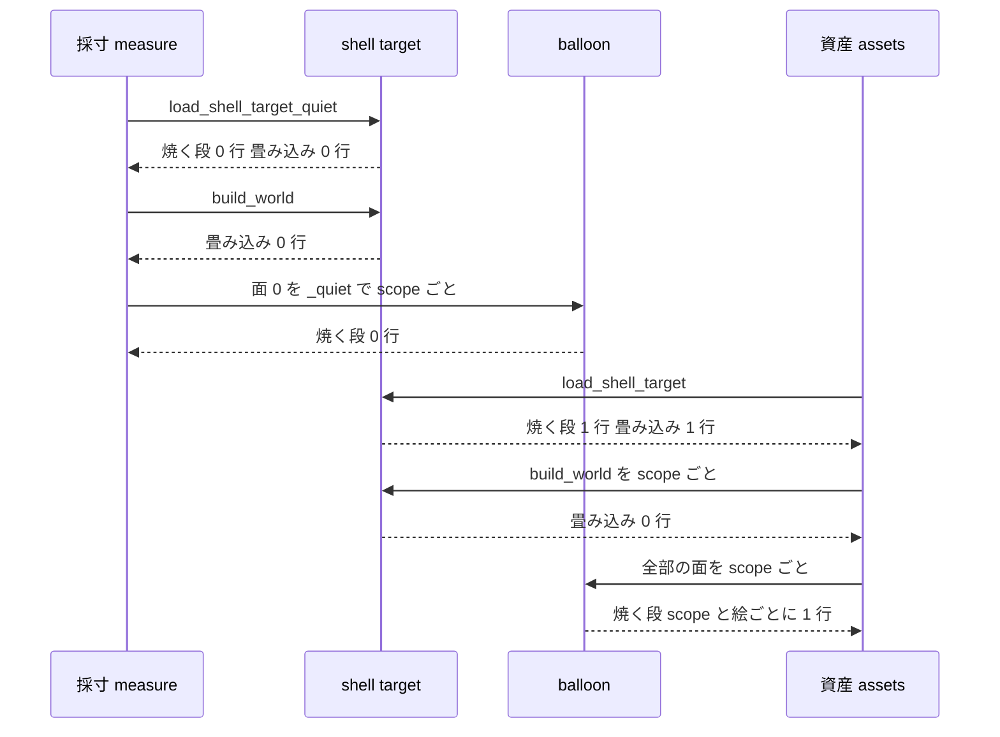

# Design Document: emo-bake-log-overlap

> 2026-11-01・本ブランチ（main `9604677a` の上の `50b60c63`）でコードを読み直して書いた。行番号はこの時点のもの。
> 直し方は要件討議で決めた案 1（記録を出さない口を足し、採寸の道だけ黙らせる・焼く回数は今のまま）である。設計の段で決めた 4 点（`research.md` 6 節の 3・4・8・9）は末尾の「決めごと」にまとめた。

## Overview

**Purpose**: 起動の準備（採寸 → 資産の組み立て）で、焼く段と面の表を組む段の記録が、同じ絵・同じ件について 1 行ずつ出るようにする。起動の記録を読む人と記録を数える道具が、警告の数をそのまま問題の数として数えられるようにする。

**Users**: 起動の記録を読んで判定をする開発者・ゴーストの作者と、起動の記録の行を数える自動の試験と道具。

**Impact**: 焼く段（`areka-emo-atlas`）・面の表を組む段（`areka-emo-compose`）・バルーンの組み立て（`areka-emo-present` の `balloon.rs`）に「記録を出さない兄弟の入口」を 1 つずつ足し、採寸の道と面の表の組み直し（`ShellTarget::build_world`）だけをそちらへ付け替える。記録の水準・文言・欄、焼く回数、起動の結果は変えない。

### Goals

- 起動 1 回（と読み込み直し 1 回）で、焼く段の記録をシェルでは絵ごとに 1 行、バルーンでは scope と絵ごとに 1 行にする（要件 1）。
- 起動 1 回（と読み込み直し 1 回）で、面の表を組む段の記録を、scope の数によらず 1 件 1 行にする（要件 2）。
- 1 枚目が全透明の動く絵で、採寸の道だけに出ていた「全透明」の警告を 0 行にする（要件 1.5）。
- 起動を止める失敗の記録と、焼く段の前提の崩れの `error!` は、どの道でも必ず出す（要件 1.7・3.5）。
- 行の数を決定論のテストで固定する（要件 6）。

### Non-Goals

- 焼く回数・面の表を組む回数を減らすこと（案 2・要件討議の決定 1）。
- バルーンの 2 層マージの記録（例外 2・要件 5）。口も今は入れない（要件討議の決定 5）。
- scope をまたいで同じバルーンの絵の行を 1 行にすること（要件討議の決定 4）。
- 装着（`bind_atlas`）・合成（compose）・アニメーションの表（`AnimationTable::from_world`）の記録。どれも面の表を組む段ではない。
- 着替えの道の行の数を変えること（今より増やさないことだけを守る・要件 4.1）。

## Boundary Commitments

### This Spec Owns

- 焼く段の記録を出さない入口 `areka_emo_atlas::bake_quiet` と、その中で黙らせる行の範囲（`lib.rs` の `bake_with_limits` の繰り返しの中の 4 本＝抜き色の `debug!`・元画像が 0 寸の `warn!`・着せ替えの「無し」の絵の `debug!`・全透明の `warn!`）。
- 面の表を組む段の記録を出さない入口 `EmoWorld::build_with_images_quiet` と、その中で黙らせる行の範囲（`fold.rs` の全部の記録＝`warn!` 9 本と `debug!` 1 本、`base_image.rs` の `warn!` 1 本）。
- バルーンの組み立ての記録を出さない入口 `build_balloon_target_from_faces_quiet`。
- `ShellTarget` の記録の約束の書き換え: 読み込み（`load_shell_target_with`）が `records` を核まで通す。`ShellTarget::build_world` はいつも記録を出さない組み方を使う。
- 採寸（`measure.rs`）がバルーンの面 0 を記録を出さない入口で組むこと。
- 起動の準備 1 回の行の数を固定する決定論のテストと、例外 1 を固定していたテストの書き直し。

### Out of Boundary

- `crates/areka/src/placement/mod.rs`・`crates/areka/src/ghost_session.rs`・`crates/areka/src/emo2_boot/assets.rs`（ウェーブ C15 の約束・触らない）。
- `areka-emo-atlas` の `animated.rs`・`bake.rs`・`pack.rs`（触らない）。動く絵の 3 本の `warn!` は、採寸の読み手 `FirstFrameDecoder` が動く絵の道に入らせないので採寸の道では起きない。`bake.rs`・`pack.rs` の `error!` は前提の崩れの記録で、いつも出す（要件 1.7）。
- `areka-emo-compose` の `boxes.rs`（箱の表を組む `fold_boxes`）。中で `expand_targets` の「知らない追記の記述」の `warn!` を通るが、今のパーサーの型の全部の種類は手前の枝で受けるので通らない。面の表を組む段でもない。今のまま出す。
- `areka-emo-compose` の `atlas_bind.rs`（装着の `debug!`）・`method.rs`・`scale.rs`・`blit*.rs`・`bind_steps.rs`（合成のときの記録）。
- `areka-emo-present` の `load_records.rs`（`LoadRecords` の形を変えない）・`balloon_definitions.rs` ほか 2 層マージの道。
- 着替えの道（`emo2_boot/switch_assets.rs`）・面の書き出し（`offline_dump`・MCP）・examples。呼ぶ入口は今のまま（記録を出す入口）である。
- 2 層マージの重なりの起票（要件 5.2）は完了の手順（`/kiro-complete` の棚卸）が行う。本設計はその申し送りの中身だけを持つ（下の「完了の棚卸への申し送り」）。

### Allowed Dependencies

- 依存の向きは今のまま: `areka-emo-atlas` ← `areka-emo-compose` ← `areka-emo-present` ← `areka`（`placement`）。下のクレートは上のクレートの型（`LoadRecords` など）を知らない。
- 新しい外のクレートは足さない（`Cargo.toml` を変えない）。
- テストは今ある道具だけを使う: `log_capture_kit::capture`・各クレートの `capture_events`／`capture_logs`・`MemoryDecoder`（`insert`・`insert_animated`・`insert_corrupt`）・`temp_path_kit::TempPath::under_target`。
- `placement` は examples から `#[path]` で読まれるので、本番のファイル（`measure.rs`・`measure_first_frame.rs`）で `crate::` を使わない。
- 1 ファイル 1,000 行以下。`shell_target.rs`（917 行）は足す行を 25 行までに抑える。`measure_tests.rs`（1,000 行）・`fold_tests.rs`（976 行）には足さない。

### Revalidation Triggers

- 採寸の読み手が `FirstFrameDecoder` で包むのをやめる、または `FirstFrameDecoder` が `probe_animation` を通すようになる（動く絵の 3 本の `warn!` が採寸の道で出始め、行が 2 行に戻る）。
- 焼く段・面の表を組む段に新しい記録の行を足す（`if records.emits()` の外に置くと、採寸の道で重なりが戻る）。
- 案 2（焼くのを 1 回にする）を後で取る（本 spec の `_quiet` の入口の一部が使われなくなる）。
- `ShellTarget::build_world` を、記録を出す入口を通らずに組んだ `ShellTarget` から呼ぶ新しい呼び手（その道では畳み込みの記録が 0 行になる）。今は全部の `ShellTarget` が記録を出す核か `load_shell_target_quiet` から作られる。
- 同じウェーブの `test-roots-under-target` が `TempPath::under_target` の名前を変える（新しいテストの検体の作り方を合わせる）。

## Architecture

### Existing Architecture Analysis

- 記録の口の前例は `placement-measure-bake-once` の `LoadRecords`（`areka-emo-present` の `pub(crate)`）と `_quiet` の兄弟の入口（`load_shell_target_quiet`・`resolve_balloon_faces_quiet`・`load_balloon_use_self_alpha_quiet`）である。中身は 1 本のまま、記録の行を `if records.emits() { … }` で囲み、読み込みを `Err` で終える失敗の `error!` は囲まない。本設計はこの型を下の 2 クレートへ同じ形で広げる。
- 今の起動の準備で、面の表を組む所は 4 か所・3＋N 回（N＝scope の数）、焼く所はシェル 2 回・バルーンは面 0 が scope ごとに 2 回である（`research.md` 2.1・2.3 節）。

| # | 場所 | 今の記録 | 変えた後 |
|---|---|---|---|
| ① | 採寸の読み込み `load_shell_target_quiet` の核（`shell_target.rs` 552 行の `probe`・582 行の `bake`） | 出す | 出さない（`records` を核へ通す） |
| ② | 採寸の `target.build_world()`（`measure.rs` 401 行） | 出す | 出さない（`build_world` をいつも出さない形に） |
| ③ | 資産の読み込み `load_shell_target` の核（同上） | 出す | 出す（起動 1 回の 1 行はここ） |
| ④ | 資産の scope ごとの `target.build_world()`（`assets.rs` 355 行・N 回） | 出す | 出さない（`assets.rs` は変えない） |
| ⑤ | 採寸のバルーンの面 0（`measure.rs` 462 行・scope ごと） | 出す | 出さない（`_quiet` の兄弟へ付け替え） |
| ⑥ | 資産のバルーン（`assets.rs` 473 行・scope ごと） | 出す | 出す（scope と絵ごとに 1 行） |

### Architecture Pattern & Boundary Map

選んだ形は「記録を出す入口と出さない兄弟の入口を並べ、中身は 1 本」である（前例 `LoadRecords` と同じ）。



**Architecture Integration**:
- 選んだ形: 兄弟の入口（`_quiet`）＋クレートの中だけで見える 2 値の型。公開の型は足さない。
- 責務の分け方: 各クレートは自分の記録だけを出し分ける。どの道で黙らせるかは呼び手（`areka-emo-present` と `placement`）が入口を選んで決める。
- 保つ前例: `LoadRecords` の「中身は 1 本・`if records.emits()`・失敗の `error!` は囲まない」。公開の入口の既定は「出す」のまま。
- 新しい部品の理由: 下の 2 クレートは `LoadRecords`（上のクレートの `pub(crate)`）を使えないので、自分の 2 値の型を持つ。
- steering: 記録の無い失敗の道を作らない（`logging.md`）・`unsafe` なし・依存を足さない。

### Technology Stack

| Layer | Choice / Version | Role in Feature | Notes |
|-------|------------------|-----------------|-------|
| 焼く段 | `areka-emo-atlas`（既存） | `bake_quiet` と記録の出し分け | 依存の変更なし |
| 面の表 | `areka-emo-compose`（既存・`bevy_ecs` の `World`） | `EmoWorld::build_with_images_quiet` と記録の出し分け | 依存の変更なし |
| 読み込み | `areka-emo-present`（既存） | 核へ `records` を通す・バルーンの `_quiet` | 依存の変更なし |
| 採寸 | `areka`（`placement`） | バルーンの面 0 の付け替え 1 行 | examples から読まれる |
| 記録 | `tracing`（既存） | 水準・文言・欄は変えない | 購読者の差し替えはしない |
| テスト | `log-capture-kit`・`temp-path-kit`（既存の dev 依存） | 行の数を数える・`target\` の下に検体 | — |

## File Structure Plan

### Directory Structure

```
crates/
├── areka-emo-atlas/src/
│   ├── lib.rs                      # bake_quiet・内側の核・クレートの中の 2 値の型 Records
│   └── bake_quiet_tests.rs         # 新規: bake_quiet が lib.rs の 4 本を出さず、結果が bake と同じ
├── areka-emo-compose/src/
│   ├── world.rs                    # build_with_images_quiet・内側の核・クレートの中の 2 値の型 Records
│   ├── fold.rs                     # fold_shell_with（records を全部の関数へ通す）・fold_shell は出す形の包み
│   ├── base_image.rs               # apply_base_images が records を受ける
│   └── world_quiet_tests.rs        # 新規: 出さない入口が面の表の記録を 0 行・面の表は出す入口と同じ
├── areka-emo-present/src/
│   ├── shell_target.rs             # 核へ records を通す・build_world は常に出さない形
│   ├── shell_target_quiet_tests.rs # 追記: 焼く段と面の表の記録も出さない入口で 0 行
│   ├── shell_target_load_tests.rs  # 追記: build_world が畳み込みの記録も 0 行
│   ├── balloon.rs                  # build_balloon_target_from_faces_quiet（中身は 1 本）
│   └── balloon_quiet_tests.rs      # 追記: バルーンの出さない入口と、止める失敗の error!
└── areka/src/placement/
    ├── measure.rs                  # 462 行を _quiet へ（1 行）・新しい檻の mod 宣言
    ├── measure_first_frame.rs      # 説明だけ書き直す（例外 D4 が解けた）
    ├── measure_first_frame_tests.rs# 例外 1 の檻の書き直し
    └── measure_bake_log_tests.rs   # 新規: 起動の準備 1 回の行の数の檻
```

### Modified Files

- `crates/areka-emo-atlas/src/lib.rs` — 今の `bake_with_limits` の中身を内側の核 `bake_core(sets, decoder, cfg, limits, records)` へ移し、`bake_with_limits` は `Records::Emit` で呼ぶだけにする。`bake_quiet` を足す。繰り返しの中の 4 本（139・171・184・193 行）を `if records.emits()` で囲む。2 値の型 `Records` を `pub(crate)` で置く。新しいテストのファイルの `mod` 宣言を足す。818 行から 30 行ほど増える。
- `crates/areka-emo-compose/src/world.rs` — `build_with_images` の中身を内側の核 `build_with(shell, images, records)` へ移し、`build_with_images_quiet` を足す。`populate_from_shell` が `records` を受けて `fold_shell_with` を呼ぶ。2 値の型 `Records` を `pub(crate)` で置く。新しいテストのファイルの `mod` 宣言を足す。
- `crates/areka-emo-compose/src/fold.rs` — `fold_shell_with(world, shell, records)` を足し、`fold_plain_surface`・`fold_append`・`merge_animations`・`upsert_surface` と `expand_targets_with(targets, records)` へ `records` を通す。10 本の記録（`warn!` が 40・51・62・71・179・189・244・300・357 行、`debug!` が 95 行）を `if records.emits()` で囲む。今の `fold_shell(world, shell)` と `expand_targets(targets)` は `Records::Emit` の包みとして残す（`fold_tests.rs`・`base_image_tests.rs`・`boxes.rs` の呼び手を変えない）。
- `crates/areka-emo-compose/src/base_image.rs` — `apply_base_images(world, images, records)` にし、89 行の `warn!` を `if records.emits()` で囲む（呼び手は `world.rs` だけ）。
- `crates/areka-emo-present/src/shell_target.rs` — 今の `build_shell_target_with_boxes` の中身を内側の核 `build_core(…, records: LoadRecords)` へ移し、公開の `build_shell_target`・`build_shell_target_with_boxes` は `LoadRecords::Emit` で呼ぶ。核の中で `records` に従って `EmoWorld::build_with_images` か `_quiet`、`bake` か `bake_quiet` を選ぶ。`load_shell_target_with` は核へ `records` を渡す。`ShellTarget::build_world` は `EmoWorld::build_with_images_quiet` を使う。モジュールの冒頭の「記録を出す場所」と `build_world` の説明を書き直す。足す行は 25 行まで。
- `crates/areka-emo-present/src/balloon.rs` — 今の `build_balloon_target_from_faces` の中身を内側の核へ移し、`build_balloon_target_from_faces_quiet` を足す。核は `records` に従って `bake` か `bake_quiet`、`EmoWorld::build` か `EmoWorld::build_with_images_quiet(&shell, &BTreeMap::new())` を選ぶ。面の列が空の `error!` と焼く段の脱落の `error!`＋`Err` は囲まない（要件 3.5）。
- `crates/areka/src/placement/measure.rs` — 462 行の `build_balloon_target_from_faces` を `_quiet` へ替え、`use` を直す。モジュールの冒頭の「読み手の段と記録」に焼く段と面の表も黙らせることを書き足す。新しい檻の `#[cfg(test)] #[path] mod` を足す。
- `crates/areka/src/placement/measure_first_frame.rs` — 説明の「例外（D4）: … `warn!` が 1 行増える」を「採寸は記録を出さない焼き（`bake_quiet`）を通るので、この `warn!` は出ない（emo-bake-log-overlap 要件 1.5）」へ書き直す。コードは変えない（`measure.rs` の中の `mod first_frame` の中身）。
- `crates/areka/src/placement/measure_first_frame_tests.rs` — 例外 1 の檻を書き直す（下の「Testing Strategy」）。
- `crates/areka-emo-present/src/shell_target_quiet_tests.rs`（241 行）・`shell_target_load_tests.rs`・`balloon_quiet_tests.rs`（142 行）— テストを足す。`shell_target_load_tests.rs` は 517 行で、足しても上限に届かない。

### 実装の順

- 焼く段の口（`areka-emo-atlas`）と面の表の口（`areka-emo-compose`）は互いに触らず、並べて進められる。
- シェルの結線とバルーンの口（`areka-emo-present`）は上の 2 つの後。2 つは別のファイルなので並べて進められる。
- 採寸の結線と例外 1 の檻の書き直しはバルーンの口の後。起動の準備の檻は全部の後。

## System Flows

起動 1 回（scope が 0 と 1 の 2 つ）の記録の流れ。ゴーストの切り替えと読み込み直しは、`ghost_session.rs` の `prepare_ghost_windows`（採寸）→ `wire_emo2_boot`（資産）の同じ道を通るので、同じ数になる（要件 3.1）。



行の数の表（N＝scope の数・emo2 とぱすたは N＝2）:

| 記録 | 今 | 変えた後 | 要件 |
|---|---|---|---|
| シェルの絵の 0 寸・全透明・着せ替えの「無し」・抜き色 | 2 | 1 | 1.1・1.2・1.3・1.6 |
| シェルの動く絵の 3 本の `warn!` | 1（資産だけ） | 1 | 1.6 |
| 1 枚目だけ全透明の動く絵の「全透明」 | 1（採寸だけ） | 0 | 1.5 |
| バルーンの面 0 の焼く段の記録 | scope ごとに 2 | scope ごとに 1 | 1.4・1.6 |
| バルーンの面 0 以外の焼く段の記録 | scope ごとに 1 | scope ごとに 1 | 1.4 |
| 畳み込み（`fold.rs`）・面の画像（`base_image.rs`）の記録 | 3＋N | 1 | 2.1・2.2 |
| 着替え: シェルの畳み込み | 1＋N | 1 | 4.1 |
| 着替え: シェル・バルーンの焼く段 | 1・scope ごとに 1 | 同じ | 4.1 |
| 面の書き出し（`load_shell_target`＋`take_world`） | 1 | 1 | 4.2 |
| examples（`load_shell_target`＋`build_world` を k 回） | 1＋k | 1 | 4.2 |
| 焼く段の前提の崩れの `error!`・起動を止める失敗の `error!` | 今のまま | 今のまま | 1.7・3.5 |
| バルーンの 2 層マージの記録 | 今のまま | 今のまま | 5.1 |

## Requirements Traceability

| Requirement | Summary | Components | Interfaces | Flows |
|-------------|---------|------------|------------|-------|
| 1.1 | 0 寸の絵を起動 1 回 1 行 | 焼く段の口・シェルの結線 | `bake_quiet`・`build_core` | ①を黙らせ③だけ出す |
| 1.2 | 全透明の絵を起動 1 回 1 行 | 同上 | 同上 | 同上 |
| 1.3 | 着せ替えの「無し」の絵の記録を 1 行 | 同上 | 同上 | 同上 |
| 1.4 | バルーンは scope と絵ごとに 1 行 | バルーンの口・採寸の結線 | `build_balloon_target_from_faces_quiet` | ⑤を黙らせ⑥だけ出す |
| 1.5 | 1 枚目だけ全透明の動く絵に 0 行 | 焼く段の口・シェルの結線 | `bake_quiet` | 採寸の焼き①を黙らせる。資産③は全コマを見るので出ない |
| 1.6 | 抜き色・動く絵の記録も 1 行 | 焼く段の口（抜き色）・`FirstFrameDecoder`（動く絵・既存） | `bake_quiet` | 抜き色は①⑤を黙らせる。動く絵の 3 本は採寸の道で起きない |
| 1.7 | 前提の崩れの `error!` は出す | 焼く段の口 | `bake_quiet` は `bake.rs`・`pack.rs` に触らない | 全部の道 |
| 2.1 | 畳み込みの記録を起動 1 回 1 件 1 行 | 面の表の口・シェルの結線 | `build_with_images_quiet`・`fold_shell_with`・`apply_base_images` | ①②④を黙らせ③だけ出す |
| 2.2 | scope の数によらず 1 行 | シェルの結線（`build_world`） | `ShellTarget::build_world` | ④の N 回を黙らせる |
| 2.3 | 面の表の中身は同じ | 面の表の口 | 核は 1 本・`records` は記録の行だけを切り替える | — |
| 3.1 | 読み込み直しでも 1 行 | 全部（起動と同じ道） | — | `prepare_ghost_windows` → `wire_emo2_boot` |
| 3.2 | 水準・文言・欄は同じ | 全部 | 今の記録の行を囲むだけで書き換えない | — |
| 3.3 | 0 行にはしない | シェルの結線・資産の道（既存） | 公開の入口の既定は「出す」 | ③⑥は今どおり出す |
| 3.4 | 起動の結果は同じ | 全部 | 核は 1 本・焼く回数は今のまま | — |
| 3.5 | 止める失敗の記録は出す | バルーンの口・シェルの結線（既存）・採寸（既存） | `_quiet` は失敗の `error!` を囲まない | 全部の道 |
| 4.1 | 着替えは少なくとも 1 行・増やさない | シェルの結線 | `load_shell_target`（出す）＋`build_world`（出さない） | 着替え＝③④ |
| 4.2 | 外の入口は少なくとも 1 行・増やさない | 全部 | `bake`・`bake_with_limits`・`EmoWorld::build`・`build_with_images`・`load_shell_target`・`build_shell_target*`・`build_balloon_target_from_faces` は今どおり出す | — |
| 5.1 | 2 層マージの記録は今のまま | — | 触らない | — |
| 5.2 | 完了の棚卸で起票 | 完了の棚卸への申し送り | — | `/kiro-complete` |
| 6.1 | 要件 1.1〜1.4 の数の檻 | 起動の準備の檻 | `measure_bake_log_tests.rs` | 採寸 → 資産 |
| 6.2 | 要件 1.5 の檻（例外 1 の書き直し） | 起動の準備の檻・例外 1 の檻 | `measure_bake_log_tests.rs`・`measure_first_frame_tests.rs` | 同上 |
| 6.3 | 要件 2.1・2.2 の数の檻（scope 2 つ以上） | 起動の準備の檻 | `measure_bake_log_tests.rs` | 同上 |
| 6.4 | 要件 3.5 の檻 | 起動の準備の檻・バルーンの口の檻 | `measure_bake_log_tests.rs`・`balloon_quiet_tests.rs` | 採寸の道 |
| 6.5 | 時間・画面・机に左右されない | 全部の檻 | `MemoryDecoder`・`TempPath::under_target` | — |
| 6.6 | 違ったら赤 | 全部の檻 | `assert_eq!` で行の数を比べる | — |

## Components and Interfaces

| Component | Domain/Layer | Intent | Req Coverage | Key Dependencies | Contracts |
|-----------|--------------|--------|--------------|------------------|-----------|
| 焼く段の口 | `areka-emo-atlas` | 記録を出さない焼き | 1.1〜1.7・2.3・3.2・3.4 | なし（最下層） | Service |
| 面の表の口 | `areka-emo-compose` | 記録を出さない面の表の組み方 | 2.1〜2.3・3.2・3.4 | `areka-emo-atlas`（型だけ） | Service |
| シェルの結線 | `areka-emo-present`（`shell_target.rs`） | 読み込みの `records` を核まで通す・組み直しは出さない | 1.1〜1.3・1.5・2.1・2.2・3.3・4.1・4.2 | 焼く段の口・面の表の口 | Service |
| バルーンの口 | `areka-emo-present`（`balloon.rs`） | 記録を出さないバルーンの組み立て | 1.4・1.6・3.5 | 焼く段の口・面の表の口 | Service |
| 採寸の結線 | `areka`（`placement/measure.rs`） | 採寸の道を全部黙らせる | 1.4・1.5・1.6・3.1 | バルーンの口・`load_shell_target_quiet`（既存） | — |
| 起動の準備の檻 | `areka`（`placement/measure_bake_log_tests.rs`） | 起動の準備 1 回の行の数 | 6.1〜6.6 | `measure_with_reader`・`build_shell_assets`・`build_balloon_assets`（呼ぶだけ） | — |

### areka-emo-atlas

#### 焼く段の口

| Field | Detail |
|-------|--------|
| Intent | `bake` と同じ中身で焼き、繰り返しの中の 4 本の記録だけを出さない |
| Requirements | 1.1, 1.2, 1.3, 1.4, 1.5, 1.6, 1.7, 2.3, 3.2, 3.4 |

**Responsibilities & Constraints**
- 中身は 1 本（`bake_core`）。`bake`・`bake_with_limits` の引数と働きは変えない（既定は出す）。
- 黙らせるのは `lib.rs` の繰り返しの中の 4 本だけ（抜き色の `debug!`・0 寸の `warn!`・着せ替えの「無し」の `debug!`・全透明の `warn!`）。`animated.rs` の 3 本の `warn!` と `bake.rs`・`pack.rs` の `error!` は囲まない（触らない）。
- 戻り値（`table`・`errors`・`ignored_pna`）は同じ入力の `bake` と等しい。

**Contracts**: Service [x]

##### Service Interface
```rust
/// 記録を出すかどうか（中身は同じ 1 本）。クレートの中だけで使う。
#[derive(Clone, Copy, Debug, PartialEq, Eq)]
pub(crate) enum Records { Emit, Quiet }
impl Records { pub(crate) fn emits(self) -> bool; }

/// 今のまま（Records::Emit で核を呼ぶ）。
pub fn bake(sets: &[SurfaceSet<'_>], decoder: &impl ElementDecoder, cfg: PackConfig) -> BakeResult;
pub fn bake_with_limits(sets: &[SurfaceSet<'_>], decoder: &impl ElementDecoder, cfg: PackConfig, limits: AnimationLimits) -> BakeResult;

/// `bake` と同じ中身で焼き、絵ごとの記録（抜き色・0 寸・全透明・着せ替えの「無し」）を出さない。
/// 動く絵の上限は `bake` と同じく `AnimationLimits::from_env()`。
pub fn bake_quiet(sets: &[SurfaceSet<'_>], decoder: &impl ElementDecoder, cfg: PackConfig) -> BakeResult;

fn bake_core(sets: &[SurfaceSet<'_>], decoder: &impl ElementDecoder, cfg: PackConfig, limits: AnimationLimits, records: Records) -> BakeResult;
```
- Preconditions: `bake` と同じ。
- Postconditions: `bake_quiet(s, d, c)` の戻り値は `bake(s, d, c)` と等しい。`bake_quiet` は `lib.rs` の 4 本を出さない。
- Invariants: 前提の崩れの `error!`（`bake.rs`・`pack.rs`）はどちらの入口でも出る。

**Implementation Notes**
- `bake_with_limits` の説明は残し、核の説明に「記録を出すのは `records` が出すときだけ」を書く。`lib.rs` は 850 行ほどになり、上限に届かないので記録の塊を別のファイルへ移さない。
- Risks: 動く絵の 3 本は `bake_quiet` でも出る。採寸の道で出ないのは `FirstFrameDecoder` のおかげである（Revalidation Triggers の 1 つ目）。`bake_quiet` の説明にこのことを書く。

### areka-emo-compose

#### 面の表の口

| Field | Detail |
|-------|--------|
| Intent | `build_with_images` と同じ面の表を組み、面の表を組む段の記録を出さない |
| Requirements | 2.1, 2.2, 2.3, 3.2, 3.4 |

**Responsibilities & Constraints**
- 中身は 1 本（`build_with`）。`build`・`build_with_images` の引数と働きは変えない（既定は出す）。
- 黙らせるのは、組む間に `fold.rs` と `base_image.rs` が出す記録の全部である（`fold.rs` 40・51・62・71・95・179・189・244・300・357 行・`base_image.rs` 89 行）。本来起きない約束の崩れの `warn!` と、id 重複の `debug!` を含む（要件討議の決定 3）。
- `bind_atlas`（装着）・合成・`AnimationTable::from_world` の記録は対象の外（面の表を組んだ後の段）。
- `fold_shell(world, shell)` と `expand_targets(targets)` は `Records::Emit` の包みとして残す。`boxes.rs` の `expand_targets` の呼び手は今どおり出す。

**Contracts**: Service [x]

##### Service Interface
```rust
// world.rs
#[derive(Clone, Copy, Debug, PartialEq, Eq)]
pub(crate) enum Records { Emit, Quiet }
impl Records { pub(crate) fn emits(self) -> bool; }

impl EmoWorld {
    /// 今のまま（Records::Emit）。
    pub fn build(shell: &Shell) -> EmoWorld;
    pub fn build_with_images(shell: &Shell, images: &BTreeMap<u32, String>) -> EmoWorld;
    /// `build_with_images` と同じ面の表を組み、畳み込みと面の画像の記録を出さない。
    pub fn build_with_images_quiet(shell: &Shell, images: &BTreeMap<u32, String>) -> EmoWorld;
    fn build_with(shell: &Shell, images: &BTreeMap<u32, String>, records: Records) -> EmoWorld;
}

// fold.rs
pub(crate) fn fold_shell(world: &mut World, shell: &Shell);            // = fold_shell_with(.., Records::Emit)
pub(crate) fn fold_shell_with(world: &mut World, shell: &Shell, records: Records);
pub(crate) fn expand_targets(targets: &[AppendTarget]) -> Vec<u32>;    // = expand_targets_with(.., Records::Emit)
fn expand_targets_with(targets: &[AppendTarget], records: Records) -> Vec<u32>;

// base_image.rs
pub(crate) fn apply_base_images(world: &mut World, images: &BTreeMap<u32, String>, records: Records) -> BaseImageReport;
```
- Postconditions: `build_with_images_quiet(s, i)` の面の番号・element定義・アニメーション・別名・`base_images()`・入れ子の報告・当たり判定の領域は `build_with_images(s, i)` と等しい（要件 2.3）。
- Invariants: `records` は記録の行を出すかどうかだけを切り替え、枝の選び方・面の表への書き込みを変えない。

### areka-emo-present

#### シェルの結線（`shell_target.rs`）

| Field | Detail |
|-------|--------|
| Intent | 読み込みの `records` を焼く段と面の表の口まで通し、組み直しでは記録を出さない |
| Requirements | 1.1, 1.2, 1.3, 1.5, 2.1, 2.2, 3.3, 4.1, 4.2 |

**Responsibilities & Constraints**
- `load_shell_target`（出す）は核で 1 回だけ焼き 1 回だけ組む＝起動 1 回の 1 行の出どころ。`load_shell_target_quiet`（出さない）は同じ核で、焼く段と面の表の記録も出さない。
- `ShellTarget::build_world` はいつも出さない組み方を使う。面の表の記録は、その `ShellTarget` を作った核が 1 回出している（出す入口なら）。`take_world` の 2 回目からも `build_world` を通るので同じ。
- 公開の核 `build_shell_target`・`build_shell_target_with_boxes` は今どおり出す（呼び手はテストだけ）。

**Contracts**: Service [x]

##### Service Interface
```rust
pub fn load_shell_target(shell_dir: &Path, decoder: &impl ElementDecoder) -> Result<ShellTarget, ShellLoadError>;        // 変えない
pub fn load_shell_target_quiet(shell_dir: &Path, decoder: &impl ElementDecoder) -> Result<ShellTarget, ShellLoadError>;  // 焼く段・面の表も黙る
pub fn build_shell_target(/* 今のまま */) -> ShellTarget;               // LoadRecords::Emit で build_core
pub fn build_shell_target_with_boxes(/* 今のまま */) -> ShellTarget;    // LoadRecords::Emit で build_core
fn build_core(shell: Shell, boxes: &ShellBoxes, selection: SurfaceImageSelection, shell_dir: &Path,
              decoder: &impl ElementDecoder, use_self_alpha: UseSelfAlpha, records: LoadRecords) -> ShellTarget;
impl ShellTarget {
    /// 面の表を 1 つ組む（記録を出さない組み方 → bind_atlas）。scope の数だけ呼んでよい。
    pub fn build_world(&self) -> EmoWorld;
}
```
- Postconditions: 両入口の戻り値は今どおり等しい（`shell_target_quiet_tests.rs` の `fingerprint`）。`build_world` が返す面の表は今と同じ。
- Invariants: 3 つの失敗の `error!` は `records` に関わらず出す（今のまま）。

**Implementation Notes**
- 冒頭の「記録を出す場所」の「`ShellTarget::build_world` は新しい記録を 1 本も出さない」と、`build_world` の説明の「畳み込みと装着の既存の `warn!` は今日と同じく組むたびに出る」を、「畳み込みと面の画像の記録も出さない（読み込みの核が 1 度だけ出す）。装着の記録は組むたびに出る」へ書き直す。
- Risks: 917 行。核を内側へ移すのは関数の頭を 1 つ足すだけにし、本文は動かさない。

#### バルーンの口（`balloon.rs`）

| Field | Detail |
|-------|--------|
| Intent | 同じ中身でバルーンの面を焼いて組み、焼く段と面の表の記録を出さない |
| Requirements | 1.4, 1.6, 3.5 |

**Contracts**: Service [x]

##### Service Interface
```rust
pub fn build_balloon_target_from_faces(balloon_dir: &Path, decoder: &impl ElementDecoder,
    faces: &[ResolvedFace], use_self_alpha: UseSelfAlpha) -> Result<(EmoWorld, AtlasTable), PresentError>;        // 変えない
/// 同じ中身で、焼く段と面の表の記録を出さない（採寸の面 0）。失敗の `error!` は出す。
pub fn build_balloon_target_from_faces_quiet(balloon_dir: &Path, decoder: &impl ElementDecoder,
    faces: &[ResolvedFace], use_self_alpha: UseSelfAlpha) -> Result<(EmoWorld, AtlasTable), PresentError>;
```
- Postconditions: 戻り値は `build_balloon_target_from_faces` と等しい。
- Invariants: 面の列が空の `error!`＋`Err` と、焼く段の脱落の `error!`＋`Err` は両方の入口で出る（要件 3.5）。
- `lib.rs` の再公開（`pub use balloon::{…}`）には足さない（`measure.rs` は `areka_emo_present::balloon::` から引く）。

### areka（placement）

#### 採寸の結線（`measure.rs`）

- `measure_balloon_surface0` の構築を `build_balloon_target_from_faces_quiet` へ替える（1 行と `use`）。シェルの側（`load_shell_target_quiet`・`build_world`）は上の 2 つの変更で黙るので変えない。
- 採寸自身の記録（既定の面が無い・scope 0 で代える・失敗・k 適用）は今どおり出す。`placement-measure-bake-once` の `public_measure_emits_no_load_records_and_same_own_records` はそのまま通る。
- 本番のファイルで `crate::` を使わない。

## 決めごと（設計の段・research.md 6 節の 3・4・8・9 への答え）

1. **`build_world` の約束（6 節の 3）**: いつも記録を出さない組み方にする。`ShellTarget` に `records` を持たせる案は取らない。全部の `ShellTarget` は核から作られ、核が面の表を 1 回組んで記録を出す（出す入口なら）ので、組み直しで出す理由が無い。欄を 1 つ増やさずに済む。起動の数は 2 案とも同じ（起動 1 回で 1 行）。
2. **記録の口の形（6 節の 4）**: 公開するのは `_quiet` の兄弟の入口だけ（`bake_quiet`・`EmoWorld::build_with_images_quiet`・`build_balloon_target_from_faces_quiet`）。下の 2 クレートは中で `pub(crate)` の 2 値の型 `Records` を持つ。前例（`load_shell_target_quiet`・`LoadRecords`）と同じ形で、公開の型を増やさず、下のクレートが上のクレートの型を知らない。`areka-emo-atlas` に公開の型を 1 つ置いて上でも使う案は、`areka-emo-present` の `LoadRecords` と二重になるので取らない。
3. **例外 1 の檻（6 節の 8）**: 置き換える。`measure_first_frame_tests.rs` の `fade_in_animation_warns_all_transparent_only_when_wrapped` を、「採寸が使う焼き（包んだ読み手＋`bake_quiet`）で『全透明』の `warn!` が 0 行・包まない読み手の `bake` でも 0 行」を主張する形へ書き直し、名前も 0 行を言う名前にする。包んだ読み手＋ふつうの `bake` で 1 行になる事実は、`bake_quiet` を使う理由として説明の文に残す（主張はしない）。採寸の道全体の 0 行は起動の準備の檻が主張する。
4. **檻の検体（6 節の 9）**: ファイルの形（`ghost\master\descript.txt`・`shell\master\surfaces.txt`・面の画像の名前・`balloon\` の面の画像の名前）だけを `TempPath::under_target` の下に置き、絵の中身はメモリ上の復号器 `MemoryDecoder` が返す（0 寸・全透明・動く絵・読めない絵を自由に作れ、COM も WIC も要らない）。起動を止める失敗の記録は、バルーンの面 0 を `insert_corrupt` で読めない絵にして、採寸の道（記録を出さない焼き）で `error!` が出ることを確かめる。

## Error Handling

### Error Strategy

- 黙らせるのは警告と調べの記録（`warn!`・`debug!`）だけで、`error!` は 1 本も囲まない。今の対象の中に `error!` は無い（焼く段の前提の崩れの `error!` は `bake.rs`・`pack.rs`、バルーンの失敗は `balloon.rs` の囲まない枝）。
- 起動を止める失敗の記録（シェルの 3 つの失敗・バルーンの系列の解決の失敗・バルーンの面の列が空・バルーンの焼く段の脱落・採寸の失敗）は、記録を出さない道の上でも今どおり出る（要件 3.5）。
- シェルの焼く段で落ちた絵の `error!`（「shell bake で脱落した element」）は読み込みの記録で、`placement-measure-bake-once` が決めたとおり出す入口だけが出す（起動では資産の読み込みが 1 回出す）。起動は止めない。

### Monitoring

- 記録の宛先・水準・文言・欄は変えない（要件 3.2）。数え方は「焼く段（宛先 `areka_emo_atlas`）と面の表を組む段（宛先 `areka_emo_compose` のうち `fold.rs`・`base_image.rs` の文言）の警告の数＝問題の数」になる。

## Testing Strategy

### Unit Tests

1. **`bake_quiet` の檻**（新規 `areka-emo-atlas/src/bake_quiet_tests.rs`）: 0 寸の絵・全透明の絵・着せ替えの「無し」の絵・抜き色の絵を持つ検体を `bake` と `bake_quiet` で焼く。`bake` はその 4 種の記録を絵ごとに 1 行ずつ出し（対照）、`bake_quiet` は宛先 `areka_emo_atlas` の記録を 0 行にする。戻り値（索引表の鍵の並び・各エントリ・`errors`・`ignored_pna`）が等しい（要件 1.1〜1.3・1.6・2.3・3.4）。
2. **面の表の口の檻**（新規 `areka-emo-compose/src/world_quiet_tests.rs`）: 追記の相手の面が無い・既に在るアニメーションの番号を追記で書き直す・同じ番号の面を 2 度書く、を持つシェルを `build_with_images` と `build_with_images_quiet` で組む。出す入口はその記録を出し（対照）、出さない入口は宛先 `areka_emo_compose` の記録を 0 行にする。面の番号の列・各面の `SurfaceMaster`・別名・`base_images()` が等しい（要件 2.1・2.3）。
3. **シェルの結線の檻**（`shell_target_quiet_tests.rs` に追記）: 0 寸の絵と追記の相手の無い面を持つ検体で、`load_shell_target` は焼く段と畳み込みの記録を 1 行ずつ出し、`load_shell_target_quiet` は宛先 `areka_emo_atlas`・`areka_emo_compose` の記録を 0 行にし、`fingerprint` が等しい。
4. **`build_world` の檻**（`shell_target_load_tests.rs` に追記・517 行）: 追記の相手の無い面を持つ `ShellTarget` で `build_world` を 2 回呼び、畳み込みの `warn!` が 0 行。今の 404〜420 行の主張（権威の記録 0 行・装着の記録は在る）はそのまま通る（要件 2.2・4.1）。
5. **バルーンの口の檻**（`balloon_quiet_tests.rs` に追記）: 抜き色の面 0 で、出す入口は抜き色の記録を出し、出さない入口は宛先 `areka_emo_atlas` を 0 行・戻り値が等しい。面 0 を読めない絵にすると、出さない入口でも「面画像の bake に失敗」の `error!` が 1 行出て `Err`（要件 1.4・3.5・6.4）。

### Integration Tests（起動の準備の順の通し）

6. **起動の準備の檻**（新規 `areka/src/placement/measure_bake_log_tests.rs`・`measure.rs` から `#[cfg(test)] #[path]`）: 本番と同じ順に `measure_with_reader` → `build_shell_assets` → `build_balloon_assets` を scope 0・1 で通し、宛先 `areka_emo_atlas`・`areka_emo_compose` の記録を文言ごとに数える。検体（決めごと 4）は、シェルに面 0 と面 10（見える絵）・0 寸の絵・全透明の絵・着せ替えの「無し」の絵・抜き色の絵・1 枚目だけ全透明の動く絵・全コマを読めない動く絵・追記の相手の無い追記・アニメーションの番号を書き直す追記、バルーンに抜き色の面 0 と全透明の面 1 を持つ。固定する数:
   - 採寸の側だけ（`measure_with_reader` の窓）: 焼く段と面の表の記録が 0 行（要件 1.5・6.2 を含む）。
   - 起動の準備 1 回: シェルの 0 寸・全透明・「無し」・抜き色が絵ごとに 1 行、「1 枚目だけ全透明の動く絵」の「全透明」が 0 行、動く絵の読めない `warn!` が 1 行、畳み込みの 2 件が 1 行ずつ、バルーンの面 0 の抜き色と面 1 の全透明が scope ごとに 1 行（計 2 行ずつ）（要件 1.1〜1.6・2.1・2.2・6.1〜6.3）。
   - 資産の側だけ（`build_shell_assets` の窓）: 畳み込みの 2 件が 1 行ずつ（着替えの道と同じ関数・要件 4.1）。
7. **止める失敗の檻**（同じファイル）: バルーンの面 0 を `insert_corrupt` で読めない絵にして `measure_with_reader` を通すと（公開の口 `measure_scope_sizes` は本物の読み手を作るので使わない）、`Err(PlacementError::Measure { scope: 0, .. })`・宛先 `areka_emo_present::balloon` の `error!` 1 行・採寸の `error!` 1 行（要件 3.5・6.4）。

### 書き直す檻

8. **例外 1 の檻**（`measure_first_frame_tests.rs`）: 決めごと 3 のとおり、包んだ読み手＋`bake_quiet` で 0 行・包まない `bake` で 0 行を主張する（要件 6.2）。

### 通り続けることを確かめる今のテスト（変えない）

- `shell_target_load_tests.rs` 404〜420 行（`build_world` の後の権威の記録 0 行と、装着の記録が在る対照）・`shell_target_base_image_tests.rs` の `append_to_an_unknown_surface_warns_and_creates_nothing`（記録を出す核で 1 行）・`areka-emo-compose` の `log_firing_tests.rs`（`EmoWorld::build` の中で畳み込みの記録が出る）・`areka-emo-atlas` の `lib.rs` の中のテスト（`bake` が警告を出す）・`placement-measure-bake-once` の `measure_bake_count_tests.rs`（焼く回数と読み込みの記録）。どれも公開の入口の既定を「出す」のまま保つので通る（`research.md` 8.2 節）。

### Structure

- どの檻も `MemoryDecoder` を使い、時間・実の画面・COM・ほかのセッションの机に依らない。ファイルが要る檻は `TempPath::under_target` で `target\` の下に作る（要件 6.5）。
- 行の数は `assert_eq!` で固定し、違えば赤（要件 6.6）。
- 足す先の行数: `measure_tests.rs`（1,000）・`fold_tests.rs`（976）には足さない。新しいファイルはどれも 300 行以下の見込み。

## 完了の棚卸への申し送り（要件 5.2）

- 起票する中身: バルーンの 2 層マージ（`load_scope_balloon_model`）の基層の `descript.txt` が読めない `warn!`・上書き層が読めない `warn!`・確定の記録が、窓の位置の読み（`placement/mod.rs` 825 行）と資産の組み立ての 2 か所から重ねて出る件。直すには `placement/mod.rs` を記録を出さない入口へ替える必要があり、`shell-scale-linkage` の着地の後に取る。
- 本 spec は 2 層マージの口を入れない（使われない口になるため・要件討議の決定 5）。
