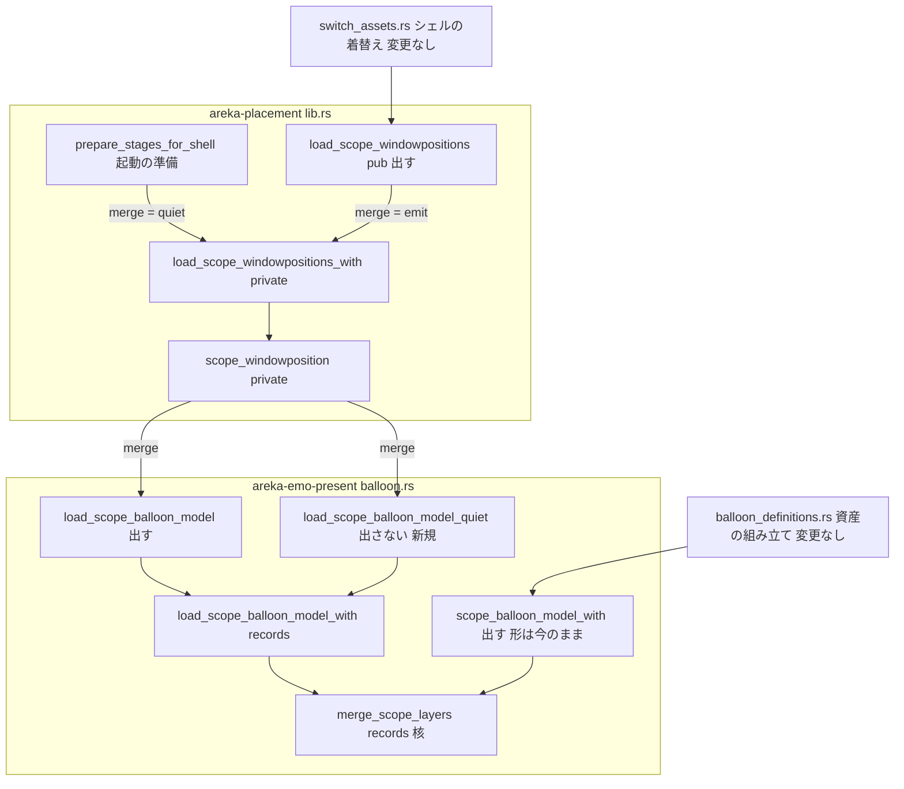
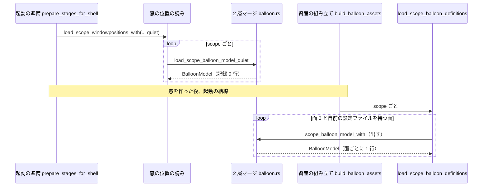

# Design Document

> 2026-11-28・本ブランチ（main `b05e652f` の上）でコードを読み直して書いた。行番号はこの時点のもの。
> 直し方は要件討議で決めた案 1（記録を出さない入口を足し、起動の準備の窓の位置の読みだけ黙らせる）。

## Overview

**Purpose**: 起動の準備 1 回（とゴーストの切り替え・読み込み直し 1 回）で、バルーンの 2 層マージの記録（基層の `descript.txt` が読めない `warn!`・面 0 の上書き層が読めない `warn!`・上書き層が無い `debug!`・`windowposition`／`validrect` の確定の `info!`）を scope ごとに 1 行にする。記録の水準・文言・欄と、窓の位置と資産の組み立ての結果は変えない。

**Users**: 起動の記録を読んで判定をする開発者・ゴーストの作者と、警告の数をそのまま問題の数として数える自動の試験と道具。

**Impact**: 今は窓の位置の読み（`crates/areka-placement/src/lib.rs:748`）と資産の組み立て（`balloon_definitions.rs:102`）が、面 0 の 2 層マージをそれぞれ記録つきで通す。本設計は 2 層マージの権威（`areka-emo-present` の `balloon.rs`）に記録を出さない入口 `load_scope_balloon_model_quiet` を足し、起動の準備の窓の位置の読み（`lib.rs:411`）だけをその入口へ替える。資産の組み立てとシェルの着替えの読みは今どおり記録を出す。2 つの道が同じ面 0 の定義を見ることは、記録の 2 行ではなく決定論のテストで確かめる。

### Goals
- 起動の準備 1 回で、2 層マージの記録が scope ごとに（面 0 以外は面ごとに）1 行になる（要件 1・2）。
- 記録の水準・文言・欄、窓の位置、資産の組み立ての定義が今と同じ（要件 3）。
- 起動の準備の外の道（シェルの着替え・バルーンの着替え・MCP の面の書き出しなど）は今どおり記録を出す（要件 4）。
- 2 つの道の面 0 の定義の一致と、記録の行の数を決定論のテストで固定する（要件 5・6）。

### Non-Goals
- 読むのを 1 回にして定義を運ぶ直し（brief の案 2）。
- 焼く段・面の表・系列の解決・透過の宣言の読みの記録（先行 spec で済み）。
- 資産の組み立ての記録の出方、`areka-emo-atlas`・`areka-emo-compose` の記録。
- 記録の文言そのものの変更。

## Boundary Commitments

### This Spec Owns
- 2 層マージの記録を出さない入口 `areka_emo_present::balloon::load_scope_balloon_model_quiet` と、その中身 1 本の形（出す入口と同じ戻り値）。
- 起動の準備の窓の位置の読み（`prepare_stages_for_shell` の中の 1 か所）が、その入口を通ること。
- 2 層マージの説明（`balloon.rs` の `load_scope_balloon_model` の「観測」の節）と、窓の位置の読みの説明（`lib.rs` の `scope_windowposition`・`load_scope_windowpositions`）の書き直し。
- 記録の行の数と 2 つの道の一致を固定する決定論のテスト（新しい兄弟のテストのファイル 2 つ）と、今の 2 行を固定している `crates/areka-session/src/boot_shell_tests.rs` の檻の改め。
- `balloon_model_tests.rs` の確かめの文言の「R6.3:」の前置き 3 か所を外すこと（ほかの番号には触らない）。

### Out of Boundary
- `load_scope_balloon_model`（出す入口）の名前・形・記録。MCP の面の書き出し（`crates/areka/src/mcp/dump_surface_gpu_test_support.rs`）・emo-text の検体の支え（`tests/support/fixture.rs`）・`balloon_model_tests.rs` は今どおりこの入口を呼ぶ。
- `load_scope_windowpositions`（pub）の名前・形・記録。シェルの着替え（`crates/areka-runtime/src/switch_assets.rs:235`）とテスト 2 本は今どおりこれを呼ぶ。
- 資産の組み立て（`load_scope_balloon_definitions`・`build_balloon_assets`）。`balloon_definitions.rs` は変えない。
- `crates/areka-runtime/src/assets.rs`・`crates/areka-session/src/ghost_session.rs`・emo-text の `tests/support/mod.rs`（ウェーブ C29 の約束 ⑹）。
- 透過の宣言の読み（`load_balloon_use_self_alpha`）が同じ文言で出す「descript.txt が読めない」`warn!`（バルーン 1 つにつき 1 行）と、作者の DPI の読み（`load_balloon_author_dpi`）の `warn!`。2 層マージの記録ではないので変えない。
- 起動を止める失敗（採寸の失敗など）の記録。2 層マージは失敗で止まる道を持たないので、本設計はその道に触らない。

### Allowed Dependencies
- `areka-placement` → `areka-emo-present`（既存の向き）。`areka-placement` の `lib.rs` は新たに `areka_emo_present::balloon::{ResolvedFace, load_scope_balloon_model_quiet}` と `areka_parsers::balloon::BalloonModel` の名前を使う（どちらも既存の依存の中）。
- テストは既存の dev-dependency（`log-capture-kit`・`temp-path-kit`）と、通常の依存 `areka-emo-atlas` の `MemoryDecoder`・`AlphaParams`・`UseSelfAlpha` だけを使う。
- 依存は足さない。`Cargo.toml` は変えない。
- 記録を出すかどうかの口は crate の中の `LoadRecords`（`pub(crate)`）を使い、crate の外へ型を開けない。`areka-placement` の側は関数ポインタで入口を選び、自前の型を足さない。

### Revalidation Triggers
- `load_scope_balloon_model_quiet` の戻り値が `load_scope_balloon_model` と等しくなくなる変更（窓の位置と表示の枠のずれ）。
- 起動の準備の窓の位置の読みを出す入口へ戻す変更、または資産の組み立てを黙らせる変更（行の数が 2 行か 0 行へ戻る）。
- 2 層マージの記録の文言・欄の変更（記録を数える自動の試験と `boot_shell_tests.rs` の数え方が文言で引いている）。
- `load_scope_windowpositions` の形の変更（シェルの着替えの呼び手とテストに波及）。

## Architecture

### Existing Architecture Analysis
- 2 層マージの権威は `balloon.rs` の `load_scope_balloon_model`（pub・521）と核 `scope_balloon_model_with`（pub(crate)・532）。核は資産の組み立て（`balloon_definitions.rs:102`）からも、基層を 1 回読んだ本文を渡されて呼ばれる。
- 記録を出さない入口の前例が 2 つある: `resolve_balloon_faces_quiet`（378）・`load_balloon_use_self_alpha_quiet`（620）。どちらも「中身は 1 本の `_with(records)`、入口は薄いラッパ、戻り値は出す入口と等しい、`Err` で終える失敗の記録は出す」の形で、`LoadRecords { Emit, Quiet }`（`load_records.rs`）を使う。
- 窓の位置の読み `scope_windowposition`（`lib.rs:710`・private）は系列を `resolve_balloon_faces_quiet` で解き、2 層マージは記録を出す `load_scope_balloon_model` を呼ぶ。`load_scope_windowpositions`（pub・559）はそれを scope ごとに回すだけで、起動の準備（`lib.rs:411`）とシェルの着替え（`switch_assets.rs:235`）の 2 か所から呼ばれる。
- 起動・ゴーストの切り替え・ゴーストの読み込み直しは同じ `prepare_stages_for_shell` → `wire_runtime` の道を通る（`research.md` 2.3）。SHIORI だけの読み込み直しはどちらも通らない。

### Architecture Pattern & Boundary Map



**Architecture Integration**:
- 採る形: 前例の「中身 1 本＋薄い入口」。`areka-emo-present` の側は `LoadRecords` を核まで通し、記録の行だけを `records.emits()` で切り替える。`areka-placement` の側は 2 層マージの入口を関数ポインタで選ぶ private の中身 `load_scope_windowpositions_with` を 1 本置き、pub の `load_scope_windowpositions` はそのラッパのまま残す。
- 境界: 「どの道が記録を出すか」は入口の名前の違いで表す。起動の準備だけが出さない入口を名指し、ほかの呼び手は 1 行も変えない。
- 守る前例: `LoadRecords` は crate の中の型のまま（各 crate が自前の型を持たない）。`Err` で終える失敗の記録は値に関わらず出す（2 層マージには `Err` が無い）。`PreparedPlacement` は素の値だけを運ぶ。
- 新しい部品の理由: `load_scope_balloon_model_quiet` は要件 1 の唯一の手段。`load_scope_windowpositions_with` は pub の形を変えずに起動の準備だけを黙らせるため（要件 4.1 を守る S1 の形）。
- 依存の向き: `areka-parsers` → `areka-emo-present` → `areka-placement` → `areka-runtime`／`areka-session`。逆向きの import は作らない。

### Technology Stack

| Layer | Choice / Version | Role in Feature | Notes |
|-------|------------------|-----------------|-------|
| 記録 | `tracing`（既存） | 記録の行を `records.emits()` で切り替える | 水準・文言・欄は変えない |
| テストの捕捉 | `log-capture-kit`（既存 dev-dependency） | 記録を文言・scope・`file` ごとに数える | DEBUG も捕まえる（`balloon_model_tests.rs` の前例） |
| 検体 | `temp-path-kit`（既存）・`areka-emo-atlas::MemoryDecoder`（既存） | `target\` の下に名前だけの絵と設定ファイルを置く | 時間・実の画面・COM に依らない |

依存の追加は無い。

## File Structure Plan

### Directory Structure
```
crates/
├── areka-emo-present/src/
│   ├── balloon.rs                         # 変更: 出さない入口・中身 1 本・上書き層の読みの records・説明
│   ├── balloon_merge_quiet_tests.rs       # 新規: 出さない入口の無音と戻り値の一致・2 つの道の面 0 の定義の一致
│   └── balloon_model_tests.rs             # 変更: 「R6.3:」の前置き 3 か所を外すだけ
├── areka-placement/src/
│   ├── lib.rs                             # 変更: 起動の準備の読みを出さない入口へ・private の中身 1 本・説明
│   └── placement_balloon_merge_log_tests.rs  # 新規: 起動の準備 1 回の行の数・出さない道の失敗の記録・シェルの着替えの行の数
└── areka-session/src/
    └── boot_shell_tests.rs                # 変更: 本番の順の檻を 2 行 → 1 行・説明と非空虚性
```

### Modified Files
- `crates/areka-emo-present/src/balloon.rs`（793 行 → 830〜845 行の見込み）
  - `pub fn load_scope_balloon_model_quiet(balloon_dir: &Path, scope: u32, face0: &ResolvedFace) -> BalloonModel` を足す。
  - private `load_scope_balloon_model_with(balloon_dir, scope, face0, records: LoadRecords) -> BalloonModel`（基層を `read_descript_layer(.., records)` で読み、核へ渡す）を足し、`load_scope_balloon_model` はその `Emit` のラッパにする。
  - 核の中身を private `merge_scope_layers(balloon_dir, scope, face0, descript: &str, records: LoadRecords) -> BalloonModel` へ移し、確定の `info!` を `if records.emits() { … }` で囲む。`pub(crate) fn scope_balloon_model_with(balloon_dir, scope, face0, descript)` は形と名前を保ち、`merge_scope_layers(.., LoadRecords::Emit)` を呼ぶだけにする（`balloon_definitions.rs` を変えないため・e1）。
  - `read_face_override_layer` に `records: LoadRecords` を足し、`match` に `Err(_) if !records.emits() => None,` の腕を 1 本足す（不在の `debug!` と不在以外の `warn!` の 2 腕はそのまま）。
  - `load_scope_balloon_model` の「観測」の節（516〜520）を書き直す（下の「説明の書き直し」）。
  - 末尾のテストの宣言に `#[cfg(test)] #[path = "balloon_merge_quiet_tests.rs"] mod merge_quiet_tests;` を足す（+3 行）。
- `crates/areka-placement/src/lib.rs`（896 行 → 915〜918 行の見込み・内訳は下の「lib.rs の行の数」）
  - `use areka_emo_present::balloon::{…}` に `ResolvedFace`・`load_scope_balloon_model_quiet` を、`use areka_parsers::balloon::{…}` に `BalloonModel` を足す。
  - private `fn load_scope_windowpositions_with(balloon_root: &Path, scope_ids: &[usize], merge: fn(&Path, u32, &ResolvedFace) -> BalloonModel) -> ScopeWindowPositions` を足す。今の `load_scope_windowpositions` の本体（scope ごとに `scope_windowposition` を回して集める）はここへ移す。
  - `pub fn load_scope_windowpositions` は形・名前・説明の「失敗」の節を保ち、本体を `load_scope_windowpositions_with(balloon_root, scope_ids, load_scope_balloon_model)` の 1 行にする。
  - `scope_windowposition` に引数 `merge: fn(&Path, u32, &ResolvedFace) -> BalloonModel` を足し、748 を `merge(balloon_root, scope_key, face0)` にする。系列の解決（`resolve_balloon_faces_quiet`）と 3 つの見送りの `warn!` は変えない。
  - 411 を `load_scope_windowpositions_with(balloon_root, &scope_ids, load_scope_balloon_model_quiet)` にし、直前の説明に「2 層マージの記録は同じ定義を組む資産の組み立てが出す」の 1 行を足す。
  - 末尾のテストの宣言に `#[cfg(test)] #[path = "placement_balloon_merge_log_tests.rs"] mod balloon_merge_log_tests;` を足す（+3 行・並びは名前の順で先頭）。
- `crates/areka-emo-present/src/balloon_model_tests.rs`: 288・297・307 の確かめの文言から「R6.3: 」を外す（「scope が乗る」「windowposition の実値が乗る」「validrect の実値が乗る」になる）。ほかの行は触らない。
- `crates/areka-session/src/boot_shell_tests.rs`: `LoadLines::per_boot` の `merge: scopes(2 * n)` を `merge: scopes(n)` にする。`production_boot_emits_each_load_record_once` の説明（316〜320）を「2 層マージの確定が scope ごとに 1 行」に直し、「非空虚性」の節に「windowposition の読みの 2 層マージを記録を出す入口へ戻すと、2 層マージの確定が 2 行になって赤」を足す。

### lib.rs の行の数（rustfmt の折り返しの後）

| 所 | 増減 | 根拠 |
|---|---|---|
| `use areka_emo_present::balloon::{…}` | +3 | 4 つの名前は 100 桁に収まらず、`{` の後で 2 行に折れる（1 行 → 4 行） |
| `use areka_parsers::balloon::{BalloonModel, …}` | 0 | 78 桁で 1 行に収まる |
| 411 の呼び出しと説明 | +2 | 呼び出しは `let windowpositions =` の後で 1 回折れる（2 行目は 98 桁）。説明 +1 |
| `load_scope_windowpositions` の本体 | −3 | 4 行の鎖 → 1 行 |
| `load_scope_windowpositions_with`（新規） | +13〜15 | 空行 1・説明 1・署名 5・本体 4〜6・閉じ 1。`filter_map` の行がちょうど 100 桁なので、rustfmt が閉包を折れば +2 |
| `scope_windowposition` の署名 | +1 | 引数 `merge` の 1 行 |
| `scope_windowposition` の説明（704〜707） | 0〜+1 | 権威の名前の言い換え |
| テストの宣言 | +3 | `#[cfg(test)]`・`#[path]`・`mod` |
| **合計** | **+19〜23** | **915〜919 行**（上限 1,000 の内） |

### 説明の書き直し（要件 5.4）
- `balloon.rs` の `load_scope_balloon_model` の「観測」の節: 確定の `info!` の中身（scope・採用上書きファイル名・`windowposition`／`validrect` の実値）はそのまま書き、「placement からは scope あたり 1 行、boot は面ごとに 1 行、面 0 の行は placement の行と値が一致する」を、「起動の準備では資産の組み立て（`load_scope_balloon_definitions`）が面ごとに（面 0 と、自前の設定ファイルを持つ面）1 行ずつ出し、窓の位置の読みは [`load_scope_balloon_model_quiet`] を通して出さない。2 つの読みが同じ面 0 の定義を見ることはテストで確かめる」に置き換える。
- `lib.rs` の `scope_windowposition` の説明（704〜707）: 「採寸・起動時資産構築と同じ規則で同じ面を見る」の段は今も正しいので残し、権威の名前を「`merge` に渡る 2 層マージの入口（`load_scope_balloon_model` かその出さない兄弟）」へ言い換える。
- `lib.rs` の `load_scope_windowpositions` の説明: 1 行目に「2 層マージの記録を出す」を足す（起動の準備は出さない中身を直に呼ぶことは 411 の説明が持つ）。
- コードの説明にも、テストの名前と文言にも、spec の名前・要件の番号を書かない（CLAUDE.md の `## Comments`）。

## System Flows



- 起動・ゴーストの切り替え・ゴーストの読み込み直しは同じ道を通るので、どれも開け直し 1 回につき同じ数になる（要件 2.1）。
- シェルの着替えは `switch_assets.rs:235` から pub の `load_scope_windowpositions` を呼び、`merge = load_scope_balloon_model` の道で scope ごとに今どおり 1 行出す（要件 4.1）。資産の組み立ては通らない。
- バルーンの着替えは資産の組み立てだけを通り、窓の位置は読み直さない（要件 4.2・変更なし）。

## Requirements Traceability

| Requirement | Summary | Components | Interfaces | Flows / Tests |
|-------------|---------|------------|------------|-------|
| 1.1 | 確定の `info!` を scope ごとに 1 行 | 2 層マージの権威・窓の位置の読み | `load_scope_balloon_model_quiet`・411 の呼び出し | 起動の流れ・行の数の檻（placement）・本番の順の檻（session） |
| 1.2 | 基層が読めない `warn!` を scope ごとに 1 行 | 同上 | `load_scope_balloon_model_with` の `read_descript_layer(.., records)` | 行の数の檻（検体 A） |
| 1.3 | 上書き層が不在以外で読めない `warn!` を 1 行 | 同上 | `read_face_override_layer(.., records)` | 行の数の檻（検体 B） |
| 1.4 | 上書き層が無い `debug!` を 1 行 | 同上 | 同上 | 行の数の檻（検体 C） |
| 1.5 | ほかの面は面ごとに 1 行（増減なし） | 資産の組み立て（変更なし） | `scope_balloon_model_with`（形は今のまま） | 行の数の檻（検体 D） |
| 1.6 | scope をまたいで畳まない | 資産の組み立て（scope ごとに基層を読む・変更なし） | — | 行の数の檻（全検体を scope 0・1 で数える） |
| 2.1 | 切り替え・読み込み直しも同じ数 | 起動の準備の道（共有） | 411 の呼び出し | 本番の順の切り替えの檻 `each_switch_adds_one_more_set_of_load_records` |
| 2.2 | SHIORI だけの読み込み直しは 0 行のまま | なし（道を通らない） | — | 変更なし（`research.md` 2.3） |
| 3.1 | 水準・文言・欄を変えない | 2 層マージの権威 | 記録の行は `if records.emits()`／守りの腕で切り替えるだけ | `balloon_model_tests.rs`（出す入口の中身）が今どおり通る |
| 3.2 | 警告を 0 行にしない | 資産の組み立て（出す側に残る） | — | 行の数の檻（検体 A・B で 1 行以上） |
| 3.3 | 結果を変えない | 出さない入口・窓の位置の読み | 戻り値は出す入口と等しい | 出さない入口の一致の檻・既存の `default_basis_from_boot_equals_the_one_from_shell_switch` |
| 3.4 | 出さない道でも系列の失敗と見送りの警告 | 窓の位置の読み | `scope_windowposition` の見送りの `warn!`（変更なし）・`resolve_balloon_faces_quiet` の `error!`（変更なし） | 出さない道の失敗の檻（placement） |
| 3.5 | 起動を止める失敗の記録は必ず出す | 採寸（変更なし） | 2 層マージは `Err` を持たない | 既存の `unreadable_balloon_face0_stops_measure_with_one_error_each` が今どおり通る |
| 4.1 | シェルの着替えは scope ごとに 1 行 | 窓の位置の読み（pub は出す） | `load_scope_windowpositions`（形は今のまま） | シェルの着替えの行の数の檻（placement） |
| 4.2 | バルーンの着替えは今どおり | 資産の組み立て（変更なし） | — | 変更なし（`research.md` 2.4） |
| 4.3 | 起動の準備の外の入口は今どおり | 出す入口（変更なし） | `load_scope_balloon_model` | 既存の emo-text の検体のテスト・MCP の支えが今どおり通る |
| 5.1 | 2 つの道の面 0 の定義が等しい | 出さない入口・資産の組み立て | `BalloonModel: PartialEq` | 一致の檻（emo-present） |
| 5.2 | 上書き層あり・なしの両方 | 同上 | — | 一致の檻（検体 C の scope 0・1） |
| 5.3 | 食い違えば赤 | 同上 | — | 一致の檻（`assert_eq!`・非空虚性の確かめ） |
| 5.4 | 説明の書き直し | 2 層マージの権威・窓の位置の読み・本番の順の檻 | — | 「説明の書き直し」の節 |
| 6.1 | 4 種の検体 × scope 2 つの行の数 | 行の数の檻 | — | `placement_balloon_merge_log_tests.rs` |
| 6.2 | 出さない道の失敗の記録 | 同上 | — | 同上 |
| 6.3 | シェルの着替えの行の数 | 同上 | — | 同上 |
| 6.4 | 時間・画面・机に依らない | 全部の新しい檻 | `TempDir`（`target\` の下）・`MemoryDecoder` | — |
| 6.5 | 行の数が違えば赤 | 行の数の檻 | 期待の表との `assert_eq!` | — |
| 6.6 | 本番の順の起動と切り替えで 1 行 | 本番の順の檻 | `LoadLines::per_boot` の `merge: scopes(n)` | `boot_shell_tests.rs` の 3 本 |

## Components and Interfaces

| Component | Domain/Layer | Intent | Req Coverage | Key Dependencies | Contracts |
|-----------|--------------|--------|--------------|------------------|-----------|
| 2 層マージの権威（`balloon.rs`） | areka-emo-present | 出す入口と出さない入口を 1 本の中身で持つ | 1.1〜1.4, 3.1, 3.3, 4.3, 5.4 | `LoadRecords`（P0）・`areka_parsers::balloon::parse_str`（P0） | Service |
| 窓の位置の読み（`lib.rs`） | areka-placement | 起動の準備だけ出さない入口を通す | 1.1〜1.4, 2.1, 3.4, 4.1, 5.4 | 2 層マージの権威（P0） | Service |
| 出さない入口の檻（`balloon_merge_quiet_tests.rs`） | areka-emo-present テスト | 無音と戻り値の一致・2 つの道の面 0 の一致 | 3.3, 5.1〜5.3, 6.4 | `log-capture-kit`・`MemoryDecoder` | — |
| 行の数の檻（`placement_balloon_merge_log_tests.rs`） | areka-placement テスト | 起動の準備 1 回・出さない道の失敗・シェルの着替えの行の数 | 1.1〜1.6, 3.2, 3.4, 4.1, 6.1〜6.5 | `log-capture-kit`・`MemoryDecoder`・`load_scope_balloon_definitions` | — |
| 本番の順の檻（`boot_shell_tests.rs`） | areka-session テスト | 本番の順の起動と切り替えで確定の `info!` が scope ごとに 1 行 | 1.1, 2.1, 6.6 | 既存の `SwitchRig` | — |

### areka-emo-present

#### 2 層マージの権威（`balloon.rs`）

| Field | Detail |
|-------|--------|
| Intent | 2 層マージを 1 本の中身で行い、記録を出すかどうかを入口で選ぶ |
| Requirements | 1.1, 1.2, 1.3, 1.4, 3.1, 3.3, 4.3, 5.4 |

**Responsibilities & Constraints**
- 出す入口 `load_scope_balloon_model` の記録（4 種）の水準・文言・欄は今と同じ。
- 出さない入口 `load_scope_balloon_model_quiet` は 4 種の記録をどれも出さない。戻り値は出す入口と等しい。
- 資産の組み立てが呼ぶ `scope_balloon_model_with` の名前・形・記録は今と同じ（`balloon_definitions.rs` を変えない）。
- 2 層マージは `Err` を返さず、いつも `BalloonModel` を返す（失敗で止まる道を作らない）。

**Dependencies**
- Inbound: `areka-placement` の窓の位置の読み（出す・出さない）、`balloon_definitions.rs`（出す）、MCP の面の書き出しと emo-text の検体の支え（出す）
- Outbound: `read_descript_layer`（既存・`records` あり）、`read_face_override_layer`（`records` を足す）、`areka_parsers::balloon::parse_str`

**Contracts**: Service [x]

##### Service Interface
```rust
// 既存（形は変えない）
pub fn load_scope_balloon_model(balloon_dir: &Path, scope: u32, face0: &ResolvedFace) -> BalloonModel;
pub(crate) fn scope_balloon_model_with(
    balloon_dir: &Path, scope: u32, face0: &ResolvedFace, descript: &str,
) -> BalloonModel;

// 新規
pub fn load_scope_balloon_model_quiet(
    balloon_dir: &Path, scope: u32, face0: &ResolvedFace,
) -> BalloonModel;
fn load_scope_balloon_model_with(
    balloon_dir: &Path, scope: u32, face0: &ResolvedFace, records: LoadRecords,
) -> BalloonModel;
fn merge_scope_layers(
    balloon_dir: &Path, scope: u32, face0: &ResolvedFace, descript: &str, records: LoadRecords,
) -> BalloonModel;

// 引数を足す（private）
fn read_face_override_layer(
    path: &Path, scope: u32, file_name: &str, records: LoadRecords,
) -> Option<String>;
```
- Preconditions: `face0` は `resolve_balloon_faces` か `resolve_balloon_faces_quiet` が返した面 0（両者は同じ面を返す・`balloon_quiet_tests.rs` の檻）。
- Postconditions: `load_scope_balloon_model_quiet(d, s, f) == load_scope_balloon_model(d, s, f)`。出さない入口の呼び出しは宛先 `areka_emo_present::balloon` の記録を 0 行にする。
- Invariants: 記録の切り替えは記録の行だけを囲み、読み・マージ・戻り値の分岐は `records` に依らない。

**Implementation Notes**
- 中身の形は前例 `resolve_balloon_faces_with`・`load_balloon_use_self_alpha_with` に合わせる。説明の 1 行目は前例と同じ型（「[`load_scope_balloon_model`] と同じ中身で組み、読み込みの記録（…）を出さない（起動の準備の windowposition の読み）。戻り値は [`load_scope_balloon_model`] と等しい」）。
- `read_face_override_layer` の守りの腕 `Err(_) if !records.emits() => None` は、`Ok` の腕の次・`NotFound` の腕の前に置く。

### areka-placement

#### 窓の位置の読み（`lib.rs`）

| Field | Detail |
|-------|--------|
| Intent | 2 層マージの入口を呼び手が選べる中身 1 本と、出す pub のラッパ |
| Requirements | 1.1, 1.2, 1.3, 1.4, 2.1, 3.4, 4.1, 5.4 |

**Responsibilities & Constraints**
- 起動の準備（`prepare_stages_for_shell`）は出さない入口を通す。シェルの着替えは pub を通して今どおり出す。
- 系列の解決は今どおり `resolve_balloon_faces_quiet`。見送りの `warn!` 3 つ（scope が u32 に収まらない・系列の解決の失敗・面 0 が無い）はどちらの入口でも出す。
- 戻り値（`ScopeWindowPositions`）と合流（`scale_then_merge`）は変えない。

**Contracts**: Service [x]

##### Service Interface
```rust
// 既存（形は変えない）
pub fn load_scope_windowpositions(balloon_root: &Path, scope_ids: &[usize]) -> ScopeWindowPositions;

// 新規（private）
fn load_scope_windowpositions_with(
    balloon_root: &Path,
    scope_ids: &[usize],
    merge: fn(&Path, u32, &ResolvedFace) -> BalloonModel,
) -> ScopeWindowPositions;

// 引数を足す（private）
fn scope_windowposition(
    balloon_root: &Path,
    scope: usize,
    merge: fn(&Path, u32, &ResolvedFace) -> BalloonModel,
) -> Option<(WindowPosition, WindowPositionRaw)>;
```
- Postconditions: `load_scope_windowpositions_with(r, s, load_scope_balloon_model_quiet) == load_scope_windowpositions(r, s)`（戻り値は 2 層マージの入口の等しさから従う）。

**Implementation Notes**
- 入口の選び方に関数ポインタを使う理由: `LoadRecords` は `areka-emo-present` の crate の中の型で外へ開けない。`areka-placement` に自前の `enum` を足すと型の定義と `match` で行が増える。`bool` は呼び出しの場で意味が読めない。関数ポインタなら選んだ入口の名前が呼び出しの場にそのまま出て、足す型が無い。
- `test-support` の口は開けない（行の数の檻は crate の中のテストから private の中身を呼ぶ）。

## Data Models

変更なし（`BalloonModel`・`ScopeWindowPositions`・`ScopeBalloonDefinitions` の形は今のまま）。

## Error Handling

### Error Strategy
- 2 層マージは今どおり寛容（読めない層は空層で続ける）で、`Err` を返さない。出さない入口でもこの性質は同じなので、記録の無い失敗の道は構造上生まれない（要件 3.5 の 2 層マージの側）。
- 窓の位置の読みの見送り（系列の解決の失敗・面 0 が無い・scope が u32 に収まらない）は、出さない道の上でも `warn!` を出す。系列の解決の `error!`（走査の失敗・面 0 が解決できない）は `resolve_balloon_faces_quiet` が値に関わらず出す（要件 3.4）。
- 起動を止める失敗（採寸の `error!`＋`Err`）は採寸の道のもので、本設計は触らない（要件 3.5）。

### Monitoring
- 起動の準備 1 回の 2 層マージの記録は、資産の組み立ての 1 か所から scope ごと・面ごとに 1 行。シェルの着替えでは窓の位置の読みから scope ごとに 1 行。
- 同じ文言「balloon: バルーン既定設定（descript.txt）の読取に失敗（空層で継続）」は、透過の宣言の読み（資産の組み立ての `load_balloon_use_self_alpha`・バルーン 1 つにつき 1 回）からも出る。これは 2 層マージの記録ではなく範囲の外（Out of Boundary）。基層が読めないバルーンで scope を 2 つ読む起動では、この文言の行は 2 層マージから 2 行、透過の宣言の読みから 1 行の計 3 行になる（今は 5 行）。

## Testing Strategy

検体はどれも `target\` の下の一時フォルダ（各 crate の既存の `TempDir`・`temp-path-kit`）に置き、絵は名前だけのファイル、読み手が要る所は `MemoryDecoder` を使う。数えるのは 2 層マージの記録の 4 つの文言だけ（宛先まるごとで数えない。矢印の絵の解決など別の記録を拾わないため）。

### 検体（行の数の檻と一致の檻で共通の形）

| 検体 | 置くもの | scope 0 の面 0 の上書き層 | scope 1 の面 0 の上書き層 |
|---|---|---|---|
| A 基層が読めない | `balloons0.png` だけ（`descript.txt` を置かない） | `balloons0s.txt` 不在 | 同左（本体側へ縮退） |
| B 上書き層が不在以外で読めない | `descript.txt`・`balloons0.png`・同名のフォルダ `balloons0s.txt\` | 読めない | 同左 |
| C scope 1 だけ上書き層を持たない | `descript.txt`・`balloons0.png`・`balloons0s.txt`・`balloonk0.png` | `balloons0s.txt` | `balloonk0s.txt` 不在 |
| D 面 0 のほかに自前の設定ファイルを持つ面 | `descript.txt`・`balloons0.png`・`balloons0s.txt`・`balloons1.png`・`balloons1s.txt` | `balloons0s.txt`（面 1 は `balloons1s.txt`） | 同左 |

### 行の数の檻（`crates/areka-placement/src/placement_balloon_merge_log_tests.rs`・新規）
1. **起動の準備 1 回の行の数（要件 1.1〜1.6・3.2・6.1・6.5）**: 検体 A〜D ごとに、1 回の `capture` の中で、起動の準備の読み `load_scope_windowpositions_with(dir, &[0, 1], load_scope_balloon_model_quiet)` と、資産の組み立てと同じ読み（scope 0・1 ごとに `resolve_balloon_faces` → `areka_emo_present::balloon_definitions::load_scope_balloon_definitions(dir, scope, &faces, &MemoryDecoder::new(), AlphaParams { use_self_alpha: UseSelfAlpha::Off })`）を通す。（文言, `scope` 欄, `file` 欄）ごとに数え（欄が無ければ `-`）、期待の表と `assert_eq!` で比べる。期待: A は基層の `warn!` が（-, -）で 2 行・不在の `debug!` と確定の `info!` が scope ごとに 1 行、B は不在以外の `warn!` と確定の `info!` が scope ごとに 1 行、C は確定の `info!` が scope 0（`balloons0s.txt`）・scope 1（`balloonk0s.txt`）で 1 行ずつ・不在の `debug!` が scope 1 で 1 行、D は確定の `info!` が scope ごとに `balloons0s.txt` と `balloons1s.txt` で 1 行ずつ。起動の準備の読みを出す入口へ戻すと面 0 の行が 2 行になって赤（6.5）。
2. **出さない道でも失敗の記録が出る（要件 3.4・6.2）**: 起動の準備の読み（`merge = load_scope_balloon_model_quiet`）を、フォルダが無いバルーンと面 0 が無いバルーン（`balloons1.png` だけ）で scope 0 について通す。戻り値が空で、見送りの `warn!`（「バルーン系列の解決に失敗」・scope 欄 0）が 1 行、系列の解決の `error!`（「走査に失敗」／「面 ID 0 が連鎖のどの接頭辞でも解決できない」）が 1 行出ることを確かめる。
3. **シェルの着替えの読みは今どおり出す（要件 4.1・6.3・6.5）**: pub の `load_scope_windowpositions(dir, &[0, 1])` を検体 A〜C で通し、2 層マージの記録が scope ごとに 1 行（面 0 の行だけ）出ることを、檻 1 と同じ数え方で確かめる。0 行に黙らせると赤。

### 出さない入口の檻（`crates/areka-emo-present/src/balloon_merge_quiet_tests.rs`・新規）
1. **無音と戻り値の一致（要件 3.1・3.3）**: 検体 A・B・C（scope 1）と上書き層を持つ面 0（C の scope 0）で、`load_scope_balloon_model` が対応する記録を出し（検体が事象を起こしていることの確かめ）、`load_scope_balloon_model_quiet` は宛先 `areka_emo_present::balloon` の記録を 0 行にし、戻り値が等しいことを確かめる。確かめの形は前例 `balloon_quiet_tests.rs` の `assert_silenced` と同じで、小さな確かめの関数を新しいファイルの中に持つ（`balloon_quiet_tests.rs` は約束 ⑹ の触ってよいファイルに無いので触らない）。支えは `balloon_test_support.rs` の `CapturedEvent`・`TempDir`・`ALPHA` を使う。
2. **2 つの道の面 0 の定義の一致（要件 5.1〜5.3）**: 検体 C に `descript.txt` と `balloons0s.txt` で違う `windowposition`／`validrect` を書き、scope 0（上書き層あり）と scope 1（上書き層なし）のそれぞれで、窓の位置の読みと同じ手順（`resolve_balloon_faces_quiet` の面 0 → `load_scope_balloon_model_quiet`）の模型と、資産の組み立ての手順（`resolve_balloon_faces` → `load_scope_balloon_definitions(..).face0().model`）の模型を `assert_eq!` で丸ごと比べる。比べが空虚でないことを示すため、scope 0 と scope 1 の模型が違うことも確かめる。

### 本番の順の檻（`crates/areka-session/src/boot_shell_tests.rs`・既存の改め）
- `production_boot_emits_each_load_record_once`・`animated_hidden_shell_boot_emits_each_load_record_once`・`each_switch_adds_one_more_set_of_load_records` の期待 `LoadLines::per_boot(1)` が、2 層マージの確定の `info!` を scope ごとに 1 行として数える（要件 1.1・2.1・6.6）。起動の準備の読み（`lib.rs:411`）を出す入口へ戻すと 2 行になって赤になり、この檻が 411 の結線を支える。

### 今どおり通ることを確かめる既存のテスト
- `balloon_model_tests.rs`（出す入口の記録の中身・要件 3.1・4.3）、`placement_windowposition_vocab_tests.rs`・`reseed_tests.rs`（pub の読み）、`switch_assets_tests.rs` の `default_basis_from_boot_equals_the_one_from_shell_switch`（要件 3.3）、`measure_bake_log_tests.rs`（要件 3.5）、emo-text の `tests/staysee_balloon_fixture/faces.rs`（要件 4.3）。

## 前提（設計の討議で確かめる）

本設計は次を前提に書いた。どれも答えで作業が変わる。

1. **核の形は e1（`balloon_definitions.rs` を変えない）**: e2（`scope_balloon_model_with` に `records` を足し、`balloon_definitions.rs:102` の 1 行を直す）なら Emit のラッパ `scope_balloon_model_with` が要らず、`balloon.rs` の関数が 1 つ減る（約 −9 行）。`balloon_definitions.rs` は約束 ⑹ の触ってよいファイルに無いので e1 を採った。
2. **起動の準備 1 回の行の数は `areka-placement` の crate の中で数える（t2 の 1 か所版）**: 資産の組み立ての側は `build_balloon_assets`（`assets.rs`・約束 ⑹ で触らない）を通さず、それが scope ごとに呼ぶ `load_scope_balloon_definitions` を直に呼んで同じ数を出す。411 の結線は本番の順の檻（emo2）が支える。t1（`areka-runtime` の `placement_tests/` に新しい兄弟を置き、`areka-placement` に `test-support` の口を開ける）は `placement_tests/mod.rs` と口の追加（`lib.rs` +5 前後）が要り、約束 ⑹ の触ってよいファイルの外に出る。t3（本番の順に壊れた検体を足す）は実の WIC で読める絵が要る。
3. **シェルの着替えの行の数は pub の `load_scope_windowpositions` を数える（u1）**: `switch_assets.rs` が出す入口を呼び続けることの檻にはならないが、`switch_assets.rs` は本設計で変えない。u2 は `switch_assets.rs` に新しい兄弟の宣言が要り、約束 ⑹ の外に出る。
4. **同じ文言の透過の宣言の読みの `warn!` は範囲の外のまま**（Monitoring の節）: 基層が読めないバルーンで scope を 2 つ読む起動では、文言で数えると 3 行（2 層マージ 2・透過の宣言の読み 1）になる。要件の境界（透過の宣言の読みの記録は変えない）のとおり触らない。
5. **`lib.rs` は +19〜23 行（915〜919 行）**: 要件討議の 2 は「数行増える（上限 1,000 行の内）」とした。中身 1 本の private の関数と `use` の折り返しで約 20 行になる。上限の内なので受け入れる前提で書いた。

## Supporting References
- 検討した形（e1／e2・S0／S1／S2・テストの置き場 t1／t2／t3・u1／u2・v1／v2）と、選ばなかった理由は `research.md` の「設計の判断」に置く。
