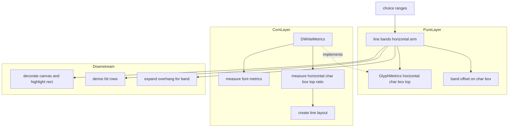
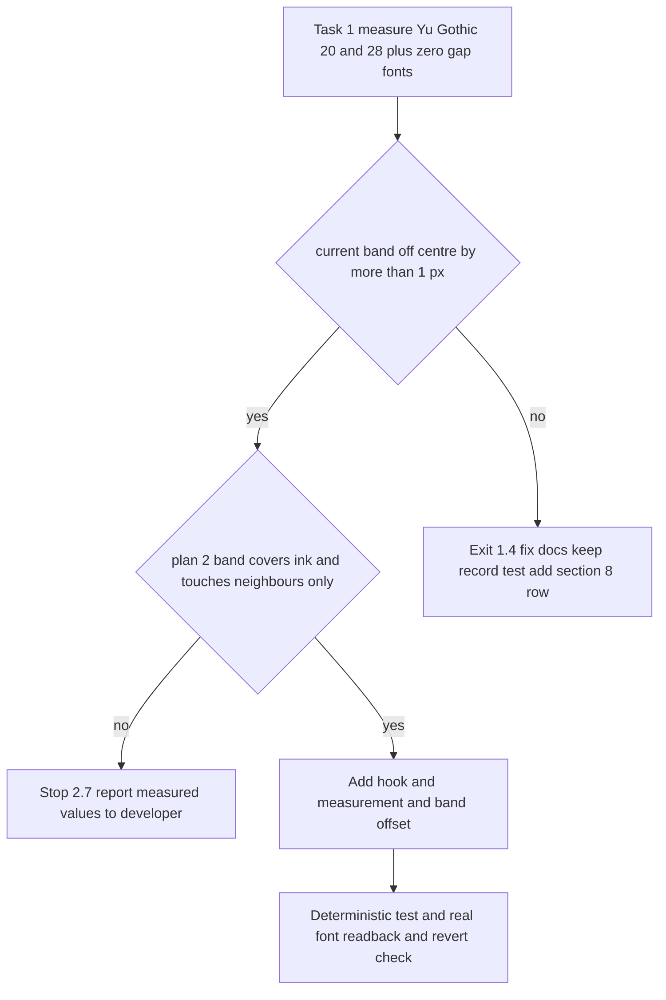

# 設計: emo-text-line-gap

## Overview

**目的**: 書体の行間を持つ書体（游ゴシックなど）を `font.name` に書いた横書きのバルーンで、選択肢とアンカーの反転の帯と当たりを、字に対して中央（縦書きと同じ形）に置く。書体の行間 0 の書体（Yu Gothic UI・ＭＳ ゴシック・既定）と縦書きの帯は、数も画素も今のまま保つ。

**使う人**: ゴーストの利用者（選択肢にマウスを乗せて選ぶ）とバルーンの作者（書体を選ぶだけで帯が字に合う）。

**変えること**: 今の横書きの帯は「字の箱の上端＝行矩形の上端」を暗に前提にして、字の箱の丈（`line_box_height`＝ascent＋descent）の中央へ寄せている。DirectWrite は書体の行間を含む行の高さで組むので、書体の行間を持つ書体では字の箱が行矩形の上端から下がった所に在り、帯が字からずれる。本 spec は開発者の裁定（2026-10-31・案 2）に従い、横書きの帯も **DirectWrite が測った基線（字の置き場）から** 置く。計測器（`GlyphMetrics`）に横書きの字の箱の上端を返す口を 1 つ足し、帯の寄せにその量を足す。帯の厚みの決まり（字の箱の丈を em と行送りのあいだに収めた値）は変えない。直す前に実物の書体で測り、裁定を確かめる（要件 1）。

### Goals

- 書体の行間を持つ書体の横書きで、帯の中心をその行の字の箱の中心に合わせる（1 画素以内）。塗りと当たりは同じ値から出る（要件 2・3）。
- 帯の置き場が書体から測った行の箱の寸法を読まない形になり、`line_box_height` の意味（字の箱の丈）と説明が事実に合う（要件 4）。
- 書体の行間 0 の書体と縦書きの帯・当たり・字の描画が 1 ビットも動かない（要件 5）。
- 直す前の測りの記録・偽の計測器の決定論のテスト・実物の游ゴシックの読み戻しが残る（要件 1・6）。

### Non-Goals

- 縦書きの帯の形（完了 `vertical-choice-hover-band`）・行送り（`line_pitch` と行送りの行間）・字の描画（DirectWrite の組み方・書式への行の間隔の設定）。
- 選択肢の飾り（`choice-marker-styling`）・`cursor.*` の色と混ぜ方・書体の引き当て（`balloon-font-file`）。
- 行の中で `\f[name,…]` で替えた書体や、フォールバックの書体が行の基線を押し下げる場合（束縛の書体の比で見るのは今からの限界・`balloon-font-file`／`text-typesetting` の持ち分）。
- 大きさの違う行が隣り合うときの帯の重なりの解消（下の「開発者の決め」・要件 2.7 で開発者が決める）。

## Boundary Commitments

### This Spec Owns

- 横書きの選択肢とアンカーの帯の **置く所**（`LineBand::offset` の横書きの値）を、字の箱の上端から決める式。塗りと当たりは同じ `LineBand` を読むので一緒に動く。
- `GlyphMetrics` の新しい口 `horizontal_char_box_top`（既定の実装 0）と、その本番の実装（`DWriteMetrics` が生成時に 1 度だけ測る比）。
- `line_box_height` の意味を「字の箱の丈（ascent＋descent）」と定め直す説明（名前は変えない）。`DWriteMetrics::vertical_em_box_left` の横書きに束縛した物の逃げ道（`None` の枝）が本番で通らないことの説明。
- 測りの記録（記録だけの検査）・決定論のテスト・実物の書体の読み戻しを持つ新しいテストのファイル 1 つ。
- `doc/COMPAT_ARCHITECTURE.md` §8 の表の末尾の 1 行。

### Out of Boundary

- 帯の **厚み** の決まり（`highlight_band_extent`）は変えない（要件 2.6）。縦書きの帯（`vertical_em_box_left`・縦書きの腕）は変えない（要件 5.2）。
- 帯を読む下流（`viewbox_draw_render.rs` の `highlight_rect`・`expand_overhang_for_band`、`choice.rs` の `derive_hit_rows`・`glyph_cells`・`decorate_canvas`、`crates/areka/src/input_events/balloon.rs` の当たりの探し方）の形は変えない。値だけが変わる。
- 書式（`create_text_format`）・行の生成口（`create_line_layout`）・行の配置（`LayoutEngine`）・行送りの式は変えない。
- 縮退の扱い（書体の寸法を測れないときの `warn!`＋行送り相当の比）は変えない（要件 4.2）。
- `FixedMetrics` と既存の偽の計測器（テストの中の物）は触らない（既定の実装 0 を受け継ぐ）。

### Allowed Dependencies

- `windows` の DirectWrite の型（`DWRITE_FONT_METRICS`・`DWRITE_LINE_METRICS`・`IDWriteTextFormat`）と `wintf::com::dwrite`（既に使っている物だけ）。新しい依存は足さない。
- 依存の向き: 純粋層 `layout.rs`（口の宣言）← `choice.rs`（帯の式・純粋）← COM 層 `draw_metrics.rs`（本番の実装）。純粋層は `windows` を読まない（`lib.rs` の `pure_layer_modules_have_no_windows_imports`）。`choice.rs` は `GlyphMetrics` の口だけを読み、`DWriteMetrics` を知らない。
- 本番のファイルで TextLayout を作るのは `draw.rs::create_line_layout` だけ（`draw_line_store_tests.rs` の L2）。新しい測りもこの生成口を通す。

### Revalidation Triggers

- `GlyphMetrics` に口が増える（既定の実装つき）。crate の外で `GlyphMetrics` を実装する物が既定の 0 を受け継ぐことを前提にする変更は、横書きの帯が今の形（行矩形の上端から寄せる）に留まる。
- 横書きの `LineBand::offset` の意味が「行矩形の上端から字の箱の中央へ寄せる量」から「行矩形の上端から、字の箱の上端（0 以上）＋字の箱の中での寄せ」へ変わる。値は 0 以上のまま。**寄せが負になり得る変更**（`max(0, t)` を外すなど）をするなら、`expand_overhang_for_band` の横書きの近端を広げる必要がある。
- 横書きの行の書式に行の間隔を設定する変更（`text-typesetting`・`balloon-font-file` など）は、本 spec の測りが同じ生成口を通るので自動で追従するが、§8 の行と読み戻しの数を見直す。
- `line_box_height` の意味（字の箱の丈）を読む所を足す変更は、DirectWrite の行の高さと取り違えないこと。

## Architecture

### Existing Architecture Analysis

- 帯の値は `choice.rs::line_bands` が行ごとに 1 度だけ決め、本番の唯一の呼び手 `actor_present.rs::choice_ranges` が塗り（`decorate_canvas`→`highlight_rect`）・当たり（`derive_hit_rows`）・字の矩形（`glyph_cells`）・ダーティ帯（`expand_overhang_for_band`）へ同じ列を配る（完了 `choice-ranges-one-function`）。
- 縦書きの帯は完了 `vertical-choice-hover-band` で「書体の縦書きの基線を 1 度だけ測って比で持ち、em を掛ける」形（`vertical_em_box_left`）に改めてある。本 spec はこの形を横書きへ写す。
- 横書きの行は `create_line_layout`（横書きは何も足さない）で組み、行矩形の左上を原点に描く。行の基線は行矩形の上辺から `GetLineMetrics()[0].baseline`。字の箱は `[基線 − ascent, 基線 + descent]`。書体の行間 0 の書体では基線 ＝ ascent で、字の箱の上端は 0（今の式の前提と同じ）。

### Architecture Pattern & Boundary Map



- **取った形**: 縦書きの前例と同じ「書体が字を置いた所を生成時に 1 度だけ測り、比で持ち、行の em を掛ける」。口は向きごとに分ける（縦書き＝符号つきの em の箱の左・横書き＝0 以上の字の箱の上）。1 つの汎用の口へまとめると縦書きの意味と符号の約束が動く（要件 5.2）ので、まとめない。
- **新しい物の理由**: 口 1 つ（帯の式が書体の置き場を知る唯一の道）・測り 1 つ（その本番の値）・私的な関数 1 つ（寄せの式の定義点を 1 つに保ちつつ、`highlight_band_offset` の引数の形を保つ）。
- **steering との合わせ**: 純粋層は `windows` を読まない・TextLayout の生成口は 1 つ・1 ファイル 1,000 行以下・テストの助けの関数は写さず借りる（`structure.md`）・測れないときは `warn!` で記録して縮退（`logging.md` の log-first）。

### Technology Stack

| 層 | 選んだ物・版 | この機能での役 | 備考 |
|---|---|---|---|
| 文字の計測（COM 層） | `windows`（ワークスペースのピンのまま）の DirectWrite: `DWRITE_FONT_METRICS`・`IDWriteTextLayout::GetLineMetrics` | 字の箱の上端の比を生成時に 1 度だけ測る | 依存の追加・版上げなし |
| 帯の式（純粋層） | Rust（`areka-emo-text` の `choice.rs`・`layout.rs`） | 横書きの帯の寄せに字の箱の上端を足す | `windows` を読まない |

## File Structure Plan

### Directory Structure

```
crates/areka-emo-text/src/
├── layout.rs                              # GlyphMetrics に口 horizontal_char_box_top（既定 0）・line_box_height の説明の直し
├── choice.rs                              # line_bands の横書きの腕・寄せの式の定義点（私的な関数）・説明の直し
├── draw_metrics.rs                        # 書体の寸法の読み口の改め・字の箱の上端の比の測り・口の実装・説明の直し
├── viewbox_draw.rs                        # 新しいテストのファイルの子の宣言（#[cfg(test)] #[path] の 3 行）だけ
├── viewbox_draw_line_gap_band_tests.rs    # 新規: 決定論のテスト・記録だけの測り・実物の游ゴシックの読み戻し
└── lib.rs                                 # SOURCES_OUTSIDE_THE_PURE_SCAN に新しいファイルの 1 行だけ
doc/COMPAT_ARCHITECTURE.md                 # §8 の表の末尾に 1 行
.kiro/specs/emo-text-line-gap/research.md  # 測った数・書き換えた檻の記録（§3 以降）
```

### Modified Files

- `crates/areka-emo-text/src/layout.rs`（551 行）— `GlyphMetrics` に `horizontal_char_box_top` を既定の実装つきで足す。`line_box_height` の説明の「DirectWrite は行を ascent＋descent で組む」を事実（字の箱の丈・DirectWrite の行の高さは書体の行間を含み、これより大きいことがある）へ直す（要件 1.4・4.1）。`FixedMetrics` は触らない。
- `crates/areka-emo-text/src/choice.rs`（790 行）— `line_bands` の横書きの腕で寄せに字の箱の上端を足す。寄せの式は私的な関数 `band_offset_on_char_box` 1 つに置き、`highlight_band_offset` はそれに「上端 0」を渡して委ねる（引数の形を保つ）。`highlight_band_offset`・`LineBand::offset` の説明を「字の箱の中央」へ直す。
- `crates/areka-emo-text/src/draw_metrics.rs`（462 行）— `measure_line_box_ratio` を `measure_font_metrics`（`DWRITE_FONT_METRICS` をそのまま返す・`pub(crate)`）へ改め、比は `new_shared` で作る。横書きに束縛した物だけ字の箱の上端の比を測る私的な関数 `measure_horizontal_char_box_top_ratio` を足す。`GlyphMetrics::horizontal_char_box_top` を実装する。`vertical_em_box_left` の `None` の枝に「本番で通らない」根拠を書く（要件 4.4）。
- `crates/areka-emo-text/src/viewbox_draw.rs`（388 行）— 新しいテストのファイルの子の宣言だけ（`vertical_band_readback_tests` と同じ形）。
- `crates/areka-emo-text/src/lib.rs` — `SOURCES_OUTSIDE_THE_PURE_SCAN` に `"viewbox_draw_line_gap_band_tests.rs"` の 1 行（C15 で本 spec だけが使える席）。
- `doc/COMPAT_ARCHITECTURE.md` — §8 の表の末尾に 1 行（要件 4.3）。
- （要るときだけ）`crates/areka-emo-text/src/viewbox_draw_vertical_band_readback_tests.rs` — 私的な助けの関数 `bgra_y_span` を `pub(super)` へ上げる 1 語だけ（写さずに借りるため）。中身と縦書きの検査は変えない。

**触らないファイル**（約束）: `choice_tests.rs`・`actor_choice_contract_tests.rs`・`draw_format_metrics_tests.rs`（上限に近い）・`tests/line_pitch_readback_test.rs`（要件の一覧に在るが要らない＝`clippy-199-lints` の段 2 と重ならない）・`viewbox_draw_render.rs`・`actor_present.rs`・`crates/areka/` の全部。

**要件の一覧からの増え**: `viewbox_draw.rs`（子の宣言 3 行）と `lib.rs`（1 行）。C15 のほかの 5 本は emo-text に触らない（roadmap の C15 の行）ので重なりは 0。要件は新しいファイルを足すとき `lib.rs` に行を足すことを見込んでいる。読み戻しの助けの関数は `viewbox_draw_test_support.rs`（`Rig`・`live_diff_model_font`・`block_axis_ink_span`・`glyph_items`）から借りるため、新しいファイルは `viewbox_draw` の子でなければならない（`pub(super)`）。兄弟のファイルに私的に在る助けの関数（例: `viewbox_draw_vertical_band_readback_tests.rs` の `bgra_y_span`）が要るときは、写さずに `pub(super)` へ上げて借りる（`structure.md`「複製は本文の同一性を壊す」）。

## System Flows

実装の進め方は、最初の測り（要件 1）の結果で 3 つに分かれる。



- 「ずれていない」の判定は、游ゴシック 20・28（k ＝ 1・2）のすべてで今の帯の中心と字の箱の中心の差が 1 image px 以下（要件 1.4）。1 つでも超えれば直しへ進む。
- 「案 2 で満たせる」の判定は、測った基線と ascent から案 2 の帯を出し、仮名と漢字のインクを上下とも覆い（要件 2.2）、中心の差が 1 image px 以下（要件 2.1）で、同じ大きさの隣の行の帯と重ならない（要件 2.3）こと。満たせなければ直しに入らず止まる（要件 2.7）。大きさの違う行の組は記録に載せるが、この判定には入れない（下の「開発者の決め」）。
- 測りのタスク（Task 1）は、記録だけの検査が ascent を読めるよう、`measure_line_box_ratio` を `measure_font_metrics` へ改める（値も記録も変わらない置き換え）ところまでを含む。この置き換えはどの道でも残る。
- 1.4 の出口では、口・字の箱の上端の測り・帯の式を足さない。`line_box_height` の説明の直し・記録だけの検査・§8 の行だけを残し、測った数を開発者へ報告して閉じる（止まらない）。

## Requirements Traceability

| 要件 | 要約 | 部品 | 口・契約 | 流れ |
|---|---|---|---|---|
| 1.1 | 游ゴシック 20・28 の行の箱・基線・インク・今の帯を測って記録 | LineGapBandTests（記録だけ） | `create_line_layout`・`measure_font_metrics`・読み戻し | Task 1 |
| 1.2 | 行間 0 の書体も同じ形で測る | LineGapBandTests（記録だけ） | 同上 | Task 1 |
| 1.3 | 案 2 の帯を測った数から出し、満たせると確かめてから直す | LineGapBandTests（記録だけ） | 案 2 の式を記録の中で計算 | 分かれ「案 2 で満たせる」 |
| 1.4 | ずれていなければ帯の式に触らず説明・記録・§8 で閉じる | GlyphMetrics の説明・§8 | — | 出口 1.4 |
| 1.5 | 測りを普段は回らない記録だけの検査として残す | LineGapBandTests（`#[ignore]`） | — | — |
| 2.1 | 帯の中心を字の箱の中心に（1 画素以内） | BandOffset・HorizontalCharBoxTop | `horizontal_char_box_top`・`band_offset_on_char_box` | 直し |
| 2.2 | 厚みは em 以上・行送り以下でインクを覆う | 既存の `highlight_band_extent`（変えない）・読み戻し | — | 直し・確かめ |
| 2.3 | 隣の行の帯と重ねない | BandOffset（同じ大きさの行は同じ寄せ・厚み＝行送り以下） | — | 開発者の決め（大きさの違う行） |
| 2.4 | 大きい字の行はその行の大きさから決める | LineBands（行の最大の em × 比） | `horizontal_char_box_top(em)` | — |
| 2.5 | アンカーも同じ形 | LineBands（選択肢とアンカーが同じ列を読む） | — | — |
| 2.6 | 厚みの決まりは今のまま・書体の名前で分けない | 既存の `highlight_band_extent` | — | — |
| 2.7 | 満たせなければ測った値を添えて開発者へ | 進め方の分かれ・開発者の決め | — | 止まり 2.7 |
| 3.1 | 当たりと塗りが数値まで同じ | 既存の単一の源（`line_bands`）・決定論のテスト | `LineBand` | — |
| 3.2 | 帯の中の点（インクの上を含む）で選ばれる | 当たり＝帯（3.1）・読み戻し | — | — |
| 3.3 | 境の点はたかだか 1 つ | 既存の半開区間と後ろから探す当たり | — | — |
| 4.1 | 帯の置き場は基線から・厚みは字の箱の丈として読む | BandOffset・HorizontalCharBoxTop・説明の直し | — | — |
| 4.2 | 測れないときの縮退と記録を保つ | HorizontalCharBoxTop の縮退（0・`warn!`） | — | — |
| 4.3 | §8 に行を足す | CompatRow | — | — |
| 4.4 | 縦書きの逃げ道は本番で通らないと確かめ、説明だけ | DWriteMetrics の説明 | — | — |
| 5.1 | 行間 0 の書体の横書きは数も画素も同じ | `max(0, t)`＋丸め 1 回・既存の檻 | — | — |
| 5.2 | 縦書きは数も画素も同じ | 縦書きの腕に触らない | — | — |
| 5.3 | 字の描画は同じ | 書式・生成口・配置に触らない | — | — |
| 5.4 | 檻を消さず・ゆるめず・書き換えは記録 | 進め方の決まり・research.md の記録 | — | — |
| 6.1 | 行間を持つ寸法の決定論のテスト | LineGapBandTests（偽の計測器） | `GlyphMetrics` | 確かめ |
| 6.2 | 実物の游ゴシック 20・28 の読み戻し・名前を固定 | LineGapBandTests（読み戻し） | — | 確かめ |
| 6.3 | 直しを外すと 6.1 が赤 | 進め方の決まり（1 度確かめて記録） | — | 確かめ |
| 6.4 | 排他テストの机で短く 1 回 | 進め方の決まり | — | 確かめ |

## Components and Interfaces

| 部品 | 層 | 役 | 要件 | 主な依存 | 契約 |
|---|---|---|---|---|---|
| HorizontalCharBoxTop（`GlyphMetrics` の口） | 純粋（`layout.rs`） | 横書きの字の箱の上端を返す口（既定 0） | 2.1, 2.4, 4.1 | — | Service |
| DWriteMetrics の測り | COM（`draw_metrics.rs`） | 字の箱の上端の比を生成時に 1 度だけ測る・口の実装 | 2.1, 4.1, 4.2, 4.4 | `create_line_layout`（P0）・`DWRITE_FONT_METRICS`（P0） | Service, State |
| BandOffset（`line_bands` の横書きの腕） | 純粋（`choice.rs`） | 帯の寄せ＝字の箱の上端＋字の箱の中での寄せ | 2.1〜2.6, 3.1, 4.1, 5.1, 5.2 | HorizontalCharBoxTop（P0） | Service |
| LineGapBandTests | テスト（`viewbox_draw_line_gap_band_tests.rs`） | 記録だけの測り・決定論のテスト・実物の読み戻し | 1.1〜1.5, 2.2, 3.1, 3.2, 6.1〜6.3 | `viewbox_draw_test_support.rs`（P0）・実物の游ゴシック（P0） | — |
| CompatRow | 文書（`doc/COMPAT_ARCHITECTURE.md` §8） | 変えた扱いと根拠の 1 行 | 4.3 | 測った数（P1） | — |

### 純粋層

#### HorizontalCharBoxTop（`GlyphMetrics::horizontal_char_box_top`）

| 欄 | 中身 |
|---|---|
| 役 | 横書きの行で、字の箱の上端の、行矩形の上端からの量（image px・丸める前）を返す |
| 要件 | 2.1, 2.4, 4.1 |

**責務と制約**
- 字の箱 ＝ その行の字について ascent＋descent の丈を持ち、DirectWrite が実際に字を置いた所に在る箱（要件の用語）。その上端 ＝ 行の基線 − ascent。
- 既定の実装は 0（＝今の前提「字の箱の上端は行矩形の上端」）。`FixedMetrics` と既存の偽の計測器はこれを受け継ぎ、今の値のまま。
- 縦書きでは意味を持たない（呼ばれない）。

**契約**: Service [x]

```rust
pub trait GlyphMetrics {
    // 既存: advance / line_pitch / line_box_height / advance_styled / vertical_em_box_left

    /// 横書きの字の箱の上端の、行矩形の上端からの量（image px・丸める前）。
    /// 既定 0（字の箱の上端＝行矩形の上端）。
    fn horizontal_char_box_top(&self, font_height: f32) -> f32 {
        0.0
    }
}
```

- 事前条件: `font_height` は行の最大の em（`line_bands` が行矩形のブロック軸寸から渡す）。
- 事後条件: 書体の大きさに比例する（同じ書体なら `f(k·h) = k·f(h)`）。値の符号は保証しない（帯の式が `max(0, ·)` で読む）。
- 不変条件: 文字列に依らない（書体の設計値）。

`line_box_height` の説明は次の意味に直す（名前・値は変えない）: 字の箱の丈（ascent＋descent・image px）。DirectWrite が組む行の高さは書体の行間を含み、これより大きいことがある（游ゴシック 20 で 25.74 と 32.04）。帯の厚みの源として読み、行の箱（行の高さ）としては読まない。

#### BandOffset（`choice.rs::line_bands` の横書きの腕）

| 欄 | 中身 |
|---|---|
| 役 | 横書きの帯の寄せを、字の箱の上端から字の箱の中央へ置く量として決める |
| 要件 | 2.1〜2.6, 3.1, 4.1, 5.1, 5.2 |

**責務と制約**
- 横書きの腕だけを変える。縦書きの腕は 1 文字も変えない（要件 5.2）。
- 厚み `E = highlight_band_extent(em, B, line_pitch(em))`（今のまま・`B = line_box_height(em)`）。
- 寄せ `offset = round(max(0, t) + max(0, B − E) / 2)`、`t = metrics.horizontal_char_box_top(em)`。丸めは 1 回。
- 式の定義点は私的な関数 1 つに置き、公開の `highlight_band_offset(B, E)` はそれへ `t = 0` を渡して委ねる（引数の形を保ち、上限に近い 2 つのテストのファイルに触らない）。

**契約**: Service [x]

```rust
/// 公開・形を保つ。字の箱の上端が行矩形の上端に在るとき（t = 0）の寄せ。
pub fn highlight_band_offset(line_box_height: f32, band_extent: f32) -> f32 {
    band_offset_on_char_box(0.0, line_box_height, band_extent)
}

/// 私的。寄せの式の唯一の定義点。
fn band_offset_on_char_box(char_box_top: f32, line_box_height: f32, band_extent: f32) -> f32 {
    (char_box_top.max(0.0) + (line_box_height - band_extent).max(0.0) / 2.0).round()
}
```

- 事後条件: 横書きの `LineBand::offset` は 0 以上（下流 `expand_overhang_for_band` の横書きは遠端だけを広げる＝この不変条件に頼る）。
- t ＝ 0 のとき `0.0 + x` は x とビットまで同じ＝今の `highlight_band_offset` の値と同じ（要件 5.1）。
- 同じ大きさの行どうしは同じ寄せ・厚みは行送り以下＝隣の行の帯とは接するだけで重ならない（要件 2.3）。当たりは半開区間で境の点はたかだか 1 行（要件 3.3）。

### COM 層

#### DWriteMetrics の測り

| 欄 | 中身 |
|---|---|
| 役 | 束縛した書式で、横書きの字の箱の上端の比を生成時に 1 度だけ測り、口を実装する |
| 要件 | 2.1, 4.1, 4.2, 4.4 |

**責務と制約**
- 測る相手は本番の行と同じ書式・同じ生成口（`create_line_layout`・横書き）・同じ箱の高さ（`font.height`）の「あ」1 字の TextLayout（縦書きの `measure_vertical_em_box_left_ratio` と同じ型）。L2 の檻（TextLayout を作るのは生成口の中だけ）を守る。
- 比 ＝ `(GetLineMetrics()[0].baseline − ascent ÷ upem × h) ÷ h`。ascent・upem は `measure_font_metrics` が返す `DWRITE_FONT_METRICS` から。
- 横書きに束縛した物だけ測る。縦書きに束縛した物は 0（横書きを問われる道は本番に無い・縦書きの `Some(_)` の向き違いと同じ扱い）。
- `vertical_em_box_left` の `None` の枝（横書きに束縛した物へ縦書きを問う）は値を変えず、説明に「本番で通らない」根拠を書く（下の「決め」の 7）。

**依存**
- Inbound: `actor_decoration.rs::build_actor_render`（本番の生成・`resolved.mode` を渡す）（P0）
- Outbound: `draw.rs::create_line_layout`（P0）・`IDWriteFontFace::GetMetrics`（P0）
- External: DirectWrite の既定の組み方（書体の行間をどこに置くかは資料に無い＝測って決まる・`research.md` §1.5）（P1）

**契約**: Service [x] / State [x]

```rust
pub struct DWriteMetrics {
    // 既存の欄 …
    /// 横書きの字の箱の上端の比（(基線 − ascent) ÷ h・生成時に 1 度だけ実測）。
    /// 縦書きに束縛した物と、測れなかった物は 0。
    horizontal_char_box_top_ratio: f32,
}

impl GlyphMetrics for DWriteMetrics {
    fn horizontal_char_box_top(&self, font_height: f32) -> f32 {
        self.horizontal_char_box_top_ratio * font_height
    }
}

/// 書式が束縛した書体の寸法（upem ＞ 0 を確かめた物）。測れなければ None。
pub(crate) fn measure_font_metrics(
    factory: &IDWriteFactory2,
    format: &IDWriteTextFormat,
) -> Option<DWRITE_FONT_METRICS>;

/// 横書きの字の箱の上端の比。失敗は失敗した所の名前を Err で返す。
fn measure_horizontal_char_box_top_ratio(
    factory: &IDWriteFactory2,
    format: &IDWriteTextFormat,
    font_height: f32,
    ascent_ratio: f32,
) -> Result<f32, &'static str>;
```

- 状態: 比は生成時に 1 度だけ決まり、以後変わらない（書体の設計値・縦書きの比と同じ持ち方）。
- `line_box_ratio` は今と同じ式 `(ascent + descent) ÷ upem` を `new_shared` で作る。`measure_font_metrics` が `None` のときの `warn!`＋行送り相当の比の縮退は今のまま（要件 4.2）。

**Implementation Notes**
- 統合: `measure_font_metrics` は今の `measure_line_box_ratio` の中身（書式の家族名 → コレクション → 書体 → `GetMetrics`）をそのまま移し、比の計算だけを呼び手へ出す。`pub(crate)` は新しいテストのファイルが同じ読み口で字の箱を出すため。
- 確かめ: 書体の行間 0 の書体（Yu Gothic UI・ＭＳ ゴシック）の各組（20・28 × k ＝ 1・2）で、本番の `LineBand::offset` が `highlight_band_offset(B, E)`（t ＝ 0 の式）と**等しい**ことを読み戻しの検査で固定し、t そのものも記録する（門は「|比 × h| ＜ 0.5」でなく「丸めを変えない」）。t が浮動小数の誤差（1e−3 image px）を超えて 0 でないと測れたら、要件 5.1 と 2.1 の衝突として要件 2.7 に従って止まる。游ゴシックでは比が正であることを見る。
- 危険: DirectWrite が既定の組み方で基線を丸める場合（自然の組み方では丸めない見込み）も、測った値をそのまま使うので帯は字の箱の所に置かれる。

### テスト

#### LineGapBandTests（`src/viewbox_draw_line_gap_band_tests.rs`・新規）

`viewbox_draw.rs` の子（`#[cfg(test)]`）。縦書きの前例 `viewbox_draw_vertical_band_readback_tests.rs` と同じ「本番と同じ道（配置 → `line_bands` → 塗りの住人へ焼く → 描く → 読み戻す）」で回す。助けの関数は `viewbox_draw_test_support.rs` から借りる。書体の候補列は本番と同じ解決（`FontCatalog::pick`）に通す。

1. **記録だけの測り**（`#[ignore]`・要件 1.1〜1.3・1.5）: 書体 × 大きさ × 拡大率 ＝ {游ゴシック・Yu Gothic UI・ＭＳ ゴシック} × {20, 28} × {1, 2}。各組で次を標準出力へ出す（`research.md` §3 へ写す）: 引けた書体の名前・DirectWrite の行の高さと基線（`create_line_layout`＋`GetLineMetrics`）・ascent と descent（`measure_font_metrics`）・字の箱・仮名と漢字のインクの上下・今の帯の厚みと置く所・帯とインクの上下の余白（物理画素）・案 2 の帯（測った数から式で出す）と同じ余白・「ずれていない」と「案 2 で満たせる」の判定。加えて記録の行として、`\f[height,40]` の行の次に既定の大きさの行が来る組（游ゴシック・Yu Gothic UI）の帯の重なりを出す（要件 2.7 の「測った値」）。
2. **決定論のテスト**（GPU を使わない `#[test]`・要件 6.1・6.3・3.1）: 書体の行間を持つ偽の計測器（`line_box_height = 1.287·h`・`horizontal_char_box_top = 0.315·h`・行送り `h + 2`・游ゴシックの「上」の見込みの数）で、`line_bands` の横書きの帯が (a) 中心が字の箱 `[t, t + B]` の中心から 1 image px 以内（2.1）、(b) 厚みが em 以上・行送り以下（2.2）、(c) 同じ大きさの 2 行の帯が接するだけで重ならない（2.3）、(d) `derive_hit_rows` の当たりのブロック軸の範囲と `decorate_canvas` が焼く帯の 2 値が数値まで同じ（3.1）、(e) アンカーの範囲も同じ帯（2.5）。書体の行間 0 の偽の計測器（`FixedMetrics`）だけでは確かめたことにしない（行間を持つ組を必ず含む）。直しを外す（`line_bands` で t を読まない）と (a) が赤になることを実装の段で 1 度確かめて記録する（6.3）。
3. **実物の読み戻し**（`#[test]`・GPU・要件 6.2・2.2・3.2）: 游ゴシック 20・28 × k ＝ 1・2 の横書きの選択肢 2 行で、(a) 引けた書体の名前が `Yu Gothic`（違えば赤＝代わりの書体のまま緑にしない・`R_FONTS` と同じ固定）、(b) 測った比が正（行間 0 の書体へ縮退していない）、(c) 帯の塗りが仮名と漢字のインクを上下とも覆う、(d) 帯の中心と字の箱の中心（基線 − ascent から出す）の差が k 物理画素（1 image px）以内、(e) 当たりの行の矩形が塗りの範囲を含む（帯の中のインクの上の点が当たる）、(f) hover を外したフレームに塗りが残らない（ダーティ帯が遠端まで広がる）。(g) 書体の行間 0 の書体（Yu Gothic UI・ＭＳ ゴシック）の 20・28 × k ＝ 1・2 も同じ道で回し、本番の `LineBand::offset` が `highlight_band_offset(B, E)` と等しいことを固定し、t を記録する（5.1 の実物の側の確かめ・今ある檻は 28 と既定の書体だけを見ているため）。記録だけの測り（1）でも同じ組の t を最初に出し、2.7 の止まりに入るかを直す前に知る。

**Implementation Notes**
- 1,000 行を超えない（見込み 500 行前後）。超えそうなら記録だけの測りを兄弟のファイル `viewbox_draw_line_gap_band_record_tests.rs` へ分ける（同じく `lib.rs` に 1 行）。
- 字の箱の中心の基準は、検査の中で `create_line_layout` の基線と `measure_font_metrics` の ascent から出す（帯の式の値ではなく、DirectWrite の値から）。

### 文書

#### CompatRow（`doc/COMPAT_ARCHITECTURE.md` §8 の表の末尾）

| 項目 | 裁量 | 根拠 | 出典 spec |
|---|---|---|---|
| 横書きの選択肢・アンカーの帯の置き場（書体の行間を持つ書体） | 帯は DirectWrite が測った基線から出す字の箱（基線 − ascent 〜 基線 ＋ descent）の中央に置く。厚みは今のまま（字の箱の丈を em と行送りのあいだに収めた値・書体の行間を数えない）。`line_box_height` は字の箱の丈で、DirectWrite の行の高さとは別 | 実装のタスク 1 の測った数（游ゴシック 20・28 の字の箱と基線・帯とインクの余白）と 2026-10-31 の開発者の裁定（案 2） | `emo-text-line-gap` |

1.4 の出口のときは「裁量」を「帯の置き場は変えない（測りで字の箱の中央にあると確かめた）・`line_box_height` は字の箱の丈」とし、根拠に測った数を書く。

## Data Models

値の意味だけを定める（新しい型は作らない）。記号は大きさ em・行矩形の上端 0（image px）。

| 記号 | 意味 | 出す所 |
|---|---|---|
| `B` | 字の箱の丈（ascent＋descent） | `line_box_height(em)`（今のまま） |
| `t` | 字の箱の上端（基線 − ascent） | `horizontal_char_box_top(em)`（新） |
| `E` | 帯の厚み ＝ `clamp(B, em, max(em, pitch))` | `highlight_band_extent`（今のまま） |
| `offset` | 帯の寄せ ＝ `round(max(0, t) + max(0, B − E) / 2)` | `line_bands` の横書きの腕（新） |

見込み（游ゴシック・「上」の見込み・測る前）: 20 で `B` 25.74・`t` 6.30・`E` 22・帯 8..30（字の箱 6.30..32.04）、28 で `B` 36.04・`t` 8.82・`E` 30・帯 12..42（字の箱 8.82..44.86）。Yu Gothic UI・ＭＳ ゴシックは `t` 0 で今と同じ。

## Error Handling

- **書体の寸法を測れない**（`measure_font_metrics` が `None`）: 今のまま `warn!`＋行の箱の比を行送り相当へ縮退する。字の箱の上端の比は 0（今の帯）。記録は既存の 1 件で足りる（同じ失敗に 2 件目を出さない）。
- **字の箱の上端の測りが失敗**（生成口・`GetLineMetrics`・行 0 本・値が有限でない・`font_height ≤ 0`）: `warn!(font, step, "横書きの字の箱の上端を測れない——行矩形の上端へ縮退する")`＋比 0。生成口の失敗は生成口が `error!` 済み（縦書きの測りと同じ形）。panic しない。
- **書体の行間が負の書体**: `t` が負になり得るが、帯の式が `max(0, t)` で読み、今の帯（行矩形の上端から寄せる形）に戻る。記録は出さない（失敗ではなく書体の性質）。
- 新しい記録の文は既存の語彙（「縮退する」）に合わせる（`logging.md`）。

## Testing Strategy

- **単体（決定論・GPU なし）**: LineGapBandTests の 2（2.1・2.2・2.3・2.5・3.1・6.1・6.3）。偽の計測器は書体の行間を持つ物と持たない物の 2 つ。
- **既存の檻（変えずに緑）**: 書体の行間 0 の書体と `FixedMetrics` の横書きの帯の檻（`choice_tests.rs`・`choice_decorate_tests.rs`・`actor_choice_contract_tests.rs`・既定の書体のバイト一致の檻・`tests/line_pitch_readback_test.rs` の `hover_band_centers_in_the_line_box_and_contains_choice_ink`）と縦書きの檻（`viewbox_draw_vertical_band_*`・`draw_metrics_styled_tests.rs` の `vertical_em_box_left` の固定）がすべて緑のまま（5.1・5.2・5.4）。書き換えの見込みは 0 件。書き換えが要ったら、それが書体の行間を持つ書体の横書きの帯と当たりの檻であることを確かめ、元と新しい期待値を `research.md` に残す（5.4）。それ以外の檻が赤なら直しの誤り。
- **層の檻**: `pure_layer_modules_have_no_windows_imports`（`layout.rs`・`choice.rs` は `windows` を読まない）・`only_create_line_layout_creates_text_layouts`（新しい測りも生成口を通す）・`lib.rs` の一覧の網羅の檻（新しいファイルの 1 行）。
- **実物の読み戻し（GPU）**: LineGapBandTests の 3（2.1・2.2・3.2・5.1・6.2）。排他テストの机を取り、本 spec の検査だけを短く 1 回回してすぐ返す。赤が出たら回し直しは赤のテストだけ（6.4）。
- **記録だけ**: LineGapBandTests の 1 を最初のタスクで 1 回（1.1〜1.3）。普段は回らない（1.5）。

## 設計の決め（要件の討議で設計の段へ回された物）

1. **`line_box_height` の名前**（§1.7 の 5）: 改めない。説明だけを「字の箱の丈」に直す。名前を改めると上限に近い `choice_tests.rs`・`actor_choice_contract_tests.rs`・`draw_format_metrics_tests.rs` を含む 20 か所余り（本ウェーブの触る一覧に無いファイルも多い）に手が届き、意味は説明で定まる。
2. **検査の置き場**（§1.7 の 6）: 新しいソースのファイル `src/viewbox_draw_line_gap_band_tests.rs`（`viewbox_draw.rs` の子・`lib.rs` に 1 行）。縦書きの前例と同じ助けの関数を写さずに借りられる唯一の置き場で、字の箱を DirectWrite の値から出すのに要る `create_line_layout`（`pub(crate)`）も読める。`tests/line_pitch_readback_test.rs` は触らない（crate の外から字の箱を出せない・`clippy-199-lints` の段 2 と重ならない）。
3. **丸めの順**（§1.7 の 7）: `round(max(0, t) + max(0, B − E) / 2)`（丸め 1 回）。誤差は 0.5 image px 以下で要件 2.1 の 1 画素に余裕を残し、`t = 0` で今の値とビットまで同じ。
4. **読み戻しの拡大率**（§1.7 の 8）: 記録だけの測りも残す検査も k ＝ 1・2（縦書きの前例と同じ）。許しは 1 image px（＝ k 物理画素）。
5. **最後の行の帯のはみ出し**（§1.6 の 5）: 対処のコードは足さない。字のインクも今から同じだけ行矩形の下へ出ていて、ダーティ帯は `offset + extent − font_height` で遠端を広げる。読み戻しの検査で hover を外したフレームに塗りが残らないことを見る。
6. **書体の行間が負の書体**（§1.6 の 6）: `max(0, t)` で読む。横書きの寄せが 0 以上のままになり、`viewbox_draw_render.rs` の近端を広げずに済む。負の書体は要件の「書体の行間を持つ書体」（差が正）にも要件 5.1（差 0）にも入らず、今の帯に戻る。
7. **`None` の枝の到達**（§1.6 の 7・要件 4.4）: 本番で通らないと確かめた（`research.md` §2.2: 計測器と `line_bands` は同じ `resolved.mode` を使い、解き直した値が変われば描画資源を捨てて作り直す・箱も同じ）。値は変えず、`DWriteMetrics::vertical_em_box_left` の説明に根拠を書く。`draw_metrics_styled_tests.rs` の固定は書き換えない。
8. **案 2 の口の形と縮退**: 口は `GlyphMetrics::horizontal_char_box_top(font_height) -> f32`（既定 0）。本番は生成時に 1 度だけ測った比 × em。測れなければ `warn!`＋0（今の帯）。書体の寸法そのものが測れないときは既存の `warn!` 1 件で足りる。

## 開発者の決め（設計の討議へ・要件 2.7）

**大きさの違う行が隣り合うとき、帯が重なる**（`research.md` §2.8）。

- 行送りは閉じた行の最大の em から出すので、`\f[height,40]` の行（行送り 42）の次に既定 20 の行が来ると、40 の行の字の箱（游ゴシックで 51.5）が行送りを超え、**字のインク同士が既に重なる** 見込み。両方のインクを覆う帯（要件 2.4）は重ならざるを得ず、要件 2.3 とぶつかる。
- 見込みの重なり: Yu Gothic UI（行間 0・要件 5.1 で変えない）で今から 4 image px、游ゴシックで今 3・案 2 で 9。
- 当たりは `last_hit_of`（後ろから探して最初の 1 つ）で 1 点 1 選択肢に決まる（要件 3.3 は形の上で満たされる）。
- **推奨**: 行ごとの帯のまま（本設計のとおり）。要件 2.3 は同じ大きさの行どうしと読む。重なりを切る案（帯の遠端を次の行の帯の始まりで切る）は、大きい字のインクを帯の外へ出し（要件 2.4 に反する）、書体の行間 0 の書体の今の帯を変える（要件 5.1 に反する）。
- 設計はこの推奨で書いてある（推奨が通ればコードは変わらない）。別の案を取るときは `line_bands` が隣の行を読む形になり、本設計の BandOffset を改める。測りのタスクでこの組の重なりも測り、値を添える。
