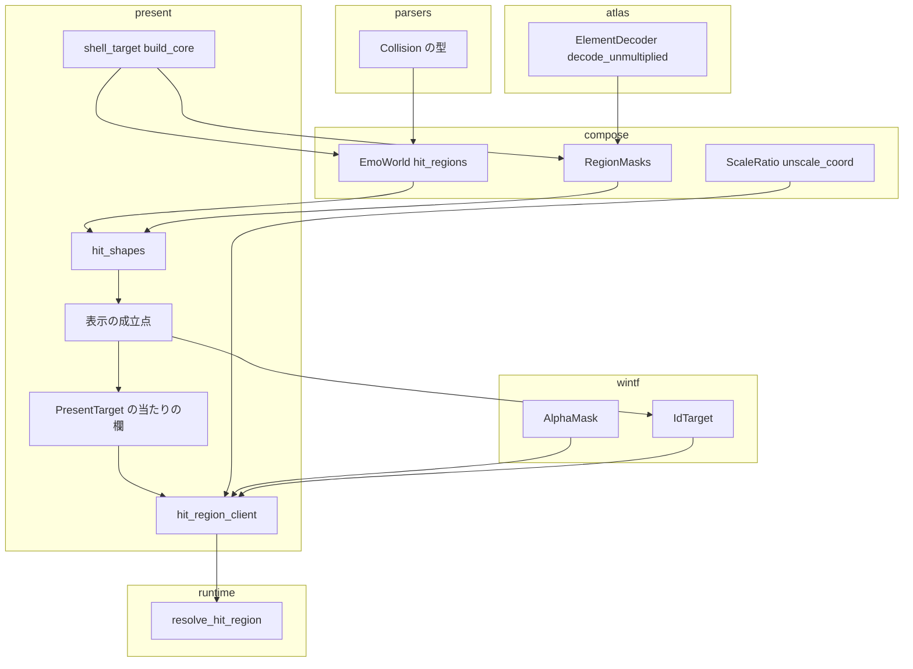
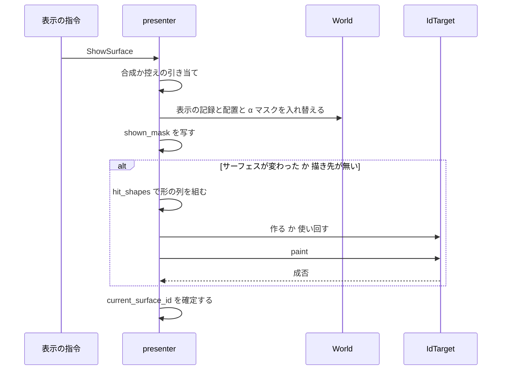
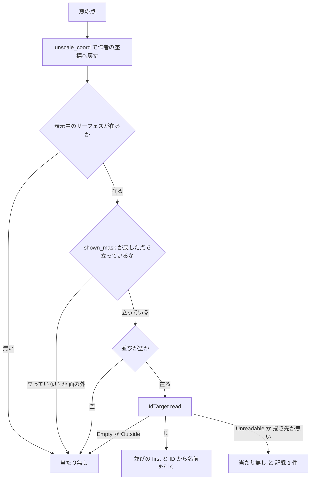

# Design Document: hit-id-pass

## Overview

**Purpose**: シェルの `collisionex*` の 4 つの形（`ellipse`・`circle`・`polygon`・`region`）を当たり判定として働かせ、`rect`（`collision*` の矩形を含む）も同じ仕組みへ寄せる。当たり判定の形を GPU の「ID の描き先」に塗り、点の 1 ピクセルの ID を読んで名前を引く（開発者の裁定 2026-11-20・`requirements.md` の決め 1）。

**Users**: 利用者は楕円・多角形・画像で囲んだ部位を触って部位ごとの反応を受け取る。ゴーストの作者は 5 つの形を混ぜて書ける。wintf の使い手は、形を ID で塗って 1 点の ID を読む口を得る。

**Impact**: 当たり判定の解決が「並びを後ろから 1 件ずつ調べる CPU の矩形の判定」から「色の絵の α を確かめ、ID の描き先の 1 ピクセルを読む」形へ替わる。CPU の矩形の判定は消す（決め 9）。`rect` の端は「左と上を含み、右と下を含まない」へ変わり、逆向きの矩形は並べ直して当たる（決め 5・決め 6）。読み手の「まだ働かない形」の記録は腕ごと消す（決め 10）。

この設計は、設計の段の試し（`research.md` 11 節・WARP と実 GPU）の結果で骨組みを決めている。試しで分かった要件の文との食い違いは「未決の議題」の節に集めた（要件の文の直しが要るものを含む）。

### Goals

- 5 つの形と `collision*` の矩形を 1 つの並びのまま ID の描き先へ塗り、点 1 つの判定を「α の確かめ 1 回＋ 1 ピクセルの読み 1 回＋名前の引き当て」にする。
- 表示の拡大率に依らず、サーフェスの 1 画素に当たる画面の画素がどれも同じ答えを返す（SSP は画像の画素ごとに決める＝`research.md` 10 節の読み 3）。
- 表示の成立と同じ呼び出しの中で ID の描き先を描き終え、変わる前の答えを返す窓を作らない。
- wintf に、areka の語を持たない ID の描き先（塗る・1 点を読む・読めないを区別する）を足す。

### Non-Goals

- `collisionex` の行の読み・持ち込みの規則（完了 `collisionex-regions`）。
- `animation*.collision*`・`animation*.collisionex*`、`collision-sort` の忠実な解決、カーソルの形の働き、マウスのイベントの送り方。
- 色の合成を D2D へ移すことと、クリックの透過の α の出どころの付け替え（`draw-methods-canon`）。
- D3D11 で形を描く道（整数の描き先・自前のシェーダー）。比べたうえで採らない（「描く道具と読み戻し」の節・未決の議題 3）。
- 拡大つきで ID を塗る口・描き手ごとに選べる ID の幅。

## Boundary Commitments

### This Spec Owns

- wintf の ID の描き先（`IdTarget`）と、形の型（`IdShape`・`IdForm`・`IdMask`）・答えの型（`IdRead`）。
- wintf の色分け画像の読み込み（`ColorMapData::from_image`）の透明な画素の扱いの直し（決め 12）。
- 画像の読み手の「色に α を掛けない形で読む口」（`areka-emo-atlas`）。
- `region` の画像からマスクを作る規則（色の完全一致・領域反転・透明な画素は黒）と、シェルの読み込みでの 1 度読み。
- 当たり判定の並びを ID の形の列へ直す規則（端・逆向き・負の半径・大きさ 0・サーフェスの外・上限）。
- presenter の当たり判定の解決（色の絵の α の確かめ → ID の読み → 名前）と、ID の描き先の持ち方・描き直す時点・装置の作り直しへの追従。
- 「まだ働かない形」の記録の撤去、台帳と `doc/COMPAT_ARCHITECTURE.md` §8 の書き直し、steering `tech.md` の WARP の例外の列。

### Out of Boundary

- 当たり判定の並びそのもの（`EmoWorld::hit_regions`・`hit_import.rs`）。読むだけで変えない。
- 窓の点を作者の座標へ戻す式（`ScaleRatio::unscale_coord`）。使うだけで変えない。
- クリックの透過（wintf の α マスクの当たり判定・`AlphaMaskResource`）。同じマスクを読むだけで、作り方も働きも変えない。
- 色の絵の描画面と、その 1 ピクセルの読み戻し（`SurfaceComposite`・`SurfaceReadback`）。この設計は使わない。
- areka 本体（`crates/areka/`）と `crates/areka-runtime/src/frame*`。`resolve_hit_region` の署名は変えない。

### Allowed Dependencies

- wintf の中: `GraphicsCore`（共有の DC・装置の失いの判定）・D2D（`windows` クレートの今の束縛）。新しい外部の依存は足さない。
- `areka-emo-compose` → `areka-emo-atlas`（読み手の口）・`areka-parsers`（当たり判定の型）。wintf には依らないまま。
- `areka-emo-present` → wintf の `IdTarget` 一式と `AlphaMask`、`areka-emo-compose` の `EmoWorld`・`ScaleRatio`・`RegionMasks`。
- 依存の向き: `areka-parsers` → `areka-emo-atlas` → `areka-emo-compose` → `areka-emo-present` → `areka-runtime`。wintf は areka のどのクレートにも依らない。逆向きの参照を足さない。

### Revalidation Triggers

- `ScaleRatio::unscale_coord` の式、`EmoWorld::hit_regions` の並びの約束、`Collision`／`CollisionShape` の形が変わるとき。
- 合成の外形の原点が (0,0) でなくなるとき（ID の描き先は表示中の絵の原寸と同じ座標に塗る）。
- `draw-methods-canon` が α マスクの出どころを替えるとき（色の絵の α の確かめの 1 か所を付け替える）。
- 形ごとの変形が要るようになるとき（`animation*.collisionex*`・合成の D2D 化の後）。`IdTarget::paint` に変形を足すかを見直す。
- wintf の束縛を `windows` クレートから windows-bindgen へ移すとき（`IdTarget` が使う D2D の口の一覧は「Technology Stack」）。
- `IdRead`・`IdForm` の腕を足し引きするとき（使い手の網羅の `match` が変わる）。

## Architecture

### Existing Architecture Analysis

- 当たり判定の解決の入口は `EmoPresenter::hit_region_client(&self, target, x, y)` で、`areka-runtime` の `resolve_hit_region(presenter, scope, x, y)` を通して本体のポインタの受け手から呼ばれる。受け手は tick の `Input` の段と窓のメッセージの中で走り、表示の指令の適用（`Update` の段）と描画（`RenderSurface` の段）の後にしか走らない。
- presenter は表示の成立点（`presenter/show.rs`）で、表示の記録・配置・α マスク（`AlphaMaskResource::set_shared`）を同じ呼び出しの中で入れ替える（中間の状態を見せない決まり）。装置に結びつく控え（命令の列）は `refresh_after_device_change` が捨てて出し直す。
- 色の合成は CPU（`areka-emo-compose`）で、表示の拡大は wintf が描画面へ描くときの D2D の変換だけが持つ。presenter が抱える絵・マスクはどれも原寸である。
- wintf には描画面ごとの入れ物 `SurfaceComposite`（1×1 の `CPU_READ` の写し先で 1 ピクセルを読む・同じ座標は読み直さない）が在り、ID の描き先の読み戻しはこの形を写す。wintf に D3D11 で描く道は無い（`com/d3d11.rs` は装置を作る 1 関数だけ）。

### 設計の段の試しで決まったこと（`research.md` 11 節）

| 試したこと | 結果（WARP と実 GPU） | 決め |
| --- | --- | --- |
| 縁のぼかしなしの塗りと SSP の測りの点（拡大率 1） | `rect` 100〜199・`ellipse` 100〜199・`circle` 110〜189・`polygon` 20〜79 は合う。混ざった画素は 0。大きさ 0 の形は 1 画素も塗らない。SSP と合わないのは、多角形の左と上の辺（決め 5 のとおり）と、楕円・円の周のそばの 3 点 (115,108)・(178,178)・(259,100) | 規則は「画素の中心が形の中か」の 1 つで通す。3 点は未決の議題 1 |
| 物理ピクセルの大きさで拡大つきに塗る | 矩形と軸に沿った多角形は、拡大率 2・5/4・3/2・11/10 で点を戻した答えと全部一致。曲線は細かさが変わる（一致しない画素が出る）。マスクの画像は `FillOpacityMask` が補間して ID が混ざり、最近傍で置く形は拡大率 11/10 で WARP の答えが点を戻した答えと 1,087 画素ずれた | ID の描き先はサーフェスの原寸で持ち、点の側を戻す |
| 原寸でマスクを置く（8 ビットの α の絵＋`FillOpacityMask`） | 面の中・面からはみ出す置き方とも誤り 0 | マスクはこの形で置く |
| WARP と実 GPU の画素の一致 | 矩形・マスク・頂点が整数で辺が交差しない多角形は一致。楕円・円は 1 つの形につき 0〜2 画素、辺が交差する多角形は 9 画素が分かれた（どれも画素の中心が周から約 0.1 画素以内） | 決定論のテストの点は周から離して選ぶ。知らせは未決の議題 3 |
| ID の色の往復 | 2,819 個の ID（各成分 0〜255 を含む）が 1 つも化けない。α を無視する的も作れる | 24 ビットを `B8G8R8A8` の色に載せる |
| D2D の的に整数の形式 | `R32_UINT`・`R8G8B8A8_UINT`・`R16_UINT` は `0x88982F80`（形式を扱えない）で断られる | D3D11 の整数の描き先は D2D では描けない |
| 1 ピクセルの読み戻しの待ち（実 GPU・512×512・各 300 回） | D2D 1 回＝中央値 396 µs・95% 点 605 µs／D2D 2 回＝817 µs／D2D で 2 枚を 1 度に＝360 µs／D3D11 の口で 1 回＝304 µs（描いた直後は 393〜405 µs でどれも同じ） | 読み戻しは D2D の 1×1 の写し先。D3D11 の口へは替えない |
| 塗る手間（実 GPU） | 矩形 1,000 件 1.5 ms・10,000 件 10.7 ms・2^20 件 663 ms／楕円 10,000 件 28 ms／5 角形 10,000 件 179 ms／300×300 のマスク 100 件＝絵の作成 約 170 ms＋塗り 約 8 ms | 塗る件数に上限を置く（未決の議題 5） |

### Architecture Pattern & Boundary Map



**Architecture Integration**:

- **選んだ形**: ID の描き先は wintf の単体の入れ物 `IdTarget` で、presenter が表示対象（target）ごとに持つ。描くのは表示の成立点（装置を借りられる所）、読むのは `&self` の `hit_region_client`。
- **境界**: 仕組み（塗る・読む・読めないの区別）は wintf、意味（どの ID がどの名前か・形の決め・`region` の色の規則）は areka。wintf の型は ukadoc と areka の語を持たない。
- **保つ形**: 表示・マスク・当たりの絵を同じ `apply` の中で入れ替える決まり／窓の点を戻す式の持ち主は `unscale_coord` だけ／`resolve_hit_region` の署名と `ClientHit` の形／点の判定ごとの `debug!` の 1 行。
- **新しい部品の理由**: `IdTarget`（GPU の描き先と読み戻しを 1 つに閉じる）・`RegionMasks`（画像の 1 度読みと色の規則を GPU 抜きで固定する）・`hit_shapes`（形の決めを 1 か所に置く）。
- **steering との整合**: wintf は areka に依らない／外部の依存を足さない／GPU のテストは実 GPU、WARP は例外の列に足した答えだけ／失敗の道には必ず記録。

#### ID の描き先をサーフェスの原寸で持つ理由

- 矩形とマスクの答えが、拡大率がどんな値でも SHIORI へ届けるローカル座標（戻した点）と食い違わない（要件 3.1・10.5 を構造で満たす）。物理ピクセルで塗ると、拡大率が 2 のべき乗で割り切れない値（11/10 など）のとき、端の画面の画素が隣のサーフェスの画素の答えを持ちうる（試しで確かめた）。
- `region` のマスクを 1 画素対 1 画素で置けるので、補間が起きない。物理ピクセルで置くには `region` 1 件ごとに ID の色を焼いた絵が要る（100 件で約 750 ms・GPU のメモリは件数 × 画像の面積 × 4 バイト）。
- 拡大率が変わっても描き直さない。描き先の大きさは原寸（クローディアで 333×500）。
- 形ごとの変形が要るようになったら、原寸の描き先の中で D2D の変換を掛けて塗れる（窓全体の拡大だけが点の側の戻しで済む）。

#### ID の描き先を presenter が持つ理由

- 表示の成立と同じ呼び出しで描き終える。受け手がどの段で走っても、変わった後の状態で答える（要件 4.4）。係に描かせる形は、指令の適用から描画の段までのあいだ古い絵が残る。
- 原寸で持つ描き先は、描画面の物理の大きさにも WUC の描画面の寿命にも依らない。寿命に効くのは装置の作り直しだけで、presenter は命令の列で同じ追従をすでに持つ。
- 描き直す時点（表示するサーフェスが変わった）を知っているのは presenter である。変わった時点が分かる値は、その時点で作る（毎フレーム比べない）。
- 本番と同じ道を、今ある presenter のテストの足場（実 GPU の `GraphicsCore` だけの World）で通せる。

#### 色の絵の α の出どころ

色の絵の α は、クリックの透過と同じ α マスク（原寸・閾値 128・`AlphaMask`）を、戻した点で引く。

- 当たるかどうかの α の持ち主を 1 つにする。マウスが窓に届くか（クリックの透過）と名前が返るか（この設計）が、同じ画素の集まりで決まる。
- 色の合成は今 CPU で、マスクは表示の成立点で入れ替わる。古い値が残る窓が無い。
- `draw-methods-canon` が合成を D2D へ移してマスクの出どころを替えるとき、クリックの透過と名前の解決は同じ 1 か所の付け替えで一緒に移る。
- 表示中の絵のマスクは target の欄に写しを持つ（共有の参照）。キャッシュから追い出された後も引ける。
- GPU の読み戻し（`SurfaceReadback`）で引く形は採らない理由と代案は、未決の議題 4。

#### 描く道具と読み戻し

| 形 | 描き方 | 読み戻し | 評価 |
| --- | --- | --- | --- |
| ⑴ D2D（採る） | `B8G8R8A8` へ縁のぼかしなし・不透明の ID の色で上書き | D2D の 1×1 の `CPU_READ` の写し先へ写して `Map` | 色の絵と同じ描き手。矩形・楕円・巻き数の多角形・マスクの口がそろう。ID は 24 ビットで化けない |
| ⑵ D3D11 の整数の描き先 | `R32_UINT` へ自前のシェーダーで描く | `CopySubresourceRegion`（1×1）→ `Map` | D2D は整数の形式へ描けない（試し）。楕円・巻き数の多角形・マスクを描く 2 つ目の描き手（シェーダー・頂点・ステンシル）を wintf に作ることになる。得るのは「本物の整数」と、周のそばの画素が装置で分かれないこと |
| ⑶ 折衷（D2D で描き D3D11 で読む） | ⑴ と同じ | D3D11 の `CopySubresourceRegion`（1×1）→ `Map` | 待ちは 304 µs 対 396 µs（描いた直後は同じ）。D2D と D3D11 の直列化の錠が要る。差が小さいので採らない |

開発者の言う「1 ピクセルだけ CPU に書き戻す方法」は、⑴ の読み戻しが内側で行っていること（1×1 だけを CPU から読める領域へ写して読む）と同じである。

### Technology Stack

| Layer | Choice / Version | Role in Feature | Notes |
|-------|------------------|-----------------|-------|
| 描画 | Direct2D（`windows` 0.62 の今の束縛） | ID の描き先への塗りと 1 ピクセルの読み戻し | 使う口: `ID2D1DeviceContext::{CreateBitmap, SetTarget, SetAntialiasMode, SetTransform, Clear, FillRectangle, FillEllipse, FillGeometry, FillOpacityMask, CreateSolidColorBrush}`・`ID2D1Factory::CreatePathGeometry`・`ID2D1GeometrySink::SetFillMode`・`ID2D1Bitmap1::{CopyFromBitmap, Map, Unmap}`。新しい機能フラグは要らない |
| 画像の読み | WIC（`areka-emo-atlas` の既定の腕） | `region` の画像を `32bppBGRA`（乗算なし）へ変換して読む | 色が書いた値から動かないことは実装の最初に確かめる（未決の議題 6） |
| ECS | bevy_ecs 0.19 | presenter が World から `GraphicsCore` を借りる（今と同じ） | 新しい部品・係・資源は足さない |
| 記録 | tracing | 読めない画像・読めない描き先・上限越え | 重さは「Error Handling」 |

## File Structure Plan

### Directory Structure

```
crates/wintf/src/ecs/graphics/
├── id_target.rs            # 新規: IdTarget・IdShape・IdForm・IdMask・IdRead・MAX_ID
├── id_target_tests.rs      # 新規: WARP の足場で ID を完全一致で固定
└── mod.rs                  # 変更: mod と pub use を足す
crates/wintf/tests/graphics/
└── id_target_test.rs       # 新規: crate の外から使える・実 GPU の読み戻しの待ちを測って出す
crates/areka-emo-atlas/src/
├── decode.rs               # 変更: ElementDecoder::decode_unmultiplied・MemoryDecoder の登録口
└── decode/wic_arm.rs       # 変更: 32bppBGRA への変換の道
crates/areka-emo-compose/src/
├── hit_mask.rs             # 新規: RegionMask・RegionMasks・色の規則（GPU に依らない）
├── hit_mask_tests.rs       # 新規
├── hit.rs                  # 削除: CPU の矩形の判定（hit_region_in・hit_region_scaled_in・ScaledHit・RegionPriority）
├── hit_order_tests.rs      # 削除: 重なりの順の確かめは emo-present の GPU のテストへ移す
├── world.rs                # 変更: RegionMasks を載せる口と読む口
└── lib.rs                  # 変更: 公開の一覧
crates/areka-emo-present/src/
├── hit_shapes.rs           # 新規: 当たり判定の並び → IdShape の列（形の決め・上限）
├── hit_shapes_tests.rs     # 新規: GPU なしで列を確かめる
├── shell_target.rs         # 変更: region の画像の 1 度読み・読めないファイルの記録・ShapesInactive の出口を消す
├── presenter/target.rs     # 変更: 当たりの欄（hit_picture・shown_mask・記録の控え）
├── presenter/show.rs       # 変更: 表示の成立点で shown_mask を写し ID の描き先を描く
├── presenter/refresh.rs    # 変更: 装置の変化で ID の描き先を捨てる
├── presenter/hit.rs        # 変更: 解決を「α → ID → 名前」へ替える
├── presenter_hit_shape_tests.rs    # 新規: 形ごとの内外・端・重なり（実 GPU）
├── presenter_hit_region_tests.rs   # 新規: region の色・反転・置き方（実 GPU）
└── presenter_hit_picture_tests.rs  # 新規: 描き直さない・読めない・立ち直り・α
crates/areka-parsers/src/shell/
└── model.rs, decode.rs, parse.rs, mod.rs   # 変更: ShellIssue::ShapesInactive と ShapeCounts を消す
```

### Modified Files

- `crates/wintf/src/ecs/layout/hit_region/mod.rs` — `ColorMapData::from_image` を乗算しない読みへ替え、完全に透明な画素を対応の外にする（決め 12）。確かめは `crates/wintf/tests/layout/` の色分け画像のテストへ足す。
- `crates/wintf/src/ecs/graphics/visual/draw/README.md` — ID の描き先の使い方（作る・塗る・答えの読み分け・装置の作り直しは使い手が作り直す）を書き足す。
- `crates/areka-runtime/src/hit_region.rs` — 説明のうち矩形の端と「α を参照しない」を書いた所だけを直す。署名とテストは変えない。
- `crates/areka-emo-present/src/presenter.rs`・`lib.rs` — `mod` の宣言と `use`（`RegionPriority` を外す）。
- `crates/areka-emo-present/src/presenter/hub.rs`・`presenter/replace.rs` — 対象を作る所で、当たりの欄を空で始める。
- `crates/areka-emo-compose/src/normalized.rs`・`crates/areka-emo-present/src/presenter_read_accessor_tests.rs` — 消す関数（`hit_region_in`・`hit_region_scaled_in`）を名指しした説明とテストを、新しい解決に合わせて直す。
- 既存のテストの書き直し: `crates/areka-parsers/src/shell/decode_collisionex_tests.rs`・`crates/areka-emo-present/src/shell_target_element_base_tests.rs`（「まだ働かない形」の行）・`presenter_nesting_hit_tests.rs`・`presenter_refresh_and_log_tests.rs`・表示の拡大率つきの当たりのテスト（`presenter_dpi_scale_tests.rs`・`presenter_fractional_scale_tests.rs` のうち当たりを確かめる所）・`presenter_test_support.rs`（足場）・`crates/areka-emo-compose/src/hit_import_tests.rs` と `fold_merge_tests.rs`（`RegionPriority` と `hit_region_in` を使う所を、並びそのものの確かめへ書き直す）。
- 文書: `doc/ukadoc-coverage/ledger/assets.toml`（`collisionex*` の行・`collision*` の行の「hit が当たり判定に使う」の文）・`doc/COMPAT_ARCHITECTURE.md` §8・`doc/ukadoc-coverage/roadmap-draft.md`（「ID の描き先に塗るのは `hit-id-pass`」の文）・`.kiro/steering/tech.md`（WARP の例外の列）。
- 触らない: `crates/areka/`・`crates/areka-runtime/src/frame*`・`crates/areka-emo-compose/src/hit_import.rs`・`crates/areka-emo-compose/src/scale.rs`。

コードの説明には spec の名前・要件の番号・タスクの番号を書かない（`CLAUDE.md` の Comments の節）。この表の対応は設計の文書の中だけに置く。

## System Flows

### 表示の成立と ID の描き先



- 描き直すのは、描き先が無い・塗ってあるサーフェスが違う・大きさが原寸と違う、のどれかのときだけ（要件 6.3）。コマが進むだけの適用と拡大率だけの変化では描かない。
- 当たり判定の並びが空のサーフェスには描き先を作らない。
- 塗りに失敗しても表示は成立させる。描き先は「読めない」のまま残り、次の表示の成立で塗り直す。
- 装置の変化（`refresh_after_device_change`）では全部の対象の描き先を捨て、見えている対象の出し直しが新しい装置で塗る。

### 点の判定



α の確かめを先に置くので、透明な所では GPU を読まない。同じ点の読み直しは `IdTarget` が控えで返す（要件 5.12）。どの枝でも戻した点は返し、`debug!` の 1 行は今と同じ欄で残す。

## Requirements Traceability

| Requirement | Summary | Components | Interfaces | Flows |
|-------------|---------|------------|------------|-------|
| 1.1, 1.2, 1.3 | 楕円・円・多角形の当たりと端 | hit_shapes・IdTarget | `hit_shapes`・`IdForm::{Ellipse, Polygon}` | 点の判定 |
| 1.4 | 交差する多角形は巻き数 | IdTarget | `IdForm::Polygon`（巻き数で塗る） | — |
| 1.5 | 画素の中心の 1 つの規則 | IdTarget | 縁のぼかしなしの塗り | — |
| 1.6, 1.7, 1.8, 1.9 | 逆向き・負の半径・大きさ 0 | hit_shapes | 形の決めの表 | — |
| 1.10 | 面の外・整数の極値 | hit_shapes・IdTarget | 切り取りと座標の頭打ち | — |
| 2.1, 2.11 | 画像の探し方・読めない画像 | RegionMasks・shell_target | `RegionMasks::load` | — |
| 2.2, 2.3, 2.4, 2.8, 2.9, 2.10, 2.12 | 色の一致・反転・透明・全部が指定色 | RegionMasks・画像の読み手 | `region_mask`・`decode_unmultiplied` | — |
| 2.5, 2.6, 2.7 | 置く位置・画像の外・はみ出し | hit_shapes・IdTarget | `IdForm::Mask` | — |
| 3.1 | `rect` の端と逆向き・拡大率に依らない | hit_shapes・hit_region_client | `IdForm::Rect`・原寸の描き先 | 点の判定 |
| 3.2, 3.3 | 画家の順・上が当たらなければ下 | IdTarget | 列の順の上書き | — |
| 3.4, 3.6 | 持ち込みと並びを変えない | hit_shapes | `EmoWorld::hit_regions` をそのまま読む | — |
| 3.5 | 同じ入力に同じ答え | IdTarget・hit_region_client | — | — |
| 3.7, 3.8 | 255 越えの区別・上限越え | hit_shapes | `HIT_SHAPE_LIMIT`・`HitShapePlan` | — |
| 4.1 | 色の絵の α と面の外 | hit_region_client | `shown_mask` | 点の判定 |
| 4.2, 4.3 | 拡大率・ローカル座標を変えない | hit_region_client | `unscale_coord`・`ClientHit::surface_point` | 点の判定 |
| 4.4 | 変わった後の状態で答える | 表示の成立点 | 同じ `apply` で塗る | 表示の成立 |
| 4.5 | 表示が無いとき | hit_region_client | — | 点の判定 |
| 5.1, 5.2 | 求めたときだけ描き先を持つ | IdTarget | `IdTarget::new`（大きさは使い手が渡す＝未決の議題 2） | — |
| 5.3, 5.4, 5.5, 5.6 | 上書き・ぼかしなし・巻き数・マスク | IdTarget | `IdTarget::paint` | — |
| 5.7 | 形の置き方 | IdTarget | 形の座標は描き先の画素（拡大の口は持たない＝未決の議題 2） | — |
| 5.8, 5.9, 5.10, 5.11, 5.12 | 読み戻しと答えの読み分け・控え | IdTarget | `IdTarget::read`・`IdRead` | — |
| 5.13 | 装置の失い・大きさの変化 | IdTarget・presenter | 読めないを返す／使い手が作り直す（未決の議題 2） | 表示の成立 |
| 5.14, 5.15, 5.16 | ID の幅 1 つ・語・依存なし | IdTarget | `MAX_ID` | — |
| 5.17 | 色分け画像の透明な画素 | ColorMapData | `ColorMapData::from_image` | — |
| 6.1, 6.2 | 画像の 1 度読みと使い回し | RegionMasks | `RegionMasks::load` | — |
| 6.3 | 描き直す時点 | 表示の成立点 | `HitPicture` の照合 | 表示の成立 |
| 6.4 | 点 1 つの手間 | hit_region_client | — | 点の判定 |
| 6.5 | 待ちの測り | id_target_test | 測りのテスト・「Performance」 | — |
| 7.1 | 読めない画像の記録 | shell_target | `RegionMasks::unreadable` | — |
| 7.2 | 「まだ働かない形」を出さない | 読み手 | `ShellIssue::ShapesInactive` の撤去 | — |
| 7.3, 7.4 | 読めない描き先の記録と立ち直り | hit_region_client・表示の成立点 | 記録の控え | 両方 |
| 7.5 | 点の判定ごとの `debug!` | hit_region_client | 今の欄のまま | — |
| 7.6 | 記録の無い失敗の道を作らない | 全部 | 「Error Handling」の表 | — |
| 8.1, 8.2, 8.3 | 名前の届き方を変えない | resolve_hit_region | 署名と `HitRegion` を変えない | — |
| 8.4 | `rect` だけのシェルの当たり方 | hit_shapes・hit_region_client | — | — |
| 8.5 | バルーンとクリックの透過を変えない | — | α マスクは読むだけ | — |
| 8.6 | 本体を書き換えない | — | `resolve_hit_region` の署名を変えない | — |
| 9.1, 9.2, 9.3, 9.6 | 台帳と §8 | 文書 | — | — |
| 9.4 | コードの説明の書き直し | 全部 | — | — |
| 9.5 | wintf の描画の文書 | 文書 | `visual/draw/README.md` | — |
| 10.1, 10.2, 10.4, 10.5, 10.6, 10.11 | 形・重なり・拡大率・α の確かめ | テスト | 「Testing Strategy」 | — |
| 10.3 | `region` の確かめ | テスト | 同上 | — |
| 10.7, 10.8 | wintf の WARP の確かめ | テスト | 同上 | — |
| 10.9 | 描き直さない・1 度読み | テスト | 同上 | — |
| 10.10, 10.12 | クローディアの実機 | 実機の確かめ | 同上 | — |
| 10.13 | 既存のテストの書き直し | テスト | 「Modified Files」 | — |

## Components and Interfaces

| Component | Domain/Layer | Intent | Req Coverage | Key Dependencies (P0/P1) | Contracts |
|-----------|--------------|--------|--------------|--------------------------|-----------|
| IdTarget | wintf 描画 | 形を ID で塗り 1 点の ID を読む | 1.4, 1.5, 3.2, 3.3, 3.5, 5.1〜5.16 | GraphicsCore (P0) | Service, State |
| ColorMapData の直し | wintf 配置 | 透明な画素を対応の外にする | 5.17 | WIC (P1) | Service |
| decode_unmultiplied | 画像の読み手 | 色に α を掛けない形で読む | 2.9, 2.10 | WIC (P0) | Service |
| RegionMasks | 合成（GPU なし） | `region` の画像の 1 度読みと色の規則 | 2.1〜2.4, 2.8〜2.12, 6.1, 6.2, 7.1 | ElementDecoder (P0) | Service, State |
| hit_shapes | 提示 | 並びを ID の形の列へ直す | 1.1〜1.3, 1.6〜1.10, 2.5〜2.7, 3.1, 3.4, 3.6〜3.8 | RegionMasks (P0)・IdForm (P0) | Service |
| 当たりの欄と表示の成立点 | 提示 | ID の描き先の寿命と描き直し | 4.4, 6.3, 7.4 | IdTarget (P0)・GraphicsCore (P0) | State |
| hit_region_client | 提示 | α → ID → 名前 | 4.1〜4.5, 6.4, 7.3, 7.5, 8.1〜8.5 | shown_mask (P0)・IdTarget (P0) | Service |
| shell_target の読み | 提示 | 画像を読み EmoWorld へ載せる | 2.1, 6.1, 7.1, 7.2 | RegionMasks (P0) | Batch |

### wintf

#### IdTarget

| Field | Detail |
|-------|--------|
| Intent | 画面に出ない ID の描き先。形の列を ID で上書きして塗り、1 点の ID をその場で読む |
| Requirements | 1.4, 1.5, 3.2, 3.3, 3.5, 5.1, 5.2, 5.3, 5.4, 5.5, 5.6, 5.7, 5.8, 5.9, 5.10, 5.11, 5.12, 5.13, 5.14, 5.15, 5.16 |

**Responsibilities & Constraints**

- 的は `B8G8R8A8_UNORM`・α 掛け済み・96 DPI の D2D のビットマップ。ID は不透明の色（B＝下位 8 ビット・G＝中位・R＝上位・A＝255）で塗り、塗っていない画素は透明（A＝0）のまま。読みは A＝0 を「ID なし」、A＝255 を ID とする。
- 塗りは `D2D1_ANTIALIAS_MODE_ALIASED`・変換は恒等・`SOURCE_OVER`。不透明の色を縁のぼかしなしで塗るので、後の形が前の形を上書きし、ID は混ざらない。
- 多角形は `D2D1_FILL_MODE_WINDING` の path geometry で塗る。マスクは 8 ビットの α の絵（0 か 255 だけ）を作り、`FillOpacityMask` で整数の位置へ 1 画素対 1 画素で置く。
- 形の座標は描き先の画素の単位（左上が (0,0)）。拡大と変換の口は持たない。
- ID の幅は 24 ビットの 1 つ（1〜`MAX_ID`）。`MAX_ID` を越える ID を含む列は塗らずに失敗にする。
- ID の意味は持たない。公開の名前に ukadoc と areka の語を使わない。
- 共有の DC を借りて塗る（UI スレッドから呼ぶ約束）。戻るとき DC は的なし・変換は恒等・ぼかしの設定は元どおり。
- 読みは自分の 1×1 の写し先だけに触る（共有の DC に触らない）。写し先と控えは 1 つの錠の中に置く。

**Dependencies**

- Inbound: presenter — 塗りと読み (P0)
- Outbound: GraphicsCore — 共有の DC・装置の失いの判定 (P0)
- External: Direct2D — 塗りと写し (P0)

**Contracts**: Service [x] / State [x]

##### Service Interface

```rust
pub const MAX_ID: u32 = 0x00FF_FFFF;

/// 画素ごとに「立っている／いない」だけを持つ絵。
pub struct IdMask { /* 幅・高さ・0 か 255 の 1 バイトの列 */ }
impl IdMask {
    /// 一辺は 1〜16,384。外れたら None。
    pub fn new(width: u32, height: u32, is_set: impl Fn(u32, u32) -> bool) -> Option<Self>;
    pub fn width(&self) -> u32;
    pub fn height(&self) -> u32;
}

pub enum IdForm {
    Rect { left: f32, top: f32, right: f32, bottom: f32 },
    Ellipse { center: (f32, f32), radius: (f32, f32) },
    /// 書いた順の頂点。最後の頂点から最初の頂点へ閉じ、巻き数が 0 でない所を塗る。
    Polygon(Vec<(f32, f32)>),
    /// マスクの左上を (left, top) に置く。立っている画素にだけ ID を置く。
    Mask { mask: std::sync::Arc<IdMask>, left: i32, top: i32 },
}

pub struct IdShape { pub id: std::num::NonZeroU32, pub form: IdForm }

#[derive(Clone, Copy, Debug, PartialEq, Eq)]
pub enum IdRead {
    Id(std::num::NonZeroU32),
    /// 塗られていない画素（ID なし）。
    Empty,
    /// 座標が描き先の外（画素なし）。GPU から読まない。
    Outside,
    /// まだ塗っていない・装置が無いか失われた・塗りか読みが失敗した。
    Unreadable,
}

impl IdTarget {
    pub fn new(core: &GraphicsCore, size: (u32, u32)) -> windows::core::Result<Self>;
    pub fn size(&self) -> (u32, u32);
    /// 塗り終えた回数（0＝まだ）。
    pub fn generation(&self) -> u64;
    /// 透明に塗ってから列の順に塗る。失敗したら理由を記録し、読めない状態にする。
    pub fn paint(&mut self, core: &GraphicsCore, shapes: &[IdShape]) -> windows::core::Result<()>;
    pub fn read(&self, x: u32, y: u32) -> IdRead;
}
```

- Preconditions: `paint` は UI スレッドから呼ぶ。`size` の一辺は 1〜16,384。
- Postconditions: `paint` が成功すると世代が 1 上がり、以後の `read` は塗り終えた絵を答える。`paint` が失敗すると世代を 0 に戻し、`read` は `Unreadable` を返す（前の絵も「ID なし」も答えない）。`read` は座標が外なら `Outside`、同じ座標・同じ世代なら GPU から読まずに前と同じ答えを返す。
- Invariants: 答えは `Id`（塗った ID のどれか 1 つ）・`Empty`・`Outside`・`Unreadable` のどれか。A が 0 でも 255 でもない画素を読んだら（起きないはずの形）`error!` を残して `Unreadable`。

##### State Management

- State model: `未塗り（世代 0）` → `塗り済み（世代 n）` → 読みか塗りの失敗で `未塗り` へ戻る。読みの失敗は 1 度だけ `error!` を残し、塗り直すまで GPU に触らずに `Unreadable` を返す。
- 装置の失いによる失敗は `GraphicsCore::is_lost_failure` で見分け、`paint` では `error!` を残さない（立ち直りの道が 1 度だけ記録する・`SurfaceReadback` と同じ決まり）。`read` は `GraphicsCore` を受けないので見分けず、1 度だけ記録する。
- 装置が作り直されたら、使い手が新しい `IdTarget` を作って塗り直す（古い装置の描き先は使い回せない）。
- Concurrency: `IdTarget` は D2D の多スレッドの工場の系列の資源を持ち、`Send`・`Sync` の根拠は `SurfaceComposite` と同じ（写し先と控えは錠の中）。

**Implementation Notes**

- Integration: `crates/wintf/src/ecs/graphics/mod.rs` で `pub use`。crate の中の WARP のテストは DC を直に受ける口（`pub(crate)`）を使い、公開の口は同じ手順を `GraphicsCore` の DC で呼ぶ。
- Validation: ID の往復（各成分 0・1・127・128・254・255 と `MAX_ID`）・形の端・巻き数・上書きの順・マスクの置き方・答えの読み分け・控え・失敗の後の `Unreadable`。
- Risks: 楕円・円・斜めの辺の周のすぐそば（画素の中心が周から約 0.1 画素以内）の画素は、装置で答えが分かれうる（試しで 1 つの形につき 0〜9 画素）。同じ装置では常に同じ答え。

#### ColorMapData の直し

| Field | Detail |
|-------|--------|
| Intent | 色分け画像の読み込みで、完全に透明な画素をどの領域にも対応させない |
| Requirements | 5.17 |

- `ColorMapData::from_image` の変換先を `GUID_WICPixelFormat32bppBGRA`（乗算なし）へ替え、α が 0 の画素を対応の外（ID 0）にする。α が 1 以上の画素は、掛ける前の R・G・B で対応を引く。
- `region` の読みにはこの口を使わない（1 色 → 1 つの名前・先に書いた方が勝つ・画像を伸ばす、という作りが `region` と合わない）。
- 確かめ: 透明な黒・半透明の指定色・不透明の指定色の 3 画素を持つ絵で、領域の番号を固定する。

### 画像の読み手（`areka-emo-atlas`）

#### decode_unmultiplied

| Field | Detail |
|-------|--------|
| Intent | 画像を、色に α を掛けない 8 ビット BGRA で読む |
| Requirements | 2.9, 2.10 |

```rust
pub trait ElementDecoder {
    // 既存の口はそのまま。
    /// 色に α を掛けない BGRA で読む。抜き色・透過の宣言・`.pna` は当てない。
    /// 既定は Err（この読み手は乗算しない読みを持たない）。
    fn decode_unmultiplied(&self, path: &Path) -> Result<DecodedImage, DecodeError>;
}
```

- 既定の腕（WIC）は 1 枚目のコマを `GUID_WICPixelFormat32bppBGRA` へ変換して返す。α の無い絵は全部の画素が α＝255。一辺の上限（16,384）は今の読みと同じ。
- テストの腕 `MemoryDecoder` に、乗算しない絵を登録する口を足す。
- 既定の実装（`Err`）を持たせるので、ほかの読み手の実装は書き換えなくてよい。

### 合成（`areka-emo-compose`・GPU に依らない）

#### RegionMasks

| Field | Detail |
|-------|--------|
| Intent | `region` の画像をファイルごとに 1 度読み、（ファイル・色・反転）ごとのマスクを持つ |
| Requirements | 2.1, 2.2, 2.3, 2.4, 2.8, 2.9, 2.10, 2.11, 2.12, 6.1, 6.2, 7.1 |

```rust
/// 画素ごとに「当たる／当たらない」を持つ、画像と同じ大きさのマスク。
pub struct RegionMask { /* 幅・高さ・画素ごとの真偽 */ }
impl RegionMask {
    pub fn width(&self) -> u32;
    pub fn height(&self) -> u32;
    pub fn is_set(&self, x: u32, y: u32) -> bool;
}

/// 乗算しない BGRA の絵から、指定色（反転つき）のマスクを作る。
pub fn region_mask(image: &DecodedImage, rgb: [u8; 3], invert: bool) -> RegionMask;

pub struct RegionMasks { /* （ファイル・色・反転）→ マスク、読めなかったファイルと理由 */ }
impl RegionMasks {
    /// 並びの中の region を全部たどり、ファイルごとに 1 度だけ読む。
    pub fn load<'a>(
        regions: impl Iterator<Item = &'a CollisionRegion>,
        base_dir: &Path,
        decoder: &impl ElementDecoder,
    ) -> Self;
    /// 読めなかったファイルの region には None。
    pub fn get(&self, region: &CollisionRegion) -> Option<&std::sync::Arc<RegionMask>>;
    /// 読めなかったファイル（書いた名前と理由）。ファイルごとに 1 件。
    pub fn unreadable(&self) -> &[(String, String)];
}
```

**色の規則**（`region_mask`）

| 画素 | 比べる色 |
| --- | --- |
| α＝0 | 蓄えた R・G・B に依らず (0,0,0) |
| α＝1〜255 | 蓄えた R・G・B（α を掛ける前） |

- 一致は 3 成分の完全一致。`invert` が偽なら一致した画素、真なら一致しなかった画素を立てる。全部の画素が指定色でも、そのまま全部を立てる（SSP の「Color not found」は写さない・決め 14）。
- ファイルは `base_dir.join(書いた名前)` で開く（サーフェスの絵と同じ決まり）。同じファイルかどうかは、区切りを揃え ASCII の大小文字を畳んだ名前で見分ける。
- `EmoWorld` に `RegionMasks` を共有の参照で載せる口（`set_region_masks`）と読む口（`region_masks`）を足す。スコープの数だけ面の表を組んでも、マスクの実体は 1 つ。

**削除**: `hit.rs` の `hit_region_in`・`hit_region_scaled_in`・`ScaledHit`・`RegionPriority` と、その単体のテストを消す（CPU の判定を残さない・決め 9）。`RegionPriority` は腕が 1 つ（画家の順）で、並びの順は列の順の上書きがそのまま持つ。

### 提示（`areka-emo-present`）

#### hit_shapes

| Field | Detail |
|-------|--------|
| Intent | 当たり判定の並びを、ID の形の列へ直す（GPU に触らない純粋な関数） |
| Requirements | 1.1, 1.2, 1.3, 1.6, 1.7, 1.8, 1.9, 1.10, 2.5, 2.6, 2.7, 3.1, 3.4, 3.6, 3.7, 3.8 |

```rust
pub(crate) const HIT_SHAPE_LIMIT: usize = 65_536;

pub(crate) struct HitShapePlan {
    pub shapes: Vec<IdShape>,
    /// ID 1 に当たる並びの中の位置（ID n の名前は 並び[first + n - 1]）。
    pub first: usize,
    /// 上限を越えて塗らなかった件数（並びの先頭の側）。
    pub dropped: usize,
}

pub(crate) fn hit_shapes(
    regions: &[Collision],
    masks: Option<&RegionMasks>,
    extent: (u32, u32),
    limit: usize,
) -> HitShapePlan;
```

**形の決め**（並びの順は変えない・後ろほど手前）

| 形 | 直し方 | 塗らない場合 |
| --- | --- | --- |
| `Rect` | 左右・上下を並べ直し、面の外形（0,0〜幅,高さ）で切る | 幅か高さが 0・面と重ならない |
| `Ellipse` | 左右・上下を並べ直し、囲みの長方形に内接する楕円（中心と半径は f64 で求めて f32 へ） | 幅か高さが 0・囲みが面と重ならない |
| `Circle` | 半径は絶対値。（中心−半径）〜（中心＋半径）の正方形に内接する円 | 半径 0・囲みが面と重ならない |
| `Polygon` | 頂点を書いた座標のまま渡す | 頂点が 3 つ未満（面積 0 の多角形は塗っても 1 画素も立たない） |
| `Region` | `masks.get` のマスクを `IdMask` にして、型が運ぶ「画像を置く位置」へ置く | マスクが無い（読めない画像）・置いた矩形が面と重ならない |

- ID は `並びの位置 − first ＋ 1`。塗らない件も ID の席は使う（名前の引き当てを位置だけで決める）。
- 並びが `limit` を越えたら、後ろ（手前）から `limit` 件だけを塗り、先頭の側の越えた分は塗らない（`first`＝越えた件数）。本番の `limit` は `HIT_SHAPE_LIMIT`、テストは小さい値を渡す。
- 座標は i64 から f32 へ移すとき ±2^24 で頭を打つ（溢れも panic も無い）。±2^24 の中の整数は正確に移る。それを越える座標を持つ形は、面の中の部分が近似になる（試し: 半径 2^24 の円でも 2〜4 ms で塗れ、失敗しない）。
- マスクの絵と楕円は面の外へはみ出したまま渡してよい（描き先が切る）。

#### 当たりの欄と表示の成立点

| Field | Detail |
|-------|--------|
| Intent | target ごとに ID の描き先と表示中の α マスクを持ち、表示の成立点で入れ替える |
| Requirements | 4.4, 6.3, 7.4 |

```rust
struct HitPicture {
    /// 塗ってあるサーフェス。
    surface_id: u32,
    /// `HitShapePlan::first`。
    first: usize,
    target: IdTarget,
}
// PresentTarget に足す欄
hit_picture: Option<HitPicture>,
shown_mask: Option<std::sync::Arc<AlphaMask>>,
hit_notes: HitNotes, // 記録を 1 度に抑える控え（読めない・上限越え）
```

`hit_notes` は `&self` の読み（`hit_region_client`）から立てるので `Cell` で持つ（presenter は UI スレッド専用で、ほかのスレッドへ渡らない）。

- **描く時点**: 表示の成立点で、α マスクを `AlphaMaskResource` へ渡すのと同じ所。`shown_mask` に同じ参照を写し、続けて「描き先が無い・`surface_id` が違う・大きさが原寸と違う」のどれかなら `hit_shapes` → `IdTarget`（大きさが同じなら使い回す）→ `paint`。
- **並びが空**のサーフェスでは `hit_picture` を `None` にする（描き先を作らない）。
- **失敗**: `GraphicsCore` が無い・`IdTarget::new` か `paint` が失敗したら `hit_picture` を `None` にして表示は成立させる。次の表示の成立でまた試す。成功した回に「読めない」の控えを下ろす（立ち直り）。
- **装置の変化**: `refresh_after_device_change` が全部の対象の `hit_picture` を捨てる。ふつうの `InvalidateCache` では捨てない（ID の絵は合成の画素に依らない）。
- **対象の差し替え**（シェルの切り替え）は対象を作り直すので、欄は空から始まる。
- `Hide` では欄を残す（`current_surface_id` が `None` になるので当たらない）。

#### hit_region_client

| Field | Detail |
|-------|--------|
| Intent | 窓の点から、当たり判定の名前と作者の座標の点を返す |
| Requirements | 4.1, 4.2, 4.3, 4.4, 4.5, 6.4, 7.3, 7.5, 8.1, 8.2, 8.3, 8.4, 8.5 |

```rust
impl EmoPresenter {
    pub fn hit_region_client(&self, target: TargetId, x: i64, y: i64) -> ClientHit<'_>;
}
```

- 署名・`ClientHit`・`surface_point` の作り方（`unscale_coord`）・拡大率の出どころ（`applied` の直読）・表示が無いときの縮退・`applied` が無いときの `warn!` は今のまま。
- 名前の決め方だけを替える（「System Flows」の点の判定）。戻した点が負か原寸の外なら α の確かめで当たり無しになる。
- ID から名前: `並び[first + id − 1]`。位置が並びの外なら（起きないはずの形）`error!` を残して当たり無し。
- 読めないとき（`Unreadable`・並びが在るのに描き先が無い・塗ってあるサーフェスが表示中と違う）は当たり無しにし、`warn!` を 1 件だけ残す。控えは `hit_notes` に持ち、塗り直しの成功で下ろす。
- `debug!` の 1 行（拡大率・窓の点・作者の座標の点・名前）は欄も文も変えない。

#### shell_target の読み

| Field | Detail |
|-------|--------|
| Intent | シェルの読み込みで `region` の画像を読み、面の表へ載せる |
| Requirements | 2.1, 6.1, 7.1, 7.2 |

##### Batch / Job Contract

- Trigger: `build_core`（シェルの読み込みの核・記録を出す読みと出さない読みの両方）。
- Input: 面の表の全サーフェスの当たり判定の並び（持ち込みを含む）の `Region`。
- Output: `ShellTarget` が `Arc<RegionMasks>` を持ち、`build_world`／`take_world` が面の表へ載せる。
- 記録: 記録を出す読みのとき、読めなかったファイルごとに `warn!` を 1 件（ファイル名と理由）。記録を出さない読み（置き方の採寸）でも画像は読む（採寸のために読み方を分けない。`region` を持たないシェルでは 0 回）。
- `ShellIssue::ShapesInactive` を出す所を消す（腕そのものは読み手で消す）。

### 読み手（`areka-parsers`）

- `ShellIssue::ShapesInactive`・`ShapeCounts`・`Reading` の `inactive`／`first_inactive`／`finish` の数え上げを消す。行の読み方は変えない。
- `CollisionShape::Rect` の説明「今当たるのはこの形だけ」など、「まだ働かない」と書いた説明を、着地した働きに合わせて書き直す（要件 9.4）。

## Data Models

### Domain Model

- **当たり判定の並び**（`EmoWorld::hit_regions(サーフェス番号)`）: 書いた順・後ろほど手前。持ち主は面の表。この設計は読むだけ。
- **ID**: 並びの位置から決まる 1 始まりの番号。表は持たず、`first` と位置の足し算で名前に戻す。ID は表示対象の中だけで意味を持ち、外へ出さない。
- **ID の描き先**: 表示中のサーフェス 1 枚ぶん。大きさは表示中の絵の原寸。座標は当たり判定の座標と同じ（合成の外形の原点が (0,0)）。
- **不変条件**: `hit_picture.surface_id == current_surface_id` のときだけ答える／`hit_picture.target.size() == native_size`／`shown_mask` は表示中の絵の α（`AlphaMaskResource` へ渡したのと同じ実体）。

### Data Contracts & Integration

- wintf ↔ areka: `IdShape` の列（ID と形）と `IdRead`。ID の意味は areka だけが知る。
- 読み手 ↔ 合成: `DecodedImage`（`decode_unmultiplied` の答えは乗算なし・それ以外の口は今のまま乗算済み）。
- 提示 ↔ 結線: `ClientHit`・`HitRegion` は変えない。

## Error Handling

### Error Strategy

読めない・塗れないは「当たり無し」に倒し、CPU の判定へは落とさない（決め 9）。表示は当たりの絵の失敗で止めない。どの失敗の道にも記録を 1 つ置く。

### Error Categories and Responses

| 起きること | 答え | 記録 |
| --- | --- | --- |
| `region` の画像が無い・読めない・読み手が乗算しない読みを持たない | その当たり判定は塗らない（下の当たり判定は生きる） | 読み込みごと・ファイルごとに `warn!` 1 件（ファイル名・理由） |
| 並びが上限（65,536）を越える | 先頭の側の越えた分を塗らない | 対象とサーフェスごとに `warn!` 1 件（並びの件数・塗らなかった件数） |
| `GraphicsCore` が無い・無効 | 描き先を作らない → 読みは当たり無し | 最初の点の判定で `warn!` 1 件（下の行と同じ控え） |
| `IdTarget::new`・`paint` の失敗 | 描き先を捨てる。表示は成立 | wintf が `error!`（HRESULT つき。装置の失いは記録しない）。presenter は最初の点の判定で `warn!` 1 件 |
| `IdTarget::read` の失敗 | `Unreadable` → 当たり無し | wintf が `error!` を 1 度。presenter は `warn!` 1 件。塗り直しの成功まで繰り返さない |
| ID が並びの外・A が 0 でも 255 でもない画素 | 当たり無し | `error!`（内部の決まりの破れ） |
| 表示中のサーフェスが無い | 当たり無し | 無し（今と同じ） |

### Monitoring

- 実機の確かめは、今の `debug!` の 1 行（`[hit_region_client]`）を拾う。
- 塗りの所要は、今の適用の所要の記録の段とは別に足さない（描き直すのはサーフェスが変わった回だけで、所要は「Performance」の表のとおり小さい）。

## Testing Strategy

GPU を使うテストは実のハードウェア GPU で回し、wintf の ID の描き先の答えだけを WARP の足場で固定する。曲線と斜めの辺の点は、周から 0.25 画素より離して選ぶ（装置で分かれる画素を期待値にしない）。

### wintf（WARP・`id_target_tests.rs`・全体テストで常に回る）

- 形の端: 矩形 (100,200)-(200,260) が x 100〜199・y 200〜259、楕円・円の軸の端、正方形の多角形が 20〜79。五芒星の中心が塗られ、凸包の中で星の外が塗られない（1.4・5.5・10.2・10.7）。
- 上書き: 重ねた 3 つの形で後の ID が残る・上の形が覆わない所で下の ID が読める・混ざった画素が 0（5.3・5.4）。
- マスク: 立っている画素だけに ID・面からはみ出す置き方・負の位置（5.6）。
- 読み分け: 塗る前は `Unreadable`・外は `Outside`・塗っていない画素は `Empty`・塗り直した直後に新しい答え・同じ座標で読み直さない（GPU を読んだ回数）・`MAX_ID` を越える列は失敗して `Unreadable`（5.8〜5.12・5.14・10.8）。
- ID の往復: 各成分の端の値と `MAX_ID`・256 以上の ID が 1 つずつ区別される（3.7）。

### wintf（実 GPU・`tests/graphics/id_target_test.rs`）

- crate の外から `IdTarget` を作り、塗り、読む（公開の口の確かめ）。
- 1 ピクセルの読みを 300 回測り、中央値と 95% 点を出す（閾値は置かない・6.5）。数字は実装の記録に写す。

### 合成（GPU なし・`hit_mask_tests.rs`）

- `region_mask`: 指定色・違う色・1 だけ違う色・領域反転・α＝0 の画素（指定色が黒・黒でない・反転）・α＝1・128・254・全部が指定色（SSP の測りの S0・S3〜S6 の画素）（2.2〜2.4・2.8・2.9・2.12・10.3）。
- `RegionMasks::load`: 同じファイルを指す 3 件で読みが 1 回・読めないファイルは `unreadable` に 1 件で `get` が `None`（2.11・6.1・6.2・7.1・10.9）。

### 画像の読み手（`areka-emo-atlas`）

- 既定の腕の `decode_unmultiplied`: 半透明の画素の R・G・B が書いた値のまま・α の無い絵は α＝255。ガンマと色の情報のチャンクを持つ PNG でも R・G・B が動かない（2.9・2.10・未決の議題 6）。

### 提示（GPU なし・`hit_shapes_tests.rs`）

- 逆向きの矩形と楕円・負の半径・半径 0・幅 0・頂点 2 つ・面の外・整数の極値（panic しない）・読めない `region`・持ち込みでずれた `region` の位置（1.6〜1.10・2.5・2.7・2.11）。
- 上限: 小さい `limit` で、後ろの `limit` 件だけが列に入り `first` と `dropped` が合う（3.8）。300 件の並びで ID が 1 つずつ違う（3.7）。

### 提示（実 GPU・`presenter_hit_*_tests.rs`）

- 形ごとの内外と端を、SSP の測りの S8・S9 の点で固定する。多角形の辺の上の点と、楕円・円の周のそばの 3 点は規則の答えを期待値にする（3 点の扱いは未決の議題 1。(115,108) は周から 0.2 画素なので期待値にしない）（10.1・10.11）。
- 5 つの形と `collision*` を混ぜた重なり・上が当たらず下の名前が返る並び・子から持ち込んだ並び・300 件の並び（10.4）。
- `region`: 面より小さい画像・大きい画像・画像の外・持ち込みでずれた画像・読めないファイルが下の矩形を塞がない（S1〜S3・S7）（10.3）。
- 拡大率 2（整数）と 5/4・11/10（整数でない・11/10 は 2 のべき乗で割り切れない値）: サーフェスの 1 画素に当たる画面の画素を全部たどり、名前がどれも同じ（矩形の端・楕円の周・`region` の画素）。楕円・円・多角形の周はサーフェスの画素の細かさで決まる（10.5）。
- α: 形が覆う透明な画素は当たり無し・不透明な画素は名前・面の外の点は当たり無し（10.6）。
- 描き直さない: 点の判定を繰り返しても、コマだけが進む適用でも、拡大率だけが変わっても `IdTarget` の世代が変わらない。サーフェスを替えた直後の最初の判定が新しい名前を返す（10.9）。
- 読めない: 描き先を捨てた状態で当たり無しと `warn!` 1 件・繰り返しても 1 件のまま・次の表示の成立で名前が戻る。装置の変化の追従で塗り直す（7.3・7.4）。
- 既存のテストの書き直し（10.13）: 「当たらない」を固定していたテスト・「まだ働かない形」の記録・矩形の右端と下端・逆向きの矩形。

### 実機（クローディア）

- 排他テストの机で順を取り、`sample-ghost-kit` の `claudia` を動かして、`OnMouseMove` の Reference4 に `Foot`（楕円）・`Fan`・`Skirt`（多角形）・`Head`・`Bust`（矩形）が載ること、読み込みの記録に「まだ働かない形」が出ないことを areka の記録で確かめる。終わったらすぐ机を返す（10.10・10.12）。

## Performance & Scalability

- **点 1 つの判定**: α の確かめ（メモリの 1 ビット）＋ 1 ピクセルの読み 1 回。読みの待ちは実 GPU で中央値 396 µs・95% 点 605 µs（設計の段の試し・512×512・デバッグビルド）。完了 `wintf-d2d-composite-rules` の記録（中央値 344〜516 µs・95% 点 556〜747 µs）と同じ帯。透明な所と同じ点の繰り返しでは 0 回。上限は置かない（決め 15）。
- **描き直し**: サーフェスが変わった回だけ。形 100 件で 1〜5 ms、1,000 件で 1.5〜20 ms（形の種類による）。
- **上限**: 1 枚の描き先に塗るのは 65,536 件まで（矩形で約 50 ms・楕円で約 120 ms・多角形ばかりで約 1 秒）。持ち込みの予算（2^20 件）いっぱいの並びを塗ると矩形でも 0.7 秒 UI スレッドを止めるので、手前の側から上限の件数だけを塗る。
- **`region`**: マスクの絵は描き直しのたびに GPU へ載せる（300×300 で 1 件あたり約 1.7 ms・100 件で約 180 ms）。正典が「100 以上で重い」と書く使い方では、サーフェスの切り替えのたびにこの手間がかかる。GPU の絵を対象の寿命で覚えておく形は足していない（`region` を多く使うシェルが出たら足す）。
- **メモリ**: 描き先は原寸 × 4 バイト（クローディアで約 670 KB）を表示対象ごとに 1 枚。マスクは（ファイル・色・反転）ごとに画素数 × 1 バイト。

## Migration Strategy

- 当たり方が変わるのは 3 つ（要件 3.1）: 矩形の右端と下端の 1 画素・逆向きの矩形・色の絵の α が 0.5 未満の点と面の外の点。`doc/COMPAT_ARCHITECTURE.md` §8 に、上書きした旨と SSP の測りを添えて書く。
- §8 に足す行: 5 つの形の端の画素・大きさ 0 の形・逆向きの座標と負の半径・`region` の画像の置き場所と大きさ・透明な画素と色の許容幅・読めない画像・全部が指定色の画像・色の絵の α と当たりの関係・塗る件数の上限。SSP と食い違わせた所（多角形の左と上の辺の上の 1 画素・楕円と円の周のそばの画素・全部が指定色の画像・重なりの順）は食い違いと理由を書く。
- steering `tech.md` の WARP の例外の列へ足す文（案）: 「ID の描き先の答え（形の塗り・上書きの順・マスクの置き方・読み戻しの読み分け）も WARP を使ってよい。ID は完全一致で比べる（±1 でない）。固定する点は、矩形・マスクの画素と、曲線や斜めの辺から 0.25 画素より離れた点に限る」。

## 未決の議題（設計の討議へ）

どれも下書きの仮定で設計を組んである。答えで作業が変わる。

1. **要件 10.1 と要件 1.5 の食い違い（要件の文の直しが要る）**: 10.1 は「SSP の測りの S8・S9 の点を期待値に使い、多角形の辺の上の点だけ規則の答えにする」と書くが、規則（画素の中心が形の中か）の答えは、楕円・円の周のそばの 3 点でも SSP と食い違う（(115,108) は SSP が外・規則は中／(178,178) は SSP が中・規則は外／(259,100) は SSP が外・規則は中。試しで WARP・実 GPU とも規則のとおり）。SSP は画素の左上の角の点で決めているとみると 3 点とも合う（SSP の当たる所は、規則の当たる所を右下へ半画素ずらした形）。**仮定**: 決め 5 の「1 つの規則で通し、SSP を写さない所は §8 に書く」をここにも当て、3 点は規則の答えを期待値にする。10.1 の「多角形の辺の上の点だけ」を「多角形の辺の上の点と、楕円・円の周のそばの点」へ直す。**代案**: 楕円と円だけ半画素ずらして塗り SSP に合わせる（軸の端の 4 点が周のちょうど上に載り、答えが塗りの丸めに左右される）。
2. **ID の描き先の細かさと置き場（要件 5 の文の直しが要る）**: **仮定**: サーフェスの原寸で持ち、点の側を戻す／presenter が持つ wintf の入れ物（`IdTarget`）にする。要件 5.1（描画面と同じ大きさ）・5.6 の後半と 5.7（拡大して置く）・5.8（描画面の物理ピクセルの座標）・5.13（wintf が作り直す）は、この形に合わせて書き直すことになる。要件 6.3 の「表示の拡大率が変わったとき」は描き直しの時点から外れる。**代案 A**: 物理ピクセルで塗る（要件 5 の文のまま。拡大率が 2 のべき乗で割り切れない値で端の画素がずれうる・`region` は 1 件ごとに ID の色を焼いた絵が要る）。**代案 B**: 描画面の持ち主の実体に付く部品と係にする（wintf が寿命を持つ。読むのに World が要り、`resolve_hit_region` の署名が変わる。呼び手の追従は `input-crate-split` の着地の後に `crates/areka-input/src/lib.rs` で行う）。
3. **描く道具と読み戻し**: **仮定**: D2D で塗り、D2D の 1×1 の写し先で読む。D3D11 の整数の描き先は採らない（D2D は整数の形式へ描けず、wintf に 2 つ目の描き手を作ることになる）。D3D11 の口で読む折衷も採らない（待ちの差は 0.1 ms ほど）。**知らせ**: D2D の塗りでは、楕円・円・辺が交差する多角形の周のすぐそばの画素が装置で分かれうる（同じ装置では常に同じ）。これを無くすには D3D11 で形を式で塗る道が要る。
4. **色の絵の α の出どころ**: **仮定**: クリックの透過と同じ CPU の α マスクを戻した点で引く（持ち主を 1 つにする・`draw-methods-canon` が一緒に付け替える）。**代案**: GPU の読み戻し（`SurfaceReadback`）で物理ピクセルの α を読む（brief の Desired Outcome の形。読みが 1 回増える〔2 枚を 1 度に読めば待ちは増えない〕・World が要るので署名が変わる・描画の段が走るまで前の絵の α が残る・クリックの透過と縁の 1 画素で食い違いうる・presenter のテストに本物の描画面が要る）。
5. **塗る件数の上限と `region` の重さ**: **仮定**: 上限は 65,536 件で、手前の側から残す。マスクの GPU の絵は描き直しのたびに作る（100 件で約 180 ms）。上限の数と、GPU の絵を覚えておく形を今足すかを決める。
6. **WIC の乗算しない読みが色を変えないか**: 試していない。**仮定**: 変えない（WIC は色の変換を頼まれない限り行わない）。実装の最初のタスクで、ガンマと色の情報のチャンクを持つ PNG の決定論のテストで確かめる。変わるなら、`region` の読みだけ `image` の PNG の読み（すでに在る依存）へ替える。
7. **`RegionPriority` と CPU の判定の公開の口を消す**: 完了 `collision-geometry` が `collision-sort` のために置いた型の継ぎ目（腕は画家の順だけ）を、CPU の判定と一緒に消す。**仮定**: 消す（並びの順は列の順の上書きが持つ・`collision-sort` は今も範囲の外）。

`resolve_hit_region` と `hit_region_client` の署名は、この下書きでは**変わらない**（本体と `areka-input` の追従は要らない）。議題 2 の代案 B か議題 4 の代案が採られたときだけ変わる。

## Supporting References

- 試しの数字と道具の比べの詳細: `research.md` 11 節。
- SSP の測り: `research.md` 10 節（S0〜S9）。
- 読み戻しの写し先の作り: `crates/wintf/src/ecs/graphics/composite.rs` の `read_pixel`。
