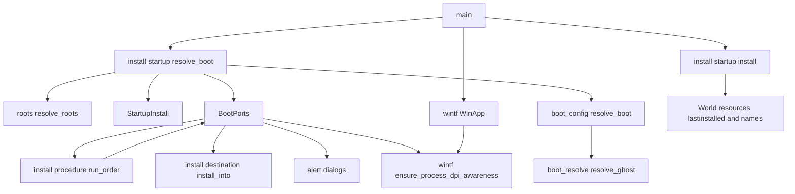
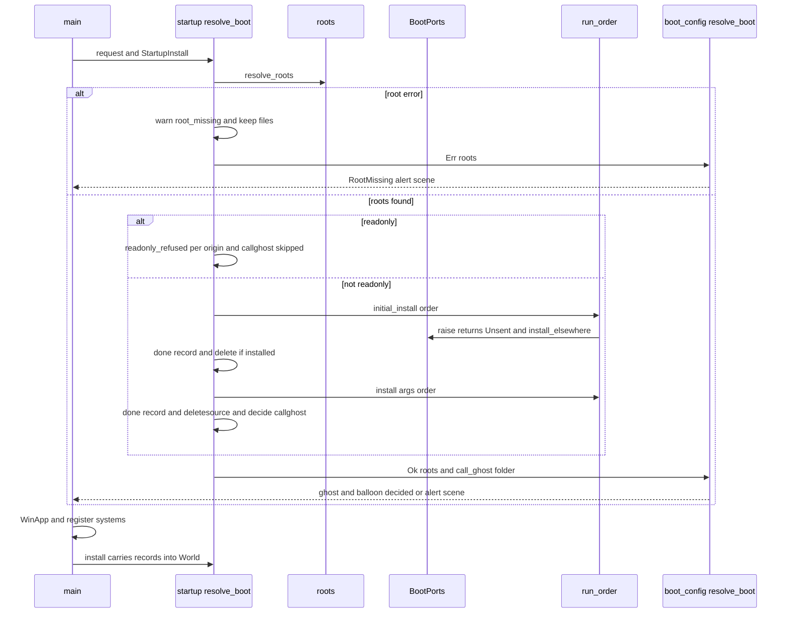
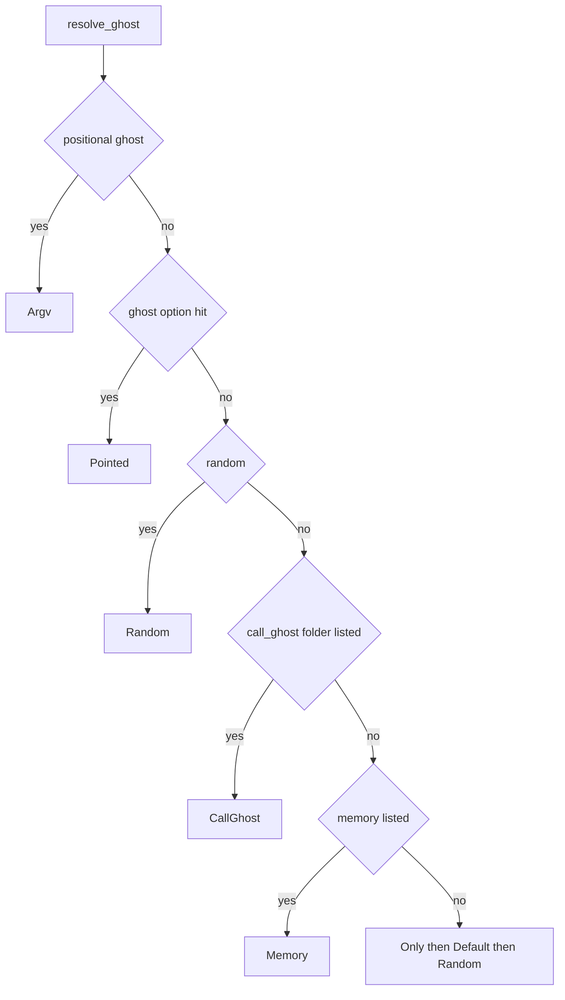

# 設計: install-before-boot

> 2026-10-31・本ブランチ（main `da020c10` の上・`dcbd91da`）。コードは「何の定義か」（関数名・型名＋ファイルパス）で指し、行番号は添え物。
> 要件の番号は `requirements.md` のとおり。調べと比べの詳しいところは `research.md` の「設計の段の調べと決め」にあり、決めたことはこの文書にも書く。
> 要件の討議（2026-10-31）の決め（議題 1〜7・全部を推奨案で確定）はそのまま受け継ぐ。

## Overview

**目的**: `areka.exe --install a.nar` の 1 行と、exe の隣に置いた `initial_install.nar` を、起動の解決が根（置き場）を決めた後・ゴーストとバルーンを選ぶ前に入れる。置き場が空でも、入れたゴーストで起動できる（SSP の「インストール処理を行った後起動を続行する」と同じ）。

**使う人**: 空の試験の根から「入れる → 起こす → MCP で確かめる」を 1 行で回す開発者と AI のエージェント、areka にゴーストを同梱して配る人。

**変わること**: 完了 `startup-install-option` は、最初のゴーストが定常に着いた後に、窓口（World の中）から入れていた。この spec は、窓のアプリ（`WinApp`）を立てる前に、`main` の起動の解決の段で、窓口を通さずに今の手続き `install::procedure::run_order` を直に呼ぶ。手続きの口は、起動の前の形（ゴーストが居ない・イベントを送らない）を新しく 1 つ作る。`callghost` は「起動した後に切り替えを頼む」から「起動のゴーストの選び方の段」に変わる。定常の後に入れる道は、起動の引数と `initial_install.nar` については消す（メニュー・台本・窓への投げ込みは今のまま）。

### Goals
- 根を決めた後・ゴーストを選ぶ前に、`initial_install.nar` → `--install` の順で、1 回の走りで 1 回だけ入れる（ゴーストが居ても居なくても）。
- 起動の前には、インストールと利用条件のイベントをどのゴーストへも送らず、記録もそのとおりに残す（「送りました」と書かない）。
- `callghost` で、最後に入ったゴーストを起動のゴーストに選ぶ（記憶の前回のゴーストより先・前回がきれいに終わらなかったときも）。
- `deletesource` と `initial_install.nar` の消去を、起動の解決の続きへ進む前に行う。
- 起動の前に入れた「最後に入れた物」を、起動の後の World へ引き継ぐ。
- 利用条件の画面と警告の画面を、窓のアプリの前でも、DPI 追従を壊さずに出す。

### Non-Goals
- 起動中の areka へインストールを任せる仕組み（SSTP の受け口）。
- 手続きの中身（読み取りと検査・`accept` の照合の決まり・置き場・上書き・利用条件と警告の中身）の変更。
- `--install` と `--option` の値の読み方（`cli/`）。
- `install.txt` の `bootghost` を読むこと（`install-package-type`）。
- `callghost` を 2 体目として呼ぶ形（`ghost-call`・`multi-ghost-runtime`）。
- 起動を止める告知（根なし・ゴーストなし・バルーンなし）の画面の DPI（今のまま。起動の前の利用条件と警告の画面だけを扱う）。
- メニュー・台本・窓への投げ込みからのインストール（今のまま起動の後に窓口から入れる）。

## Boundary Commitments

### This Spec Owns
- 起動の前に入れる道: 根を決める → 入れる → 消す → `callghost` の相手を決める → 起動の解決の続き、の並び（`install::startup::resolve_boot`）。
- 起動の前の手続きの口 `install::before_boot_ports::BootPorts`（`InstallPorts` の実装・ゴーストの居ない素性・イベントを送らない・入れた物の控え）。
- 手続きの口の答えの語 `install::procedure::Raised::Unsent`（「起動の前なので送らない」）と、`send` がそれを「送りました」と書かないこと。
- 持ち物 `install::startup::StartupInstall` の新しい中身（入れる物・起動の後へ運ぶ控え）と、その口（起動の前に 1 回だけ扱う・World へ控えを移す）。
- 起動の前の `callghost` の判断（純粋な関数 `decide_call_ghost` の新しい形）と、使わない理由の語。
- 起動のゴーストの選び方の段 `GhostRoute::CallGhost`（`boot_resolve::resolve_ghost` の記憶の段の前）と、その相手を運ぶ口（`GhostInputs::call_ghost`・`boot_config::resolve_boot_with_call`）。
- 読み取りだけの断りの記録 `readonly_refused`（`what=install`）を 1 か所で出す関数（`install::record_readonly_refused`）。
- プロセスの DPI の扱いを 1 回だけ立てる口 `wintf::ensure_process_dpi_awareness`（今の `WinApp::with_exit_policy` の中の 1 段を外へ出したもの）。
- 定常の後に入れる道の撤去（`install::startup` の `on_steady`・`discard_for_exit`・`on_order_done`・切り替えの頼み、`install::desk` からの呼び出し 3 行、資源 `SwitchAcceptCount`）。
- 説明書 `dist/README.txt` の「--install と initial_install.nar」と、ぱすたの手順書 `doc/pasta-real-run.md` の入れる手順の行。

### Out of Boundary
- 手続き `run_order` の段の並び・判定・記録の語（`Raised::Unsent` の腕のほかは変えない）。
- 窓口 `install::desk` と背景のスレッドの口 `install::worker::DeskPorts` の振る舞い（起動の後のインストールは今のまま。`desk.rs` は呼び出し 3 行の撤去と、入れた物の綴りを目録に合わせる部分の切り出しだけ）。
- 置き場の決まり `install::destination`・`areka-nar`。
- 根の解決 `roots::resolve_roots` と、起動の解決の段のうち `CallGhost` のほか（位置引数・`--ghost`・`--random`・記憶・唯一・既定・無作為・バルーン）。
- 告知 `alert` の文面と出し方（呼ぶだけ）。
- `crates/areka/src/ghost_session.rs`（ウェーブ C14 の約束で触らない）・`install/desk_overwrite_tests.rs`（同じ）。
- 切り替えの手続き `emo2_boot::ghost_switch`（`SwitchAcceptCount` の撤去のほかは触らない）。
- `cli/`（読み方・`BootRequest`・`InstallArgs` の形は変えない）。

### Allowed Dependencies
- `main` → `install::startup`（作る・`resolve_boot` を呼ぶ・`install` で World へ移す）。
- `install::startup` → `install::before_boot_ports`・`install::procedure::{run_order, ArchiveEnd}`・`install::{InstallOrder, InstallOrigin, record_readonly_refused}`・`boot_config::{resolve_boot, default_app_profile_dir}`・`roots::resolve_roots`・`readonly::is_on`・`alert::suppressed`・`emo2_boot::ghost_switch::record_last_installed`・`emo2_boot::shell_balloon_resolve::{record_installed_balloon, record_installed_shell}`・`install::names::update`。
- `install::before_boot_ports` → `install::procedure::{InstallPorts, Raised, Overwritten, InstalledRecord}`・`install::destination::install_into`・`install::judge::GhostFacts`・`install::desk::catalog_spelling`（目録の綴り）・`alert::{ask_yes_no, warn_ok}`・`wintf::ensure_process_dpi_awareness`。
- `boot_config` → `boot_resolve`（今のまま）。**`boot_config` と `boot_resolve` は `install` を知らない**（起動の解決は「起こすゴーストのフォルダ名」を受けるだけ）。
- 依存の向き: `main` → `install::startup` → `boot_config` → `boot_resolve`。`install::startup` → `install::before_boot_ports` → `install::procedure`／`install::destination`。逆向きの `use` は誤りとして扱う。
- 新しいクレートの依存・`windows` の新しい機能は足さない（`Win32_UI_HiDpi` はワークスペースで既に有効）。

### Revalidation Triggers
- `InstallPorts` の口や `Raised` の腕を変えるとき: `DeskPorts`・`BootPorts`・手続きの偽の口（`procedure_test_support.rs`）の 3 つを見直す。
- `ArchiveEnd::Installed` の意味・`InstalledItem::place` の形を変えるとき: `sources_to_delete` と `decide_call_ghost` を見直す（取り消せない消去と起こすゴーストに効く）。
- `boot_resolve::resolve_ghost` の段の並びを変えるとき: `CallGhost` の段が「記憶の前・位置引数／`--ghost`／`--random` の後」にあることを見直す。
- `GhostRoute` の読み手（記憶の書き込み・`argv_session`・`Switched` の比べ）が経路で分かれるようになるとき: `CallGhost` を「ほかの起動と同じ」に数えているかを見直す（要件 4.10）。
- `main` の起動の順（`readonly::engage` → 起動の解決 → `WinApp`）を変えるとき: 読み取りだけの判定と DPI の口の順を見直す。
- `install-package-type` が `bootghost` を読むとき: 起こすゴーストの名前を `boot_config::resolve_boot` の `call_ghost` と同じ口で渡せるかを見直す（この spec は受け口の形を決めない）。
- `session-module-gather`／`session-crate-split` が `main.rs`・`boot_config.rs`・`install/desk.rs` を動かすとき: 呼ぶ所の 1 か所と依存の向きを見直す。

## Architecture

### Existing Architecture Analysis

- `main` は `cli::read` → `StartupInstall::new`（`--install` を絶対パスへ） → `readonly::engage` → `boot_config::resolve_boot`（根 → ゴースト → バルーン） → MCP の待受 → `WinApp::with_exit_policy`（COM と DPI の設定） → 系の登録 → `install::startup::install`（持ち物を World へ）の順に動く（`crates/areka/src/main.rs` の `main`）。
- 手続き `run_order` は World もスレッドも知らず、口 `InstallPorts`（8 つ）だけで外とやりとりする（`install/procedure.rs`）。本物の口 `DeskPorts` は窓口へ頼んで答えを待つ（`install/worker.rs`）。
- `run_order` は、口の `raise` が `Raised::Closed` を返すか `ghost_facts` が `None` を返すと、その書庫を「途中でやめた」にして並びの残りもやめる＝起動の前の口はこの 2 つを返してはならない。
- 起動の解決の中身 `boot_config::resolve_boot_with` は、根の解決の結果（`Result<ResolvedRoots, RootError>`）を引数で受ける＝根を先に解いて、入れてから渡せる（関数を割らなくてよい）。
- 置き場 `install::destination::install_into` は World を受けず、一時の置き場を並びから除く（窓へ落としたときと同じ根に入る）。空のフォルダの根も「見つかる根」に入り（`roots::resolve` は `is_dir` だけを見る）、`areka-nar` は `ghost\` が無ければ作る（`areka-nar` の `install.rs` の `create_dir_all`）。
- 利用条件の画面と警告の画面は、持ち主の窓を渡さない素の `MessageBoxW`（`alert::ask_yes_no`・`alert::warn_ok`）で、窓のアプリが無くても出せる。ただし今は `WinApp` が `SetProcessDpiAwarenessContext(PER_MONITOR_AWARE_V2)` を呼ぶ前に UI を作ることになる（下の「DPI の扱い」）。

### Architecture Pattern & Boundary Map



**Architecture Integration**:
- 選んだ形: research の案 B（起動の前の道を `install` の側に置き、起動の解決は「起こすゴーストのフォルダ名」を 1 つ受けるだけ）。層の向き（`install` が起動の解決を呼ぶ）が今の形と同じで、`boot_config` に install の知識が入らない。
- 窓口の外から手続きを呼ぶ: 窓口（`InstallDesk`）と背景のスレッドは使わない。起動の前の依頼は `main` のスレッドで同期に扱う（起動の前には待たせるトークも操作も無い＝要件 1.8）。
- 今の形を守る所: 手続き `run_order` の段と記録・`install_into` の置き場・`resolve_boot_with` の段（`CallGhost` を 1 段足すだけ）・`main` の起動の順。
- 新しい部品の理由: `BootPorts`＝ゴーストも窓口も無い口が要る。`Raised::Unsent`＝送っていないのに「送りました」と書かないため。`GhostRoute::CallGhost`＝`callghost` で起きたと記録から読めるため（要件 4.4）。`ensure_process_dpi_awareness`＝UI を作る前に DPI の扱いを立てる文書の決まりを守るため。
- steering との合い方: 失敗は記録に残す（`error!`／`warn!`／`info!`・黙って捨てない）、メッセージボックスで失敗を告げない（利用条件と警告の画面は 2026-10-17 の例外のまま）、テストは兄弟の `*_tests.rs`、`main.rs` は 1,000 行の上限、試験の根は `target\` の下。

### Technology Stack

| 層 | 選び・版 | この spec での役 | 注 |
|---|---|---|---|
| アプリ（areka） | Rust 2024・`bevy_ecs`（ワークスペースのピン） | 起動の前の道・口・控えの引き継ぎ | 依存の追加なし |
| 書庫 | `areka-nar`（ワークスペースの中） | 読み取り・検査・展開（呼ぶだけ） | 変えない |
| 窓の土台 | `wintf`（ワークスペースの中）・`windows` の `Win32_UI_HiDpi` | プロセスの DPI の扱いを 1 回だけ立てる口 | 機能はワークスペースで既に有効 |
| 試験 | `log-capture-kit`・`temp-path-kit`・`sample-ghost-kit`・`real-run-kit` | 決定論のテスト・実機の確かめ | `real-run-kit` の `Launch::Empty` をそのまま使う（足場の追加なし） |

## File Structure Plan

### Directory Structure

```
crates/areka/src/
├── install/
│   ├── before_boot_ports.rs        # 新: 起動の前の手続きの口 BootPorts（InstallPorts の実装）
│   ├── before_boot_ports_tests.rs  # 新: 口の決定論のテスト（イベント 0・空の素性・控え・断りの記録）
│   ├── startup.rs                  # 改: 起動の前の道（resolve_boot）・持ち物・純粋な判断・控えの引き継ぎ
│   ├── startup_tests.rs            # 改（書き直し）: 道の決定論のテスト（順・1 回・消す・callghost・readonly・止まり方・引き継ぎ）
│   ├── desk_startup_tests.rs       # 消: 定常の後の道を固めた 10 本（陳腐化）
│   ├── desk.rs                     # 改: startup への呼び出し 3 行を外す・目録の綴りの部分を切り出す
│   ├── desk_tests.rs               # 改: desk_startup_tests の mod 宣言 3 行を外す
│   ├── procedure.rs                # 改: Raised::Unsent と send の腕
│   ├── procedure_branch_tests.rs   # 改: Unsent の記録のテストを 1〜2 本足す
│   └── mod.rs                      # 改: before_boot_ports の宣言・readonly の断りの記録を関数へ
├── boot_config.rs                  # 改: resolve_boot の引数（根の結果・callghost の相手）・resolve_boot_with_call
├── boot_config_callghost_tests.rs  # 新: callghost の段を通る起動の解決のテスト（前回がきれいに終わらなかった・指定あり）
├── boot_resolve.rs                 # 改: GhostInputs::call_ghost・GhostRoute::CallGhost・resolve_ghost の段
├── boot_resolve_option_tests.rs    # 改: GhostInputs の新しい欄（None）・CallGhost の段のテスト
├── boot_resolve_tests.rs           # 改: GhostInputs の新しい欄（None）だけ
├── emo2_boot/ghost_switch.rs       # 改: SwitchAcceptCount（読み手が無くなる）を外す
└── main.rs                         # 改: 呼ぶ所 1 か所・let mut 1 か所・use の 1 語（行は増やさない）
crates/areka/tests/
└── startup_install_real_run.rs     # 改: 今の試験の確かめを起動の前の形へ・空の根の試験を 1 本足す
crates/wintf/src/runtime/
└── mod.rs                          # 改: ensure_process_dpi_awareness（1 回だけ）を外へ出し、with_exit_policy から呼ぶ
dist/README.txt                     # 改: 「--install と initial_install.nar」と起動オプションの 40・44・45 行目
doc/pasta-real-run.md               # 改: 新しい書庫の入れ方（248 行目の段落）を起動の 1 行へ
```

### Modified Files（中身）
- `crates/areka/src/install/startup.rs` — 定常の後の部品（`on_steady`・`ArgsFollowup`・`discard_for_exit`・`on_order_done`・`call_ghost`・`callghost_request`・`CallGhostFacts` の旧い形・`CallGhostSkip` の旧い腕）を消し、起動の前の道（`resolve_boot`・`resolve_boot_from`・`StartupInstall::run_before_boot`）と、控えの引き継ぎ（`install`）を置く。残す: `INITIAL_INSTALL_FILE`・`StartupInstall::new`／`new_with`・`Pending::initial_install`／`record_not_submitted`・`Drop`・`end_word`・`sources_to_delete`・`delete_sources`。472 行 → 450 行前後の見込み。
- `crates/areka/src/install/desk.rs` — `on_steady` の `super::startup::on_steady(world)`、`discard_for_exit` の `super::startup::discard_for_exit(world)`、`answer` の `OrderDone` の腕の `super::startup::on_order_done(...)` を外す（`busy = false` は残す）。`record_installed` の中の「目録の綴りのフォルダ名と関わったゴーストの名前」を純粋な `catalog_spelling` に切り出し、`BootPorts` と共有する（振る舞いは変えない・`desk_record_tests.rs` がそのまま通る）。
- `crates/areka/src/install/procedure.rs` — `Raised` に `Unsent` を足し、`send` は `Unsent` のとき `install_event` を出さず debug `install_event_unsent` を出して `Ok(Unsent)` を返す。`archive_steps` の「`NoReply` なら `OnInstallComplete` へ続ける」は `NoReply` だけを見るので、`Unsent` では旧仕様へ続かない（変えない）。
- `crates/areka/src/install/mod.rs` — `mod before_boot_ports;` を足す。`submit` の先頭の `readonly_refused` の記録を `pub(crate) fn record_readonly_refused(origin, count)` に切り出し、`submit` と起動の前の道の両方から呼ぶ（記録の語・欄は今のまま）。
- `crates/areka/src/boot_config.rs` — `resolve_boot` の引数を `(resolved, request, call_ghost, app_profile_dir)` に改め（根の解決は呼び手が先に行う）、本体を `resolve_boot_with_call(resolved, request, call_ghost, app_profile_dir, pick, prepare_ghost)` に移す。`resolve_boot_with` はテストだけの口（`#[cfg(test)]`・`call_ghost` に `None` を渡す 1 行）に下ろし、テストの 37 か所の呼び出しは動かさない。
- `crates/areka/src/boot_resolve.rs` — `GhostInputs` に `call_ghost: Option<&str>`、`GhostRoute` に `CallGhost`、`resolve_ghost` の `--random` の段と記憶の段のあいだに `CallGhost` の段（下の「起動のゴーストの選び方」）。
- `crates/areka/src/emo2_boot/ghost_switch.rs` — `SwitchAcceptCount` の型と、`accept_switch` の中で 1 増やす数行を外す（読み手は `install::startup` だけで、この spec で消える）。それで使われなくなる局所の値 `elsewhere`（数えのためだけに計算している）も一緒に外す。
- `crates/areka/src/main.rs` — `let startup_install` を `let mut startup_install` に、`resolve_boot(&opts.boot)` を `install::startup::resolve_boot(&opts.boot, &mut startup_install)` に、`pub(crate) use boot_config::{…}` から `resolve_boot` を外す。周りの注釈は同じ行数で書き直す。986 行から増やさない（新しい呼び出しは 1 行に収まり、`use` の並びも行数が変わらない）。`readonly_tests.rs` の走査（`readonly::engage(` が `resolve_boot(&` の綴りより前）は新しい呼び出しの綴りでも当たる。`install::startup::install(…, startup_install)` の行はそのまま（中身が控えの引き継ぎに変わる）。
- `crates/wintf/src/runtime/mod.rs` — `WinApp::with_exit_policy` の中の `SetProcessDpiAwarenessContext` の段（成否の記録つき）を `pub fn ensure_process_dpi_awareness()`（`std::sync::Once` で 1 回だけ）へ移し、`with_exit_policy` はそれを呼ぶ。記録の語と水準は今のまま。
- `crates/areka/tests/startup_install_real_run.rs` — 今の試験の確かめ `startup_callghost_requested`・`switch_balloon_resolved` を、`startup_callghost_chosen`・`ghost_resolved route=CallGhost`・`balloon_resolved`（既定のバルーン）に改める。空の根の試験を 1 本足す（下の「Testing Strategy」）。
- `dist/README.txt`・`doc/pasta-real-run.md` — 要件 8 の文（下の「説明書と手順書」）。

## System Flows

### 起動の前に入れる道



- 入れる物が何も無い（`initial_install.nar` が無く `--install` の値も無い）ときは、`run_order` を呼ばず、debug `initial_install_absent` のほか何も出さずに起動の解決へ進む（要件 1.5）。
- `StartupInstall` の入れる物（`pending`）は、根を決めた時点で取り出す。取り出した後は、起動が止まっても `Drop` は何も出さない（要件 6.3）。根が決まらないときは、取り出して warn `startup_install_not_submitted reason=root_missing` を 1 件残す（要件 1.7）。`Drop` の `boot_stopped` は、ここを通らずに落ちたときの守りとして残す。
- 起動の前の依頼は `main` のスレッドで、窓のアプリより前に扱う＝ゴーストとバルーンの窓はまだ無い（要件 1.8）。出る画面は利用条件と警告だけ（要件 2.2・2.3）。

### 起動のゴーストの選び方（`callghost` を足した段）



- `call_ghost` は、起動の前の道が「`callghost` を使う」と決めたときだけ `Some(フォルダ名)` になる。決める前に、位置引数・`--ghost`・`--random` のどれかがあれば使わない（要件 4.5）ので、上の図の `CallGhost` の段に着くのは、その 3 つが無いときだけ。
- `CallGhost` の段は記憶の段より前なので、記憶の前回のゴーストより先に立つ（要件 4.3）。前回がきれいに終わらなかった（起動中の印がある）ときは記憶を読まないが、`CallGhost` の段は印に関わらず立つ（要件 4.7）。印の値は今のとおり返り、起動のイベントの中身は変わらない。
- 相手は、入れた後の目録 `list_ghosts` から、記憶の段と同じ突き合わせ（`same_folder_name`）で引く。目録に無い（入れた直後に消えたなど）ときは warn `callghost_target_not_found` を残して記憶の段へ進む（黙って読み替えない）。
- `CallGhost` の経路は `Argv` でも指し先でもないので、書く前の写し（`prepare_ghost`＝`user_root::writable_ghost`）も、起動の後の記憶の書き込みも、ほかの起動と同じに通る（要件 4.10）。

## Requirements Traceability

| 要件 | 要約 | 部品 | 口・契約 | 流れ |
|---|---|---|---|---|
| 1.1 | 根の後・ゴーストの前に initial → args の順 | StartupFlow | `startup::resolve_boot`・`run_before_boot` | 起動の前に入れる道 |
| 1.2 | ゴーストが居ても居なくても同じ時点 | StartupFlow | `run_before_boot`（ゴーストの有無を見ない） | 同上 |
| 1.3 | 1 回の走りで 1 回だけ | StartupInstall・DeskCleanup | `pending` の取り出し・`desk::on_steady` からの撤去 | 同上 |
| 1.4 | 窓へ落としたときと同じ置き場 | BootPorts | `install_into`（一時の置き場を除く根） | 同上 |
| 1.5 | 入れる物が無ければ何もしない | StartupFlow | debug だけ | 同上 |
| 1.6 | `--offline-dump` は扱わない | main（変えない） | `StartupInstall::new` の前の早い戻り | — |
| 1.7 | 根が決まらなければ入れず warn 1 件 | StartupFlow | `startup_install_not_submitted reason=root_missing` | 同上 |
| 1.8 | 窓を出さない・入れ終わってから続ける | StartupFlow | `main` のスレッドで同期・`WinApp` の前 | 同上 |
| 2.1 | 今の手続きで扱う | BootPorts | `run_order` をそのまま呼ぶ | 同上 |
| 2.2 | 利用条件の画面を出す | BootPorts・DpiOnce | `ask_terms` → `alert::ask_yes_no` | 同上 |
| 2.3 | 警告の画面を出す | BootPorts・DpiOnce | `warn_skipped` → `alert::warn_ok` | 同上 |
| 2.4 | 画面を出せない設定では拒否 | BootPorts | `alert_suppressed` → `YesNo::Suppressed` | 同上 |
| 2.5 | 受け取るゴーストを要する書庫は入れず記録 | BootPorts | 空の素性・`install_refused_no_ghost` | 同上 |
| 2.6 | 失敗の後も続ける | BootPorts | `Closed` を返さない・`ghost_facts` は必ず `Some` | 同上 |
| 2.7 | バルーンの記憶に書かず info | BootPorts | `install_balloon_memory_skipped` | 同上 |
| 3.1 | イベントを送らない | BootPorts・ProcedureUnsent | `Raised::Unsent` | 同上 |
| 3.2 | 後から送らない | StartupCarry | 控えはイベントにしない | — |
| 3.3 | 起動の後のインストールは今のまま | DeskCleanup（触らない所） | `DeskPorts` | — |
| 3.4 | 最後に入れた物を引き継ぐ | BootPorts・StartupCarry | `carried` → `startup::install` | 起動の前に入れる道の末尾 |
| 4.1 | 入れた後の置き場で選ぶ | StartupFlow・BootConfigCall | 入れた後に `resolve_boot` | 同上 |
| 4.2 | callghost なしは今の選び方 | BootResolveCall | `call_ghost: None` | 選び方 |
| 4.3 | 最後に入ったゴーストを記憶より先に | CallGhostDecision・BootResolveCall | `decide_call_ghost`・`GhostRoute::CallGhost` | 選び方 |
| 4.4 | 選んだことを info | CallGhostDecision | `startup_callghost_chosen` | — |
| 4.5 | 指定があれば使わず info | CallGhostDecision | `startup_callghost_skipped reason=boot_target_given` | — |
| 4.6 | ゴーストが入らなければ使わず info | CallGhostDecision | `reason=no_ghost_installed` | — |
| 4.7 | 前回がきれいに終わらなくても callghost | BootResolveCall | 記憶の段より前・印に関わらない | 選び方 |
| 4.8 | 切り替えを頼まない・2 体目なし | StartupFlow（撤去） | `request_ghost_switch` を呼ばない | — |
| 4.9 | initial_install.nar は選び方を変えない | CallGhostDecision | args の終わり方だけを見る | — |
| 4.10 | ほかの起動と同じに扱う | BootResolveCall | `CallGhost` は `Argv` でも指し先でもない | — |
| 4.11 | 入れた後も 0 体なら今と同じに止まる | BootConfigCall | `AlertScene::GhostMissing` | 同上 |
| 5.1 | deletesource は入った書庫だけ・続きの前に | StartupFlow | `sources_to_delete`・`delete_sources` | 同上 |
| 5.2 | 同じパスは 1 回だけ | StartupFlow | `sources_to_delete`（今のまま） | — |
| 5.3 | initial は入ったら必ず消す | StartupFlow | 同上 | — |
| 5.4 | 消したら info | StartupFlow | `startup_source_deleted`（今のまま） | — |
| 5.5 | 消せなければ warn して続ける | StartupFlow | `startup_source_delete_failed`（今のまま） | — |
| 5.6 | 書庫のファイルのほかは消さない | StartupFlow | `remove_file` だけ | — |
| 5.7 | deletesource なしは消さない | StartupFlow | `delete_source` の語 | — |
| 6.1 | 依頼・出どころ・終わり方を今の語で | StartupFlow | `startup_install_started`・`startup_install_done`・`end_word` | — |
| 6.2 | 起動の前と読める | StartupFlow | `stage = "before_boot"` の欄 | — |
| 6.3 | 入れた後に止まっても boot_stopped を出さない | StartupInstall | `pending` を取り出した後の `Drop` | — |
| 6.4 | 失敗を理由つきで記録 | StartupFlow・BootPorts | 下の「Error Handling」の表 | — |
| 6.5 | 失敗をメッセージボックスで告げない | StartupFlow・BootPorts | 画面は利用条件と警告だけ | — |
| 7.1 | 読み取りだけなら断る | StartupFlow | `record_readonly_refused` | 同上 |
| 7.2 | 断りの記録に出どころ | StartupFlow | `origin = InitialInstall／StartupArgs` | — |
| 7.3 | 読み取りだけなら消さない | StartupFlow | 消す段へ入らない | — |
| 7.4 | 読み取りだけなら callghost を使わない | CallGhostDecision | `reason=readonly` | — |
| 8.1・8.2・8.3・8.4・8.5・8.6 | 説明書 | Docs | `dist/README.txt`（下の「説明書と手順書」） | — |
| 8.7 | ぱすたの手順書 | Docs | `doc/pasta-real-run.md` | — |
| 9.1・9.2・9.3・9.4・9.5・9.6・9.7・9.8・9.9・9.12 | 決定論のテスト | Tests | 下の「Testing Strategy」 | — |
| 9.10・9.11 | 実機の確かめ | RealRun | `startup_install_real_run.rs` | — |
| 10.1 | 議題 1＝案 A（居ても居なくても前に入れる） | StartupFlow・DeskCleanup | 定常の後の道の撤去 | 起動の前に入れる道 |
| 10.2 | 議題 2＝どのゴーストへも送らない | BootPorts・ProcedureUnsent | `Raised::Unsent` | — |
| 10.3 | 議題 3＝利用条件と警告の画面を今と同じに出す | BootPorts・DpiOnce | `alert::ask_yes_no`・`alert::warn_ok`・DPI を先に立てる | — |
| 10.4 | 議題 4＝initial_install.nar は選び方を変えない | CallGhostDecision | args の終わり方だけを見る | — |
| 10.5 | 議題 5＝callghost が前回の記憶より先 | BootResolveCall | `CallGhost` の段の位置 | 選び方 |
| 10.6 | 議題 6＝最後に入れた物を引き継ぐ | StartupCarry | `startup::install` | — |
| 10.7 | 議題 7＝手順書を直す | Docs | `doc/pasta-real-run.md` | — |

## Components and Interfaces

| 部品 | 層 | 役 | 要件 | 主な依存 | 契約 |
|---|---|---|---|---|---|
| StartupFlow（`install::startup::resolve_boot`・`run_before_boot`） | install | 根 → 入れる → 消す → callghost → 起動の解決 | 1.1〜1.5・1.7・1.8・4.1・4.8・5.x・6.1〜6.4・7.x | roots (P0)・BootPorts (P0)・boot_config (P0) | Service |
| StartupInstall（持ち物） | install | 入れる物と起動の後へ運ぶ控え | 1.3・3.4・6.3 | — | State |
| StartupCarry（`install::startup::install`） | install | 控えを World の資源へ移す | 3.2・3.4 | ghost_switch・shell_balloon_resolve・names (P1) | Service |
| CallGhostDecision（`decide_call_ghost`） | install（純粋） | callghost を使うか・相手 | 4.3〜4.6・4.9・7.4 | ArchiveEnd (P0) | Service |
| BootPorts | install | 起動の前の手続きの口 | 1.4・2.x・3.1・3.4 | procedure (P0)・destination (P0)・alert (P1)・wintf (P1) | Service・State |
| ProcedureUnsent（`Raised::Unsent`） | install::procedure | 送らないことを記録で正しく | 3.1・6.2 | — | Service |
| BootConfigCall（`boot_config::resolve_boot`・`resolve_boot_with_call`） | 起動の解決 | 根の結果と callghost の相手を受けて解く | 4.1・4.11 | boot_resolve (P0) | Service |
| BootResolveCall（`GhostRoute::CallGhost`） | 起動の解決（純粋） | 記憶の前の段 | 4.2・4.3・4.7・4.10 | — | Service |
| DpiOnce（`wintf::ensure_process_dpi_awareness`） | wintf | プロセスの DPI の扱いを 1 回だけ立てる | 2.2・2.3（DPI 追従を守る） | `windows` HiDpi (P0) | Service |
| DeskCleanup | install::desk | 定常の後の道の撤去・綴りの共有 | 1.3・3.3 | — | — |
| Docs | 文書 | 説明書と手順書 | 8.x | — | — |

### install（起動の前の道）

#### StartupFlow

| 欄 | 中身 |
|---|---|
| Intent | 根を決めた後・ゴーストを選ぶ前に、起動の引数と `initial_install.nar` を 1 回だけ入れ、入れた後の置き場で起動の解決を続ける |
| Requirements | 1.1〜1.5・1.7・1.8・4.1・4.8・5.1〜5.7・6.1〜6.5・7.1〜7.4 |

**Responsibilities & Constraints**
- 並び: ⑴ 根を解く ⑵ 根が決まらなければ入れずに warn 1 件 ⑶ 読み取りだけなら断る ⑷ `initial_install.nar` の依頼 → 記録 → 入ったら消す ⑸ `--install` の依頼 → 記録 → `deletesource` なら入った書庫を消す ⑹ `callghost` の判断 ⑺ 控えを持ち物へ ⑻ 起動の解決の続き。⑷〜⑹ はどれも⑻より前。
- 依頼の中身は今と同じ: `initial_install.nar` は `InstallOrigin::InitialInstall` の 1 本だけの依頼、`--install` は `InstallOrigin::StartupArgs` の並び全部で 1 件（2026-10-29 議題 5 の決め）。
- `callghost`・`deletesource` は `--install` の依頼だけに効かせ、`initial_install.nar` には効かせない（要件 4.9・5.3）。
- 手続きの終わり方の並びが短い（途中でやめた）ことは起きない（`BootPorts` は `Closed` を返さない）。起きても、終わり方の無い書庫は「まだ扱っていない」として消さない（`sources_to_delete` の今の決まり）。
- ゴーストへの切り替えは頼まない・2 体目は起こさない（要件 4.8）。`emo2_boot::ghost_switch` の頼みの口は使わない。

**Dependencies**
- Inbound: `main` — 起動の 1 回（P0）
- Outbound: `roots::resolve_roots`（P0）・`BootPorts`（P0）・`run_order`（P0）・`boot_config::resolve_boot`（P0）・`install::record_readonly_refused`（P1）
- External: なし

**Contracts**: Service [x] / State [ ]

##### Service Interface
```rust
/// 本物の口（main から 1 回）。env・記憶・exe の場所・読み取りだけの旗・告知の抑止を読み、
/// resolve_boot_from を本番の選び方（pick_index・writable_ghost）で呼ぶ。
pub(crate) fn resolve_boot(
    request: &crate::cli::BootRequest,
    startup: &mut StartupInstall,
) -> Result<crate::boot_config::BootResolved, crate::alert::AlertScene>;

/// 中身（テストは根の結果・旗・選び方を差し込む）。
pub(crate) fn resolve_boot_from(
    resolved: Result<crate::roots::ResolvedRoots, crate::roots::RootError>,
    request: &crate::cli::BootRequest,
    startup: &mut StartupInstall,
    before: BeforeBootEnv,
    app_profile_dir: &std::path::Path,
    pick: fn(usize) -> usize,
    prepare_ghost: fn(&areka_ghost::BasewareRoots, &std::path::Path) -> std::path::PathBuf,
) -> Result<crate::boot_config::BootResolved, crate::alert::AlertScene>;

/// 起動の前の道が読むプロセスの旗（本番は readonly::is_on と alert::suppressed）。
#[derive(Clone, Copy)]
pub(crate) struct BeforeBootEnv {
    pub readonly: bool,
    pub alert_suppressed: bool,
}

impl StartupInstall {
    /// 根が決まった後に 1 回だけ（2 回目からは何もせず None）。入れる・消す・callghost を決め、
    /// 起こすゴーストのフォルダ名（callghost を使うときだけ）を返す。控えは self に残る。
    pub(crate) fn run_before_boot(
        &mut self,
        roots: &areka_ghost::BasewareRoots,
        request: &crate::cli::BootRequest,
        before: BeforeBootEnv,
    ) -> Option<String>;
}
```
- Preconditions: `readonly::engage` が済んでいる（`main` の今の順）。`roots` は `--ghost` の一時の置き場を足す前の並び。
- Postconditions: `pending` は `None`。入った書庫の消去は済んでいる。`carried` に入れた物の控えが入れた順にある。
- Invariants: 1 回の走りで `run_order` を呼ぶのは高々 2 回（initial と args）。`run_before_boot` の 2 回目は何もしない（要件 1.3）。

**Implementation Notes**
- Integration: `resolve_boot_from` は `resolved` が `Ok` なら `run_before_boot`、`Err` なら `pending` を取り出して `record_not_submitted("root_missing")`。どちらの後も `boot_config::resolve_boot_with_call(resolved, request, call_ghost.as_deref(), …)` へ渡す（根の記録と告知の場面は今の `resolve_boot_with` が出す）。
- Validation: 書庫の在る無しは手続きが見る（在らなければ手続きの失敗として記録・要件 2.6）。
- Risks: 起動の前の画面が出ているあいだ、起動は止まる（利用者の答えを待つ）。SSP も同じ（利用条件の答えを待ってから起動を続ける）と読み、待つ時間の上限は設けない。

#### StartupInstall（持ち物）

**Contracts**: State [x]

##### State Management
```rust
#[derive(Debug, Default)]
pub(crate) struct StartupInstall {
    /// 入れる物（根が決まったときに取り出す＝1 回だけ）。
    pending: Option<Pending>,          // 今の Pending のまま（archives・call_ghost・delete_source・exe_dir）
    /// 起動の前に入れた物の控え（入れた順・起動の後に World へ移す）。
    carried: Vec<CarriedInstall>,
}

/// 入れた物 1 本の控え（目録の綴りに直した後の値）。
#[derive(Debug, Clone, PartialEq, Eq)]
pub(crate) struct CarriedInstall {
    pub kind: areka_nar::InstallKind,
    /// 入れた先のフォルダ名（目録の綴り）。
    pub folder: String,
    /// 関わったゴーストのフォルダ名（シェル・追加ファイル）。
    pub ghost_folder: Option<String>,
    /// %lastobjectname の値（install.txt の name）。
    pub object_name: String,
    /// %lastghostname の値（バルーンは None＝前の値のまま）。
    pub ghost_name: Option<String>,
}
```
- `StartupInstall` は World の資源でなくなる（`Resource` の derive を外す）。`main` が持ち、`install` で控えを移して落とす。
- `Drop`: `pending` が残っていれば warn `startup_install_not_submitted reason=boot_stopped`（守り）。`carried` は落としても何も出さない（起動が止まれば引き継ぐ先が無い）。

#### StartupCarry（`install::startup::install`）

```rust
/// main から 1 回（系の登録の後・今の行のまま）。控えを入れた順に World の資源へ移す。
pub(crate) fn install(world: &mut bevy_ecs::world::World, startup: StartupInstall);
```
- 控え 1 本ごとに、窓口の `record_installed` と同じ受け皿へ置く: ゴースト → `ghost_switch::record_last_installed`（`LastInstalledGhost`）、シェル → `record_installed_shell`（`LastInstalledShell`）、バルーン → `record_installed_balloon`（`LastInstalledBalloon`）、追加ファイル → 受け皿なし。全部 → `install::names::update`（`%lastobjectname`・`%lastghostname`）。
- 入れた順に置くので、最後の 1 本が「最後に入れた物」になる。起動の後に入れた物は、窓口の `record_installed` が同じ資源を置き換える（要件 3.4）。記憶へは書かない（どの資源もプロセスの中だけ・終了で消える）。
- `names::update` はこの時点で起動中のゴーストが居ないので値を載せず（`published=false`）、資源だけを置く。起こしたゴーストへは今の `names::reseed`（`ghost_session_runtime::rewire_runtime_consumers` から）が載せる。ゴーストへイベントは送らない（要件 3.2）。
- 控えが 1 本以上なら info `startup_install_carried`（`count`）を 1 件残す。

#### CallGhostDecision（`install::startup::decide_call_ghost`・純粋）

```rust
pub(crate) struct CallGhostFacts<'a> {
    /// --option callghost が --install と一緒に渡された（cli が下ろした後の値）。
    pub requested: bool,
    pub readonly: bool,
    /// 起動するゴーストの指定（位置引数・--ghost の値・--random のどれか）。在れば使わない。
    pub boot_target: Option<BootTarget>,
    /// --install の依頼の終わり方（initial_install.nar の分は渡さない）。
    pub ends: &'a [ArchiveEnd],
}

#[derive(Debug, Clone, Copy, PartialEq, Eq)]
pub(crate) enum BootTarget { Positional, GhostOption, Random }

#[derive(Debug, Clone, PartialEq, Eq)]
pub(crate) enum CallGhost {
    /// 起こすゴーストのフォルダ名（並びの最後に入ったゴーストの書庫の本体の place の末尾）。
    Choose { folder: String },
    Skip(CallGhostSkip),
    /// callghost が渡されていない（記録を出さない）。
    NotRequested,
}

#[derive(Debug, Clone, Copy, PartialEq, Eq)]
pub(crate) enum CallGhostSkip { Readonly, BootTargetGiven(BootTarget), NoGhostInstalled }
```
- 判断の順: 渡されていない → `NotRequested` ／ 読み取りだけ → `Readonly` ／ 指定あり → `BootTargetGiven` ／ 並びの最後から見て、本体（`items` の先頭）が `ghost` の `Installed` が無い → `NoGhostInstalled` ／ それ以外 → `Choose`。
- 「指定あり」は、起動の求め `BootRequest` に値が在るかで決める（`positional_ghost`・`ghost`・`random`）。`--ghost` の名前が置き場に当たらなかったときも「指定あり」に数える（要件 4.5 の字のまま・`--ghost` を書いた人の指示を `callghost` で上書きしない）。
- 記録: `Choose` → info `startup_callghost_chosen`（`folder`・`origin = StartupArgs`）。`Skip` → info `startup_callghost_skipped`（`reason` の語 `readonly`・`boot_target_given`・`no_ghost_installed`、`boot_target_given` のときは `target` の語 `positional`・`ghost_option`・`random`）。

### install（起動の前の口）

#### BootPorts（`install/before_boot_ports.rs`）

| 欄 | 中身 |
|---|---|
| Intent | ゴーストも窓口も無い起動の前に、手続き `run_order` の口として答える |
| Requirements | 1.4・2.1〜2.7・3.1・3.4・6.4・6.5 |

**Responsibilities & Constraints**
- `raise` はどのイベントにも `Raised::Unsent` を返す（どこへも送らない・送る相手を持たない）。`Closed` は返さない。
- `ghost_facts` は必ず `Some`（根の並びだけを持ち、ほかは空: `folder: None`・`running_dir: None`・`name: ""`・`sakura_name: None`・`install_accept: []`）。今の `judge_accept` は、この素性で `accept` を持つ書庫を必ず `Refused` にし、`accept` の無いシェル・追加ファイルを `AcceptMissing`（失敗 `invalid type`）にする＝今の照合の決まりのまま（要件 2.5）。`destination_of` は `folder: None` で必ず `Elsewhere`。
- `raise` が `OnInstallRefuse` を受けたら、info `install_refused_no_ghost`（`archive`）を 1 件残す（起動の前の断りは、どれも受け取るゴーストが居ないため＝要件 2.5 の「記録に残し」）。
- `install_elsewhere` は `install_into(&roots, archive, target_ghost, None)` を直に呼び、必ず `Some` を返す（終了の門は無い）。
- `overwrite_running` は来ない（`destination_of` が `Elsewhere`）。来たら debug を残して `Overwritten::NotRunning(archive)` を返し、手続きは `install_elsewhere` へ倒れる（落ちない）。
- `ask_terms`・`warn_skipped` は、告知が抑止されていなければ先に `wintf::ensure_process_dpi_awareness()` を呼び、今の `alert::ask_yes_no`・`alert::warn_ok` に `alert_suppressed` を渡す。抑止なら画面を出さず、今の手続きどおり利用条件は拒否になる（要件 2.4）。
- `record` は、窓口の綴りの決まり（`install::desk::catalog_spelling`）で目録の綴りに直して `CarriedInstall` を控える。バルーンのときは info `install_balloon_memory_skipped`（`folder`）を 1 件残し、どのゴーストの記憶にも書かない（要件 2.7）。
- `begin_archive` は書庫のパスを覚えるだけ（記録に載せるため）。

**Contracts**: Service [x] / State [x]

##### Service Interface
```rust
pub(crate) struct BootPorts {
    roots: areka_ghost::BasewareRoots,
    alert_suppressed: bool,
    archive: std::path::PathBuf,
    carried: Vec<CarriedInstall>,
}

impl BootPorts {
    pub(crate) fn new(roots: areka_ghost::BasewareRoots, alert_suppressed: bool) -> BootPorts;
    /// 控えを取り出す（入れた順）。
    pub(crate) fn take_carried(&mut self) -> Vec<CarriedInstall>;
}

impl InstallPorts for BootPorts { /* 上の決まりのとおり */ }
```

#### ProcedureUnsent（`install::procedure`）

```rust
pub(crate) enum Raised {
    Script,
    NoReply,
    Closed,
    /// 起動の前なので、送らなかった（受け取るゴーストが居ない）。
    Unsent,
}
```
- `send` は `Unsent` のとき、info `install_event`（「イベントを送りました」）を出さず、debug `install_event_unsent`（`id`）を出して `Ok(Raised::Unsent)` を返す。`Script`・`NoReply`・`Closed` の腕は今のまま。
- `archive_steps` の「`OnInstallCompleteEx` に `NoReply` が返ったら `OnInstallComplete` へ続ける」は `NoReply` だけを見るので、`Unsent` では続かない（送らないイベントを 2 本目まで試さない）。`OnInstallCompleteAll` も `send` を通るので `Unsent` で終わる。
- `DeskPorts` は `Unsent` を返さない（起動の後の記録は今のまま＝要件 3.3）。

### 起動の解決

#### BootConfigCall（`boot_config`）

```rust
/// アプリの記憶と本番の選び方で resolve_boot_with_call を呼ぶ薄い口（根の解決は呼び手）。
pub(crate) fn resolve_boot(
    resolved: Result<crate::roots::ResolvedRoots, crate::roots::RootError>,
    request: &crate::cli::BootRequest,
    call_ghost: Option<&str>,
    app_profile_dir: &std::path::Path,
) -> Result<BootResolved, crate::alert::AlertScene>;

/// 今の resolve_boot_with の本体。call_ghost を GhostInputs へ渡すほかは変えない。
pub(crate) fn resolve_boot_with_call(
    resolved: Result<crate::roots::ResolvedRoots, crate::roots::RootError>,
    request: &crate::cli::BootRequest,
    call_ghost: Option<&str>,
    app_profile_dir: &std::path::Path,
    pick: fn(usize) -> usize,
    prepare_ghost: fn(&areka_ghost::BasewareRoots, &std::path::Path) -> std::path::PathBuf,
) -> Result<BootResolved, crate::alert::AlertScene>;

/// テストだけの口（今の 37 か所の呼び出しのため・call_ghost は None）。
#[cfg(test)]
pub(crate) fn resolve_boot_with(/* 今の引数のまま */) -> Result<BootResolved, crate::alert::AlertScene>;
```
- `boot_config` は「起こすゴーストのフォルダ名」を受けるだけで、インストールも `callghost` の語も知らない。
- 記憶の読み（`read_last_ghost`）の条件は変えない（`call_ghost` が目録に当たらなかったときの次の段に要る）。

#### BootResolveCall（`boot_resolve`）

```rust
pub(crate) struct GhostInputs<'a> {
    pub argv: Option<&'a Path>,
    pub pointed: Option<(&'a Path, &'a str)>,
    pub random: bool,
    /// callghost の相手のフォルダ名（起動の前の道が決めたときだけ）。記憶より先に目録から引く。
    pub call_ghost: Option<&'a str>,
    pub memory: Option<&'a str>,
    pub listed: &'a [GhostEntry],
    pub stores: &'a [PathBuf],
}

pub(crate) enum GhostRoute { Argv, Pointed, CallGhost, Memory, Only, Default, Random, Switched }
```
- 段の位置は図「起動のゴーストの選び方」のとおり。目録に在れば `GhostRoute::CallGhost`・当たった項目の場所とフォルダ名。在らなければ warn `callghost_target_not_found`（`folder`・`ghost_store`）で次の段へ。
- `GhostRoute` を網羅で照らす `match` は今のコードに無い（読み手は `== Argv`・`== Switched` の比べと記録の `?route` だけ）。

### wintf

#### DpiOnce（`wintf::ensure_process_dpi_awareness`）

```rust
/// プロセスの既定の DPI の扱いを、モニタごとの v2 に 1 回だけ立てる（2 回目からは何もしない）。
/// 成否はどちらも 1 行残す（今の WinApp::with_exit_policy の記録と同じ語・同じ水準）。
pub fn ensure_process_dpi_awareness();
```
- `WinApp::with_exit_policy` は COM の初期化の後にこれを呼ぶ（今の順のまま）。起動の前に画面を出したときは、そちらが先に立て、`with_exit_policy` の呼び出しは何もしない＝`SetProcessDpiAwarenessContext` はプロセスで 1 回だけ呼ばれ、2 回目の失敗（`ERROR_ACCESS_DENIED`）の warn は出ない。
- 決めの根拠（DPI の扱い）: Microsoft の文書は `SetProcessDpiAwarenessContext` を「DPI の扱いに依る API を呼ぶ前（プロセスで UI を作る前を含む）に呼ばなければならない」と書く（https://learn.microsoft.com/en-us/windows/win32/api/winuser/nf-winuser-setprocessdpiawarenesscontext ）。起動の前の画面は `WinApp` より前に UI を作るので、画面より先に立てる。スレッドの扱いだけを替える形（`SetThreadDpiAwarenessContext` で包む）は、プロセスの既定を立てる前に UI を作ることに変わりはなく、文書の決まりの外になるので取らない。
- 起動を止める告知（`alert::raise`・根なし／ゴーストなし／バルーンなし）は、今のとおり立てずに出す（出した後はすぐ終わる・範囲外）。

### install::desk（撤去と共有）

#### DeskCleanup
- 撤去: `desk::on_steady` の `super::startup::on_steady(world)`・`desk::discard_for_exit` の `super::startup::discard_for_exit(world)`・`answer` の `OrderDone` の腕の `super::startup::on_order_done(world, &order, &ends, closing)`。`DeskAsk::OrderDone` の形（依頼と終わり方を運ぶ）は変えない（worker と desk の今のテストがそのまま通る）。
- 共有: `record_installed` の中の「入れた物の目録の綴り（ゴーストのフォルダ名・バルーンのフォルダ名）と関わったゴーストの名前」を、純粋な関数へ切り出す。

```rust
/// 目録の綴りに直したフォルダ名と、%lastghostname の値（窓口と起動の前の口の共通の決まり）。
pub(super) fn catalog_spelling(
    roots: Option<&areka_ghost::BasewareRoots>,
    record: &InstalledRecord,
) -> (String, Option<String>);
```

## Data Models

### Domain Model
- **持ち物 `StartupInstall`**: 1 回の走りに 1 つ。`pending`（入れる物）は根が決まったときに 1 回だけ取り出す。`carried`（起動の前に入れた物の控え）は World へ移すまで持つ。
- **控え `CarriedInstall`**: 窓口の `record_installed` が World へ置く値と同じ中身（受け皿の種類・目録の綴り・置換語）。記憶へは書かない。
- **終わり方 `ArchiveEnd`**: 今のまま。起動の前の道は `Installed`・`Refused`・`Declined`・`Failed` だけを受ける（`Abandoned` は口が `Closed` を返さないので出ない）。

### 記録の語（Data Contracts）

| 語 | 水準 | 欄 | いつ |
|---|---|---|---|
| `startup_install_started` | info | `stage="before_boot"`・`origin`・`count` | 依頼を扱い始めた（要件 6.1・6.2） |
| `startup_install_done` | info | `stage="before_boot"`・`origin`・`results`（書庫ごとの `installed`・`refused`・`declined`・`failed`・`not_started`） | 依頼を扱い終えた（今の語に `stage` を足す） |
| `install_event_unsent` | debug | `id` | 起動の前なので送らなかった（`install_event` の代わり） |
| `install_refused_no_ghost` | info | `archive` | 受け取るゴーストを要する書庫を断った（要件 2.5） |
| `install_balloon_memory_skipped` | info | `folder` | バルーンを入れ、記憶に書かなかった（要件 2.7） |
| `startup_source_deleted`／`startup_source_delete_failed` | info／warn | `origin`・`archive`（・`error`） | 今のまま（要件 5.4・5.5） |
| `startup_callghost_chosen` | info | `folder`・`origin` | 起こすゴーストに選んだ（要件 4.4） |
| `startup_callghost_skipped` | info | `reason`（`readonly`・`boot_target_given`・`no_ghost_installed`）・`target` | 使わなかった（要件 4.5・4.6・7.4） |
| `callghost_target_not_found` | warn | `folder`・`ghost_store` | 選んだ相手が目録に無かった（守り） |
| `startup_install_not_submitted` | warn | `reason`（`root_missing`・`boot_stopped`）・`archives`・`initial_install` | 根が決まらず入れなかった（要件 1.7）・持ち物が扱われずに落ちた（守り） |
| `readonly_refused` | info | `what="install"`・`origin`・`count` | 今のまま（要件 7.1・7.2） |
| `startup_install_carried` | info | `count` | 控えを World へ移した（要件 3.4） |
| `ghost_resolved` | info | `route=CallGhost`・`dir` | 今の語（経路の値が 1 つ増える） |

- 消える語: `startup_callghost_requested`・`startup_followup_dropped`・`exit_before_steady`（`startup_install_not_submitted` の理由）・`CallGhostSkip` の `abandoned`・`closing`・`switching`・`switched_meanwhile`・`already_running`。今の語を読む物は実機の試験 `startup_install_real_run.rs`（この spec で改める）と `startup_tests.rs`・`desk_startup_tests.rs`（書き直す・消す）だけ（2026-10-31 の grep）。

## Error Handling

### Error Strategy
- 起動の前の道の失敗は、どれも起動を止めない（根が決まらないときと、入れた後もゴーストが 0 体のときだけ、今の告知で止まる）。失敗は理由の分かる記録に残し、メッセージボックスで告げない（要件 6.4・6.5）。

| 起きたこと | 振る舞い | 記録 |
|---|---|---|
| 根が決まらない | 何も入れず何も消さず、今の告知（根なし）で終了コード 1 | warn `startup_install_not_submitted reason=root_missing`・今の根の記録と `alert` |
| 書庫が無い・読めない・入れられない | その書庫を失敗にして残りを続ける | 今の error `install_failed`（手続き） |
| 受け取るゴーストを要する書庫 | 断る（`accept` あり）・失敗（`accept` の無いシェル・追加ファイル）で残りを続ける | 今の warn `install_refused`／error `install_failed`＋info `install_refused_no_ghost` |
| 利用条件の拒否・抑止・画面を出せない | 拒否として入れない | 今の `install_terms`（info／warn／error） |
| 見つかる根が無い（入れる時点で根が消えた） | 失敗として続ける | 今の error `install_no_root` |
| 入った書庫を消せない | 残して次へ | 今の warn `startup_source_delete_failed` |
| callghost を使えない | 今の選び方で選ぶ | info `startup_callghost_skipped`・warn `callghost_target_not_found` |
| 入れた後もゴーストが 0 体 | 今の告知（ゴーストなし）で終了コード 1 | 今の `alert`。`boot_stopped` は出ない |
| DPI の扱いを立てられない | 起動を続ける（今の決まり） | 今の warn `[SetProcessDpiAwarenessContext] failed` |

### Monitoring
- 起動の前に入れた結果は `stage="before_boot"` で起動の後の依頼（窓口の `install_order_queued`）と読み分けられる。

## Testing Strategy

決定論のテストは兄弟の `*_tests.rs`、根と書庫の写しは `TempPath::under_target` の下（要件 9.9）。書庫は `sample_ghost_kit::NarBuilder` で組む。告知は `BeforeBootEnv { alert_suppressed: true }` で出さない。

### Unit（純粋・口）
- `startup_tests.rs`: `decide_call_ghost` の判断の表（渡されていない・読み取りだけ・位置引数／`--ghost`／`--random` の指定・ゴーストが入った／シェルだけ／バルーンだけ／全部が失敗・最後に入ったゴーストを選ぶ・同梱バルーンつきのゴーストは本体で数える）（要件 9.5）。`sources_to_delete` の今のテスト 5 本は残す（要件 9.6 の一部）。
- `before_boot_ports_tests.rs`: `raise` が `Unsent` だけを返し、どこへも送らない（要件 9.4）・`ghost_facts` が空の素性で `Some`・`accept` を持つゴーストの書庫が `Refused` で `install_refused_no_ghost` が出る・バルーンの書庫で `install_balloon_memory_skipped` が出て控えが目録の綴りになる・抑止のとき利用条件が拒否になる（要件 9.3 の一部・9.12 の一部）。
- `procedure_branch_tests.rs`: 偽の口が `Unsent` を返すと `install_event` が 0 件・`install_event_unsent` が出る・`OnInstallComplete` へ続かない（要件 9.4）。
- `boot_resolve_option_tests.rs`: `CallGhost` の段が記憶より先・目録に無ければ warn して記憶へ・`--random` と指し先の後（要件 9.5）。

### Integration（起動の前の道 → 起動の解決）
- 空の根（`TempPath` の空のフォルダ・バルーンだけを置く）に起動の前にゴーストを 1 本入れると、`resolve_boot_from` が `GhostRoute::Only` でそのゴーストを選ぶ（要件 9.1・4.2）。
- `initial_install.nar` と `--install` があるとき、`startup_install_started` の並びが `InitialInstall` → `StartupArgs` で、どちらも `ghost_resolved` より前、2 回目の `run_before_boot` は何もしない（要件 9.2・1.3）。
- 並びに「在らない・読めない・`accept` つき・利用条件つき（抑止で拒否）」を混ぜても、残りの書庫が入り、起動の解決が続く（要件 9.3）。
- `callghost` で、記憶の前回のゴーストが在っても入れたゴーストが `CallGhost` で起き、起動中の印が在るときも同じで印の値が返る（要件 9.5・4.7・`boot_config_callghost_tests.rs`）。
- `deletesource` で入った写しだけが消え、失敗・断った写しが残る・同じパス 2 回は 1 回だけ・読み取り専用の写しは消せずに warn・`initial_install.nar` は入ったら消え入らなければ残る（要件 9.6）。
- 根が決まらない（`Err(RootError::NoneFound)`）とき warn `root_missing` が 1 件で何も入らない・入れた後も 0 体（バルーンだけ入れた）なら `GhostMissing` で `boot_stopped` が出ない（要件 9.7）。
- 読み取りだけのとき、`readonly_refused` に `InitialInstall`・`StartupArgs` の語が出て、写しが消えず、`startup_callghost_skipped reason=readonly`（要件 9.8）。
- `startup::install` の後、`LastInstalledGhost`・`LastInstalledBalloon`・`LastInstallNames` が控えの最後の値で、続けて窓口の記録の口で入れた物がそれを置き換える（要件 9.12）。

### E2E（実機・排他テストの机・`real-run-kit`）
- 新: `Launch::Empty`（`target\` の下の空の根）・`before_spawn` で既定のバルーン `areka-balloon` だけを根の `balloon\` へ写す・`--install <konnoyayame.nar の写し>`。`get_active_ghost_list` に「はろーYAYAわーるど」が出る・根に `ghost\konnoyayame` が在る・`ghost_resolved route=Only`・写しは残る（`deletesource` なし）（要件 9.10）。
- 改: emo2 の居る根に `--install` と `callghost,deletesource`。確かめを「入れたゴーストが起動中・置き場に在る・写しが消えた・`startup_install_done`・`startup_source_deleted`・`startup_callghost_chosen`・`ghost_resolved` の経路が `CallGhost`・`balloon_resolved` が既定のバルーン」に改める（要件 9.11）。
- 実機で 1 回確かめること（決定論のテストでは画面を出さないので見えない）: 利用条件つきの書庫を起動の前に入れ、⑴ 画面がぼやけずに出る ⑵ 記録の `[SetProcessDpiAwarenessContext] DPI awareness set` が 1 回だけで `failed` が出ない ⑶ 起きたゴーストの窓が拡大率の違うモニタへ動かしても今どおり追う。これは実機の確かめの段（タスクの最後）で行い、SSP は動かさない。

## 説明書と手順書（要件 8）

- `dist/README.txt` の起動オプションの行（40・44・45 行目）: `--install` は「起動の途中、ゴーストを選ぶ前に入れます」、`callghost` は「最後に入ったゴーストを、起動するゴーストに選びます」、`deletesource` は「入れた後、ゴーストを選ぶ前に」に改める。
- 「--install と initial_install.nar」: 入れ始める時を「起動の途中、ゴーストを選ぶ前（ゴーストが 1 体も入っていなくても入れる）」に改め、「最初のゴーストが起動した後」「ゴーストが 1 体も起動しなかったときは、何も入れず」を外す（8.1）。起動の前には、ゴーストへインストールの知らせを送らないこと・`accept` を持つ書庫と追加シェル・追加ファイルは入らないこと・入れ終わるまで窓が出ないこと（利用条件と警告の画面は出る）を書く（8.2）。`callghost` の文を「最後に入ったゴーストを起動のゴーストに選ぶ（起動した後に切り替えない・2 体目としては起こさない）」「位置引数・`--ghost`・`--random` があればそちらが先」に改める（8.3）。`initial_install.nar` の入れる時を起動の前に改め、置き場が空の areka に同梱したゴーストが、置き場にそのゴーストだけなら最初の起動で起きることを書く（8.4）。例の 1 行は残し、説明を「NAR を 1 本入れて、入ったゴーストで起動し、入った NAR を消します（置き場が空でも動きます）」に改める（8.5）。readonly の「断る物」の文は変えない（8.6）。
- `doc/pasta-real-run.md` の「崩れ 1・2 の確かめの準備」の段落: 新しいぱすたの書庫は、3 節の根で起こす起動の行に `--install <書庫の写し>` を足して入れる（起動の前に入り、そのまま起動が続く）。窓へ投げ込む手順は外す。同梱のバルーンが入る場所の文は今のまま（8.7）。

## Migration Strategy

- 振る舞いの移り変わり（利用者に見える）: 起動の引数と `initial_install.nar` は、ゴーストが居る起動でも、起動の前に入るようになる。ゴーストへインストールの知らせが行かなくなり、`accept` を持つ書庫は起動の引数では入らなくなり、`callghost` は切り替えでなく起動のゴーストの選び方になる（要件の討議 議題 1 の決め）。説明書でそう書く。
- テストの移り変わり: `desk_startup_tests.rs`（10 本）と `startup_tests.rs` のうち定常の後の道・切り替えを固めた約 30 本は、振る舞いが無くなった陳腐化のテストとして除き、起動の前の道で作り直す（`sources_to_delete` の 5 本と `new_with`・`Drop` の 2 本は残す）。

## Supporting References

- 正典: SSP ヘルプ「起動オプション一覧」 https://ukatech.shillest.net/ukadoc-ssp/functions/option/ （`--install`・`--option callghost`・`initial_install.nar`）・ukadoc「install.txt」の `bootghost`・ukadoc「SHIORI Event」の `OnInstallBegin` ほか。
- Microsoft の文書: SetProcessDpiAwarenessContext（上の DpiOnce）。
- 調べの詳しいところと比べた案: `research.md` の「設計の段の調べと決め」。
