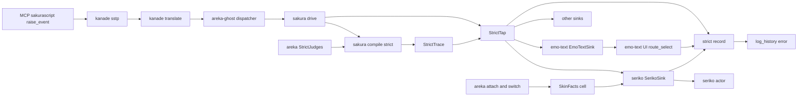
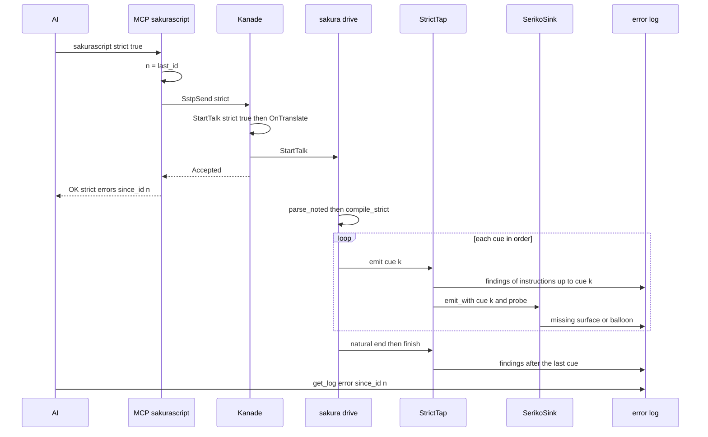

# 設計: mcp-strict-errors

> 2026-10-29 `/kiro-spec-design`（`/kiro-design` の中の段）。測った main は `932d2c30`。行の番号はこの時点のもの。
> 調べものの詳しい中身は `research.md` の 11 節。ここでは決めたことと約束だけを書く。
> 2026-10-29 の設計の討議で 4 議題を推奨案で確定し、SSP の実測（要件 6.8）をした（`research.md` 12 節・`doc/ssp-mcp/survey.md` 8 節）。

## Overview

**目的**: AI が MCP の `sakurascript`・`raise_event` に `strict` を付けて流した台本について、再生の途中で実際に当たった誤りを 1 件ずつエラーログへ残す。AI は `sakurascript` の答えにある番号より後の `get_log(log_type=error)` を読めば、自分の台本のどこがどう誤っていたかが分かる。あわせて、MCP の案内文の古い 1 文を消し、`params` がオブジェクトでない要求に JSON-RPC のエラーで答える。

**使う人**: 台本を流して試す AI（Claude Code など）と、その試験を組む開発者。

**今との違い**: 今は `strict` を kanade の控え（`StrictNote`）まで運んで捨てている。本 spec は印を台本の始めの知らせ（`StartTalk`）に載せ、翻訳の後も保ったまま再生の層まで運ぶ。再生の層は、誤りに当たった分岐で記録する。再生のしかた・今の警告の記録・`script` の記録は変えない。

### Goals
- strict の台本の再生が当たった誤りを、`check_script` と同じ種類・文面で、当たった順にエラーログへ残す（要件 1〜4）。
- 検出点を 1 つの表に持ち、表と実装の一致をテストで判定する（要件 4.4・4.5・7.6）。
- 案内文の最後の 1 文を消す（要件 5）。
- `params` がオブジェクトでない要求に、受け口でも中継ごしでも、その `id` 付きの JSON-RPC のエラーで答える。直しは rmcp の中に置く（要件 6）。

### Non-Goals
- SSTP の `Option: strict`（印は同じ `StartTalk.strict` を SSTP の口が立てれば済む形にしておく）。
- 誤った箇所の再生のしかたを変えること。
- `check_script` の答え・判定・種類・文面を変えること（判定の関数の置き場を動かすだけで、答えは 1 バイトも変えない）。
- `\i`・`\&` への対応（今は `unknown_tag`）。
- 通知と `params` が `null` の要求への答え。

## Boundary Commitments

### This Spec Owns
- 印の通り道: `StartTalk.strict` を kanade が立て、翻訳を通して保ち、配り口（dispatcher）→ 台本の駆動（sakura drive）→ 合図の受け手（sink）まで運ぶこと。
- 誤りの語彙: 検出点の列挙 `DetectionPoint`（16 個）と、種類の名前・文面の定数（今は `check_script_judge.rs` の `MSG_*`。置き場を `areka-sakura` の `strict` へ下ろし、`check_script` も同じ定数を使う）。
- 記録の書き方: 1 件の本文の形・記録の名（ゴースト名）・target（`areka::log::error`）。
- 合図の受け手が誤りを知らせる口: `dola` の `CueSink::emit_with` と `CueProbe`。
- seriko の「今のシェルとバルーンの事実」（`SkinFacts`）と、`\s`・`\b` の判定の関数（`check_script` から移す）。
- `sakurascript` の strict の答え（`since_id` 付き）。
- 案内文の定数 `INSTRUCTIONS` の 1 文。
- rmcp の直し（フォーク・`[patch.crates-io]`・上流への直し）と、中継の同じ答え。
- 文書: `doc/ssp-mcp/areka-tools.md` の strict の節と検出点の表、`transport-diff-areka.md`・`bridge-diff-areka.md`・`survey.md` の該当の行。

### Out of Boundary
- 再生の各層の振る舞い（表示・捨て方・既定への落とし方・今の `warn!`／`error!`）。本 spec は判定を読むだけで、分岐の結果を変えない。
- `\!` の受け取り手の台帳 `ConsumerLedger` の中身（表の行を足す・消すのは各機能の spec）。本 spec は `consumer_of` を引くだけ。
- シェル・バルーンの切替の時機（今は「台詞の切れ目」まで待つ）。本 spec はその時機をそのまま受け入れる。
- エラーログの上限・本文の上限・記録の取り決め（`mcp-log-history` の持ち物）。
- 選択肢の `script:` や `\![raise]` で始まる別の台本への印の引き継ぎ（既定は引き継がない。要件 3.8）。
- rmcp の他の振る舞い・版の上げ下げ（版は `3.5.0` のまま）。

### Allowed Dependencies
- 依存の向き（左が下・右は左だけを使う）: `dola` → `areka-talk` → `areka-sakura` → `areka-seriko`・`areka-emo-text` → `areka-kanade`・`areka-ghost` → `areka`。`areka-mcp`（rmcp）→ `areka-mcp-bridge`。
- `areka-sakura` は `ConsumerLedger`（`areka`）と `apply_font_tag`（`areka-emo-text`）を直接使わない。判定は `StrictJudges` の約束を通して `areka` から差し込む。
- seriko と emo-text は `areka-sakura::strict` の語彙だけを使い、記録は `CueProbe` を通す（自分で target を書かない）。
- rmcp は `=3.5.0` のまま、`[patch.crates-io]` で直しの入った枝（版の番号は `3.5.0`）を使う。新しい crate は足さない。

### Revalidation Triggers
- `doc/ssp-mcp/areka-tools.md` の ⑶ の表（種類・文面・行）か、検出点の表が変わる。
- `DetectionPoint` の増減、`CueSink::emit_with`・`CueProbe` の形、`StartTalk.strict` の形が変わる。
- シェル・バルーンの切替が台詞の途中で効くように変わる（判定の事実を替える時機が変わる）。
- `ConsumerLedger::consumer_of` の形が変わる。
- rmcp の版を上げる・上流が直しを取り込む（`[patch]` を外す）。
- SSP の実測（要件 6.8）が既定と違う答えを示す（3.8・3.10・文書の「SSP との違い」）。

## Architecture

### Existing Architecture Analysis
- 台本は kanade の `start_talk` で `StartTalk` になり、翻訳（`OnTranslate`）の後に `on_done` が台本だけを差し替え、`Action::StartTalk` で配り口へ渡る。出どころ（`origin`）は同じ道を運ばれている（`script-security-level` の前例）。
- 配り口は sink を talk ごとに複製し、`spawn_talk` が `sakura-talk-{id}` のスレッドで `parse` → `compile`（全部を先に）→ `CuePlayer` の broadcast（合図ごとに、登録順に全 sink へ `emit`）をする。
- 誤りに当たる分岐は 3 つのスレッドに散っている: 台本の解釈（talk スレッド）・seriko（seriko スレッド）・表示と文字の層（UI スレッド）。どれも talk の id・ゴースト名・台本の位置を持たない。
- シェル・バルーンの切替は、kanade の「台詞の切れ目」（再生中の台詞が無い）まで待ってから seriko へ差し替え（`SerikoReplace`）を送る。seriko は合図と差し替えを 1 本の受信口で順に捌く。

### Architecture Pattern & Boundary Map

選んだ形: **「合図を配る口で順をそろえ、各層は自分の判定を合図の受け取りの場で行う」**。

- 台本の解釈で分かる誤りは `compile` が命令ごとに控え、その命令の最初の合図が配られる時に記録する（再生が届いた所だけ）。
- seriko の誤り（無い surface・無いバルーン）は、seriko の受け口 `SerikoSink` が合図を受け取った場で、seriko が使う事実（`SkinFacts`）で判定する。差し替えと同じ鍵の下で判定と送り出しをするので、seriko の本体が使う定義と食い違わない。
- 名前の形の `\b[名前]` だけは、文字の層が UI スレッドで今のサーフェスの箱を見て決めるので、合図に添えた `CueProbe` を文字の層へ渡し、決めた場で知らせる。

この形を取った理由（退けた案は `research.md` 11.3）:
- 判定と記録を talk スレッドの合図の順で行うので、要件 2.5・2.7 の「順」がスレッドの競り合いに左右されない。
- 各層の判定の関数は各層の crate に置き、`check_script` も同じ関数を使う（物差しは 1 つ）。
- 再生の振る舞いは変えない。strict でない台本は今の道（`parse`・`compile`・sink の直の登録）を 1 つも変えずに通る。



**Architecture Integration**:
- 守る前例: `origin` の運び方（`StartTalk` の欄・翻訳で保つ）、`\!` の汎用キャリアと名前の自己選別、`check_script` の「再生が使う関数の答えを写すだけ」、記録の取り決め（`log-convention.md`）。
- 新しく足すもの: `StrictTap`（strict の talk だけに挟む配り口の覆い）・`StrictTrace`（命令の位置と控えた誤り）・`DetectionPoint`・`StrictJudges`・`SkinFacts`・`CueProbe`。どれも「位置と順を保ったまま層をまたいで知らせる」ために要る最小のもの。
- steering との整合: 時刻・順を正確に扱う、ログの無い失敗経路を作らない、UI スレッドを塞がない、プロトコルは公式 SDK に任せる（rmcp の中で直す）。

### Technology Stack

| Layer | Choice / Version | Role in Feature | Notes |
|-------|------------------|-----------------|-------|
| 再生の核 | `dola`（ワークスペース内） | `CueSink::emit_with` と `CueProbe` を足す | 既定の実装は `emit` を呼ぶだけ＝今の sink は無改変で動く |
| 台本の駆動 | `areka-sakura` | `strict` の語彙・`compile_strict`・`StrictTap` | `parse_noted` を使う（`parse` はその写し） |
| 表情 | `areka-seriko` | `SkinFacts` と `\s`・`\b` の判定 | 判定の関数を `check_script_judge.rs` から移す |
| 文字の層 | `areka-emo-text` | 名前の形の `\b` の知らせ・`\f` の分類の関数 | `judge_font` を `look` へ移す |
| MCP の受け口 | `rmcp` `=3.5.0`＋`[patch.crates-io]` | 本文が読めない要求のうち `params` の形だけが誤るものに、`id` 付きのエラーで答える | 3.8.0（2026-10-26 時点の最新）でも直っていない。上流へ直しを出す（許しを取ってから） |
| 記録 | `tracing`＋`log_history` | target `areka::log::error`・`warn!` | 取り決めの欄 `ghost` を使う。`label` は付けない（既定の `Error`） |

## File Structure Plan

### Directory Structure
```
crates/
├── dola/src/cue/
│   └── sink.rs                      # CueSink::emit_with（既定は emit）・CueProbe・CueFinding
├── areka-talk/src/
│   └── lib.rs                       # StartTalk.strict: bool（new は false）
├── areka-kanade/src/schedule/
│   ├── sstp.rs                      # 受け付けた台本の StartTalk に strict を立てる・StrictNote を消す
│   └── types.rs                     # State::sstp_strict を消す
├── areka-sakura/src/
│   ├── strict.rs                    # 新: DetectionPoint・文面の定数・StrictJudges・StrictHooks・記録・位置の数え方
│   ├── strict_tap.rs                # 新: StrictTrace・StrictTap（合図の配り口の覆い）
│   ├── compile.rs                   # compile_strict（compile と同じ走査で誤りを控える）
│   ├── drive.rs                     # strict の talk だけ parse_noted→compile_strict→StrictTap
│   └── lib.rs                       # mod と再公開
├── areka-ghost/src/
│   ├── runtime.rs                   # GhostBootOptions.strict_judges・StrictHooks を組む（名は listed_ghost_name）
│   └── dispatcher.rs                # StrictHooks を持ち、strict の StartTalk で spawn_talk へ渡す
├── areka-seriko/src/
│   ├── skin_facts.rs                # 新: SkinLookup・SkinFacts・surface_missing・balloon_missing
│   ├── actor.rs                     # SerikoSink に事実の置き場・emit_with・set_facts・send_replace の引数
│   └── lib.rs                       # 再公開
├── areka-emo-text/src/
│   ├── look.rs                      # classify_font_tag（check_script の judge_font を移す）
│   ├── sink.rs                      # TextMsg::ProbedCue・EmoTextSink::emit_with（名前の形の \b だけ）
│   └── state_route.rs               # route_select が見つからなかったことを返す・知らせの口
├── areka/src/
│   ├── emo2_boot/strict_judges.rs   # 新: ArekaStrictJudges（台帳と \f の分類）
│   ├── emo2_boot/skin_facts_copy.rs # 新: 表示の層・差し替えの荷物から SkinFacts を組む（check_script と共用）
│   ├── emo2_boot/talk_clock.rs      # ClockedTextSink が emit_with を内側へ通す
│   ├── emo2_boot/frame/attach.rs    # 装着の時に seriko へ事実を渡す
│   ├── emo2_boot/frame/switch.rs    # 差し替えの依頼と同時に事実を替える
│   ├── emo2_boot/runtime_boot.rs    # strict_judges を入れる
│   ├── emo2_boot/spine.rs           # strict_judges を入れる
│   ├── boot_config.rs               # 窓の無いゴーストにも strict_judges を入れる
│   ├── mcp/check_script.rs          # SkinFacts と共用の写しを使う（答えは不変）
│   ├── mcp/check_script_judge.rs    # 判定の関数と定数を移した先を使う（答えは不変）
│   ├── mcp/sakurascript.rs          # strict 真の答え（since_id）
│   └── mcp/raise_event.rs           # strict 真で台本が返ったときの答え（since_id）
├── areka-mcp/src/
│   ├── handler.rs                   # INSTRUCTIONS から 1 文を消す
│   └── server_params_shape_tests.rs # 新: 5 つの版の params の形の答え（server.rs に #[path] 1 行）
└── areka-mcp-bridge/src/
    └── stdio.rs                     # 読めない行のうち params の形だけの誤りに rmcp の同じ答え
```

### Modified Files（上の木に出ないもの・テスト）
- `Cargo.toml`（根）— `[patch.crates-io]` に `rmcp = { git = "https://github.com/ekicyou/rust-sdk", rev = "<直しの rev>" }` を足す。
- `Cargo.lock` — rmcp（と同じリポジトリの `rmcp-macros`）の出どころが git に替わる。依存の席を使う（1 ウェーブに 1 本）。
- `deny.toml` — `allow-git` にフォークの URL を名指しで足す（`image-webp` の前例）。
- `THIRD-PARTY-NOTICES.md` — rmcp の行に出どころ（フォークの rev）を書く。許諾は同じ（Apache-2.0）。
- StartTalk の素の構築を持つ所 — `areka-kanade/src/schedule/close.rs`・`boot.rs`、`areka-ghost/src/prop_sink.rs`、テストの構築（`strict: false` を足す）。
- GhostBootOptions の素の構築を持つテスト — `strict_judges: None` を足す。
- `doc/ssp-mcp/areka-tools.md` — ⑶ の 2 つの表を印で挟む・「⑺ strict の記録」を足す（約束・本文の形・検出点の表）・⑸ の行を直す。
- `doc/ssp-mcp/transport-diff-areka.md`・`bridge-diff-areka.md`・`survey.md` — 要件 6.8〜6.10 の行。
- テスト（新）: `areka-sakura/src/strict_tests.rs`・`compile_strict_tests.rs`・`drive_strict_tests.rs`、`areka-seriko/src/skin_facts_tests.rs`・`actor_strict_tests.rs`、`areka-emo-text/src/sink_probe_tests.rs`、`areka/src/emo2_boot/strict_judges_tests.rs`（⑶ の 17 行・`check_script` と同じ集まり・検出点の表の一致）、`areka/src/mcp/sakurascript_tests.rs`（追記）、`areka-kanade/src/schedule/sstp_tests.rs`（追記）、`areka-mcp-bridge/tests/real_receiver_test.rs`（追記）、`areka/tests/mcp_strict_real_run.rs`（実機）。

## System Flows

### strict の台本 1 本の流れ



- `<n>` は kanade へ送る**前**に読む。受け付けの返事は再生の開始を送った後に来るので、返事の後に読むとその台本の記録より後の番号になりうる（要件 1.2）。
- 途中で打ち切られた（別の台本・利用者の操作・終了）ときは `StrictTap` ごと捨てる。配った合図より後ろの控えは記録しない。記録済みの分は消さない（要件 3.6・3.7）。
- `\e`・`\-` の後ろは `compile_strict` が走査しないので、控えも生まれない（要件 3.6）。

### 判定の事実を替える時機（シェル・バルーンの切替）

```mermaid
sequenceDiagram
    participant Ui as UI switch phase
    participant Cell as SkinFacts cell
    participant Sink as SerikoSink
    participant Actor as seriko actor
    Ui->>Cell: write lock
    Ui->>Cell: new facts
    Ui->>Actor: SerikoReplace
    Ui->>Cell: unlock
    Sink->>Cell: read lock
    Sink->>Sink: judge cue with facts
    Sink->>Actor: Cue
    Sink->>Cell: unlock
```

- 差し替えの依頼と事実の差し替えを同じ書き込みの鍵の中で行い、`SerikoSink` は読みの鍵の中で判定と送り出しをする。seriko の本体は受信口の順で差し替えと合図を捌くので、どの合図も「seriko の本体が使う定義」と同じ事実で判定される（要件 4.1）。
- areka の切替は「台詞の切れ目」まで待つ。そのため同じ台本の中の `\![change,shell,…]` の後ろの `\s` は、再生でも切替の前のシェルで扱われ、判定も切替の前の事実で行う。差し替えが効いた後に配られた合図は新しい事実で判定する。これが本 spec の「切り替えた後の実際の答え」である（`research.md` 11.2）。

## Requirements Traceability

| Requirement | Summary | Components | Interfaces | Flows |
|-------------|---------|------------|------------|-------|
| 1.1 | strict 真の答えの文 | SakuraScriptStrictAnswer | `strict_accepted_text(n)` | strict の流れ |
| 1.2 | `<n>` は記録の前の番号 | SakuraScriptStrictAnswer | `log_history::last_id()` を送る前に読む | strict の流れ |
| 1.3 | `since_id` で全部読める | StrictRecord・StrictTap | 記録はその場で積まれる | strict の流れ |
| 1.4 | strict 偽・省略は今のまま | SakuraScriptStrictAnswer・KanadeStrictFlag | `strict == Some(true)` だけ | — |
| 1.5 | NG のときは今の答え・記録なし | SakuraScriptStrictAnswer | NG の腕は変えない・talk が始まらない | — |
| 2.1 | 1 件ずつ記録 | StrictRecord | `record(ghost, finding, place)` | — |
| 2.2 | 名はゴースト名 | StrictHooks・StrictRecord | `listed_ghost_name(mount)` | — |
| 2.3 | 本文に 4 つ | StrictRecord・CharCursor | 本文の形 | — |
| 2.4 | 文書と 1 字も違わない | DetectionPoint・StrictJudgesTests | 文書の表を読むテスト | — |
| 2.5 | 当たった順 | StrictTap・StrictTrace | 合図の順で記録 | strict の流れ |
| 2.6 | 7 種類 | DetectionPoint | 検出点の表 | — |
| 2.7 | `check_script` と同じ集まり | DetectionPoint・SkinFacts・StrictJudges | 同じ判定の関数 | — |
| 2.8 | 予約の種類を出さない | DetectionPoint | 列挙に無い | — |
| 2.9 | 誤り 0 なら記録 0 | StrictTap | 控えも知らせも無ければ何も書かない | — |
| 3.1 | `sakurascript` の台本を strict で再生 | KanadeStrictFlag | `StartTalk.strict` | strict の流れ |
| 3.2 | `raise_event` の返った台本 | KanadeStrictFlag | `on_notify_reply` で立てる | — |
| 3.3 | 翻訳の後も strict | KanadeStrictFlag | `on_done` は台本だけを替える | — |
| 3.4 | `raise_event` の記録しない場合 | KanadeStrictFlag | talk が始まらない | — |
| 3.5 | strict 偽は記録 0 | StrictDrive | 今の道を通る | — |
| 3.6 | 再生されなかった所は記録しない | StrictTap・CompileStrict | 走査の打ち切り・talk の打ち切りで捨てる | strict の流れ |
| 3.7 | 記録済みは消さない | StrictRecord | 書いたら終わり | — |
| 3.8 | 別の台本へ及ぶか | KanadeStrictFlag | 既定は及ばない（`StartTalk::new` は偽） | — |
| 3.9 | 再生・`script`・警告を変えない | StrictDrive・CompileStrict | 同じ合図の列を作る・既定の `emit_with` | — |
| 3.10 | `raise_event` の答えの文 | RaiseEventStrictAnswer・SspMeasurement | 実測どおり strict 真で台本が返ったときだけ 1 行目に strict の文を足す | — |
| 3.11 | 表示と他のツールを止めない | StrictTap・SkinFacts | talk スレッドで判定・UI は事実の組み立てだけ | — |
| 4.1 | 切替の後ろの `\s`・`\b` | SkinFacts・SerikoStrictSink | 差し替えと同じ鍵 | 事実を替える時機 |
| 4.2 | 名前の形の `\b`・後から解決する指定 | TextProbe・SerikoStrictSink | `TextMsg::ProbedCue`・`route_select` | — |
| 4.3 | 窓の無いゴースト | StrictDrive | seriko と文字の層が居ない | — |
| 4.4 | 検出点の表 | DetectionPoint | 本書「検出点の表」 | — |
| 4.5 | 表と実装の一致 | StrictJudgesTests | 3 つの赤の条件 | — |
| 4.6 | 文書の約束 | ArekaToolsDoc | ⑺ の節 | — |
| 4.7 | `ignored` の説明 | ArekaToolsDoc | ⑺ の節 | — |
| 5.1 | 案内文の 1 文を消す | Instructions | `INSTRUCTIONS` | — |
| 5.2 | 中継の組み込みの答え | Instructions | 中継は同じ定数を読む | — |
| 5.3 | `NG:not implemented yet` を返さない | Instructions | 本番のファイルにその文字列が無いことを見るテスト | — |
| 6.1 | 数・文字列・真偽値は `-32600` | RmcpShapePatch | `request_shape_error` | — |
| 6.2 | 配列は `-32602` | RmcpShapePatch | 同上 | — |
| 6.3 | rmcp の形で返す | RmcpShapePatch | フォーク＋`[patch]`・上流へ | — |
| 6.4 | HTTP の状態 | RmcpShapePatch | 版の経路ごとの状態 | — |
| 6.5 | 中継も同じ | BridgeShapeAnswer | 同じ rmcp の関数 | — |
| 6.6 | 次の要求はいつもどおり | RmcpShapePatch・BridgeShapeAnswer | 1 件で閉じる | — |
| 6.7 | ほかの答えは変えない | RmcpShapePatch・BridgeShapeAnswer | 当たらなければ今の道 | — |
| 6.8 | SSP の実測 | SspMeasurement | 許しを取ってから | — |
| 6.9 | `transport-diff-areka.md` の行 | DiffDocs | — | — |
| 6.10 | `bridge-diff-areka.md` の行 | DiffDocs | — | — |
| 7.1 | ⑶ の 17 行 | StrictJudgesTests | 文書の表を読む | — |
| 7.2 | `check_script` と同じ集まり | StrictJudgesTests | `diagnose` と比べる | — |
| 7.3 | 4.1・4.2・4.3・3.3・3.6 | 各層のテスト | — | — |
| 7.4 | 答えの文と `<n>`・`since_id` | SakuraScriptStrictAnswer | — | — |
| 7.5 | 記録を残さない場合 | 各層のテスト | — | — |
| 7.6 | 検出点の表の一致 | StrictJudgesTests | — | — |
| 7.7 | 5 つの版 | ReceiverShapeTests・BridgeShapeAnswer | — | — |
| 7.8 | 既存のテスト | 全体 | — | — |
| 7.9 | 実機 1 本 | StrictRealRun | `real-run-kit` | — |

## Components and Interfaces

| Component | Domain/Layer | Intent | Req Coverage | Key Dependencies | Contracts |
|-----------|--------------|--------|--------------|------------------|-----------|
| CueProbe | dola | 合図の受け手が誤りを知らせる口 | 2.1, 4.2 | なし | Service |
| KanadeStrictFlag | kanade・areka-talk | 受け付けた台本の `StartTalk` に印を立てる | 1.4, 3.1〜3.5, 3.8 | areka-talk (P0) | State |
| DetectionPoint・StrictRecord | areka-sakura strict | 検出点の語彙と 1 件の書き方 | 2.1〜2.4, 2.6, 2.8 | tracing (P0) | Service |
| CompileStrict・StrictTrace | areka-sakura | 走査で誤りを控え、命令の位置を合図に対応づける | 2.5, 2.7, 3.6, 3.9 | StrictJudges (P0) | Service |
| StrictTap・StrictDrive | areka-sakura | strict の talk だけ配り口を覆い、合図の順で記録する | 2.5, 2.9, 3.5〜3.7, 3.11, 4.3 | dola (P0) | Service, State |
| StrictHooks | areka-ghost | ゴースト名と判定を talk へ渡す | 2.2 | areka-sakura (P0) | Service |
| SkinFacts・SerikoStrictSink | areka-seriko | 今のシェルとバルーンの事実で `\s`・`\b` を判定する | 2.7, 4.1, 4.2 | areka-sakura (P0) | Service, State |
| TextProbe | areka-emo-text | 名前の形の `\b` を決めた場で知らせる | 4.2 | dola (P0) | Event |
| ArekaStrictJudges・SkinFactsCopy | areka | 台帳・`\f` の分類の差し込み、事実の組み立て | 2.7, 4.1 | ConsumerLedger (P0) | Service |
| SakuraScriptStrictAnswer・RaiseEventStrictAnswer | areka mcp | strict 真の答え | 1.1〜1.5, 3.10 | log_history (P0) | API |
| Instructions | areka-mcp | 案内文 | 5.1〜5.3 | — | API |
| RmcpShapePatch・BridgeShapeAnswer | rmcp フォーク・中継 | `params` の形の誤りへの答え | 6.1〜6.7 | rmcp (P0) | API |
| ArekaToolsDoc・DiffDocs・SspMeasurement | 文書 | 約束・差の一覧・実測 | 4.4, 4.6, 4.7, 6.8〜6.10 | SSP の MCP (P1) | — |

### dola

#### CueProbe

| Field | Detail |
|-------|--------|
| Intent | 合図を受け取った層が、その合図の台本の位置に結びついた知らせを返す口 |
| Requirements | 2.1, 4.2 |

**Responsibilities & Constraints**
- dola は知らせの中身を解釈しない（種類・文面は不透明な文字列）。
- 既定の `emit_with` は `emit` を呼ぶだけ。上書きしない sink の振る舞いは今と同じ（要件 3.9）。
- `CueProbe` は複製でき、別のスレッドへ渡せる（UI で決まる知らせのため）。

**Contracts**: Service [x]

##### Service Interface
```rust
/// 1 件の知らせ（どれも 'static の不透明な文字列）。
#[derive(Clone, Copy, Debug, PartialEq, Eq)]
pub struct CueFinding {
    pub point: &'static str,   // 検出点の名前（DetectionPoint::name）
    pub kind: &'static str,    // 種類の名前（例 "missing_surface"）
    pub message: &'static str, // 文面
}

/// 合図 1 つに結びついた知らせの口。PartialEq は同じ口か（Arc の指す先）で比べる。
#[derive(Clone)]
pub struct CueProbe(std::sync::Arc<dyn Fn(CueFinding) + Send + Sync>);

impl CueProbe {
    pub fn new(report: impl Fn(CueFinding) + Send + Sync + 'static) -> Self;
    pub fn report(&self, finding: CueFinding);
}

pub trait CueSink {
    fn emit(&mut self, cue: TalkCue);
    /// strict の台本の合図。既定は emit と同じ（知らせない）。
    fn emit_with(&mut self, cue: TalkCue, probe: &CueProbe) {
        let _ = probe;
        self.emit(cue);
    }
    // preview・choice_wait_began は今のまま
}
```
- 不変条件: `emit_with` を上書きする sink は、`emit` と同じ送り出しをちょうど 1 回する（知らせの有無で配送を変えない）。
- 覆いの sink（`ClockedTextSink` など）は `emit_with` を内側の `emit_with` へ通す。

### kanade・areka-talk

#### KanadeStrictFlag

| Field | Detail |
|-------|--------|
| Intent | `strict` 真で受け付けた台本の `StartTalk` に印を立てる |
| Requirements | 1.4, 3.1, 3.2, 3.3, 3.4, 3.5, 3.8 |

**Contracts**: State [x]

##### State Management
- `areka_talk::StartTalk` に `pub strict: bool` を足す。`StartTalk::new` は `false`。
- `schedule/sstp.rs` の `on_send` は `start_talk` が返した `StartTalk` に `strict == Some(true)` を入れてから翻訳へ預ける。`on_notify_reply` はゴーストが空白だけでない台本を返したときだけ同じく立てる（空・空白・不受理・送れないときは talk が始まらない＝要件 3.4）。
- 翻訳の `on_done` は台本（`script`）と出どころだけを替えるので、印は翻訳の後も残る（要件 3.3）。`talk_origin::stamp` は `origin` だけを書き換える。
- 控え `StrictNote` と `State::sstp_strict` は消す（印の正本を 1 つにする。読むのはテストだけだった）。
- 選択肢の `script:` など、kanade が自分で始める台本は `StartTalk::new` の既定（偽）のまま。SSP の実測（要件 6.8）が「及ぶ」を示したときだけ、出どころを引き継ぐ所（`talk_origin::of_shown`）で同じく引き継ぐ（要件 3.8）。

### areka-sakura

#### DetectionPoint・StrictRecord

| Field | Detail |
|-------|--------|
| Intent | 検出点の列挙・種類と文面の定数・1 件の記録の書き方 |
| Requirements | 2.1, 2.2, 2.3, 2.4, 2.6, 2.8 |

**Responsibilities & Constraints**
- 文面の定数 10 個（今の `MSG_*`）をここへ下ろす。`check_script_judge.rs` の `MSG_*` はこれを指す別名にする（文字列は 1 バイトも変えない）。
- `DetectionPoint` は 16 個（下の「検出点の表」）。予約の種類（`missing_animation`・`unknown_entity`）は持たない（要件 2.8）。
- 記録は `tracing::warn!(target: RECORD_TARGET, ghost = %ghost, point = finding.point, "{kind} {start}-{end} {message}: {text}")`。`RECORD_TARGET` は `"areka::log::error"`（`areka` のテストが `log_history::TARGET_ERROR` と同じことを確かめる）。
- 位置は再生した台本（翻訳の後の `StartTalk.script`）の先頭を 0 とした文字の数。`check_script` の `Out::push` と同じ数え方を `CharCursor` として共用する（前から 1 度だけ数える）。

**Contracts**: Service [x]

##### Service Interface
```rust
pub const RECORD_TARGET: &str = "areka::log::error";
pub const MSG_UNKNOWN_TAG: &str = "areka does not know this tag; playback drops it";
// …残りの 9 個も今の check_script_judge.rs と同じ文字列

#[derive(Clone, Copy, Debug, PartialEq, Eq, Hash)]
pub enum DetectionPoint {
    ReadUnknownTag, ReadUnclosed, ReadDefaulted, ReadMarkerIgnored,
    CommandUnhandled, ChoiceTimeoutUnreadable, FontIgnored, FontUnknownKey,
    AnchorReopened, AnchorUnclosed, AnchorStrayClose,
    SurfaceUnresolved, SurfaceAbsent, BalloonInvalid, BalloonAbsent, BalloonBoxMissing,
}
impl DetectionPoint {
    pub const ALL: [DetectionPoint; 16];
    pub fn name(self) -> &'static str;     // 列挙子の名前と同じ綴り
    pub fn kind(self) -> &'static str;
    pub fn message(self) -> &'static str;
    pub fn finding(self) -> CueFinding;
}

/// 台本の解釈の外にある判定（`areka` が実装して差し込む）。
pub trait StrictJudges: Send + Sync {
    /// `\!` の名前と第 1 引数の組を誰かが拾うか（`ConsumerLedger::consumer_of` が Some）。
    fn command_handled(&self, name: &str, first: Option<&str>) -> bool;
    /// `\f` の引数の分類。FontIgnored か FontUnknownKey、診ないものは None。
    fn font(&self, args: &[String]) -> Option<DetectionPoint>;
}

#[derive(Clone)]
pub struct StrictHooks {
    pub ghost: std::sync::Arc<str>,           // get_active_ghost_list と同じ値
    pub judges: std::sync::Arc<dyn StrictJudges>,
}

/// 文字の数での位置と綴り。
pub struct Place { pub start: usize, pub end: usize, pub text: String }

pub struct CharCursor<'a> { /* script・ここまでのバイトと文字の数 */ }
impl<'a> CharCursor<'a> {
    pub fn new(script: &'a str) -> Self;
    /// span はバイトの範囲。前の呼び出しより前へは戻らない（戻ったら先頭から数え直す）。
    pub fn place(&mut self, span: std::ops::Range<usize>) -> Place;
}

pub fn record(ghost: &str, finding: CueFinding, place: &Place);
```
- 本文の例: `missing_surface 2-11 no such surface in the current shell; playback does not change the surface: \s[99999]` の後に取り決めの欄 ` point="SurfaceAbsent"` が続く。
- 文面はどれも `:` を含まないので、最初の `: ` までが文面、その後ろから欄の手前までが綴りになる。本文の上限（4,096 文字）を超えると後ろから切られる。位置の `<end>` は切られても元の長さを示す（文書に書く）。

#### CompileStrict・StrictTrace

| Field | Detail |
|-------|--------|
| Intent | `compile` と同じ走査で合図の列を作り、台本の解釈で分かる誤りを控え、合図ごとの位置を残す |
| Requirements | 2.5, 2.7, 3.6, 3.9 |

**Responsibilities & Constraints**
- `compile` と `compile_strict` は 1 つの走査の関数を共有する（strict かどうかは控えを取るかどうかだけ）。同じ命令の列から同じ `CompiledTalk` を作る（要件 3.9。テストで固定）。
- 命令 `i` の走査の頭で「次に作られる、sink へ配られる合図の順番」を控え、命令 `i` の誤りは全部この順番に結びつける。順は `check_script` の `diagnose` と同じ（読みの印 → 命令の腕の判定 → アンカー）。
- 順番は sink へ配られる合図（`Entry::Command`）だけを数える。末尾の選択待ちの区切り（`emit_barrier`・`Entry::Barrier`）は配られないので数えない。走査の後で先頭へ差し込む全消しの合図（`compile.rs` 337 行の `cues.insert(0, …ClearAll)`）は位置 `None` の合図として順番 0 に入り、命令の合図の順番はみな 1 つ後ろへずれる。`cue_spans`・`pending` の順番は、この差し込みと区切りを済ませた後の最終の列で決める（走査中の `cues.len()` をそのまま使わない）。
- 控えるもの: 読みの印 4 つ（`UnknownTag`・`Unclosed`・`ArgumentDefaulted`・`MarkerIgnored`）、`GenericCommand`・`Move` の腕の `judges.command_handled` が偽（単独の `\![*]` は除く）、`choicetimeout` の読めない時間、`Font` の腕の `judges.font`、アンカーの 3 つ（今の `pair_anchors` の答え）。
- 今の `warn!`（アンカー・`choicetimeout`）と `debug!` は今のまま出す。
- `\e`・`\-` で走査を止めるので、その後ろの命令の誤りは控えない。
- 合図ごとの位置: 命令から作った合図にはその命令の読みの範囲（バイト）を、走査の後で補うアンカーの閉じと先頭の全消しには `None` を持たせる。末尾に足すエピローグの合図は数に入れない（位置なし）。

##### Service Interface
```rust
pub fn compile_strict(
    reads: &[areka_parsers::sakura::Read],
    vars: &SystemVarSnapshot,
    judges: &dyn StrictJudges,
) -> (CompiledTalk, StrictTrace);

pub struct StrictTrace {
    /// 合図の順番 → 台本の読みの範囲（バイト）。None は台本に元の無い合図。
    pub(crate) cue_spans: Vec<Option<std::ops::Range<usize>>>,
    /// （結びつけた合図の順番, 検出点, 読みの範囲）を位置の順に。
    pub(crate) pending: Vec<(usize, DetectionPoint, std::ops::Range<usize>)>,
}
```
- 不変条件: `compile` が作る合図は時刻が減らない順に並ぶので、`TimedSchedule` の安定な並べ替えの後も配られる順＝作った順になる。テストで「`CuePlayer` が配った順」と「`cue_spans` の順」が一致することを、先頭の全消しを持つ台本と選択肢で終わる台本の両方で固定する。

#### StrictTap・StrictDrive

| Field | Detail |
|-------|--------|
| Intent | strict の talk だけ、実の sink を覆う 1 つの sink として `CuePlayer` に登録し、合図の順で記録する |
| Requirements | 2.5, 2.9, 3.5, 3.6, 3.7, 3.11, 4.3 |

**Responsibilities & Constraints**
- `drive.rs` の `on_start`: `start.strict` が真で `StrictHooks` が在るときだけ `parse_noted` → `compile_strict` をし、`Armed` に控えと台本（`Arc<str>`）を持たせる。偽なら今の `parse` → `compile`（要件 3.5・3.9）。
- 最初の `Tick` で、strict なら実の sink を全部 `StrictTap` へ入れ、`StrictTap` 1 つを登録する。偽なら今のまま各 sink を登録する。
- `StrictTap::emit(cue)`（順番 `k`）:
  1. `pending` のうち順番が `k` 以下のものを順に記録する。
  2. `cue_spans[k]` が在れば、その位置に結びついた `CueProbe` を作り、各 sink へ登録順に `emit_with` する。無ければ各 sink へ `emit` する。
  3. `k` を 1 進める。
- `preview` は各 sink へそのまま通す。
- `choice_wait_began`: 選択待ちの区切りは列の末尾にしか置かれない（`compile.rs` の `emit_barrier` は末尾の 1 か所）ので、再生はここで台本の全部の命令に届いている。残りの控えを全部記録してから各 sink へ通す。選択の後に台本が閉じられても（`on_close`）控えは落ちない。
- 自然に終わったとき（`is_completed`）は `finish` で残りの控え（最後の合図より後ろの命令の誤り）を記録してから `TalkDone` を送る。打ち切り（`on_close`）は残りを記録せずに捨てる（要件 3.6・3.7）。
- `CueProbe` の知らせは、talk スレッドの上で来たものは `CharCursor` で位置を出してすぐ記録する。別のスレッドから後で来たもの（名前の形の `\b`）は、その合図の範囲から位置を数え直して記録する（まれなので前から数えてよい）。
- 窓の無いゴーストは sink が `LogSink`・`DiscardSink` だけなので、`emit_with` で知らせる層が無く、台本の解釈の誤りだけが記録される（要件 4.3）。
- 仕事は talk スレッドだけで、UI スレッドには何も足さない（要件 3.11）。

**Contracts**: Service [x] / State [x]

##### Service Interface
```rust
pub fn spawn_talk<D>(
    start: StartTalk,
    done: Sender<D>,
    sinks: Vec<Box<dyn CueSink + Send>>,
    system_vars: SystemVarSnapshot,
    strict: Option<StrictHooks>,   // 足す引数（strict の台本でなければ使わない）
) -> TalkHandle;

pub(crate) struct StrictTap { /* sinks・trace・script・ghost・次の順番・CharCursor */ }
impl CueSink for StrictTap { /* emit・preview・choice_wait_began */ }
impl StrictTap { pub(crate) fn finish(&mut self); }
```

### areka-ghost

#### StrictHooks の配線

- `GhostBootOptions` に `pub strict_judges: Option<Arc<dyn StrictJudges>>` を足す。
- `boot` が `StrictHooks { ghost: listed_ghost_name(mount), judges }` を組んで `spawn_dispatcher` へ渡す。名は kanade の `script` の記録と同じ関数（`config.rs` の `listed_ghost_name`）で作るので、`get_log` の `ghost_name` の絞り込みに当たる（要件 2.2）。
- 配り口の `on_start` は、`start.strict` が真のときだけ `Some(hooks.clone())` を `spawn_talk` へ渡す。
- `strict_judges` が `None`（テスト）のときは strict の台本も今の道で再生する（記録しない）。

### areka-seriko

#### SkinFacts・SerikoStrictSink

| Field | Detail |
|-------|--------|
| Intent | seriko が使う今のシェルとバルーンの事実を持ち、`\s`・数の `\b` を合図の受け取りの場で判定する |
| Requirements | 2.7, 4.1, 4.2 |

**Responsibilities & Constraints**
- `check_script_judge.rs` の `ScriptFacts`・`surface_missing`・`balloon_missing` を seriko へ移す（名を `SkinLookup` とする）。`check_script` の `ScriptFactsSnapshot` は同じ形の `SkinFacts` に置き換える。答えは変えない。
- `SerikoSink` は `Arc<RwLock<Option<SkinFacts>>>` を持つ（複製はみな同じ置き場を指す）。
- `emit_with(cue, probe)`: 読みの鍵の中で、事実が在れば次を判定してから今の `deliver` をする。
  - `Emote { key }` → `surface_missing`。解けない名前・範囲外は `SurfaceUnresolved`、数は在るがシェルに無いのは `SurfaceAbsent`。
  - `BalloonSurface { key }` → `balloon_missing`。範囲外は `BalloonInvalid`、バルーンに無い ID は `BalloonAbsent`。名前の形と非表示は判定しない（名前の形は文字の層）。
  - 話し手のスコープに絵・バルーンが無ければ判定しない（`check_script` と同じ）。
- 要件 4.2 の「表情の層が後から解決する指定」（別名の `\s[名前]`・数の `\b[…]`）は、seriko の本体と同じ解決器の答えで、この場で記録する。
- 事実がまだ無い（装着の前）ときは判定しない。
- `send_replace(replace, facts)`: 書き込みの鍵の中で事実を替えてから差し替えを送る。`set_facts(facts)`: 装着の時に入れる。
- seriko の本体（`handle_message`）の分岐と `error!` は今のまま。

**Contracts**: Service [x] / State [x]

##### Service Interface
```rust
pub trait SkinLookup {
    fn resolve_surface(&self, key: &str) -> SurfaceTarget;
    fn shell_has(&self, scope: u32, surface_id: u32) -> Option<bool>;
    fn balloon_has(&self, scope: u32, balloon_id: u32) -> Option<bool>;
}

pub struct SkinFacts {
    resolver: SurfaceResolver,                    // scope 0 の別名の表から作る
    shells: BTreeMap<u32, BTreeSet<u32>>,         // スコープ → シェルの surface ID
    balloons: BTreeMap<u32, BTreeSet<u32>>,       // スコープ → バルーンの面の ID
}
impl SkinFacts {
    pub fn new(aliases: BTreeMap<String, Vec<u32>>,
               shells: BTreeMap<u32, BTreeSet<u32>>,
               balloons: BTreeMap<u32, BTreeSet<u32>>) -> Self;
    pub fn with_shells(&self, aliases: BTreeMap<String, Vec<u32>>, shells: BTreeMap<u32, BTreeSet<u32>>) -> Self;
    pub fn with_balloons(&self, balloons: BTreeMap<u32, BTreeSet<u32>>) -> Self;
}
impl SkinLookup for SkinFacts { /* … */ }

/// 解けない名前・範囲外は Unresolved、シェルに無い数は Absent、在れば None。
pub fn surface_missing(facts: &dyn SkinLookup, scope: u32, key: &str) -> Option<DetectionPoint>;
pub fn balloon_missing(facts: &dyn SkinLookup, scope: u32, key: &str) -> Option<DetectionPoint>;

impl SerikoSink {
    pub fn set_facts(&self, facts: SkinFacts);
    pub fn send_replace(&self, replace: SerikoReplace, facts: SkinFacts) -> bool;
}
```
- `check_script` は `surface_missing(..).is_some()` を使う（真偽は今と同じ）。

### areka-emo-text

#### TextProbe

| Field | Detail |
|-------|--------|
| Intent | 名前の形の `\b[名前]` を、文字の層が UI スレッドで箱を探した場で知らせる |
| Requirements | 4.2 |

**Responsibilities & Constraints**
- `EmoTextSink::emit_with`: 合図が `BalloonSurface { key }` で `resolve_balloon_key(key)` が名前の形のときだけ、`TextMsg::ProbedCue(cue, probe.clone())` を送る。ほかは今の `emit` と同じ。
- UI の drain は `ProbedCue` を今の `Cue` と同じに捌き、`route_select` が箱を見つけられなかった（空回しの写しでない）ときに `probe.report(BalloonBoxMissing.finding())` を呼ぶ。今の `warn!` は残す。
- `TextMsg` の `Clone`・`Debug`・`PartialEq` は `CueProbe` の実装（同じ口か）で保つ。
- `\f` の分類 `classify_font_tag(args) -> Option<FontClass>` を `look.rs` に置く（`check_script` の `judge_font` を移す。値の誤り `BadValue` は診ない）。`areka` の `ArekaStrictJudges::font` と `check_script` が使う。

**Contracts**: Event [x]
- 送る知らせ: `TextMsg::ProbedCue(TalkCue, CueProbe)`。同じ FIFO の口で今の `Cue` と同じ順に届く。
- 順の約束: この知らせは UI で決まるので、talk スレッドで書いた記録との前後は合図の順と違うことがある（後述「要件の読み」）。

### areka

#### ArekaStrictJudges・SkinFactsCopy

- `emo2_boot/strict_judges.rs`: `ArekaStrictJudges { ledger: ConsumerLedger }`。`command_handled` は `ledger.consumer_of(name, first).is_some()`、`font` は `classify_font_tag` を検出点へ写す。`runtime_boot.rs`・`spine.rs`・`boot_config.rs`（窓の無いゴースト）の 3 つの構築で `strict_judges: Some(..)` を入れる。
- `emo2_boot/skin_facts_copy.rs`: 表示の層から `SkinFacts` を写す関数（今の `ScriptFactsSnapshot::copy` を移す）と、差し替えの荷物（`SwapBuilt` の各スコープの `EmoWorld::surface_ids`・`alias_snapshot`）から新しい事実を組む関数。
- `frame/attach.rs`: 装着（`wiring.attached = true`）の時に `seriko_sink.set_facts(copy(..))`。
- `frame/switch.rs`: `send_replace(replace)` を `send_replace(replace, facts)` にする。シェルの差し替えは `with_shells`、バルーンは `with_balloons`。
- `talk_clock.rs`: `ClockedTextSink::emit_with` は時刻を観測してから内側の `emit_with` へ通す。

#### SakuraScriptStrictAnswer

| Field | Detail |
|-------|--------|
| Intent | `strict` 真で受け付けたときの答え |
| Requirements | 1.1, 1.2, 1.4, 1.5 |

**Contracts**: API [x]

##### API Contract
| 条件 | 本文 | `isError` |
|------|------|-----------|
| `strict` 真・受け付けた | `OK:strict errors will be recorded to the error log. Check them later with get_log tool (log_type=error, since_id=<n>)` | 偽 |
| `strict` 偽・省略・受け付けた | `OK`（今のまま） | 偽 |
| 空の台本・受け付けない・ゴーストが居ない・答えの前に降りた | 今の `NG:` のまま | 今のまま |

- `<n>` は `handle` の中で、`KanadeMsg::SstpSend` を送る**前**に `log_history::last_id()` を読んだ値（10 進。何も無ければ 0）。`strict` 真のときだけ読む。
- NG の場合は kanade が talk を始めていない（受け付けない・返事の口が落ちたのは kanade が台本を処理する前）ので、記録も無い（要件 1.5）。
- SSP の `<n>` はエラーログの最後の番号だった（`survey.md` 8.1）。areka は要件 1.2 どおり全種類の通しの最後の番号を返す。どちらも `since_id` で読めばその台本の記録が全部入る（文書の「SSP との違い」に書く）。

#### RaiseEventStrictAnswer

| Field | Detail |
|-------|--------|
| Intent | `strict` 真で送ったイベントに台本が返ったときの答えを、SSP の実測（`survey.md` 8.2）に揃える |
| Requirements | 3.10 |

| 条件 | 本文 |
|------|------|
| `strict` 真・台本が返った | `OK:the ghost returned a script and it is being played. strict errors will be recorded to the error log. Check them later with get_log tool (log_type=error, since_id=<n>)`＋今の区切り（`\r\n`）＋`Script: <台本>` |
| `strict` 偽・省略・台本が返った | 今のまま（`OK:the ghost returned a script and it is being played.`＋区切り＋`Script: <台本>`） |
| 台本が返らない・受け付けない・送れない | 今のまま |

- `<n>` は `crates/areka/src/mcp/raise_event.rs` の `handle` の中で、`KanadeMsg::SstpNotify` を送る**前**に `log_history::last_id()` を読んだ値（`strict` 真のときだけ読む）。返事の後に読むと、その台本の記録より後の番号になりうる（`sakurascript` と同じ理由）。
- strict の文は `sakurascript` の答えと同じ定数から作る（`OK:` を除いた本文を共用し、文字列を 2 つに写さない）。

#### 案内文（Instructions）

- `crates/areka-mcp/src/handler.rs` の `INSTRUCTIONS` から最後の 1 文を消す。前の 3 文は 1 字も変えない。説明の「英文・4 文」を「3 文」に直す。
- `server/discover` と中継の組み込みの答え（`service.rs` 408 行）は同じ定数を読むので、コードの直しはここだけ（要件 5.1・5.2）。
- 要件 5.3 は、`crates/areka/src/mcp/` の本番のファイルに `not implemented yet` の文字列が無いことを読むテストで保つ。

### rmcp と中継

#### RmcpShapePatch

| Field | Detail |
|-------|--------|
| Intent | 本文が `ClientJsonRpcMessage` に読めず、理由が `params` の形だけのとき、その `id` を付けた JSON-RPC のエラーで答える |
| Requirements | 6.1, 6.2, 6.3, 6.4, 6.6, 6.7 |

**Responsibilities & Constraints**
- 版を上げても直らない（3.5.1〜3.8.0 の `expect_json` は 415 の平文のまま。`research.md` 11.4）。よって要件 6.3 の ⑵: 上流へ直しを出し、取り込まれるまではフォークの枝を `[patch.crates-io]` で使う。
- 枝は上流のタグ `rmcp-v3.5.0` から切り、版の番号は `3.5.0` のまま（3 つの `Cargo.toml` の `=3.5.0` に合う。合わないと cargo は黙って公開版を使う）。
- 直す所: `transport/streamable_http_server/tower.rs` の `handle_post` で `expect_json` が読めなかったとき（`serde_json` の分類が `Data` のとき）だけ、本文を `serde_json::Value` として読み直し、下の関数が `Some` を返せばその答えを返す。`None` なら今の 415 のまま。
- HTTP の状態: 要求のヘッダ `MCP-Protocol-Version` が無状態の版（`2026-07-28`）なら `jsonrpc_http_status(code)`（`-32600` は 200・`-32602` は 400）、それ以外の版は 200。本文は `application/json` の JSON-RPC のエラー 1 件（要件 6.4）。
- 1 件の答えで閉じ、次の要求はいつもどおり（要件 6.6）。
- フォークは開発者のアカウントの `ekicyou/rust-sdk`（2026-10-29 の設計の討議で確定）。上流へは `main`（3.8 系）向けに PR を出し、取り込まれて公開されたらその版へ上げて `[patch]` を外す。
- 上流へ直しを出す（フォークを作る・PR を出す）のは外へ出す操作なので、実装でその段に来たときに改めて開発者の許しを取ってから行う。

**Contracts**: API [x]

##### API Contract
```rust
// rmcp::model（フォークで足す公開の関数）
/// JSON として読めたが要求の形でない本文について、id を読める要求で、params が在り、
/// null でもオブジェクトでもないときだけ Some を返す。
/// 数・文字列・真偽値 → ErrorData::invalid_request（-32600）、配列 → ErrorData::invalid_params（-32602）。
pub fn request_shape_error(raw: &serde_json::Value) -> Option<JsonRpcError>;
```

| 要求 | 受け口の答え | HTTP（旧式の 4 版／`2026-07-28`） |
|------|--------------|-----------------------------------|
| `id` 有り・`params` が数・文字列・真偽値 | `{"jsonrpc":"2.0","id":<id>,"error":{"code":-32600,…}}` | 200 ／ 200 |
| `id` 有り・`params` が配列 | 同じ形・`code` は `-32602` | 200 ／ 400 |
| `id` 無し（通知）・`params` が `null`・`jsonrpc` が `"2.0"` でない・`method` が無い・JSON でない | 今のまま（415 の平文ほか） | 今のまま |

- `id` は要求の値のまま（数か文字列）。メソッドの名前は見ない（知らない名前でも同じ・要件 6.1・6.2）。

#### BridgeShapeAnswer

- `crates/areka-mcp-bridge/src/stdio.rs` の `LineTransport::receive` で、serde の分類が `Data`（今 `-32600`・`id: null` を返す所）のとき、行を `serde_json::Value` として読み直し、`rmcp::model::request_shape_error` が `Some` ならその答えを書く。`None` なら今の `-32600`・`id: null` のまま（要件 6.5・6.7）。
- 中継は areka の有無に関わらず自分で答える所なので、受け口と同じ関数を使うことで同じ答えになる。`tests/real_receiver_test.rs` の 5 つの版の比較に行を足して固定する。
- 注意: 中継は前に話した areka の案内文を控えて返すことがある（`service.rs` 377 行）。控えは次に areka と話した時に新しくなる。要件 5.2 の「組み込みの答え」は定数なので直る。

### 文書

#### ArekaToolsDoc（`doc/ssp-mcp/areka-tools.md`）
- ⑶ の 2 つの表を印で挟む: `<!-- diagnostic-kinds:begin -->`〜`end`（種類と文面）、`<!-- diagnostic-rows:begin -->`〜`end`（17 行）。テストがこれを読む。
- 「⑺ strict の記録」を足す:
  - 記録すること（要件 1〜3 の範囲）と、本文の形・名・target・`point` の欄・本文の上限で切られること。
  - 記録しない場合（要件 3）。
  - SSP の strict との違い（`survey.md` 8 節の実測の分。測れなかった所は「測っていない」）:
    - 本文の形が違う（SSP は `[GHOST/Script] surface not found (99999) at position 2 : <その位置から後ろの台本>`、areka は `check_script` の種類と文面）。表示の語（`Error`）・名（ゴースト名）・位置の数え方（文字の数）は同じ。
    - SSP は知らないタグ（`\y`）を記録しなかった。areka は `unknown_tag` として記録する。
    - SSP の `since_id` はエラーログの最後の番号、areka は全種類の通しの最後の番号（どちらでも読み落としは無い）。
    - 呼んだ先の台本に記録が及ぶかは測っていない（areka は及ばない）。
  - 同じ誤りが再生の側の記録（名は `[SYSTEM]`）としても出ることがあり、strict の記録だけを読むには `get_log` の `ghost_name` で絞ればよいこと。
  - `ignored` は「areka がまだ対応していないもので、台本の誤りではない」。除いて読みたいときは種類の名前で外せる。
  - areka の切替は台詞の切れ目で効くので、同じ台本の中の切替の後ろの `\s`・`\b` は切替の前のシェル・バルーンで判定されること。
  - 名前の形の `\b[名前]` の記録は文字の層で決まるので、ほかの記録との前後が台本の順と違うことがあること。
  - 検出点の表（本書の表と同じ行）を `<!-- strict-points:begin -->`〜`end` で挟む。
- ⑸ の「`mcp-strict-errors` が作る予定」の書きぶりを、作った後の文へ直す。

#### DiffDocs・SspMeasurement
- `transport-diff-areka.md`: `params` がオブジェクトでない要求の行（areka の番号と HTTP の状態・固定するテストの名前・SSP の欄）。
- `bridge-diff-areka.md`: 91 行目「オブジェクトでない行と、要求の形でないオブジェクト」から `params` の形だけの誤りを分け、areka の欄を「`id` 付きの `-32600`／`-32602`（受け口と同じ）」に書き直す。
- `survey.md`: 要件 6.8 の 4 つは、2026-10-29 の設計の討議で開発者の許しを取って測り、8 節に書いた（設計の段で済み・実装のタスクには置かない）。結果: `raise_event` は strict 真で台本が返ったときだけ 1 行目に strict の文が付く（RaiseEventStrictAnswer）。表示の語は `Error`。呼んだ先の台本に及ぶかは「測っていない」＝3.8 は既定の「及ばない」。`params` がオブジェクトでない要求には、SSP は旧式の版で形を見ずに普通に答え、無状態の版では `_meta` の検査の 400・`-32602` が先に出る（`params` の形への答えは見えない）。
- `transport-diff-areka.md` の行の SSP の欄は、この 8.4 を写す（areka は要件 6.1・6.2 どおり `-32600`／`-32602` で、SSP と違う）。

## 検出点の表

再生の側で、strict の記録を書く分岐の全部。列「点」は `DetectionPoint` の名前と同じ綴り。テスト（要件 4.5・7.6）は `doc/ssp-mcp/areka-tools.md` に写したこの表を読む。

| 点 | 種類 | 層と分岐 | 記録する条件 | 赤の台本 | 緑の台本 |
|---|---|---|---|---|---|
| ReadUnknownTag | `unknown_tag` | 台本の解釈: `compile_strict` の命令の頭（読みの印 `UnknownTag`） | 再生がその命令に届いた | `\x` | `\e` |
| ReadUnclosed | `unreadable_argument`（閉じていない） | 同（印 `Unclosed`） | 同 | `\s[0` | `\s[0]` |
| ReadDefaulted | `unreadable_argument`（既定の値へ落とす） | 同（印 `ArgumentDefaulted`） | 同 | `\_w[abc]` | `\_w[500]` |
| ReadMarkerIgnored | `ignored` | 同（印 `MarkerIgnored`） | 同 | `\![*]` | `\q[題,ID]` |
| CommandUnhandled | `unknown_command` | 台本の解釈: `GenericCommand`・`Move` の腕（`\!` の受け取り手の台帳 `consumer_of` が None。単独の `\![*]` を除く） | 同 | `\![nosuch]` | `\![open,readme]` |
| ChoiceTimeoutUnreadable | `unreadable_argument`（既定の値へ落とす） | 台本の解釈: `GenericCommand` の腕（`parse_choice_timeout` が `Unreadable`） | 同 | `\![set,choicetimeout,abc]` | `\![set,choicetimeout,5000]` |
| FontIgnored | `ignored` | 台本の解釈: `Font` の腕（文字の層の `classify_font_tag` が受け取るだけ） | 同 | `\f[sub,1]` | `\f[bold,1]` |
| FontUnknownKey | `unknown_tag` | 同（知らないキー・キーなし） | 同 | `\f[colour,red]` | `\f[color,red]` |
| AnchorReopened | `unpaired_tag`（新しい開き） | 台本の解釈: `Anchor` の腕（`pair_anchors` が `Reopened`） | 同 | `\_a[x]あ\_a[y]い\_a` | `\_a[x]あ\_a\_a[y]い\_a` |
| AnchorUnclosed | `unpaired_tag`（閉じが無い） | 同（`Unclosed`） | 同 | `\_a[x]` | `\_a[x]あ\_a` |
| AnchorStrayClose | `unpaired_tag`（開いていない所の閉じ） | 台本の解釈: `AnchorEnd` の腕（`StrayClose`） | 同 | `\_a` | `\_a[x]あ\_a` |
| SurfaceUnresolved | `missing_surface` | 表情: `SerikoSink::emit_with` の `Emote`（解決器が `Unresolved`） | 合図が配られた・話し手のスコープにシェルが在る | `\s[-2]` | `\s[-1]` |
| SurfaceAbsent | `missing_surface` | 同（数が今のシェルの ID に無い） | 同 | `\s[99999]` | `\s[0]` |
| BalloonInvalid | `missing_balloon` | 表情: `SerikoSink::emit_with` の `BalloonSurface`（`resolve_balloon_key` が `Invalid`） | 合図が配られた・話し手のスコープにバルーンが在る | `\b[-2]` | `\b[-1]` |
| BalloonAbsent | `missing_balloon` | 同（ID が今のバルーンに無い） | 同 | `\b[99]` | `\b[0]` |
| BalloonBoxMissing | `missing_balloon` | 文字の層: `route_select`（名前の形の `\b[名前]` の箱が今のサーフェスに無い・空回しの写しでない） | UI が合図を捌いた | `\b[無い箱]` | 今のサーフェスに在る箱の名前 |

誤りを見つけるが、strict の記録は書かない分岐（同じ誤りを上の点が先に記録するか、台本の誤りでないもの）:

| 分岐 | 書かない理由 |
|---|---|
| seriko 本体 `handle_message` の `Unresolved`・`BalloonResolve::Invalid` の `error!` | 同じ解決器で `SurfaceUnresolved`・`BalloonInvalid` が記録済み |
| 表示の層 `apply_show` の「合成失敗」（`presenter/show.rs` 226 行） | 同じ ID の集まりで `SurfaceAbsent`・`BalloonAbsent` が記録済み |
| 文字の層 `apply_font_args` の `warn!` | 同じ分類で `FontIgnored`・`FontUnknownKey` が記録済み |
| `compile` の除外の腕（`Raw` の `debug!`） | 読みの印で `ReadUnknownTag`・`ReadUnclosed` が記録済み |
| seriko の `log_shell_fallback`（切替で今の面が無い） | 台本の誤りでない（切替の戻り先） |
| seriko の `EntityRef`・知らないシェル系の合図 | 到来しない守りの枝 |
| 表示の層の装着前の宛先（`show.rs` 63 行） | 台本の誤りでない |
| `\f` の値の誤り（`BadValue`） | `check_script` と同じく診ない |

## 要件の読み（2026-10-29 の設計の討議で確定）

1. **要件 2.7 と 4.2**（議題 2）: `check_script` は名前の形の `\b[名前]` を診ない（⑷）が、再生は箱が無ければ記録する（要件 4.2）。要件 2.7 の条件に「名前の形の `\b[名前]` で箱が見つからない箇所を持たない」を足した。要件 7.1 の「出ない台本」がこの形の行は、今のサーフェスに在る箱の名前で確かめる。
2. **要件 4.1**（議題 3）: areka の切替は台詞の切れ目まで待つので、同じ台本の中の切替の後ろの `\s`・`\b` は、再生でも切替の前のシェル・バルーンで扱われる。判定は seriko の本体が実際に使う定義と同じ事実で行う（差し替えと同じ鍵）。差し替えが効いた後の合図は新しい事実で判定する。要件 4.1 の文をこの形に直した。文書の「SSP との違い」に書く。
3. **要件 2.5 の順**（議題 2）: talk スレッドで決まる 15 の点は合図の順で書く。名前の形の `\b`（`BalloonBoxMissing`）だけは UI で決まるので、当たった時点で書き、ほかの記録との前後は台本の順と違うことがある。要件 2.5 にこの例外を足した。
4. **記録の本文**: `<kind> <start>-<end> <message>: <text>` に取り決めの欄 `point` が続く。表示の語は既定の `Error`（SSP の実測と同じ）。本文の形は SSP と違う（`check_script` の種類と文面に揃えるのが要件 2.4）ので、文書の「SSP との違い」に書く。

## Error Handling

### Error Strategy
- 記録の口（`tracing`）は失敗しない。`CueProbe` の知らせは、talk が終わった後に UI から来ても書く（打ち切りの前に配った合図の分なので要件 3.7 に合う）。
- `SkinFacts` の鍵が毒になったときは中身をそのまま使う（`PoisonError::into_inner`。前例: `switch.rs` の置き場）。
- `strict_judges` が無い構築では strict の台本も記録せずに再生する（`debug!` を 1 行）。本番の 3 つの構築は必ず入れる（テストで確かめる）。
- rmcp の直しの判定で読み直しに失敗したときは今の 415 を返す（新しい失敗の経路を作らない）。

### Monitoring
- strict の talk を始めるとき `debug!(talk_id, pending = n, "strict の台本を再生する")`。
- 本番の 3 つの構築で `strict_judges` が入っていることはテストで固定する（無言で記録が 0 件になるのを防ぐ）。

## Testing Strategy

### Unit Tests
- `areka-sakura`: `compile_strict` と `compile` が同じ `CompiledTalk` を作る（台本の見本の集まり・要件 3.9）。命令ごとの控えの順番と順が `diagnose` と同じ順になる。`\e`・`\-` の後ろは控えない（3.6）。`CharCursor` が `check_script` の位置と同じ数を返す。
- `areka-sakura`: `StrictTap` が合図の順で控えを書き、`cue_spans` の順と `CuePlayer` が配った順が一致する（先頭の全消しで番号がずれない・選択待ちの区切りを数えない）。打ち切りで後ろを書かない・自然な終わりで最後の控えを書く・選択肢で終わる台本は選択待ちの始まりで残りを書き、その後に閉じても落ちない（3.6・3.7）。strict 偽で今の登録になる（3.5）。
- `areka-seriko`: `surface_missing`・`balloon_missing` の答えが今の `check_script` の真偽と同じ。`send_replace` の後の合図は新しい事実で、前の合図は古い事実で判定される（4.1）。事実が無いと判定しない。
- `areka-emo-text`: `ProbedCue` で箱が無いと 1 回知らせ、空回しの写しでは知らせない（4.2）。`classify_font_tag` が今の `judge_font` と同じ答え。
- `areka-kanade`: `on_send`・`on_notify_reply` が `strict` を立て、翻訳の後も残る（3.1〜3.3）。不受理・空・送れないときは talk が始まらない（3.4）。`StartTalk::new` は偽（3.8）。

### Integration Tests
- `areka/src/emo2_boot/strict_judges_tests.rs`（⑶ と検出点の表を文書から読む）:
  - ⑶ の 17 行それぞれの「出る台本」の例を strict で再生すると、その行の種類と文面の記録が残り、「出ない台本」の例では残らない。種類と文面は文書の表から読む。確かめの数と行数が違えば赤（7.1・2.4）。再生は実の `compile_strict`・`StrictTap`・事実を入れた `SerikoSink`・`ArekaStrictJudges` をテストのスレッドの `CuePlayer` で回し、`log_history` の写しで拾う。
  - 複数の誤りを含む台本で、記録の（種類・位置・綴り・文面・順）が `diagnose` の答えと同じ（7.2・2.7）。
  - 検出点の表: `DetectionPoint::ALL` の名前の集まりと表の「点」の列が同じ・数が同じ。各行の赤の台本でその点の記録がちょうど 1 件、緑の台本で 0 件（4.5・7.6）。
  - `RECORD_TARGET == log_history::TARGET_ERROR`・記録の名が `listed_ghost_name` と同じ（2.2）。
- `areka-sakura/src/drive_strict_tests.rs`: 窓の無い sink の組（`LogSink`・`DiscardSink`）で、台本の解釈の誤りだけが記録される（4.3）。翻訳で書き換えた台本の位置は書き換えた後の台本に対するもの（3.3）。
- `areka/src/mcp/sakurascript_tests.rs`: strict 真の答えの文と `<n>`（送る前の `last_id`）、`since_id` で記録が全部読める、strict 偽・省略は `OK`、NG の 4 つの場合は今の答えで記録が増えない（1.1〜1.5・7.4・7.5）。
- `areka/src/mcp/raise_event_tests.rs`（追記）: strict 真で台本が返ったときの 1 行目の文と `<n>`（送る前の `last_id`）・`Script: ` の行は今のまま、strict 偽・省略と台本が返らないときは今の答え（3.10・7.4）。
- `areka-mcp/src/server_params_shape_tests.rs`: 5 つの版で、数・文字列・真偽値・配列の `params` に `id` 付きの `-32600`／`-32602` と表の HTTP の状態、知らない名前のメソッドでも同じ、その後の要求がいつもどおり、通知・`null`・JSON でない本文は今のまま。案内文から 1 文が消え、ほかが同じ（5.1・6.1〜6.7・7.7）。
- `areka-mcp-bridge/tests/real_receiver_test.rs`: 同じ要求を中継へ送ると受け口へ直接と同じ答え（5 つの版）。areka が居ないときの組み込みの `initialize` の案内文（5.2・6.5・7.7）。

### 既存のテスト
- 期待を変えてよいのは、`sakurascript` の strict 真の答え（1.1）・案内文（5.1）・`params` の形の答え（6.1・6.2・6.5）を固定しているものだけ。`StartTalk`・`GhostBootOptions` の素の構築に欄を足す直し（`strict: false`・`strict_judges: None`）と、`StrictNote` を読んでいたテストの読み先の付け替えは、期待を変えない（7.8）。

### E2E（実機）
- `crates/areka/tests/mcp_strict_real_run.rs`（`real-run-kit` の窓口・1 本）: 本物のゴーストに `\s[99999]\x` のような誤りを含む台本を `strict` 真で流し、答えの `since_id` で `get_log(log_type=error, ghost_name=…)` を読むと、2 件の strict の記録が台本の順に読める（7.9）。

### Performance
- 長い台本（4 MiB）の strict の再生で、UI スレッドの 1 フレームの仕事が増えない（判定と記録は talk スレッド）。`compile_strict` の追加の手間は台本の長さに比例する 1 回の走査だけ（3.11）。

## Security Considerations
- rmcp のフォークは開発者のアカウントのリポジトリに置き、`deny.toml` の `allow-git` に名指しで足す。`rev` を固定し、枝の更新で知らぬ間に中身が替わらないようにする。
- 記録の本文に台本の綴りをそのまま入れる。エラーログは MCP の `get_log` で読まれるだけで外へ出ない。

## Supporting References
- 調べの詳細・退けた案・rmcp の版の調べ: `research.md` 11 節。
