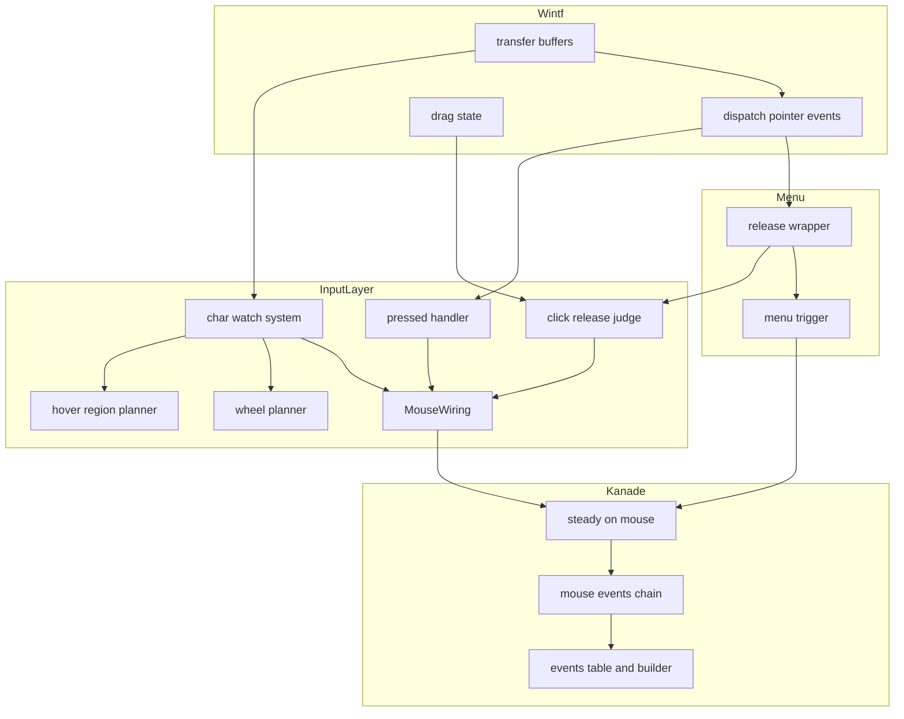
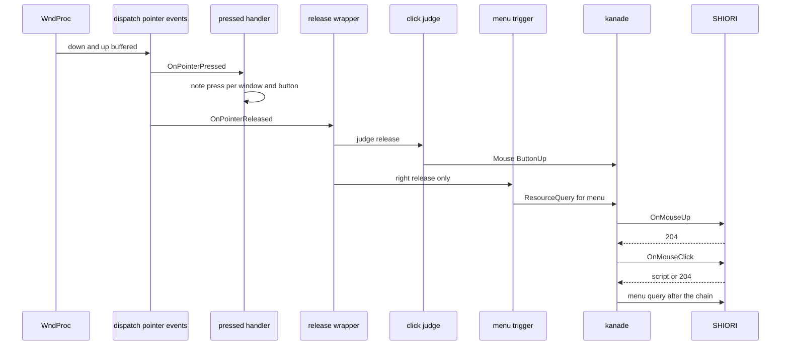
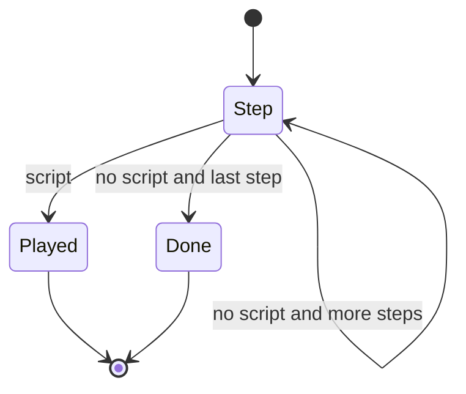

# Design Document: mouse-click-wheel-events

## Overview

**Purpose**: キャラクターの窓の上の 1 回のクリック・ボタンの解放・ホイール・当たり判定と窓の出入りを、正典（ukadoc「SHIORI Event」）の Reference で SHIORI へ送る。送るのは `OnMouseUp`・`OnMouseUpEx`・`OnMouseClick`・`OnMouseClickEx`・`OnMouseWheel`・`OnMouseEnter`・`OnMouseLeave`・`OnMouseEnterAll`・`OnMouseLeaveAll` の 9 語（以下「9 語」）。

**Users**: ゴーストの作者と利用者。辞書の「つつく」「× で閉じる」「ボールを押す」「乗ると色が変わる」「ホイールでなでる」の返事が areka でも呼ばれる。ゴースト「窓際のぱすたさん」の申し送りの件 10〜13 が解ける。

**Impact**: 今の areka はキャラクターの窓のマウスについて移動・ダブルクリック・ドラッグの開始と終了の 4 語だけを送る。本設計は ⑴ kanade に 9 語の受理と「返事が無ければ次の段へ進む」クリックの段の列を足し、⑵ 入力の層に「押下の控え」「解放の判定」「毎 tick の窓の見張り（出入りとホイール）」を足し、⑶ 窓の層（wintf）の 3 つの穴（ホイールの量が誰にも渡らない・拡張ボタンの押下が配られない・ドラッグの終わりに閾値を越えたかが残らない）を塞ぐ。ダブルクリック・ドラッグ・右クリックのメニューの今の動きは変えない。

### Goals
- 1 回のクリックで `OnMouseUp`（`Ex`）→ 返事が無ければ `OnMouseClick`（`Ex`）が正典の Reference で届く（中ボタンは `Ex` の 2 段に返事が無ければ互換の 2 段が続く）。
- ホイールで `OnMouseWheel` が届き、窓ごとに 100 ミリ秒に高々 1 回・回転量は捨てずに足し合わせる。
- 当たり判定と窓の出入りで `OnMouseEnter`／`OnMouseLeave`／`OnMouseEnterAll`／`OnMouseLeaveAll` が正しい順で届く。
- 送った・送らなかった（理由つき）が記録で分かり、網羅台帳の 9 行と §8 が実物と合う。
- すべての決まりを、本物のマウスも実際の待ち時間も使わない決定論のテストで固定する。

### Non-Goals
- `OnMouseDown`・`OnMouseDownEx`・`OnMouseDoubleClickEx`・`OnMouseMultipleClick`・`OnMouseHover`・`OnMouseGesture`（タッチパネルの代わりの `OnMouseWheel` を含む）。
- バルーンの窓の上のクリック・ホイール・出入り。横のホイール。入力の機器の見分け（Reference6 は `mouse` のまま）。
- 当たり判定の解決そのもの・ドラッグの判定そのものの作り直し。
- `\t` の間にマウスのイベントを止めること（`sakura-time-critical` の持ち物）。
- 1 tick に「押下 1・解放 1・押下 2」が全部入ったときの順の補正（「Open Questions / Risks」の R1）。

## Boundary Commitments

### This Spec Owns
- kanade の 9 語の受理・Reference の組み立て・クリックの段の列（`plan_click` の表）と、その応答の扱い（台本なら止める・204／失敗／想定外なら次へ）。
- 入力の層の 3 つの持ち物: 押下の控え（どの窓でどのボタンが押されたか・ダブルクリックの押下か・箱が使ったか）・解放の判定（クリックにするか・理由）・窓ごとの見張りの状態（今どの当たり判定の上か・窓の上に居るか・ホイールの溜めと前の送出の時刻）。
- 毎 tick の窓の見張りの系（`char_watch`）と、右クリックのメニューとクリックの解放を 1 本にまとめる受け手（`menu/mod.rs` の包み）。
- 窓の層の最小の 3 つの直し: ホイールの量を `PointerState.wheel` へ移して溜めを空にすること・拡張ボタンの押下で `OnPointerPressed` を配ること・直前の左の解放がドラッグ（か取り消し）だったかを読む口。
- 網羅台帳 `shiori.toml` の 9 行・報告の再生成・`doc/COMPAT_ARCHITECTURE.md` §8 の行・実機の確かめの記録。

### Out of Boundary
- 当たり判定の解決（完了 `collision-geometry`・`emo2_boot::hit_region`）とドラッグの判定（wintf の閾値の計算・完了 `mouse-drag-events`）。結果を読むだけ。
- 右クリックのメニューの出し方・照会・期限・抑止の決め方（`menu/trigger.rs`）。本 spec は `trigger.rs` を一切直さない。
- kanade の SHIORI との往復の層（`actor.rs`＝`shiori2-protocol` の持ち物）と SSTP の受け口（`schedule/sstp.rs`＝`mcp-strict-errors` の持ち物）。
- wintf の `window_proc/mouse_move.rs`・`drag/dispatch.rs`（`dpi-realign-remembered-chain` の持ち物）と、本 spec の 3 ファイル以外の wintf のファイル（`drag/mod.rs` の公開の一覧も含む）。
- 窓ごとの見張りの状態を読む公開の口（後の `shell-mouse-cursor`・`shell-tooltip`・`shell-hover-animation` が要るときに読み口を足す。本 spec は状態の型と置き場所だけを決める）。

### Allowed Dependencies
- 依存の向き: wintf → （公開の型と関数だけ）→ areka の入力の層（`input_events`）→ kanade の境界の型（`areka_kanade::MouseInput` ほか）→ kanade の `schedule`。`menu` → `input_events` の向きは今のまま（`input_events` は `menu` を参照しない）。
- 入力の層が使ってよい wintf の口: `PointerState`（`client_point`・`*_down`・`released`・`double_click`・`wheel`）・`find_owner_window`・`Window`・`WindowPos.size`・`snapshot_drag_state`・本 spec が足す `DragState::last_release_was_drag`・`tick_wake::arm_deadline`・`dispatch_pointer_events`（系の順の指定だけ）。
- kanade の `schedule` が使ってよい物: 今の `events`（表と組み立て）・`State`・`Action::ShioriRequest`・`ShioriOutcome`。新しい外部のクレートは足さない。

### Revalidation Triggers
- `MouseEventKind` の腕・`ClickButton`・`HoverEdge` の形が変わる（下流の `mcp-user-response`・`sakura-time-critical` が読む）。
- `plan_click` の表（段の列とその順）が変わる。
- 見張りの状態（`HoverState`）の置き場所・鍵（窓の entity）・中身が変わる（後の `shell-mouse-cursor` ほか 3 本が読む）。
- `ALLOWED_EVENT_IDS` の語の数（64）が変わる（後の `balloon-communicatebox`・`shell-scale-linkage` も同じ手書きの数を動かす）。
- wintf の `PointerState.wheel` が実際の値を運ぶようになったこと・拡張ボタンの押下が `OnPointerPressed` に届くようになったこと（どちらも製品で今は読み手 0 だが、後で足す受け手は前提が変わる）。

## Architecture

### Existing Architecture Analysis
- kanade の `steady::on_mouse` は種類ごとに組み立てを 1 つ呼んで GET を 1 本積む。殻（`actor.rs`）は GET の応答を次の知らせより先に入れ直すので、1 つの知らせから続く往復は他の知らせに割り込まれない。アンカー（`schedule/anchor.rs`）がこの性質に乗って「段の記憶 1 つ」で 2 段を送る前例である。
- 定常での SHIORI の送信の失敗は横断で `Unloading{Fault}` へ倒れる。例外はアンカーの段の記憶がある間と選択肢の in-flight の間（`schedule/mod.rs` の `on_shiori_reply`）。
- 入力の層の `MouseWiring`（NonSend）が送出の端・移動の間引き・当たり判定の供給・注入できる時計を束ねる。キャラ窓の受け手は `OnPointerMoved`・`OnPointerPressed`・`OnDragStart`・`OnDragEnd`（`input_events`）と `OnPointerReleased`（`menu`）。同じ型の部品は 1 窓に 1 つ。
- wintf は毎 tick の頭（`transfer_buffers_to_world`）で WndProc の溜めを `PointerState` へ移し、`Input` の段で `dispatch_pointer_events`（移動は毎 tick・押下・解放の順）→ `dispatch_drag_events` を回す。ドラッグの状態（`DRAG_STATE`）は WndProc の中で同期に変わるので、tick の中の受け手が読む時点では、その tick までの押下・閾値越え・解放は全部済んでいる。`PointerState` は「カーソルが窓の上に居る間、その窓の中のちょうど 1 つの entity」に付き、窓を出ると（`WM_MOUSELEAVE`）外れる。左の押下は捕捉を取るので、押している間は窓の外でもその窓の entity に残る。

### Architecture Pattern & Boundary Map



**Architecture Integration**:
- 採った形: 前例の組み合わせ（2 段＝アンカーの段の記憶・毎 tick の系＝バルーンの離脱の系・期限で起こす＝`balloon_visibility_phase` の `arm_deadline`・純関数＋状態は値型＝`throttle.rs`）。判断は純関数に集め、受け手と系は「読む → 純関数 → 送る」だけにする。
- 境界の分け方: kanade は「届いた 1 つの知らせから何をどの順で SHIORI へ送るか」だけを持ち、入力の層は「OS の出来事から知らせを作るか・いつ作るか」だけを持つ。クリックにするかの判定は入力の層、段の列（返事しだいで次へ）は kanade に置く。
- 毎 tick の見張りを `dispatch_pointer_events` の**前**の系に置く理由: ⑴ 出入りを同じ tick の `OnMouseMove` より先に送れる（要件 7.7）⑵ 今の移動の受け手 `on_char_pointer_moved` に手を入れずに済み、移動・ドラッグの今のテスト（最初の移動の知らせの数を数えるもの）が変えずに通る（要件 11.4）⑶ 窓を出たことを「その窓に `PointerState` の持ち主が居るか」で毎 tick 読めるので、`PointerLeave` の印の二義（窓を出た・窓の中で持ち主が替わった）に悩まない。
- 見張りの状態の鍵を窓の entity にする理由: 窓が作り直されると entity が変わるので、古い窓の覚えは「窓が無くなった」として黙って捨てられ、`OnMouseLeave` を送らない（要件 7.10・7.14）。ゴーストの切り替え・終了は `MouseWiring` が起動ごとに作り直されるので同じく捨てられる。
- steering との整合: 1 ファイル 1,000 行以下（`schedule/steady.rs` に足すのは入口の 10 行ほど）・新しいテストは兄弟ファイル・ログは構造化フィールドと `event` 名・ログ無しの失敗経路を作らない。

### Technology Stack

| Layer | Choice / Version | Role in Feature | Notes |
|-------|------------------|-----------------|-------|
| ゴーストの運行 | `areka-kanade`（ワークスペースの版） | 9 語の受理・クリックの段の列・失敗の免除 | 新しい依存なし |
| 入力の配線 | `areka` の `input_events`・`menu`（bevy_ecs はワークスペースの版） | 押下の控え・解放の判定・毎 tick の見張り | 新しい依存なし |
| 窓の層 | `wintf`（ワークスペース内） | ホイールの移し・拡張ボタンの押下・閾値越えの読み口 | 触るのは 3 ファイルと、その兄弟のテスト |
| 記録 | `tracing`（ワークスペースの版） | 送った・送らなかったの行 | 水準は「記録の水準」の節 |

## File Structure Plan

### Directory Structure
```
crates/areka-kanade/src/schedule/
├── mouse_events.rs         # 新: 9 語の受理（解放・ホイール・出入り）とクリックの段の列（plan_click・ClickChain・応答の扱い）
└── mouse_events_tests.rs   # 新: 段の列の表・各段の応答・失敗の免除・閉じの握手の保留・話の最中・記録
crates/areka/src/input_events/
├── click.rs                # 新: 押下の控え（note_press）と解放の判定（judge_release）・解放の受け手
├── click_tests.rs          # 新: 判定の表と受け手（ボタン 5 つ・ドラッグ・2 回目・窓の外・別の窓・箱）
├── hover_region.rs         # 新: 窓ごとの見張りの状態 HoverState と出入りの純関数 plan_hover（後の 3 本が読む置き場所）
├── hover_region_tests.rs   # 新: 無し→A・A→無し・A→B・窓の出入り・同時の順・止まったまま
├── wheel.rs                # 新: 窓ごとのホイールの溜め WheelAccum と間引きの純関数 plan_wheel
├── wheel_tests.rs          # 新: 静かな所の初回・足し合わせ・期限ちょうどの吐き出し・和 0・窓ごと
├── char_watch.rs           # 新: 毎 tick の見張りの系（持ち主の窓を引く→出入り→ホイール→吐き出し→期限の予約・消えた窓の覚えを捨てる）
└── char_watch_tests.rs     # 新: 系の結線（偽の窓と PointerState・注入の時計）・窓が無くなったとき・押下の控えを捨てる
```

### Modified Files
- `crates/areka-kanade/src/msg.rs` — `MouseEventKind` に `ButtonUp`・`Wheel`・`Hover` の 3 腕、`ClickButton`・`HoverEdge` の 2 型を足す。
- `crates/areka-kanade/src/lib.rs` — `ClickButton`・`HoverEdge` を公開の一覧へ足す（1 行）。
- `crates/areka-kanade/src/schedule/events.rs` — `ALLOWED_EVENT_IDS` に 9 語（ukadoc の URL のコメントつき）。`mouse_drag_get` を Ref2・Ref5 を受ける共通の組み立て `mouse_get` へ広げる（ドラッグの 2 つは `"0"`・`"0"` で呼ぶ＝値は今と同じ）。
- `crates/areka-kanade/src/schedule/steady.rs` — `on_mouse` に 3 腕を 1 つの腕で `mouse_events::on_mouse_extended` へ渡す。`on_reply` の先頭（アンカーの腕の直後）でクリックの段の記憶を取り出す。足すのは 10 行ほど（957 → 970 前後）。
- `crates/areka-kanade/src/schedule/types.rs` — `State.mouse_click: Option<mouse_events::ClickChain>` と `State::initial` の 1 行。
- `crates/areka-kanade/src/schedule/mod.rs` — `pub(crate) mod mouse_events;` と、失敗の免除の条件に `state.mouse_click.is_some()` を 1 つ足す。
- `crates/areka-kanade/src/schedule/events_change_tests.rs` — 手書きの数 `55` → `64`（コメントに 9 語と本 spec 名）。
- `crates/areka/src/input_events/mod.rs` — `pub(crate) mod click;`（`menu` の包みが呼ぶ）・`pub(crate) mod char_watch;`（`ghost_session` が登録する）・`mod hover_region;`・`mod wheel;`。`MouseWiring` に 3 欄（`presses`・`hover`・`wheel`）と両構築子の初期化。`on_char_pointer_pressed` で箱の判定の結果を控えてから押下の控えを書く（戻り値は今のまま）。新しい送出の口 `send_mouse`（警告つき・新しい知らせだけが使う）。
- `crates/areka/src/input_events/drag.rs` — `notify_drag` の種類の名前の `match` に新しい 3 腕を `"other"` で足す（ドラッグの 2 つしか来ない）。
- `crates/areka/src/menu/mod.rs` — `attach_release_handlers` が入れる受け手を、クリックの解放 → メニューの解放の順に呼ぶ包み `on_char_release` に替える。
- `crates/areka/src/menu/mod_wiring_tests.rs` — 包みの順の檻を足す（同じ受信端でクリックの知らせがメニューの照会より先に届く）。今あるテストは直さない。
- `crates/areka/src/ghost_session.rs` — `register_systems` に `input_events::char_watch::register_char_watch(world);` の 1 行。
- `crates/wintf/src/ecs/pointer/buffers.rs` — `transfer_buffers_to_world` でホイールの溜めを持ち主へ移し、溜めを毎回空にする。今ある中のテストの塊へテストを足す。
- `crates/wintf/src/ecs/pointer/dispatch/mod.rs` — `OnPointerPressed` の条件に `xbutton1_down || xbutton2_down` を足す（1 行）。テストは `pointer/dispatch/tests.rs`。
- `crates/wintf/src/ecs/drag/state/mod.rs` — 最後に休みへ移したときの「閾値を越えたか・取り消しか」の印（thread_local の 1 つ・次の `start_preparing` でも消さない）と読み口 `DragState::last_release_was_drag()`。テストは `drag/state/tests.rs`。
- `doc/ukadoc-coverage/ledger/shiori.toml` の 9 行・`doc/ukadoc-coverage/report/`（`ukadoc-survey` の `report`・`report-summary` で作り直す）・`doc/COMPAT_ARCHITECTURE.md` §8 の表の末尾。
- `.kiro/specs/mouse-click-wheel-events/verification.md`（新・実機の確かめの記録。撮った絵と記録はワークツリーの `target\` の下）。

wintf の兄弟のテストファイル（`pointer/dispatch/tests.rs`・`drag/state/tests.rs`）は、要件の「wintf で触るのは 3 ファイルだけ」の 3 ファイルのテストの置き場所として扱う（構造の決まり「テストは兄弟ファイル」・同じウェーブの `dpi-realign-remembered-chain` は触らない）。`drag/mod.rs` の公開の一覧・`clickthrough/controller_tests.rs`・`drag/reentry_tests.rs` に触らないために、`JustEnded` の形（欄）は変えない。

## System Flows

### 左・右のクリック（解放 → kanade の段の列 → メニューの照会）



- kanade の受け箱は 1 本（`MouseWiring` とメニューの送出の端は同じ受け箱の写し）なので、包みがクリックの知らせを先に投函すれば、段の列は照会より先に終わる（要件 5.2）。
- 段の列の途中に他の知らせは入らない（殻が応答を先に入れ直す・要件 4.2）。
- メニューを出すか抑えるかは今のとおり照会の返事だけで決まる（要件 5.3）。右のクリックの台本は今のマウスの返事と同じに再生される（要件 5.4）。

### クリックの段の列（kanade）



- 段の列は `plan_click`（下の表）で知らせを受けた時点に決まる。各段の応答が台本なら止めて再生し、204・送信の失敗・GET では起きない応答なら次の段を送る。最後の段の後は何もしない。
- 止めたとき・2 回目の解放で列を 1 段目だけで終えたときは、その旨を記録に残す（要件 3.6・9.2・9.3）。

### 毎 tick の見張り（`char_watch`・`dispatch_pointer_events` の前）

1. `MouseWiring` が無ければ何もしない（結線の前）。
2. 覚えている窓（3 つの表の鍵）のうち、entity が無い・`CharWindowMarker` が無いものの覚えを黙って捨てる（要件 7.10・7.14）。
3. `PointerState` の持ち主を集め、`find_owner_window` で持ち主の窓を引き、`CharWindowMarker` を持つ窓だけを「上に居る窓」とする（持ち主は 1 窓に高々 1 つ）。
4. 覚えでは上に居たのに持ち主が居なくなった窓を先に処理する: `plan_hover(.., Away)` の出入り（`OnMouseLeave` → `OnMouseLeaveAll`）を送り、その窓の右・中・拡張の押下の控えを捨てる（左は捕捉で持ち主が残るので、ここへは来ない）。
5. 上に居る窓ごとに: 位置が前と同じでホイールも 0 なら当たり判定を解かない。位置が変わった・初めて見た・ホイールが回ったときだけ `resolve_hit_owned` で解く。出入りは位置が変わった・初めて見たときだけ `plan_hover` に掛けて送る（要件 7.9）。続けて縦のホイールの量（`PointerState.wheel.vertical`・0 でなければ）を `plan_wheel` に掛ける。
6. 溜めの残っている窓すべてに `plan_wheel(.., 回転なし)` を掛け、期限が来ていれば吐き出す。
7. 溜めが残っていれば、最も早い期限で `tick_wake::arm_deadline` を預け直す（預かりは最も早い 1 つだけで到来すると倒れるので、残っている限り毎回預け直す）。

## Requirements Traceability

| Requirement | Summary | Components | Interfaces | Flows |
|-------------|---------|------------|------------|-------|
| 1.1 | 左の解放で `OnMouseUp`（Reference の並び） | ClickJudge・MouseEvents・Events | `judge_release`・`plan_click`・`mouse_get` | クリック |
| 1.2 | 204 なら `OnMouseClick` | MouseEvents | `on_click_reply` | 段の列 |
| 1.3 | 台本なら再生し `OnMouseClick` を送らない | MouseEvents・Steady | `on_click_reply`（`None`）→ 今の応答の腕 | 段の列 |
| 1.4 | 座標は `OnMouseMove` と同じ空間 | ClickJudge・CharWatch | `resolve_hit_owned` の `surface_point` | — |
| 1.5 | 待たない | ClickJudge | 解放の受け手で即投函 | クリック |
| 1.6 | 1 段目の失敗は 204 と同じに次へ | MouseEvents・失敗の免除 | `on_click_reply`・`on_shiori_reply` の条件 | 段の列 |
| 1.7 | 右も同じ 2 段・Ref5＝1 | MouseEvents | `plan_click(Right, ..)` | クリック |
| 1.8 | 2 段目の失敗も 204 と同じ・終わらせない | MouseEvents・失敗の免除 | 同上 | 段の列 |
| 2.1 | 中・拡張の解放で `OnMouseUpEx`（Ref5＝`middle` ほか） | ClickJudge・MouseEvents・wintf dispatch | `plan_click`・押下の配り | クリック |
| 2.2 | 204 なら `OnMouseClickEx` | MouseEvents | `on_click_reply` | 段の列 |
| 2.3 | 台本なら `OnMouseClickEx` を送らない | MouseEvents | `on_click_reply` | 段の列 |
| 2.4 | 中は `Ex` の 2 段に返事が無ければ互換の 2 段（Ref5＝2） | MouseEvents | `plan_click(Middle, false)` | 段の列 |
| 2.5 | 中の `Ex` に返事があれば互換を送らない | MouseEvents | 台本で止める規則 | 段の列 |
| 2.6 | 拡張ボタンは互換を送らない | MouseEvents | `plan_click(XButton*, ..)` | — |
| 3.1 | ドラッグの後は送らない（同じ瞬間の閾値越えも・解放と次の押下が同じ tick に入っても） | ClickJudge・wintf drag state | `DragState::last_release_was_drag`・`judge_release` | — |
| 3.2 | ダブルクリックの 2 回目の解放は 1 段目だけ | PressNote・ClickJudge・MouseEvents | `second_of_double`・`plan_click(.., true)` | 段の列 |
| 3.3 | 別の窓・窓の外で放したら送らない | ClickJudge・CharWatch | 押下の控えの有無・`WindowPos.size`・控えを捨てる | — |
| 3.4 | 箱の選択肢の押下は送らない | PressNote | `note_press(.., by_box)` | — |
| 3.5 | ドラッグ・ダブルクリック・強制退避の今の動き | 押下の受け手（変えない枝）・包み | 戻り値と既存の送出は今のまま | — |
| 3.6 | 送らなかった理由を記録 | ClickJudge・MouseEvents | `mouse_click_not_sent` | — |
| 4.1 | 左ダブルクリックの順 | PressNote・ClickJudge・押下の受け手 | 解放ごとに投函・押下で `OnMouseDoubleClick` | クリック |
| 4.2 | 段の間に他を挟まない | MouseEvents（殻の性質） | `State.mouse_click` | 段の列 |
| 4.3 | 右ダブルクリックの今の決まり | menu trigger（変えない） | `PendingDoubleClick` | — |
| 4.4 | 中・拡張のダブルクリックは送らない今の動き | 押下の受け手（変えない枝） | — | — |
| 5.1 | 右の解放で 2 段・メニューによらず | ReleaseWrap・ClickJudge | `on_char_release` | クリック |
| 5.2 | 右の 2 段をメニューの照会より先に | ReleaseWrap | 投函の順（同じ受け箱） | クリック |
| 5.3 | メニューの出し方は今のまま | menu trigger（変えない） | — | — |
| 5.4 | 右の台本は今のマウスの返事と同じに再生 | Steady（今の応答の腕） | `value_replaces_active_talk` | — |
| 6.1 | 窓の上の縦ホイールで `OnMouseWheel` | CharWatch・Wheel・MouseEvents | `plan_wheel`・`mouse_get` | 見張り |
| 6.2 | Ref2＝足し合わせた量・120・上が正 | Wheel・wintf buffers | `WheelDelta.vertical` の和 | 見張り |
| 6.3 | 窓ごとに 100 ms に高々 1 回 | Wheel | `WHEEL_MIN_INTERVAL_MS` | 見張り |
| 6.4 | 100 ms 以上空いた回転はすぐ送る | Wheel | `plan_wheel` | 見張り |
| 6.5 | 間隔の中は足し合わせ、期限で次の回転を待たずに送る | Wheel・CharWatch | `plan_wheel`・`arm_deadline` | 見張り |
| 6.6 | 和が 0 なら送らず記録 | Wheel・CharWatch | `WheelPlan::DropZero`・`mouse_wheel_not_sent` | 見張り |
| 6.7 | 横のホイールは送らない | CharWatch | `vertical` だけ読む | — |
| 6.8 | 窓ごとに別々 | Wheel | `MouseWiring.wheel` の鍵＝窓の entity | — |
| 6.9 | Ref0/1/4 は最後の回転の時点 | Wheel | `PendingWheel` の位置と当たり判定を上書き | — |
| 6.10 | カーソルの下に無い窓へは送らない | wintf buffers・CharWatch | 持ち主が居ない溜めは捨てる（wintf）・持ち主が窓の entity そのもの（絵の透けた所＝当たっていない）ならホイールを捨てる（CharWatch） | 見張り |
| 7.1 | 無し→A で Enter | Hover | `plan_hover` | 見張り |
| 7.2 | A→無し で Leave | Hover | `plan_hover` | 見張り |
| 7.3 | A→B は Leave(A)→Enter(B) | Hover | `plan_hover` | 見張り |
| 7.4 | A の上のまま窓の外 → Leave(A) | Hover・CharWatch | `HoverSighting::Away` | 見張り |
| 7.5 | 出入りの Reference の並び | Hover・MouseEvents | `HoverSend`・`mouse_get` | — |
| 7.6 | 出入りは間引かない | CharWatch | 移動の間引きを通さない | — |
| 7.7 | 出入りを `OnMouseMove` より先 | CharWatch | 系の順 `.before(dispatch_pointer_events)` | 見張り |
| 7.8 | 窓ごとに覚える | Hover | `MouseWiring.hover` の鍵＝窓の entity | — |
| 7.9 | カーソルが動いたときだけ確かめる | CharWatch・Hover | 位置の比べ | 見張り |
| 7.10 | 窓が無くなったら覚えを捨て Leave を送らない | CharWatch | 消えた鍵を黙って捨てる | 見張り |
| 7.11 | 窓に入ると `OnMouseEnterAll`（Ref4＝入った位置の当たり判定） | Hover | `plan_hover` | 見張り |
| 7.12 | 窓を出ると `OnMouseLeaveAll`（最後の位置・当たり判定） | Hover | `plan_hover` | 見張り |
| 7.13 | EnterAll→Enter・Leave→LeaveAll | Hover | `plan_hover` の出力の順 | 見張り |
| 7.14 | 6・7・10 を All にも | CharWatch・Hover | 同上 | 見張り |
| 8.1 | 話の最中の台本は話を置き換える | Steady（今の応答の腕） | `value_replaces_active_talk` | — |
| 8.2 | 話の最中も同じ条件で送る | MouseEvents | 話の有無で分けない | — |
| 8.3 | 受け付けない時期は送らず記録 | schedule mod（今の棄却）・Steady（閉じの握手の保留） | `mouse_input_ignored`・`mouse_close_pending` | — |
| 8.4 | メニュー表示中の操作は送らない | OS のメニューの模態（今のまま） | — | — |
| 9.1 | 送ったら名前・スコープ・当たり判定・ボタン／量 | MouseEvents | `mouse_event_sent` | — |
| 9.2 | 2 段目へ進まなかったことを記録 | MouseEvents | `mouse_click_chain_stopped` | — |
| 9.3 | 送らなかった理由を記録 | ClickJudge・CharWatch・MouseEvents・今の棄却 | 理由の語彙の表 | — |
| 9.4 | 1 回ごとの回転・動きを info 以上で残さない | Wheel・Hover の記録の水準 | debug・trace | — |
| 10.1 | 台帳の 9 行 | 台帳 | `shiori.toml` | — |
| 10.2 | ほかの行を変えない | 台帳 | — | — |
| 10.3 | 報告は生成の道具で | 台帳 | `ukadoc-survey report` | — |
| 10.4 | §8 への登記 | §8 | 「§8 へ登記する行」 | — |
| 11.1 | クリックの決定論テスト | テスト一式 | Testing Strategy | — |
| 11.2 | ホイールの決定論テスト（時刻の注入） | wheel_tests・char_watch_tests | 注入の時計 | — |
| 11.3 | 出入りの決定論テスト | hover_region_tests・char_watch_tests | — | — |
| 11.4 | 今のテストが変えずに通る | 設計の配置（移動の受け手・trigger を直さない） | — | — |
| 11.5 | wintf の 3 つの決定論テスト | wintf のテスト | Testing Strategy | — |
| 12.1 | × に乗ると赤くなる | 実機の確かめ | `doc/pasta-real-run.md` 段 3・7 | — |
| 12.2 | ボールのトーク・初回の身体 | 実機の確かめ | 同上 | — |
| 12.3 | × で終わりの台詞の後に終わる | 実機の確かめ | 同上 | — |
| 12.4 | 記録と絵を並べて残す | `verification.md` | — | — |
| 12.5 | メニュー・ダブルクリック・ドラッグの今の動き | 実機の確かめ | 同上 | — |

## Components and Interfaces

| Component | Domain/Layer | Intent | Req Coverage | Key Dependencies (P0/P1) | Contracts |
|-----------|--------------|--------|--------------|--------------------------|-----------|
| MouseKinds（`msg.rs`） | kanade 境界 | 新しい 3 腕と 2 型 | 1.1, 2.1, 6.1, 7.1, 7.11 | — | State |
| MouseEvents（`schedule/mouse_events.rs`） | kanade | 9 語の受理・段の列・応答 | 1.1–1.8, 2.1–2.6, 3.2, 3.6, 4.2, 8.2, 9.1–9.3 | Events (P0)・State (P0) | Service, State |
| Events（`schedule/events.rs`） | kanade | 表の 9 語と共通の組み立て | 1.1, 2.1, 6.1, 7.5, 10.1 | — | Service |
| Steady 入口・失敗の免除 | kanade | 3 腕の委譲・段の取り出し・免除 | 1.3, 1.6, 1.8, 5.4, 8.1, 8.3 | MouseEvents (P0) | Service |
| PressNote・ClickJudge（`input_events/click.rs`） | 入力 | 押下の控えと解放の判定 | 1.1, 1.4, 1.5, 2.1, 3.1–3.6, 4.1, 5.1 | wintf drag state (P0)・MouseWiring (P0) | Service, State |
| HoverRegion（`input_events/hover_region.rs`） | 入力 | 窓ごとの出入りの状態と純関数 | 7.1–7.5, 7.8, 7.11–7.13 | — | Service, State |
| WheelThrottle（`input_events/wheel.rs`） | 入力 | 窓ごとの溜めと間引きの純関数 | 6.2–6.6, 6.8, 6.9, 9.4 | — | Service, State |
| CharWatch（`input_events/char_watch.rs`） | 入力 | 毎 tick の見張りの系 | 6.1, 6.5, 6.7, 7.4, 7.6, 7.7, 7.9, 7.10, 7.14, 3.3 | HoverRegion (P0)・WheelThrottle (P0)・tick_wake (P1) | Batch |
| ReleaseWrap（`menu/mod.rs`） | メニュー | クリック → メニューの順の包み | 5.1–5.3 | ClickJudge (P0)・trigger (P0) | Event |
| WintfHoles（3 ファイル） | 窓の層 | ホイールの移し・拡張ボタン・閾値越えの読み口 | 2.1, 3.1, 6.2, 6.10, 11.5 | — | State |
| 台帳・§8・実機の記録 | 文書 | 登記と確かめ | 10.1–10.4, 12.1–12.5 | `ukadoc-survey` (P1) | — |

### kanade

#### MouseKinds（`crates/areka-kanade/src/msg.rs`）

| Field | Detail |
|-------|--------|
| Intent | 入力の層 → kanade の知らせに、解放・ホイール・出入りの 3 種を足す |
| Requirements | 1.1, 1.7, 2.1, 3.2, 6.1, 6.2, 7.1, 7.2, 7.11, 7.12 |

**Contracts**: State [x]

```rust
pub enum MouseEventKind {
    Move,
    DoubleClick { button: MouseButton },
    DragStart,
    DragEnd,
    /// クリックにすると入力の層が決めたボタンの解放（OnMouseUp／OnMouseUpEx から始まる段の列）。
    /// `second_of_double`＝ダブルクリックとして届いた押下の解放（1 段目の系だけを送る・要件 3.2）。
    ButtonUp { button: ClickButton, second_of_double: bool },
    /// 縦のホイール。足し合わせた回転量（1 目盛り 120・上が正）。0 は来ない（入力の層が捨てる）。
    Wheel { delta: i32 },
    /// 当たり判定・窓の出入り。
    Hover(HoverEdge),
}

/// クリックのボタン（Ref5 の 5 通り）。既存の `MouseButton`（左右だけ・ダブルクリック用）とは分ける。
pub enum ClickButton { Left, Right, Middle, XButton1, XButton2 }

/// 出入りの 4 語。
pub enum HoverEdge { Enter, Leave, EnterAll, LeaveAll }
```
- 不変条件: `MouseInput` の `x`・`y` は今と同じ縮約後のサーフェス px、`region` は不透明な名前（`None`＝無し）。3 型とも `Debug, Clone, Copy, PartialEq, Eq`。
- `MouseButton` は変えない（ダブルクリックの組み立ての `match` を広げない）。

#### MouseEvents（`crates/areka-kanade/src/schedule/mouse_events.rs`）

| Field | Detail |
|-------|--------|
| Intent | 本 spec の 3 腕の受理と、クリックの段の列を送り切る |
| Requirements | 1.1–1.8, 2.1–2.6, 3.2, 3.6, 4.2, 7.5, 8.2, 9.1–9.3 |

**Responsibilities & Constraints**
- `steady::on_mouse` が閉じの握手の保留を確かめた後（要件 8.3）に、3 腕だけをここへ渡す。話の最中かどうかでは分けない（要件 8.2）。
- 段の記憶は `State.mouse_click` の 1 つだけで、送る直前に置き、応答で必ず取り出す（アンカーと同じ）。殻が応答を次の知らせより先に入れ直すので、列は 1 つの知らせの処理の中で終わる（要件 4.2）。

**Contracts**: Service [x] / State [x]

##### Service Interface
```rust
/// 段 1 つ（送るイベントの名前と Ref5）。
pub(crate) struct ClickStep { pub id: &'static str, pub ref5: &'static str }

/// ボタンと「2 回目の解放か」から段の列を決める（表は下）。
pub(crate) fn plan_click(button: ClickButton, second_of_double: bool) -> &'static [ClickStep];

/// 送っている途中の段の列（Reference の材料と、次に送る段の位置）。
pub(crate) struct ClickChain {
    scope: u32,
    x: i64,
    y: i64,
    region: Option<String>,
    steps: &'static [ClickStep],
    next: usize,
    second_of_double: bool,
}

/// 3 腕の受理。ButtonUp は列の 1 段目を積んで段を置く。Wheel・Hover は GET を 1 本積むだけ。
pub(super) fn on_mouse_extended(state: State, input: MouseInput) -> (State, Vec<Action>);

/// 段の列の応答。`chain` は呼び手（`steady::on_reply`）が `State.mouse_click` から取り出したもの。
/// 台本（Value）→ `None`（呼び手が今の応答の腕へ流す＝起動か置き換え）。
/// それ以外 → `Some(actions)`（次の段の GET か、空）。
pub(super) fn on_click_reply(
    state: &mut State,
    chain: ClickChain,
    outcome: &ShioriOutcome,
    origin: &'static str,
) -> Option<Vec<Action>>;
```

段の列の表（`plan_click`）:

| ボタン | ふつうの解放 | ダブルクリックの 2 回目の解放 |
|---|---|---|
| 左 | `OnMouseUp`(0) → `OnMouseClick`(0) | `OnMouseUp`(0) |
| 右 | `OnMouseUp`(1) → `OnMouseClick`(1) | `OnMouseUp`(1) |
| 中 | `OnMouseUpEx`(middle) → `OnMouseClickEx`(middle) → `OnMouseUp`(2) → `OnMouseClick`(2) | `OnMouseUpEx`(middle) → `OnMouseUp`(2) |
| 拡張 1 | `OnMouseUpEx`(xbutton1) → `OnMouseClickEx`(xbutton1) | `OnMouseUpEx`(xbutton1) |
| 拡張 2 | `OnMouseUpEx`(xbutton2) → `OnMouseClickEx`(xbutton2) | `OnMouseUpEx`(xbutton2) |

- 進む規則はどの列も 1 つ: 応答が台本なら止める（以降の段は送らない）。204・送信の失敗（`error!` で残す）・GET では起きない応答（`warn!` で残す）は 204 と同じに扱って次の段を送る。最後の段の後は何もしない。これが要件 1.2・1.3・1.6・1.8・2.2〜2.5 を 1 つの規則で満たす。
- 中ボタンの 2 回目の解放は、要件 3.2（`OnMouseClick`・`OnMouseClickEx` の系は送らない）と要件 2.4（`Ex` に返事が無ければ互換が続く）を両方守る列として、`Click` の系を抜いた `OnMouseUpEx` → `OnMouseUp`(2) とする。SSP では測っていないので §8 に登記する。
- Reference: `[x, y, "0", scope, region または空, ref5, "mouse"]`（Ref2 は解放・出入りで `"0"`、ホイールで `delta`）。組み立ては `events::mouse_get` を呼ぶだけ。
- Wheel → `OnMouseWheel`（Ref2＝`delta`・Ref5＝`"0"`）。Hover → `Enter`／`Leave`／`EnterAll`／`LeaveAll` に対応する `OnMouse*`（Ref2・Ref5＝`"0"`）。
- Preconditions: `state.phase` は `Steady`・`pending_close` は `None`（呼び手が確かめ済み）。`state.mouse_click` は `None`。
- Postconditions: `on_mouse_extended` の後、ButtonUp なら `state.mouse_click` が `Some`、それ以外は `None`。`on_click_reply` の後、次の段を積んだときだけ `Some`。
- Invariants: in-flight の GET は高々 1 本。段の列の途中でフェーズは変わらない。

**Implementation Notes**
- Integration: `steady::on_reply` の先頭、アンカーの腕の直後に `if let Some(chain) = state.mouse_click.take() && let Some(a) = mouse_events::on_click_reply(..) { return (state, a); }` を置く。`schedule/mod.rs` の失敗の免除の条件 `state.anchor.is_some() || ..` に `state.mouse_click.is_some()` を足す（列の各段の失敗は終了の系列へ倒さない）。ホイール・出入りは段の記憶を持たないので、失敗は今の `OnMouseMove` と同じに終了の系列へ倒れる（要件は 2 段のクリックにだけ免除を求めている）。
- Validation: 台本の置き換えは今の述語 `value_replaces_active_talk`（`OnSecondChange` 以外は置き換え）のままで要件 8.1・5.4 を満たす。翻訳（`OnTranslate`）の前後の扱いはアンカーと同じ経路を通る。
- Risks: `steady.rs` は 957 行。足すのは `on_mouse` の 1 腕（4 行ほど）と `on_reply` の入口（5 行ほど）だけにする。

#### Events（`crates/areka-kanade/src/schedule/events.rs`）

| Field | Detail |
|-------|--------|
| Intent | 送ってよい表に 9 語、Reference の共通の組み立て |
| Requirements | 1.1, 2.1, 6.1, 7.5, 10.1 |

**Contracts**: Service [x]

```rust
/// マウスの GET の共通の組み立て（Ref0..6 の固定の並び）。今の `mouse_drag_get` を広げたもの。
pub(super) fn mouse_get(
    id: &'static str,
    x: i64,
    y: i64,
    ref2: &str,
    scope: u32,
    region: Option<&str>,
    ref5: &str,
    snapshot: &ExecutionSnapshot,
) -> ShioriCall;
```
- `ALLOWED_EVENT_IDS` に 9 語を、ukadoc の URL のコメントつきで足す（55 → 64）。`events_change_tests.rs` の手書きの数を 64 にする。手書きの数は「母数も判定する」檻なので、表から数える形には改めない（同じウェーブで表に語を足す spec は他に居ない）。
- `on_mouse_drag_start`・`on_mouse_drag_end` は `mouse_get(id, x, y, "0", scope, region, "0", snapshot)` を呼ぶ（値は今と同じ）。

### 入力の層

#### PressNote・ClickJudge（`crates/areka/src/input_events/click.rs`）

| Field | Detail |
|-------|--------|
| Intent | どの窓でどのボタンが押されたかを控え、解放をクリックにするか決めて kanade へ投函する |
| Requirements | 1.1, 1.4, 1.5, 1.7, 2.1, 3.1–3.6, 4.1, 5.1 |

**Responsibilities & Constraints**
- 控えは `MouseWiring.presses: HashMap<(Entity, ClickButton), PressNote>`（鍵＝キャラ窓の entity とボタン）。同じ鍵の新しい押下で上書きし、解放で必ず取り出す。
- 押下の受け手 `on_char_pointer_pressed` は、強制退避の判定の後に箱の判定を 1 回だけ呼び、その結果を `by_box` に入れて控えを書いてから、今までどおりに返す（箱なら `true`、単発・中・拡張なら `false`）。戻り値は変えない（今の檻がそのまま通る＝要件 11.4）。結線の前は控えを書かない。
- 解放の判定は待たない（要件 1.5）。解放の受け手の中で決めて、その場で投函する。

**Contracts**: Service [x] / State [x]

```rust
/// 押下 1 つの控え。`double`＝その押下がそのボタンのダブルクリックとして届いた。
pub(super) struct PressNote { pub double: bool, pub by_box: bool }

/// 押下の受け手から呼ぶ。`PointerState` の `left_down`・`right_down`・`middle_down`・`xbutton1_down`・
/// `xbutton2_down`（どれもその tick に押された印）ごとに控えを書く。`double` は `double_click` が同じボタンのとき真。
pub(super) fn note_press(world: &mut World, entity: Entity, state: &PointerState, by_box: bool);

/// 左の解放がドラッグの終わりか（呼び手が wintf の状態から読む）。左以外は `NotLeft`。
pub(super) enum LeftDrag { NotLeft, Clean, Dragged }

pub(super) enum NotClickReason { OtherWindow, BoxChoice, Drag, Outside }
pub(super) enum ReleaseVerdict { Click { second_of_double: bool }, NotClick(NotClickReason) }

/// 判定の純関数。順: 控えが無い → OtherWindow／箱 → BoxChoice／左のドラッグ → Drag／
/// 放した点が窓の外 → Outside／それ以外 → Click{ second_of_double: note.double }。
pub(super) fn judge_release(note: Option<PressNote>, left: LeftDrag, inside: bool) -> ReleaseVerdict;

/// 解放の受け手（Bubble だけ・常に false＝伝播は止めない）。`released` の 5 つの旗を
/// 左・右・中・拡張 1・拡張 2 の順に見て、1 つずつ判定して投函する。
pub(crate) fn on_char_pointer_released(
    world: &mut World,
    sender: Entity,
    entity: Entity,
    ev: &Phase<PointerState>,
) -> bool;
```
- 左のドラッグの読み方: `DragState::last_release_was_drag()`（最後に休みへ移したときに閾値を越えていたか取り消しだったか）が真なら `Dragged`、偽なら `Clean`。今の状態（`snapshot_drag_state()`）が `JustEnded` かどうかは見ない。ドラッグの状態は WndProc の中で同期に変わるので、閾値越えと解放が同じ tick に入っても、ドラッグの解放と次の左の押下が同じ tick に入っても（受け手の時点の状態は次の押下の `Preparing`）、印は直前の閉じのものが残っていて正しく読める（要件 3.1）。
- 窓の中か: 放した点 `client_point` が、その窓の `WindowPos.size`（物理 px）の矩形 `0 ≤ x < 幅・0 ≤ y < 高さ` の中か。捕捉中に窓の外で放した左は wintf が窓の entity の `PointerState` に窓の外の座標で載せるので、ここで外と分かる。`size` が無い窓は中とみなし trace を残す。右・中・拡張は捕捉を取らないので、窓の外で放した解放はこの窓に届かず、別のキャラ窓で放した解放はその窓に控えが無い（OtherWindow）。窓の外へ出た時点で見張りの系がその窓の右・中・拡張の控えを捨てる（古い控えで後の解放を取り違えない）。
- 投函: クリックなら放した点で `resolve_hit_owned` を解き、`MouseInput { scope, x, y（surface_point）, region, kind: ButtonUp { button, second_of_double } }` を `MouseWiring::send_mouse` で送る（要件 1.4）。
- 記録: クリックにしなかったら `info!(event = "mouse_click_not_sent", reason, scope, button)`（要件 3.6・9.3）。結線の前は trace。

**Implementation Notes**
- Integration: 受け手は `menu/mod.rs` の包みから呼ぶ（下）。`input_events` は `menu` を参照しない。
- Validation: 左ダブルクリックは「解放 1（Up→Click）→ 押下 2（今の受け手が `OnMouseDoubleClick`）→ 解放 2（Up だけ）」の順に投函される（要件 4.1）。右ダブルクリックの預かり（`PendingDoubleClick`）は今のまま。
- Risks: R1（1 tick に押下 1・解放 1・押下 2 が全部入ると、wintf がその tick の押下と解放を 1 つの `PointerState` にまとめるため、押下 2 の `OnMouseDoubleClick` が解放 1 のクリックより先に届き、解放 1 の控えが押下 2 で上書きされる）。

#### HoverRegion（`crates/areka/src/input_events/hover_region.rs`）

| Field | Detail |
|-------|--------|
| Intent | 窓ごとに「上に居るか・今どの当たり判定の上か」を覚え、出入りを決める純関数 |
| Requirements | 7.1–7.5, 7.8, 7.11–7.13 |

**Contracts**: Service [x] / State [x]

```rust
/// 窓 1 つの見張りの状態。表に在る＝カーソルがその窓の上に居る。
pub(super) struct HoverState {
    pub scope: u32,
    /// 前に見た位置（窓 client 物理 px・動いたかの比べに使う）。
    pub client: (i64, i64),
    /// 前に見た位置（縮約後サーフェス px・Reference に載せる）。
    pub surface: (i64, i64),
    pub region: Option<String>,
}

pub(super) enum HoverSighting {
    Over { scope: u32, client: (i64, i64), surface: (i64, i64), region: Option<String> },
    Away,
}

pub(super) struct HoverSend { pub edge: HoverEdge, pub surface: (i64, i64), pub region: Option<String> }

/// 前の状態と今の見え方から、次の状態と送る出入り（送る順）を返す。
pub(super) fn plan_hover(prev: Option<&HoverState>, now: HoverSighting) -> (Option<HoverState>, Vec<HoverSend>);
```

| 前 | 今 | 送る（順） | 座標・Ref4 |
|---|---|---|---|
| 表に無い | Over(r) | `EnterAll`(r) → r が在れば `Enter`(r) | 今の位置・EnterAll の Ref4 は r か空 |
| Over(A) | Over(A) | なし | — |
| Over(無し) | Over(B) | `Enter`(B) | 今の位置 |
| Over(A) | Over(無し) | `Leave`(A) | 今の位置 |
| Over(A) | Over(B) | `Leave`(A) → `Enter`(B) | 今の位置（SSP の測り ⑴ と同じ） |
| Over(r) | Away | r が在れば `Leave`(r) → `LeaveAll`(r) | 窓の中で最後に見た位置・LeaveAll の Ref4 は r か空 |
| 表に無い | Away | なし | — |

- 後の `shell-mouse-cursor`・`shell-tooltip`・`shell-hover-animation` は、`MouseWiring.hover` の `HoverState` を読む口を足して使う（作り直さない）。本 spec では読み口を作らない（読み手が居ない）。

#### WheelThrottle（`crates/areka/src/input_events/wheel.rs`）

| Field | Detail |
|-------|--------|
| Intent | 窓ごとのホイールの溜めと、100 ミリ秒に高々 1 回の間引きの純関数 |
| Requirements | 6.2–6.6, 6.8, 6.9, 9.4 |

**Contracts**: Service [x] / State [x]

```rust
/// 間引きの幅（移動の間引き `throttle::MOUSE_MOVE_MIN_INTERVAL_MS` と同じ 100 ms を使う）。
pub(super) const WHEEL_MIN_INTERVAL_MS: u64 = 100;

pub(super) struct PendingWheel { pub sum: i32, pub surface: (i64, i64), pub region: Option<String> }

/// 窓 1 つの溜め。鍵は窓の entity（`MouseWiring.wheel`）。
pub(super) struct WheelAccum {
    pub scope: u32,
    /// 前に `OnMouseWheel` を送った時刻（注入の時計の ms）。送らなかった（和 0）ときは変えない。
    pub last_sent_ms: Option<u64>,
    pub pending: Option<PendingWheel>,
}

pub(super) struct WheelRotation { pub delta: i32, pub surface: (i64, i64), pub region: Option<String> }

pub(super) enum WheelPlan {
    /// 送る（和・最後の回転の位置と当たり判定）。
    Send(PendingWheel),
    /// 和が 0 になったので送らずに溜めを空にした（要件 6.6）。
    DropZero,
    /// 溜めが残る。`until_ms` に期限が来る（前の送出＋100 ms ちょうど）。
    Wait { until_ms: u64 },
    /// 何も無い。
    Idle,
}

/// 回転を足し（あれば・位置と当たり判定は最後の回転で上書き）、期限が来ていれば吐き出す。
pub(super) fn plan_wheel(acc: &mut WheelAccum, now_ms: u64, rotation: Option<WheelRotation>) -> WheelPlan;
```
- 規則: 溜めがあり、`last_sent_ms` が無いか `now_ms − last_sent_ms ≥ 100` なら吐き出す（和が 0 でなければ `Send` で `last_sent_ms = now_ms`・0 なら `DropZero`）。溜めがあって期限前なら `Wait { until_ms: last_sent_ms + 100 }`。これで「静かな所からの最初の回転はすぐ」（6.4）「間隔の中は足し合わせ」（6.5）「100 ms に高々 1 回」（6.3）を同じ式で満たす。和は `i32` の飽和加算。

#### CharWatch（`crates/areka/src/input_events/char_watch.rs`）

| Field | Detail |
|-------|--------|
| Intent | 毎 tick、キャラ窓ごとに出入りとホイールを見張って送る排他の系 |
| Requirements | 3.3, 6.1, 6.5, 6.7, 6.10, 7.4, 7.6, 7.7, 7.9, 7.10, 7.14, 9.4 |

**Contracts**: Batch [x]

##### Batch / Job Contract
- Trigger: `Input` の段で毎 tick（`register_char_watch` が `char_watch.before(dispatch_pointer_events)` で 1 回だけ登録する。呼ぶのは `ghost_session::register_systems`）。
- Input / validation: `MouseWiring`（無ければ何もしない）・`PointerState` の持ち主とその窓（`find_owner_window`・`CharWindowMarker`）・注入の時計 `now_ms`・`resolve_hit_owned`。
- Output / destination: `MouseInput { kind: Hover(..) }`・`MouseInput { kind: Wheel { delta } }` を `MouseWiring::send_mouse` で kanade へ。期限は `tick_wake::arm_deadline(Instant::now() + (until_ms − now_ms))`（`until_ms ≤ now_ms` なら `tick_wake::mark(REARM)`）。
- Idempotency & recovery: 同じ tick に 2 回回っても、位置が同じなら出入りは出ず、溜めは時刻で決まるので二重に送らない。処理の順は「System Flows」の 1〜7（出る窓を入る窓より先・出入りをホイールより先）。
- 記録: 出入りとホイールの送出は kanade 側の `mouse_event_sent`（debug）。和 0 は `debug!(event = "mouse_wheel_not_sent", reason = "zero_sum", scope)`。消えた窓の覚えを捨てたときは trace（送らない理由ではない）。1 回ごとの回転・動きは info 以上で残さない（要件 9.4）。

**Implementation Notes**
- 横のホイール（`wheel.horizontal`）は読まない（要件 6.7）。
- 持ち主が窓の entity そのもの（wintf の α のマスクの当たり判定で絵に当たらず、窓へ縮退した＝カーソルが絵の透けた所の上）なら、その tick のホイールの量を捨てて `trace!(event = "mouse_wheel_not_sent", reason = "transparent", scope)` を残す（要件 6.10 の後半。クリック透過の切り替えが後から当たるまでの間もホイールの知らせは窓に届くため）。出入りは同じ持ち主で当たり判定「無し」として扱う（透けた所へ移ると `Leave`、その後 `WM_MOUSELEAVE` で持ち主が外れて `LeaveAll`）。
- 箱（シェルの中のバルーン）の選択肢の行の上でも、出入りとホイールはシェルの当たり判定で決める（移動の受け手の箱の前段は移動だけを止める・§8 に登記）。
- 位置が前と同じでホイールも 0 なら当たり判定を解かない（毎 tick の負荷を上げない）。カーソルが止まったまま表情が替わって当たり判定が変わっても、次に動くまで出入りを送らない（要件 7.9）。

#### `MouseWiring` に足す物（`crates/areka/src/input_events/mod.rs`）

```rust
pub(crate) struct MouseWiring {
    // 今の欄（sender・throttle・region_source・now_ms・pending_right_double_click）はそのまま。
    presses: HashMap<(Entity, ClickButton), click::PressNote>,
    hover: HashMap<Entity, hover_region::HoverState>,
    wheel: HashMap<Entity, wheel::WheelAccum>,
}

impl MouseWiring {
    /// 新しい知らせの送出（失敗は warn＋何もしない・今の送出と同じ扱い）。返り値は送れたか。
    fn send_mouse(&self, input: MouseInput, kind_name: &'static str) -> bool;
}
```
- 3 欄の鍵はどれもキャラ窓の entity。窓が無くなった鍵は見張りの系が捨てる。ゴーストの切り替え・終了では `MouseWiring` ごと作り直される（`wire_mouse_input`）。

### メニュー

#### ReleaseWrap（`crates/areka/src/menu/mod.rs`）

| Field | Detail |
|-------|--------|
| Intent | キャラ窓の解放の受け手を 1 本にまとめ、クリックをメニューの照会より先に投函する |
| Requirements | 5.1, 5.2, 5.3 |

**Contracts**: Event [x]

```rust
/// キャラ窓の `OnPointerReleased`。クリックの判定 → メニューの解放の順に呼ぶ。返り値はメニューの側のもの。
fn on_char_release(world: &mut World, sender: Entity, entity: Entity, ev: &Phase<PointerState>) -> bool {
    crate::input_events::click::on_char_pointer_released(world, sender, entity, ev);
    trigger::on_char_pointer_released(world, sender, entity, ev)
}
```
- Ordering / delivery guarantees: どちらの送出の端も同じ kanade の受け箱の写しなので、先に投函したクリックの段の列は、メニューの照会（`KanadeMsg::ResourceQuery`）より先に SHIORI へ届く（要件 5.2）。
- `attach_release_handlers` は `OnPointerReleased(on_char_release)` を入れる。`trigger.rs` は直さない（メニューの出し方・照会・期限・抑止は今のまま・要件 5.3）。結線の無い起動では、クリックの側は何もせず、メニューの側が今のとおり「not wired」を残す。

### 窓の層（wintf）

#### WintfHoles

| Field | Detail |
|-------|--------|
| Intent | 製品で動いていない 3 か所を、その層の正しい直し方で塞ぐ |
| Requirements | 2.1, 3.1, 6.2, 6.10, 11.5 |

**Contracts**: State [x]

- `pointer/buffers.rs` の `transfer_buffers_to_world`: `WHEEL_BUFFERS` の各窓の entity について、`PointerState` を持ち `find_owner_window` がその窓を返す entity（高々 1 つ）を探し、在ればその `PointerState.wheel` に溜めの `vertical`・`horizontal` を入れる。無ければ捨てる（trace・要件 6.10）。どちらでも溜めは毎回空にする（今は 1 度も空にならず溜まり続けている）。`PointerState.wheel` は今までどおり `FrameFinalize` で 0 に戻る＝1 tick だけ有効。
- `pointer/dispatch/mod.rs` の `dispatch_pointer_events`: `OnPointerPressed` を配る条件を `left_down || right_down || middle_down || xbutton1_down || xbutton2_down` にする。今の押下の受け手（キャラ窓・バルーン・箱）は `left_down` か `double_click == Left` を見るので、拡張ボタンの押下では今の中ボタンの押下と同じに何もしない（箱の「直前の押下が選択だったか」の記憶だけが上書きされるのも中ボタンと同じ）。
- `drag/state/mod.rs`: `close_drag` が休みへ移すたびに `started || cancelled`（開始を配ったか・取り消しか）を thread_local の印へ書き、読み口を足す。印は次の `start_preparing` でも消さず、次に休みへ移すときにだけ書き換える。

```rust
impl DragState {
    /// 最後に休み（`JustEnded`）へ移したとき、その押下が閾値を越えていた（開始を配った）か取り消しだったとき真。
    /// 今の状態によらず返す（解放と次の押下が同じ tick に入っても、直前の解放の答えが読める）。
    /// `JustEnded` の欄は変えない（形を変えると wintf の他のテストのファイルに手が入るため）。
    pub fn last_release_was_drag() -> bool;
}
```
- `DragState` は `wintf::ecs::drag` から既に公開されているので、`drag/mod.rs` の公開の一覧に触らずに `wintf::ecs::drag::DragState::last_release_was_drag()` で読める。

### 文書

- 網羅台帳 `doc/ukadoc-coverage/ledger/shiori.toml` の 9 行（`OnMouseUp`・`OnMouseUpEx`・`OnMouseClick`・`OnMouseClickEx`・`OnMouseWheel`・`OnMouseEnter`・`OnMouseLeave`・`OnMouseEnterAll`・`OnMouseLeaveAll`）を `status = "implemented"`・`owner = "mouse-click-wheel-events"`・`OnMouseMove` の行と同じ形の `note`（壊れ方・ログ・根拠の場所＝表と `schedule/mouse_events.rs`・構築関数＝`events::mouse_get`・入力の在りか＝`input_events/click.rs`／`char_watch.rs`）で書き直す。`OnMouseWheel` の `introduced` と版番号の注記は今のまま。`OnMouseDown`・`OnMouseDownEx`・`OnMouseDoubleClickEx`・`OnMouseMultipleClick`・`OnMouseHover`・`OnMouseGesture` の行は触らない（要件 10.2）。報告は `cargo run -p ukadoc-survey -- report` と `-- report-summary` で作り直す（要件 10.3）。

#### §8 へ登記する行（`doc/COMPAT_ARCHITECTURE.md`・表の末尾・出典 spec＝`mouse-click-wheel-events`）

「測った」は SSP 2.9.x（`C:\wintools\ssp\ssp.exe`・ゴースト「窓際のぱすたさんDRESSTEST」・2026-10-23・`ssp_shiori_log.txt` の差分）の答えで、各行の根拠の欄に版と答えを添え、`research.md` の 9 節を指す（要件 10.4）。

1. ドラッグになった押下の解放では `OnMouseUp`・`OnMouseClick`（`Ex` も）を送らない（SSP 2.9.x で測って同じ）。ダブルクリックの 2 回目の解放は `OnMouseUp`（`OnMouseUpEx`）だけ（同じく測った）。
2. 右ボタンのクリックの 2 段を、右クリックのメニューの照会より先に、メニューの有効・無効によらず送る（測って同じ）。完了 `popup-menu-minimal` の要件 1.5 を上書きする。
3. 中ボタンは `OnMouseUpEx` → `OnMouseClickEx` の 2 段に返事が無いときだけ互換の `OnMouseUp` → `OnMouseClick`（Ref5＝2）を続ける。`Ex` に返事があったときの SSP の動きは測れていない（測ったゴーストはどれにも 204）。中ボタンのダブルクリックの 2 回目の解放は `OnMouseUpEx` → 返事が無ければ `OnMouseUp`(2)（`Click` の系は送らない・SSP では測っていない）。
4. クリックの段の各段の送信の失敗は 204 と同じに扱い、ゴーストを終わらせない。
5. `OnMouseWheel` の Reference2 は OS の回転量（1 目盛り 120・上が正）の和。窓ごとに 100 ミリ秒に高々 1 回に間引き、間の回転は足し合わせ、期限で次の回転を待たずに送る。和が 0 なら送らない。SSP は間引かず知らせごとに送る（測った）。横のホイールは送らない。
6. 当たり判定 A から B へ直に移ると `OnMouseLeave`(A) → `OnMouseEnter`(B)（測って同じ）。窓と当たり判定に同時に入ると `OnMouseEnterAll` → `OnMouseEnter`、同時に出ると `OnMouseLeave` → `OnMouseLeaveAll`（測って同じ）。窓の外へ直に出たとき、SSP は Reference4 を空・座標を窓の外の位置で送るが、areka は出た当たり判定の名前と窓の中で最後に見た位置を入れる。
7. カーソルが止まったまま表情が替わって当たり判定が変わっても、次にカーソルが動くまで出入りを送らない。窓が作り直された・ゴーストが替わったときは覚えを捨て、`OnMouseLeave`／`OnMouseLeaveAll` を送らない。2 つのキャラ窓の間を移ったときは出る窓の出入りを先に送る。絵の透けた所の上ではホイールを送らず、当たり判定から透けた所へ移ると `OnMouseLeave`、窓を出たと OS が知らせた（`WM_MOUSELEAVE`）ときに `OnMouseLeaveAll` を送る。
8. シェルの中のバルーン（箱）の選択肢の行の上でも、出入りとホイールはシェルの当たり判定で決める（行の上では `OnMouseMove` を送らない今の決まりは変えない）。
9. 既知の崩れ（R1）: 1 tick に「押下 1・解放 1・押下 2」が全部入ると（UI スレッドが詰まったとき）、`OnMouseDoubleClick` が 1 回目のクリックより先に届き、1 回目の解放は 2 回目の扱い（`OnMouseUp` だけ）になる。wintf のポインタの配りを出来事の列に改める別の spec で直す（本 spec の完了の時に起票する）。

## Data Models

### Domain Model
- 押下の控え（`PressNote`）: 鍵（窓・ボタン）ごとに高々 1 つ。書く＝押下、取り出す＝解放、捨てる＝窓の外へ出た（右・中・拡張）・窓が無くなった。
- 見張りの状態（`HoverState`）: 鍵（窓）ごとに高々 1 つ。在る＝窓の上に居る。
- ホイールの溜め（`WheelAccum`）: 鍵（窓）ごとに高々 1 つ。`pending` が在る間だけ期限を預ける。
- 段の列（`ClickChain`）: kanade の `State` に高々 1 つ。1 つの知らせの処理の中だけで生きる。

## Error Handling

### Error Strategy
- SHIORI の送信の失敗: クリックの段の列は各段とも `error!(event = "mouse_click_shiori_failed_as_204", id, stage, origin, error)` を残して 204 と同じに次へ（要件 1.6・1.8）。GET では起きない応答（`Notified`・`Unloaded`）は `warn!(event = "mouse_click_unexpected_reply")` で 204 と同じ。ホイールと出入りは今の `OnMouseMove` と同じく終了の系列へ倒れる（`shiori_failed`・横断の扱いのまま）。
- 入力の層の送出の失敗（kanade が止まった後の `Sender` のエラー）: `warn!(event = "mouse_send_failed", scope, kind)` で何もしない（今の送出と同じ）。
- 結線の前（`MouseWiring` が無い）: trace で何もしない（今の受け手と同じ）。
- 受け付けない時期: kanade の今の棄却（定常以外＝`mouse_input_ignored`・閉じの握手の保留＝`mouse_close_pending`、どちらも trace）がそのまま 9 語にも当たる（要件 8.3・「今のマウスのイベントと同じく」）。

### Monitoring（記録の水準・決めの項目 10）

| 行（`event`） | 水準 | 層 | 中身 | 要件 |
|---|---|---|---|---|
| `mouse_event_sent`（`OnMouseUp`・`OnMouseUpEx`・`OnMouseClick`・`OnMouseClickEx`） | info | kanade | event・scope・region・ref5 | 9.1 |
| `mouse_event_sent`（`OnMouseWheel`・出入りの 4 語） | debug | kanade | event・scope・region・delta | 9.1・9.4 |
| `mouse_click_chain_stopped` | info | kanade | 返事のあった event・送らなかった段の名前の列（中ボタンの互換の系を含む） | 9.2・9.3 |
| `mouse_click_not_sent`（`reason = "second_of_double"`） | info | kanade | 2 回目の解放で 2 段目を送らなかった | 3.6・9.3 |
| `mouse_click_not_sent`（`reason` ＝ `drag`／`other_window`／`outside`／`box_choice`） | info | 入力 | scope・button | 3.6・9.3 |
| `mouse_wheel_not_sent`（`reason = "zero_sum"`） | debug | 入力 | scope | 6.6・9.3 |
| `mouse_input_ignored`・`mouse_close_pending` | trace（今のまま） | kanade | 受け付けない時期 | 8.3・9.3 |
| `mouse_click_shiori_failed_as_204` | error | kanade | id・段・error | 1.6・1.8 |

- クリックの系は利用者の操作 1 回につき数行なので info にし、`get_log`（info 以上を集める）でも「送ったのに返事が無い」と「送っていない」を見分けられるようにする。出入りとホイールはカーソルの動きにつれて出るので debug にする（既定の水準の記録を埋めない）。実機の確かめは `RUST_LOG=info,kanade=debug,areka::input_events=debug` で回す。

## Testing Strategy

### Unit Tests
- kanade `mouse_events_tests.rs`: `plan_click` の表の 10 通り（ボタン 5 × 2 回目か）。各段で台本 → 止まる（以降の GET 無し・`mouse_click_chain_stopped`）、204 → 次の段、`Failed` → `error!` を残して次の段・終了の系列へ倒れない（`on_shiori_reply` を通した `step` で確かめる）、最後の段の後は空。中ボタンで `OnMouseUpEx` か `OnMouseClickEx` に台本 → 互換の段を送らない。Reference の 7 並び（Ref2・Ref5 の値）。ホイール・出入りの組み立て（`OnMouseWheel` の Ref2＝delta）。閉じの握手の保留・定常以外では送らない。話の最中の台本が話を置き換える（origin が新しいイベント名）。`ALLOWED_EVENT_IDS` が 64 語で 9 語を含む。
- 入力 `click_tests.rs`: `judge_release` の表（控え無し・箱・左のドラッグ・取り消し・窓の外・2 回目・ふつう）。`note_press` がその tick に押されたボタンごとに控え、`double_click` が同じボタンのときだけ `double` を立てる。解放の受け手を模型の当たり判定と `update_drag_state` で仕込んだドラッグの状態・`WindowPos.size` で回し、ボタン 5 つの `ButtonUp` の中身（座標は `surface_point`）を受信端で確かめる。
- 入力 `hover_region_tests.rs`: 表の 7 行・`EnterAll` の Ref4 が入った位置の当たり判定・`LeaveAll` の座標が最後に見た位置。
- 入力 `wheel_tests.rs`（注入の時計の ms）: 静かな所の最初の回転はすぐ送る・間隔の中は足し合わせて `Wait { until_ms: 前＋100 }`・`until_ms` ちょうどで吐き出す・99 ms では吐き出さない・和 0 は `DropZero` で `last_sent_ms` を変えない・Ref0/1/4 は最後の回転の値。

### Integration Tests
- 入力 `char_watch_tests.rs`（`Window` と `CharWindowMarker` を持つ偽の窓・子の entity に `PointerState`・注入の時計）: 入る → `EnterAll` → `Enter` の順・A→B・持ち主を外すと `Leave` → `LeaveAll`・位置が同じなら何も出ない・止まったまま当たり判定が替わっても出ない・窓 2 つで別々・窓を despawn すると何も送らず覚えが消える・窓の外へ出たら右の押下の控えが消える・`wheel.vertical` を入れた tick に `OnMouseWheel`・`horizontal` だけでは何も出ない・窓の entity そのものに `PointerState` と `wheel.vertical` があっても `OnMouseWheel` を送らない（透けた所）・溜めを残して時計を進めた次の回しで吐き出す。出入りが同じ tick の `OnMouseMove` より先に届くこと（系を回した後に `on_char_pointer_moved` を呼んで受信端の順を見る）。
- 入力 `char_watch_tests.rs` の続き: 移動の間引きが閉じている（直前に `OnMouseMove` を送った）状態でも、系は当たり判定の変化で出入りを送る（系は移動の間引きの状態を読まない・要件 7.6）。
- メニュー `mod_wiring_tests.rs`: `MouseWiring` と `MenuWiring` に同じ受信端を渡し、右の押下 → 包みの受け手で右の解放 → 受信端の順が `Mouse(ButtonUp{Right})` → `ResourceQuery`。押下が無い解放ではクリックを送らず、照会は今のとおり 1 件。包みの受け手で作った返事待ちに `popupmenu.visible` の返事を入れ、有効ならメニューを出す・0 なら抑えて預かりの右ダブルクリックを送る、が今の `trigger` の檻と同じ結果になる（要件 5.3・11.1）。
- kanade `mouse_events_tests.rs`: `step` に解放の知らせを入れ、続けて各段の応答（204）を順に入れると、各応答の後の `Action` が次の段の GET 1 本だけで、最後の応答の後は空（殻が応答を次の知らせより先に入れ直す今の性質と合わせて要件 4.2 を満たす。`actor.rs` には手を入れない）。

### wintf の決定論テスト（要件 11.5）
- `buffers.rs` の中のテスト: 窓の entity に溜めたホイールが、その窓の中で `PointerState` を持つ子の `wheel` に移り、溜めが空になる。もう 1 回移しても `wheel` は増えない（その tick の値だけ）。持ち主の居ない窓の溜めは捨てられて空になる。別の窓の `PointerState` には移らない。
- `pointer/dispatch/tests.rs`: `xbutton1_down`・`xbutton2_down` だけで `OnPointerPressed` が配られる。
- `drag/state/tests.rs`: `start_preparing` → 解放（`end_dragging_on_release`）で `last_release_was_drag()` が偽、`start_preparing` → `start_dragging` → 解放で真（閾値越えと解放が同じ tick に入った場合と同じ状態の並び）、取り消し（`cancel_dragging`）の後は真、`start_dragging` → 解放 → 次の `start_preparing` の後も真のまま（解放と次の押下が同じ tick に入った場合）、その次の解放（閾値を越えない）で偽に戻る。

### 今のテスト（要件 11.4）
- 移動の受け手・押下の受け手の戻り値・`menu/trigger.rs` を直さないので、ダブルクリック・ドラッグ・右クリックのメニュー・強制退避の今のテストは変えずに通る。手書きの数 55 → 64 だけは本 spec が直す（語を足した数の檻）。

### 実機（要件 12）
- `doc/pasta-real-run.md` の段 3・段 7 を、画面のロックを外した在席の机で回す（× に乗る・離れる・ボール・× のクリック・右クリックのメニュー・ダブルクリック・ドラッグ）。ぱすたの記録の `OnMouseEnter`・`OnMouseLeave`・`OnMouseClick` の行と areka の `mouse_event_sent` の行を、撮った絵と並べて `verification.md` に残す。撮った物はワークツリーの `target\` の下。
- R4 の確かめ（要件 12.5 の続き）: 右の `OnMouseClick` に台本を返し、かつ `popupmenu.visible` に `0` を返すゴーストで右クリックし、右のクリックの台本が出てメニューが出ないこと、`menu` の「全件既定名」の警告が出ないことを見る。そういうゴーストが手元に無ければ、検体をワークツリーの `target\` の下に作る。

## Performance & Scalability
- 毎 tick の系は持ち主（キャラ窓あたり高々 1 つ）を集めて、動いたときだけ当たり判定を解く。ホイールは窓ごとに 100 ミリ秒に高々 1 回の GET。出入りは当たり判定の境を越えたときだけ。SHIORI の呼び出しは今の移動の間引きより増えない。

## Open Questions / Risks
- **R1**（受け入れる）: 1 tick に「押下 1・解放 1・押下 2（ダブルクリック）」が全部入ると、wintf がその tick の押下と解放を 1 つの `PointerState` にまとめるため、`OnMouseDoubleClick` が解放 1 のクリックより先に届き、解放 1 のクリックは 2 回目の扱いになる。人のダブルクリックで解放 1 と押下 2 の間が 1 tick に収まるのは UI スレッドが詰まったときだけ。直すには wintf のポインタの配りを出来事の列に改める必要があり、ポインタの受け手すべて（バルーン・箱・メニュー）に効く別の仕事になる。設計討議（2026-10-23・開発者が推奨の案で承認）で、本 spec では受け入れて §8 の 9 行目に書き、本 spec の完了の時に `/kiro-discovery` で「wintf のポインタの配りを tick ごとのまとめでなく出来事の列にする」を起票すると決めた。
- **R4**（受け入れる）: メニューの照会の待ちの枠（`menu/captions.rs` の `QUERY_TIMEOUT`＝1,000 ms）は投函の時刻から数えるので、先に処理される右のクリックの段の列（台本が返れば翻訳の往復も）の時間が枠から引かれる。枠を過ぎるとメニューは既定の名前で出て、`popupmenu.visible`＝0 の抑止が効かない。ふだん段の列は数ミリ秒で終わり、1 秒を超えるほど SHIORI が遅ければ照会そのものも今と同じに期限切れになるので、`trigger.rs` は直さない（直すには段の列の終わりを殻から知らせる口が要り、`actor.rs` に手が入る）。期限切れのときは今の `menu` の「全件既定名」の警告が出る。設計討議（2026-10-23）で承認。実機の確かめ（要件 12.5）に 1 手順を足す（下の「実機」）。
- **R2**: 捕捉中に左を窓の外で放したときの判定は `WindowPos.size` に頼る。`size` の無い窓は中とみなす（trace）。キャラ窓は配置が必ず `size` を入れる。
- **R3**: 「直前の左の解放はドラッグだったか」の印は、次に休みへ移すまで残る。ドラッグを無効にした窓（`start_preparing` を呼ばない）では前の押下の印が残りうるが、キャラ窓は常にドラッグできるので起きない。ドラッグの解放と次の左の押下が同じ tick に入る場合は、印が `start_preparing` で消えないので塞がっている（R1 とは別）。
