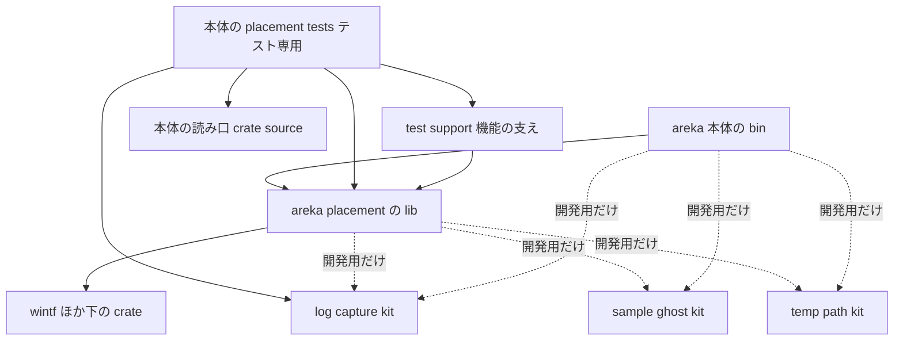
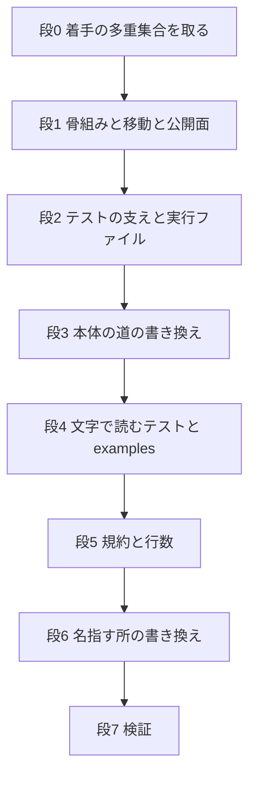

# 設計書: placement-crate-split

## 概要

**目的**: 本体の bin crate の中にある窓の配置（`crates/areka/src/placement/`・160 ファイル）を、新しい lib crate `crates/areka-placement/` へそのまま移す。配置の境目を crate の境目で守り、配置を変えても配置の crate とそれを使う側だけが組み直されるようにする。

**使う人**: areka の開発者。配置を直す人と、見直し（ponytail の audit）を受け持ちごとに回す人。

**変わること**: 本体は配置を path 依存で使う。配置の公開面は外から使われる分だけ `pub` になる。配置の外から使うテストの支えは `test-support` 機能で開く。配置と本体のほかの部分をまたぐテストと判定器は、本体の中のテスト専用のフォルダ `crates/areka/src/placement_tests/` に集まる。動く ukagaka のアプリとしての振る舞いは変えない（ログの出所の名前だけが `areka::placement::…` から `areka_placement::…` に変わる）。

### 目標

- 配置の本番とテストが `crates/areka-placement/` にあり、本体は依存として使う（1.1〜1.9）。
- 外から使われない項目は外から見えない（2.1〜2.5）。
- テストの支えは写しを作らず 1 か所に置き、どのテストも自分の crate のファイルか、依存の向きどおり下の crate のファイルだけを読む（3.1〜3.13・5.2〜5.5）。
- 古いパスと古い出所の名前が、決めた範囲で 0 件になる（5.10・6.6）。
- テストの名前の多重集合・警告 0・全体テスト・実機 1 本が、移す前と同じ合否を示す（8.1〜8.8）。

### 目標でないこと

- 配置の中身の直し（不具合・要らない項目の削除・wintf との重なりの整理）。`audit-placement-core`・`audit-placement-follow` へ申し送る。
- 外から使われない `pub(crate)`（約 42 件）の削除。
- ファイル名の付け直し（`placement_` で始まるテストのファイル名ほか）。
- 走査器 `code_only` の写し（本体と配置の 10 ファイル以上にある）をまとめること。
- `emo2_boot` ほか本体のほかの部分の分け方（「本体の crate 分け」の後の 5 本）。

## 境目の約束

### この仕様が持つもの

- 新しい crate `crates/areka-placement/` の骨組み（`Cargo.toml`・`lib.rs`・`error.rs`・`test-support` 機能・テストの実行ファイルの落ちの報告）。
- 配置の公開面の付け替えと、そのために開けた項目の記録。
- 本体の中のテスト専用のフォルダ `crates/areka/src/placement_tests/`（判定器の一族と、配置と本体をまたぐテスト）と、本体の読み口 `crates/areka/src/crate_source_test_support.rs`。
- `log-capture-kit` の `ExpectField`・`expect_one`（`src/expect.rs`）。
- 配置を名指すパスと出所の名前の書き換え（番人の表・文字で読むテスト・文書・道具・説明・2 本の audit の brief・`structure.md`）。
- 依存の向きの規約の文と、食い違い 5 件の解消（`OffsetBase` の置き場・`PlacementError` の置き場）。
- 検証の手順（多重集合・警告・全体テスト・実機 1 本・性能の道具の確かめ・`THIRD-PARTY-NOTICES.md`）。
- steering の追記: `structure.md` の crate の一覧（この枝で書く）。`roadmap.md` は、C18 の「触るファイル」に足す分（`log-capture-kit/src` ほか）を 11-06 に棚卸のセッションへ伝えた（行は roadmap の持ち主の棚卸が書く）。新旧のパスの対応表の行は完了の段（`/kiro-complete`）で書く。この枝の途中では `roadmap.md` を書かない（並走の枝との衝突を避ける）。

### この仕様が持たないもの

- 配置の振る舞い。直したくなった所は直さず、`audit-placement-core`・`audit-placement-follow` の brief へ申し送る。
- 規約が名指さないモジュールの間の参照と輪（7.7・申し送るだけ）。
- 理由の文が古くなる `#[allow(dead_code)]`・`#[allow(unused_imports)]`（約 51 個・属性も文も変えない・8.1）。
- `areka-emo-present`・`areka-emo-text` のテストが持つ `expect_one`・`ExpectField` の自前の写し（この仕様の支えではない）。
- 配置に触れると書いているほかの約 19 本の brief（roadmap の新旧のパスの対応表で読み替える）。
- 歴史の文書（`roadmap-history.md`・`.kiro/specs/completed/`）の中の古いパス。

### 使ってよい依存

- `areka-placement` の本番の依存は次に限る: wintf・bevy_ecs・tracing・areka-parsers・areka-emo-compose・areka-emo-present・areka-sylphya・areka-emo-atlas・areka-ghost・windows・thiserror（1.7）。
- `areka-placement` の開発用の依存は次に限る: log-capture-kit・temp-path-kit・sample-ghost-kit・tracing-subscriber（どれもワークスペースの中か `Cargo.lock` に既にある）。
- `areka-placement` は `areka` に依存しない（1.8）。本体 → 配置の一方向だけ。
- 共有のテスト用の crate（log-capture-kit・sample-ghost-kit・temp-path-kit）は、どの crate でも本番の依存表（optional を含む）に書かない（3.4）。
- `test-support` 機能の下の項目が頼ってよいのは、配置の本番の項目と、ほかの `test-support` の項目と、std・windows・wintf・bevy_ecs だけ。`#[cfg(test)]` だけの項目と共有のテスト用の crate には頼らない。
- 読み方の規則は 1 つ: **自分の crate のファイルは相対の道で読み、別の crate のファイルは読み口で読む**。本体のテストが別の crate のファイルを読むのは、本体が依存する crate（下の crate）だけで、必ず読み口 `crate_source!`／`crate_path` を通す。配置のテストは本体のファイルを読まない。配置の crate が別の crate を読むのは `zorder_property_deferral_tests` の `../areka-sylphya/src`（配置が依存する下の crate）1 か所だけなので、配置には読み口を作らず、その行に理由を 1 行書く。
- 名前を付けた例外: `crates/areka/src/session_end_sync_send_tests.rs` はワークスペースの全部の `crates/*/src` を歩く見張りで、依存の向きの外の crate も読む。この仕様では動かさず、置き場（ワークスペース全体の見張りの家＝`log-capture-kit/tests/`）へ移すことを `audit-areka-app` へ申し送る。

### 見直しの引き金

- `areka-placement` の公開面か `test-support` の中身が変わる → 本体の使い手と `placement_tests/` を見直す。
- `runtime-module-untangle` が `emo2_boot` を改名する → `placement_tests/` の `crate::emo2_boot::…` と、読み口で読む本体のパス（`crate_source!("areka", "src/emo2_boot/…")`）を書き換える（コンパイルで赤になる）。
- `runtime-crate-split` が判定器の一族を `areka-runtime` のテスト専用へ移す → `placement_tests/transition_*` と、`emo2_boot` を使うまたぐテスト（`reset_balloon_pos_tests`・`measure_bake_*`・分岐の対応表 2 本・2 本の片割れ）の置き場を決め直す。`input-crate-split` は `spawn_assembly_tests` の置き場を決め直す。
- ログの出所の名前が変わる → `RUST_LOG` の文字列・捕まえたログを出所で選ぶテスト・`tools/perf` の見本を見直す。

## 構成

### 今の形

- 配置は本体の中の `mod placement;`（`main.rs`）で、本番から本体のほかの部分への `crate::` は 0 件。テストは本番のファイルの兄弟で、本番のモジュールの子として `#[cfg(test)] #[path = "…_tests.rs"] mod …;` で宣言されている。
- 配置の外のテストは `placement::test_support`（`log_capture_kit::capture` の薄い包み）と `placement::shared_test_support` を使う。本体の `cargo test` では配置の `#[cfg(test)]` が立つ。crate を分けると、本体のテストを組むときに配置の `#[cfg(test)]` は立たない。これが支えの開け方を決める一番の制約である。
- 番人 `with_default_guard_test.rs`・`sample_path_guard_test.rs` は、共有のテスト用の crate を本番の依存表に書くと赤にする。Cargo の機能は本番の依存（optional）しか引けない。よって共有のテスト用の crate に頼る支えは `test-support` 機能で開けない。
- 配置の 5 本のテストと判定器の一族（15 ファイル）は本体の `emo2_boot`・`input_events` を使い、4 本のテストは本体のファイルを文字で読む。

### 依存の図



- 実線は本番と開発用の両方、点線は開発用の依存（dev-dependency）だけ。
- `test-support` は `areka-placement` の中の機能で、本体は開発用の依存でだけ付ける（3.5）。
- 本体 → 配置 → 下の crate の一方向。配置から本体へは、コードでも文字の読みでも引かない。

**構成の決め**:

- 形: 今のモジュールの境目をそのまま crate の境目にする。新しい層や包みは作らない。
- 規約の範囲: 依存の向きの規約は、名指す 6 モジュールの間の約束として書く（7.1）。
- steering との合致: ルートの `Cargo.toml` は変えない・外の依存を足さない・1,000 行の例外表の項目を増やさない（1.5・1.6・1.9）。

### 技術の表

| 層 | 選んだもの | この仕様での役 | 備考 |
|---|---|---|---|
| ビルド | Cargo（ワークスペース `members = ["crates/*"]`・resolver 2） | 新しい crate を自動で拾う・`test-support` 機能 | 根の `Cargo.toml` は不変 |
| 言語 | Rust 2024（`edition.workspace = true`） | `pub` の付け替え・`#[cfg(any(test, feature = "test-support"))]` | 新しい警告は `private_interfaces` だけを見込む |
| ログ | tracing・tracing-subscriber（EnvFilter は前方一致） | 出所の名前が `areka_placement::…` になる | `areka=…` の指定は `areka_placement` も覆う |
| テストの支え | log-capture-kit・sample-ghost-kit・temp-path-kit | 開発用の依存だけで使う | 番人の決まりは不変 |
| 道具 | `tools/load-flake.ps1`・`tools/perf/*.py`・`cargo about` | 実行ファイルの名前・見本・第三者の表 | 新しい道具は作らない |

### 設計の段で決めたこと（研究の 6 章で設計の段へ回された 5 件ほか）

| # | 決めること | 決め | 主な代案 |
|---|---|---|---|
| D1 | 判定器の一族の置き場の名前（3.9） | 本体のテスト専用のフォルダ `crates/areka/src/placement_tests/` に、境をまたぐテストと一緒に置く。`main.rs` が `#[cfg(test)] mod placement_tests;` で宣言する | `emo2_boot/transition_judge/` に置く（`runtime-crate-split` で一緒に動くが、`audit-emo2-boot-spine` の「`emo2_boot/` のうち…全部」と受け持ちが重なる）／`src/transition_judge/` を根に置く（境をまたぐテストと置き場が割れる） |
| D2 | 移し方 | 研究の案 C（段に分ける）。段 1 だけ本体の `main.rs` に一時の別名 `use areka_placement as placement;` を置き、公開面をコンパイラに数えさせる。段 3 で本体の道を書き換えて別名を外す。最終形に別名は残らない | 案 B（一度に全部）＝数百件のエラーが一度に出て、どの `pub` が何のためかを確かめにくい |
| D3 | 本体のテストへ `reseed::tests` の補助を渡す方法 | `booted_world`・`new_shell`・`char_positions` と、それらが中で使う補助だけを `reseed_test_support.rs`（`reseed::test_support`・`test-support` 機能）へ移す。3 つは見本のゴーストに頼らないので、そのまま開ける | 本体の側へ写す（3.6 の写しの禁止に反する） |
| D4 | 1,000 行の上限（1.9） | 例外表に項目を足さない。根（`lib.rs`）は `PlacementError` を `error.rs` へ出し、判定器の宣言を外すので 約 910 行に減る。`transition_judge.rs`（999 行）は、書き換えと rustfmt の後に 1,000 行を超えたときだけ、観測行の読み（`optional_fields`・`parse_transition_line`・`parse_transition_log`）を兄弟のファイル `transition_judge_parse.rs` へ出す（`verdict` を出してある形と同じ）。`main.rs`（986 行）は宣言の差し替えで 989 行以下に収める | 例外表に足す（roadmap の決め「どの spec も例外表に触れない」に反する） |
| D5 | examples の開発用の依存 | `areka-placement` の `[dev-dependencies]` に `sample-ghost-kit`（path）と `tracing-subscriber`（`workspace = true`）を足す。どちらもワークスペースの中か `Cargo.lock` に既にある | なし |
| D6 | 見本のゴーストのバルーンの入口（3.2 の「`balloon_root` を足す」） | 本体の `emo2_boot/sample_test_support.rs` に同じ働きの `emo2_balloon_root` が既にあるので、新しい名前は足さずにそれを使い、`emo2_root` と合わせて `pub(crate)` に広げる（同じ働きの関数を 2 つにしない＝3.6） | 字面どおり `balloon_root` を足す（同じ中身の関数が 2 つになる） |
| D7 | 下の crate を読む読み口の及ぶ範囲（5.4） | 5.4 は本体の crate 全体の約束なので、配置から来たテストだけでなく、本体のほかの 5 ファイル 6 か所（`input_events/file_drop_wiring_tests.rs`・`log_history_convention_tests.rs`・`tick_gate_config_producers_tests.rs`・`boot_shell_tests.rs`・`emo2_boot/film_playback_e2e_tests.rs`）も読み口へ寄せる。文書（`doc/`）と `target/` を読む所は crate ではないので変えない | 配置から来たテストだけに使い、ほかは申し送る（本体に読み方が 2 通り残る） |
| D8 | テストの支えの置き場の決まり | 配置の中の支えを、頼る相手で 3 つに分ける: `test_support`（外へ開く・配置の型と windows だけ）・`sample_test_support`（見本のゴースト・慣習どおり）・`shared_test_support`（一時フォルダと合成の検体）。外へ開くものは、どれも `test_support` という名のモジュールか、`test-support` の印を付けた項目にある | 1 つのファイルに `#[cfg]` を混ぜる（どの項目が外へ開くか読み取りにくい） |
| D9 | `measure` の私有の関数の開け方（3.8） | `measure_test_support.rs`（`measure::test_support`・`#[cfg(feature = "test-support")]`）に、私有の `measure_with_reader`・`measure_baked` へそのまま渡す `pub fn` を 2 つ置く。本番の可視性は変えない | 関数の本体を 2 つの `#[cfg]` で二重に書く／`#[doc(hidden)] pub` にする（本番の公開面が広がる） |
| D10 | `synth_declared_dpi_ghost` の置き場 | 本体に残る `reset_balloon_pos_tests` が使うので、一時フォルダと見本の道を引数で受ける形にして `test_support` へ移す。配置の中の 10 か所の呼び出しも同じ形へ書き換える | 古い形の包みを `shared_test_support` に残す（包みが 2 つになる） |
| D11 | 1.7 の「どれも `workspace = true` で受ける」の読み | 外の crate（bevy_ecs・tracing・thiserror・windows）は `workspace = true`、ワークスペースの中の crate（wintf・areka-*）はほかの crate と同じく `{ path = "../…" }`。根の `[workspace.dependencies]` に areka 系の crate は無く、根を変えずに（1.5）書けるのはこの形だけ | 根に areka 系の crate を足して全部を `workspace = true` にする（1.5 に反する） |

## ファイルの置き場

### 新しい crate

```
crates/areka-placement/
├── Cargo.toml                      # lib・publish = false・test-support 機能・依存は「使ってよい依存」のとおり
├── examples/
│   └── window-placement.rs         # crates/areka/examples/ から git mv。#[path] をやめ crate の公開面で使う
└── src/
    ├── lib.rs                      # 旧 placement/mod.rs を git mv。規約の文を書き直す・PlacementError は error.rs から出し直す
    ├── error.rs                    # 新: PlacementError（旧 mod.rs から移す・配置のモジュールを引かない）
    ├── test_support.rs             # 新しい中身: 外へ開く支え（WA・with_com_initialized・EMILY_SHAPED_*・emily_shaped_scopes・synth_declared_dpi_ghost）
    ├── sample_test_support.rs      # 新: 見本のゴーストの入口（emo2_root・balloon_root・r_post_and_komainu_shell_root・konnoyayame_shell_root）
    ├── sample_test_support_tests.rs # 旧 placement_shared_test_support_tests.rs を git mv（中身は同じ）
    ├── placement_shared_test_support.rs # 残すのは一時フォルダと合成の検体（TempDir・synth_balloon_dir・MEASURE_DPI・write_self_alpha_one_descript）
    ├── reseed_test_support.rs      # 新: reseed_tests.rs から booted_world・new_shell・char_positions とその補助を移す
    ├── measure_test_support.rs     # 新: measure_with_reader・measure_baked への pub の入口（test-support のときだけ）
    ├── spawn_test_support.rs       # git mv（関数を pub に・宣言を test-support でも立つように）
    ├── test_crash_report.rs        # 新: wintf の test_crash_report.rs の 3 つ目の写し（#[cfg(test)]）
    ├── follow/ ・ follow.rs ・ 本番の .rs ・ *_tests.rs ・ *_test_support.rs
    │                               # 旧 placement/ のほかの全部を git mv（中の crate::placement:: を crate:: へ）
    ├── measure_template_tests.rs   # 配置の片割れ（採寸と表示の外形の一致・measure.rs と measure_first_frame.rs と window-placement.rs の走査・自分の実物での較正）
    └── spawn_zorder_pair_deferred_tests.rs # 配置の片割れ（配置のファイルの名簿・配置の src の木の走査・窓の印の確かめ）
```

- 移したうえで中身も変える配置のファイル（それ以外は道の書き換えと可視性の付け替え＝PublicSurface だけ）:
  - `resolver.rs`（`OffsetBase` の型の定義を受け取る）・`follow/offset_space.rs`（定義を渡し、残す `impl` だけ持つ）・`follow.rs`（`OffsetBase` を `resolver` から出し直す）— DependencyConvention ①。
  - `measure.rs`・`source.rs`（`crate::error::PlacementError` を引く・`measure.rs` は `measure_test_support.rs` を宣言する）— ④・D9。
  - `diag.rs`（`DIAG_TARGET` と説明の出所の名前）— 6.2。
  - `spawn.rs`（`test_support` の宣言の印）・`reseed.rs`（`test_support` の宣言）・`reseed_tests.rs`（移した補助を `super::test_support` から使う）・`persist.rs`（`project_restore` の印）・`source.rs`（`from_scope_titles` の印）— TestSupportFeature。
  - 配置のテスト全部（`capture_logs`／`LogEvent` を `log_capture_kit` へ・`shared_test_support` の分け直しに合わせた `use`）— 3.1・D8。
- 旧 `placement/test_support.rs`（`capture_logs`・`LogEvent` の包み）は消す（3.1）。同じ名前のファイルに外へ開く支えを置くので、git の上では中身の入れ替わりとして出る。
- 配置のファイル 160 のうち、本体へ移すのは 21（判定器の一族 15・境をまたぐテスト 4・分岐の対応表 2）。残りの 139 から `test_support.rs` の古い中身を除いた全部が新しい crate へ移る。

### 本体の新しい置き場

```
crates/areka/src/
├── placement_tests/                # 新しいテスト専用のフォルダ（main.rs が #[cfg(test)] で宣言）
│   ├── mod.rs                      # 新: 置いた理由（上の crate に置くテスト）と子の宣言だけ
│   ├── transition_judge.rs         # 判定器の一族 15 ファイルを git mv（中の #[path] は兄弟を指すので不変）
│   ├── transition_judge_*.rs ・ transition_signoff_tests.rs ・ transition_signoff_procedure_tests.rs
│   ├── reset_balloon_pos_tests.rs  # git mv（emo2_boot::switch_assets を使う）
│   ├── spawn_assembly_tests.rs     # git mv（input_events::attach_char_pointer_handlers を使う）
│   ├── measure_bake_count_tests.rs # git mv（emo2_boot::assets と measure の私有の関数を使う）
│   ├── measure_bake_log_tests.rs   # git mv（同上）
│   ├── zorder_group_branch_coverage_tests.rs     # git mv（1 つの分岐を覆うテストが crate をまたいで並ぶ表）
│   ├── zorder_inversion_branch_coverage_tests.rs # git mv（同上・wintf の行を含む）
│   ├── measure_template_tests.rs   # 新: 本体の片割れ（emo2_boot/assets.rs・本体のテストの支え・本体の examples の走査と較正）
│   └── spawn_zorder_pair_deferred_tests.rs # 新: 本体の片割れ（emo2_boot のファイルの名簿・帯のファイル・本体の src の木の走査）
├── crate_source_test_support.rs    # 新: 読み口（crate_source! と crate_path）
└── main.rs                         # mod placement; を外し、#[cfg(test)] mod placement_tests; と読み口の宣言を置く
```

- `placement_tests/` は `audit-emo2-boot-*`・`audit-areka-input-menu` の受け持ち（`emo2_boot/`・`input_events*`）の外にある。`audit-areka-app` の「ほかの 7 本の持ち物でないもの全部」からは、`audit-placement-core`・`audit-placement-follow` の brief が名指すことで外れる。どのファイルもちょうど 1 本の audit の持ち物になる。
- 2 本の片割れは、元と同じファイル名にする（どちらの crate のどの片割れかは各ファイルの頭の説明に書く）。

### 変えるファイル

- `crates/areka/Cargo.toml` — `[dependencies]` に `areka-placement = { path = "../areka-placement" }`、`[dev-dependencies]` に `areka-placement = { path = "../areka-placement", features = ["test-support"] }`。
- `crates/areka/src/**`（配置を指す約 170 ファイル）— `crate::placement::`・`placement::` を `areka_placement::` へ（2.4）。`crate::placement::test_support::…` は `log_capture_kit::…` へ（3.1）。`crate::placement::transition_judge*` は `crate::placement_tests::transition_judge*` へ。
- `crates/areka/src/emo2_boot/sample_test_support.rs` — `emo2_root`・`emo2_balloon_root` を `pub(super)` から `pub(crate)` へ（D6）。
- `crates/areka/src/emo2_boot/crash_report_test_support.rs`・`crates/wintf/src/test_crash_report.rs` — 頭の「写しの相手」の行に 3 つ目（`crates/areka-placement/src/test_crash_report.rs`）を足す（説明だけ）。
- `crates/areka/examples/collision-probe.rs`（と `collision-probe/` の中の配置の参照）— `#[path = "../src/placement/mod.rs"] mod placement;` を外し、`areka_placement::…` を使う（4.2）。
- 本体の 5 ファイル 6 か所（D7）— 下の crate を読む所を `crate_source!`／`crate_path` へ。
- `crates/log-capture-kit/src/expect.rs`（新）・`src/lib.rs`（`mod expect; pub use expect::{ExpectField, expect_one};`）。
- `crates/log-capture-kit/tests/file_length_guard_test.rs`（3 件）・`temp_path_guard_test.rs`（2 件）・`with_default_guard_test.rs`（3 件と理由の文の主語）— 5.1。
- `crates/wintf/src/ecs/window_proc/window_pos_tests.rs:14`（`RUST_LOG`）・`ecs/window_proc/lifecycle.rs:34`（説明）— 6.5。
- 説明の中のパス（5.7）: wintf の `api_owner_chain_probe_tests.rs`・`ecs/window/window_band_pipeline_real_tests.rs`・`ecs/window/zorder_pair_maintain_always_on_top_tests.rs`・`runtime/tick_bridge.rs`、`crates/pilot/examples/pilot-dropfiles-on-wuc-window/main.rs`、`crates/ukadoc-survey/src/evidence/candidates.rs`、本体の `emo2_boot/hit_region.rs`・`emo2_boot/frame_transition_atomicity_tests.rs`（行番号つき）、`tools/perf/judge-followup.py`（行番号つき）・`tools/perf/judge-perf.py:695`。
- `crates/areka/tests/window_link_real_run.rs:49` — `RUST_LOG` の `areka::placement=debug` を `areka_placement=debug` へ（6.5）。
- `tools/perf/fixtures/generate.py:211` を直して `fixtures/` を作り直す。`tools/perf/fixtures-loop/*/run.log` は 1 語だけをスクリプトで置き換える（5.8）。
- `tools/load-flake.ps1` — `-Binary` に `areka-placement-lib` を足す（説明 52 行・注 68 行・`ValidateSet` 69 行・209 行の選び）（3.13）。
- `doc/COMPAT_ARCHITECTURE.md`・`doc/ukadoc-coverage/briefing-assets.md`・`doc/ukadoc-coverage/ledger/assets.toml`・`ledger/sakura-script.toml`・`.kiro/steering/structure.md`（5.6）。
- `.kiro/specs/audit-placement-core/brief.md`・`.kiro/specs/audit-placement-follow/brief.md`（5.9 と申し送り）。
- `.kiro/steering/roadmap.md` — この枝の途中では書かない。C18 の②の「触るファイル」に足す分（`log-capture-kit/src`・wintf の `test_crash_report.rs` の説明・`tools/load-flake.ps1`・本体の 5 ファイル〔D7〕）は棚卸のセッションへ伝える（11-06 に `log-capture-kit/src` ほかは伝え済み・残りは設計の確定のときに伝える）。新旧のパスの対応表の判定器の行（「本体のテスト専用のモジュール」＝`crates/areka/src/placement_tests/`）と本体に残すテストの 1 行は、完了の段（`/kiro-complete`）で書く。
- `Cargo.lock`・`THIRD-PARTY-NOTICES.md` — 道具が作り直す（8.8）。

### パスの書き換えの対応

| 古いパス | 新しいパス |
|---|---|
| `crates/areka/src/placement/<下の 2 行のほか>` | `crates/areka-placement/src/<同じ名前>` |
| `crates/areka/src/placement/mod.rs` | `crates/areka-placement/src/lib.rs`（`PlacementError` を名指す所は `error.rs`） |
| `crates/areka/src/placement/{transition_judge*,transition_signoff*,reset_balloon_pos_tests,spawn_assembly_tests,measure_bake_count_tests,measure_bake_log_tests,zorder_group_branch_coverage_tests,zorder_inversion_branch_coverage_tests}.rs` | `crates/areka/src/placement_tests/<同じ名前>` |
| `crates/areka/examples/window-placement.rs` | `crates/areka-placement/examples/window-placement.rs` |
| 出所 `areka::placement::<道>` | `areka_placement::<道>` |
| `RUST_LOG` の `areka::placement=…`・`areka::placement::diag=…` | `areka_placement=…`・`areka_placement::diag=…` |

## 流れ

### 移す段



| 段 | すること | 段の終わりに緑であるもの |
|---|---|---|
| 0 | 枝の先頭で `cargo test --workspace --no-fail-fast -- --list` を取り、`target/placement-crate-split/tests-before.txt` に残す | （取るだけ） |
| 1 | `Cargo.toml` を作る・配置を `git mv`（本体へ移す 21 ファイルは `placement_tests/` へ）・中の `crate::placement::` を `crate::` へ・本体へ移したファイルの `super::` を `areka_placement::` へ・`main.rs` に一時の別名・コンパイルのエラー（E0603・E0616・E0624・E0364・`private_interfaces`）を 1 件ずつ見て `pub` にし、2.5 の連れて開く型に印の説明を付ける | `cargo check -p areka-placement --lib`・`cargo check -p areka --bin areka` |
| 2 | `log-capture-kit` に `expect.rs`・支えを 3 つに分ける・`test-support` 機能と各項目の印・`reseed_test_support.rs`・`measure_test_support.rs`・`synth_declared_dpi_ghost` の引数・本体の `sample_test_support` の可視性・`capture_logs`／`LogEvent` を `capture`／`CapturedEvent` へ・`test_crash_report.rs` の写し | `cargo check --workspace --all-targets`・`cargo test -p areka-placement`・`cargo test -p areka --bin areka`（赤が出たら赤のテストだけ回し直す） |
| 3 | 本体の `crate::placement::`・`placement::` を `areka_placement::` へ書き換え、一時の別名を外す・`cargo fmt --all` | `cargo check --workspace --all-targets`・本体の `src` で `crate::placement::` が 0 件 |
| 4 | 2 本の片割れ・分岐の対応表を読み口へ・読み口 `crate_source_test_support.rs` と D7 の 6 か所・examples の 2 本 | `cargo check --workspace --all-targets` 警告 0・触ったテストだけ回す |
| 5 | `OffsetBase` を `resolver` へ・`PlacementError` を `error.rs` へ・規約の文・1,000 行の確かめ（D4） | `cargo check --workspace --all-targets`・`file_length_guard_test` |
| 6 | 番人の表・出所の名前・文書・道具・説明・`load-flake.ps1`・2 本の brief と申し送り・`structure.md`・roadmap の追記・`tools/perf` の見本と自分の確かめ | `cargo test -p log-capture-kit`・性能の道具の自分の確かめ・grep 0 件（5.10・6.6） |
| 7 | 完了の多重集合・警告・`tools/test-all.ps1`・実機 1 本・`cargo about generate` | 8.2〜8.8 のすべて |

- 段 1 の後はテストの組み立てが赤のままでよい（段 2 で緑に戻す）。どの段もコミットを分け、PR は 1 本。
- 一時の別名は段 1 のコミットにだけあり、段 3 で消える。最終形に残らない。

## 要件の対応表

| 要件 | 要約 | 部品 | 口 | 流れ |
|---|---|---|---|---|
| 1.1 | lib・`publish = false` の理由を同じ行に・慣習 | PlacementCrate | `Cargo.toml` | 段 1 |
| 1.2 | 履歴を残す移動 | PlacementCrate・PlacementTests | `git mv` | 段 1 |
| 1.3 | `mod.rs` を `lib.rs` に | PlacementCrate | `lib.rs` | 段 1 |
| 1.4 | 本体は path 依存・`src/placement/` を持たない | PlacementCrate | 本体の `Cargo.toml` | 段 1・3 |
| 1.5 | 根の `Cargo.toml` 不変 | PlacementCrate | ― | 全段 |
| 1.6 | 外の依存を足さない | PlacementCrate | `Cargo.toml`・`Cargo.lock` | 段 1・7 |
| 1.7 | 本番の依存の一覧・`windows` の機能 | PlacementCrate | `Cargo.toml` | 段 1・7 |
| 1.8 | 本体に依存しない | PlacementCrate | `Cargo.toml` | 段 1 |
| 1.9 | 1,000 行・例外表を増やさない | DependencyConvention・PlacementTests | D4 | 段 5 |
| 2.1 | 外から使われる `pub(crate)` だけ `pub` | PublicSurface | 公開面の記録 | 段 1 |
| 2.2 | 使われないものは残す | PublicSurface | ― | 段 1 |
| 2.3 | 中の自分を指す道 | PublicSurface | ― | 段 1 |
| 2.4 | 本体の道を `areka_placement::` へ | PublicSurface | ― | 段 3 |
| 2.5 | 連れて開く型の記録 | PublicSurface | 公開面の記録 | 段 1 |
| 3.1 | `ExpectField`・`expect_one` を下ろし直に使う | LogExpect | `expect.rs` | 段 2 |
| 3.2 | 見本のゴーストの入口は crate ごと | TestSupportFeature | `sample_test_support` | 段 2 |
| 3.3 | 配置の型と windows だけの支えを `test-support` で | TestSupportFeature | `test_support` ほか | 段 2 |
| 3.4 | 共有のテスト用の crate を本番の表に書かない | TestSupportFeature | `Cargo.toml` | 段 2 |
| 3.5 | 本体は dev-dependency でだけ機能を付ける | TestSupportFeature | 本体の `Cargo.toml` | 段 2 |
| 3.6 | 写しを作らない | TestSupportFeature・LogExpect | D3・D6・D10 | 段 2 |
| 3.7 | またぐ 5 本を本体に | PlacementTests | `placement_tests/` | 段 1 |
| 3.8 | 私有の関数は `test-support` でだけ | TestSupportFeature | `measure::test_support` | 段 2 |
| 3.9 | 判定器の一族を本体のテスト専用へ | PlacementTests | `placement_tests/` | 段 1 |
| 3.10 | `frame_transition_*` 2 本が移した先を使う | PlacementTests | `crate::placement_tests::transition_judge` | 段 1 |
| 3.11 | プロセスの寿命の MTA | TestBinaryGuard | `test_crash_report.rs` | 段 2 |
| 3.12 | 落ちの報告 | TestBinaryGuard | `test_crash_report.rs` | 段 2 |
| 3.13 | `load-flake.ps1` の `-Binary` | TestBinaryGuard | `areka-placement-lib` | 段 6 |
| 4.1 | `window-placement.rs` を配置の examples へ | Examples | crate の公開面 | 段 4 |
| 4.2 | `collision-probe.rs` は本体に残し依存で使う | Examples | `areka_placement::` | 段 4 |
| 4.3 | examples が警告なしに通る | Examples | `cargo check --workspace --all-targets` | 段 4・7 |
| 5.1 | 番人の表 | PathRewrite | 3 つの番人 | 段 6 |
| 5.2 | 文字で読むテストの原則 | SourceReadTests・CrateSourceReader | 読み口 | 段 4 |
| 5.3 | 4 本の置き方 | SourceReadTests | 片割れ 2 組・対応表 2 本 | 段 4 |
| 5.4 | 本体の読み口 1 つ | CrateSourceReader | `crate_source!`・`crate_path` | 段 4 |
| 5.5 | 見つからなければ赤・範囲が狭まらない | SourceReadTests・CrateSourceReader | コンパイルの失敗・`assert!` | 段 4 |
| 5.6 | 文書のパス | PathRewrite | 対応の表 | 段 6 |
| 5.7 | ソースと道具の説明のパス | PathRewrite | 対応の表 | 段 6 |
| 5.8 | 見本の作り直しと 1 語の置き換え | PathRewrite | `generate.py`・スクリプト・自分の確かめ | 段 6 |
| 5.9 | 2 本の brief の受け持つファイル | PathRewrite | brief | 段 6 |
| 5.10 | 古いパスの grep 0 件 | Verification | grep | 段 6・7 |
| 6.1 | 出所が `areka_placement::…` | PlacementCrate | モジュールのパス | 段 1 |
| 6.2 | 直書きの `DIAG_TARGET` | PathRewrite | `diag.rs` | 段 6 |
| 6.3 | `areka_placement=debug` で診断が開く | PathRewrite・Verification | EnvFilter の前方一致・実機 1 本 | 段 7 |
| 6.4 | 語彙の出所は変えない | PathRewrite | ― | 段 6 |
| 6.5 | 名前で読む所の書き換え | PathRewrite | 対応の表 | 段 6 |
| 6.6 | 古い出所の名前の grep 0 件 | Verification | grep | 段 6・7 |
| 6.7 | 性能の道具が出所に頼るかの確かめと記録 | Verification | 記録 | 段 6 |
| 6.8 | 頼っていれば直して自分の確かめ | Verification | 発動しない見込み | 段 6 |
| 7.1 | 規約の文は 6 モジュールの約束と明記・一致 | DependencyConvention | `lib.rs` の文 | 段 5 |
| 7.2 | 食い違い 5 件を 1 件ずつ | DependencyConvention | 下の表 | 段 5 |
| 7.3 | 移すだけで済むものは参照を直す | DependencyConvention | ①の `OffsetBase`・④の `PlacementError` | 段 5 |
| 7.4 | 済まないものは文を書き直す | DependencyConvention | ①の残り・②・③ | 段 5 |
| 7.5 | 振る舞いを変えない | DependencyConvention | ― | 段 5 |
| 7.6 | 5 件の解き方 | DependencyConvention | 下の表 | 段 5 |
| 7.7 | 名指さない所は変えず申し送る | DependencyConvention・PathRewrite | `audit-placement-core` の brief | 段 6 |
| 8.1 | 振る舞いを変えない・`#[allow]` は申し送る | Verification・PathRewrite | 2 本の brief | 全段 |
| 8.2 | 前後の多重集合 | Verification | 段 0・段 7 | 段 0・7 |
| 8.3 | 差は対応表で説明 | Verification | 多重集合の差の表 | 段 7 |
| 8.4 | 警告 0 | Verification | `cargo check --workspace --all-targets` | 各段・段 7 |
| 8.5 | 全体テスト | Verification | `tools/test-all.ps1` | 段 7 |
| 8.6 | 実機 1 本 | Verification | `window_link_real_run.rs` | 段 7 |
| 8.7 | 実機はその 1 本だけ | Verification | ― | 段 7 |
| 8.8 | `THIRD-PARTY-NOTICES.md` を作り直す | Verification | `cargo about generate` | 段 7 |

## 部品と口

### 部品の一覧

| 部品 | 層 | 役 | 要件 | 主な依存 | 口の種類 |
|---|---|---|---|---|---|
| PlacementCrate | 新しい crate | 配置の lib・依存の表・出所の名前 | 1.1〜1.8・6.1 | wintf ほか（P0） | Cargo の約束 |
| PublicSurface | 配置の公開面 | 外から使われる分だけ `pub` | 2.1〜2.5 | コンパイラ（P0） | 公開の型と関数 |
| TestSupportFeature | 配置のテストの支え | 外へ開く支えと見本・一時の支え | 3.2〜3.6・3.8 | windows・wintf・bevy_ecs（P0） | Rust の関数 |
| LogExpect | log-capture-kit | ログの判定の補助 | 3.1・3.6 | tracing（P1） | Rust の関数 |
| TestBinaryGuard | 配置のテストの実行ファイル | MTA と落ちの報告・揺れの道具 | 3.11〜3.13 | windows（P1） | 初期化子・道具の引数 |
| PlacementTests | 本体のテスト専用 | 判定器の一族と境をまたぐテスト | 3.7・3.9・3.10・1.9 | areka-placement・emo2_boot・input_events（P0） | 本体の中のモジュール |
| CrateSourceReader | 本体のテストの支え | 下の crate を読む 1 つの読み口 | 5.4・5.5 | std（P2） | マクロと関数 |
| SourceReadTests | 両方の crate | 文字で読むテストの割り方 | 5.2・5.3・5.5 | CrateSourceReader（P1） | テスト |
| Examples | 両方の crate | examples の置き場 | 4.1〜4.3 | areka-placement（P1） | ― |
| DependencyConvention | 配置の根 | 規約の文と 5 件の解消・行数 | 7.1〜7.7・1.9 | ― | 文書の約束 |
| PathRewrite | 本体の外 | 古いパスと出所の名前の書き換え | 5.1・5.6〜5.9・6.2・6.4・6.5・7.7・8.1 | ― | ― |
| Verification | 手順 | 前後の比べと実機 | 5.10・6.3・6.6〜6.8・8.1〜8.8 | 全部（P0） | コマンド |

### 新しい crate

#### PlacementCrate

| 項目 | 中身 |
|---|---|
| 役 | 配置を lib として持ち、本体へ公開面を出す |
| 要件 | 1.1・1.2・1.3・1.4・1.5・1.6・1.7・1.8・6.1 |

**責務と約束**

- `crates/areka-placement/Cargo.toml` は `areka-emo-atlas` の型に揃える: `name = "areka-placement"`・`workspace = "../.."`・`description`・`version`／`edition`／`authors`／`license`／`repository` は `.workspace = true`・`publish = false # 理由（areka 本体の部品・areka の中でしか意味を持たない）` を同じ行に書く（1.1）。`license.workspace = true` は `cargo about` が行を作るのに要る。
- 本番の依存は「使ってよい依存」の 11 個。ワークスペースの中の crate（wintf・areka-*）はほかの crate と同じく `{ path = "../…" }`、外の crate（bevy_ecs・tracing・thiserror・windows）は `{ workspace = true }` で受ける。1.7 の「どれも `workspace = true` で受ける」は、根の `[workspace.dependencies]` に areka 系の crate が無く、根を変えずに書けるのはこの形だけなので、慣習どおりの形として読む。
- `windows = { workspace = true }`（機能を足さない・減らせない）。本番のソース（`#[cfg(test)]` と `test-support` の印の外）が使う名前空間は `Win32::Foundation`・`Win32::UI::WindowsAndMessaging` だけで、検証で grep して示す（1.7）。テスト専用の写し（`test_crash_report.rs`）と `test_support` の `with_com_initialized` は、ワークスペースの表にある `Win32_System_Com` ほかを使う。
- `[features]` は `test-support = []` 1 つ。説明の 1 行に「本体のテストだけが使う支えを開ける・本体は dev-dependency でだけ付ける」と書く。
- 出所の名前は crate の名前から自動で付く（`areka_placement::follow::window_move` など）。直書きは `diag.rs` の `DIAG_TARGET` 1 つだけを `"areka_placement::diag"` に合わせる（6.2）。

**依存**

- 入: 本体の bin（本番・P0）、本体のテスト（`test-support`・P0）、本体の examples（P1）。
- 出: wintf・bevy_ecs・tracing・areka-parsers・areka-emo-compose・areka-emo-present・areka-sylphya・areka-emo-atlas・areka-ghost・windows・thiserror（P0）。
- 開発用: log-capture-kit・temp-path-kit・sample-ghost-kit・tracing-subscriber（P1）。`log-capture-kit` の `env-filter` 機能は付けない（有効にしてよいのは wintf だけという番人の決まり）。

**口の種類**: Cargo の約束 [x]

```toml
[features]
test-support = []

[dependencies]
wintf = { path = "../wintf" }
areka-parsers = { path = "../areka-parsers" }
areka-emo-atlas = { path = "../areka-emo-atlas" }
areka-emo-compose = { path = "../areka-emo-compose" }
areka-emo-present = { path = "../areka-emo-present" }
areka-sylphya = { path = "../areka-sylphya" }
areka-ghost = { path = "../areka-ghost" }
bevy_ecs = { workspace = true }
thiserror = { workspace = true }
tracing = { workspace = true }
windows = { workspace = true }

[dev-dependencies]
log-capture-kit = { path = "../log-capture-kit" }
sample-ghost-kit = { path = "../sample-ghost-kit" }
temp-path-kit = { path = "../temp-path-kit" }
tracing-subscriber = { workspace = true }
```

- 各行の上には、ほかの crate と同じ型の理由の注（「[dependencies] へは決して置かない」ほか）を写す。

**実装の注**

- 確かめ: `cargo tree -p areka-placement -e normal` に areka が出ない（1.8）。`Cargo.lock` の差分が `areka-placement` の 1 項目と本体の依存の 1 行だけ（1.6）。
- 危うさ: resolver 2 では、`cargo test`・`cargo check --all-targets` のときに限り、本体の dev-dependency が付けた `test-support` が同じビルドの配置にも効く。リリースのビルド（`tools/package.ps1` の `cargo build --release`）には入らない。振る舞いは変わらない。

#### PublicSurface

| 項目 | 中身 |
|---|---|
| 役 | 外から使われる項目だけを `pub` にし、開けた理由を残す |
| 要件 | 2.1・2.2・2.3・2.4・2.5 |

**責務と約束**

- 「外」は本体の本番・本体のテスト（`placement_tests/` を含む）・本体の examples・配置の examples。外から使われる `pub(crate)` のモジュール・型・関数・定数・フィールド・再公開・メソッドを `pub` にする（2.1）。見積りは モジュール 13・項目 約 43・フィールド 7・再公開 20 で、確定は段 1 でコンパイラのエラーに数えさせる。
- `follow` の再公開を `pub use` にするとき、定義の側も `pub` にする（E0364）。
- 外から使われない `pub(crate)` はそのまま（2.2）。lib では使われない `pub(crate)` は警告になるが、今の bin で警告 0 なので新しい警告は出ない見込み。出たら、その項目が本当に外からだけ使われているかを確かめて `pub` にする（消さない）。
- `pub` にした関数が `pub(crate)` の型を名指して `private_interfaces` が出るときは、その型を `pub` にし、項目の上に 1 行「要件 2.5: 公開の `<名前>` が名指すので開ける」と書く（見込み: `DpiSyncOutcome`・`ChainPlacement`・`ChainClampOutcome`・`ScopeWindowPositions` は要確認）。
- 記録: 2.5 と 3.8 で開けた項目の一覧を `audit-placement-core` の brief の申し送りに載せる（項目の側の 1 行の注と同じ中身）。

**口の種類**: 公開の型と関数 [x]（中身は今の定義のまま・可視性だけを変える）

**実装の注**

- 確かめ: 段 1 の終わりに `cargo check -p areka --bin areka` が緑。段 7 で警告 0。
- 危うさ: `how`・`reason`・`as_str` のような短い名前のメソッドは数え漏れやすいが、コンパイラが E0624 で出す。

### テストの支え

#### TestSupportFeature

| 項目 | 中身 |
|---|---|
| 役 | 配置の外のテストが使う支えを、写しを作らず 1 か所に置く |
| 要件 | 3.2・3.3・3.4・3.5・3.6・3.8 |

**責務と約束**

- 配置の中の支えを、頼る相手で 3 つに分ける（D8）。

| モジュール（ファイル） | 立つ条件 | 頼る相手 | 中身 |
|---|---|---|---|
| `test_support`（`test_support.rs`） | `#[cfg(any(test, feature = "test-support"))] pub mod` | 配置の型・windows・std | `WA`・`with_com_initialized`・`EMILY_SHAPED_GHOST_DESCRIPT`・`EMILY_SHAPED_SHELL_DESCRIPT`・`emily_shaped_scopes`・`synth_declared_dpi_ghost`、割った片割れが共に使う組ごとのモジュール `zorder_pair_deferred`・`measure_template`（設計の討議 議題 2） |
| `sample_test_support`（`sample_test_support.rs`） | `#[cfg(test)] mod` | sample-ghost-kit | `emo2_root`・`balloon_root`・`r_post_and_komainu_shell_root`・`konnoyayame_shell_root` と、その確かめ（`sample_test_support_tests.rs`） |
| `shared_test_support`（`placement_shared_test_support.rs`） | `#[cfg(test)] pub(crate) mod` | temp-path-kit | `TempDir`・`synth_balloon_dir`・`MEASURE_DPI`・`write_self_alpha_one_descript` |

- そのほかに `test-support` の印で開く項目:

| 項目 | 今 | 後 |
|---|---|---|
| `spawn::test_support`（`spawn_test_support.rs`） | `#[cfg(test)] mod`・関数は `pub(super)` | `#[cfg(any(test, feature = "test-support"))] pub mod`・関数 3 つを `pub` |
| `reseed::test_support`（`reseed_test_support.rs`・新） | `reseed::tests` の中の `pub(crate) fn` | `booted_world`・`new_shell`・`char_positions` は `pub`。それらが中で使う補助（`boot_placements`・`world_from`・`fake_handle`・`position_of`・寸法の定数）は `pub(crate)` で同じファイルへ移す。テストだけが使う補助は `reseed_tests.rs` に残す |
| `measure::test_support`（`measure_test_support.rs`・新） | 無い | `#[cfg(feature = "test-support")] pub mod`。私有の関数へそのまま渡す `pub fn measure_with_reader`・`pub fn measure_baked` |
| `GhostTitles::from_scope_titles` | `#[cfg(test)] impl` の `pub(crate) fn` | `#[cfg(any(test, feature = "test-support"))]`・`pub fn` |
| `persist::project_restore` | `#[cfg(test)] pub fn` | `#[cfg(any(test, feature = "test-support"))] pub fn` |

- 段 2 でコンパイラが、本体のテストが使う `#[cfg(test)]` だけの項目をほかにも出したら、同じ規則で印を付け替える（頼る相手が共有のテスト用の crate なら、引数で受ける形に割る）。
- `test-support` の項目は、`#[cfg(test)]` だけの項目と共有のテスト用の crate に頼らない（機能だけが立ち `test` が立たないビルド＝本体のテストを組むときの配置で、組めなくなるため）。
- `test-support` の項目は全部 `pub` か、`pub` の項目から使われる `pub(crate)` だけにする（機能だけが立つビルドで死んだコードの警告を出さない）。
- 本体の側: `emo2_boot/sample_test_support.rs` の `emo2_root`・`emo2_balloon_root` を `pub(crate)` に広げ、本体のテストはこれを使う（3.2・D6）。本体の `TempDir` の使い手（`reset_balloon_pos_tests`）は `temp_path_kit::TempPath` を直に使う。

**口の種類**: Rust の関数 [x]

```rust
// crates/areka-placement/src/test_support.rs
pub const WA: RectPx;
pub fn with_com_initialized<F: FnOnce()>(f: F);
pub const EMILY_SHAPED_GHOST_DESCRIPT: &str;
pub const EMILY_SHAPED_SHELL_DESCRIPT: &str;
pub fn emily_shaped_scopes() -> Vec<usize>;
/// root の下にゴースト・シェル・バルーンを合成する。絵は emo2 の写しから取る（道は呼び手が渡す）。
pub fn synth_declared_dpi_ghost(
    root: &Path,
    emo2_root: &Path,
    balloon_root: &Path,
    shell_dpi: &str,
    balloon_dpi: &str,
    balloon_windowposition: Option<(i32, i32)>,
) -> (PathBuf, PathBuf);
/// 割った spawn_zorder_pair_deferred_tests の片割れが共に使う（wintf の兄弟の表と対で保つ）。
pub mod zorder_pair_deferred {
    pub const DEFERRED_NEEDLES: [(&str, &str); 6];
    pub const BAND_NEEDLES: [(&str, &str); 3];
    /// // で始まる行を落とした本文（今の中身のまま）。
    pub fn code_only(source: &str) -> String;
}
/// 割った measure_template_tests の片割れが共に使う。
pub mod measure_template {
    /// 註釈と文字列リテラルを除いた本文（今の中身のまま）。
    pub fn code_only(source: &str) -> String;
    /// code_only の前提（見落としを生む文字の形が無いこと）を生のソースに対して主張する。
    pub fn assert_no_blind_spot_literals(raw: &str, file: &str);
}

// crates/areka-placement/src/reseed_test_support.rs（reseed::test_support）
pub fn booted_world(dpi: u16) -> (World, GhostWindows);
pub fn new_shell(extra: &[(&str, &str)]) -> DescriptSource;
pub fn char_positions(world: &World, windows: &GhostWindows) -> Vec<Point>;

// crates/areka-placement/src/measure_test_support.rs（measure::test_support・test-support のときだけ）
pub fn measure_with_reader(
    reader: &impl ElementDecoder,
    shell_dir: &Path,
    balloon_root: &Path,
    scope_ids: &[usize],
    default_surfaces: &DefaultSurfaces,
) -> Result<Vec<ScopeInput>, PlacementError>;
pub fn measure_baked(
    decoder: &impl ElementDecoder,
    shell_dir: &Path,
    balloon_root: &Path,
    scope_ids: &[usize],
    default_surfaces: &DefaultSurfaces,
) -> Result<Vec<ScopeInput>, PlacementError>;
```

- 事前条件: `synth_declared_dpi_ghost` の `emo2_root`・`balloon_root` は見本のゴーストとそのバルーンのフォルダ。呼び手が自分の crate の `sample_test_support` から渡す。
- 事後条件: どの関数も、移す前の同名の関数と同じ値・同じ失敗（`expect` の panic）を返す。

**実装の注**

- 確かめ: `with_default_guard_test`・`sample_path_guard_test` が無変更で緑（3.4）。`grep -rn "fn capture_logs\|type LogEvent" crates/` が 0 件（3.1）。
- 危うさ: 機能だけが立つビルドは `cargo check --workspace --all-targets` で初めて組まれる。段 2 の確かめに必ず入れる。

#### LogExpect

| 項目 | 中身 |
|---|---|
| 役 | ログの判定の補助を共有の crate へ下ろす |
| 要件 | 3.1・3.6 |

**責務と約束**

- `crates/log-capture-kit/src/expect.rs`（新）に、旧 `placement/test_support.rs` の `ExpectField`（`CapturedEvent` への実装つき）と `expect_one` を中身を変えずに移す。`lib.rs` は `mod expect; pub use expect::{ExpectField, expect_one};` を足すだけ。
- 本体と配置のテストは `use log_capture_kit::{capture, CapturedEvent, ExpectField, expect_one};` と書く。`capture_logs(` は `capture(`、`LogEvent` は `CapturedEvent`、`test_support::ensure_interest_probes` は `log_capture_kit::ensure_interest_probes` へ。

**口の種類**: Rust の関数 [x]

```rust
pub trait ExpectField {
    /// 構造化フィールドの Debug 表現。欠落は panic（フィールド名も契約のうち）。
    fn expect_field(&self, name: &str) -> &str;
}
impl ExpectField for CapturedEvent { /* 旧と同じ */ }
/// メッセージに needle を含むイベントがちょうど 1 件在ることを主張して返す（違えば panic）。
pub fn expect_one<'a>(events: &'a [CapturedEvent], needle: &str) -> &'a CapturedEvent;
```

**実装の注**

- 移した関数は中身を変えないので、新しいテストは足さない（多重集合も変わらない）。
- `log-capture-kit/src` は C18 の兄弟の触るファイルの外（要件の討議で確かめ済み）。roadmap の C18 の行に足す。

#### TestBinaryGuard

| 項目 | 中身 |
|---|---|
| 役 | 配置のテストの実行ファイルに、本体と wintf と同じ MTA と落ちの報告を入れ、揺れの道具から選べるようにする |
| 要件 | 3.11・3.12・3.13 |

**責務と約束**

- `crates/areka-placement/src/test_crash_report.rs` は `crates/wintf/src/test_crash_report.rs` の写し（許可の持ち手の表を持たない形・3.12）。説明の「wintf の lib」を「areka-placement の lib」に直し、頭の「写しの相手」に残り 2 つを書く。`lib.rs` で `#[cfg(test)] mod test_crash_report;`。
- 同じ初期化子（`.CRT$XCU`）がプロセスの寿命の MTA（`CoIncrementMTAUsage`）を立てる（3.11）。
- 残り 2 つの写しの頭の「写しの相手」の行に 3 つ目を足す（説明だけ）。
- `tools/load-flake.ps1`: `ValidateSet('areka-bin', 'wintf-lib', 'areka-placement-lib')`、選びを `switch` にして `areka-placement-lib` を `-p areka-placement --lib` に。説明（52 行）と注（68 行）にも足す（3.13）。

**口の種類**: 初期化子・道具の引数 [x]

**実装の注**

- 写しは 5 本のテストを持つ。多重集合の差（+5）として 8.3 の表で説明する。
- 確かめ: `cargo test -p areka-placement --lib -- crash_filter_is_installed_before_the_tests_start initializer_keeps_a_process_lifetime_mta` が緑。`load-flake.ps1 -Binary areka-placement-lib` の引数の確かめ（`-WhatIf` 相当の短い走行か、選びの行の目視）。

### 本体の側

#### PlacementTests

| 項目 | 中身 |
|---|---|
| 役 | 配置と本体のほかの部分をまたぐテストと判定器を、上の crate（本体）のテスト専用のフォルダに集める |
| 要件 | 3.7・3.9・3.10・1.9 |

**責務と約束**

- `crates/areka/src/placement_tests/mod.rs` は、置いた理由（「配置の crate は本体を使えないので、本体のほかの部分も使うテストはここに置く」）と、子の宣言だけを持つ。判定器は `pub(crate) mod transition_judge;`・`pub(crate) mod transition_judge_offset;`、テストは `mod …;`。`main.rs` が `#[cfg(test)] mod placement_tests;` で宣言するので、本番のビルドに入らない（3.9）。
- 判定器の一族の中の `#[path = "…"]` は兄弟のファイルを指すので変えない。中の `super::diag`・`super::transition_diag`・`super::super::diag`・`crate::placement::dpi_sync` は `areka_placement::…` へ、`crate::emo2_boot::target_map` はそのまま。
- 境をまたぐ 4 本（`reset_balloon_pos_tests`・`spawn_assembly_tests`・`measure_bake_count_tests`・`measure_bake_log_tests`）の `super::…` は、元の親のモジュールの公開の道（`areka_placement::reset_balloon_pos::…` ほか）か、`test-support` の口へ。
- 本体の `emo2_boot/frame_transition_atomicity_tests.rs`・`frame_transition_branch_tests.rs` は `crate::placement_tests::transition_judge…` を使う（3.10）。
- 1,000 行（D4）: `transition_judge.rs` は段 5 で番人の数え方で測り、超えたときだけ `transition_judge_parse.rs` へ観測行の読みを出す。`transition_judge_tests.rs`・`transition_judge_verdict_tests.rs` は例外表の既存の 2 項目で、パスだけ書き換える。

**依存**

- 出: `areka_placement`（公開面と `test-support`・P0）・`crate::emo2_boot`（`target_map`・`switch_assets`・`assets`・P0）・`crate::input_events`（P0）・読み口（P1）・log-capture-kit（P1）。

**口の種類**: 本体の中のモジュール [x]

**実装の注**

- 確かめ: `cargo test -p areka --bin areka placement_tests` が緑。`frame_transition_*` の 2 本が緑（3.10）。
- 危うさ: `runtime-module-untangle` で `emo2_boot` の名前が変わると、この フォルダの `crate::emo2_boot::…` が切れる（コンパイルで赤＝気づける）。

#### CrateSourceReader

| 項目 | 中身 |
|---|---|
| 役 | 本体のテストが別の crate のファイルを読むときの、たった 1 つの読み口 |
| 要件 | 5.4・5.5 |

**責務と約束**

- `crates/areka/src/crate_source_test_support.rs`（`main.rs` が `#[cfg(test)] mod crate_source_test_support;`）。
- 読んでよいのは本体自身と、本体が依存する crate だけ（説明に書く）。crate の名前は `crates/` の下のフォルダ名。
- 文字を読む所（`include_str!` だった所）は `crate_source!`、走る時に道が要る所（見本のフォルダ・`read_to_string`）は `crate_path` を使う。
- 使う所: 分岐の対応表 2 本の配置と wintf の行・`measure_bake_count_tests` の見本のフォルダ（`areka-emo-compose`）・D7 の 6 か所。自分の crate のファイルを読む所（分岐の対応表の本体の行・片割れ 2 組・`transition_signoff_procedure_tests`）は相対の `include_str!`／`CARGO_MANIFEST_DIR` で読む（規則は「自分の crate は相対・別の crate は読み口」の 1 つ）。

**口の種類**: マクロと関数 [x]

```rust
/// `crates/<krate>/<path>` の中身を、コンパイルの時に読む（無ければコンパイルが止まる）。
macro_rules! crate_source {
    ($krate:literal, $path:literal) => {
        include_str!(concat!(env!("CARGO_MANIFEST_DIR"), "/../", $krate, "/", $path))
    };
}
pub(crate) use crate_source;

/// `crates/<krate>/<path>` の道を返す。在ることを確かめ、無ければ panic する（5.5）。
pub(crate) fn crate_path(krate: &str, path: &str) -> std::path::PathBuf;
```

- 事後条件: `crate_source!` は読めなければコンパイルの失敗、`crate_path` は道が無ければ panic。どちらも黙って通らない（5.5）。

**実装の注**

- 確かめ: `grep -rnE '"(\.\./)+(wintf|areka-|log-capture|sample-ghost|temp-path|real-run|dola|shiori)' crates/areka/src` と、`CARGO_MANIFEST_DIR` から `".."` で crate の外へ上がる所（`grep -rnE '"\.\."|"\.\./\.\."' crates/areka/src`）が、読み口と名前を付けた例外（`session_end_sync_send_tests.rs`）の外で 0 件。

#### SourceReadTests

| 項目 | 中身 |
|---|---|
| 役 | ソースを文字で読むテストを、自分の crate を読むか、依存の向きに下の crate を読む形に置く |
| 要件 | 5.2・5.3・5.5 |

**責務と約束**

| テスト | 配置の crate に置くもの | 本体（`placement_tests/`）に置くもの |
|---|---|---|
| `measure_template_tests` | `measure_and_present_agree_on_r_post_and_komainu`・`…_on_konnoyayame`・`the_measure_side_does_not_parse_the_shell_itself`（`measure.rs`・`measure_first_frame.rs`）・`the_examples_do_not_parse_the_shell_themselves`（`examples/window-placement.rs`）と、走査器の較正 2 本（自分の crate の実物から採る: 当たり＝`measure_tests.rs` の本文の `areka_parsers::shell::parse` の呼び出し、外れ＝同じファイルの説明文の中の綴りが本文だけにすると消えること） | `the_source_scan_still_sees_a_real_call`（`emo2_boot/frame_test_support.rs`）・`the_source_scan_drops_a_spelling_that_only_lives_in_a_comment`（`emo2_boot/assets_tests.rs`）・`the_boot_side_does_not_parse_the_shell_itself`（`emo2_boot/assets.rs`）・`the_examples_do_not_parse_the_shell_themselves`（`examples/emo-present/setup.rs`・`examples/collision-probe/setup.rs`） |
| `spawn_zorder_pair_deferred_tests` | 配置の本番ファイルの名簿（`src/spawn.rs`・`src/diag.rs`・`src/zorder_chain_compose.rs`・`src/zorder_group_ledger.rs`）で `deferred_window_state_vocabulary_is_absent_from_this_features_areka_sources`・`the_areka_deferred_vocabulary_scan_can_actually_find_what_it_looks_for`（`src/spawn.rs` を使う較正）・`ghost_windows_carry_no_always_on_top_minimize_or_taskbar_bits`・`the_scanned_roster_covers_every_zorder_production_source_in_this_crate`（配置の `src` の木） | `emo2_boot` の本番ファイルの名簿（`src/emo2_boot/zorder_cue.rs`・`frame/zorder_drain.rs`・`frame/zorder_descript.rs`）で `deferred_window_state_vocabulary_is_absent_from_this_features_areka_sources`・`the_areka_deferred_vocabulary_scan_can_actually_find_what_it_looks_for`（本体の実物で較正）・`the_band_files_are_where_the_band_words_live`・`the_scanned_roster_covers_every_zorder_production_source_in_this_crate`（本体の `src` の木・較正の外れは `src/emo2_boot/frame/zorder_drain_test_support.rs`） |
| `zorder_group_branch_coverage_tests`・`zorder_inversion_branch_coverage_tests` | ― | 割らずに移す。配置の行は `crate_source!("areka-placement", …)`、wintf の行は `crate_source!("wintf", …)`、本体の行は相対の `include_str!("../emo2_boot/…")` で読み、「どの分岐も 1 本以上のテストで覆われている」の確かめを保つ |
| `transition_signoff_procedure_tests` | ― | 判定器の一族と一緒に移す。読む先は本体の `src/placement_tests/transition_judge_offset_signoff_tests.rs` と `.kiro/specs/completed/…`（crate ではない） |
| `zorder_property_deferral_tests` | 残す。`CARGO_MANIFEST_DIR` からの `../areka-sylphya/src` は crate の深さが同じなので変えない（配置が依存する下の crate を読む向き）。配置の crate が別の crate を読む唯一の所なので、その行に「配置が依存する下の crate を読む唯一の所・読み口は作らない」と 1 行書く | ― |

- 割った片割れが共に使う語の表（`DEFERRED_NEEDLES`・`BAND_NEEDLES`）と走査器（`code_only`・`assert_no_blind_spot_literals` と、その前提の定数）は、配置の `test_support`（`test-support` 機能）の中に組ごとの小さなモジュールとして 1 つだけ置く: `test_support::zorder_pair_deferred`（`DEFERRED_NEEDLES`・`BAND_NEEDLES`・行の註釈を落とす `code_only`）と `test_support::measure_template`（註釈と文字列を除く `code_only`・`assert_no_blind_spot_literals` とその前提の定数）。2 つの `code_only` は中身が違う（前者は `//` の行を落とすだけ、後者は註釈と文字列リテラルを除く）ので 1 つにまとめず、名前も中身も今のまま組ごとに置く。配置の片割れは `crate::test_support::<組>::…`、本体の片割れは `areka_placement::test_support::<組>::…` を使う（写しを作らない・3.6）。語の表の写しは今と同じ 2 か所（wintf の `zorder_pair_deferred_vocabulary_tests.rs` と配置の `test_support`）で止まり、表の上の注「片方だけを増やすと守りが片肺になる・両方のファイルへ足す」の相手を新しい置き場に直す。ワークスペースのほかの `code_only` の写しは寄せない（目標でないこと）。
- 範囲が黙って狭まらない（5.5）: 木を歩くテストは、配置の側が配置の `src`、本体の側が本体の `src` を歩き、合わせて移す前と同じ範囲になる。どちらの側も、自分の crate の実在する正例を見つけられることを先に確かめる（較正）。

**実装の注**

- 多重集合の差: `measure_template_tests` の 3 名（`the_examples_do_not_parse_the_shell_themselves`・`the_source_scan_still_sees_a_real_call`・`the_source_scan_drops_a_spelling_that_only_lives_in_a_comment`）と `spawn_zorder_pair_deferred_tests` の 3 名（`deferred_window_state_vocabulary_is_absent_from_this_features_areka_sources`・`the_areka_deferred_vocabulary_scan_can_actually_find_what_it_looks_for`・`the_scanned_roster_covers_every_zorder_production_source_in_this_crate`）が 1 つずつ増える（同じ確かめを crate ごとに持つ）。

#### Examples

| 項目 | 中身 |
|---|---|
| 役 | examples がソースのファイルの置き場に縛られない形にする |
| 要件 | 4.1・4.2・4.3 |

**責務と約束**

- `window-placement.rs` を `crates/areka-placement/examples/` へ `git mv`。`#[path = "../src/placement/mod.rs"] mod placement;` を外し、`use areka_placement::…` で使う。足りない公開面は 2.1 の「外」として `pub` にする（4.1）。開発用の依存は D5。
- `collision-probe.rs` は本体に残す。配置の `#[path]` を外して `areka_placement::…` を使う。`emo2_boot/target_map.rs`・`hit_region.rs` の `#[path]` はそのまま（4.2）。
- `cargo check --workspace --all-targets` で両方が警告なしに組める（4.3）。

### 配置の根

#### DependencyConvention

| 項目 | 中身 |
|---|---|
| 役 | 依存の向きの規約の文を実際の参照と一致させる |
| 要件 | 7.1・7.2・7.3・7.4・7.5・7.6・7.7・1.9 |

**責務と約束**

| 件 | 解き方 | 要件 |
|---|---|---|
| ① `resolver` が `follow::OffsetBase`・`config`・`tracing`・`wintf::ecs::DPI` を引く | `OffsetBase` の型の定義を `follow/offset_space.rs` から `resolver.rs` へ移し、`follow` が `pub use` で出し直す（外の 23 ファイルの `follow::OffsetBase` はそのまま）。`impl OffsetBase` のうち `follow` の写像を使うものは `offset_space.rs` に残す（同じ crate の中なので impl は分けて置ける）。`config`・`tracing`・`DPI` は文の並びを実際に合わせる | 7.3・7.4 |
| ② `diag` が `bevy_ecs::Entity`・`wintf::ecs::ZOrderPairStrategy` を引く | 文を書き直す（配置のモジュールは 1 つも引かない＝最下流は正しい） | 7.4 |
| ③ `config` が `tracing` を引く | 文を書き直す | 7.4 |
| ④ `measure` が根の `PlacementError` を引き、根と参照し合う | `PlacementError` を `error.rs` へ移し、根は `mod error; pub use error::PlacementError;`。`measure.rs`・`source.rs` は `crate::error::PlacementError` を引く（外の道 `areka_placement::PlacementError` は変わらない） | 7.3 |
| ⑤ `spawn` と `follow` が互いに引く | 文に「同じ段どうしは引き合ってよい」を書く | 7.4 |

- 新しい規約の文（`lib.rs` の頭・要旨）:

```text
依存の向き（この約束が名指すのは resolver・config・measure・spawn・follow・diag の 6 つだけで、
ほかのモジュールの参照はこの約束の外）:
config（areka-parsers・tracing）← resolver（std・tracing・wintf の DPI・config）←
measure（emo-atlas・emo-compose・emo-present）← spawn／follow（wintf・bevy_ecs ほか・
同じ段どうしは引き合ってよい）← 本体のシーム。左のモジュールは右を import しない。
diag は最下流: 配置のモジュールを 1 つも引かない（ほかの crate からは bevy_ecs の Entity・
wintf の ZOrderPairStrategy・tracing を引く）。
失敗の型 PlacementError は error.rs（配置のモジュールを引かない）に置き、根から出し直す。
```

- 名指さない所の参照（`reset_pos` → 根の `primary_monitor`・`follow/offset_space` → 根の `scale_signed`・名指さない 21 モジュールの間の輪）は変えず、`audit-placement-core` の brief に申し送る（7.7）。
- 1,000 行: 根は約 971 行から、`PlacementError`（約 60 行）と判定器・古い `test_support` の宣言（約 16 行）が抜け、規約の文と新しい宣言（約 15 行）が入って 約 910 行。

**実装の注**

- 確かめ: 6 つのファイルの `use super::…`・`crate::…` を grep し、文の並びと照らした表を実装の記録に残す（新しいテストは足さない）。`cargo test -p areka-placement` が緑（7.5）。

### 本体の外

#### PathRewrite

| 項目 | 中身 |
|---|---|
| 役 | 古いパスと古い出所の名前を名指す所を、決めた対応で書き換え、申し送りを書く |
| 要件 | 5.1・5.6・5.7・5.8・5.9・6.2・6.4・6.5・7.7・8.1 |

**責務と約束**

- 番人の表（5.1）: `file_length_guard_test.rs` の 3 項目（`follow/window_move.rs` は配置の crate、判定器の 2 つは `placement_tests/`）・`temp_path_guard_test.rs` の 2 項目（`measure_tests.rs`・`placement_monitor_tests.rs` は配置の crate）・`with_default_guard_test.rs` の 3 項目（配置の crate）。`with_default_guard_test.rs` の理由の「areka は当該フィーチャを有効にしない」は「areka-placement は…」に直す。項目の数は変えない。
- 出所の名前（6.5）: `diag_tests.rs`・`follow_window_move_diag_tests.rs`・`measure_bake_count_tests.rs`（`MEASURE_TARGET`）・`measure_bake_log_tests.rs`・`window_link_real_run.rs:49`・wintf `window_pos_tests.rs:14`・wintf `lifecycle.rs:34`・`judge-perf.py:695`・`diag.rs` の説明（15・67・136 行）・`window-placement.rs` の説明。語彙として付けた `"areka::persist::*"` ほかは変えない（6.4）。
- 文書（5.6）: パスの書き換えの対応の表どおり。網羅台帳の根拠の場所は散文なので書き換えだけで済む（検査はソースから毎回集める）。`structure.md` は crate の一覧に `areka-placement` の節を足し、本体の `placement/` の行を外し、`placement_tests/` を書き、`follow.rs` の例のパスと「`log-capture-kit` を使う crate の数」を直す。
- 説明（5.7）: 「変えるファイル」の一覧のとおり。行番号つきの 2 つ（`frame_transition_atomicity_tests.rs` の `window_move.rs:632`・`judge-followup.py` の `diag.rs:338-343`）は、移した後の行を確かめて書く。
- 見本（5.8）: `generate.py:211` の `areka::placement:` を `areka_placement:` に直して `python tools/perf/fixtures/generate.py` で作り直す。`fixtures-loop/*/run.log` は、`areka::placement:` の 1 語を `areka_placement:` へ置き換えるだけの使い捨てのスクリプト（`target/` の下に置く）で直し、行のほかの部分が変わっていないことを `git diff --word-diff` で示す。
- 2 本の brief（5.9）: `audit-placement-core` の受け持つファイル＝「`crates/areka-placement/` のうち `audit-placement-follow` の持ち物でないもの全部（`Cargo.toml`・`examples/` を含む）と、`crates/areka/src/placement_tests/` のうち `transition_*` でないもの」。`audit-placement-follow`＝「`crates/areka-placement/src/` の `follow*`・`transition_*` と、`crates/areka/src/placement_tests/` の `transition_*`」。
- 申し送り: 両方の brief に「placement-crate-split からの申し送り」の節を足し、⑴ 直さなかった不具合（あれば）⑵ 理由の文が古くなった `#[allow(dead_code)]`・`#[allow(unused_imports)]` の一覧（8.1）⑶ 2.5・3.8 で開けた項目 ⑷ 名指さない所の参照と輪（7.7・core だけ）を書く。

**実装の注**

- 確かめ: 下の Verification の grep。`cargo test -p log-capture-kit` が緑（番人が新しいパスで実在を確かめる）。

### 手順

#### Verification

| 項目 | 中身 |
|---|---|
| 役 | 「移しただけ」を証跡で示す |
| 要件 | 5.10・6.3・6.6・6.7・6.8・8.1〜8.8 |

**責務と約束**

- 多重集合（8.2・8.3）: 段 0 と段 7 で `cargo test --workspace --no-fail-fast -- --list` を取り、`: test$` の行の最後の `::` から後ろの多重集合を比べる。見込みの差は次の表で、これ以外の差は残さない。

| 名前 | 差 | 理由 |
|---|---|---|
| `crash_filter_is_installed_before_the_tests_start` ほか 写しの 5 本 | 各 +1 | 3.12 の 3 つ目の写し（配置のテストの実行ファイル） |
| `the_examples_do_not_parse_the_shell_themselves`・`the_source_scan_still_sees_a_real_call`・`the_source_scan_drops_a_spelling_that_only_lives_in_a_comment` | 各 +1 | `measure_template_tests` を crate ごとに割った（5.3） |
| `deferred_window_state_vocabulary_is_absent_from_this_features_areka_sources`・`the_areka_deferred_vocabulary_scan_can_actually_find_what_it_looks_for`・`the_scanned_roster_covers_every_zorder_production_source_in_this_crate` | 各 +1 | `spawn_zorder_pair_deferred_tests` を crate ごとに割った（5.3） |

- 文書のテスト: lib になると doc コメントの中のコードが回る。新しく出たら多重集合に現れるので、その囲みを ```` ```text ```` にして 0 に戻す（見込みは 0）。
- 警告（8.4）: `cargo check --workspace --all-targets` の警告 0。
- 全体テスト（8.5）: `pwsh -NoProfile -File tools/test-all.ps1`（所要 約 50 分・机は impl-watch の排他テストの机で取る）。
- 実機（8.6・8.7・6.3）: `crates/areka/tests/window_link_real_run.rs` を新しい `RUST_LOG`（`areka_placement=debug` を含む）で 1 回。拾うログに `areka_placement::diag` の診断の行があることを示す。画面の操作は排他テストの机で順を取る。
- grep（5.10・6.6）: `grep -rn "src/placement/" crates tools doc .kiro/steering/structure.md .kiro/steering/tech.md` と `grep -rnE "areka::placement(::|=|\b)" …`（同じ範囲・`target/` を除く・本体の `areka::placement_tests` は当たらない）が 0 件。
- 性能の道具（6.7・6.8・5.8）: `judge-perf.py`・`judge-followup.py` が出所の名前に頼らない（`primary_dpi=` と文言で拾う）ことを記録する（6.8 は発動しない見込み）。見本を作り直した後、`python tools/perf/judge-perf.py --selftest` と、`fixtures-loop/` を読む自分の確かめ（`perf_compare_selftest.py`・`perf_ledger_selftest.py`・`judge_followup_selftest.py` ほか grep で挙がる全部）を回して緑を示す。
- 本番の `windows` の名前空間（1.7）: 配置の本番のファイル（`*_tests.rs`・`*_test_support.rs`・`test_crash_report.rs`・`test_support.rs` を除く）で `windows::Win32::` の後ろが `Foundation`・`UI::WindowsAndMessaging` だけであることを grep で示す。
- 第三者の表（8.8）: `cargo about generate --workspace about.hbs -o THIRD-PARTY-NOTICES.md`（`tools/test-all.ps1 -License` の段と同じ）。

## 失敗の扱い

- この仕様は本番の失敗の扱いを変えない（`PlacementError` は置き場が変わるだけで、型・文言・`error!`＋`Err` の流れは同じ）。
- 移す作業の失敗は、どれも組み立てかテストの赤として出る。黙って通る形を残さない:
  - 公開面の数え漏れ → コンパイルのエラー（E0603 ほか）。
  - 文字で読む先が無い → `crate_source!`・`include_str!` はコンパイルの失敗、`crate_path`・`read_to_string` は panic（5.5）。
  - 木の走査が狭まる → 各片割れの較正が、自分の crate の正例を見つけられずに赤。
  - 番人の表のパスが古い → 番人の「表の項目が実在する」の確かめが赤。
  - 出所の名前の取り残し → 出所で選ぶテストが 0 件を捕まえて赤（番兵つきの捕捉）、または grep（6.6）。
- 全体テストで触っていない crate だけが赤のときは、止めて報告し、赤の crate だけをもう 1 回回す（開発者の決めごと）。

## テストの方針

### 決定論のテスト（今あるものを移す）

- 配置の crate に残るテストのファイル（`*_tests.rs` 96・11-06 の数え）は `cargo test -p areka-placement` で、移す前と同じ名前で緑（多重集合で示す）。特に COM と WIC を使う採寸のテスト（`measure_tests`・`measure_template_tests` の配置の片割れ）は、プロセスの寿命の MTA の下で緑であること（3.11）。
- `placement_tests/` の判定器の一族と境をまたぐテストは `cargo test -p areka --bin areka placement_tests` で緑。`emo2_boot` の `frame_transition_atomicity_tests`・`frame_transition_branch_tests` が移した先の判定器で緑（3.10）。
- 出所で選ぶテスト（`diag_tests`・`follow_window_move_diag_tests`・`measure_bake_*`）が新しい出所の名前で緑（6.5）。

### 割ったテストと読み口

- `measure_template_tests`・`spawn_zorder_pair_deferred_tests` の 2 組 4 ファイルが、それぞれ自分の crate の実物で較正を通し、合わせて移す前と同じファイルと木を覆う（5.3・5.5）。
- 分岐の対応表 2 本が、読み口を通して 3 つの crate のファイルを読み、どの分岐も覆われている（5.3・5.4）。

### 番人と道具

- `cargo test -p log-capture-kit`: 1,000 行・一時の入口・`with_default`・見本の道の番人が、新しいパスで緑（5.1・3.4・1.9）。
- `tools/perf` の自分の確かめが、作り直した見本と 1 語を置き換えた見本で緑（5.8）。
- `tools/load-flake.ps1 -Binary areka-placement-lib` が `-p areka-placement --lib` を選ぶ（3.13）。

### 全体と実機

- `tools/test-all.ps1` が緑（8.5）。
- `window_link_real_run.rs` を 1 回（8.6）。ほかの実機テストは回さない（8.7）。

## 移し方

- 段 0〜7 は「流れ」の表のとおり。1 本の枝の上で段ごとにコミットし、PR は完了のときに 1 本（squash）。
- 戻すときは段のコミットを戻す。段 1 だけを戻すと一時の別名ごと戻る。
- 段 1 と段 3 は機械の置換が主で、置換の前後で `cargo fmt --all` をかける。置換は道具に任せ、書いた後に `git diff --stat` と grep で範囲を確かめる（逆斜線の化けを避けるため、正規表現を含む書き込みはバイトで確かめる）。
- 段 2 と段 7 の重い走行は、赤が出たテストだけに絞って回し直す。

## 申し送りと危うさ

- **危うさ: 中**。技術は既知で、振る舞いを変えない。注意する所は次の 4 つ。
  1. 機能だけが立つビルド（本体のテストを組むときの配置）で、`test-support` の項目が `#[cfg(test)]` の項目に頼って組めなくなる → 段 2 の `cargo check --workspace --all-targets` で必ず組む。
  2. `transition_judge.rs`（999 行）と `main.rs`（986 行）の余裕が小さい → D4 の手当て。
  3. テストが新しい実行ファイルに分かれ、同時に回る実行ファイルが 1 つ増える → MTA と落ちの報告の写しで本体・wintf と同じ形にする。揺れが出たら `load-flake.ps1 -Binary areka-placement-lib` で測る。
  4. 割ったテストの語の表と走査器 → 配置の `test_support` に 1 つだけ置き、本体の片割れはそれを使う（写しは wintf と配置の 2 か所のまま）。
- 範囲の外で気づいたこと（直さない）:
  - `areka-emo-present`・`areka-emo-text` のテストが `expect_one`・`ExpectField` を自前で持つ。完了の棚卸で扱う。
  - `crates/areka/src/session_end_sync_send_tests.rs` のワークスペース全体の走査は、置き場を `log-capture-kit/tests/` へ移すことを `audit-areka-app` へ申し送る（読み口の規則の名前を付けた例外）。
  - `crates/areka/examples/collision-probe.rs` の説明（90 行あたり）の `../pilot/...` を読むという記述は、今の中身と合っていない古い説明に見える。4.2 で触るときに確かめ、直すかは `audit-areka-app` へ申し送る。
- 要件との対応の記録（設計の討議で要件の字面を改めた 2 件）: 要件 1.7 は「外の crate は `workspace = true`・ワークスペースの中の crate は path」（D11 の形）に、要件 3.2 は「既にある `emo2_balloon_root` を広げて使う」（D6 の形）に、要件の文を直した。

## 設計の討議で決めたこと（2026-11-06・開発者「全部承認」）

- **議題 1（本体のテスト専用のフォルダ）**: D1 のとおり crates/areka/src/placement_tests/（`mod.rs` 形・本体の慣習どおり）に、配置と本体をまたぐ 21 ファイルを集める。使う本体の部品の隣へばらすと、配置のテストが本体じゅうに散ってほかの audit の持ち物と混ざるため。
- **議題 2（割った片割れが共に使う表と走査器）**: 写さず、配置の `test_support` の組ごとのモジュール（`zorder_pair_deferred`・`measure_template`）に 1 つだけ置き、本体の片割れは `areka_placement::test_support::<組>::…` を使う。2 つの `code_only` は中身が違うので 1 つにまとめない。語の表の写しは wintf と配置の 2 か所のまま。
- **議題 3（読み口の及ぶ範囲）**: D7 のとおり、本体のほかの 5 ファイル 6 か所も読み口へ寄せる。読み方の規則は「自分の crate は相対・別の crate は読み口」の 1 つで、例外は名前を付けた `session_end_sync_send_tests.rs` だけ。
- 設計の検証（GO）の重大な問題 1・2 は、自明な直しとして反映済み（読み口の規則の 1 本化・名前を付けた例外・要件 1.7 と 3.2 の字面の直し）。