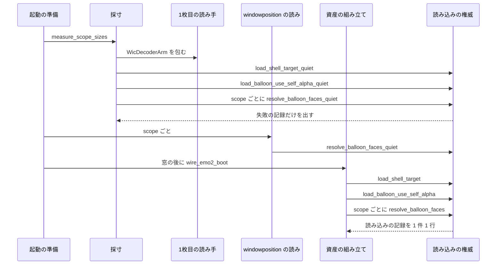

# Design Document: placement-measure-bake-once

> 2026-10-31・ブランチ `claude/kiro-start-placement-measure-bake-once-80df62`（main `da020c10` の上・`a6da785f`）で読んだコードによる。行番号はこの時点のもの。実装の着手時に引き直すこと。
>
> 直し方は要件討議（2026-10-31・requirements.md 末尾「決まったこと」）で決まっている: 採寸の道だけ、動く絵を 1 枚目で読む読み手で包む（上限 `AnimationLimits { max_frames: 1 }` は渡さない）＋採寸の道で読み込みの記録を重ねて出さない。焼く回数を 1 回にする案 A は取らない。

## Overview

**Purpose**: 動く絵（APNG・動く WebP）を持つシェルのゴーストを起こすとき、窓の大きさを測る段（採寸）が動く絵の全コマを読んでは捨てるのをやめ、窓が出るまでの待ち時間を採寸の分だけ縮める。あわせて、採寸と資産の組み立てがそれぞれ出していたシェルとバルーンの読み込みの記録を、起動 1 回で 1 行ずつにする。

**Users**: 動く絵を持つシェル（例: 「窓際のぱすたさん」の面 1000 に動く WebP 3 つ）のゴーストを起こす利用者と、起動を何度も繰り返す自動の試験を回す開発者。起動の記録を読んで判定をする人と、記録を数える道具。

**Impact**: 起動の準備は今と同じ順（採寸 → 窓の配置 → 資産の組み立て）で、シェルを 2 回・バルーンを scope ごとに 2 回焼くのも今のまま。変わるのは (a) 採寸が使う読み手（動く絵を 1 枚目だけ読む）と (b) 採寸と `windowposition` の読みが、読み込みの権威の「記録を出さない入口」を通ること、の 2 つだけである。

### Goals

- 採寸の道で、動く絵の 2 枚目以降のコマを読まない（動く絵 1 つ・1 回の焼きにつき、採寸が読むのは 1 枚目の 1 枚）。シェルの動く絵の全コマを読むのは起動 1 回につき 1 度（資産の組み立て）だけにする。
- 起動の結果（scope ごとの窓の大きさ・位置・描かれる絵）を emo2 でも動く絵を持つシェルでも今と同じに保つ。
- シェルとバルーンの読み込みの記録を、起動 1 回（と読み込み直し 1 回）につき 1 件ごとに 1 行にする。起動を止める失敗の記録は、記録を出さない入口の上でも必ず出す。
- 焼く回数・読んだコマの数・記録の行の数を、決定論のテストで固定する。
- release の焼く時間を静かな机で 1 回だけ測り直し、採寸の分が消えたことを記録する。

### Non-Goals

- 焼く回数そのものの 1 本化（案 A）。採寸に使った資産は今どおり採寸の後に捨てる。
- シェルの着替え・バルーンの着替え（`emo2_boot/switch_assets.rs`）。変更 0。
- 動く絵の読み込み（`areka-emo-atlas` の読み方・上限・形式）と再生、焼くこと自体の速さ、窓の配置の決まり（DPI の倍率・原点・作業領域への収め方）。
- 焼く段（`areka-emo-atlas`）と面の表の畳み込み（`areka-emo-compose`）の記録、バルーンの 2 層マージが確定した `info!`（`load_scope_balloon_model`）。
- 動く絵の再生の重さ（`window-link-directives` の申し送り ⅳ）。

## Boundary Commitments

### This Spec Owns

- 採寸の道（`placement/measure.rs`）が使う読み手の形: 動く絵を 1 枚目だけで読む包み（`FirstFrameDecoder`）と、それを差し込む口。
- シェルの読み込みの権威（`load_shell_target`）とバルーンの読み込みの入口（`resolve_balloon_faces`・`load_balloon_use_self_alpha`）の「記録を出さない入口」。読み込みの中身は 1 本のまま、記録を出す入口（今の名前と形）と出さない入口が同じ中身を共有する。
- 採寸の道と `windowposition` の読みが、記録を出さない入口を使うこと（どちらの道で記録を出すかの決め）。
- 起動の資産の組み立て（`emo2_boot/assets.rs`）の `build_shell_assets`・`build_balloon_assets` が読み手を `ElementDecoder` の形で受けること（数える読み手を差し込む口）。
- 焼く回数・読んだコマの数・記録の行の数の決定論の檻と、そのための数える読み手（テスト専用）。
- 測り直し（要件 5）の手順と記録。

### Out of Boundary

- `areka-emo-atlas` の中身（`bake`・`AnimationLimits`・動く絵の 3 つの `warn!`・0 寸・全透明の `warn!`）と `areka-emo-compose` の畳み込みの `warn!`。変更 0。
- `load_scope_balloon_model`（バルーンの 2 層マージ）と、その中の基層 `descript.txt` の読み（`warn!`）と確定の `info!`。変更 0（下の「決めごと D3」）。
- `emo2_boot/switch_assets.rs`・`boot_config.rs`・`crates/areka/src/install/`。変更 0。
- 起動の段取りの順、`PreparedPlacement`／`MeasuredSizes` の形、`ghost_session.rs`。変更 0。
- 起動の資産の scope の集まり（`emo2_boot::derive_scopes()` の `[0, 1]`）と、配置の scope の集まり（`placement/config.rs` の `detect_scopes`）。変更 0。

### Allowed Dependencies

- `areka-emo-atlas` の公開の型だけ: `ElementDecoder`・`AnimationInfo`・`DecodedImage`・`DecodeError`・`AnimatedImage`・`WicDecoderArm`・`MemoryDecoder`（テスト）。
- `areka-emo-present` の公開の入口（今あるものと、本 spec が足す `_quiet` の 3 本）。
- テストでは既存の `log_capture_kit`・`sample_ghost_kit`・`temp_path_kit`・`SwitchRig`（`ghost_switch_test_support`）・検体 `crates/areka-emo-compose/tests/fixtures/animated-playback/`。
- 依存の向き: `areka-emo-atlas` ← `areka-emo-present` ← `areka`（`placement` ／ `emo2_boot`）。`placement` は examples から `#[path]` で読まれるので、`placement` の新しい本番のファイルは `crate::` を使わない（`#[cfg(test)]` のテストのファイルは examples に入らないので `crate::emo2_boot` を使ってよい・既存の `measure_tests.rs` と同じ）。
- 新しいクレートの依存は足さない。

### Revalidation Triggers

- 配置の scope の集まりが起動の資産の scope の集まりを超えるようになったとき（`extra-character-windows` が `detect_scopes` の「scope は 1 まで」の絞りを外す、または `derive_scopes` が変わる）。採寸の道は記録を出さないので、資産の組み立てが読まない scope のバルーンの記録が 0 行になる（下の D2）。
- `load_shell_target`・`resolve_balloon_faces`・`load_balloon_use_self_alpha` に新しい記録を足すとき（記録の口の切り替えを通すこと）。
- `ElementDecoder` の `decode_first_frame` の契約（`decode_frames` の 0 番のコマと同じ画素・同じ `has_alpha`）が変わるとき。
- `balloon-webp-names` が `balloon.rs` に触るとき（同じファイル・着地の順で直列）。
- 採寸の呼び手（今は `placement/mod.rs:460` の 1 か所）が増えるとき。

## Architecture

### Existing Architecture Analysis

- 起動・ゴーストの切り替え・読み直しの 3 つとも、`ghost_session::prepare_ghost_windows` → `placement::prepare_ghost_windows_for_shell` → `prepare_stages_for_shell`（採寸 `measure::measure_scope_sizes`・`scope_windowposition`）→ 窓 → `boot_ghost`／`boot_ghost_strict` → `wire_emo2_boot` の手順 1 `build_boot_assets_for` → `build_boot_assets_with_shell` の同じ道を通る。直しはこの道の 2 か所（採寸と `windowposition` の読み）に入れるので、3 つとも同じく効く（要件 1.3・3.3）。
- 採寸（`measure.rs:153` `measure_native_scope_sizes`）は `WicDecoderArm` を中で作り（160 行目）、`load_shell_target`（343）でシェルを、scope ごとに `resolve_balloon_faces`（403）→ `build_balloon_target_from_faces`（409・面 0 だけ）でバルーンを焼き、寸法だけを返して焼いた物を捨てる。
- `windowposition` の読み（`placement/mod.rs:787` `scope_windowposition`）は scope ごとに `resolve_balloon_faces` をもう 1 回呼ぶ（焼かない）。
- 資産の組み立て（`assets.rs:241`）は `WicDecoderArm` を作り直し（251）、`build_shell_assets`（322・`load_shell_target` 343）と `build_balloon_assets`（441・`load_balloon_use_self_alpha` 469・scope ごとに `resolve_balloon_faces` 471）を呼ぶ。この 2 つは着替えの道（`switch_assets.rs:219`・251）も呼ぶ。
- 読み込みの記録はすべて `load_shell_target`（`shell_target.rs:318-471`）・`resolve_balloon_faces`（`balloon.rs:371-423`）・`load_balloon_use_self_alpha`（`balloon.rs:604-627`）と、その中で呼ぶ `list_file_names`・`enumerate_file_names`・`read_descript_layer`・`self_alpha::read_use_self_alpha` が出す。
- 配置の scope の集まりは「scope 0 は常に・scope 1 は `kero.*` が在るとき・`char{n}.`（n≥2）からは足さない」（`placement/config.rs:142-148`）ので、いつも資産の scope の集まり `[0, 1]` の内に収まる。

### Architecture Pattern & Boundary Map



**Architecture Integration**:

- 選んだ形: 「読み手の包み」＋「1 本の中身を共有する 2 つの入口」。採寸は要る物（寸法）だけを読み、記録は表示に使う読み込み（資産の組み立て）だけが出す。
- 境界: 読み手の包みは `placement` の中（採寸の持ち物）。記録の口の切り替えは `areka-emo-present` の中（読み込みの権威の持ち物）。どちらの道で黙らせるかの決めは `placement` の呼ぶ所に置く。
- 保つもの: 読み込みの権威は 1 本（`load_shell_target` の中身を 2 つに分けない）・採寸に使った資産は採寸の後に捨てる・`PreparedPlacement` は素の値だけを運ぶ・着替えの道は今のまま記録を出す。
- 新しい物: `FirstFrameDecoder`（採寸の読み手）・`LoadRecords`（記録の口の切り替え）・`_quiet` の入口 3 本・テスト専用の数える読み手。どれも要件 1・3・4 のどれかに直接要る。
- steering: ログの無い失敗の道を作らない（`logging.md`・失敗は `error!`）・1 ファイル 1,000 行以下・テストは兄弟のファイル（`structure.md`）・依存を足さない。

### Technology Stack

| Layer | Choice / Version | Role in Feature | Notes |
|-------|------------------|-----------------|-------|
| 絵の読み | `areka-emo-atlas`（ワークスペース内）の `ElementDecoder`・`WicDecoderArm` | 採寸の読み手が包む相手・資産の組み立ての読み手 | 中身は変えない |
| 読み込みの権威 | `areka-emo-present`（ワークスペース内） | 記録を出す入口と出さない入口 | 公開の入口を 3 本足す |
| 記録 | `tracing`（ワークスペースの版） | 読み込みの記録 | 水準・文言・欄は変えない |
| テスト | `log_capture_kit`・`sample_ghost_kit`・`temp_path_kit`（ワークスペース内） | 記録の行の数・検体の写し | 既存 |

新しい依存は 0。

## File Structure Plan

### Directory Structure

```
crates/areka-emo-present/src/
├── load_records.rs              # 新: 記録の口の切り替え LoadRecords（Emit／Quiet）
├── shell_target_quiet_tests.rs  # 新: シェルの記録を出さない入口のテスト（兄弟）
└── balloon_quiet_tests.rs       # 新: バルーンの記録を出さない入口のテスト（兄弟）

crates/areka/src/placement/
├── measure_first_frame.rs        # 新: 採寸の読み手 FirstFrameDecoder（measure の子のモジュール）
├── measure_first_frame_tests.rs  # 新: 読み手の決定論テスト（MemoryDecoder・COM 不要）
└── measure_bake_count_tests.rs   # 新: 焼く回数・読んだコマの数・窓の大きさの一致・採寸の道の記録 0 行の檻
                                  #     （数える読み手 CountingDecoder はこのファイルの中だけに置く・使うのはここだけ）
```

### Modified Files

- `crates/areka-emo-present/src/lib.rs` — `pub(crate) mod load_records;` の 1 行と説明 1 行。
- `crates/areka-emo-present/src/shell_target.rs`（874）— 今の `load_shell_target` の中身を `load_shell_target_with(…, LoadRecords)` へ移し、`load_shell_target`（Emit・名前と形は今のまま）と `load_shell_target_quiet`（Quiet）がそれを呼ぶ。中の記録を `records` で切り替える。`list_file_names` に `records` を渡す。モジュールの説明「記録を出す場所」に出さない入口を書き足す。テストのモジュールの宣言 1 つ。
- `crates/areka-emo-present/src/balloon.rs`（701）— `resolve_balloon_faces`／`resolve_balloon_faces_quiet`、`load_balloon_use_self_alpha`／`load_balloon_use_self_alpha_quiet` を同じ形（1 本の中身＋2 つの入口）にする。`enumerate_file_names`・`read_descript_layer` に `records` を渡す（`load_scope_balloon_model` からは常に Emit）。テストのモジュールの宣言 1 つ。
- `crates/areka-emo-present/src/self_alpha.rs`（63）— `read_use_self_alpha` に `records` を足す（呼び手 2 か所と `self_alpha_tests.rs` の 1 か所は Emit を渡す）。
- `crates/areka/src/placement/measure.rs`（465）— 読み手の段を 3 段にする（`measure_native_scope_sizes` が `WicDecoderArm` を作る → `measure_with_reader` が包む → `measure_baked` が今の中身）。`build_shell_assets`・`measure_balloon_surface0` の読み手を `&impl ElementDecoder` にし、`_quiet` の入口 3 本を呼ぶ。`measure_first_frame.rs` の `#[path]` の宣言とテストのモジュールの宣言 1 つ。モジュールの説明を書き足す。
- `crates/areka/src/placement/mod.rs`（970）— 呼ぶ所の付け替えだけ: 97 行目の `use` と 803 行目の `resolve_balloon_faces` を `resolve_balloon_faces_quiet` にする（新しいコードは足さない・行数は変わらない）。
- `crates/areka/src/placement/measure_template_tests.rs`（367）— 本文の走査（`the_measure_side_does_not_parse_the_shell_itself`）の対象に `measure_first_frame.rs` を足す（steering `structure.md` の兄弟の列挙）。
- `crates/areka/src/emo2_boot/assets.rs`（540）— `build_shell_assets`・`build_balloon_assets` の `decoder: &WicDecoderArm` を `decoder: &impl ElementDecoder` にする（本文は変えない）。`switch_assets.rs` は `&WicDecoderArm` を渡したまま組み立てが通るので変更 0。
- `crates/areka/src/boot_shell_tests.rs`（218）— 既存 2 本の期待値「シェルを 2 回読む」を「資産の組み立ての 1 回」へ直し、採寸のシェルは準備が置いた `BootShellChoice` で確かめる（仕様が変わったための更新）。起動の通しと切り替えの通しで記録の行の数を数える檻を足す。

変えないファイル（変更 0 を確かめる）: `emo2_boot/switch_assets.rs`・`ghost_session.rs`・`placement/measure_tests.rs`・`boot_config.rs`・`crates/areka/src/install/`・`areka-emo-atlas`・`areka-emo-compose`・`balloon_definitions.rs`。

## Components and Interfaces

| Component | Domain/Layer | Intent | Req Coverage | Key Dependencies (P0/P1) | Contracts |
|-----------|--------------|--------|--------------|--------------------------|-----------|
| LoadRecords と `_quiet` の入口 | areka-emo-present（読み込みの権威） | 1 本の中身を共有し、記録を出す入口と出さない入口を持つ | 3.1, 3.2, 3.4, 3.5, 3.6 | tracing (P0) | Service |
| FirstFrameDecoder | areka／placement（採寸） | 動く絵を 1 枚目だけで読む読み手の包み | 1.1, 1.2, 1.4, 2.2 | ElementDecoder (P0) | Service |
| 採寸の付け替え | areka／placement（採寸） | 採寸を包んだ読み手と記録を出さない入口で行う | 1.1, 1.3, 2.1〜2.6, 3.1〜3.3, 3.6 | FirstFrameDecoder (P0)・`_quiet` (P0) | Service |
| windowposition の付け替え | areka／placement | 3 回目の系列の解決を黙らせる | 3.2, 3.3 | `resolve_balloon_faces_quiet` (P0) | — |
| 資産の組み立ての読み手の口 | areka／emo2_boot | 数える読み手を差し込めるようにする（本文は変えない） | 1.5, 4.1, 4.2 | ElementDecoder (P0) | Service |
| 檻（テスト） | 各クレートの兄弟のテスト | 回数・行数・寸法を固定する | 1.1〜1.5, 2.1〜2.6, 3.1〜3.7, 4.1〜4.6 | CountingDecoder (P0)・log_capture_kit (P0) | — |
| 測り直しと実機の確かめ | 開発の手順 | 前後の時間と窓の配置を 1 回ずつ記録する | 5.1〜5.5 | 静かな机 (P1) | — |

### areka-emo-present（読み込みの権威）

#### LoadRecords と `_quiet` の入口

| Field | Detail |
|-------|--------|
| Intent | 読み込みの中身を 1 本に保ったまま、記録を出すかどうかを入口で選べるようにする |
| Requirements | 3.1, 3.2, 3.4, 3.5, 3.6 |

**Responsibilities & Constraints**

- 読み込みの結果（`ShellTarget`・`Vec<ResolvedFace>`・`UseSelfAlpha`）は、記録を出す入口と出さない入口で同じ（同じ中身を通るため）。
- 出さない入口が黙らせるのは「読み込みの記録」だけ。読み込みを `Err` で終える失敗の記録（下の表）は、出さない入口の上でも今と同じ水準・文言・欄で出す（要件 3.6・2.5）。
- 記録の水準・文言・欄は変えない（要件 3.4）。変わるのは出る道の数だけ。
- 既存の入口（`load_shell_target`・`resolve_balloon_faces`・`load_balloon_use_self_alpha`）の名前・形・働きは今のまま（呼び手の `assets.rs`・`switch_assets.rs`・`offline_dump`・examples・テストは変えない）。

| 入口 | 黙らせる記録（Quiet のとき出さない） | Quiet でも出す失敗の記録 |
|------|------------------------------------|-------------------------|
| シェル `load_shell_target_with` | 同じ番号の重複 `warn!`・桁溢れ `debug!`・descript.txt が読めない `warn!`・透過の宣言の `info!`／値が読めない `warn!`・`.pna` の `warn!`・土台に使わなかった画像 `debug!`・相手の無いコマ `warn!`・焼く段で落ちた絵の `error!`・入れ子の各件 `warn!`・形の誤りの各件 `warn!`・箱の各件 `warn!`・描けない描画メソッドの element定義の `warn!`・箱の数の `info!`・画像だけで組んだ `info!`・一覧の `info!`・一覧の 1 件を飛ばす `warn!`（2 種） | フォルダの一覧に失敗 `error!`・`surfaces.txt` が読めない `error!`・面が 1 つも無い `error!`（3 つとも `Err` を返す） |
| バルーン `resolve_balloon_faces` の中身 | 本体側の系列へ縮退した `warn!`・系列の解決が完了した `info!`・一覧の 1 件を飛ばす `warn!` | バルーンのフォルダの走査に失敗 `error!`・面 0 がどの接頭辞でも解決できない `error!`（どちらも `Err`） |
| バルーン `load_balloon_use_self_alpha` の中身 | descript.txt が読めない `warn!`・透過の宣言の `info!`／値が読めない `warn!`・`.pna` の `warn!`・一覧の 1 件を飛ばす `warn!` | バルーンのフォルダの走査に失敗 `error!`（続く系列の解決が同じ理由で `Err` を返し、起動を止める） |

##### Service Interface

```rust
// crates/areka-emo-present/src/load_records.rs（新）
/// 読み込みの記録を出すかどうか（読み込みの中身は同じ 1 本）。
#[derive(Clone, Copy, Debug, PartialEq, Eq)]
pub(crate) enum LoadRecords {
    /// 今までどおり出す（既存の入口・着替えの道・起動の資産の組み立て）。
    Emit,
    /// 読み込みの記録を出さない（採寸・windowposition の読み）。失敗の記録は出す。
    Quiet,
}
impl LoadRecords {
    pub(crate) fn emits(self) -> bool;
}

// crates/areka-emo-present/src/shell_target.rs
pub fn load_shell_target(shell_dir: &Path, decoder: &impl ElementDecoder)
    -> Result<ShellTarget, ShellLoadError>;            // 今のまま（Emit）
pub fn load_shell_target_quiet(shell_dir: &Path, decoder: &impl ElementDecoder)
    -> Result<ShellTarget, ShellLoadError>;            // 新（Quiet）
fn load_shell_target_with(shell_dir: &Path, decoder: &impl ElementDecoder, records: LoadRecords)
    -> Result<ShellTarget, ShellLoadError>;            // 今の中身
fn list_file_names(shell_dir: &Path, records: LoadRecords) -> Result<Vec<String>, ShellLoadError>;

// crates/areka-emo-present/src/balloon.rs
pub fn resolve_balloon_faces(balloon_dir: &Path, scope: u32)
    -> Result<Vec<ResolvedFace>, PresentError>;        // 今のまま（Emit）
pub fn resolve_balloon_faces_quiet(balloon_dir: &Path, scope: u32)
    -> Result<Vec<ResolvedFace>, PresentError>;        // 新（Quiet）
pub fn load_balloon_use_self_alpha(balloon_dir: &Path) -> UseSelfAlpha;        // 今のまま（Emit）
pub fn load_balloon_use_self_alpha_quiet(balloon_dir: &Path) -> UseSelfAlpha;  // 新（Quiet）
fn enumerate_file_names(balloon_dir: &Path, records: LoadRecords) -> Result<Vec<String>, PresentError>;
fn read_descript_layer(path: &Path, records: LoadRecords) -> Option<String>;

// crates/areka-emo-present/src/self_alpha.rs
pub(crate) fn read_use_self_alpha(kind: &'static str, key: &'static str, dir: &Path,
    descript: Option<&str>, records: LoadRecords) -> UseSelfAlpha;
```

- 事前条件: なし（今の入口と同じ）。
- 事後条件: 同じ入力に対し、Emit と Quiet の戻り値は等しい。Quiet が出す記録は上の表の「Quiet でも出す失敗の記録」だけ。
- 不変条件: 読み込みの中身（一覧・解析・面の表・焼き・系列の選択）は 1 本で、入口ごとに複製しない。

**Implementation Notes**

- Integration: 記録の行は `if records.emits() { … }` で囲むだけで、文言と欄は動かさない。`load_scope_balloon_model` は `read_descript_layer(…, LoadRecords::Emit)` を渡す（2 層マージは変えない）。
- Validation: `shell_target_quiet_tests.rs`・`balloon_quiet_tests.rs`（Testing Strategy）。既存の記録のテスト（`shell_target_load_tests.rs`・`shell_target_nesting_tests.rs`・`shell_target_boxes_tests.rs`・`balloon_series_tests.rs`・`balloon_alpha_tests.rs`・`self_alpha_tests.rs`）は Emit の道として緑のまま通る。
- Risks: 新しい記録を足す人が `emits()` で囲み忘れると採寸の道で 2 行に戻る → 起動の通しの檻（記録の行の数）が赤になる。

### areka／placement（採寸）

#### FirstFrameDecoder

| Field | Detail |
|-------|--------|
| Intent | 包んだ読み手の動く絵を、1 枚目だけの静止画として焼く段へ見せる |
| Requirements | 1.1, 1.2, 1.4, 2.2 |

**Responsibilities & Constraints**

- 焼く段（`areka-emo-atlas` の `animated::load`）が動く絵の道に入らないよう、`probe_animation` は既定（`None`）のまま返す。上限の判定も、上限を超えた・動く絵として読めない・1 枚目を読めないの `warn!` も採寸の道では起きない（議題 1 の決まり）。
- `decode` は、包んだ読み手の `probe_animation` が見出しを返せば `decode_first_frame`、それが `Err` なら包んだ読み手の `decode`、見出しが無ければ包んだ読み手の `decode`。この順は資産の組み立ての縮め方（`decode_first_frame` → `decode` → 失敗）の段 1・段 2 と同じなので、採寸が焼く絵は資産の組み立てが焼く 0 番のコマと同じ寸法になる（`decode_frames` の契約: 全コマが見出しと同じ寸法・`decode_first_frame` は 0 番のコマと同じ画素）。
- `probe_pna` は包んだ読み手へそのまま渡す（`.pna` の数は変わらない）。`decode_frames`・`decode_first_frame` は既定（`Err`）のまま（焼く段は呼ばない）。
- 静止画（見出しの無い絵）は包んだ読み手の `decode` をそのまま通るので、emo2 の焼く絵は今と同じ（要件 1.4）。
- `crate::` を使わない（examples の `#[path]`）。

##### Service Interface

```rust
// crates/areka/src/placement/measure_first_frame.rs（新・measure の子のモジュール）
/// 動く絵を 1 枚目だけで読む読み手（採寸の道だけで使う）。
pub(super) struct FirstFrameDecoder<'a, D: ElementDecoder> { inner: &'a D }
impl<'a, D: ElementDecoder> FirstFrameDecoder<'a, D> {
    pub(super) fn new(inner: &'a D) -> Self;
}
impl<D: ElementDecoder> ElementDecoder for FirstFrameDecoder<'_, D> {
    fn decode(&self, path: &Path) -> Result<DecodedImage, DecodeError>;
    fn probe_pna(&self, path: &Path) -> bool;
    // probe_animation / decode_frames / decode_first_frame は既定のまま
}
```

- 事後条件: 包んだ読み手の `decode_frames` を 1 度も呼ばない。動く絵 1 つの `decode` 1 回につき、包んだ読み手の `decode_first_frame` を高々 1 回呼ぶ。

**Implementation Notes**

- Integration: `measure.rs` に `#[path = "measure_first_frame.rs"] mod first_frame;` を置く。
- Validation: `measure_first_frame_tests.rs`（`MemoryDecoder` の `insert_animated`／`insert`／`insert_corrupt`）。
- Risks: APNG の既定の絵が動きに含まれない形（`IDAT` が 1 枚目のコマでない）でも、`decode_first_frame` を先に使うので資産の 0 番のコマと同じになる（gap R2・`rgb.apng` の検体で確かめる）。

#### 採寸の付け替え（`measure.rs`）

| Field | Detail |
|-------|--------|
| Intent | 採寸を、包んだ読み手と記録を出さない入口で行う。採寸の結果と失敗の扱いは今と同じ |
| Requirements | 1.1, 1.3, 2.1, 2.2, 2.3, 2.4, 2.5, 2.6, 3.1, 3.2, 3.3, 3.6 |

**Responsibilities & Constraints**

- 公開の口 `measure_scope_sizes` と `MeasuredSizes`・`MeasureScaling` の形は変えない（呼び手は `placement/mod.rs:460` の 1 か所のまま）。
- 読み手の段を 3 つに分ける: `measure_native_scope_sizes`（`WicDecoderArm` を作る・失敗の `error!` は今のまま）→ `measure_with_reader`（受けた読み手を `FirstFrameDecoder` で包む 1 行・数える読み手を差し込む口）→ `measure_baked`（今の中身・受けた読み手で焼く）。
- `measure_baked` の中で呼ぶのは `load_shell_target_quiet`・`load_balloon_use_self_alpha_quiet`・`resolve_balloon_faces_quiet`。`build_balloon_target_from_faces` と `Composer::compose` は今のまま（面 0 の焼きの失敗は今どおり `error!`＋`Err`）。
- 採寸自身の記録（`default_surface_missing` の `warn!`・合成に失敗した scope を scope 0 で代える `warn!`・失敗の `error!`・k 適用の `error!`）は変えない（要件 2.4・2.5）。`placement/mod.rs:470` の窓の大きさの `info!` も変えない（要件 2.6）。
- 採寸に使った資産と読み手は今どおり関数の終わりで捨てる。

##### Service Interface

```rust
// crates/areka/src/placement/measure.rs（私有の段）
fn measure_native_scope_sizes(shell_dir: &Path, balloon_root: &Path, scope_ids: &[usize],
    default_surfaces: &DefaultSurfaces) -> Result<Vec<ScopeInput>, PlacementError>;
fn measure_with_reader(reader: &impl ElementDecoder, shell_dir: &Path, balloon_root: &Path,
    scope_ids: &[usize], default_surfaces: &DefaultSurfaces) -> Result<Vec<ScopeInput>, PlacementError>;
fn measure_baked(decoder: &impl ElementDecoder, shell_dir: &Path, balloon_root: &Path,
    scope_ids: &[usize], default_surfaces: &DefaultSurfaces) -> Result<Vec<ScopeInput>, PlacementError>;
fn build_shell_assets(shell_dir: &Path, decoder: &impl ElementDecoder)
    -> Result<(EmoWorld, AtlasTable), PlacementError>;
fn measure_balloon_surface0(balloon_root: &Path, decoder: &impl ElementDecoder, composer: &mut Composer,
    scope: usize, use_self_alpha: UseSelfAlpha) -> Result<SizePx, PlacementError>;
```

- 事後条件: 同じ入力に対し、`measure_with_reader(&arm, …)` の戻り値は `measure_baked(&arm, …)`（今の採寸＝全コマを焼いて測る）の戻り値と等しい（要件 2.2）。

**Implementation Notes**

- Integration: テストのモジュール `measure_bake_count_tests.rs` の宣言を足す。`measure_tests.rs`（1,000 行）には足さない。
- Validation: 既存の `measure_tests.rs`・`measure_template_tests.rs`・`measure_default_surface_tests.rs`・`placement_*_tests.rs` が緑のまま（要件 2.1・2.3・2.4）。新しい檻は Testing Strategy。
- Risks: 動く絵の 1 枚目が全透明のとき、静止画の枝の「全透明」の扱いで寸法が変わり得る。焼いた表の `original`（元の寸法）で外形を組むなら変わらない見込みで、要件 2.2 の檻（全コマで測った値との一致）が落とす。

#### windowposition の付け替え（`placement/mod.rs`）

- 呼ぶ所の付け替えだけ: `scope_windowposition`（803 行目）の `resolve_balloon_faces` を `resolve_balloon_faces_quiet` にし、97 行目の `use` を合わせる。失敗のときの `warn!`（供給を見送る）と `load_scope_balloon_model` は今のまま。新しいコードは足さない（要件 3.2・3.3）。

### areka／emo2_boot（資産の組み立て）

#### 資産の組み立ての読み手の口（`assets.rs`）

- `build_shell_assets`・`build_balloon_assets` の読み手の引数を `&impl ElementDecoder` にするだけで、本文は変えない。中で呼ぶ `load_shell_target`・`resolve_box_markers`・`build_balloon_target_from_faces`・`load_scope_balloon_definitions` はすでに `&impl ElementDecoder` を受ける。
- `build_boot_assets_with_shell` は今どおり `WicDecoderArm` を作って渡す。記録を出す入口（Emit）を呼び続けるので、起動の記録はここから 1 件 1 行で出る。再生へ渡す動く絵（全コマ・待ち時間・上限の扱い）は今と同じ（要件 1.5）。
- 着替えの道（`switch_assets.rs`）は `&WicDecoderArm` を渡したまま変更 0 で組み立てが通る。

## System Flows

起動の準備 1 回の数（決めた値）:

| 段 | シェルを焼く | 動く絵 1 つの読み方（1 回の焼きにつき） | バルーンを焼く | 読み込みの記録 |
|----|-------------|---------------------------------------|---------------|---------------|
| 採寸 | 1 回 | 1 枚目の 1 枚だけ（`decode_first_frame`） | scope ごとに 1 回（面 0 だけ） | 出さない（失敗の記録だけ出す） |
| windowposition の読み | 0 | — | 0（系列の解決だけ） | 出さない（失敗の記録だけ出す） |
| 資産の組み立て | 1 回 | 全コマ（`decode_frames`） | scope ごとに 1 回（全部の面） | 1 件 1 行 |
| 計 | **2 回** | シェルの動く絵の全コマは **1 度** | scope ごとに **2 回** | **1 件 1 行** |

- ゴーストの切り替え・読み直しは `reopen_ghost_windows` → `prepare_ghost_windows` → `boot_ghost_strict` の同じ道なので、読み込み直し 1 回につき上の表と同じ数になる（要件 1.3・3.3）。
- 準備の後・資産の組み立ての前に起動が止まった場合（窓を作れない等）、その起動では読み込みの記録が出ない。採寸の失敗は採寸の道の上で `error!` が出るので、記録の無い失敗の道にはならない（要件 2.5・3.6）。

## Requirements Traceability

| Requirement | Summary | Components | Interfaces | Flows |
|-------------|---------|------------|------------|-------|
| 1.1 | 採寸で 2 枚目以降を読まない | FirstFrameDecoder・採寸の付け替え | `FirstFrameDecoder::decode`・`measure_with_reader` | 数の表「採寸」 |
| 1.2 | シェルの動く絵の全コマは起動 1 回に 1 度 | FirstFrameDecoder・資産の組み立ての読み手の口 | 同上・`build_shell_assets` | 数の表「計」 |
| 1.3 | 切り替え・読み直しも同じ | 採寸の付け替え・windowposition の付け替え | `measure_scope_sizes`（呼び手 1 か所） | 数の表の下の 1 点目 |
| 1.4 | 静止画だけのシェルは焼く絵が同じ | FirstFrameDecoder | `decode`（見出しが無ければ素通し） | — |
| 1.5 | 再生へ渡す動く絵は同じ | 資産の組み立ての読み手の口 | `build_boot_assets_with_shell`（本文不変） | — |
| 2.1 | emo2 の窓の大きさ・位置が同じ | 採寸の付け替え | `measure_scope_sizes`（形不変） | — |
| 2.2 | 動く絵のシェルの窓の大きさが全コマで測った値と同じ | FirstFrameDecoder・採寸の付け替え | `measure_with_reader` と `measure_baked` の一致 | — |
| 2.3 | 96 以外の拡大率で同じ倍率 | 採寸の付け替え | `apply_scaling`（不変） | — |
| 2.4 | 合成失敗は scope 0 で代え同じ `warn!` 1 行 | 採寸の付け替え | `measure_baked`（採寸自身の記録は不変） | — |
| 2.5 | 読めないときは窓の前に失敗＋記録 | LoadRecords・採寸の付け替え | Quiet でも出す失敗の記録の表 | 数の表の下の 2 点目 |
| 2.6 | 窓の大きさと位置の行が同じ | 採寸の付け替え | `placement/mod.rs:470` の `info!`（不変） | — |
| 3.1 | シェルの読み込みの記録を 1 件 1 行 | LoadRecords・採寸の付け替え | `load_shell_target_quiet` | 数の表「読み込みの記録」 |
| 3.2 | バルーンの読み込みの記録を scope と件ごとに 1 行 | LoadRecords・採寸の付け替え・windowposition の付け替え | `resolve_balloon_faces_quiet`・`load_balloon_use_self_alpha_quiet` | 同上 |
| 3.3 | 読み込み直し 1 回につき 1 行 | 同上 | 同上 | 数の表の下の 1 点目 |
| 3.4 | 水準・文言・欄は同じ | LoadRecords | `emits()` で囲むだけ | — |
| 3.5 | 記録を 0 行にしない | LoadRecords・資産の組み立ての読み手の口 | Emit の道（資産の組み立て）が必ず出す | D2 |
| 3.6 | 止める失敗は記録しない道でも 1 行 | LoadRecords | Quiet でも出す失敗の記録の表 | — |
| 3.7 | 焼く段・畳み込み・2 層マージの行の数は変えない | 範囲外の明記・FirstFrameDecoder | `areka-emo-atlas`・`areka-emo-compose`・`load_scope_balloon_model` 変更 0 | D4 |
| 4.1 | シェル 2 回・バルーン scope ごとに 2 回 | 檻 | `CountingDecoder`・`measure_with_reader`・`build_shell_assets`・`build_balloon_assets` | 数の表「計」 |
| 4.2 | 動く絵の読んだコマの数 | 檻 | 同上 | 同上 |
| 4.3 | emo2 の焼く回数 | 檻 | 同上 | 同上 |
| 4.4 | 記録の行の数 | 檻 | `boot_shell_tests.rs`（起動・切り替えの通し） | — |
| 4.5 | 時間・画面・机に左右されない | 檻 | 偽の SHIORI・検体の写しは `target\` の下 | — |
| 4.6 | 超えたら赤 | 檻 | 回数を `assert_eq!` で固定 | — |
| 5.1 | 前後を 1 回だけ静かな机で測る | 測り直し | 捨てる測定（下の Performance） | — |
| 5.2 | 前後の時間を research.md に記録 | 測り直し | research.md の節 | — |
| 5.3 | 時間は参考・合否は回数 | 測り直し・檻 | — | — |
| 5.4 | 静かな机は 1 回だけ | 測り直し | — | — |
| 5.5 | 本物のゴーストで窓の配置を確かめる | 実機の確かめ | 下の Performance「実機」 | — |

### 決めごと（設計の段・research.md 6.4 の申し送りへの答え）

- **D1 採寸の読み手**: 包む形（`FirstFrameDecoder`）を `placement/measure_first_frame.rs` に置き、`measure` の子のモジュールにする（`placement/mod.rs` に `mod` の行を足さない）。
- **D2 黙らせる道**: 採寸と `windowposition` の読みを黙らせ、起動の資産の組み立てで出す。理由: (1) 表示に使う読み込み（全コマで焼いた結果）の事実を記録に残せる。(2) `switch_assets.rs` と `build_shell_assets`・`build_balloon_assets` の本文を変えずに済む。(3) 準備を通らないで資産を組むテストや手本の道も今どおり記録を出す。(4) 配置の scope の集まりはいつも資産の scope の集まり `[0, 1]` の内（`detect_scopes` は scope 1 まで）なので、採寸が測る scope の記録は必ず資産の組み立てが 1 行出す（要件 3.5）。資産だけが読む scope（`kero.*` の無いゴーストの scope 1）は今も資産の組み立てだけが出しており、変わらない。
- **D3 「descript が読めない」の範囲**: 要件 3.2 の「descript が読めない」は、透過の宣言を読む入口 `load_balloon_use_self_alpha` の `warn!` を指す（要件の並び「透過の宣言・`.pna` を使わない・descript が読めない」はこの入口の 3 つの記録と同じ）。`load_scope_balloon_model` の中の基層の読みの `warn!` は 2 層マージの一部で、要件 3.7 と Out of scope のとおり変えない（`windowposition` の読みと資産の面ごとの定義の読みから今と同じ数だけ出る・壊れたバルーンのときだけ）。
- **D4 焼く段の記録（要件 3.7）**: 焼く段の 0 寸・全透明の `warn!` と畳み込みの `warn!` は、採寸がシェルとバルーンの面 0 を焼き面の表を組むのは今どおりなので、今と同じ数だけ出る。動く絵の 3 つの `warn!`（上限を超えた・動く絵として読めない・1 枚目を読めない）は、採寸の読み手が動く絵として見せないので採寸の道では出ない。これは議題 1 で決めた読み手の形（`probe_animation` を `None` にする・ギャップ分析 4 章 B-1）がそのまま持つ働きで、`areka-emo-atlas` の中身は変えない。
- **D5 檻の置き方**: 焼く回数・コマの数は、読み手を差し込める関数の段（`measure_with_reader`・`build_shell_assets`・`build_balloon_assets`）の檻で、本番と同じ順（採寸 → 資産）に通して固定する。記録の行の数は、本番の順（`prepare_ghost_windows` → 起こす処理）の通しの檻で固定する。`boot_shell_tests.rs` の「シェルを 2 回読む」は、記録を出す道が 1 本になったので「資産の組み立ての 1 回」へ直す（壊れたテストではなく仕様が変わったための更新）。採寸のシェルは準備が置いた `BootShellChoice` で確かめる。
- **D6 本文の走査（gap R6）**: `measure_template_tests.rs` の採寸側の走査に `measure_first_frame.rs` を足す。

## Error Handling

### Error Strategy

- 失敗の種類・戻り値・起動の止め方は今と同じ。記録を出さない入口の上でも、読み込みを `Err` で終える失敗は今と同じ `error!` を出す（上の表）。採寸は今どおり `PlacementError::Measure` を返し、呼び手が「起動窓を開けない」を告げて終える。
- `FirstFrameDecoder` は失敗を作らない: 1 枚目が読めなければ包んだ読み手の `decode` に任せ、それも駄目なら包んだ読み手の `DecodeError` をそのまま返す（焼く段が今どおり脱落として扱う）。
- 採寸の道で黙らせた「焼く段で落ちた絵の `error!`」は、資産の組み立てが同じ絵を全コマで焼くときに出す。動く絵の 1 枚目と静止画の 1 枚読みがどちらも駄目な絵は、資産の組み立てでも駄目になる（段 1・段 2 を同じ順で通る）。

### Monitoring

- 起動 1 回で、シェルの読み込みの記録（宛先 `areka_emo_present::shell_target`・接頭辞 `shell:`）とバルーンの読み込みの記録（`balloon:`・`self_alpha:`）がそれぞれ 1 件 1 行で出る。読み込み直しのたびに同じ数がもう 1 組出る。出る時点は窓の後（起動の結線の手順 1）で、今の 2 行目と同じ時点である。

## Testing Strategy

すべて決定論（時間・実の画面・ほかのセッションの机に左右されない・要件 4.5）。本物の読み手（WIC）を使うものは COM を初期化する。検体を作る・写すときは `target\` の下（`temp_path_kit`・`sample_ghost_kit`）。

### Unit Tests

1. `measure_first_frame_tests.rs`（`MemoryDecoder`・COM 不要）: 動く絵の `decode` が `decode_first_frame` の絵を返す・1 枚目が `Err` なら `decode` に落ちる・静止画は `decode` をそのまま返す・`probe_animation` は `None`・`probe_pna` は素通し・包んだ相手の `decode_frames` は 1 度も呼ばれない（要件 1.1・1.4）。
2. `shell_target_quiet_tests.rs`: 記録を出す検体（重複・入れ子・箱・相手の無いコマ・`.pna`・画像だけ・descript が読めない）で、Quiet の記録が 0 行・Emit の記録が今と同じ（要件 3.1・3.4）・戻りの `ShellTarget`（面の数・焼いた表の鍵・脱落・箱）が Emit と等しい・フォルダが無い／`surfaces.txt` が読めない／面が無いの 3 つで Quiet でも `error!` が 1 行（要件 3.6）。
3. `balloon_quiet_tests.rs`: 縮退する検体（相方側の系列を持たないバルーン）・`.pna` を持つ検体・descript が読めない検体で、Quiet の記録が 0 行・戻り値が Emit と等しい・面 0 が無い／フォルダが無いで Quiet でも `error!` が 1 行（要件 3.2・3.5・3.6）。
4. `self_alpha_tests.rs`: 既存のテストが Emit を渡して緑（要件 3.4）。

### Integration Tests（関数の段・本物の読み手）

1. `measure_bake_count_tests.rs`・動く絵の検体（`animated-playback` のシェルとバルーン）: 検体のシェルを `target\` の下の小さなゴーストの形（`ghost\master\descript.txt` と `shell\master\`・`temp_path_kit`）へ写す。`CountingDecoder`（`WicDecoderArm` を包み、5 つの口の呼ばれた回数をファイルごとに数えるテスト専用の読み手）を `measure_with_reader` に渡し、続けて同じ検体で `crate::emo2_boot::assets::build_shell_assets`・`build_balloon_assets` に別の `CountingDecoder` を渡す（本番と同じ順）。採寸は動く絵 1 つ・1 回の焼きにつき `decode_first_frame` 1 回・`decode_frames` 0 回、資産はシェルの動く絵 1 つにつき `decode_frames` 1 回（シェルの全コマは計 1 度）。シェルの絵 1 枚ごとの焼き（`probe_animation` の回数）は採寸 1・資産 1（計 2）、バルーンの面の絵は scope ごとに採寸 1（面 0）・資産 1（計 2）（要件 1.1・1.2・4.1・4.2・4.6）。
2. 同じファイル・emo2（`shared_test_support::emo2_root`）: 動く絵の口が 0 回・絵 1 枚ごとの焼きが採寸 1・資産 1（要件 1.4・4.3）。
3. 同じファイル・窓の大きさの一致: 動く絵の検体と emo2 で `measure_with_reader(&arm)` と `measure_baked(&arm)`（全コマを焼いて測る今の採寸）の scope ごとの寸法が等しい（要件 2.1・2.2）。拡大率をかけた後の値は既存の `measure_tests.rs` が固定している（要件 2.3）。
4. 同じファイル・採寸の道の記録: 動く絵の検体で `measure_scope_sizes` を通したとき、シェルとバルーンの読み込みの記録が 0 行・採寸自身の記録は今と同じ。シェルのフォルダが無い／バルーンの面 0 が無いとき、権威の `error!` と採寸の `error!` が今と同じ数だけ出て `Err`（要件 2.5・3.6）。

### E2E Tests（本番の順の通し）

1. `boot_shell_tests.rs`・起動の通し: ゴースト A（emo2 の写し）を `prepare_ghost_windows` → 起こす処理で起こし、シェルの一覧の `info!`・シェルとバルーンの透過の宣言の `info!` が 1 行ずつ、バルーンの系列の解決が完了した `info!` が scope ごとに 1 行、2 層マージの `info!` は scope ごとに 2 行（今のまま・要件 3.7）であることを固定する（要件 3.1・3.2・4.4）。
2. 同じファイル・動く絵のシェル: 検体の動く絵のシェルを A に隠しシェルとして写して記憶の名に置き、同じ通しで起こす。記録の行の数が 1 の通りで、起動が通る（要件 1.3 の起動の側・4.4）。
3. 同じファイル・切り替えの通し: `SwitchRig` で A から B へ切り替え、切り替え 1 回につき 1. と同じ数がもう 1 組出る（要件 3.3）。
4. 同じファイル・既存 2 本の更新: 読み込みの記録で数えるシェルのフォルダは 1 つ（資産の組み立て）、採寸のシェルは `BootShellChoice` が持つ名前で確かめる（D5）。

### Structure

- `measure_template_tests.rs`: 走査の対象に `measure_first_frame.rs` を足す（D6）。
- 変更 0 のファイル（`switch_assets.rs`・`ghost_session.rs`・`measure_tests.rs`・`boot_config.rs`・`install/`）は、完了の門で `git diff --stat` が 0 であることを確かめる。

## Performance & Scalability

- 目安（参考・合否の線にしない・要件 5.3）: 上限いっぱいの動く絵 1 つあたり、採寸の分が release で約 1.5 秒から 1 枚目を読む約 5 ms へ。起動の焼く時間は、動く絵 1 つのシェルで 3.2 秒 → 約 1.7 秒、4 つで 13.2 秒 → 約 6.5 秒の見込み（完了 `areka-P0-animated-image-decode` の research.md 9.14 節の数からの見積もり）。
- **測り直し（要件 5.1〜5.4）**: 9.14 節と同じ測り方。捨てる測定（コミットしない）を一時に `placement` の子のテスト（`#[ignore]`）として置き、release で 1 回だけ静かな机で回してから消す。
  - 絵: 9.14 節と同じ 500×500・268 コマの `big.apng`・`big.webp` と、emo2 のシェルの写しの `shell_big`（絵 1 つ）・`shell_big4`（絵 4 つ）を `target\placement-measure\` の下に作る（作り手は `areka-emo-atlas` の `gen_animated_samples` と同じ手・コミットしない）。
  - 前＝`measure_baked(&arm, …)`（全コマを焼く今の採寸）＋資産（`build_shell_assets`＋`build_balloon_assets`）、後＝`measure_with_reader(&arm, …)`＋資産。前と後を 1 組ずつ交互に回し、1 組目は捨て、中央値を書く。emo2 のシェルも同じく測る。
  - 静かな机はこの 1 回だけ（要件 5.4）。結果（前後の時間・採寸の分が消えたこと）を本 spec の research.md に書く（要件 5.2）。
- **実機（要件 5.5）**: ぱすた（面 1000 に動く WebP 3 つ）と emo2 を 96 以外の拡大率で、直す前と直した後に起こし、`placement: k₀ 倍後の物理窓寸で窓を生成する` の行の寸法・窓の位置の記録・描かれる絵（MCP の `dump_surface`）が同じであることを確かめて research.md に書く。画面の操作は排他テストの机で順を取る。SSP でぱすたが起きていると `127.0.0.1:9276` を握るので、持ち主のセッションに降ろしてもらってから回す。
