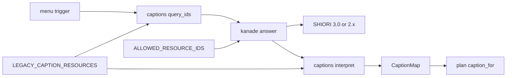
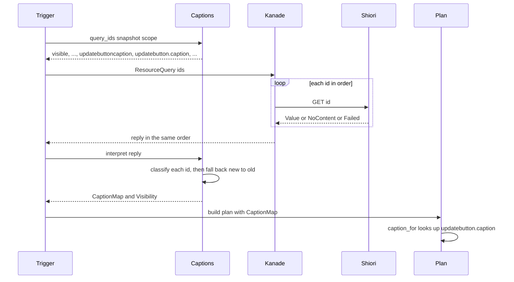
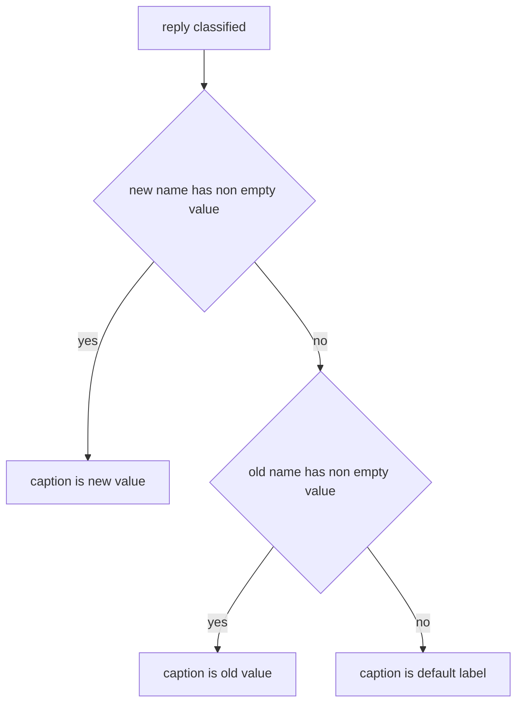

# Design Document: popup-menu-extra-resources

## Overview

**Purpose**: 右クリックメニューの「ネットワーク更新」の項目名を、新しい名前 `updatebutton.caption` で引けないときに古い名前 `updatebuttoncaption` で引く。「．さくら」（華和梨・SHIORI/2.x）のように古い名前だけを持つゴーストで、項目名がゴーストの言葉になる。

**Users**: 古いゴーストを areka で使う人（項目名）・障害のときに記録を読む人（今と同じ記録の決まり）・網羅台帳を読む人（`updatebuttoncaption` の行が持ち主と状態を持つ）。

**Impact**: 問い合わせてよい名前の表（kanade の `ALLOWED_RESOURCE_IDS`）に 1 語を足し、メニューの照会の列と返り値の写し（areka の `menu/captions.rs`）に「新しい名前 → 古い名前」の 1 組を足す。メニューの組み立てと表示（`menu/{plan,mod,win32}.rs`）・SHIORI/2.x の組み替え・kanade の照会の往復は変えない。

### Goals
- 新しい名前が引けたら新しい名前、引けず古い名前が引けたら古い名前、どちらも引けなければ既定名（1.2〜1.4）。
- 古い名前は「ネットワーク更新」の項目があるときだけ、新しい名前の直前に 1 回だけ問う（1.1・1.7・5.2）。
- 記録の行の数・水準・種類は増やさない（2.3）。
- 網羅台帳の検査（`ukadoc-survey`）を通したまま、`updatebuttoncaption` の行を `implemented`・持ち主を本 spec にする（4.2・4.5）。

### Non-Goals
- ⑵（消滅通告・おすすめ・ポータルの 8 つの名前と `char*.recommend*` の 3 つ・その項目）・`readmebuttoncaption`・`sakura.updatebuttoncaption`（6.1・6.3）。
- 「ネットワーク更新」以外の項目名に古い名前を足すこと。古い名前の対応表は 1 組だけを持ち、行を足す仕組みや選択肢は作らない。

## Boundary Commitments

### This Spec Owns
- 古い名前 `updatebuttoncaption` を SHIORI へ送ってよい名前にすること（kanade の許可表の 1 要素と、その凍結のテスト）。
- 「新しい名前 → 古い名前」の対応（1 組）と、その対応から決まる 2 つのこと: 1 回の表示の照会の列に古い名前を入れる位置、新しい名前が引けないときに古い名前の値を新しい名前の項目名として使う優先。
- 網羅台帳の `updatebuttoncaption` の行（状態・持ち主・備考）と `updatebutton.caption` の行の備考の 2 文（「壊れ方」「根拠の場所」）、それに伴う `roadmap-draft.md`・`briefing.md`・`report/` の直し。
- 「．さくら」での実機の見比べ 1 回と、その検証の記録。

### Out of Boundary
- メニューの組み立てと表示（`crates/areka/src/menu/{plan,mod,win32}.rs`）・`MenuItem` の形・項目の並びと有無・選べる条件と選んだ後の動作（3.3・6.2）。
- kanade の照会の往復（`actor_resources.rs` の `answer`）・送出の関門（`actor.rs`）・SHIORI/2.x の組み替え（`shiori/real.rs`・`shiori-host32-host/src/shiori2.rs`）。表に足した名前は今の名前と同じ道で通る（3.4）。
- 返事を待つ上限 `QUERY_TIMEOUT`（1,000 ms）と、時間切れのときの全件既定名（1.6）。
- 問い合わせない名前の表 `UNQUERIED_POPUPMENU_RESOURCES`（3.5）。
- ⑵ のすべてと `readmebuttoncaption`・`sakura.updatebuttoncaption`（6.1）。roadmap の「windows-reactor 待ち」の段への引き渡しは完了の棚卸の仕事（6.3）で、コードの変更ではない。
- `briefing-shiori.md` の人向けの経緯の文（台帳の検査の対象ではなく、要件 4.5 の挙げる周りにも入らない）。

### Allowed Dependencies
- areka の `menu/captions.rs` → `areka_kanade::resources::ResourceOutcome`（今のまま）。新しい依存は足さない。
- テストだけが `areka_kanade::resources::is_allowed_resource_id` を読む（今のまま）。本番コードが kanade の許可表の中身を読むことはしない。
- 依存の向きは今と同じ: `areka`（menu）→ `areka-kanade`（resources）。逆向きは作らない。kanade はメニューの意味（新旧の対応）を知らない。

### Revalidation Triggers
- `FRAME_CAPTIONS` の「ネットワーク更新」の資源名が変わる、または枠が別の資源名を持つようになる（対応表の新しい名前の側が合わなくなる）。
- `interpret` の 1 件ずつの写し方（非空・空・値なし・失敗）か、記録の 2 行の形が変わる。
- kanade の照会が入力と同じ順・同じ長さで返す契約を変える。
- windows-reactor の後のメニューの作り直し（`menu/` を組み替えるときに、対応表と落とし先の解決を新しい組み立てへ持っていく）。

## Architecture

### Existing Architecture Analysis
- 1 回の表示の照会は `trigger.rs` が `captions::query_ids(&snapshot, scope)` で名前の列を作り、`send_query` で kanade へ 1 通送る。kanade は名前を 1 つずつ順に SHIORI と往復し、入力と同じ順・同じ長さで 1 回だけ返す。返り値は `captions::interpret` が `CaptionMap`（非空の値だけを持つ「名前 → 文言」の表）と表示可否へ写し、空・値なしを `debug` 1 行、失敗を `warn` 1 行にまとめて記録する。`plan.rs` の `caption_for` は `item.caption_resource` を鍵に `CaptionMap::get` を引き、無ければ既定名を出す。
- 送ってよい名前は kanade の `ALLOWED_RESOURCE_IDS` だけで決まる。SHIORI/2.x の相手への資源の印も同じ表から決まる（`is_allowed_resource_id`）。
- 本 spec は、この流れの 2 か所（名前の列を作る所・返り値を写す所）にだけ 1 組の対応を差し込む。

### Architecture Pattern & Boundary Map



- 新しく置くのは `LEGACY_CAPTION_RESOURCES`（1 組の表）だけ。読むのは同じファイルの `query_ids`（の下請け `collect_caption_resources`）と `interpret` の 2 か所。
- `Plan`（`plan.rs`）・`Trigger`（`trigger.rs`）・`Kanade`（`actor_resources.rs`）は変えない。
- 本 spec の直しは、windows-reactor の後に作り直すメニューの組み立て（`plan`・`mod`・`win32`）に乗らない。「何を問い、どの値を使うか」は作り直しても残る側に置く。

### 設計の決め（research.md 7 章の議題 2・3・4・8・10）

| 議題 | 決め | 理由 |
|---|---|---|
| 2 落とし先を解決する場所 | `interpret` の最後で解決する。新しい名前の鍵が `CaptionMap` に無く古い名前の鍵があれば、古い名前の値を新しい名前の鍵へ入れる | 「引ける・引けない」を 1 件ずつ決めているのが `interpret` で、優先の決め（新しい名前が先）を同じ所に置ける。`CaptionMap` は「名前 → その名前自身の値」の表のままで、`get` に意味を足さない（`plan_tests.rs` などが直接組む `CaptionMap` の振る舞いも変わらない）。記録は今のループが古い名前も他の名前と同じに数えるので、記録のための手当てが要らない（2.1〜2.3） |
| 3 対応の持ち方 | `captions.rs` に 1 行だけの組の表 `LEGACY_CAPTION_RESOURCES: &[(&str, &str)]`（新しい名前, 古い名前）を置く | 同じファイルの名前の表（`FRAME_CAPTIONS`・`UNQUERIED_POPUPMENU_RESOURCES`）と同じ形で、兄弟テストが「表の名前はすべて許可表にある」を同じ書き方で確かめられる。決め打ちの 1 組の定数とコードの大きさは変わらない。行を足す予定は無い（`readmebuttoncaption` は取らない裁定） |
| 4 古い名前を導く鍵 | 資源名（`caption_resource` が表の新しい名前に等しいこと）から導く。`Frame` は使わない | `interpret` は名前の列しか持たず、サブメニューの子には `Frame` が無い。資源名から導けば、「ネットワーク更新」の項目が写しに無いとき古い名前も列に入らない（1.7）が、分岐を足さずに満たされる。`query_ids` の入力と出力の型は変わらない |
| 8 照会の並び | 古い名前を、新しい名前の**直前**に入れる | SSP は古い名前を新しい名前の直前に問う（測 1）。areka の記録を SSP の `ssp_shiori_log.txt` と見比べやすい。優先は `interpret` が往復の後でまとめて決めるので、並びは優先に効かない |
| 10 凍結のテストの否定側 | kanade の `resources.rs` の兄弟テストに、⑵ の名前を「入れない」と確かめるテストを 1 本足す（今の `unqueried_menu_names_are_not_allowed` とは別） | 今のテストは「問い合わせない裁定」の名前で、⑵ は「windows-reactor 待ちで今は問わない」名前である。理由の違う名前を同じ失敗文に混ぜない。許可表を持つクレートの、表の隣に置く（5.3・5.4） |

### Technology Stack

| Layer | Choice / Version | Role in Feature | Notes |
|-------|------------------|-----------------|-------|
| アプリ（areka の menu） | Rust（ワークスペースの版） | 照会の列と返り値の写し | 新しい依存なし |
| 運行（areka-kanade） | Rust | 送ってよい名前の表 | 1 要素を足すだけ |
| 文書の検査（ukadoc-survey） | Rust・既存の CLI（`report`・`report-summary`） | 台帳の整合の検査と報告の作り直し | 道具には手を入れない |

## File Structure Plan

### Directory Structure
```
crates/
├── areka-kanade/src/schedule/
│   └── resources.rs            # 許可表に 1 要素・凍結のテストを 15 名に・⑵ を入れないテスト
└── areka/src/menu/
    ├── captions.rs             # 古い名前の 1 組の表・照会の列へ入れる・interpret で落とす
    └── captions_tests.rs       # 組み合わせ 6 通り・照会の列・既存 2 本の直し
doc/ukadoc-coverage/
├── ledger/shiori.toml          # 2 行（updatebuttoncaption・updatebutton.caption の備考の 2 文）
├── roadmap-draft.md            # [[spec]] 1 行・[briefs] の数・追加の段落・段階 A の表の「メニュー」の行
├── briefing.md                 # list_shiori_resource の [[barrier]] 14/145 → 15/144 と経緯の 1 文
└── report/{shiori.md,summary.md}  # 道具で作り直す（手で書かない）
.kiro/specs/popup-menu-extra-resources/
└── verification.md             # 新規・実機の見比べの記録
```

### Modified Files
- `crates/areka-kanade/src/schedule/resources.rs`
  - `ALLOWED_RESOURCE_IDS` の末尾に、出どころの 1 行のコメント（「ネットワーク更新」の項目名の古い名前・本 spec の名前）と `// ukadoc: https://ssp.shillest.net/ukadoc/manual/list_shiori_resource.html#updatebuttoncaption:1` を置いて `"updatebuttoncaption"` を足す（4.1）。末尾に足すのは、これまでの追加（`switchmovetodefaultpositionbutton.caption`・`resetballoonpositionbutton.caption`）と同じ並べ方。
  - 表の doc コメントの内訳と数（「利用者名＋メニュー 11 名＋更新 2 名」）を実数 15 に合わせて書き直す。
  - 凍結のテスト `allowed_resource_ids_are_exactly_the_fourteen_names` を `allowed_resource_ids_are_exactly_the_fifteen_names` にし、書き下しの列の末尾に `"updatebuttoncaption"` を足し、doc コメントの経緯（「14→15」と本 spec）と失敗文の数を直す（5.3）。
  - 新しいテスト `deferred_menu_item_names_are_not_allowed` を `unqueried_menu_names_are_not_allowed` の隣に足す（議題 10・5.3）。
- `crates/areka/src/menu/captions.rs` — 下の「Components and Interfaces」の C2・C3。モジュールの doc コメントに、古い名前で落とすことを 1 文足す。
- `crates/areka/src/menu/captions_tests.rs` — 下の「Testing Strategy」。444 行に 8〜9 本足して 1,000 行の目安に収まる（5.4）。
- `doc/ukadoc-coverage/ledger/shiori.toml`、`roadmap-draft.md`、`briefing.md`、`report/shiori.md`、`report/summary.md` — 下の C4。
- `.kiro/specs/popup-menu-extra-resources/verification.md`（新規） — 下の C5。
- `.kiro/specs/popup-menu-extra-resources/brief.md` — 完了の棚卸で ⑵ を渡した先と日付を書く（6.4）。`.kiro/steering/roadmap.md` の「windows-reactor 待ち」の段への引き渡し（6.3）も完了の棚卸（`/kiro-complete`）で行う。実装のタスクでは触らない。

変えないファイル（6.2・3.3 の確かめの対象）: `crates/areka/src/menu/plan.rs`・`mod.rs`・`win32.rs`・`trigger.rs`・`update_frame.rs`、`crates/areka-kanade/src/actor_resources.rs`・`actor_resources_tests.rs`（doc コメントの「許可表の 14 名目」は `resetballoonpositionbutton.caption` が 14 名目であることの記録で、末尾に足しても変わらない）・`actor.rs`・`shiori/real.rs`、`crates/shiori-host32-host/src/shiori2.rs`。

## System Flows



- 古い名前が列に入るのは、写しに `caption_resource == "updatebutton.caption"` の項目があるときだけ（1.7）。同じ項目が 2 つあっても、どちらの名前も 1 回だけ入る（5.2）。
- 返事が上限までに来ないとき（`Err(QueryFailure)`）は、`interpret` が今と同じく空の `CaptionMap` を返す。落とし先の解決は `Ok` の枝の中だけで行うので、全件既定名のまま（1.6）。
- 項目名の優先の分岐:



「引けない」は空の値・値なし・照会の失敗のすべて（要件の「この文書で使う言葉」）。

## Requirements Traceability

| Requirement | Summary | Components | Interfaces | Flows |
|-------------|---------|------------|------------|-------|
| 1.1 | 1 回の照会で古い名前も問う | C2 | `query_ids` | 照会の列 |
| 1.2 | 新しい名前が引けたら新しい名前 | C3 | `interpret` | 優先の分岐 |
| 1.3 | 新しい名前が引けず古い名前が引けたら古い名前 | C3 | `interpret` | 優先の分岐 |
| 1.4 | どちらも引けなければ既定名・メニューは出す | C3（既存の `caption_for`） | `interpret`・`CaptionMap::get` | 優先の分岐 |
| 1.5 | 古い名前の値も `&` 素通し・前後を削らない | C3 | 同じ鍵で `CaptionMap` に入るので `caption_for` の扱いがそのまま | — |
| 1.6 | 時間切れは全件既定名・上限を延ばさない | C3（`Err` の枝は無改変）・`QUERY_TIMEOUT` 無改変 | `interpret` | 時間切れ |
| 1.7 | 項目が無ければ古い名前を問わない | C2 | `collect_caption_resources` | 照会の列 |
| 2.1 | 古い名前の空・値なしは今の `debug` 行に | C3（既存のループ） | `menu_resource_empty` | — |
| 2.2 | 古い名前の失敗は今の `warn` 行に | C3（既存のループ） | `menu_resource_failed` | — |
| 2.3 | 行の数・水準・種類を増やさない | C3 | 記録の 2 行は無改変 | — |
| 3.1 | 新しい名前を持つゴーストは今と同じ項目名 | C3 | `interpret` | 優先の分岐 |
| 3.2 | 他の項目名・表示可否は今のまま | C2・C3 は「ネットワーク更新」の 1 組だけを見る | — | — |
| 3.3 | 選べる条件・動作・並びと有無は今のまま | 変えないファイルの一覧 | — | — |
| 3.4 | 3.0 と 2.x で同じ決まり | C1（許可表の印で 2.x へも同じ道） | `is_allowed_resource_id` | — |
| 3.5 | 問い合わせない名前の表は今のまま | `UNQUERIED_POPUPMENU_RESOURCES` 無改変 | 既存テスト | — |
| 4.1 | 許可表に 1 語を URL とともに・⑵ は足さない | C1 | `ALLOWED_RESOURCE_IDS` | — |
| 4.2 | `updatebuttoncaption` の行 | C4 | 台帳 | — |
| 4.3 | `updatebutton.caption` の行の 2 文 | C4 | 台帳 | — |
| 4.4 | ⑵ の 11 行を変えない | C4 | 台帳 | — |
| 4.5 | 整合の検査が通る周りの直し | C4 | `roadmap-draft.md`・`briefing.md`・`report/` | — |
| 5.1 | 組み合わせ 6 通りの決定論テスト | テスト（captions_tests） | `interpret` | — |
| 5.2 | 項目があるときだけ・重ならない | テスト（captions_tests） | `query_ids` | — |
| 5.3 | 凍結のテストを 15 名に・⑵ が無いこと | テスト（resources.rs） | `ALLOWED_RESOURCE_IDS` | — |
| 5.4 | テストの置き場 | `captions_tests.rs`・`resources.rs` の `mod tests` | — | — |
| 5.5 | 3 クレートのテストが通る | 確かめの手順 1 | — | — |
| 5.6 | 「．さくら」で SSP と見比べる | C5 | — | 実機 |
| 5.7 | ⑵ の項目が無いのは既知の差 | C5 | — | 実機 |
| 5.8 | 実機の置き場は `target\` の下 | C5 | — | 実機 |
| 6.1 | ⑵ を足さず問わない | C1・C2（1 組だけ）・5.3 のテスト | — | — |
| 6.2 | `menu/{plan,mod,win32}.rs` を変えない | 変えないファイルの一覧 | — | — |
| 6.3 | 完了の棚卸で ⑵ を渡す | 完了の棚卸（`/kiro-complete`） | `roadmap.md` | — |
| 6.4 | brief に渡した先と日付 | 完了の棚卸 | `brief.md` | — |

## Components and Interfaces

| Component | Domain/Layer | Intent | Req Coverage | Key Dependencies | Contracts |
|-----------|--------------|--------|--------------|------------------|-----------|
| C1 許可表の 1 要素 | areka-kanade `schedule/resources.rs` | 古い名前を送ってよい名前にする | 3.4, 4.1, 5.3, 6.1 | 送出の関門・2.x の印（P0・無改変） | State |
| C2 古い名前の表と照会の列 | areka `menu/captions.rs` | 新しい名前の直前に古い名前を入れる | 1.1, 1.7, 5.2, 6.1 | `MenuItem.caption_resource`（P0） | Service |
| C3 落とし先の解決 | areka `menu/captions.rs` | 新しい名前が引けないとき古い名前の値を使う | 1.2〜1.6, 2.1〜2.3, 3.1, 3.2 | `ResourceOutcome`（P0）・`plan::caption_for`（P0・無改変） | Service |
| C4 網羅台帳一式 | `doc/ukadoc-coverage/` | 台帳の行と整合の検査 | 4.2〜4.5 | `ukadoc-survey` の検査（P0） | Batch |
| C5 実機の見比べの記録 | `.kiro/specs/popup-menu-extra-resources/verification.md` | 「．さくら」で SSP と見比べた事実を残す | 5.6〜5.8 | 排他テストの机・i686 helper（P1） | — |

### areka-kanade

#### C1 許可表の 1 要素

| Field | Detail |
|-------|--------|
| Intent | `updatebuttoncaption` を SHIORI へ送ってよい名前にする |
| Requirements | 3.4, 4.1, 5.3, 6.1 |

**Responsibilities & Constraints**
- 許可表は 15 名になる。足すのは `updatebuttoncaption` の 1 つだけで、⑵ の 8 つと `char*.recommend*` の 3 つ・`readmebuttoncaption`・`sakura.updatebuttoncaption` は足さない。
- 要素の前の `// ukadoc: …#updatebuttoncaption:1` の 1 行が、台帳の `implemented` の証拠になる（`doc/ukadoc-coverage/README.md` 3 章「許可表の要素」）。この名前の証拠はここ 1 か所だけに置く。
- 表を読む本番コードは `is_allowed_resource_id` だけで、要素の数や並びを前提にしない。送出の関門（`actor.rs`）と SHIORI/2.x の印（`shiori/real.rs` の `for_resource`）は同じ判定を使うので、足した名前は 3.0 にも 2.x（`GET String SHIORI/2.5`・`ID: updatebuttoncaption`）にも今の名前と同じ道で届く（3.4）。

**Contracts**: State [x]

##### State Management
- 状態の形: `pub const ALLOWED_RESOURCE_IDS: &[&str]`（型は変えない）。末尾に `"updatebuttoncaption"`。
- 不変量: 凍結のテストが書き下す 15 名と完全に一致する。⑵ の名前と、取らない裁定の 2 つの名前は含まない。

**Implementation Notes**
- Validation: 凍結のテスト（15 名）と `deferred_menu_item_names_are_not_allowed`（下の Testing Strategy）。名前ごとの往復のテスト（`actor_resources_tests.rs` の先例）は足さない。往復の道は判定 1 つで決まり、名前を足しても道は変わらないので、配線を名前ごとに確かめ直さない。
- Risks: 無し。

### areka menu

#### C2 古い名前の表と照会の列

| Field | Detail |
|-------|--------|
| Intent | 1 回の表示の照会の列に、新しい名前の直前で古い名前を 1 回だけ入れる |
| Requirements | 1.1, 1.7, 5.2, 6.1 |

**Responsibilities & Constraints**
- 表を 1 つ置く。行は 1 つだけ。

```rust
/// 項目名の資源の新しい名前と古い名前の組（新しい名前, 古い名前）。
/// 新しい名前が引けないとき、古い名前の値をその項目名に使う（popup-menu-extra-resources）。
/// 正典は 2 つを別の項目として同じ説明で載せる:
/// <https://ssp.shillest.net/ukadoc/manual/list_shiori_resource.html#updatebuttoncaption>
pub(crate) const LEGACY_CAPTION_RESOURCES: &[(&str, &str)] =
    &[("updatebutton.caption", "updatebuttoncaption")];
```

- この表の doc コメントには `ukadoc:` で始まる行を置かない。台帳の証拠は C1 の 1 行だけにする（README 3 章「1 項目 1 行」「呼び出し側には書かない」。ページ URL の行を置くと、検査の道具が要素の最初の文字列＝新しい名前を証拠として拾う）。
- `query_ids` の公開の形は変えない: `pub(crate) fn query_ids(snapshot: &[(Frame, MenuItem)], scope: u32) -> Vec<&'static str>`。
- 下請けの `collect_caption_resources` が `caption_resource` を列へ足すとき、その名前が表の新しい名前なら、先に対応する古い名前を足し、続けて新しい名前を足す。どちらも「既に列にあれば足さない」の今の決まりに従う。

**Contracts**: Service [x]

##### Service Interface
- 事前条件: 写し `snapshot` は今と同じ（`Frame` と `MenuItem` の組・子を持つことがある）。
- 事後条件: 先頭は表示可否の名前。写しに `updatebutton.caption` を持つ項目が 1 つ以上あれば、列には `updatebuttoncaption` と `updatebutton.caption` がそれぞれちょうど 1 回、この順で隣り合って現れる（最初に現れた位置）。無ければどちらも現れない。他の名前の並びは今と同じ。
- 不変量: 列に同じ名前が 2 度現れない。

**Implementation Notes**
- Integration: `trigger.rs` は `query_ids` の結果をそのまま `send_query` へ渡しているので、呼び手は変わらない。
- Validation: 既存の `query_ids_collects_submenu_children_and_collapses_duplicates` は孫の葉に `updatebutton.caption` を持つので、期待の列が `…, "closebutton.caption", "updatebuttoncaption", "updatebutton.caption"` に変わる（直す）。
- Risks: 往復が 1 回増える（C3 の Performance を参照）。

#### C3 落とし先の解決

| Field | Detail |
|-------|--------|
| Intent | 返り値を写した後、新しい名前が引けず古い名前が引けたとき、古い名前の値を新しい名前の項目名にする |
| Requirements | 1.2, 1.3, 1.4, 1.5, 1.6, 2.1, 2.2, 2.3, 3.1, 3.2 |

**Responsibilities & Constraints**
- `interpret` の公開の形は変えない: `pub(crate) fn interpret(result: Result<QueryReply, QueryFailure>, visible_id: &'static str, scope: u32) -> Interpreted`。
- 1 件ずつの写し（非空＝表へ・空と値なし＝`empty`・失敗＝`failed`）は今のまま。古い名前もこのループで他の名前と同じに扱われるので、空・値なしは `menu_resource_empty`（`debug`）の `ids` に、失敗は `menu_resource_failed`（`warn`）の `failed` に、他の名前と一緒に 1 行で載る（2.1〜2.3）。新しい記録の行・水準・`event=` は足さない。
- ループの後（記録の前でも後でもよい・記録の中身には効かない）、表の各組 `(new, old)` について: `CaptionMap` に `new` の鍵が無く `old` の鍵があれば、`old` の値の写しを `new` の鍵で入れる。`new` の鍵があれば何もしない（1.2・3.1）。
- `CaptionMap` には非空の値しか入らないので、「鍵が有る」＝「引けた」。空の値・値なし・失敗はどれも鍵が無い（1.3 の「引けず」の 3 通りが同じ扱いになる）。
- 値は写すだけで手を加えない。`plan::caption_for` は `updatebutton.caption` の鍵で引いた値を今と同じに `&` を素通しし前後を削らずに出す（1.5）。どちらも引けなければ鍵が無く、`caption_for` が既定名を出す（1.4）。
- `Err(QueryFailure)` の枝は今のまま空の `CaptionMap` を返し、落とし先の解決を通らない（1.6）。
- 表示可否の名前の扱い・他の項目名の写しは変えない（3.2）。

**Contracts**: Service [x]

##### Service Interface
- 事前条件: `result` は kanade の返り値（入力と同じ順・同じ長さ）か、返事が得られなかった理由。
- 事後条件（`Ok` のとき）: `captions.get("updatebutton.caption")` は、新しい名前が非空なら新しい名前の値、そうでなく古い名前が非空なら古い名前の値、どちらでもなければ `None`。`captions.get("updatebuttoncaption")` は古い名前自身の値（非空のとき）で、メニューの項目からは引かれない。
- 事後条件（`Err` のとき）: 今と同じ（`CaptionMap` は空・`Visibility::Show`・`warn` 1 行）。

**Implementation Notes**
- Integration: `plan.rs`・`trigger.rs` は無改変。`Interpreted` の形も変えない。
- Validation: 下の Testing Strategy の組み合わせ 6 通りと、記録の 1 本。
- Risks: 新しい名前を持つ今のゴーストでも、古い名前に値が無ければ `menu_resource_empty` の `ids` に `updatebuttoncaption` が 1 語増える（要件討議で決めたことの 6 で受け入れ済み・項目名は今と同じ）。

### 文書

#### C4 網羅台帳一式

| Field | Detail |
|-------|--------|
| Intent | `updatebuttoncaption` を実装済み・持ち主を本 spec にし、整合の検査を通す |
| Requirements | 4.2, 4.3, 4.4, 4.5 |

**Contracts**: Batch [x]

##### Batch / Job Contract
- 対象と中身:
  - `ledger/shiori.toml` の `updatebuttoncaption` の行（4.2）: `status = "implemented"`・`owner = "popup-menu-extra-resources"`・`priority = "A11"` と `values = ["装い"]` と `introduced = ""` と `links = []` はそのまま。備考は `updatebutton.caption` の行と同じ組み立てで、次を書く。
    - 中身: 実装済み。メニューを出すたびに `updatebutton.caption` の直前にこの名前を引き、新しい名前が引けない（空・値なし・失敗）ときにこの値を「ネットワーク更新」の項目名に使う。新しい名前が引けたときはこの値を使わない。「ネットワーク更新」の項目が登記されていないときは引かない。
    - 壊れ方: 無い。両方引けないときと時間切れのときは既定名「ネットワーク更新」に落ち、メニューはそのまま出る。
    - ログ: 空と値なしは `updatebutton.caption` などと一緒に `debug!` の 1 行に、失敗は `warn!` の 1 行に名前を載せる。
    - 根拠の場所: `crates/areka-kanade/src/schedule/resources.rs` の `ALLOWED_RESOURCE_IDS`、`crates/areka/src/menu/captions.rs` の `LEGACY_CAPTION_RESOURCES` と `interpret`。
    - 画面の材料・無いと失うもの: 今の行の 2 文を引き継ぐ。
    - 優先: 新しい名前を先にする。ukadoc は 2 つの名前の優先を書いていないので、README 2 章の「最も新しい書き方を正典とする」に拠る。
    - 測りの結果: SSP は右クリックメニューを開くたびに `updatebuttoncaption` → `sakura.updatebuttoncaption` → `updatebutton.caption` の順で問う（2026-10-31・`ssp_shiori_log.txt` の 73〜74 回分）。両方に値があるときと新しい名前が空のときに SSP がどちらを使うかは、値を返す検体が SSP に無く、検体を入れると SSP の外の実物を動かすことになるので測っていない。
    - `alias` にしない理由: areka はこの名前を自分で問い、新しい名前が引けないときの落とし先に使う（新しい名前の写しとしてだけ読むのではない）ので、README 2 章の仕訳の決まり（新しくない書き方は `alias`）から外して `implemented` にした（2026-11-01 要件討議）。
  - 同じ台帳の `updatebutton.caption` の行（4.3）: 状態と持ち主は変えない。「壊れ方」を「無い。空・値なし・失敗のときは古い名前 `updatebuttoncaption` の値に落ち、それも引けないときと時間切れのときは既定名「ネットワーク更新」に落ち、メニューはそのまま出る。」の意味に、「根拠の場所」に `crates/areka/src/menu/captions.rs` の `LEGACY_CAPTION_RESOURCES` と `interpret`（落とし先を決める所）を足す。他の文は変えない。
  - ⑵ の 8 行と `char*.recommend*` の 3 行は変えない（4.4）。
  - `roadmap-draft.md`（4.5・先例 `shiori2-protocol`）: `[[spec]]` を 1 行足す（`name = "popup-menu-extra-resources"`・`stage = "A"`・`bundle = "メニュー"`・`owner_count = 1`・`wave = "C15-⑥"`）。束は `linkage.md` の `[bundle."メニュー"]` が `updatebuttoncaption` を持つことから、段階はその束の順位表の段階（A）、ウェーブは正本のロードマップ（C15 の ⑥）の写し。`[briefs]` を `count = 67`・`snapshot_on` を直した日にし、「追加」の段落（何をしたか・束・件数が ⑴ ⑵ に当たらないこと・足した行の中身・行数 67／束を持つ行 43／`none = true` 24）を先例の段落の後に足す。段階 A の表の「メニュー」の行の「依存する既存 spec」に `popup-menu-extra-resources`（C15-⑥・1 件）を足す。行数の 3 つは足した後に `[[spec]]` の塊を数え直した値を書く。
  - `briefing.md`（4.5）: `page = "list_shiori_resource"` の `[[barrier]]` を `implemented = 15`・`vocabulary_only = 144` にし、その節の経緯の段落に 1 文（日付・本 spec・`updatebuttoncaption` を語彙のみから実装済みへ移したこと）を足す。
  - `report/shiori.md`・`report/summary.md`（4.5）: 手で書かず `cargo run -p ukadoc-survey -- report` と `cargo run -p ukadoc-survey -- report-summary` で作り直す。
- 検査: `cargo test -p ukadoc-survey`（持ち主の名前が spec の一覧に在る・`[briefs].count` と行数・`owner_count`・束名・状態の分布・`implemented` の証拠・報告の全文一致）。
- 冪等性: 報告は道具が作るので、作り直しを何度回しても同じ全文になる。台帳と文書の直しが終わってから作り直す。

**Implementation Notes**
- Risks: 同じウェーブの `shell-scale-linkage` も台帳と `roadmap-draft.md`・`briefing.md` に触れる。台帳は互いに別の行だが、`[briefs].count`・行数・`[[barrier]]`・報告は数を共有するので、後から着地する側が main に合わせて数え直す（どちらも手で書く数は数え直した値にする・報告は作り直す）。

#### C5 実機の見比べの記録

| Field | Detail |
|-------|--------|
| Intent | 「．さくら」を areka と SSP で開いたメニューの項目名を見比べ、事実を残す |
| Requirements | 5.6, 5.7, 5.8 |

**Responsibilities & Constraints**
- 排他テストの机を取ってから、`vendors/sample_ghost/dot_sakura.nar` を展開した根をワークツリーの `target\` の下に置き、areka で起こす（SHIORI/2.x・i686 helper 経由・起こし方は完了 `shiori2-protocol` の検証の記録と同じ）。一時フォルダも `target\` の下（5.8）。
- 右クリックメニューを開き、「ネットワーク更新」の項目名が「．さくら」の辞書の `updatebuttoncaption` の言葉であること、他の項目名を記録する。SSP（`C:\wintools\ssp` に入っている「．さくら」）で同じゴーストのメニューを開いて並べる（5.6）。SSP の外の実物には何も足さない。
- 消滅通告・おすすめ・ポータルの項目が areka に無いことは既知の差として書き、直さない（5.7）。
- areka の記録から、照会を送ってから写すまでの時刻の差を読み、1,000 ms の上限に収まっているかを書く（1.6 の実機の見え方・Performance）。
- 書く先: `.kiro/specs/popup-menu-extra-resources/verification.md`（先例 `shiori2-protocol` の検証の記録の形）。机は見比べが済んだらすぐ返す。

## Error Handling

### Error Strategy
- 新しい失敗の型は作らない。古い名前の空・値なし・失敗は、今の 1 件ずつの写しの 3 通りにそのまま乗る（2.1・2.2）。
- 返事なし（送れない・時間切れ・返信端が捨てられた）は今と同じく全件既定名と `menu_resource_query_unanswered`（`warn`）1 行（1.6）。

### Monitoring
- 記録の種類（`event=`）は `menu_resource_empty`・`menu_resource_failed`・`menu_resource_query_unanswered`・`menu_suppressed_by_visible` のまま（2.3）。古い名前が増えるのは前 2 つの `ids`／`failed` の中身と `count` だけ。

## Testing Strategy

### 部品のテスト（決定論・`crates/areka/src/menu/captions_tests.rs`）
新しい名前を N（`updatebutton.caption`）、古い名前を O（`updatebuttoncaption`）と書く。どれも `interpret_capturing` に返り値を渡し、`captions.get(N)` を確かめる（5.1）。
1. N だけが引ける → N の値。
2. O だけが引ける（N は値なし） → O の値。値に `&` と前後の空白を含めて、そのまま出ることも確かめる（1.5）。
3. 両方が引ける → N の値（O の値は使わない・1.2・3.1）。
4. どちらも引けない（N・O とも値なし） → `None`（既定名・1.4）。同じテストで、`menu_resource_empty` の `debug` 行がちょうど 1 行で `ids` に N と O の両方が載ることを確かめる（2.1・2.3）。
5. N が空の値（`Value("")`）で O が引ける → O の値。
6. N の問い合わせが失敗し O が引ける → O の値。同じテストで、`menu_resource_failed` の `warn` 行がちょうど 1 行で N が載ることを確かめる（2.2・2.3）。
7. O の問い合わせが失敗し N が引ける → N の値で、`warn` 1 行に O が載る（2.2）。
8. 照会の列（5.2・1.1・1.7）: 写しに「ネットワーク更新」の項目があるとき、列は `[表示可否, …, O, N, …]` で O が N の直前・どちらも 1 回。項目を 2 つ置いても重ならない。項目が無い写し（今の `readme_and_close_snapshot`）では O が列に無いことを明示して確かめる。
9. 既存の `query_ids_collects_submenu_children_and_collapses_duplicates` の期待の列を直す（孫の N の直前に O）。
10. 既存の `unqueried_resources_are_absent_from_the_real_allow_table` に、`LEGACY_CAPTION_RESOURCES` の両方の名前が運行の許可表にあることを足し、doc コメントの数を直す。
11. 時間切れ（既存の `timeout_defaults_every_id_with_one_warn_carrying_the_reason`）は無改変で通る（1.6・`Err` の枝は落とし先の解決を通らない）。

### 部品のテスト（決定論・`crates/areka-kanade/src/schedule/resources.rs` の `mod tests`）
1. `allowed_resource_ids_are_exactly_the_fifteen_names`: 15 名の書き下しと完全一致（5.3・4.1）。
2. `deferred_menu_item_names_are_not_allowed`: ⑵ の 8 つ（`vanishbuttoncaption`・`vanishbuttonvisible`・`sakura.recommendbuttoncaption`・`kero.recommendbuttoncaption`・`sakura.recommendsites`・`kero.recommendsites`・`sakura.portalbuttoncaption`・`sakura.portalsites`）、`char*.recommend*` の 3 つを台帳の綴りと 3 人目の窓の綴り（`char2.recommendbuttoncaption`・`char2.recommendsites`・`char2.recommendsites.caption`＝実際に送られうる形・今の `char2.popupmenu.visible` と同じ書き方）の両方で、取らない裁定の `readmebuttoncaption`・`sakura.updatebuttoncaption` を、どれも `is_allowed_resource_id` が偽であることを確かめる（5.3・6.1）。失敗文は「windows-reactor 待ち・本 spec では問わない」の意味にする。

### 文書の検査
- `cargo test -p ukadoc-survey` が通る（4.5）。台帳の `updatebuttoncaption` の行の証拠は C1 の 1 行で、`ImplementedWithoutEvidence` にならない。

### 実機（机が要る・1 回）
- C5 の手順（5.6〜5.8）。

### 変えないことの確かめ
- `git diff main...HEAD --stat` に `crates/areka/src/menu/plan.rs`・`mod.rs`・`win32.rs` が現れない（6.2・3.3）。既存の `plan_tests.rs`・`update_frame_tests.rs`・`trigger_wired_tests.rs` は無改変で通る（3.1〜3.3）。

## Performance & Scalability
- 「ネットワーク更新」の項目がある表示 1 回につき、SHIORI への往復が 1 回増える。kanade は名前を順に往復するので、照会全体の時間がその 1 往復の分だけ延びる。上限 `QUERY_TIMEOUT`（1,000 ms）は変えない（1.6）。上限を超えたときは今と同じく全件既定名に落ちる。「．さくら」（i686 helper 経由）での所要は C5 で記録の時刻から読む。

## 確かめの手順
1. `cargo test -p areka`・`cargo test -p areka-kanade`・`cargo test -p ukadoc-survey` が全部通る（5.5）。
2. `git diff main...HEAD --stat` で、変えないファイルが現れないことを見る（6.2）。
3. 台帳の 2 行・`roadmap-draft.md`・`briefing.md` の数が、足した後に数え直した値であることを見る。報告は道具で作り直した直後の全文であること（4.5）。
4. 実機の見比べ（C5）を記録に残す（5.6〜5.8）。
5. 完了の棚卸（`/kiro-complete`・アーカイブの前）で ⑵ と `readmebuttoncaption` などを roadmap の「windows-reactor 待ち」の段へ渡し、brief に渡した先と日付を書く（6.3・6.4）。
