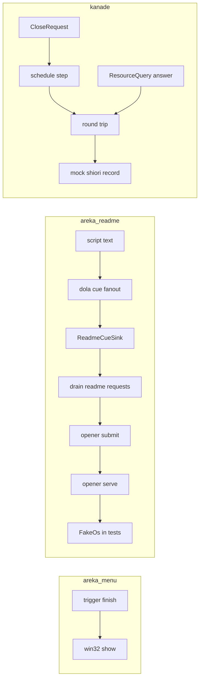
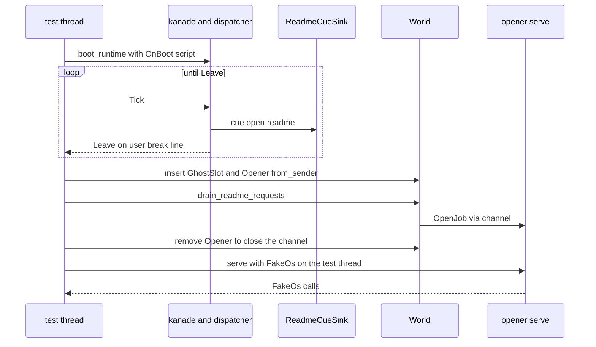

# 設計: popup-menu-residue

## Overview

この spec は、右クリックメニューの第 1 スライス（`areka-P0-popup-menu-minimal`・完了）の拾い残し 13 件を 1 本で片づける台帳型の spec である。13 件それぞれに「直した」「直さないと決めた」「別の spec へ渡した」のどれかを付け、本書の「13 件の仕分けの記録」に 1 か所でまとめる。

**Purpose**: 次にメニューと説明書を開く道へ手を入れる開発者と、障害のときに記録を読む人へ、事実に合う記録の文・同じ型の記録・壊れたら赤になる通しのテスト・閉じた spec を指さない網羅台帳を渡す。
**Users**: メニュー（`crates/areka/src/menu/`）・説明書の道（`readme.rs`・`emo2_boot/readme_cue.rs`）・kanade の SHIORI の往復を触る開発者と、areka の記録を検索する人。
**Impact**: 利用者に見える動き（メニューの項目・選んだ後の動作・説明書を開くかどうか）は変えない。変わるのは記録の文と型、テスト、網羅台帳の 4 行の備考と持ち主、spec の一覧の 1 行、2 つの brief である。

### Goals

- 件 3〜6・8・9 を直し、件 1・2・7・10 を今の main で確かめて「済み」と記録し、件 11・12・13 を生きている spec へ渡す。
- 新しい決定論テストは 6 本（件 3 が 2 本・件 4 が 1 本・件 5 が 1 本・件 6 が 1 本・件 8 が 1 本）で、どれも今ある型紙の兄弟に置く。
- `areka`・`areka-kanade`・`ukadoc-survey` のテストが全部通る（10.4）。

### Non-Goals

- 件 11・12・13 の再現・原因の特定・修正（C14 の約束・9.4）。
- 省略した形のメニューの作り分け・3 人目以降の窓・項目の追加・オーナードロー。
- kanade の記録の型の揃え（5.4 で直さないと決めた）。
- `spine.rs` の変更（件 7 は済み）。
- `roadmap-draft.md` の `owner_count` 以外の行（`[[spec]]` の追加・`[briefs].count`・束の表の手書きの件数）。

## Boundary Commitments

### This Spec Owns

- 13 件の仕分けと、その記録（本書「13 件の仕分けの記録」）。
- メニューの組み立ての失敗と表示の失敗を分けて記録すること（`menu/win32.rs` の戻り値の型・`menu/trigger.rs` の記録）。
- 台本の説明書の受け口の記録の型（`emo2_boot/readme_cue.rs` の 7 行）。
- kanade の SHIORI の往復の失敗の 3 行の文と、その関数の説明（`crates/areka-kanade/src/actor.rs`）。
- 件 3・4・5・6・8 の決定論テスト。
- 網羅台帳 `doc/ukadoc-coverage/ledger/shiori.toml` の 4 行の `owner` と `note`、`doc/ukadoc-coverage/roadmap-draft.md` の `areka-P0-popup-menu-minimal` の `owner_count` の 1 行、`menu/captions.rs` の `UNQUERIED_POPUPMENU_RESOURCES` の説明。
- `*.popupmenu.type` の 3 名を「作り分けない」とする裁定（理由と見直す条件）。
- `popup-menu-shell-look` の brief への件 11・12 と見直す条件の写し、本 spec の brief への写した先の記入。

### Out of Boundary

- メニューを開く所・メニューの表示・SHIORI に問う名前の表（`crates/areka-kanade/src/schedule/resources.rs`）のコード（9.4）。
- 件 11・12（`popup-menu-shell-look` が要件の段で決める）、件 13（本 spec の完了時の棚卸で新しく起票する spec が持つ）。
- `char*.popupmenu.visible` を問い合わせる側へ移すこと（`extra-character-windows` が行う）。
- kanade の終了の進め方・往復の失敗の後の振る舞い（6.3）。
- `crates/areka-kanade/src/actor_resources.rs` の記録（5.4）。
- `roadmap-draft.md` の手書きの件数の数え直し（`coverage-roadmap-refresh` の仕事）。
- 閉じた spec の要件の改訂。

### Allowed Dependencies

- テストの部品: `log_capture_kit`（`capture`・`capture_lines`・`LineFormat`）・areka の `emo2_boot` の起動の型紙（`runtime_boot_tests.rs` の `rig()`・`com()`、`sample_test_support::acquire_emo2`、`ghost_switch_test_support::standard_script`、`spine::{wait_until, run_bounded_watching, Progress}`）・`readme` の `Opener::from_sender`・`serve`・`FakeOs`・`ghost_session::GhostSession::for_test`・kanade の `tests/kanade/common` の偽物と運行の足場・kanade の `schedule::log_capture`。
- 依存の向き: `menu/trigger.rs` → `menu/win32.rs`（失敗の型は表示の側が持ち、記録は呼び手が出す今の取り決めを守る）。テストのファイルは確かめる実装と同じクレートの中だけを見る。
- 新しいクレートの依存は足さない。

### Revalidation Triggers

- `menu/win32.rs` の `show` の戻り値の型を変える spec（`popup-menu-shell-look`・`menu-thumbnail-preview` がオーナードローや別の表示関数を足すとき）は、`menu/trigger.rs` の `ShowResult` と `trigger_show_tests.rs` の偽物を一緒に直す。
- 台本の受け口の並び（`runtime_boot.rs` の `runtime_sinks`）・`ReadmeWiring`・`opener::submit` の文脈の取り方を変えると、件 3 の通しのテストが赤になる（それが狙い）。
- kanade の `events::on_close` の References の形を変えると、件 8 の通しのテストが赤になる（それが狙い）。
- `extra-character-windows` が `char*.popupmenu.visible` を引き取らないと決めたとき、または `popup-menu-shell-look` がオーナードローのメニューを入れたとき、網羅台帳の 4 行の備考を見直す（新しく起票する）。
- `areka-P0-popup-menu-minimal` を持ち主とする台帳の行を他の枝が動かしたときは、合流の後に `owner_count` を台帳から数え直す。

## Architecture

### Existing Architecture Analysis

- **メニューの表示**: `trigger::run_show` は表示の関数を引数で受け（本番は `win32::show`・テストは結果だけを返す閉包）、`display` が「出した」を記録してから呼び、`finish` が結果を記録して動作を呼ぶ。`win32.rs` は記録を呼び手に任せる（冒頭の説明）。いまの `show` は `build(...)?` と `TrackPopupMenuEx` の失敗を同じ `windows::core::Error` で返すので、`finish` は両方を `menu_display_failed`・`[menu] TrackPopupMenuEx failed` で記録する（件 4 の根）。
- **説明書の道**: 台本 → `dola` の配送（1 つの cue を全部の受け口へ登録順に配る）→ `ReadmeCueSink`（6 本目）→ `ReadmeWiring` の受信端 → `drain_readme_requests`（Input の段）→ `open_from_world`（ファイルの有無を見る）→ `opener::submit`（`GhostSlot` と `Opener` から文脈を写して送る）→ 開く専用のスレッドの `serve` → `execute` → `OsPort::shell_execute`。部品ごとのテストはあるが、通しのテストが無い（件 3）。
- **kanade の往復**: `round_trip` は会話・終了・照会・翻訳の全部が通る。失敗は `ShioriOutcome::Failed(Ipc)` で呼び手へ返し、終了へ進むかは呼び手が決める。記録の文だけが「終了系列（Fault）へ」と書く（件 6）。
- **終了の指示**: areka の側は `menu/mod.rs` が `CloseReason::User { scope }` を送り（`trigger_wired_tests.rs` が scope 1 を確かめ済み）、kanade の側は `events::on_close` が Ref1・Ref2 にスコープ番号を載せる（`events_tests.rs` が単体で確かめ済み）。kanade の入口から SHIORI の要求までを通すテストは scope 0 だけで、期待値も `on_close` から作っている（件 8）。

### Architecture Pattern & Boundary Map



- 採る形: 今ある形の延長だけ。新しい部品は「失敗の種類の型」1 つ（`ShowError`）だけで、残りは文の書き換えとテストと文書である。
- 守る取り決め: 記録は呼び手が出す（`win32.rs`）・往復の失敗の扱いは呼び手が決める（`actor.rs`）・記録の型はファイル単位で揃える（steering `logging.md`）・テストは実装の兄弟か今在るテストの束に置く（10.3）。

### Technology Stack

| 層 | 選んだもの | この spec での役目 | 備考 |
|---|---|---|---|
| 記録 | `tracing`（ワークスペースの版） | 記録の文・`event=` の名前 | 版は変えない |
| テスト | `log_capture_kit`・既存の偽物 | 記録と呼び出しの捕まえ | 新しい依存なし |
| Win32 | `windows` クレート（ワークスペースのピン） | `windows::core::Error` を失敗の型に包む | 版は変えない |

## File Structure Plan

### Directory Structure

```
crates/areka/src/
├── menu/
│   ├── win32.rs                  # 失敗の種類の型 ShowError を足し、show が段ごとに包んで返す
│   ├── trigger.rs                # ShowResult を ShowError で受け、組み立ての失敗を別の名前と文で記録
│   ├── trigger_show_tests.rs     # 偽物を 2 種の失敗に分け、組み立ての失敗のテストを 1 本足す
│   └── captions.rs               # UNQUERIED_POPUPMENU_RESOURCES の説明を引受先と裁定に合わせる
├── emo2_boot/
│   ├── readme_cue.rs             # 7 行の記録に [readme] の接頭辞と event= を付ける
│   ├── readme_cue_tests.rs       # 7 つの道の記録の型と水準を見るテストを 1 本足す
│   ├── runtime_boot_tests.rs     # 新しい通しのテストの子を 1 つ登録する（2 行）
│   └── readme_script_e2e_tests.rs  # 新規: 台本の入口から偽の OS までの通しのテスト 2 本
└── readme.rs                     # テストのビルドだけ opener と FakeOs を crate へ見せる（2 行）

crates/areka-kanade/
├── src/
│   ├── actor.rs                  # round_trip の 3 行の文と関数の説明を事実に合わせる
│   └── actor_resources_tests.rs  # 照会の道で往復が失敗したときの文を見るテストを 1 本足す
└── tests/kanade/
    ├── close_test.rs             # 新しい兄弟の子を 1 つ登録する（2 行）
    └── close_test_scope_references_tests.rs  # 新規: スコープ 0・1 の OnClose の References の通しのテスト

doc/ukadoc-coverage/
├── ledger/shiori.toml            # 4 行の owner を空にし、note の引受先と裁定を書き換える
└── roadmap-draft.md              # areka-P0-popup-menu-minimal の owner_count を 10 から 6 へ

.kiro/specs/
├── popup-menu-shell-look/brief.md   # 件 11・12 の写しと、popupmenu.type の見直す条件の 1 行
└── popup-menu-residue/brief.md      # 件 11・12・13 の節に写した先の spec と日付
```

### Modified Files

- `crates/areka/src/menu/win32.rs` — `ShowError` を足し、`show` の戻り値を `Result<Option<u32>, ShowError>` にする（件 4）。
- `crates/areka/src/menu/trigger.rs` — `ShowResult` の別名と `finish` の失敗の腕を 2 つにする（件 4）。
- `crates/areka/src/menu/trigger_show_tests.rs` — `access_denied` を表示の失敗として包み直し、組み立ての失敗の偽物と `exits()` の 1 行とテスト 1 本を足す（件 4）。
- `crates/areka/src/menu/captions.rs` — 説明の文だけ（件 9・8.5）。
- `crates/areka/src/emo2_boot/readme_cue.rs` — 記録 7 行（件 5）。
- `crates/areka/src/emo2_boot/readme_cue_tests.rs` — テスト 1 本（件 5）。
- `crates/areka/src/emo2_boot/runtime_boot_tests.rs` — `#[path]` の子 1 つ（件 3）。
- `crates/areka/src/readme.rs` — `#[cfg(test)] pub(crate) use` 2 行（件 3）。本番のビルドの見え方は変えない。
- `crates/areka-kanade/src/actor.rs` — 文 3 行と説明 1 か所（件 6）。
- `crates/areka-kanade/src/actor_resources_tests.rs` — テスト 1 本（件 6）。
- `crates/areka-kanade/tests/kanade/close_test.rs` — `#[path]` の子 1 つ（件 8）。
- `doc/ukadoc-coverage/ledger/shiori.toml`・`doc/ukadoc-coverage/roadmap-draft.md` — 件 9。
- `.kiro/specs/popup-menu-shell-look/brief.md`・`.kiro/specs/popup-menu-residue/brief.md` — 件 11・12・13 の写し（9.1・9.3・8.7）。

C14 の ⑦ の行が挙げた触るファイルに無いのは、`readme_cue_tests.rs`・`runtime_boot_tests.rs`・`readme.rs`・`actor_resources_tests.rs`・`close_test.rs`・2 つの新しいテストのファイル・網羅台帳と `roadmap-draft.md`・2 つの brief である。どれも要件（3.3・5.5・6.4・7.3・8・9・10.3）が求める兄弟のテストか文書で、同じウェーブの兄弟 6 本の触るファイル（roadmap の C14 の行）と重ならない。`actor_resources.rs` は C14 の行に在るが、5.4 で直さないと決めたので触らない。

## System Flows

### 件 3: 台本の入口から偽の OS まで



- `GhostSlot` と `Opener` は `boot_runtime` の後、取り出しの前に据える（`boot_runtime` は据えない・本番では `ghost_session` と `register_readme_drain` が据える）。据えるのは文脈で、台本の文字列から `shell_execute` までの段は 1 つも差し替えない（3.3）。開く専用のスレッドの代わりにテストのスレッドで `serve` を回すが、`serve` は本番のスレッドの中身そのものである。
- 待ちの終わりは `Leave` の合図。`dola` の配送は 1 つの cue を全部の受け口へ配ってから次へ進むので、`Leave` が届いた時点で説明書の要求は受信端に在る。

## 13 件の仕分けの記録

この表が要件 1 の「1 か所の記録」である。最後のタスクが、テストの名前・確かめた日の main の commit・渡した日を実物に合わせて書き直す（名前が変われば直す）。

| 件 | 仕分け | 中身 |
|---|---|---|
| 1 | 済み（`areka-P0-wintf-drag-state-rest-contract`・#172） | `menu/trigger.rs` の `poll_once` が預かりの窓番号と要求の窓番号を比べ、違えば `decide` の前に捨てて `trace!`（`event = "menu_deferred_double_click_scope_mismatch"`）を 1 行残す。テスト: `menu/trigger_flow_tests.rs` の `a_suppressed_tick_drops_a_deferred_double_click_of_another_window`。2.1 |
| 2 | 済み（同 #172） | `readme.rs` の `open_from_world` がファイルの有無を先に見て、無ければ `opener::submit` へ渡さず `warn!`（`event = "readme_open_skipped_missing"`）を 1 行残す。テスト: `readme_tests.rs` の `open_from_world_skips_a_missing_file_with_a_warning_and_no_submit`。2.2 |
| 3 | 直した | テスト: `emo2_boot/readme_script_e2e_tests.rs` の `script_open_readme_reaches_the_fake_os_exactly_once`・`script_open_readme_without_the_file_warns_once_and_opens_nothing`。実機の観察はしない。理由: OS へ渡す所（`open_from_world` → `submit` → 開く専用のスレッド）はメニューの入口と同じで、メニューの入口は `areka-P0-popup-menu-minimal` の実機確認 9.3 ⑵ で確かめ済み。台本の入口に固有の段（解析・配送・受け口・取り出し）は通しのテストが本物の部品で通す。3.4 |
| 4 | 直した | 組み立ての失敗は `error!`（`event = "menu_build_failed"`・`[menu] building the menu failed`・`hresult=`）、表示の失敗は今のまま（`menu_display_failed`・`[menu] TrackPopupMenuEx failed`）。テスト: `menu/trigger_show_tests.rs` の `a_failed_build_logs_one_build_error_and_runs_nothing` と、今在る `a_failed_display_logs_one_error_and_runs_nothing` |
| 5 | 直した（説明書の受け口）／直さない（kanade の照会） | 説明書の受け口の 7 行に `[readme]` と `event=`。テスト: `emo2_boot/readme_cue_tests.rs` の `every_readme_cue_line_carries_the_prefix_and_an_event`。kanade の照会（`actor_resources.rs`）は直さない。理由: kanade の記録はクレート全体で角括弧の接頭辞を持たず、`target`（`areka_kanade::resource`・`kanade`）と `event=` で揃っている。角括弧を足すとクレートの中で不揃いになる（steering `logging.md`「ファイル単位で一貫させる」）。見直す条件: kanade の記録の全体を角括弧の接頭辞へ揃える spec が起きたとき（その spec がまとめて直す） |
| 6 | 直した | `actor.rs` の `round_trip` の 3 行の文と関数の説明。テスト: `actor_resources_tests.rs` の `a_failed_round_trip_on_the_query_path_does_not_claim_termination` |
| 7 | 済み | `emo2_boot/spine.rs` の受け口の本数のコメントは「現在は 13 本＝`runtime_boot.rs` の `runtime_sinks`」で、`runtime_sinks` の `Box::new` は 13 本（確かめた日に数え直して書く）。2.3 |
| 8 | 直した | テスト: `tests/kanade/close_test_scope_references_tests.rs` の `a_user_close_carries_the_window_scope_into_onclose_references`。areka の側（メニュー → `CloseRequest { User { scope: 1 } }`）は `menu/trigger_wired_tests.rs` の `a_right_click_on_the_wired_menu_ends_in_one_close_request` が確かめ済みで、2 本で端から端までになる |
| 9 | 渡した（`char*.popupmenu.visible` と `char*.popupmenu.type` の 3 人目以降の窓の部分 → `extra-character-windows`）／直さないと決めた（`*.popupmenu.type` の省略した形） | 網羅台帳の 4 行と `captions.rs` の説明（下の「網羅台帳の 4 行」）。理由: 正典は値 1 を「省略メニュー」と名前だけ挙げ、中身を定めていない。見直す条件: `popup-menu-shell-look` がオーナードローのメニューを入れたとき（正典はこの値を「オーナードローメニューの変更」と書く）、または中身を決める根拠が得られたとき（どちらも新しく起票する） |
| 10 | 済み（`areka-P0-open-external-tags`・#251） | OS の起動（`ShellExecuteExW`）は開く専用のスレッド `open-external`（`readme/opener.rs` の `Opener::spawn`）で行い、メニューの「説明書」（`menu/mod.rs` の `open_readme`）と台本の `\![open,readme]`（`drain_readme_requests`）の両方が `open_from_world` → `submit` を通る。UI スレッドに残る OS の呼び出しは、ファイルの有無の確認（`Path::exists`）と、パスを絶対にする計算（`std::path::absolute`・`GetFullPathNameW`・ディスクを読まない文字列の計算）だけで、待ちうるのは有無の確認だけ。テスト: `readme_tests.rs` の絶対パスを渡すテスト・`readme/opener_*_tests.rs`・`ShellExecute` を綴るのが OS の境界のファイルだけであることを見るテスト。2.4 |
| 11 | 渡した → `popup-menu-shell-look` | 同 brief へ見つけた所・まだ分かっていないこと・見立て・再現の測り方を写す（9.1） |
| 12 | 渡した → `popup-menu-shell-look` | 同上。選ばれずに閉じたときの記録 `menu_dismissed`（`trigger.rs`・`debug!`）が `info` で見えないことも一緒に写す（9.1・9.4 によりコードは変えない） |
| 13 | 渡した → 本 spec の完了時の棚卸で `/kiro-discovery` が起票する新しい spec 1 本 | ⑴ 古い名前も問う直し・⑵ 無い項目を足す仕事をまとめる。`popup-menu-shell-look` の件 15（おすすめの資源）との分け方が未決であることも brief に書く。理由: 生きている spec に受け手が居ない（`popup-menu-shell-look` は項目の増減を範囲の外に置く）（9.2） |

- 「済み」の 4 件は、最後のタスクが確かめた日の main でもう一度場所とテストを見てから記録する（2.1〜2.4）。どれかが直っていなければ「済み」と書かず、本 spec で直す件に移す（2.5）。
- 「渡した」は、渡す日の main で渡し先の `.kiro/specs/<名前>/brief.md` が在り、`completed/` に入っていないことを確かめてから書く（1.3）。
- 本 spec を閉じる時点で、表に仕分けの無い件は 0 件（1.5）。

## Requirements Traceability

| 要件 | 中身 | 部品 | 契約・形 | 流れ |
|---|---|---|---|---|
| 1.1 | 13 件に 1 つずつ仕分け | 13 件の仕分けの記録 | 表 | — |
| 1.2 | 直さない理由と見直す条件 | 同（件 5・9） | 表 | — |
| 1.3 | 渡し先の名前と生きていることの確かめ | 同（件 9・11・12・13） | 渡す日の main で brief を確かめる | — |
| 1.4 | 直した証拠 | 同（件 3・4・5・6・8 のテスト名） | 表 | — |
| 1.5 | 仕分けの無い件を残さない | 同 | 最後のタスクで数える | — |
| 2.1 | 件 1 の確かめ | 同（件 1） | 表 | — |
| 2.2 | 件 2 の確かめ | 同（件 2） | 表 | — |
| 2.3 | 件 7 の確かめ | 同（件 7） | 表 | — |
| 2.4 | 件 10 の確かめ | 同（件 10） | 表 | — |
| 2.5 | 直っていなければ直す件へ | 同（表の下の注） | 表 | — |
| 3.1 | 開く要求がちょうど 1 件 | 説明書の通しのテスト | `FakeOs.calls` | 件 3 |
| 3.2 | ファイルが無いとき `[readme]` の `warn` が 1 行 | 説明書の通しのテスト | 取り出しの間の捕まえ | 件 3 |
| 3.3 | 全段を本物の部品で | 説明書の通しのテスト | 据えるのは文脈だけ | 件 3 |
| 3.4 | 実機の観察をしない理由 | 13 件の仕分けの記録（件 3） | 表 | — |
| 4.1 | 組み立ての失敗の文と符号 | ShowError・メニューの終わりの記録 | `menu_build_failed` | — |
| 4.2 | 表示の失敗は今の名前と文 | 同 | `menu_display_failed` | — |
| 4.3 | 2 つの文が違う | 同 | 文の表 | — |
| 4.4 | 失敗は未選択として続ける | 同 | `selected = None` | — |
| 4.5 | 2 種の失敗のテスト | メニューの表示のテスト | 偽物 2 種 | — |
| 5.1 | 受け口の全記録に `[readme]` と `event=` | 説明書の受け口の記録 | 記録の表 | — |
| 5.2 | 水準と場面を変えない | 同 | 記録の表 | — |
| 5.3 | 今の名前を変えない | 同・メニューの終わりの記録 | `open_external_rejected` ほか | — |
| 5.4 | kanade の照会は直さない | 13 件の仕分けの記録（件 5） | 表 | — |
| 5.5 | 型と水準のテスト | 説明書の受け口のテスト | 7 つの道 | — |
| 6.1 | 段と理由を述べ終了を述べない | 往復の記録 | 文の表 | — |
| 6.2 | 水準と名前を変えない | 同 | 文の表 | — |
| 6.3 | 振る舞いを変えない | 同 | 文だけ | — |
| 6.4 | 照会の道の文のテスト | 往復の文のテスト | 捕まえた文 | — |
| 6.5 | 関数の説明も直す | 往復の記録 | 説明の文 | — |
| 7.1 | スコープ 1 の References | 終了のスコープの通しのテスト | `["user","1","1"]` | — |
| 7.2 | スコープ 0 の References | 同 | `["user","0","0"]` | — |
| 7.3 | 入口から SHIORI の要求まで・書き下した期待値 | 同 | 記録列を直接比べる | — |
| 7.4 | Ref1＝Ref2 を変えない | `events::on_close`（触らない）・同テスト | 書き下した値 | — |
| 8.1 | 4 行の `owner` を空・引受先は備考 | 網羅台帳の 4 行 | 行の表 | — |
| 8.2 | `char*.popupmenu.visible` の引受先 | 同 | 行の表 | — |
| 8.3 | `*.popupmenu.type` の裁定・理由・見直す条件 | 同 | 行の表 | — |
| 8.4 | 状態を変えず `owner_count` だけ直す | 同・spec の一覧の 1 行 | 10 → 6 | — |
| 8.5 | 問い合わせない名前の表の説明 | `captions.rs` の説明 | 説明の文 | — |
| 8.6 | メニューの動きと問い合わせを変えない | 触らない（`captions_tests.rs` の今の檻） | — | — |
| 8.7 | 見直す条件を `popup-menu-shell-look` の brief へ | brief の写し | 1 行 | — |
| 9.1 | 件 11・12 を写す | brief の写し | 4 項目 | — |
| 9.2 | 件 13 を完了時に起票 | 13 件の仕分けの記録（件 13）・完了時の棚卸 | `/kiro-discovery` | — |
| 9.3 | 本 spec の brief に写した先と日付 | brief の写し | 節ごとに 1 行 | — |
| 9.4 | メニューと問う名前の表のコードを変えない | Out of Boundary | — | — |
| 10.1 | メニューの動きを変えない | メニューの終わりの記録（文だけ）・既存のテスト | — | — |
| 10.2 | 説明書の動きを変えない | 説明書の受け口の記録（文だけ）・既存のテスト | — | — |
| 10.3 | テストの置き場 | File Structure Plan | 兄弟か今在る束 | — |
| 10.4 | 3 クレートのテストが通る | 確かめの手順 | `cargo test -p` | — |

## Components and Interfaces

| 部品 | 層 | 役目 | 要件 | 主な依存 | 契約 |
|---|---|---|---|---|---|
| ShowError | areka の menu | 失敗の段を戻り値で分ける | 4.1〜4.4 | `windows::core::Error`（P0） | Service |
| メニューの終わりの記録 | areka の menu | 2 種の失敗を別の文で残す | 4.1〜4.4・5.3・10.1 | ShowError（P0） | Service |
| メニューの表示のテスト | areka の menu のテスト | 2 種の失敗を偽物で起こす | 4.5 | `run_show`・`finish`（P0） | — |
| 説明書の受け口の記録 | areka の emo2_boot | 7 行の型を揃える | 5.1〜5.3・10.2 | `tracing`（P2） | — |
| 説明書の受け口のテスト | areka の emo2_boot のテスト | 7 つの道の型と水準 | 5.5 | `capture_lines`（P1） | — |
| 説明書の通しのテスト | areka の emo2_boot のテスト | 台本から偽の OS まで | 3.1〜3.3 | 起動の型紙・`serve`・`FakeOs`（P0） | — |
| 往復の記録 | kanade | 3 行の文と説明 | 6.1〜6.3・6.5 | — | — |
| 往復の文のテスト | kanade のテスト | 照会の道の文 | 6.4 | `schedule::log_capture`（P1） | — |
| 終了のスコープの通しのテスト | kanade の統合テスト | References を書き下して比べる | 7.1〜7.4 | `tests/kanade/common`（P0） | — |
| 網羅台帳の 4 行 | 文書 | 持ち主を空にし引受先と裁定を書く | 8.1〜8.4 | `ukadoc-survey` の検査（P0） | — |
| brief の写し | 文書 | 件 11・12・13 を渡す | 8.7・9.1〜9.3 | — | — |

### areka の menu

#### ShowError とメニューの終わりの記録

| 項目 | 中身 |
|---|---|
| 役目 | 表示の関数の失敗を「組み立て」と「表示」に分けて返し、呼び手が別の文で記録する |
| 要件 | 4.1・4.2・4.3・4.4・5.3・10.1 |

**Responsibilities & Constraints**
- `win32.rs` が型を持ち、記録は出さない（今の取り決め）。`trigger.rs` の `finish` が記録を出す。
- 組み立ての失敗も表示の失敗も、今と同じく `selected = None` として続ける（4.4）。動作は呼ばない・預かりは捨てる・旗は降りる（今の `finish` の後半をそのまま通る）。
- 「出した」（`menu_shown`）は今と同じく表示の関数を呼ぶ前に出る。組み立てに失敗したときも「出した」→「組み立ての失敗」の順になる（今の表示の失敗と同じ並び・記録の場面は変えない）。

**Contracts**: Service [x]

##### Service Interface

```rust
// crates/areka/src/menu/win32.rs
/// 表示の関数の失敗。どの段で失敗したかを呼び手の記録へ渡す（記録は呼び手が出す）。
pub(crate) enum ShowError {
    /// `CreatePopupMenu` か `AppendMenuW` が失敗した（メニューを組み立てられなかった）。
    Build(windows::core::Error),
    /// 組み立てたメニューを `TrackPopupMenuEx` で出せなかった。
    Track(windows::core::Error),
}

pub(crate) fn show(
    owner: HWND,
    screen_pos: (i32, i32),
    plan: &MenuPlan,
) -> std::result::Result<Option<u32>, ShowError>;
// build(&plan.entries).map_err(ShowError::Build)? ／ (0, error) => Err(ShowError::Track(Error::from(error)))

// crates/areka/src/menu/trigger.rs
type ShowResult = std::result::Result<Option<u32>, win32::ShowError>;
```

- 事前条件: 無し（今と同じ）。
- 事後条件: `Ok(Some(id))`＝選ばれた・`Ok(None)`＝選ばれずに閉じた・`Err(Build)`＝何も出ていない・`Err(Track)`＝何も出ていない。
- `build` の戻り値は今のまま（`windows::core::Result<Owned<HMENU>>`）。`win32_tests.rs` は `build` だけを読むので変わらない。

**記録の表（`finish` の失敗の腕）**

| 失敗 | 水準 | `event=` | 文 | 欄 |
|---|---|---|---|---|
| 組み立て（新） | `error` | `menu_build_failed` | `[menu] building the menu failed` | `scope`・`error`・`hresult` |
| 表示（今のまま） | `error` | `menu_display_failed` | `[menu] TrackPopupMenuEx failed` | `scope`・`error`・`hresult` |

- どの API（`CreatePopupMenu`／`AppendMenuW`）が失敗したかの欄は載せない（4.1 は OS の符号だけを求め、符号で足りる）。

**Implementation Notes**
- テスト: `trigger_show_tests.rs` の `access_denied()` を `Err(ShowError::Track(...))` に、組み立ての失敗の偽物 `build_denied()`（`Err(ShowError::Build(E_ACCESSDENIED の Error))`）を足し、`exits()` を 5 つにする（`"build failed"` の行）。`exits()` を回す今のテスト 2 本（旗が降りる・預かりを捨てる）が組み立ての失敗でも通ることを見る。新しいテスト `a_failed_build_logs_one_build_error_and_runs_nothing` は `finish_captured(&f, build_denied())` で ERROR の `[menu]` 行がちょうど 1 行・`[menu] building the menu failed`・`error=`・`hresult=0x80070005` を含み・`TrackPopupMenuEx` を含まない（4.3）・INFO の行が無い・動作が呼ばれないことを見る。今の `a_failed_display_logs_one_error_and_runs_nothing` は綴りを変えずに残す（4.2）。
- 本物の OS で組み立てを決定論的に失敗させる手は無い。`show` の中の 2 か所の包み（`map_err` と最後の `Err`）は配線なので、今の偽物の差し替えの形で足りる。
- 危うさ: 低い。`ShowResult` を使うのは `trigger.rs` とそのテストだけ（`grep` で確かめた）。

### areka の emo2_boot（説明書の受け口）

#### 説明書の受け口の記録

| 項目 | 中身 |
|---|---|
| 役目 | `ReadmeCueSink` の 7 行の記録を `[readme]` の接頭辞と `event=` で揃える |
| 要件 | 5.1・5.2・5.3・10.2 |

**記録の表**（水準と場面は今のまま・文の頭の `ReadmeCueSink:` を `[readme]` に替え、文の残りの日本語は変えない）

| 場面 | 水準 | `event=` |
|---|---|---|
| 自分宛（`open`・`\j`）の開けない荷物 | `warn` | `readme_cue_unopenable`（新） |
| 他人宛の開けない荷物 | `debug` | `readme_cue_skip`（新） |
| キャリアでない cue | `debug` | `readme_cue_skip`（新） |
| 引数付きの `\![open,readme,…]` | `warn` | `readme_cue_unsupported`（新） |
| 担当外のコマンド（自己選別） | `debug` | `readme_cue_skip`（新） |
| 規則が断った開く系のタグ | `warn` | `open_external_rejected`（今のまま） |
| 送り出しの失敗（受信端が閉じている） | `warn` | `readme_cue_send_failed`（新） |

- 名前の付け方は隣の受け口（`change_cue.rs` の `change_cue_unopenable`・`change_cue_skip`・`change_cue_send_failed`、`install_cue.rs` の `install_cue_unsupported`）に揃える。読み飛ばしの 3 つの場面は欄（`command`・`name`・`selector`）で分かるので 1 つの名前を共有する。
- 文の言葉を日本語のままにするのは、隣の受け口と同じで、検索は接頭辞と `event=` で引くからである。

**Implementation Notes**
- テスト `every_readme_cue_line_carries_the_prefix_and_an_event`（`readme_cue_tests.rs`）: 7 つの場面の cue を 1 つずつ受け口へ渡し（送り出しの失敗は受信端を落としてから）、捕まえた行がちょうど 1 行・`[readme]` と `event=` と表の名前を含み・水準が表どおりであることを表で回して見る。cue の作り方は同じファイルの今の部品（`carrier_cue` など）を使う。
- 今のテストは水準と `open_external_rejected` だけを見ていて `ReadmeCueSink:` の綴りに頼っていないので、赤にならない。

### areka の emo2_boot（説明書の通しのテスト）

#### 説明書の通しのテスト

| 項目 | 中身 |
|---|---|
| 役目 | 台本の文字列を入れてから偽の OS に開く要求が届くまでを本物の部品で 1 本に通す |
| 要件 | 3.1・3.2・3.3 |

**Responsibilities & Constraints**
- 置き場: `crates/areka/src/emo2_boot/readme_script_e2e_tests.rs`。`runtime_boot_tests.rs` の子として登録する（`script_security_e2e_tests.rs` と同じ置き方・`rig()`・`com()` を `super::*` で借りる）。
- 組み方（`script_security_e2e_tests.rs` と同じ）: `com()`・`rig()`・`acquire_emo2()` の使い捨ての複製・`standard_script(ON_BOOT).build()` の偽の SHIORI・`ShioriWiring::Custom`・`TickerMode::Disabled`・`boot_runtime`。
- 台本: `ON_BOOT = r"\0\![open,readme]\![enter,nouserbreakmode]\![leave,nouserbreakmode]\e"`。待ちは `UserBreakWiring::flag_rx()` の `Leave` まで Tick を注入する（`wait_until`）。
- 待った後に据える: `GhostSlot(Some(GhostSession::for_test(None, 検体の根)))`（`insert_non_send`）と `Opener::from_sender(tx)`（`insert_resource`）。
- 取り出し: `drain_readme_requests(&mut world)` を 1 回呼ぶ（Input の段に登録される本番の関数そのもの）。その後 `world.remove_resource::<Opener>()` で送信端を落とし、`serve(rx, &mut fake)` を回す（溜まった分を処理して戻る）。
- 降ろし方: 型紙と同じく `run_bounded_watching` の中で `runtime.shutdown(CloseReason::User { scope: 0 })`。

**テスト 2 本**

| テスト | 用意 | 確かめること |
|---|---|---|
| `script_open_readme_reaches_the_fake_os_exactly_once` | 複製の根に `readme.txt` が在る（emo2 は根に `readme.txt` を持ち、descript に `readme` キーは無い） | `fake.calls.len() == 1`・その `file` が `検体の根.join("readme.txt")`（根が絶対パスであることも見る）・`verb` が `Open`（3.1） |
| `script_open_readme_without_the_file_warns_once_and_opens_nothing` | 起動の前に複製の根の `readme.txt` を消す | 取り出しの呼び出しの間だけ捕まえた行のうち、`level=WARN` で `[readme]` を含む行がちょうど 1 行で `readme_open_skipped_missing` を含む・`serve` の後の `fake.calls` が空（3.2） |

- 3.2 の「起動の全体の他の警告は数えない」は、取り出しの呼び出し 1 回だけを捕まえ（テストのスレッドで同期に出る）、さらに `[readme]` で絞ることで満たす。

**テストのビルドだけの見せ方**（`readme.rs`）

```rust
#[cfg(test)]
pub(crate) use opener::{Opener, serve};
#[cfg(test)]
pub(crate) use opener_test_support::FakeOs;
```

- `opener` と `opener_test_support` は `readme` の非公開の子なので、通しのテストのために見せる。本番のビルドでは何も見せ方が変わらない。

**Implementation Notes**
- 危うさ: 中くらい。起動を伴うテストで、型紙と同じだけの時間（数秒）がかかる。待ちは `wait_until` の上限つきで、宙吊りにならない。`REFUSED`（プロセス共有の記録）を使わないので並走するテストと混ざらない。
- 3.3 の「差し替えない」: 偽物は SHIORI（台本を返すだけ）と OS（`FakeOs`）の 2 つの端だけで、途中の段（解析・配送・受け口・取り出し・`open_from_world`・`submit`・`serve`・`execute`・`resolve`）はどれも本物である。据える `GhostSlot`・`Opener` は本番では `ghost_session` と `register_readme_drain` が据える文脈で、段ではない。

### kanade

#### 往復の記録

| 項目 | 中身 |
|---|---|
| 役目 | `round_trip` の失敗の 3 行の文と関数の説明を、呼び手へ失敗を返すだけという事実に合わせる |
| 要件 | 6.1・6.2・6.3・6.5 |

**文の表**（水準 `error`・`target: "kanade"`・`event=` は今のまま）

| `event=` | 今の文 | 新しい文 |
|---|---|---|
| `shiori_send_failed` | SHIORI 呼出の送出に失敗（shiori 切断）——終了系列（Fault）へ | SHIORI への要求を送れなかった（shiori の口が閉じている）——失敗として呼び手へ返す |
| `shiori_reply_dropped` | SHIORI 応答 oneshot が切断（shiori アクター異常終了等）——終了系列（Fault）へ | SHIORI の答えの口が答えの前に閉じた（shiori アクターが落ちた等）——失敗として呼び手へ返す |
| `shiori_reply_timeout` | SHIORI 応答が期限内に受信されず——終了系列（Fault）へ | SHIORI の答えが期限内に届かなかった——失敗として呼び手へ返す |

- 新しい文は「終了」の語を含まない（6.4 のテストがそれで見る）。
- 関数の説明（今の「再投入された Failed は状態機械を Unloading{Fault} へ倒す」）は「失敗の後どうするかは呼び手が決める（会話の道は再投入した Failed で状態機械を Unloading{Fault} へ倒し、照会の道は `ResourceOutcome::Failed` として返すだけ）」に直す（6.5）。
- 触らない: `schedule/mod.rs` の `shiori_down`・`shiori_failed`、`schedule/translate.rs` の `translate_failed` の「終了系列（Fault）へ」（状態機械の中で実際に終了へ進むので正しい）。

**Implementation Notes**
- テスト `a_failed_round_trip_on_the_query_path_does_not_claim_termination`（`actor_resources_tests.rs`）: 受信端を落とした SHIORI の口と `Phase::Steady { talk: None }` の状態で、許可表に在る id 1 つを `answer` に渡し、`schedule::log_capture::capture` で捕まえる。`target == "kanade"`・`event == "shiori_send_failed"`・`ERROR` の行が 1 行在り、その `message` に「終了」が無いこと、答えがその id の `ResourceOutcome::Failed` であること（6.3 の振る舞いが変わらない）を見る。
- `actor_tests.rs` の今のテストは `event` と水準だけを見るので赤にならない。

#### 終了のスコープの通しのテスト

| 項目 | 中身 |
|---|---|
| 役目 | kanade の入口の `CloseRequest` から偽の SHIORI の記録列の `OnClose` まで、スコープ番号が References に載ることを書き下した値で見る |
| 要件 | 7.1・7.2・7.3・7.4 |

**Responsibilities & Constraints**
- 置き場: `crates/areka-kanade/tests/kanade/close_test_scope_references_tests.rs`。`close_test.rs` に `#[path]` の子として登録する（今の `close_test_*_tests.rs` の兄弟）。
- 組み方: スコープ 0 と 1 について、`spawn_harness(KanadeConfig::new("master", "1.0.0"), Fixture::default().without_boot_greeting(), QuitPolicy::PerTalk(vec![]))` → `Boot` → `CloseRequest { reason: CloseReason::User { scope } }` → `join_bounded` で kanade が終わるのを待つ（`OnClose` は既定で 204＝無言終了なので、会話の再生を待たずに終わる）→ `shiori.recorded()`。
- 確かめ: 記録列の中で `method == CallMethod::Get` かつ `id == "OnClose"` の呼び出しがちょうど 1 件で、その `references` がスコープ 0 なら `["user","0","0"]`、1 なら `["user","1","1"]`（どちらも文字列の配列で書き下す）。`events::on_close` も `onclose_get_index` も使わない（7.3）。
- テストの名前: `a_user_close_carries_the_window_scope_into_onclose_references`（スコープ 2 つを表で回す 1 本）。

**Implementation Notes**
- 7.4 は `events::on_close` を触らないことで守り、このテストの書き下した `["user","1","1"]` が Ref1＝Ref2 を檻に入れる。
- 危うさ: 低い。同じ足場の無言終了のテスト（`silent_close_on_204_terminates_without_extra_events`）と同じ駆動で、挨拶なしにして会話の受け口との競合を断つ。

### 文書

#### 網羅台帳の 4 行

| 行（`doc/ukadoc-coverage/ledger/shiori.toml`） | `owner` | `note` の引受先と裁定（他の段落〔壊れ方・ログ・画面の材料・無いと失うもの〕はそのまま） |
|---|---|---|
| `char_2a.popupmenu.visible:1` | `""` | 引受先は `extra-character-windows`（3 人目以降の窓を作る spec）。同 spec が引き取らないと決めたら、そのときに新しく起票する。宛先の欄を空にした理由（台帳の非空の宛先は `roadmap-draft.md` の `[[spec]]` か `briefing.md` の `[[owner_completed]]` の名前に限られ、一覧へ足すのは棚卸の仕事）。決めたのは `popup-menu-residue`（2026-10-31） |
| `sakura.popupmenu.type:1` | `""` | 省略した形のメニューを作り分けない（`popup-menu-residue` の裁定・2026-10-31）。理由: 正典は値 1 を「省略メニュー」と名前だけ挙げ、中身を定めていない。見直す条件: `popup-menu-shell-look` がオーナードローのメニューを入れたとき（正典はこの値を「オーナードローメニューの変更」と書く）、または中身を決める根拠が得られたとき。どちらも新しく起票する。宛先の欄を空にした理由（同上） |
| `kero.popupmenu.type:1` | `""` | 同上 |
| `char_2a.popupmenu.type:1` | `""` | 同上に加え、3 人目以降の窓の部分の引受先は `extra-character-windows` |

- `status = "vocabulary-only"` は 4 行とも変えない（8.4）。備考の中の「本仕様の裁定」は持ち主が空になるので「`popup-menu-residue` の裁定」と名前で書く。「2026-09-18 の時点でどちらも起票は 0 本なので、先に起こした側が本欄を引き取る」の段落を上の文に置き換える。
- `doc/ukadoc-coverage/roadmap-draft.md` の `name = "areka-P0-popup-menu-minimal"` の塊の `owner_count = 10` を `6` にする。数は手で引き算せず、書き換えた後の台帳 4 本で `owner = "areka-P0-popup-menu-minimal"` の行を数えた値を書く（今は shiori 4・assets 1・sakura-script 1）。
- 1141 行の「メニュー」の束の行の「`areka-P0-popup-menu-minimal`（A0・8 件）」は台帳と合わなくなるが、8.4 が直す行を限っているので触らない。検査の外の手書きの数で、その洗い出しは `coverage-roadmap-refresh` の仕事である（本書の記録に書く）。
- `menu/captions.rs` の `UNQUERIED_POPUPMENU_RESOURCES` の説明: 「`char*.popupmenu.visible` は 3 人目以降の窓が無いので尋ね先が無い（引受先 `extra-character-windows`）。`*.popupmenu.type` の 3 名は省略した形の中身を正典が定めていないので作り分けない（`popup-menu-residue` の裁定・見直す条件は網羅台帳の備考）」に合わせる。表の 4 つの名前は変えない（8.5）。`captions_tests.rs` が名前と許可表に無いことを確かめている（8.6 の檻は今のまま）。

#### brief の写し

- `.kiro/specs/popup-menu-shell-look/brief.md` に「popup-menu-residue からの写し（2026-10-31 以降の渡した日）」の節を足す: 件 11（見つけた所・まだ分かっていないこと・見立て・再現の測り方）・件 12（同じ 4 つと、`menu_dismissed` が `debug` で `info` に見えないこと）と、`*.popupmenu.type` の見直す条件の 1 行（オーナードローのメニューを入れたら、網羅台帳の 3 行の裁定を見直す起票をする・8.7）。中身は本 spec の brief の 2026-10-16・2026-10-18 の追記から写す。向こうの要件は決めない。
- `.kiro/specs/popup-menu-residue/brief.md` の件 11・12・13 の節に「写した先: `<spec 名>`（日付）」を 1 行ずつ書く（9.3）。件 13 は完了時の棚卸で起票した spec の名前と日付を書く。

## Error Handling

- この spec は失敗の扱いを変えない。変えるのは失敗の記録の文と型だけである（4.4・6.3・10.1・10.2）。
- 組み立ての失敗・表示の失敗: `error!` 1 行・未選択として続ける（今と同じ）。
- 往復の失敗: `error!` 1 行・`Failed(Ipc)` を呼び手へ返す（今と同じ）。
- 説明書の受け口: 読み飛ばし・断り・送り出しの失敗は今と同じ水準で 1 行ずつ記録して台本を続ける。

## Testing Strategy

### 部品のテスト（決定論）

- `menu/trigger_show_tests.rs` の `a_failed_build_logs_one_build_error_and_runs_nothing`: 組み立ての失敗が `menu_build_failed` の ERROR 1 行で、文が表示の失敗と違い、動作を呼ばないこと（4.1・4.3・4.4）。
- 同ファイルの今の `a_failed_display_logs_one_error_and_runs_nothing`: 表示の失敗の名前と文が今のまま（4.2）。`exits()` に足した組み立ての失敗で、旗が降りること・預かりを捨てることも今のテストが見る（4.4）。
- `emo2_boot/readme_cue_tests.rs` の `every_readme_cue_line_carries_the_prefix_and_an_event`: 7 つの場面で `[readme]`・`event=`・水準（5.1・5.2・5.5）。
- `actor_resources_tests.rs` の `a_failed_round_trip_on_the_query_path_does_not_claim_termination`: 照会の道の往復の失敗の文に「終了」が無く、答えは `Failed`（6.1・6.3・6.4）。

### 通しのテスト（決定論）

- `emo2_boot/readme_script_e2e_tests.rs` の 2 本: 台本 → 偽の OS にちょうど 1 件（3.1・3.3）／ファイルが無ければ `[readme]` の WARN 1 行で 0 件（3.2・3.3）。
- `tests/kanade/close_test_scope_references_tests.rs` の 1 本: スコープ 0・1 の `OnClose` の References を書き下して比べる（7.1〜7.4）。

### 文書の検査

- `cargo test -p ukadoc-survey`: 4 行の `owner` を空にした後も判定 ⑸ の腕 c（`owner_count` が台帳と合う）と腕 f（非空の宛先が一覧に在る）が緑（8.1・8.4）。

## 確かめの手順

1. `cargo test -p areka`・`cargo test -p areka-kanade`・`cargo test -p ukadoc-survey` が全部通る（10.4）。
2. 13 件の仕分けの記録を、確かめた日の main で見直す: 済みの 4 件の場所とテスト（2.1〜2.4）・渡し先の brief が生きていること（1.3）・仕分けの無い件が 0（1.5）。
3. 書いた文書の `\![open,readme]` のような綴りが逆斜線 1 つであることを、バイトで読んで確かめる（書き込みの道具が逃がしを化かすことがある）。
4. 完了時の棚卸で件 13 を `/kiro-discovery` で起票し、本 spec の brief の件 13 の節に名前と日付を書く（9.2・9.3）。
