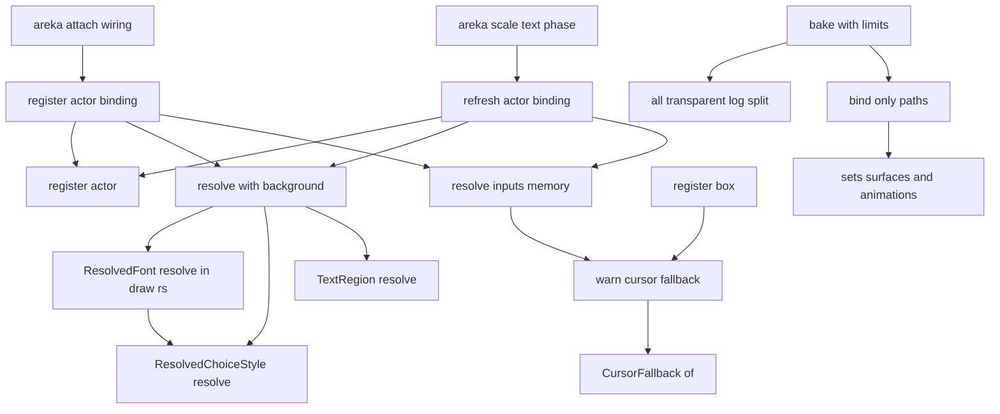
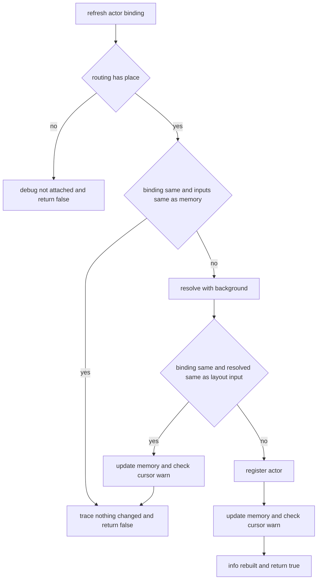
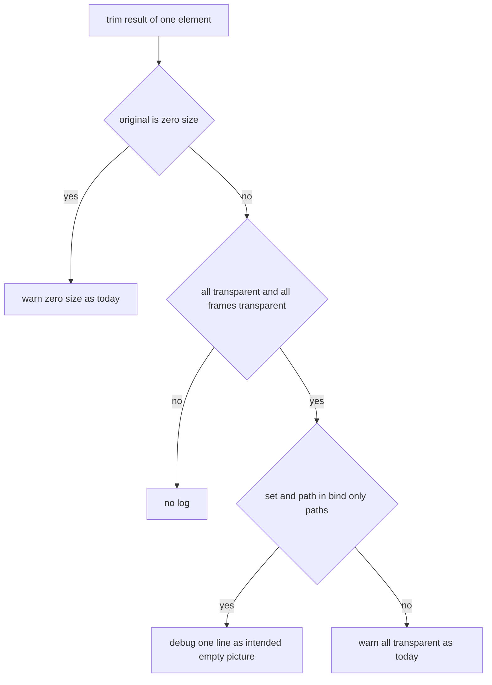

# 設計: real-run-log-noise

## Overview

**目的**: 実機の走行の記録に毎フレーム積もる行（文字の層の「何も変わらなかった」2 種類・選択肢の飾りの警告）と、同梱の emo2 が起動のたびに出す焼き込みの `WARN` を、判定の行と作者向けの警告を損なわずに止める。

**使う人**: 実機の確かめをする開発者（文字の層を `debug` まで開けた記録を読む）と、同梱の emo2・どっとさくらを起こす利用者。

**変えること**: 文字の層の再追従の判定（`refresh_actor_binding`）が、入力（バルーンの定義・画像の原寸・背景色・結線）が前と同じフレームでは解き直しをしないようにする（根の 1 か所）。「何も変わらなかった」行は `trace!` へ下げる。選択肢の飾りの 2 つの警告は純粋な解決の関数から外し、登録の側で置き場ごとに値が決まったときだけ出す。焼き込みの入口は、全部が透明な絵のうち「着せ替え（`bind`）のアニメーションからだけ参照される面の絵」を作者の意図した「無し」と見分け、`warn` の代わりに `debug` の 1 行にする。動き（判定の答え・書き始めの位置・飾りの描き方・焼き込みの結果）は変えない。

### Goals

- 文字の層を `debug` まで開けた実機の記録で、件 1・件 2 と同じ解決の中の行（要件 1.5・1.7）が、フレーム数に比例して増えない。
- 選択肢の飾りの 2 つの警告が、置き場ごとに値が決まったときに 1 件だけ出る（名前の欄つき）。
- 同梱の emo2 をそのまま起こしたとき、`purple/a/null.png` の全透明の `WARN` が 0 件。
- 直した後の実機の走行 2 回（同梱の emo2・どっとさくら）で、文言ごとの行数が上限以下であることを表で残す。

### Non-Goals

- 折返し基準の `WARN`（`emo2-kakukaku`・装着ごとに 1 件の正しい警告・討議 5）。
- パレットの PNG の `tRNS` を areka が使わない件（討議 8・完了の棚卸で起票）。
- 起動 1 回で焼き込みが 2 回走る件（位置の採寸と起動の資産の組み立てが別々にシェルを読む）。
- 記録の仕組み（記録の受け手・MCP の `get_log`）・背景のスレッドの記録の捕捉・動く絵の適用の `INFO` 行・seriko の記録・確かめの道具が終わり際に起こす `WARN`。

## Boundary Commitments

### This Spec Owns

- 再追従の判定の**書き方**: 入力が前と同じなら解き直さない。判定の**答え**（作り直すか否か）は直す前と同じ。
- 「解き直しの入力」の記憶（場所ごと・バルーンの普通の場所だけ）と、それを保つ決まり。
- 件 2 の行の水準（`debug` → `trace`）。文言は変えない。
- 選択肢の飾りの縮退の値（`cursor.blendmethod` の ROP 系・`cursor.style` の下線系）を純粋な値として取り出す口と、その 2 つの警告を出す時点・回数・欄。
- 焼き込みの入口の全透明の記録の分かれ（`warn` か `debug` か）と、その見分けの条件（着せ替えだけから参照される面の絵）。
- 直した後の実機の数え直しの手順・上限・確かめの記録（`verification.md`）。
- 上の変更が前提を変える今のテストの追随と、新しい決定論のテスト。

### Out of Boundary

- 判定の答え・書き始めの位置・選択肢の飾りの描き方（ROP 系を `none` 扱い・下線系を SquareFill）・焼き込みの結果（索引表・配置・トリムの矩形・失敗の集計）。
- `crates/areka-emo-text/src/draw.rs`（同じウェーブの `emo-text-dwrite-fidelity` の持ち物）。283 行目の `ResolvedChoiceStyle::resolve` の呼び出しはそのまま残り、警告が無くなるので何も出さなくなる。
- 同じ解き直しの中の作者向けの警告（`writing.rs`・`wrap.rs`・`balloon_overrides.rs`・`draw.rs` の `font.height`）の文言・水準・置き場。回数は根の直しで自然に「装着と入力の変わり目だけ」になる（コードは触らない）。
- `region.rs` の 3 つの `debug!` の文言・水準・置き場（コメントだけ事実に合わせる）。
- 失敗と作者の誤りを知らせる今の記録（潰れの `warn`・戻りの `info`・範囲外の `origin` の `warn`・折返し基準の `warn`・0 寸の元画像の `warn`・未知の合成メソッドの `warn` など）。
- areka 本体（`crates/areka`）の結線。再追従の公開口 `refresh_actor_scale` と装着口 `register_actor_view` の形は変えない。

### Allowed Dependencies

- `areka-emo-text` の中: `actor.rs`（`TextLayerRuntime` の欄を 1 つ足す）・`actor_attach.rs`・`actor_decoration.rs`・`actor_box.rs`・`choice.rs`・`region.rs`（コメントだけ）。`areka_parsers::balloon::{BalloonModel, BalloonCursor}`（読むだけ）。
- `areka-emo-atlas` の中: `lib.rs`・`manifest.rs`。`areka_parsers::shell::{Surface, Animation, Interval}`（読むだけ）。
- テスト: `log-capture-kit`（`capture`・`capture_under_filter`・`count_levels`）と atlas の `log_capture.rs`。
- 依存の向き: `areka-parsers` → `areka-emo-atlas`／`areka-emo-text`。emo-atlas は emo-compose の `is_bind_interval` を使わない（下流を見ない）。同じ判定を 1 行で持つ。
- 新しい crate・新しい外部の依存・新しいソースファイルは足さない。

### Revalidation Triggers

- **解き直しの入力が増える変更**: `ResolvedBalloonText::resolve_with_background` が、バルーンの定義・画像の原寸・背景色のほかに何かを読むようになったら、その値を「解き直しの入力」へ足さないと、入力が変わっても解き直さず判定の答えが変わる。`actor_attach.rs` に触る `balloon-font-file`（フォントファイル）と、`region.rs` に触る `text-typesetting` はここを読み直すこと。
- 件 1〜4・要件 1.5・1.7 の文言・欄・水準の変更（実機の記録の grep と本 spec の確かめの記録が文言で数える）。
- 選択肢の飾りの縮退の条件（`ResolvedChoiceStyle::resolve`）の変更。縮退の値の取り出し口（`CursorFallback::of`）と同じ判定を使っていることを保つ。
- `Interval` に `bind` の仲間が増える・面の番号の参照の仕方（`Pattern.surface_id`）が変わる変更（焼き込みの見分けの条件）。
- 焼き込みの入口の引数（`sets: &[SurfaceSet]`）の形の変更。

## Architecture

### Existing Architecture Analysis

- **毎フレームの出どころは 1 か所**: areka の文字の拡大率の相（`scale_text.rs` の `run_text_scale_phase`）が、毎フレーム・スコープごとに `refresh_actor_scale` → `refresh_actor_binding` を呼ぶ。そこで `ResolvedBalloonText::resolve_with_background` を毎回呼び、その中で `TextRegion::resolve`（`region.rs` の 3 つの `debug!`）・`ResolvedChoiceStyle::resolve`（`choice.rs` の 2 つの `warn!`）・`ResolvedFont::resolve_with_background`（`draw.rs` 283 行目でもう 1 回 `ResolvedChoiceStyle::resolve`）・書字方向・折返し・上書きの解決が走る。何も変わらなければ件 2 の `debug!` で終わる。
- **解き直しは純粋な関数**: 入力はバルーンの定義（`BalloonModel`・`Clone + PartialEq + Eq`）・画像の原寸・背景色の 3 つだけ。同じ入力なら同じ値を返す。
- **変わり目に 1 回の先例**: `warn_coarse_wrap_threshold`・`warn_ignored_origin`（登録口で前の領域と比べる）・`note_region_collapse`（場所の集合）・`box_definition_warned`（箱の名前ごとに 1 度）。どれも登録の側で数え、純粋な解決の関数は記録を数えない。
- **箱**（`balloon.*`ブレス）は毎フレーム解き直さない。表示が変わったときの登録（`register_box`）でだけ解く。定義の警告は箱の名前ごとに 1 度（箱の束を差し替えると数え直す）。
- **焼き込みの入口** `bake_with_limits(sets, …)` は、面の定義そのもの（`sets[].surfaces` とその `animations[].patterns`）を受け取っている。マニフェストの導出は既にパターンの参照先を辿っている。

### Architecture Pattern & Boundary Map



- **選んだ形**: 根の 1 か所（再追従の判定）で「入力が同じなら解き直さない」に変え、解き直しの中の記録はそのままにする。毎フレームの行は、解き直しが毎フレーム走らなくなることでまとめて止まる（討議 1・3・6）。
- **純粋な層は記録を数えない**: 選択肢の飾りの警告だけは、解き直し 1 回で 2 回呼ばれる（`draw.rs` 283 行目）・名前を知らない・箱の束の受け取りでも呼ばれる、の 3 つの理由で純粋な関数から外し、登録の側へ移す（討議 4）。縮退の判定そのものは `choice.rs` に 1 つだけ置き、純粋な値として取り出す。
- **焼き込みは記録だけを分ける**: 見分けは入口に届いている面の定義から 1 回だけ求め、全透明の分岐の中で `warn` と `debug` を選ぶだけ。結果の値には手を触れない（要件 3.6）。
- **ステアリングとの整合**: `logging.md` の水準の表（「フレームごとの処理」は `trace!`）・ログの無い失敗の経路を作らない（失敗と作者の誤りの記録は 1 つも減らさない）・1 ファイル 1,000 行・テストは兄弟のファイル・テストの捕捉は `log-capture-kit` を通す。

### Technology Stack

| 層 | 使うもの / 版 | この spec での役目 | 備考 |
|---|---|---|---|
| 記録 | `tracing`（ワークスペースの版） | 件 2 を `trace!` へ・飾りの警告を登録の側で `warn!`・焼き込みの見分けた絵を `debug!` | 新しい依存なし |
| テストの捕捉 | `log-capture-kit`（dev） | `capture_under_filter("areka_emo_text=debug")` で「`debug` まで開けた記録に出ない」、`=trace` で「出る」を固定 | emo-atlas は既存の `log_capture.rs` を使う |
| 実機の数え直し | `areka.exe`（debug 版）・`nar-sample-path`・PowerShell 7 | 使い捨ての命令で 2 回走らせ、文言ごとに数えて上限と比べる | 既存の道具だけ。`tools/` に足さない |

## File Structure Plan

### Directory Structure

```
crates/
├── areka-emo-text/src/
│   ├── actor.rs                    # TextLayerRuntime に「解き直しの入力」の欄を 1 つ足す
│   ├── actor_attach.rs             # 解き直しの入力の型・再追従の省き・件 2 の trace!・記憶の更新と飾りの警告の照合
│   ├── actor_decoration.rs         # 飾りの警告を出す関数（warn_ignored_origin の隣）
│   ├── actor_box.rs                # register_box の名前ごとに 1 度の警告へ飾りの警告を足す
│   ├── choice.rs                   # resolve から warn! を外す・縮退の値の取り出し口・説明の書き直し
│   ├── region.rs                   # コメントだけ（「毎フレーム呼ばれる」を事実に合わせる）
│   ├── actor_scale_refresh_tests.rs   # 件 1・件 2・要件 1.5・1.7 の代表・入力だけ変わる場合の檻
│   ├── actor_decoration_tests.rs      # 普通のバルーンの飾りの警告の檻
│   ├── actor_box_sync_tests.rs        # 箱の飾りの警告の檻
│   └── choice_style_resolve_tests.rs  # resolve が記録を出さないこと・縮退の値・説明の語
├── areka-emo-atlas/src/
│   ├── manifest.rs                 # 着せ替えだけから参照される面の絵の集合を求める関数とその檻
│   ├── lib.rs                      # 全透明の分岐で warn と debug を選ぶ・檻
│   └── emo2_e2e.rs                 # 同梱の emo2 の焼き込みで null.png の warn が 0 件の檻
.kiro/specs/real-run-log-noise/
└── verification.md                 # 新規（spec の文書）: 実機の数え直しの命令・上限・行数の表
target\real-run-log-noise-verify\   # git に残らない: 使い捨ての命令・記録・数えた結果
```

新しいソースファイルは足さない（ウェーブの約束・要件 5.5）。`verification.md` は spec の文書で、ソースファイルではない。

### Modified Files

- `crates/areka-emo-text/src/actor.rs`（768 行）— `TextLayerRuntime` に `resolve_inputs: HashMap<PlaceKey, ResolveInputs>` と説明、`new()` の初期化を足す（+約 8 行）。
- `crates/areka-emo-text/src/actor_attach.rs`（310 行）— `ResolveInputs`・`refresh_actor_binding` の省きと分岐・`register_actor_binding` の記憶・`register_actor` の記憶の取り消し・件 2 の `trace!`・説明の書き直し（+約 50 行）。
- `crates/areka-emo-text/src/actor_decoration.rs`（208 行）— `warn_cursor_fallback`（+約 35 行）。
- `crates/areka-emo-text/src/actor_box.rs`（478 行）— `register_box` の `box_definition_warned` の分岐に 1 呼び出し（+約 3 行）。
- `crates/areka-emo-text/src/choice.rs`（766 行）— `resolve` の 2 つの `warn!` を外す・`CursorFallback` と `CursorFallback::of`・説明（要件 2.6）（+約 25 行）。
- `crates/areka-emo-text/src/region.rs`（495 行）— `resolve_or`・`resolve_origin_component`・折返し基準の節のコメントの「毎フレーム呼ばれる」を「装着と入力の変わり目に呼ばれる」へ（行数ほぼ不変）。
- `crates/areka-emo-atlas/src/manifest.rs`（353 行）— `bind_only_paths` と檻（+約 100 行）。
- `crates/areka-emo-atlas/src/lib.rs`（683 行）— 見分けの集合を 1 回求め、全透明の分岐で `warn`／`debug` を選ぶ（+約 15 行）、檻（+約 70 行）。
- `crates/areka-emo-atlas/src/emo2_e2e.rs`（352 行）— 同梱の emo2 の檻 1 本（+約 40 行）。
- テストのファイル 4 つ（`actor_scale_refresh_tests.rs` 331・`actor_decoration_tests.rs` 230・`actor_box_sync_tests.rs` 655・`choice_style_resolve_tests.rs` 218）— 下の Testing Strategy の檻。どれも 1,000 行の内に収まる。`actor_region_warn_tests.rs`（894 行）には足さない。
- 触らない: `crates/areka-emo-text/src/draw.rs`・`crates/areka-emo-text/tests/attach_wiring_test.rs`（749 行目の「ちょうど 1 件」は作り直しの呼び出しの `info` だけを数えるので変わらない）・`region_vertical_canon_tests.rs`（解決 1 回の `debug` の件数は変わらない）・`crates/areka`。

ウェーブ C12 の表の ④ の行は `region.rs`・`actor_attach.rs`・`actor_decoration.rs`・`choice.rs`・emo-atlas の `lib.rs` を挙げている。本設計はこれに `actor.rs`（欄 1 つ）・`actor_box.rs`（呼び出し 1 つ）・emo-atlas の `manifest.rs`・`emo2_e2e.rs` を足す。同じウェーブでこの 4 つに触る spec は無い（③ は emo-text の `draw*.rs` だけ・ほかは emo-text と emo-atlas に触らない）。

## System Flows

### 再追従の判定（毎フレーム・スコープごと）



- 「入力」は（バルーンの定義・画像の原寸 `binding.image_size`・背景色 `background_of(actor)`）の 3 つ。`binding` の同値は別に比べる（今と同じ）。
- 「変わり目」は入力の変わり目である。拡大率だけが変わったとき（画像の原寸は拡大率に依らないので寄せた位置は同じ）も、そのフレームの 1 回は解き直して `region.rs` の行が出る（出来事ごとに 1 回で、毎フレームではない・要件 1.1・1.4）。
- 上の段（`SameAll`）で `false` を返すとき、解き直しをしないので `region.rs` の 3 つの `debug!` と要件 1.7 の警告は出ない。答えは、解き直して比べた場合と同じ `false`（同じ入力から同じ値が出るので、記憶した入力から作った `layout_input` と必ず等しい）。
- 中の段（`SameResult` が真）は、入力は変わったが結果が同じ場合（例: バルーンを付け替えたが文字の設定が同じ）。今と同じく `false`。記憶を新しい入力へ替えるので、次のフレームからは上の段で止まる。
- 下の段は今の作り直しと同じ（潰れの分岐・`info` の 2 つの文言も今のまま）。
- 件 2 の文言「文字層の再追従: 適用 k・面実寸・文字描画領域がいずれも同値のため再結線・再生成を行わない（churn ガード・R4.5）」は、上の段と中の段の両方で `trace!` として出す（文言・欄 `actor`・`k` は変えない）。

### 焼き込みの全透明の分かれ



- 0 寸の元画像は見分けの前に `warn`（要件 3.2・今のまま）。動く絵の「全部のコマが透明」の条件も今のまま（要件 3.5）。

## Requirements Traceability

| 要件 | 中身 | 部品 | 口・契約 | 流れ |
|---|---|---|---|---|
| 1.1 | 件 1 を毎フレーム出さない | 解き直しの省き | `refresh_actor_binding`・`ResolveInputs` | 再追従の判定（上の段） |
| 1.2 | 件 2 は `debug` に出さず `trace` で出す | 解き直しの省き | 件 2 の `trace!` | 上の段・中の段 |
| 1.3 | 作り直しの `info` を 1 件 | 解き直しの省き（変えない部分） | 今の 2 つの `info!` | 下の段 |
| 1.4 | 寄せた成分を変わり目ごとに 1 件 | 解き直しの省き | 解き直しは装着と入力の変わり目だけ → `region.rs` の `debug!` がそのたびに成分ごとに 1 件 | 下の段・中の段 |
| 1.5 | `region.rs` のほかの 2 つの `debug!` も同じ | 解き直しの省き | 同上 | 同上 |
| 1.6 | 書き始めの位置と判定の答えを変えない・入力が変われば解き直す | 解き直しの省き・解き直しの入力の記憶 | 記憶の決まり（不変条件） | 全段 |
| 1.7 | 解き直しの中の作者向けの警告を繰り返さない | 解き直しの省き | 同上（`writing.rs` ほかは触らない） | 上の段 |
| 2.1 | ROP 系の `warn` を値と名前つきで 1 件 | 飾りの縮退の値・飾りの警告 | `CursorFallback::of`・`warn_cursor_fallback` | 装着 |
| 2.2 | 下線系の `warn` を値と名前つきで 1 件 | 同上 | 同上 | 装着 |
| 2.3 | 値が変わらなければ追加で出さない | 飾りの警告・解き直しの省き | 前の入力の値と比べる・`resolve` は記録を出さない | 上・中・下の段 |
| 2.4 | 値が変わればもう 1 件 | 飾りの警告 | 前と異なる値で `warn` | 中・下の段 |
| 2.5 | 描き方を変えない | 飾りの縮退の値 | `ResolvedChoiceStyle::resolve` の返り値は今のまま | — |
| 2.6 | 説明を事実に合わせる | 飾りの縮退の値 | `resolve` と `CursorFallback` の説明 | — |
| 2.7 | `draw.rs` に触らない | 飾りの縮退の値 | `resolve` から外すだけで 283 行目は無音になる | — |
| 3.1 | 同梱 emo2 の `null.png` の `warn` を 0 件 | 着せ替えの見分け・全透明の記録の分かれ | `bind_only_paths`・`bake_with_limits` | 焼き込みの分かれ |
| 3.2 | 0 寸の元画像は今の `warn` | 全透明の記録の分かれ | 0 寸の分岐を先に置く | 同上 |
| 3.3 | 見分けられない全透明は今の `warn` | 同上 | 集合に無い絵は `warn` | 同上 |
| 3.4 | 見分けた絵は `warn` より低い水準で 1 件 | 同上 | `debug!`（セット・相対パス・元の寸法） | 同上 |
| 3.5 | 動く絵の決まりを変えない | 同上 | `frames` の条件をそのまま | 同上 |
| 3.6 | 焼き込みの結果を変えない | 同上 | 記録だけを分ける | 同上 |
| 3.7 | 見分けの条件は「着せ替えのパターンからだけ参照される面の絵」 | 着せ替えの見分け | `bind_only_paths` の定義 | 同上 |
| 4.1 | 2 回の実走を `debug` を開けて回す | 実機の数え直し | 使い捨ての命令 | 確かめ |
| 4.2 | 文言ごとに数えて上限と比べる | 実機の数え直し | 数える文言の表 | 確かめ |
| 4.3 | 上限はフレーム数に比例しない | 実機の数え直し | 上限の式（解き直しの回数から） | 確かめ |
| 4.4 | 超えたら不合格と文言・行数を示す | 実機の数え直し | 判定の出力 | 確かめ |
| 4.5 | 直す前と直した後を並べる | 実機の数え直し | `verification.md` の表 | 確かめ |
| 4.6 | 使い捨ての命令・`target\` の下・表で残す | 実機の数え直し | 同上 | 確かめ |
| 5.1 | 決定論のテストで回数を固定 | テスト | 檻 T1〜T7 | — |
| 5.2 | 焼き込みの警告のテストを通す・見分けの両側を固定 | テスト | 今の檻＋T8〜T10 | — |
| 5.3 | 失敗と作者の誤りの記録の水準と回数を変えない | すべて | 該当の記録に触らない | — |
| 5.4 | 前提の変わるテストを直す・緩めない | テスト | `choice_style_resolve_tests.rs` の説明の語 | — |
| 5.5 | 兄弟のテストのファイルへ足す | テスト | File Structure Plan | — |
| 5.6 | 解き直しを省いても答えが変わらない | テスト | 今の再追従の檻＋T3 | — |

## Components and Interfaces

| 部品 | 層 | 役目 | 要件 | 主な依存 | 契約 |
|---|---|---|---|---|---|
| 解き直しの入力の記憶 | emo-text・結線の口 | 場所ごとに前に解き直した入力を覚える | 1.1, 1.6, 1.7, 5.6 | `BalloonModel`（P0） | State |
| 解き直しの省き | emo-text・結線の口 | 入力が同じなら解き直さない・件 2 を `trace` へ | 1.1〜1.7, 2.3 | 記憶（P0）・`resolve_with_background`（P0） | Service |
| 飾りの縮退の値 | emo-text・純粋な層 | 縮退した元の値を純粋に取り出す・`resolve` を無音に | 2.1, 2.2, 2.5〜2.7 | `BalloonCursor`（P0） | Service |
| 飾りの警告 | emo-text・結線の口 | 置き場ごとに値が決まったときだけ `warn` | 2.1〜2.4 | 縮退の値（P0）・名前の欄（P1） | Service |
| 着せ替えの見分け | emo-atlas・列挙の層 | 着せ替えだけから参照される面の絵の集合を求める | 3.1, 3.7 | `areka_parsers::shell`（P0） | Service |
| 全透明の記録の分かれ | emo-atlas・入口 | 全透明の分岐で `warn`／`debug` を選ぶ | 3.1〜3.6 | 見分け（P0） | — |
| 実機の数え直し | 確かめ（コードでない） | 2 回の実走・文言ごとの行数と上限・記録 | 4.1〜4.6 | `areka.exe`・検体（P0） | Batch |

### emo-text・結線の口

#### 解き直しの入力の記憶と解き直しの省き

| 欄 | 中身 |
|---|---|
| 役目 | 再追従の判定で、入力が前と同じなら解き直さずに「変化なし」と答える |
| 要件 | 1.1, 1.2, 1.3, 1.4, 1.5, 1.6, 1.7, 2.3, 5.6 |

**責務と決まり**

- 記憶は普通のバルーンの場所（`PlaceKey::balloon`）だけに置く。箱は毎フレーム解き直さないので記憶を持たない。
- **不変条件**: 場所 `p` の記憶が在るなら、`layout_input[p]` は記憶の入力から `resolve_with_background` で解いた値に等しい。
  - これを保つため、`layout_input` を書く唯一の口 `register_actor`（公開・呼び手が入力を知らない直の道）は、その場所の記憶を消す。
  - 入力を知っている 2 つの道（装着 `register_actor_binding`・再追従 `refresh_actor_binding`）は、`register_actor` の後に記憶を新しい入力で入れ直す。
  - 再追従の中の段（結果が同じ）では `layout_input` を書かないが、新しい入力から解いた値が `layout_input` と等しいことを確かめた後なので、記憶を新しい入力へ替えても不変条件は保たれる。
- 記憶が無い場所（直の道で登録された場所）は今と同じく毎回解き直して比べる（答えは今と同じ・記録の量も今と同じ）。本番の結線は直の道を使わない。
- 件 2 の行は `debug!` から `trace!` へ。文言・欄は変えない。作り直しの 2 つの `info!` と、未登録の `debug!` は変えない。

**依存**

- 入: `scale_text.rs` の `run_text_scale_phase`（毎フレーム・`refresh_actor_scale` 経由）— P0
- 入: `frame/attach.rs` の `connect_balloon_text`（装着・`register_actor_view` 経由）— P0
- 外: `ResolvedBalloonText::resolve_with_background`（純粋）— P0
- 外: `warn_cursor_fallback`（飾りの警告）— P1

**契約**: Service [x] / State [x]

##### Service Interface

```rust
// actor_attach.rs（非公開の型・TextLayerRuntime の欄の値）
#[derive(Clone, Debug, PartialEq)]
pub(super) struct ResolveInputs {
    model: BalloonModel,
    image_size: (u32, u32),
    background: (u8, u8, u8),
}

impl TextLayerRuntime {
    // 形は変えない（公開口・答えも変えない）
    pub fn refresh_actor_scale(&mut self, actor: &ActorKey, view: &TextSlotView, model: &BalloonModel) -> bool;
    pub(super) fn refresh_actor_binding(&mut self, actor: &ActorKey, binding: TextSlotBinding, model: &BalloonModel) -> bool;
    pub(super) fn register_actor_binding(&mut self, actor: ActorKey, binding: TextSlotBinding, model: &BalloonModel);
    // 形は変えない。中で当該の場所の記憶を消す
    pub fn register_actor(&mut self, actor: ActorKey, binding: TextSlotBinding, resolved: ResolvedBalloonText);
}
```

- 事前条件: `binding.image_size` は image px（今と同じ）。
- 事後条件（`refresh_actor_binding`）: 返り値は、直す前の実装（毎回解き直して比べる）が同じ状態・同じ引数で返す値と等しい。`true` のとき今と同じく `layout_input`・`routing` を差し替え、描画資源を捨てる（潰れのときは残す）。
- 事後条件（記録）: 上の段では `region.rs`・`writing.rs`・`wrap.rs`・`balloon_overrides.rs`・`draw.rs`（`font.height`）の記録は 1 件も出ない。件 2 の行は `trace` で 1 件。

##### State Management

- 状態: `TextLayerRuntime.resolve_inputs: HashMap<PlaceKey, ResolveInputs>`（UI スレッドだけ・`!Send` のランタイムの中）。
- 寿命: 場所の登録と同じ。普通のバルーンの場所は今のところ登録を外す口が無いので、消すのは直の道 `register_actor` だけ。
- 毎フレームの重さ: バルーンの定義の比べ（構造体の `==`）が 1 回増え、解き直し（文字列の割り当てを含む 5 つの解決）が無くなる。

**Implementation Notes**

- 統合: `refresh_actor_binding` の説明（churn ガードの節）に、上の段・中の段・下の段と不変条件を書く。`warn_coarse_wrap_threshold` の説明の「解決は毎フレーム走る」は経緯の文として残し、今は装着と入力の変わり目だけと書き足す。
- 確かめ: T1〜T3（下の Testing Strategy）。今の再追従の檻（`actor_scale_refresh_tests.rs`・`actor_decoration_tests.rs` の背景色の 2 本・`attach_wiring_test.rs`）がそのまま緑であること。
- 危うさ: 解き直しが 3 つの入力のほかを読むようになると答えが変わる（Revalidation Triggers の 1 つめ）。`ResolveInputs` の説明に「`resolve_with_background` の引数と同じ 3 つ」と書き、引数を足したら欄も足すことを明記する。

#### 飾りの警告

| 欄 | 中身 |
|---|---|
| 役目 | `cursor.blendmethod` の ROP 系と `cursor.style` の下線系の警告を、置き場ごとに値が決まったときだけ出す |
| 要件 | 2.1, 2.2, 2.3, 2.4 |

**責務と決まり**

- 普通のバルーンの場所: 記憶を入れ直すとき（装着・再追従の中の段と下の段）に、前の記憶の入力の値（無ければ「前は無い」）と新しい入力の値を比べ、成分ごとに「新しい値が在り、前と違う」ときだけ 1 件出す。名前の欄は `balloon_label_of(actor)`（ほかの 2 つの作者向けの警告と同じ）。
- 箱の場所: `register_box` の `box_definition_warned` の分岐（箱の名前ごとに 1 度・箱の束を差し替えると数え直す）で、前を「無い」として呼ぶ。名前の欄は `balloon.*`ブレスの名前。箱の定義のほかの 2 つの警告と同じ単位にそろえる（research.md 6 節の持ち越し 2 の決着）。
- 文言は今のまま 1 文字も変えない。欄は `balloon`（足す）と今の `blendmethod`／`style`。

| 警告 | 水準 | 欄 | 文言 |
|---|---|---|---|
| ROP 系 | warn | `balloon`・`blendmethod` | `cursor.blendmethod ROP 系は M1 未対応: none 扱い（色ベース描画）へ縮退` |
| 下線系 | warn | `balloon`・`style` | `cursor.style underline 系は M1 未対応: SquareFill へ縮退` |

**契約**: Service [x]

##### Service Interface

```rust
// actor_decoration.rs（warn_ignored_origin の隣）
pub(super) fn warn_cursor_fallback(
    balloon: &str,
    now: &CursorFallback,
    previous: Option<&CursorFallback>,
);
```

- 事後条件: `now.blendmethod` が `Some(v)` で、`previous` が無いか `previous.blendmethod != Some(v)` のとき ROP 系の `warn` を 1 件。`style` も同じ。どちらでもなければ何も出さない。

**Implementation Notes**

- 確かめ: T4（普通のバルーン）・T5（箱）。
- 危うさ: 直の道 `register_actor` の後の最初の再追従は「前は無い」になり、もう 1 件出る。本番の結線は直の道を使わないので、テストと見本だけの話（説明に書く）。

### emo-text・純粋な層

#### 飾りの縮退の値

| 欄 | 中身 |
|---|---|
| 役目 | 縮退した元の値を純粋な値として返す。`ResolvedChoiceStyle::resolve` からは記録を外す |
| 要件 | 2.1, 2.2, 2.5, 2.6, 2.7 |

**責務と決まり**

- `ResolvedChoiceStyle::resolve` の返り値（`SquareFill`・`Invert`・`NoMarker`）と判定は今のまま。2 つの `warn!` だけを外す（要件 2.5）。説明の「warn-once（解決時 1 回）」を「縮退の値は `CursorFallback::of` が返し、警告は登録の側が置き場ごとに値が決まったときに 1 件出す」へ書き直す（要件 2.6）。
- `CursorFallback::of` は `resolve` が縮退を選ぶのと同じ判定（`blendmethod` が在って `none` でない・`style_has_underline`）を使う。判定の式を 2 か所に書かない。
- `draw.rs` 283 行目の `resolve` の呼び出しは変えない。記録が無くなるので何も出さない（要件 2.7）。箱の束の受け取り（`set_box_layout` の `ResolvedFont::resolve_with_background`）も同じ。

**契約**: Service [x]

##### Service Interface

```rust
// choice.rs
#[derive(Clone, Debug, Default, PartialEq, Eq)]
pub(crate) struct CursorFallback {
    /// none 以外の cursor.blendmethod の値（ROP 系・none 扱いで描く）
    pub(crate) blendmethod: Option<String>,
    /// 下線系の cursor.style の値（SquareFill で描く）
    pub(crate) underline_style: Option<String>,
}

impl CursorFallback {
    pub(crate) fn of(cursor: &BalloonCursor) -> CursorFallback;
}

impl ResolvedChoiceStyle {
    // 形と返り値は変えない。記録を出さない純粋な関数になる
    pub fn resolve(cursor: Option<&BalloonCursor>, default_font_color: (u8, u8, u8)) -> Self;
}
```

- 不変条件: `CursorFallback::of(c).underline_style.is_some()` ⇔ `resolve(Some(c), _)` が下線系の分岐を通る。`blendmethod.is_some()` ⇔ 今 ROP 系の `warn!` が出ていた条件。

### emo-atlas

#### 着せ替えの見分け

| 欄 | 中身 |
|---|---|
| 役目 | 焼き込みの入口の材料から、着せ替え（`bind`）のアニメーションのパターンからだけ参照される面の絵の集合を求める |
| 要件 | 3.1, 3.7 |

**責務と決まり**（セットごとに、面の番号はそのセットの中だけで引く・マニフェストの導出と同じ `Surface.id` の索引）

- 絵 `(セット, 相対パス)` が集合に入るのは、次をすべて満たすときだけ:
  1. その絵を `elements` に持つ面が 1 つ以上ある（以下「持ち主」）。
  2. どの持ち主も、そのセットのどこかのアニメーションのパターン（`Pattern.surface_id == 持ち主.id`）から 1 回以上参照されている。
  3. 持ち主を参照するパターンは、どれも `interval` が `Bind` か `BindRandom`（`bind+random`）のアニメーションに属する。
- 入らない例（作者の誤りとして `warn` を残す・要件 3.3・research.md 6 節の持ち越し 3 の決着）: どのパターンからも参照されない持ち主が 1 つでもある／`bind` でないアニメーション（`random`・`runonce`・`always` などの未知の語・`talk`・`periodic`）から参照される持ち主が 1 つでもある。
- 抜き色の道を通ったか・α を持つかは見ない（要件 3.7・討議 2）。
- emo-compose の `is_bind_interval` は下流なので使わず、同じ判定（`matches!(i, Interval::Bind | Interval::BindRandom { .. })`）を持つ。

**契約**: Service [x]

##### Service Interface

```rust
// manifest.rs
/// 鍵は (セットの番号, 相対パス)。マニフェストの鍵と同じ綴り（element.path.as_str()）
pub(crate) fn bind_only_paths(sets: &[SurfaceSet<'_>]) -> BTreeSet<(u32, String)>;
```

- 事後条件: 純粋（入力を変えない・記録を出さない）・決定的。

#### 全透明の記録の分かれ

**Summary-only**（`bake_with_limits` の中・新しい境界は無い）

- 入口の頭で `bind_only_paths(sets)` を 1 回だけ求める。
- 全透明の分岐（`trim.placement.is_none()` かつ動く絵の全コマが透明）で、`(key.set.0, key.rel_path)` が集合に在れば `debug!` を 1 件、無ければ今の `warn!`。0 寸の元画像の分岐はその前のまま（要件 3.2）。
- `debug!` の欄は今の `warn!` と同じ（`target: "areka_emo_atlas"`・`set`・`rel_path`・`original_w`・`original_h`）。文言は数え直しで混ざらないよう別にする: `bake: element が全透明（α=0）で、着せ替え（bind）のアニメーションからだけ参照される面の絵です——着せ替えの「無し」の絵とみなし、警告しない`（「でトリム後 0 寸」を含まない）。
- 焼き込みは 1 回の起動で 2 回走るので、同梱の emo2 では `debug` の行が起動ごとに 2 件出る（要件 3.4 の「1 件」は焼き込み 1 回ごと）。

### 確かめ

#### 実機の数え直し

| 欄 | 中身 |
|---|---|
| 役目 | 直した後の実走 2 回で、文言ごとの行数を数えて上限と比べ、直す前と並べて残す |
| 要件 | 4.1, 4.2, 4.3, 4.4, 4.5, 4.6 |

**契約**: Batch [x]

##### Batch / Job Contract

- **きっかけ**: 全タスクの実装とテストが済んだ後。AI が排他テストの机を借り、走り終えたらすぐ返す。
- **置き場**: すべてワークツリーの `target\real-run-log-noise-verify\` の下（`profile-emo2\`・`profile-dot-sakura\`・`logs\`・命令の `.ps1`）。git に残らない。
- **走行**（どっとさくらの確かめ `completed/areka-P0-dot-sakura-specimen/verification.md` 4 節と同じ形・`$wt` と置き場は絶対パスだけから組む・同じ呼び出しで終わりを待って終了コードを書き出す）:

| 走行 | 根（`AREKA_ROOT`） | バルーン | 前の準備 |
|---|---|---|---|
| A: 同梱の emo2 | `cargo run -q -p sample-ghost-kit --bin nar-sample-path -- emo2` が印字した根 | `emo2-kakukaku` | debug 版の `areka.exe` を作る |
| B: どっとさくら | 同じく `-- dot_sakura` | `bottle` | 32 ビットの補助（`tools/sync-i686-helper.ps1`） |

- **環境変数**（両方）: `RUST_LOG=info,areka_seriko=debug,areka_emo_text=debug`（2026-10-10 の測りと同じ・要件 4.1）・`AREKA_APP_SMOKE_EXIT_MS=50000`（約 50 秒で自動終了）・`AREKA_PROFILE_DIR` は置き場の下の空のフォルダ・`NO_COLOR=1`・`AREKA_NO_ALERT=1`・`AREKA_USER_ROOT` は消す。
- **数える文言と上限**（要件 4.2・4.3）: 上限は走行の長さ（フレーム数）に比例させず、記録から数えられる「装着と変わり目の回数」から決める。
  - `R_b` ＝「actor の装着先（予約スロット）を登録した」の行数（普通のバルーンの装着と作り直しごとに 1 件）。`R_x` ＝「箱の置き場所を登録した」の行数（箱の登録ごとに 1 件）。`R` ＝ `R_b` ＋ `R_x`（解き直しの回数の上限。中の段の解き直しは付け替えのときだけで、ふつうの走行では起きない）。
  - `S` ＝ `R_b` の行の `actor` の欄の種類の数（置き場の数）。`G` ＝「箱の束を受け取った」の行数。`N` ＝ 箱の名前の数（`boxes` の欄）。
  - 装着と作り直しは台詞と拡大率の出来事ごとで、毎フレームではない。毎フレームに戻ったことを `R` 自身で見逃さないよう、`R` に上限 50（50 秒の走行で 1 秒に 1 回。毎フレームなら数千になる）を置く。

| 名前（ASCII） | 文言（部分一致） | 水準 | 上限 | 根拠 |
|---|---|---|---|---|
| `resolves` | 上の `R_b` と `R_x` の 2 つの文言 | debug | `R` ≤ 50 | 出来事ごとの数であることの見張り（実際の数を表に残す） |
| `item1-origin-corner` | `未指定の origin 成分を書字開始角へ寄せる` | debug | 2 × `R` | 1 回の解き直しで成分 2 つ |
| `item2-churn-quiet` | `同値のため再結線・再生成を行わない` | debug 以上 | 0 | `trace` へ下げたので `debug` の記録には出ない |
| `item3-rop` | `cursor.blendmethod ROP 系は M1 未対応` | warn | `S` ＋ `N` × `G` | 置き場ごとに値が決まったとき 1 件・箱は名前ごとに束の受け取りごと 1 件 |
| `item3-underline` | `cursor.style underline 系は M1 未対応` | warn | `S` ＋ `N` × `G` | 同上 |
| `item4-null-png` | `全透明（α=0）でトリム後 0 寸` かつ `purple/a/null.png` | warn | 0 | 要件 3.1 |
| `item4-other` | `全透明（α=0）でトリム後 0 寸`（ほかの絵） | warn | 絵ごとに 2 | 起動 1 回の焼き込み 2 回。作者の中身から出るもの（どっとさくらの `surface12.png`・`surface22.png` など）は外さないが数を見る |
| `r15-default-edge` | `未指定座標成分を既定辺へ縮退する` | debug | 5 × `R` | 1 回の解き直しで validrect の 4 辺＋折返し基準 1 |
| `r15-origin-outside` | `宣言された origin 成分が文字を描いてよい範囲の外にある` | debug | 2 × `R` | 1 回の解き直しで成分 2 つ |
| `r17-vertical` | `vertical` の不正な値の `warn` の文言（`writing.rs`） | warn | `R` | 1 回の解き直しで 1 件 |
| `r17-writing-mode` | `writing_mode` の未知の値の `warn` の文言（`writing.rs`） | warn | `R` | 同上 |
| `r17-wrap` | 折返しの未知の値の `warn` の文言（`wrap.rs`） | warn | `R` | 同上 |
| `r17-overrides` | 上書きで飛ばした値の `warn` の文言（`balloon_overrides.rs` の 2 つ） | warn | 2 × `R` | 同上 |
| `r17-font-height` | `font.height が 0` | warn | `R` | 同上 |

  - 要件 1.7 の 5 つの文言は、数える命令を書くときにソースから逐語で写す（表の名前は ASCII の見出し）。
  - 数えない: 折返し基準の `WARN`（討議 5）・確かめの道具が終わり際に起こす `WARN`（`kanade: 強制終了指示`・`MCP: areka が終了の途中で答えなかった`）。
- **出力**（要件 4.4）: 端末へは ASCII だけ。1 文言 1 行で `name count cap PASS|FAIL`、最後に `RESULT PASS|FAIL`。どれかが上限を超えたら `FAIL` とし、その名前と行数を出す。
- **記録**（要件 4.5・4.6）: `.kiro/specs/real-run-log-noise/verification.md` に、命令の全文・コミット・走行の時刻と長さ・終了コード・記録の全行数・上の表の行数と上限と合否を走行ごとに書く。直す前の数（2026-10-10: 検体つきの走行 51 秒で全 32,194 行のうち件 1 が 20,484・件 2 が 10,240、同梱の emo2 そのままの走行 46 秒で全 42,845 行のうち件 1 と件 2 で 32,008・`null.png` の `WARN` 2 件。2026-10-23: どっとさくら 2 分 12 秒で件 3 が 20,764）を同じ表に並べる。
- **やり直し**: 赤なら直してから同じ命令で回し直す（記録は上書きでなく別の名前）。見張りは要件 5.1 の決定論のテストが担い、この命令は残さない（要件 4.6）。

## Data Models

新しい永続のデータは無い。足す値は 2 つで、どちらも 1 プロセスの中だけ。

- `ResolveInputs`（emo-text・場所ごと）: 解き直しの入力の写し。`BalloonModel` を 1 つ持つ（スコープの数だけ）。
- `CursorFallback`（emo-text・値）: 縮退した元の文字列 2 つ。`ResolvedBalloonText` には入れない——入れると再追従の比べの材料が増え、飾りの値だけが変わったバルーンの付け替えで作り直しが起き、判定の答えが変わる（要件 1.6）。

## Error Handling

- この spec は失敗の経路を足さない・消さない。下げる・減らすのは正常の経路の記録（何も変わらなかった行・意図した空の絵）と、同じ値の繰り返しの警告だけ。
- 作者の誤りの警告（ROP 系・下線系・0 寸・見分けられない全透明・要件 1.7 の 5 つ）は 1 つも黙らせない。回数が「装着と変わり目」に減るだけ（要件 5.3）。
- 焼き込みの見分けは、迷ったら `warn` に倒す（持ち主の 1 つでも条件を外れたら集合に入れない）。

## Testing Strategy

ログの捕捉はすべて `log-capture-kit` を通す（emo-text は `capture`・`capture_under_filter`、emo-atlas は `log_capture.rs`）。「出ない」の主張は捕捉窓の対照イベントで空振りを防ぐ（共有機構の決まり）。

### 単体（純粋な層）

- **T6**（`choice_style_resolve_tests.rs`）: `ResolvedChoiceStyle::resolve` が ROP 系・下線系のバルーンで返り値は今のまま、記録は 0 件。`CursorFallback::of` が `mergepennot`・`underline`・`square+underline` を返し、`none`・未指定・`square` では `None`。説明の「warn は解決時 1 回」の語を直す（要件 2.5・2.6・5.4）。
- **T8**（`manifest.rs` の檻）: `bind_only_paths` が ⑴ `bind` だけから参照される持ち主の絵を含む ⑵ `bind+random` も含む ⑶ `runonce`・未知の語（`always`）から参照される持ち主の絵を含まない ⑷ `bind` と `bind` でないの両方から参照される持ち主の絵を含まない ⑸ どこからも参照されない持ち主の絵を含まない ⑹ 同じ絵を `bind` だけの面と参照されない面の両方が持つときは含まない ⑺ 負の番号・無い番号の参照は数えない（要件 3.7）。

### 結合（登録と再追従・焼き込みの入口）

- **T1**（`actor_scale_refresh_tests.rs`・要件 1.1・1.2・1.5・5.1）: `origin` を書かず `wordwrappoint` も書かないバルーンを装着し、値の同じ再追従を 3 回。`capture_under_filter("areka_emo_text=debug")` の記録で件 1・件 2・「既定辺へ縮退」がどれも 0 件。`capture_under_filter("areka_emo_text=trace")` で 1 回の再追従に件 2 がちょうど 1 件・水準 `TRACE`。
- **T2**（同・要件 1.4・1.5）: 拡大率だけ変えた再追従 1 回で件 1 が成分ごとに 1 件（計 2 件）・返り値 `true`。その後の同じ再追従 3 回で 0 件。
- **T3**（同・要件 1.6・5.6）: ⑴ バルーンの定義だけを文字の設定が変わる形に替えた再追従は `true`（今の答え）⑵ 文字の設定に効かないキーだけを替えた再追従は `false`、その後の同じ定義の再追従 3 回で解き直しの記録が 0 件（記憶が新しい定義へ替わった）⑶ 直の道 `register_actor` で登録した場所の再追従は、今と同じく解き直して比べる（答えが今と同じ）。背景色だけが変わる場合は `actor_decoration_tests.rs` の今の 2 本（同じ背景で 0 回・変わると 1 回）がそのまま緑。
- **T7**（同・要件 1.7・5.1 の代表）: `font.height,0` のバルーンで、装着に `warn` 1 件、値の同じ再追従 3 回で 0 件、拡大率の変わる再追従で 1 件。
- **T4**（`actor_decoration_tests.rs`・要件 2.1〜2.4・5.1）: `cursor.blendmethod,mergepennot` と `cursor.style,underline` のバルーンを名前を入れて装着 → 2 つの `warn` が 1 件ずつ・`balloon` の欄が入れた名前。値の同じ再追従 3 回で 0 件。拡大率の変わる再追従で 0 件（値は同じ）。`blendmethod` だけ `xor` に替えた定義の再追従で ROP 系だけ 1 件（`blendmethod="xor"`）。
- **T5**（`actor_box_sync_tests.rs`・要件 2.1〜2.4）: ROP 系の箱の定義で、最初の登録に 1 件（`balloon` は箱の名前）、外して付け直しても 0 件、箱の束を差し替えた後の登録で 1 件。
- **T9**（`lib.rs` の `bake_entry_tests`・要件 3.2〜3.6・5.2）: ⑴ `bind` だけから参照される面の全透明の絵 → `warn` 0 件・`debug` 1 件（`set`・`rel_path`・`original_w`・`original_h`）・索引表は見分けの無い場合と同じ ⑵ `runonce` から参照される面の全透明の絵 → 今の `warn` 1 件 ⑶ `bind` だけから参照される面の 0 寸の絵 → 0 寸の `warn` 1 件。今の 0 寸・全透明の檻（参照されない面）はそのまま緑。動く絵の檻（`animated_tests.rs`）もそのまま緑。
- **T10**（`emo2_e2e.rs`・要件 3.1）: 同梱の emo2 のシェルを本物の読み手で焼き、`purple/a/null.png` について `level=WARN` の行が 0 件・見分けた `debug` が 1 件。索引表の金の値（`emo2_golden.rs`・`testdata/emo2_shell_golden.txt`）は変わらない。

### 実機（要件 4）

- 上の「実機の数え直し」の 2 回。決定論のテストの代わりではなく、実際の結線（拡大率の相・バルーンの装着の順・起動の 2 回の焼き込み）で数が上限に収まることの確かめ。

## Performance

- 毎フレーム・スコープごとの仕事は「解き直し（フォント・選択肢の飾り 2 回・折返し・書字方向・領域の解決と文字列の割り当て）」から「バルーンの定義の構造体の比べ 1 回」へ減る。記録の量は件 1〜3 の分だけ減る（2026-10-10 の測りで記録の約 95%・2026-10-23 のどっとさくらで約 98%）。
- 焼き込みの入口は面とアニメーションを 1 回なめる仕事が増える（1 回の焼き込みに 1 回・面の数に比例）。
