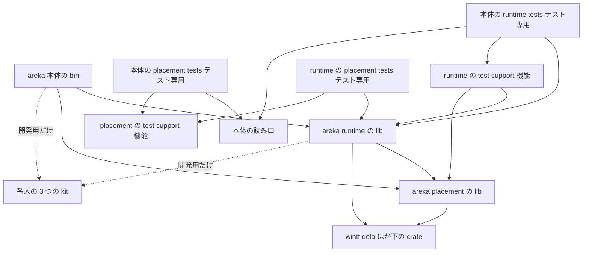
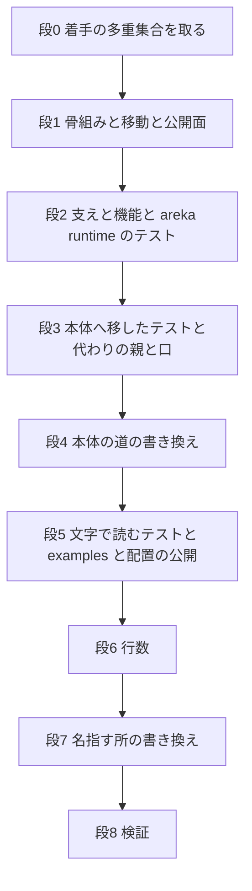
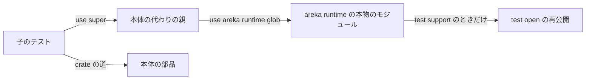

# 設計書: runtime-crate-split

## 概要

**目的**: 本体の bin crate の中にある実行系のモジュール（`crates/areka/src/runtime/`・211 ファイル）を、新しい lib crate `crates/areka-runtime/` へそのまま移す。runtime の境目を crate の境目で守り、runtime を変えても runtime の crate とそれを使う側だけが組み直されるようにする。

**使う人**: areka の開発者。runtime を直す人と、見直し（ponytail の audit）を受け持ちごとに回す人。

**変わること**: 本体は runtime を path 依存で使う。runtime の公開面は外から使われる分だけ `pub` になる。runtime の外から使うテストの支えは `test-support` 機能で開く。本体を引く runtime のテストは、runtime の木を写した本体のテスト専用のフォルダ `crates/areka/src/runtime_tests/` へ移る。判定器の一族と、配置と runtime だけを使うテストは `crates/areka-runtime/src/placement_tests/` へ移る。動く ukagaka のアプリとしての振る舞いは変えない（ログの出所の名前だけが `areka::runtime::…` から `areka_runtime::…` に変わる）。

### 目標

- runtime の本番とテストが `crates/areka-runtime/` にあり、本体は依存として使う（1.1〜1.10）。
- 外から使われない項目は外から見えない。テストのためだけに開く項目は `test-support` のときだけ見える（2.1〜2.7・4.8）。
- テストの支えは写しを作らず 1 か所に置き、どのテストも「触る範囲を含む一番下の crate」に置く（3.1〜3.10・4.1〜4.7）。
- 古いパス・古い名前・古い出所の名前が、決めた範囲で 0 件になる（5.9・5.10・6.7）。
- テストの名前の多重集合・警告 0・全体テスト・実機 3 本が、移す前と同じ合否を示す（7.1〜7.9）。

### 目標でないこと

- runtime の中身の直し（不具合・要らない項目・古い説明）。`audit-emo2-boot-frame`・`audit-emo2-boot-spine`・`audit-emo2-boot-switch` へ申し送る。
- 外から使われない `pub(crate)` の削除。
- 本体の `Cargo.toml` の、移した後に本体が直に使わなくなる依存の行（`dola`・`areka-seriko` ほか）と、その理由の説明の整理（`audit-areka-app` へ申し送る・`Cargo.lock` は変わらない）。
- input と session の crate 化（`input-crate-split`・`session-module-gather`・`session-crate-split`）。
- `tools/` の下のファイル。

## 境目の約束

### この仕様が持つもの

- 新しい crate `crates/areka-runtime/` の骨組み（`Cargo.toml`・`lib.rs`・`test-support` 機能・落ちの報告をどちらのテストの実行ファイルにも入れる形）。
- runtime の公開面の付け替えと、テストのために開けた項目の記録。
- 本体のテスト専用のフォルダ `crates/areka/src/runtime_tests/`（本体を引く runtime のテスト・背骨の足場・代わりの親）と、本体の見本の入口 `crates/areka/src/sample_test_support.rs`。
- `crates/areka-runtime/src/placement_tests/`（判定器の一族と、配置と runtime だけを使うテスト）。
- `areka-placement` の、テストだけが使う公開を `test-support` の下へ移すこと（`follow.rs` の再公開・`follow/work_area.rs` の 1 つのメソッド・`transition_diag.rs` のテストだけの語）。
- runtime を名指すパス・古い名前・出所の名前の書き換え（番人の表・文字で読むテスト・文書・説明・3 本の audit の brief・`structure.md`・`tech.md`）。
- 検証の手順（多重集合・警告・全体テスト・実機 3 本・`get_log` の分け方・`THIRD-PARTY-NOTICES.md`）。
- steering の追記は `structure.md`・`tech.md` だけ。`roadmap.md` はこの枝の途中で書かない（並走の枝との衝突を避ける）。新旧のパスの対応表の行は完了の段（`/kiro-complete`）で書く。C21 の「触るファイル」に無い所（下の「同じウェーブとの重なり」）は、設計の確定のときに棚卸のセッションへ伝える。

### この仕様が持たないもの

- runtime の振る舞い。直したくなった所は直さず 3 本の audit へ申し送る（7.1）。理由の文が古くなる `#[allow(...)]`（`frame.rs` の `#[allow(unused_imports)]` 21・`frame/wiring.rs` 2 ほか）も、属性と文を変えずに一覧を申し送る。
- `audit-placement-follow` が申し送った古い参照のうち、判定器の行番号での指し（4.3）のほかの 3 件（7.1）。
- 外から使われない `pub(crate)` の削除（2.2）。
- runtime に触れると書いているほかの約 70 本の brief（roadmap の新旧のパスの対応表で読み替える）と、歴史の文書（`roadmap-history.md`・`.kiro/specs/completed/`）。
- `tools/` の下のファイル（5.11）。`tools/load-flake.ps1` の `-Binary` は申し送るだけ（5.13）。
- ワークスペース全体を歩く見張りの置き場（前例の名前を付けた例外 3 本・`audit-areka-app` へ申し送り済み）。

### 使ってよい依存

- `areka-runtime` の本番の依存は次に限る（1.8・段 1 で `cargo tree -p areka-runtime -e normal` と使っている crate を照らして確定）: tracing・bevy_ecs・wintf・dola・areka-emo-present・areka-ghost・areka-sakura・areka-parsers・areka-emo-text・areka-emo-compose・areka-seriko・areka-kanade・areka-actor・areka-emo-atlas・areka-sylphya・thiserror・windows・areka-placement。
- 機能 `test-support` だけが付ける optional の依存は `shiori-host32-host` 1 つ（D11）。番人の 3 つの crate（log-capture-kit・sample-ghost-kit・temp-path-kit）は、どの crate でも本番の依存表（optional を含む）に書かない（3.4）。
- `areka-runtime` の開発用の依存は次に限る: log-capture-kit・temp-path-kit・sample-ghost-kit・shiori-host32-host・image・areka-placement（`test-support` つき）・tracing-subscriber・async-io（どれもワークスペースの中か `Cargo.lock` に既にある）。
- `areka-runtime` は `areka` に依存しない（1.5）。コードでも文字の読みでも本体を引かない（2.7・5.2）。本体 → runtime → 配置 → 下の crate の一方向。
- `test-support` の下の項目が頼ってよいのは、runtime の本番の項目・ほかの `test-support` の項目・`areka-placement` の公開面と `test-support`・`shiori-host32-host`・std・windows・wintf・bevy_ecs と本番の依存だけ。`#[cfg(test)]` だけの項目と番人の 3 つの crate には頼らない。
- 読み方の規則は前例の 1 つのまま: **自分の crate のファイルは相対の道で読み、別の crate のファイルは本体の読み口で読む**。下の crate を読むテストは読み口（本体の項目）を引くので本体に置く（D7・D8）。`areka-runtime` には読み口を作らない。名前を付けた例外は前例どおり、ワークスペース全体を歩く見張り（`areka-runtime` に移る `frame_attach_tests.rs` ほか 3 本）だけ。

### 見直しの引き金

- `areka-runtime` の公開面か `test-support` の中身が変わる → 本体の使い手と `runtime_tests/` を見直す。
- 本体の口の束（`SessionHooks`）の中身か据え方が変わる → `runtime_tests/` の据える所（D5）を見直す。
- `input-crate-split` が `input_events` を crate へ移す → `runtime_tests/` のうち `input_events` を引くテスト（9 本）と、本体の `placement_tests/spawn_assembly_tests.rs` の置き場を決め直す。`session-crate-split` も同じく session を引くテストを決め直す。
- `audit-placement-follow-residue`（C22）は `placement_tests/transition_*` と `runtime/frame_*_tests.rs` を触る → 新しい置き場（下の対応表）で読む。
- ログの出所の名前が変わる → `RUST_LOG` の文字列・出所で選ぶテスト・`log_history` のテストを見直す。

### 同じウェーブとの重なり

- `balloon-flip-side-rules`（`crates/areka-placement/src/{balloon_limit,resolver}.rs`・`follow/window_move.rs`・その兄弟のテスト・`doc/COMPAT_ARCHITECTURE.md` §8 の表の末尾）: この仕様は 4.8 のために `areka-placement` の `follow.rs`・`follow/work_area.rs`・`transition_diag.rs` を書くが、上の 3 つのファイルとその兄弟のテストは書かない（D10・`move_window_with_route` の切り替えは定義元でなく `follow.rs` の再公開の行で行う）。`doc/COMPAT_ARCHITECTURE.md` は両方が書くが、この仕様はパスの文字だけ・相手は §8 の表の末尾で、行が重ならない見込み（先に着地した側に合わせて取り込む）。説明の中のパスの書き換え（5.9）で触る見込みの `areka-placement` のファイル（確定は段 7 の grep・`config.rs`・`dpi_sync.rs`・`diag.rs`・`lib.rs`・`sample_test_support.rs`・`test_crash_report.rs`・`measure_template_tests.rs`・`spawn_zorder_pair_deferred_tests.rs`・`follow_*_tests.rs` の 3 本）も相手の一覧の外。
- `wintf-surface-auto-promotion`（wintf の `ecs/graphics/visual/`・`draw/`・`systems/`）: この仕様が書く wintf のファイル（`test_crash_report.rs` の 1 行目・`ecs/world/tick_wake.rs` ほか説明の中のパスと古い名前）は相手の一覧の外。
- `audit-tools-scripts`: `tools/` に触らない（5.11）。
- `pilot-windows-rs-next`: 重なり 0。
- `Cargo.lock` の席はこの仕様だけ（新しい crate の 1 項目と本体の依存の 1 行）。

## 構成

### 今の形

- runtime は本体の中の `mod runtime;`（`main.rs` 58 行）で、本番から本体のほかの部分への `crate::` は説明の中のリンクだけ。テストは本番のファイルの兄弟で、親のモジュールの子として `#[cfg(test)] #[path = "…_tests.rs"] mod …;` で宣言され、多くが `use super::*` で親の私有の項目に届く。
- 本体のテストを組むとき、依存の `areka-runtime` は `cfg(test)` を立てずに組まれる（立てられるのは機能だけ）。これが支え・倒れ先・落ちの報告の開け方を決める一番の制約である。
- 番人 `with_default_guard_test.rs`・`sample_path_guard_test.rs` は、番人の 3 つの crate を本番の依存表（optional を含む）に書くと赤にする。Cargo の機能は本番の依存（optional）しか引けない。よって番人の crate に頼る支えは `test-support` で開けない。
- 本体を引く runtime のテストは 40（`use super::*` 25）。口の倒れ先に頼るのはそのうち 15。

### 依存の図



- 実線は本番と開発用の両方、点線は開発用の依存（dev-dependency）だけ。
- `test-support` は `areka-runtime` の中の機能で、本体は開発用の依存でだけ付ける（3.2）。
- 本体 → runtime → 配置 → 下の crate の一方向。runtime から本体へは、コードでも文字の読みでも引かない。

**構成の決め**:

- 形: 今のモジュールの境目をそのまま crate の境目にする。新しい層や包みは作らない。
- 本体へ移すテストは、ファイルの中身をほぼ変えずに移す（D1 の代わりの親・D3 の家の型）。
- steering との合致: ルートの `Cargo.toml` は変えない・外の依存を足さない・1,000 行の例外表の項目を増やさない（1.6・1.7・1.10）。

### 技術の表

| 層 | 選んだもの | この仕様での役 | 備考 |
|---|---|---|---|
| ビルド | Cargo（`members = ["crates/*"]`・resolver 2） | 新しい crate を自動で拾う・`test-support` 機能・optional の依存 | 根の `Cargo.toml` は不変 |
| 言語 | Rust 2024（`edition.workspace = true`） | `pub` の付け替え・`cfg(any(test, feature = "test-support"))`・`test_open` の再公開 | 新しい警告は `private_interfaces` だけを見込む |
| ログ | tracing・tracing-subscriber（EnvFilter は前方一致） | 出所の名前が `areka_runtime::…` になる | `areka=…` は `areka_runtime` も覆う・`areka::runtime=…` は覆わない |
| テストの支え | log-capture-kit・sample-ghost-kit・temp-path-kit | 開発用の依存だけで使う | 番人の決まりは不変 |
| 道具 | `cargo about`・`tools/test-all.ps1` | 第三者の表・全体テスト | どちらも直さない |

### 設計の段で決めたこと

| # | 決めること | 決め | 主な代案 |
|---|---|---|---|
| D1 | 本体を引く runtime のテストの置き場と移し方（3.5） | ファイルごと `crates/areka/src/runtime_tests/` へ移す（関数は割らない）。このフォルダは runtime の木を写した形で、親の本番のモジュールの代わりに「代わりの親」（同じ名前の小さなファイル）を置き、子のテストの `#[path]` の宣言を親から写す。代わりの親は、本物のモジュールを `use areka_runtime::<道>::*;` でまとめて取り込み、本物の親が持っていて子が `super::*` で使っていた `use` の行を写して持つ。子のテストの `use super::*`・`super::…`・`super::super::…` と、本体の項目を指す `crate::…` は書き換えない（書き換えるのは `crate::runtime::…` → `areka_runtime::…` だけ） | テストを 1 本ずつ `use areka_runtime::<道>::*` へ書き換える（999 行のファイルが伸び、差分が大きい）／使う本体の部品の隣へばらす（audit の受け持ちが混ざる）／関数を割る（本体を引く関数も親の私有の項目を使うので開ける量が減らず、ファイルの対が増える） |
| D2 | 移し方 | 段に分ける。段 1 だけ本体の `main.rs` に一時の別名 `use areka_runtime as runtime;` を置き、公開面をコンパイラ（E0603・E0616・E0624・E0364・`private_interfaces`）に数えさせる。段 4 で本体の道を書き換えて別名を外す。最終形に別名は残らない | 一度に全部（どの `pub` が何のためかを確かめにくい） |
| D3 | 本体へ移したテストが使う私有の項目の開け方（3.5） | 本番の可視性は変えない。⑴ `pub(crate)` で外から使われるもの → `pub`（2.1）⑵ 私有か `pub(super)` の関数・型・定数 → 家の型 `test_open`（その項目を同じファイルの `mod test_open { use super::*; … }` の中で `pub` にし、`#[cfg(feature = "test-support")] pub use test_open::X;` と `#[cfg(not(feature = "test-support"))] <今の可視性> use test_open::X;` で同じ道と名前に出し直す。`areka-placement` の `dpi_sync.rs`・`balloon_limit.rs`・`balloon_lock.rs`・`lib.rs` と同じ形・説明の 1 行も同じ文型）。**⑵ の対象は、tracing の呼び出し（`trace!`〜`error!`・`#[instrument]`）を中に持たない項目（型・定数・ログを出さない関数）に限る**。`test_open` は定義そのものを子のモジュールへ移すので、中のログの出所が `…::test_open` 付きに変わる（要件 6.1・6.8 に反する）。ログを出す関数（例: `frame/switch.rs` の `run_switch_phase`）は ⑷ の渡し口で開く ⑶ 道の途中の私有のモジュール（`frame` の `wiring`・`dpi`・`attach`・`switch`・`window_state`・`scale_notice` ほか）→ 宣言の印を機能で切り替える（`#[cfg(feature = "test-support")] pub mod x;` と `#[cfg(not(feature = "test-support"))] mod x;`）⑷ 私有の欄とメソッド → 前例 D9 の渡し口（その型のモジュールの `#[cfg(feature = "test-support")] pub mod test_support` に、欄やメソッドへそのまま渡す `pub fn`）。⑷ を使うテストだけ、その 1 か所の呼び方を渡し口へ書き換える | 全部 `pub` にする（本番の公開面が広がる）／前例 D9 の渡し口だけ（型は渡せない） |
| D4 | テストの支えの割り方（3.1・3.3・3.4） | `spine` は 3 層: ⑴ 待ちの部品と `GpuPermit`（`spine_wait.rs`）と ⑵ 台本の SHIORI（`ScriptedShioriBackend` 一式・`HOMEURL_RESOURCE`・`hold_support`）を `areka-runtime` の `spine`（`#[cfg(any(test, feature = "test-support"))] pub mod spine`）に残す。⑶ 背骨の足場（`spine.rs` の 386〜894 行＝`settle_bounded`・`make_world_with_gpu`・`SpineHarness` ほか）と `spine_test_support.rs`・`spine_conformance_{judge,script,support}.rs` とそれを使うテストは、本体の `runtime_tests/spine.rs`（`spine` の代わりの親を兼ねる）とその子へ移す。`frame` の支え（`frame_test_support.rs`）は割らずに `#[cfg(any(test, feature = "test-support"))] pub mod test_support` にし、番人の crate を引く 3 項目（`capture_logs`・`window_move_lines`・`window_move_routes_of`）とその `use` 2 行だけに `#[cfg(test)]` を付ける。本体へ移すテストの `capture_logs(…)` は `log_capture_kit::capture_lines(LineFormat::LevelTargetFields, …).1` を直に使う（新しい包みを作らない・前例 3.1 の形）。runtime の中のテストの補助を本体へ移すテストが使うとき、番人の crate を引かなければ `test-support` の支えへ移し（例: `frame_attach_tests` の `gpu_attach_world` → `frame::test_support`）、引くなら本体へ移すテストと一緒に本体へ移す | `spine` を丸ごと本体へ（⑴ を使う runtime のテスト 13 本が写しを要する）／番人の決まりを狭く広げる（3.4 に反する） |
| D5 | 口の倒れ先（3.6） | `session_hooks.rs` の `FALLBACK` の 2 つの `const` を消し、`of` は口が無いとき `NO_BODY` を返す。`#[cfg(not(test))]` の `error!` はそのまま（本番は記録つき・`areka-runtime` のテストは記録なし）。本体へ移したテストのうち口を読む相を回す World は、World を組んだ直後に `crate::session::hooks::install(&mut world)` を呼ぶ（本番の `ghost_session::register_systems` と同じ口）。据える所は、倒れ先に頼る 15 本のテストの World の組み立てと、本体の `SpineHarness` の組み立ての中の 1 回 | 倒れ先を差し替える口を `test-support` に足す（仕組みが 1 つ増える）／`areka-runtime` のテストでも `error!` を出す（今の記録の合否が変わりうる） |
| D6 | 落ちの報告の 2 つ目の据え方（3.8） | 写しを足さない。`crash_report_test_support.rs` の宣言を `#[cfg(any(test, feature = "test-support"))] pub mod crash_report_test_support;` にし、中身（`install`・持ち手の表・`installed()`）を `pub` で開く。**初期化子の `static`（`#[used]`・`.CRT$XCU`）は `areka-runtime` の側では `#[cfg(test)]` だけにする**。本体の `#[cfg(test)] mod runtime_tests` の `mod.rs` に同じ形の `static` を 3 行置き、`areka_runtime::crash_report_test_support::install` を指す（中身の写しではない・置く所はテストの実行ファイルの根の crate＝今の注が挙げる「結びで落ちない」理由と同じ）。こうすると `cargo test` の中で機能つきで組まれる本体の bin（実機テストが起こす `CARGO_BIN_EXE_areka`）には初期化子が入らない（設計の検証の重大な問題 1）。本体の側に、据わったことを確かめるテスト 1 本（`runtime_tests/mod.rs` の `crash_filter_is_installed_before_the_tests_start`・`installed()` を読む）を置く。`areka-runtime` の自分のテストの実行ファイルは今と同じ 5 本で確かめる（設計の討議 2026-11-16 議題 1） | 初期化子を `test-support` でも立てる（本体の bin にも入りうる＝実機テストの exe が本番と違う形になる）／本体に 4 つ目の写しを置く（GPU の許可の持ち手の表は `areka-runtime` の側にあり、本体の写しの報告とつながらない） |
| D7 | `areka-runtime` の読み口（5.2・5.3） | 作らない。下の crate のファイルを読むテスト（`film_playback_e2e_tests`・`measure_bake_count_tests`・分岐の対応表 2 本）は本体の読み口（本体の項目）を引くので、D8 の定義で本体に置く。本体の読み口は `areka-runtime` を下の crate として読む | 読み口を `areka-runtime` の `test-support` へ移して本体も使う（5.3 の「placement-crate-split が置いた 1 つの読み口」の置き場が動く）／共有の kit へ下ろす |
| D8 | 「本体を引く」の定義と `placement_tests/` の残り（3.5・4.5） | 本体の crate の項目（本番・テストの支え・読み口を含む）を 1 つでも使うテストを「本体を引く」とする（3.5 の 40 の数え方と同じ）。この定義を `placement_tests/` の残りに 1 本ずつ当てる（下の表） | 読み口をテストの道具として数えない（`areka-runtime` に読み口が要る＝D7 の代案） |
| D9 | 1,000 行の上限（1.10） | 例外表に項目を足さない。D1 の代わりの親で、移したテストのファイルは `crate::runtime::` → `areka_runtime::`／`crate::`（短くなる向き）と D5 の口の据え付け 1 行のほかは変わらない（`switch_finish_tests.rs` は 1,000 行ちょうど・FileLength）。`lib.rs` は `wire_tests` の宣言の中身（約 95 行）が本体へ出るので約 760 行に減る。`spine.rs` は ⑶ の約 510 行が本体へ出る。`main.rs`（987 行）は宣言の差し替えで 987 行以下。書き換えと rustfmt の後に 1,000 行を超えたファイルだけ、前例 D4 の形で兄弟のファイルへ出す（`transition_judge.rs` は観測行の読み〔`optional_fields`・`parse_transition_line`・`parse_transition_log`〕を `transition_judge_parse.rs` へ） | 例外表に足す（roadmap の決め「どの spec も例外表に触れない」に反する） |
| D10 | テストだけが使う `areka-placement` の公開（4.8） | 定義元のファイルは書かず、`follow.rs` の再公開の行を D3 ⑵ と同じ形で切り替える（`test-support` のとき `pub use`・ほかは `pub(crate) use`）。メソッド `MonitorSources::is_empty` だけは定義に `#[cfg(any(test, feature = "test-support"))]` を付ける。`transition_diag.rs` の語は、本番（runtime の本番 2 ファイルと配置の本番）が使うものは公開のまま、判定器とテストだけが使う定数・関数は D3 ⑵ の形で機能の下へ。公開の型の欄は切り替えられないので公開のまま（理由を記録）。`MonitorDpiEntry` は公開のまま | 定義元で可視性を変える（`follow/window_move.rs` が `balloon-flip-side-rules` と重なる）／公開のまま残す（要件の討議 議題 4 に反する） |
| D11 | 依存の表（1.1・1.8・1.9） | 外の crate は `workspace = true`、ワークスペースの中の crate は `{ path = "../…" }`（前例 D11）。`shiori-host32-host` は `[dependencies]` に `optional = true` で置き、`test-support = ["dep:shiori-host32-host"]` が付ける（⑵ の型の名前に要る・本番のビルドでは付かない・番人の 3 つの crate ではない）。自分のテストのためには `[dev-dependencies]` にも置く。`areka-runtime` の `test-support` が `areka-placement` の `test-support` の項目を使うときだけ `"areka-placement/test-support"` を連鎖に足す（段 2 でコンパイラが要ると言ったときだけ） | `areka-kanade` に 4 つの型の再公開を足す（ほかの crate の公開面が動く） |
| D12 | examples（4.6・4.7） | `collision-probe.rs` と `collision-probe/` を `crates/areka-runtime/examples/` へ `git mv`。`#[path = "../src/runtime/{target_map,hit_region}.rs"]` を外し、`areka_runtime::{target_map, hit_region}` を使う。頭の説明の「`areka` は bin crate ゆえ `#[path]` で私有 include する」段落は、外した `#[path]` の説明なので crate の依存で読む形に書き直す（振る舞いは変わらない） | 本体に残す（`#[path]` で下の crate のファイルを取り込む形が残る） |
| D13 | 古い名前のテストの関数（5.8・7.3） | `areka-emo-text/src/actor_lookahead_tests.rs` の `emo2_boot_talk_reveals_without_moving_glyphs` を `runtime_talk_reveals_without_moving_glyphs` へ改める | ― |
| D14 | audit の受け持ち（5.7） | 3 本の brief の名前の型（frame＝`frame/`・`frame.rs`・`frame_*.rs`、switch＝`switch_assets*`・`balloon_visibility*`・`hover_inject*`・`move_cue*`・`change_cue*`・`skin_switch.rs`・`balloon_hover.rs`・`shell_box_hover.rs`、spine＝その残り全部）を、`crates/areka-runtime/` と `crates/areka/src/runtime_tests/` の両方に当てる。spine の「残り」には `crates/areka-runtime/` の `Cargo.toml`・`examples/` と `src/placement_tests/` のうち `transition_*` でないものを入れ、`src/placement_tests/transition_*` は外す（`audit-placement-follow-residue` の持ち物）。本体の `session/` へ寄せる e2e の 2 本は spine の一覧（`runtime_boot_tests.rs` の行）に足す | 本体の側の置き場を 1 本の audit にまとめる（runtime と同じ名前のテストが別の audit の持ち物になる） |

## ファイルの置き場

### 新しい crate

```
crates/areka-runtime/
├── Cargo.toml                      # lib・publish = false・test-support 機能・依存は「使ってよい依存」のとおり
├── examples/
│   ├── collision-probe.rs          # crates/areka/examples/ から git mv。#[path] をやめ crate の公開面で使う
│   └── collision-probe/            # 付随の 7 ファイルを git mv
└── src/
    ├── lib.rs                      # 旧 runtime/mod.rs を git mv。wire_tests を本体へ出し、テストの宣言を整える
    ├── crash_report_test_support.rs # git mv。宣言を cfg(any(test, feature = "test-support")) へ・installed() を足す・初期化子の static は #[cfg(test)] だけ（D6）
    ├── session_hooks.rs            # git mv。FALLBACK を NO_BODY 1 つへ（D5）
    ├── spine.rs                    # git mv。⑴ ⑵ だけを残す（⑶ は本体の runtime_tests/spine.rs へ）
    ├── spine_wait.rs ・ spine_wait_tests.rs ・ spine_hold_support.rs ・ spine_hold_tests.rs  # git mv（⑴ ⑵）
    ├── frame_test_support.rs       # git mv。test-support で開き、3 項目だけ #[cfg(test)]（D4）・gpu_attach_world を受け取る
    ├── frame_balloon_runtime_test_support.rs # git mv。test-support で開く
    ├── sample_test_support.rs      # git mv（#[cfg(test)] のまま・crate ごとの見本の入口）
    ├── placement_tests/            # 新しいテスト専用のフォルダ（lib.rs が #[cfg(test)] で宣言）
    │   ├── mod.rs                  # 新: 置いた理由（配置と runtime だけを使うテストと判定器）と子の宣言
    │   ├── transition_judge.rs ・ transition_judge_*.rs ・ transition_signoff_tests.rs ・ transition_signoff_procedure_tests.rs
    │   │                           # 本体の placement_tests/ から 15 ファイルを git mv（中の #[path] は兄弟を指すので不変）
    │   ├── reset_balloon_pos_tests.rs        # git mv（4.4）
    │   ├── measure_bake_log_tests.rs         # git mv（4.5）
    │   └── spawn_zorder_pair_deferred_tests.rs # git mv（4.5・名簿を crate の根からの道へ）
    └── <runtime/ のほかの全部>      # 本番 58 と本体を引かないテストと支えを git mv（中の crate::runtime:: を crate:: へ）
```

- 中身も変える `areka-runtime` のファイル（それ以外は道の書き換えと可視性の付け替え＝PublicSurface だけ）:
  - `lib.rs`（`wire_tests` を外す・`spine`・`crash_report_test_support`・`frame` の支えの宣言の印・説明の中の本体へのリンク）。
  - `session_hooks.rs`（D5）・`crash_report_test_support.rs`（D6）・`spine.rs`（D4）・`frame_test_support.rs`（D4）・`frame.rs`（本体へ移したテストの宣言を外す・`frame_attach_tests.rs` の `gpu_attach_world` の受け入れ・私有のモジュールの印・D3）。
  - 本体へ移したテストの親の本番のファイル（宣言を外す・D3 ⑵ ⑷ の開け方）: `assets.rs`・`balloon_visibility_phase.rs`・`balloon_visibility.rs`・`consumer_ledger.rs`・`frame/status_report.rs`・`frame/switch.rs`・`frame/window_state.rs`・`shell_carry.rs`・`shell_balloon_resolve.rs`・`strict_judges.rs`・`switch_cue.rs`。
  - `frame_attach_tests.rs`（子 `frame_attach_carry_tests` の宣言を外し、`gpu_attach_world` を `frame::test_support` から使う）。
  - `consumer_ledger.rs`・`special_name.rs`・`hit_region.rs`（説明の中の本体へのリンク・2.6）。
  - `assets.rs` の `empty_definitions`（`cfg(any(test, feature = "test-support"))`・本体のテストが使う）。
  - `frame_transition_atomicity_tests.rs`（判定器の行番号の指しを名前の指しへ・4.3）。
  - 出所を名前で読むテスト（`shell_cursor_assets_tests.rs`・`assets_tests.rs` は本体へ・`balloon_background_tests.rs`）・6.4。
- 本体の `placement_tests/` から移す 18 ファイルの中の `crate::runtime::…` は `crate::…` へ。`frame_transition_{atomicity,branch}_tests.rs` の `crate::placement_tests::transition_judge…` は、同じ crate の同じ道なので変わらない（4.3）。

### 本体の新しい置き場

```
crates/areka/src/
├── runtime_tests/                  # 新しいテスト専用のフォルダ（main.rs が #[cfg(test)] で宣言）。runtime の木を写した形
│   ├── mod.rs                      # 新: 置いた理由・根の代わりの親（use areka_runtime::*）・子の宣言・初期化子の static 3 行と落ちの報告の確かめ 1 本（D6）
│   ├── wire_tests.rs               # 新: 旧 runtime/mod.rs の wire_tests を中身を変えずに出す
│   ├── zorder_wiring_tests.rs ・ frame_schedule_tests.rs ・ film_playback_e2e_tests.rs   # git mv（根の子）
│   ├── assets.rs                   # 新: 代わりの親（assets_tests・assets_shell_tests を宣言）
│   ├── assets_tests.rs ・ assets_shell_tests.rs                                         # git mv
│   ├── balloon_visibility.rs ・ balloon_visibility_phase.rs                             # 新: 代わりの親
│   ├── balloon_visibility_lifecycle_e2e_tests.rs ・ balloon_visibility_phase_*_tests.rs # git mv（5 本）
│   ├── consumer_ledger.rs ・ consumer_ledger_agreement_tests.rs                         # 代わりの親（新）と git mv
│   ├── frame.rs                    # 新: 代わりの親（frame の子 13 本と frame/ の代わりの親 3 つを宣言）
│   ├── frame_*.rs                  # git mv: frame_move_order・frame_stay_on_top_lifecycle・frame_chain_finalize_{restart,persist,persist_restart,persist_nowrite,remembered}・frame_chain_finalize_persist_test_support・frame_visibility_integration（とその子 frame_shell_box_integration・frame_shell_box_arrow・frame_scale_notice_integration）・frame_attach_carry
│   ├── frame/
│   │   ├── status_report.rs ・ switch.rs ・ window_state.rs   # 新: 代わりの親
│   │   └── status_report_tests.rs ・ status_report_stage_tests.rs ・ switch_tests.rs ・ switch_finish_tests.rs
│   │       ・ switch_cursor_tests.rs ・ switch_finish_face_tests.rs ・ switch_reload_tests.rs ・ window_state_tests.rs  # git mv
│   ├── shell_carry.rs ・ shell_balloon_resolve.rs ・ strict_judges.rs ・ switch_cue.rs    # 新: 代わりの親
│   ├── shell_carry_tests.rs ・ shell_balloon_resolve_tests.rs ・ strict_judges_tests.rs ・ switch_cue_tests.rs  # git mv
│   ├── spine.rs                    # 新: spine の代わりの親を兼ね、⑶ の足場（旧 spine.rs の 386〜894 行）を持つ（D4・D5）
│   ├── spine_test_support.rs ・ spine_conformance_{judge,script,support}.rs ・ spine_conformance_support_{,stage_}tests.rs  # git mv
│   └── spine_{boot_smoke,close_wiring,conformance_lap,display,move_cue,seriko_loop,settle,talk_close,text_scale,third_scope_talk}_tests.rs  # git mv
├── session/
│   ├── script_security_e2e_tests.rs # 旧 runtime/ から git mv（3.7）
│   └── readme_script_e2e_tests.rs   # 旧 runtime/ から git mv（3.7・口を据える）
├── sample_test_support.rs          # 新: 本体の見本の入口（emo2_root・emo2_balloon_root・acquire_emo2・crate ごとに 1 つ・3.3）
├── placement_tests/                # 残す: measure_template・spawn_assembly・measure_bake_count・分岐の対応表 2 本と支え
└── main.rs                         # mod runtime; を外し、#[cfg(test)] mod runtime_tests; と mod sample_test_support; を置く
```

- 代わりの親のファイルは、`use areka_runtime::<道>::*;`（D3 で開けた私有の項目も同じ道で入る）・本物の親が持っていて子が使う `use` の行・子のテストの `#[cfg(...)] #[path = "…"] mod …;` の宣言（本物の親と同じ印・同じ名前）だけを持つ。本体の側のどのファイルにも本番のコードは無い。
- 親が本体へ移らないテストの子（`frame_attach_carry_tests`）は、1 つ上の代わりの親（`frame.rs`）の子にする。親のテストの補助は D4 の規則で支えへ移す。
- 子のテストのファイル名は変えない（テストの名前の多重集合は名前の末尾だけを見るので、置き場が変わっても数は変わらない）。

### 変えるファイル

- `crates/areka/Cargo.toml` — `[dependencies]` に `areka-runtime = { path = "../areka-runtime" }`、`[dev-dependencies]` に `areka-runtime = { path = "../areka-runtime", features = ["test-support"] }`。`shiori-host32-host` の dev-dependency の説明の文（「決定論 spine テスト（runtime::spine）専用」）を今の使い手に合わせる（行は残す・本体のテストが型を直に名指すかは段 3 で確かめ、名指さなければ説明だけ直す）。
- `crates/areka/src/**`（runtime を指す約 101 ファイル）— `crate::runtime::`・`runtime::` を `areka_runtime::` へ（2.4）。主な所は `mcp/{check_script,dump_balloon,dump_surface}.rs`・`input_events/user_break.rs`・`main.rs`・`log_history.rs`（説明）。`mcp/dump_surface.rs` 426 行の `crate::runtime::spine::wait_until` は `areka_runtime::spine::wait_until`（`test-support`）。
- `crates/areka/src/session/runtime_boot_tests.rs` — `#[path = "../runtime/…"]` の 2 行を兄弟のファイルへ（3.7）。
- `crates/areka/src/placement_tests/mod.rs`・`measure_template_tests.rs`・`zorder_{group,inversion}_branch_coverage_tests.rs`・`measure_bake_count_tests.rs` — 移した子の宣言を外す・runtime の読み先を読み口 `crate_source!("areka-runtime", …)` へ（5.2・5.3）。
- `crates/areka/src/crate_source_test_support.rs` — 説明の中の名前を付けた例外のパス（`runtime/frame_attach_tests.rs`）を書き換える。
- `crates/areka/src/log_history_tests.rs` — 124 行の `"areka::runtime"` を `"areka_runtime"` へ（6.4・7.8）。
- `crates/areka/tests/stay_on_top_real_run.rs` — `RUST_LOG` の `areka::runtime::…=debug` 6 つを `areka_runtime::…=debug` へ（6.4）。
- `crates/areka/tests/emo2_real_run/common_tests.rs`（ログの行の見本）・`crates/areka/tests/emo2_real_run.rs`（説明）— 6.4・5.9。
- `crates/areka-placement/src/follow.rs`・`follow/work_area.rs`・`transition_diag.rs` — D10。
- `crates/areka-placement/src/test_crash_report.rs`・`crates/wintf/src/test_crash_report.rs` — 1 行目の「写しの相手」の runtime のパスを `crates/areka-runtime/src/crash_report_test_support.rs` へ（3.8）。
- 本体の外の説明の中の古いパスと古い名前（5.8・5.9）: `rg -n 'emo2_boot|Emo2Wiring' crates -g '!crates/areka/**'` の 14 ファイル 21 行（D13 の関数の名前と `log-capture-kit/src/event_tests.rs` の出所の値 5 行を含む）と、`src/runtime/`・`placement_tests/transition_judge` を名指す説明（`areka-placement` の 11 ファイル・wintf の `ecs/world/{mod,tick_wake,tick_wake_tests,world_tick_gate_tests}.rs`・`ecs/clickthrough/{mod,controller}.rs`・`runtime/tick_bridge.rs`・`ecs/window/zorder_pair_test_support.rs`・`areka-emo-present/src/presenter/{refresh,transition_record}.rs`・`areka-emo-text/src/state_decoration_reset_tests.rs`・`shiori-host32-host/src/shiori3_charset_tests.rs` ほか。確定は段 7 の grep）。
- `crates/log-capture-kit/tests/file_length_guard_test.rs`（例外表 2 項目〔`frame_transition_branch_tests.rs` → `crates/areka-runtime/src/`・`transition_judge_verdict_tests.rs` → `crates/areka-runtime/src/placement_tests/`〕と較正の項目）・`workspace_scan_test.rs`（320 行の `runtime/spine_display_tests.rs` → `crates/areka/src/runtime_tests/spine_display_tests.rs`）— 5.1。
- 文書（5.5）: `doc/COMPAT_ARCHITECTURE.md`（パスだけ・`src/` を付けない書き方を含む）・`doc/ukadoc-coverage/ledger/{sakura-script,shiori,property,assets}.toml`（根拠の場所の行だけ）・`doc/ukadoc-coverage/briefing-assets.md`・`briefing-shiori.md`・`doc/ssp-mcp/areka-tools.md`・`doc/ssp-mcp/log-convention.md`（6.4）・`doc/emo2-conformance-scope.md`・`doc/click-through.md`。`doc/ukadoc-coverage/report/` は道具で作り直す（手で直さない）。
- `.kiro/steering/structure.md`（`areka-runtime` の節を足す・本体の `runtime/` の行を `runtime_tests/` と依存の行へ・`placement_tests/` の行・171 行の例のパス・`log-capture-kit` を使う crate の数 20 → 21）・`.kiro/steering/tech.md`（90 行の `spine_wait.rs` のパス）— 5.6。
- `.kiro/specs/audit-emo2-boot-{frame,spine,switch}/brief.md` — 受け持つファイル（D14）と「runtime-crate-split からの申し送り」の節（5.7・7.1）。
- `Cargo.lock`・`THIRD-PARTY-NOTICES.md` — 道具が作り直す（7.9）。

### パスの書き換えの対応

| 古いパス | 新しいパス |
|---|---|
| `crates/areka/src/runtime/<下の行のほか>` | `crates/areka-runtime/src/<同じ名前>` |
| `crates/areka/src/runtime/mod.rs` | `crates/areka-runtime/src/lib.rs`（`wire_tests` は `crates/areka/src/runtime_tests/wire_tests.rs`） |
| `crates/areka/src/runtime/<本体を引くテスト 36 と ⑶ の足場とそのテスト>` | `crates/areka/src/runtime_tests/<同じ名前>`（`frame/` の下も同じ） |
| `crates/areka/src/runtime/spine.rs` の ⑶（`SpineHarness` ほか） | `crates/areka/src/runtime_tests/spine.rs` |
| `crates/areka/src/runtime/{script_security,readme_script}_e2e_tests.rs` | `crates/areka/src/session/<同じ名前>` |
| `crates/areka/src/placement_tests/{transition_judge*,transition_signoff*,reset_balloon_pos_tests,measure_bake_log_tests,spawn_zorder_pair_deferred_tests}.rs` | `crates/areka-runtime/src/placement_tests/<同じ名前>` |
| `crates/areka/examples/collision-probe.rs`・`collision-probe/` | `crates/areka-runtime/examples/<同じ名前>` |
| 出所 `areka::runtime::<道>` | `areka_runtime::<道>` |
| `RUST_LOG` の `areka::runtime::<道>=…` | `areka_runtime::<道>=…` |

## 流れ

### 移す段



| 段 | すること | 段の終わりに緑であるもの |
|---|---|---|
| 0 | 枝の先頭で `cargo test --workspace --no-fail-fast -- --list` を取り、`target/runtime-crate-split/tests-before.txt` に残す | （取るだけ） |
| 1 | `Cargo.toml` を作る・runtime を `git mv`（本体へ移すテストと ⑶ は `runtime_tests/` へ・e2e の 2 本は `session/` へ・判定器ほか 18 は `crates/areka-runtime/src/placement_tests/` へ）・中の `crate::runtime::` を `crate::` へ・`main.rs` に一時の別名・コンパイルのエラーを 1 件ずつ見て `pub` にし、2.5 の連れて開く型に印の説明を付ける | `cargo check -p areka-runtime --lib`・`cargo check -p areka --bin areka` |
| 2 | `test-support` 機能と optional の依存・`spine` の 3 層・`frame` の支えの印・`crash_report_test_support` の印・`session_hooks` の倒れ先・`areka-runtime` の `placement_tests/mod.rs` | `cargo check -p areka-runtime --all-targets`・`cargo check -p areka-runtime --all-targets --features test-support`（機能だけが立つビルド）・`cargo test -p areka-runtime`（赤が出たら赤のテストだけ回し直す）。本体のテストの組み立ては段 3 で緑に戻す |
| 3 | 代わりの親・D3 の開け方・本体の `sample_test_support.rs`・口の据え付け（D5）・`capture_logs` の直の呼び出し・落ちの報告の確かめ 1 本 | `cargo check --workspace --all-targets`・`cargo test -p areka --bin areka`（赤のテストだけ回し直す）・開いた `test_open` の中に tracing のマクロ（`trace!`・`debug!`・`info!`・`warn!`・`error!`）と `#[instrument]` が 0 件（grep で確かめる・D3 ⑵）・本体のテストの記録に `session_hooks_missing` が 0 件（D5 の据え忘れが記録つきの `NO_BODY` として黙って通らない） |
| 4 | 本体の `crate::runtime::`・`runtime::` を `areka_runtime::` へ書き換え、一時の別名を外す・`cargo fmt --all` | `cargo check --workspace --all-targets`・本体の `src` で `crate::runtime::` が 0 件 |
| 5 | 本体の読み口へ寄せる 4 本・`spawn_zorder_pair_deferred_tests` の名簿・examples・配置のテストだけの公開（D10） | `cargo check --workspace --all-targets` 警告 0・触ったテストだけ回す |
| 6 | 1,000 行の確かめ（D9） | `cargo test -p log-capture-kit --test file_length_guard_test` |
| 7 | 番人の表・出所の名前・文書・説明・古い名前・3 本の brief と申し送り・`structure.md`・`tech.md` | `cargo test -p log-capture-kit`・grep 0 件（5.9・5.10・6.7） |
| 8 | 完了の多重集合・警告・`tools/test-all.ps1`・実機 3 本・`cargo about generate` | 7.2〜7.9 のすべて |

- 段 1 の後はテストの組み立てが赤のままでよい（`areka-runtime` は段 2、本体は段 3 で緑に戻す。`cargo check --workspace --all-targets` を緑の条件にするのは段 3 から）。番人の表（1,000 行・`workspace_scan_test`）は、段 1 の `git mv` で切れるので段 1 で最終のパスへ書き換える（段 7 では行わない）。文字で読むテストの読み先は、段 1 で移した先へ相対の道のままつなぎ直し、段 5 で読み口の最終形へ置き換える。
- どの段もコミットを分け、PR は 1 本。一時の別名は段 1 のコミットにだけあり、段 4 で消える。

### 本体へ移したテストが runtime の項目に届く道



- 子のテストは今と同じ `use super::*`・`super::…` で書かれたまま、代わりの親を経て本物のモジュールの公開面と、`test-support` のときだけ開く私有の項目に届く。本体の部品（`crate::ghost_session`・`crate::session` ほか）へは今と同じ道で届く。

## 要件の対応表

| 要件 | 要約 | 部品 | 口 | 流れ |
|---|---|---|---|---|
| 1.1 | lib・`publish = false` の理由を同じ行に・慣習 | RuntimeCrate | `Cargo.toml` | 段 1 |
| 1.2 | 履歴を残す移動 | RuntimeCrate・BodyRuntimeTests | `git mv` | 段 1 |
| 1.3 | `mod.rs` を `lib.rs` に | RuntimeCrate | `lib.rs` | 段 1 |
| 1.4 | 本体は path 依存・`src/runtime/` を持たない | RuntimeCrate | 本体の `Cargo.toml` | 段 1・4 |
| 1.5 | `areka-placement` に依存・本体に依存しない | RuntimeCrate | `Cargo.toml` | 段 1 |
| 1.6 | 根の `Cargo.toml` 不変 | RuntimeCrate | ― | 全段 |
| 1.7 | 外の依存を足さない | RuntimeCrate | `Cargo.toml`・`Cargo.lock` | 段 1・8 |
| 1.8 | 本番の依存の一覧と受け方 | RuntimeCrate | D11 | 段 1 |
| 1.9 | テストだけの crate を本番の依存に入れない | RuntimeCrate・TestSupportFeature | D11 | 段 2 |
| 1.10 | 1,000 行・例外表を増やさない | FileLength | D9 | 段 6 |
| 2.1 | 外から使われる `pub(crate)` だけ `pub` | PublicSurface | D3 ⑴ | 段 1・3 |
| 2.2 | 使われないものは残す | PublicSurface | ― | 段 1 |
| 2.3 | 中の自分を指す道 | PublicSurface | ― | 段 1 |
| 2.4 | 本体の道を `areka_runtime::` へ | PublicSurface | ― | 段 4 |
| 2.5 | 連れて開く型の記録 | PublicSurface | 公開面の記録 | 段 1・3 |
| 2.6 | 説明の中の本体へのリンク | PublicSurface | 地の文 | 段 1 |
| 2.7 | 本番が本体を引かない grep | Verification | grep | 段 8 |
| 3.1 | 支えを `test-support` で開く・`spine` 3 層 | TestSupportFeature | D4 | 段 2 |
| 3.2 | 本体は dev-dependency でだけ機能を付ける | TestSupportFeature | 本体の `Cargo.toml` | 段 2 |
| 3.3 | 写しを作らない・見本の入口は crate ごと | TestSupportFeature・BodyRuntimeTests | D4・D6・`sample_test_support` | 段 2・3 |
| 3.4 | 番人の crate を本番の表に書かない | TestSupportFeature | D11 | 段 2 |
| 3.5 | 本体を引くテストを本体へ・偽物に替えない | BodyRuntimeTests | D1・D3・D8 | 段 1・3 |
| 3.6 | 口の倒れ先 | HookFallback・BodyRuntimeTests | D5 | 段 2・3 |
| 3.7 | e2e の 2 本を本体の `session/` へ | BodyRuntimeTests | `#[path]` の兄弟 | 段 1 |
| 3.8 | 両方の実行ファイルに MTA と落ちの報告 | TestBinaryGuard | D6 | 段 2・3 |
| 3.9 | 逆向きの支えを写さず引く | TestSupportFeature | dev-dependency・本体の支え | 段 2・3 |
| 3.10 | `--list` で拾われ `test-all.ps1` を直さない | TestBinaryGuard・Verification | ― | 段 8 |
| 4.1 | `target_map` を持つ | RuntimeCrate・PublicSurface | `areka_runtime::target_map` | 段 1・4 |
| 4.2 | 判定器の一族をテスト専用へ | RuntimePlacementTests | `placement_tests/` | 段 1 |
| 4.3 | 判定器を使う 2 本・行番号の指し | RuntimePlacementTests | `crate::placement_tests::transition_judge` | 段 1・7 |
| 4.4 | `reset_balloon_pos_tests` を移す | RuntimePlacementTests | ― | 段 1 |
| 4.5 | `placement_tests/` の残りを 1 本ずつ | RuntimePlacementTests | D8 の表 | 段 1・5 |
| 4.6 | `collision-probe` を移し `#[path]` をやめる | Examples | D12 | 段 5 |
| 4.7 | examples が警告なしに通る | Examples・Verification | `cargo check --workspace --all-targets` | 段 5・8 |
| 4.8 | 配置のテストだけの公開 | PlacementTestOnlySurface | D10 の表 | 段 5 |
| 5.1 | log-capture-kit の表 | PathRewrite | 番人の表 | 段 1 |
| 5.2 | 文字で読むテストの原則 | SourceReadTests | 読み口・相対 | 段 5 |
| 5.3 | 本体は 1 つの読み口で読む | SourceReadTests | `crate_source!`・`crate_path` | 段 5 |
| 5.4 | 見つからなければ赤・範囲が狭まらない | SourceReadTests | コンパイルの失敗・較正 | 段 5 |
| 5.5 | 文書のパス | PathRewrite | 対応の表 | 段 7 |
| 5.6 | `structure.md`・`tech.md` | PathRewrite | steering | 段 7 |
| 5.7 | 3 本の brief の受け持ち | PathRewrite | D14 | 段 7 |
| 5.8 | 本体の外の古い名前 | PathRewrite | D13 | 段 7 |
| 5.9 | 古いパスの grep 0 件・目で確かめた一覧 | Verification | grep と一覧 | 段 7・8 |
| 5.10 | 古い名前の grep 0 件 | Verification | grep | 段 7・8 |
| 5.11 | `tools/` を変えない | PathRewrite・Verification | `git diff --stat tools` | 全段 |
| 5.12 | `tools/` に残れば申し送る | Verification | 申し送り | 段 8 |
| 5.13 | `load-flake.ps1` の `-Binary` の申し送り | Verification | 申し送り | 段 8 |
| 6.1 | 出所が `areka_runtime::…` | RuntimeCrate | モジュールのパス | 段 1 |
| 6.2 | 直書きの出所を合わせる | PathRewrite | 当てはまり 0 件（記録） | 段 7 |
| 6.3 | 語彙の出所は変えない | PathRewrite | 当てはまり 0 件（記録） | 段 7 |
| 6.4 | 名前で読む所の書き換え | PathRewrite | 対応の表 | 段 7 |
| 6.5 | `areka_runtime=debug` で診断が出る | Verification | EnvFilter の前方一致・実機 | 段 8 |
| 6.6 | `get_log` の分け方が前後で同じ | Verification | `log_history` のテスト | 段 7・8 |
| 6.7 | 古い出所の名前の grep 0 件 | Verification | grep | 段 7・8 |
| 6.8 | ログの本文を変えない | PathRewrite・Verification | `git diff` の本文の行 0 | 全段 |
| 7.1 | 振る舞いを変えない・申し送り | Verification・PathRewrite | 3 本の brief | 全段・段 7 |
| 7.2 | 前後の多重集合 | Verification | 段 0・段 8 | 段 0・8 |
| 7.3 | 差は対応表で説明 | Verification | 多重集合の差の表 | 段 8 |
| 7.4 | 警告 0 | Verification | `cargo check --workspace --all-targets` | 各段・段 8 |
| 7.5 | 全体テスト | Verification | `tools/test-all.ps1` | 段 8 |
| 7.6 | 実機 3 本 | Verification | 3 本の実機テスト | 段 8 |
| 7.7 | 実機はその 3 本だけ | Verification | ― | 段 8 |
| 7.8 | `get_log` の分け方を `log_history` のテストで | Verification | `log_history_tests` | 段 7・8 |
| 7.9 | `THIRD-PARTY-NOTICES.md` を作り直す | Verification | `cargo about generate` | 段 8 |

## 部品と口

### 部品の一覧

| 部品 | 層 | 役 | 要件 | 主な依存 | 口の種類 |
|---|---|---|---|---|---|
| RuntimeCrate | 新しい crate | runtime の lib・依存の表・出所の名前 | 1.1〜1.9・4.1・6.1 | areka-placement ほか（P0） | Cargo の約束 |
| PublicSurface | runtime の公開面 | 外から使われる分だけ `pub`・本体の道 | 2.1〜2.6・4.1 | コンパイラ（P0） | 公開の型と関数 |
| TestSupportFeature | runtime のテストの支え | `test-support` で開く支えと、`#[cfg(test)]` に残す支え | 1.9・3.1〜3.4・3.9 | shiori-host32-host・areka-placement（P0） | Rust の関数と型 |
| HookFallback | runtime の口の束 | 口の倒れ先を `NO_BODY` 1 つに | 3.6 | ― | 定数 |
| TestBinaryGuard | 両方のテストの実行ファイル | MTA と落ちの報告 | 3.8・3.10 | windows（P1） | 初期化子 |
| BodyRuntimeTests | 本体のテスト専用 | 本体を引く runtime のテスト・⑶ の足場・代わりの親・口の据え付け | 3.3・3.5・3.6・3.7 | areka-runtime の `test-support`・本体の部品（P0） | 本体の中のモジュール |
| RuntimePlacementTests | runtime のテスト専用 | 判定器の一族と、配置と runtime だけを使うテスト | 4.2〜4.5 | areka-placement の `test-support`（P0） | runtime の中のモジュール |
| PlacementTestOnlySurface | 配置の公開面 | テストだけが使う公開を `test-support` の下へ | 4.8 | ― | 再公開の印 |
| SourceReadTests | 両方の crate | 文字で読むテストの置き場と読み方 | 5.2〜5.4 | 本体の読み口（P1） | テスト |
| Examples | runtime の examples | examples の置き場 | 4.6・4.7 | areka-runtime の公開面（P1） | ― |
| FileLength | 両方の crate | 1,000 行の上限 | 1.10 | 番人（P1） | ― |
| PathRewrite | 本体の外と文書 | 古いパス・古い名前・出所の名前の書き換えと申し送り | 5.1・5.5〜5.8・5.11・6.2〜6.4・6.8・7.1 | ― | ― |
| Verification | 手順 | 前後の比べ・grep・実機 | 2.7・3.10・4.7・5.9〜5.13・6.5〜6.8・7.1〜7.9 | 全部（P0） | コマンド |

### 新しい crate

#### RuntimeCrate

| 項目 | 中身 |
|---|---|
| 役 | runtime を lib として持ち、本体へ公開面を出す |
| 要件 | 1.1・1.2・1.3・1.4・1.5・1.6・1.7・1.8・1.9・4.1・6.1 |

**責務と約束**

- `crates/areka-runtime/Cargo.toml` は `areka-placement` の型に揃える: `name = "areka-runtime"`・`workspace = "../.."`・`description`・`version`／`edition`／`authors`／`license`／`repository` は `.workspace = true`・`publish = false # areka 本体の部品・areka の中でしか意味を持たない` を同じ行に書く（1.1）。
- 本番の依存は「使ってよい依存」の 18 個。受け方は D11。`windows` は `{ workspace = true }` から始め、本番のソースが使う機能がワークスペースの表に無ければ、本体と同じく crate の側で `features = [...]` を上乗せする（根は変えない・段 1 でコンパイラが言った分だけ）。
- `lib.rs` は旧 `runtime/mod.rs` の中身（1.3）。`target_map` は `pub mod target_map;` のまま（4.1）。
- 出所の名前は crate の名前から自動で付く（`areka_runtime::frame::window_state` など・6.1）。runtime の本番に直書きの出所は無い（6.2・6.3 は当てはまり 0 件として記録）。

**依存**

- 入: 本体の bin（本番・P0）、本体のテスト（`test-support`・P0）。
- 出: 「使ってよい依存」の本番の 18 個（P0）。
- 開発用: 「使ってよい依存」の開発用の一覧（P1）。`log-capture-kit` の `env-filter` 機能は付けない（有効にしてよいのは wintf だけという番人の決まり）。

**口の種類**: Cargo の約束 [x]

```toml
[features]
# 本体のテストだけが使う支えを開ける・本体は dev-dependency でだけ付ける（spec: runtime-crate-split 要件 3.1／3.2）。
test-support = ["dep:shiori-host32-host"]

[dependencies]
wintf = { path = "../wintf" }
dola = { path = "../dola" }
areka-placement = { path = "../areka-placement" }
areka-actor = { path = "../areka-actor" }
areka-emo-atlas = { path = "../areka-emo-atlas" }
areka-emo-compose = { path = "../areka-emo-compose" }
areka-emo-present = { path = "../areka-emo-present" }
areka-emo-text = { path = "../areka-emo-text" }
areka-ghost = { path = "../areka-ghost" }
areka-kanade = { path = "../areka-kanade" }
areka-parsers = { path = "../areka-parsers" }
areka-sakura = { path = "../areka-sakura" }
areka-seriko = { path = "../areka-seriko" }
areka-sylphya = { path = "../areka-sylphya" }
# 台本の SHIORI（spine の ⑵）が実装の戻りの型を名指すため、test-support のときだけ付く（本番のビルドには付かない）。
shiori-host32-host = { path = "../shiori-host32-host", optional = true }
bevy_ecs = { workspace = true }
thiserror = { workspace = true }
tracing = { workspace = true }
windows = { workspace = true }

[dev-dependencies]
log-capture-kit = { path = "../log-capture-kit" }
sample-ghost-kit = { path = "../sample-ghost-kit" }
temp-path-kit = { path = "../temp-path-kit" }
shiori-host32-host = { path = "../shiori-host32-host" }
areka-placement = { path = "../areka-placement", features = ["test-support"] }
image = { version = "0.25.10", default-features = false, features = ["png"] }
tracing-subscriber = { workspace = true }
async-io = { workspace = true }
```

- 各行の上には、ほかの crate と同じ型の理由の注（番人の 3 つは「[dependencies] へは決して置かない」ほか）を写す。

**実装の注**

- 確かめ: `cargo tree -p areka-runtime -e normal` に areka が出ず、`shiori-host32-host` も出ない（1.5・1.9）。`cargo tree -p areka-runtime -e normal -F test-support` で `shiori-host32-host` だけが増える。`Cargo.lock` の差分が `areka-runtime` の 1 項目と本体の依存の 1 行だけ（1.7）。
- 危うさ: resolver 2 では、`cargo test`・`cargo check --all-targets` のときに限り、本体の dev-dependency が付けた `test-support` が同じビルドの `areka-runtime` にも効き、その走行で組まれる本体の bin（実機テストが起こす exe）も機能つきの rlib を結ぶ。リリースのビルドには入らない。機能の下の項目は呼ばれなければ動かない。動くものを持つ唯一の項目（落ちの報告の初期化子）は `#[cfg(test)]` の下だけに置く（D6）ので、実機テストの exe の振る舞いも変わらない。

#### PublicSurface

| 項目 | 中身 |
|---|---|
| 役 | 外から使われる項目だけを `pub` にし、本体の道をそろえる |
| 要件 | 2.1・2.2・2.3・2.4・2.5・2.6・4.1 |

**責務と約束**

- 「外」は本体の本番・本体のテスト（`runtime_tests/`・`placement_tests/` を含む）・本体の examples・`areka-runtime` の examples。外から使われる `pub(crate)` のモジュール・型・関数・定数・欄・再公開・メソッドを `pub` にする（2.1・D3 ⑴）。見積りは `pub(crate) mod` 19＋テスト 2・道 124・`RuntimeWiring` のメソッド約 30 で、確定は段 1 と段 3 のコンパイラのエラーに数えさせる。`run_ghost_quit_phase` は本体の `session/ghost_quit.rs` の持ち物で、runtime の公開面ではない。
- 本体のテストだけが使う私有の項目は D3 ⑵〜⑷ で開き、本番の可視性を変えない。
- 外から使われない `pub(crate)` はそのまま（2.2）。lib で crate の中から使われない `pub(crate)` が死んだコードの警告を出したら、外から使われているかを確かめて `pub` にする（消さない）。
- `pub` にした関数が `pub(crate)` の型を名指して `private_interfaces` が出るときは、その型を `pub` にし、項目の上に 1 行「要件 2.5: 公開の `<名前>` が名指すので開ける」と書く。
- 中の道（2.3）: `crate::runtime::` → `crate::`。本体の道（2.4）: `crate::runtime::`・`runtime::`（`use crate::runtime;` 経由を含む）→ `areka_runtime::`。
- 説明の中の本体へのリンク（2.6）: `consumer_ledger.rs` 6・`lib.rs` の説明（442・647 行の `wire_kanade_stop` ほか。`wire_tests` の中の 834 行は本体へ移るので直さない）・`special_name.rs` 1 の `crate::session::…` などを、地の文で本体を名指す形（例: 「本体の `session::runtime_boot::boot_runtime`」）へ。`hit_region.rs` の `crate::is_benign_boot_error` も同じ。意味は変えない。
- 記録: 2.5 と D3 ⑵〜⑷ で開けた項目の一覧を、受け持ちの audit の brief の申し送りに載せる（項目の側の 1 行の注と同じ中身）。

**口の種類**: 公開の型と関数 [x]（中身は今の定義のまま・可視性だけを変える）

**実装の注**

- 確かめ: 段 1 の終わりに `cargo check -p areka --bin areka` が緑。段 8 で警告 0。
- 危うさ: 短い名前のメソッドは数え漏れやすいが、コンパイラが E0624 で出す。

### テストの支え

#### TestSupportFeature

| 項目 | 中身 |
|---|---|
| 役 | runtime の外のテストが使う支えを、写しを作らず 1 か所に置く |
| 要件 | 1.9・3.1・3.2・3.3・3.4・3.9 |

**責務と約束**

| モジュール（ファイル） | 立つ条件 | 頼る相手 | 中身 |
|---|---|---|---|
| `spine`（`spine.rs`・`spine_wait.rs`・`spine_hold_support.rs`） | `#[cfg(any(test, feature = "test-support"))] pub mod spine` | std・areka-actor・areka-kanade・shiori-host32-host・`crash_report_test_support` | ⑴ `wait_until`・`wait_until_with`・`wait_recv`・`run_bounded`・`run_bounded_watching`・`join_thread_bounded`・`Progress`・`WaitFailure`・`GpuPermit` ⑵ `ScriptedShioriBackend`・`ScriptedShioriBackendBuilder`・`ScriptedShioriHandle`・`RecordedCall`・`HOMEURL_RESOURCE`・`hold_support::{HoldAt, HoldGate}` |
| `frame::test_support`（`frame_test_support.rs`） | `#[cfg(any(test, feature = "test-support"))] pub mod test_support` | runtime の項目・areka-placement・wintf・bevy_ecs | `FrameHarness`・`synth_assets*`・`resnap_world`・`pos_of`・`PerTargetSizes`・`FakeReports` ほか今の中身と、移す `gpu_attach_world`。`capture_logs`・`window_move_lines`・`window_move_routes_of` とその `use` 2 行だけ `#[cfg(test)]` |
| `frame::balloon_runtime_test_support` | `#[cfg(any(test, feature = "test-support"))] pub mod` | `GpuPermit` | 今の中身 |
| `assets::empty_definitions` | `#[cfg(any(test, feature = "test-support"))] pub fn` | runtime の項目 | 今の中身 |
| `crash_report_test_support` | D6 | windows・std | 今の中身と `installed()` |
| `sample_test_support`（`sample_test_support.rs`） | `#[cfg(test)] mod`（今のまま） | sample-ghost-kit | `emo2_root`・`emo2_balloon_root`・`acquire_emo2`（`areka-runtime` のテストの入口） |
| `frame::zorder_drain_test_support` | `#[cfg(test)]`（今のまま） | log-capture-kit | 今の中身（使い手は runtime の中だけ） |

- 段 2・3 でコンパイラが、本体のテストが使う `#[cfg(test)]` だけの項目をほかにも出したら、同じ規則で印を付け替える（頼る相手が番人の crate なら、その項目は `#[cfg(test)]` のまま残し、本体の使い手は番人の crate を直に使うか、項目ごと本体へ移す＝D4）。
- `test-support` の項目は全部 `pub` か、`pub` の項目から使われる `pub(crate)` だけにする（機能だけが立つビルドで死んだコードの警告を出さない）。
- 逆向きの支え（3.9）: `areka-runtime` のテストは `areka_placement::test_support` ほかを dev-dependency の `test-support` で引く。本体の支え（`scope_bind_fixture_test_support`・`crate_source_test_support`・`session::ghost_switch_test_support`）を使うテストは本体に置くので、本体の中から今の道で引く。写しは作らない。
- 本体の見本の入口 `crates/areka/src/sample_test_support.rs`（`#[cfg(test)] mod sample_test_support;`）は、`areka-runtime` の `sample_test_support.rs` と同じ 3 つの関数（`emo2_root`・`emo2_balloon_root`・`acquire_emo2`）を持つ。crate ごとに 1 つの入口は 3.3 が認める形（ワークスペースの慣習・`areka-placement` の `sample_test_support.rs` と同じ）。本体の使い手（`runtime_tests/`・`session/ghost_switch_test_support.rs`・`session/runtime_boot_tests.rs`・`ghost_session_{reload,restart}_tests.rs`・`placement_tests/measure_bake_count_tests.rs`）は `crate::sample_test_support` を使う。

**口の種類**: Rust の関数と型 [x]（中身は今のまま・立つ条件と可視性だけを変える）

```rust
// crates/areka-runtime/src/lib.rs（宣言の要旨）
#[cfg(any(test, feature = "test-support"))]
pub mod spine;
#[cfg(any(test, feature = "test-support"))]
pub mod crash_report_test_support;
#[cfg(test)]
mod sample_test_support;
#[cfg(test)]
mod placement_tests;

// crates/areka-runtime/src/frame.rs（宣言の要旨）
#[cfg(any(test, feature = "test-support"))]
#[path = "frame_test_support.rs"]
pub mod test_support;
```

- 事後条件: どの支えも、移す前の同名の項目と同じ値・同じ失敗（`expect` の panic・待ちの打ち切りの文言）を返す。

**実装の注**

- 確かめ: `with_default_guard_test`・`sample_path_guard_test` が無変更で緑（3.4）。`cargo check -p areka-runtime --features test-support --lib`（機能だけが立つビルド）が緑。
- 危うさ: 機能だけが立つビルドは `cargo check --workspace --all-targets` で初めて組まれる。段 2 の確かめに必ず入れる。

#### HookFallback

| 項目 | 中身 |
|---|---|
| 役 | 口が据わっていない World の倒れ先を、本体を名指さない `NO_BODY` 1 つにする |
| 要件 | 3.6 |

**責務と約束**

- `session_hooks.rs`: `FALLBACK` の 2 つの `const`（`#[cfg(not(test))]`／`#[cfg(test)]`）を消し、`of` は口が無いとき `NO_BODY` を返す。`#[cfg(not(test))]` の `error!(event = "session_hooks_missing")` はそのまま。
- 結果: 本番は今と同じ（記録つきの `NO_BODY`）。`areka-runtime` のテストは記録なしの `NO_BODY`（今の倒れ先〔本体の口 `HOOKS`〕は、本体の状態の無い World では `NO_BODY` と同じ答えを返す＝値は変わらない）。本体のテストのビルドでは `areka-runtime` に `cfg(test)` が立たないので、口が無いと記録つきの `NO_BODY`＝本体へ移したテストは口を据える（BodyRuntimeTests）。

**口の種類**: 定数 [x]

```rust
impl SessionHooks {
    pub fn of(world: &World) -> Self; // 口が無ければ NO_BODY（本番のビルドだけ error! を出す）
}
pub const NO_BODY: SessionHooks;
```

**実装の注**

- 確かめ: `cargo test -p areka-runtime` が緑（口を読む相を回す runtime のテスト〔`frame_attach_tests` ほか〕の合否が変わらない）。

#### TestBinaryGuard

| 項目 | 中身 |
|---|---|
| 役 | 本体と `areka-runtime` のどちらのテストの実行ファイルにも、プロセスの寿命の MTA と落ちの報告を 1 つずつ入れる |
| 要件 | 3.8・3.10 |

**責務と約束**

- `crash_report_test_support.rs` を `#[cfg(any(test, feature = "test-support"))] pub mod` にする（D6）。中のテスト 5 本は `#[test]` なので `areka-runtime` の自分のテストの実行ファイルにだけ入る。`install` と持ち手の表（`hold`・`release`）は `pub` で開く。初期化子の `static`（`#[used]`・`.CRT$XCU`）は `#[cfg(test)]` だけで立ち、`areka-runtime` の自分のテストの実行ファイルにだけ入る。
- 足す口は 1 つ: `pub fn installed() -> bool`（`INSTALLED` を読むだけ）。
- 本体の `runtime_tests/mod.rs`（`#[cfg(test)]` の下）に初期化子の `static` を 3 行置き、`areka_runtime::crash_report_test_support::install` を指す。テストの実行ファイルの根の crate に置くので結びで落ちず、本体の bin（`cargo test` の中で機能つきで組まれ、実機テストが起こす `CARGO_BIN_EXE_areka`）には入らない。
- 同じ `mod.rs` に `#[test] fn crash_filter_is_installed_before_the_tests_start()`（`areka_runtime::crash_report_test_support::installed()` が真）を 1 本置く。同じ初期化子が MTA も立てるので、据わったことの確かめで両方を示す。
- 頭の「写しの相手」の行: `areka-runtime` の 1 行目は今のまま（相手は wintf と配置の 2 つ）。`crates/areka-placement/src/test_crash_report.rs`・`crates/wintf/src/test_crash_report.rs` の 1 行目の相手のパスを `crates/areka-runtime/src/crash_report_test_support.rs` へ。
- 3.10: `areka-runtime` の lib のテストの実行ファイルは `cargo test --workspace -- --list` で拾われ、`tools/test-all.ps1`（crate の名前を持たない）は直さずに走る。

**口の種類**: 初期化子 [x]

```rust
// crates/areka-runtime/src/crash_report_test_support.rs（test-support のときも立つ）
pub extern "C" fn install();
pub fn installed() -> bool;
#[cfg(test)] #[used] #[unsafe(link_section = ".CRT$XCU")]
static INSTALL: extern "C" fn() = install; // 自分のテストの実行ファイルだけ

// crates/areka/src/runtime_tests/mod.rs（#[cfg(test)] の下）
#[used] #[unsafe(link_section = ".CRT$XCU")]
static INSTALL: extern "C" fn() = areka_runtime::crash_report_test_support::install;
```

- 確かめ（bin に入らないこと）: 初期化子の `static` が `#[cfg(test)]` の下にしか無いことを grep で示す（`crates/areka-runtime/src/crash_report_test_support.rs` と `crates/areka/src/runtime_tests/mod.rs` の 2 か所だけ）。

**実装の注**

- 確かめ: 段 3 で `cargo test -p areka --bin areka -- crash_filter_is_installed_before_the_tests_start` と `cargo test -p areka-runtime --lib -- crash_filter_is_installed_before_the_tests_start initializer_keeps_a_process_lifetime_mta` が緑。
- 危うさ: 本体のテストの実行ファイルに初期化子が残らないと、上の本体のテストが赤になる（黙っては失わない）。初期化子は根の crate に置くので、今と同じ理由で残る見込み。

### 本体の側

#### BodyRuntimeTests

| 項目 | 中身 |
|---|---|
| 役 | 本体を引く runtime のテストと ⑶ の足場を、上の crate（本体）のテスト専用のフォルダへ、中身をほぼ変えずに移す |
| 要件 | 3.3・3.5・3.6・3.7 |

**責務と約束**

- `crates/areka/src/runtime_tests/mod.rs` は、置いた理由（「`areka-runtime` は本体を使えないので、本体の部品も使う runtime のテストはここに置く・木は runtime を写す」）・根の代わりの親（`use areka_runtime::*;`）・子の宣言・落ちの報告の確かめ 1 本だけを持つ。`main.rs` が `#[cfg(test)] mod runtime_tests;` で宣言するので、本番のビルドに入らない。
- 移すテスト（40 のうち 36 本。残りの 4 本は e2e の 2 本〔`session/`〕と判定器を使う 2 本〔`areka-runtime` に残る〕）:

| 代わりの親 | 子のテスト |
|---|---|
| `mod.rs`（根） | `zorder_wiring_tests`・`frame_schedule_tests`・`film_playback_e2e_tests`・`wire_tests`（旧 `lib.rs` の中のテスト） |
| `assets.rs` | `assets_tests`・`assets_shell_tests` |
| `balloon_visibility.rs` | `balloon_visibility_lifecycle_e2e_tests` |
| `balloon_visibility_phase.rs` | `balloon_visibility_phase_tests`・`_reappear_tests`・`_box_tests`・`_notice_tests` |
| `consumer_ledger.rs` | `consumer_ledger_agreement_tests` |
| `frame.rs` | `frame_move_order_tests`・`frame_stay_on_top_lifecycle_tests`・`frame_chain_finalize_{restart,persist,persist_restart,persist_nowrite,remembered}_tests`・`frame_chain_finalize_persist_test_support`・`frame_visibility_integration_tests`（子 `frame_shell_box_integration_tests`〔子 `frame_shell_box_arrow_tests`〕・`frame_scale_notice_integration_tests`）・`frame_attach_carry_tests` |
| `frame/status_report.rs` | `status_report_tests`・`status_report_stage_tests` |
| `frame/switch.rs` | `switch_tests`・`switch_finish_tests`（子 `switch_cursor_tests`・`switch_finish_face_tests`・`switch_reload_tests`） |
| `frame/window_state.rs` | `window_state_tests` |
| `shell_carry.rs`・`shell_balloon_resolve.rs`・`strict_judges.rs`・`switch_cue.rs` | 同じ名前の `_tests` 各 1 |
| `spine.rs`（⑶ の足場を兼ねる） | `spine_{boot_smoke,close_wiring,conformance_lap,display,move_cue,seriko_loop,settle,talk_close,text_scale,third_scope_talk}_tests`・`spine_test_support`・`spine_conformance_{judge,script,support}`（子 `spine_conformance_support_tests`・`spine_conformance_support_stage_tests`） |

- 移したテストの中で書き換えるのは: `crate::runtime::…` → `areka_runtime::…`・`capture_logs(…)` → `log_capture_kit::capture_lines(LineFormat::LevelTargetFields, …).1`（4 本・D4）・D3 ⑷ の渡し口の呼び方・D5 の口の据え付け・文字で読む先（SourceReadTests）だけ。本体の部品を偽物に替えない（3.5）。
- 本体の `spine.rs` の ⑶ は、`use areka_runtime::spine::*;`（⑴ ⑵ を子へ渡す）と、旧 `spine.rs` の 386〜894 行を中身を変えずに持つ。本体の項目（`crate::session::runtime_boot::runtime_boot_options`・`crate::session::ghost_quit::KanadeNoticeRx`）は今と同じ道で引く。`SpineHarness` の組み立ての中で口を 1 回据える（D5）。`ghost_session_{reload,restart}_tests.rs` は `crate::runtime_tests::spine::SpineHarness` を使う。
- 口の据え付け（3.6・D5）: 倒れ先に頼る 15 本（`balloon_visibility_phase_notice_tests`・`frame/status_report_stage_tests`・`frame/status_report_tests`・`frame/switch_finish_tests`・`frame/switch_reload_tests`・`frame/switch_tests`・`frame/window_state_tests`・`frame_attach_carry_tests`・`frame_move_order_tests`・`frame_scale_notice_integration_tests`・`frame_stay_on_top_lifecycle_tests`・`frame_visibility_integration_tests`・`readme_script_e2e_tests`・`shell_balloon_resolve_tests`・`shell_carry_tests`）は、World を組んだ直後に `crate::session::hooks::install(&mut world);` を 1 行足す（組み立てを本体の側の関数がしているなら、その関数の中で 1 回）。ほかの本体へ移したテストは足さない（倒れ先に頼らない）。
- e2e の 2 本（3.7）: `script_security_e2e_tests.rs`・`readme_script_e2e_tests.rs` を `crates/areka/src/session/` へ `git mv` し、`runtime_boot_tests.rs` の `#[path]` を兄弟へ。
- 置き場の受け持ち（D14）: `runtime_tests/` のファイルは、runtime と同じ名前の型で 3 本の audit のどれか 1 本の持ち物になる。

**依存**

- 出: `areka_runtime`（公開面と `test-support`・P0）・本体の部品（`ghost_session`・`session`・`input_events`・`app_exit` ほか・P0）・本体の支え（`ghost_switch_test_support`・`scope_bind_fixture_test_support`・読み口・`sample_test_support`・P1）・log-capture-kit・sample-ghost-kit・temp-path-kit（P1）。

**口の種類**: 本体の中のモジュール [x]

**実装の注**

- 確かめ: `cargo test -p areka --bin areka runtime_tests` が緑・`cargo test -p areka --bin areka session::runtime_boot` が緑・`ghost_session_{reload,restart}_tests` が緑・本体のテストの記録に `session_hooks_missing` が 0 件（research 6 章の調べること 3 を閉じる確かめ。設計の検証で、本体の外の重いテスト〔`shell_balloon_switch_session_lap_tests`・`mcp/dump_*_gpu_tests`〕は `SwitchRig` が `register_systems` で口を据えていると確かめた）。
- 危うさ: 代わりの親が本物の親の `use` の行を写し漏らすと、子のテストが組めない（コンパイルで赤＝気づける）。代わりの親のファイルは本番のコードを持たない（`#[test]` も持たない。根の `mod.rs` の落ちの報告の確かめ 1 本だけが例外）。

#### RuntimePlacementTests

| 項目 | 中身 |
|---|---|
| 役 | 判定器の一族と、配置と runtime だけを使うテストを `areka-runtime` のテスト専用のフォルダに集める |
| 要件 | 4.2・4.3・4.4・4.5 |

**責務と約束**

- `crates/areka-runtime/src/placement_tests/mod.rs` は、置いた理由（「本体を引かず、配置と runtime だけを使うテストと判定器の置き場。本体を引くものは本体の `placement_tests/` に残る」）と子の宣言だけを持つ。`lib.rs` が `#[cfg(test)] mod placement_tests;` で宣言するので、本番のビルドに入らない（4.2）。判定器は `pub(crate) mod transition_judge;`・`pub(crate) mod transition_judge_offset;`、テストは `mod …;`（今の本体の `mod.rs` と同じ）。
- 判定器の一族の中の `#[path = "…"]` は兄弟のファイルを指すので変えない。中の `crate::runtime::target_map` は `crate::target_map` へ。
- 判定器を使う 2 本（4.3）: `frame_transition_{atomicity,branch}_tests.rs` の `crate::placement_tests::transition_judge…` は同じ道で通る。`frame_transition_atomicity_tests.rs` 57・150 行の `transition_judge.rs:609-613` は「`summarize` の `KIND_WRITE` の腕（`path_a_writes` を数える所）」と名前で指す形へ。
- `placement_tests/` の残りの置き場（4.5・D8 の定義を 1 本ずつ当てた記録）:

| テスト | 本体の項目を使うか | 置き場 |
|---|---|---|
| 判定器の一族 15 | 使わない（`crate::runtime::target_map` だけ） | `areka-runtime`（4.2） |
| `reset_balloon_pos_tests` | 使わない（`runtime::switch_assets`・`runtime::sample_test_support`・配置の `test_support`） | `areka-runtime`（4.4） |
| `measure_bake_log_tests` | 使わない（`runtime::assets`） | `areka-runtime` |
| `spawn_zorder_pair_deferred_tests` | 使わない（配置の `test_support::zorder_pair_deferred` と自分の `src`） | `areka-runtime`（名簿を `src/zorder_cue.rs`・`src/frame/zorder_drain.rs`・`src/frame/zorder_descript.rs`・`src/window_state_cue.rs`・`src/frame/window_state.rs`・較正の外れを `src/frame/zorder_drain_test_support.rs` へ） |
| `measure_bake_count_tests` | 使う（読み口 `crate_path("areka-emo-compose", …)`） | 本体 |
| `zorder_group_branch_coverage_tests`・`zorder_inversion_branch_coverage_tests`・`zorder_branch_coverage_test_support` | 使う（読み口 26 か所） | 本体 |
| `measure_template_tests` | 使う（本体の examples と読み口） | 本体 |
| `spawn_assembly_tests` | 使う（`input_events`） | 本体 |

- 1,000 行（D9）: `transition_judge.rs`（999）・`transition_judge_tests.rs`（999）は道が短くなる向き。段 6 で番人の数え方で測り、超えたときだけ D9 の割り方。`transition_judge_verdict_tests.rs`（1,024）は例外表の既存の項目で、パスだけ書き換える。

**口の種類**: runtime の中のモジュール [x]

**実装の注**

- 確かめ: `cargo test -p areka-runtime --lib placement_tests` と `frame_transition` が緑。

#### PlacementTestOnlySurface

| 項目 | 中身 |
|---|---|
| 役 | `audit-placement-follow` が申し送った「テストだけが使う `areka-placement` の公開」を 1 件ずつ扱う |
| 要件 | 4.8 |

**責務と約束**

| 項目 | 分けた後の使い手 | 扱い | 書くファイル |
|---|---|---|---|
| `on_balloon_drag` | `areka-runtime` のテスト | `test-support` の下へ（`follow.rs` 69 行の再公開を切り替え） | `follow.rs` |
| `sync_drag_writer` | 本体のテスト | `test-support` の下へ（134 行） | `follow.rs` |
| `WORK_AREA_CLAMP_TAG` | `areka-runtime` のテスト | `test-support` の下へ（101 行の束から外して切り替え） | `follow.rs` |
| `AnchorSource` | 本体 3・`areka-runtime` 1 のテスト | `test-support` の下へ（68 行の束から外して切り替え） | `follow.rs` |
| `WorkAreaResolution`・`work_area_for_window_with_origin` | `areka-runtime` のテスト | `test-support` の下へ（87 行の束から外して切り替え） | `follow.rs` |
| `move_window_with_route` | `areka-runtime` のテスト | `test-support` の下へ（113 行の束から外して切り替え・定義元 `follow/window_move.rs` は書かない） | `follow.rs` |
| `MonitorSources::is_empty` | 段 5 で使い手を確かめる | 本番の使い手が 0 なら定義に `#[cfg(any(test, feature = "test-support"))]` | `follow/work_area.rs` |
| `MonitorDpiEntry` | 本体のテスト（公開の欄の要素の型） | 公開のまま（要件の討議 議題 4） | ― |
| `transition_diag.rs` の語・欄 | 判定器の一族・runtime のテスト・runtime の本番 2 ファイル | 本番（runtime の本番と配置の本番）が使う語は公開のまま。判定器とテストだけが使う定数・関数は D3 ⑵ の形で `test-support` の下へ。公開の型の欄は切り替えられないので公開のまま（理由を記録） | `transition_diag.rs` |

- 切り替えの形は D3 ⑵ と同じ: `#[cfg(feature = "test-support")] pub use self::<mod>::X;` と `#[cfg(not(feature = "test-support"))] pub(crate) use self::<mod>::X;`（crate の中の使い手は道と名前が変わらない）。説明の 1 行も同じ文型。本番の振る舞いは変えない。
- 記録: どれにしたかを `audit-placement-follow` の申し送りへの答えとして、`audit-emo2-boot-frame` の brief の申し送りの節（判定器の受け持ちの隣）に表で残す。

**口の種類**: 再公開の印 [x]

**実装の注**

- 確かめ: `cargo check -p areka-placement --lib`（機能なし）で警告 0（切り替えた再公開が本番で未使用の警告を出さない）・`cargo check --workspace --all-targets` が緑。
- 危うさ: 機能なしのビルドで `pub(crate) use` が crate の中で使われないと `unused_imports` が出る。出たらその名前は crate の中で使われていない＝`#[cfg(feature = "test-support")]` の行だけにする（`#[cfg(not(...))]` の行を置かない）。

### 文字で読むテストと examples

#### SourceReadTests

| 項目 | 中身 |
|---|---|
| 役 | ソースを文字で読むテストを、自分の crate を読むか、依存の向きに下の crate を読む形に置く |
| 要件 | 5.2・5.3・5.4 |

**責務と約束**

| テスト | 置き場 | 読む先と読み方 |
|---|---|---|
| runtime の自分のファイルを読む 10 本（`balloon_visibility_phase_zorder_chain_tests`・`frame/zorder_drain_tests`・`frame_attach_tests`・`frame_harness_tests`・`frame_transition_branch_tests`・`frame_work_area_resnap_tests`・`frame_work_area_sync_tests`・`window_state_cue_tests`・`zorder_cue_tests` ほか） | `areka-runtime` | 相対の道のまま（深さは同じ） |
| `frame_move_order_tests` | 本体 | runtime のファイルは `crate_source!("areka-runtime", …)` |
| `frame_schedule_tests`・`zorder_wiring_tests` | 本体 | 本体のファイル（`../session/ghost_quit.rs`・`../session/runtime_boot.rs`・`../ghost_session.rs`・`../main.rs`）は相対の道（`runtime_tests/` は旧 `runtime/` と同じ深さ）・runtime のファイルは読み口 |
| `strict_judges_tests` | 本体 | `../../../../doc/ssp-mcp/areka-tools.md`（同じ深さ・文書は crate ではない） |
| `film_playback_e2e_tests` | 本体 | `crate_path("areka-emo-compose", …)`（今のまま） |
| `measure_template_tests` | 本体 | `crate_source!("areka-runtime", "src/frame_test_support.rs")`・`"src/assets.rs"`・`"examples/collision-probe/setup.rs"`、`assets_tests.rs` は相対の `../runtime_tests/assets_tests.rs`、本体の `examples/emo-present/setup.rs` は相対 |
| 分岐の対応表 2 本 | 本体 | runtime の行を相対の `../runtime/…` から `crate_source!("areka-runtime", …)` へ（配置と wintf の行は今のまま読み口） |
| `transition_signoff_procedure_tests` | `areka-runtime` | `src/placement_tests/transition_judge_offset_signoff_tests.rs`（自分の crate）と `../../.kiro/specs/completed/…`（同じ深さ） |
| `spawn_zorder_pair_deferred_tests` | `areka-runtime` | 自分の `src` の名簿と木（RuntimePlacementTests の表） |
| `frame_attach_tests` のワークスペースの走査 | `areka-runtime` | 名前を付けた例外のまま（`CARGO_MANIFEST_DIR` の親から `crates/` を歩く・深さは同じ） |

- 黙って通らない（5.4）: `include_str!`・`crate_source!` は読めなければコンパイルの失敗、`crate_path` は panic。木を歩く `spawn_zorder_pair_deferred_tests` は、`areka-runtime` の `src` を歩き、名簿の 5 ファイル（今の本体の木の中で該当するのはこの 5 つだけ）を同じく覆う。本体の `src` に runtime の外の `zorder` の名の本番ファイルが 0 件であることを段 5 で grep して記録する（歩く木が本体の `src` から `areka-runtime` の `src` へ替わっても、覆うファイルは同じ）。

**実装の注**

- 確かめ: 前例の grep（本体の `src` で `"(\.\./)+(wintf|areka-|…)` と `CARGO_MANIFEST_DIR` から crate の外へ上がる所が、読み口と名前を付けた例外の外で 0 件）に `areka-runtime` を足して 0 件。`crates/areka-runtime/src` で `"\.\./areka|"\.\./\.\./crates|crate_source` が名前を付けた例外の外で 0 件（5.2）。

#### Examples

| 項目 | 中身 |
|---|---|
| 役 | `collision-probe` を `areka-runtime` の examples へ移し、`#[path]` をやめる |
| 要件 | 4.6・4.7 |

**責務と約束**

- D12 のとおり。足りない公開面は 2.1 の「外」として `pub` にする（`target_map`・`hit_region` は既に `pub mod`）。開発用の依存は RuntimeCrate の表（`sample-ghost-kit`・`tracing-subscriber`・`async-io`）。
- 本体の examples（`emo-present.rs`・`mock-shell.rs`・`clickthrough_two_rects.rs`）は本体に残り、runtime を引くなら `areka_runtime::` を使う。
- `cargo check --workspace --all-targets` で両方の crate の examples が警告なしに組める（4.7）。

### 行数

#### FileLength

| 項目 | 中身 |
|---|---|
| 役 | 1 ファイル 1,000 行の上限を、例外表の項目を増やさずに守る |
| 要件 | 1.10 |

**責務と約束**

- D9 のとおり。上限の近いファイルと見込み: `switch_finish_tests.rs` 999（道の書き換えは短くなる向きだが、D5 の口の据え付けを `rig_on` に 1 行足すので 1,000 行ちょうど＝番人は `> 1000` で赤なので通るが余裕 0。D3 ⑷ の書き換えで 1 行でも増えたら D9 の割り方。段 6 で名指しで測る）・`transition_judge.rs`／`transition_judge_tests.rs` 999（短くなる向き）・`main.rs` 987（宣言の差し替え）・`spine.rs` 938（約 430 へ減る）・`frame_test_support.rs` 931（`#[cfg(test)]` 3 行と `gpu_attach_world` 約 15 行が増える＝約 950）・`lib.rs` 850（約 760 へ減る）・本体の `runtime_tests/spine.rs`（約 520）。
- 例外表の項目（`frame_transition_branch_tests.rs`・`transition_judge_verdict_tests.rs`）はパスだけ書き換える（5.1）。

**実装の注**

- 確かめ: 段 6 で `cargo test -p log-capture-kit --test file_length_guard_test` が緑。

### 本体の外と文書

#### PathRewrite

| 項目 | 中身 |
|---|---|
| 役 | 古いパス・古い名前・古い出所の名前を名指す所を決めた対応で書き換え、申し送りを書く |
| 要件 | 5.1・5.5・5.6・5.7・5.8・5.11・6.2・6.3・6.4・6.8・7.1 |

**責務と約束**

- 番人の表（5.1）: 「変えるファイル」のとおり。項目の数は変えない。`temp_path_guard_test.rs`・`with_default_guard_test.rs`・`sample_path_guard_test.rs` に runtime と移すテストのパスは 0 件（段 7 で grep して記録）。
- 出所の名前（6.4）: `crates/areka/tests/stay_on_top_real_run.rs` 51〜54 行・`shell_cursor_assets_tests.rs` 21 行の `TARGET`・`assets_tests.rs` 459 行・`balloon_background_tests.rs` 245 行・`log_history_tests.rs` 124 行・`emo2_real_run/common_tests.rs` 28 行・`doc/ssp-mcp/log-convention.md` 135 行。直書きの出所（6.2）と語彙の出所（6.3）は runtime の本番に 0 件で、変える所は無い（段 7 で grep して記録）。ログの本文（6.8）は 1 文字も変えない。
- 文書（5.5）: 対応の表どおり。網羅台帳は根拠の場所の行だけを書き換え、`report/` は作り直す。`doc/COMPAT_ARCHITECTURE.md` はパスの文字だけ（同じウェーブの約束 ⑴）。
- steering（5.6）: `structure.md` に `### Runtime Crate（areka-runtime）` の節（Location・Contains〔`lib.rs`・`frame/`・`spine*`・`placement_tests/`・`test-support` で開く支え〕・Dependencies・本体を引かない約束）を足し、本体の節の `runtime/` の行を「`runtime_tests/` はテスト専用・本体を引く runtime のテストの置き場」へ、`placement_tests/` の行を残りの 6 本に合わせ、依存の行に `areka-runtime` を足し、171 行の例のパスと `log-capture-kit` を使う crate の数（20 → 21）を直す。`tech.md` 90 行の `spine_wait.rs` のパスを書き換える。
- brief（5.7）: D14 のとおり受け持ちを書き換え、3 本の brief に「runtime-crate-split からの申し送り」の節を足す: ⑴ 直さなかった不具合（あれば）⑵ 理由の文が古くなった `#[allow(...)]` の一覧（`frame.rs`・`frame/wiring.rs` ほか・7.1）⑶ 2.5 と D3 で開けた項目 ⑷ `audit-placement-follow` の範囲の外の古い参照 3 件（`drain_resnap.rs`・`frame_chain_finalize_tests.rs` の「唯一の位置ライター」・`frame_work_area_resnap_hold_tests.rs` の `should_panic`・`frame/move_shift.rs` の注＝frame だけ・7.1）⑸ D10 の表（frame だけ）。
- 古い名前（5.8）: 説明の行は今の名前（`runtime::…`・`wire_runtime`・`frame_system`）と移した先の場所（`areka-runtime` の `…`）へ。D13 の関数の改名。`log-capture-kit/src/event_tests.rs` の出所の値 5 行は `"areka::emo2_boot"` を `"areka_runtime"` へ（期待の文字列も同じく・テストの意味は「出所の値をそのまま行に書く」で変わらない）。本体の中の runtime の説明の 2 行（`lib.rs` 69 行・`spine.rs` 33 行の `tests/emo2_boot_spine_test.rs`）は、完了した spec の名前で指す説明へ（要件の申し送り 4）。
- `tools/`（5.11）: どの段でも書かない。

**実装の注**

- 確かめ: 下の Verification の grep。`cargo test -p log-capture-kit` が緑。

### 手順

#### Verification

| 項目 | 中身 |
|---|---|
| 役 | 「移しただけ」を証跡で示す |
| 要件 | 2.7・3.10・4.7・5.9・5.10・5.11・5.12・5.13・6.5・6.6・6.7・6.8・7.1〜7.9 |

**責務と約束**

- 多重集合（7.2・7.3）: 段 0 と段 8 で `cargo test --workspace --no-fail-fast -- --list` を取り、`: test$` の行の最後の `::` から後ろの多重集合を比べる。見込みの差は次の表で、これ以外の差は残さない。

| 名前 | 差 | 理由 |
|---|---|---|
| `emo2_boot_talk_reveals_without_moving_glyphs` | −1 | D13 の改名（5.8） |
| `runtime_talk_reveals_without_moving_glyphs` | +1 | D13 の改名（5.8） |
| `crash_filter_is_installed_before_the_tests_start` | +1 | 本体のテストの実行ファイルに落ちの報告が据わった確かめ（D6・3.8） |

- 文書のテスト: lib になると doc コメントの中のコードが回る。新しく出たら多重集合に現れるので、その囲みを ```` ```text ```` にして 0 に戻す（見込みは 0・`cargo test --doc -p areka-runtime`）。
- 警告（7.4）: `cargo check --workspace --all-targets` の警告 0。
- 全体テスト（7.5）: `pwsh -NoProfile -File tools/test-all.ps1`（所要 約 50 分・机は impl-watch の排他テストの机で取る）。触っていない crate だけが赤のときは、止めて報告し、赤の crate だけをもう 1 回回す。
- 実機（7.6・7.7・6.5）: `crates/areka/tests/stay_on_top_real_run.rs`（新しい `RUST_LOG` の `areka_runtime::…=debug` で `[window_state] ゴーストの窓を今いる帯の最上へ出す` ほかの `debug!` の行が数えられる＝6.5 の証跡）・`crates/areka/tests/smoke_boot_loop_exit.rs`・`crates/areka/tests/emo2_real_run` を、各ファイルの頭の手順で 1 回ずつ。画面の操作は排他テストの机で順を取る。ほかの実機テストは回さない。
- `get_log` の分け方（6.6・7.8）: `log_history_tests.rs` 124 行を `classify(Level::INFO, "areka_runtime")` が `None` の確かめに書き換え、警告以上の分類が出所に頼らない（`RULES` に runtime を名指す行が無い）ことを記録する。`log_history.rs` の `RULES` は変えない。
- 本番が本体を引かない（2.7）: `rg -n "crate::(session|ghost_session|input_events|install|update|readme|mcp|log_history|boot_config|boot_resolve|roots|app_exit|desk|menu|is_benign_boot_error|insert_persist_wiring|restore_merged_placements|crate_source_test_support|scope_bind_fixture_test_support)\b|\bareka::[a-z_]+::" crates/areka-runtime` が 0 件（説明の地の文の「本体の `session::…`」は `crate::` を付けないので当たらない）。
- 古いパス（5.9）: `rg -n "crates/areka/src/runtime/|src/runtime/|placement_tests/(transition_judge|transition_signoff|reset_balloon_pos|measure_bake_log|spawn_zorder_pair_deferred)" crates tools doc .kiro/steering/structure.md .kiro/steering/tech.md` から、`wintf` と `dola` の自分の `runtime/`（`crates/wintf/src/runtime/`・`crates/dola/src/runtime/`・`crates/dola/tests/runtime`）と、新しい置き場の `crates/areka-runtime/src/placement_tests/` を名指す行を除いて 0 件。`src/` を付けない書き方（`runtime/x.rs`）で本体の runtime を指すものは、`rg -n "[^/]runtime/[a-z_/]+\.rs"` の当たりを 1 件ずつ目で確かめ、書き換えた一覧と「wintf・dola の自分のもの」として残した一覧を実装の記録に残す。
- 古い名前（5.10）: `rg -n 'emo2_boot|Emo2Wiring' crates -g '!crates/areka/**'` が 0 件。
- 古い出所の名前（6.7）: `rg -n "areka::runtime(::|=|\b)" crates tools doc .kiro/steering/structure.md .kiro/steering/tech.md` が 0 件（本体の `crate::runtime_tests` は当たらない形で書く）。
- `tools/`（5.11〜5.13）: `git diff --stat main -- tools` が空。`rg -n "src/runtime/|areka::runtime" tools` が 0 件（5.12 は発動しない見込み・発動したら申し送り）。完了の申し送りに、`tools/load-flake.ps1` の `-Binary` に `areka-runtime-lib`（`-p areka-runtime --lib`）を足すことを、`audit-tools-scripts` の着地の前後に応じて書く（先に着地していればこの仕様の完了の申し送りで拾う先の spec を名指し、後なら `audit-tools-scripts` が足す）。
- 振る舞い（7.1）: 本番のファイルの差分が、可視性・宣言の印・道・説明だけであることを `git diff --stat` と差分の目視で確かめ、記録する。
- 第三者の表（7.9）: `cargo about generate --workspace about.hbs -o THIRD-PARTY-NOTICES.md`（`tools/test-all.ps1 -License` の段と同じ）。`areka-runtime 0.1.0` の行が増える。

## 失敗の扱い

- この仕様は本番の失敗の扱いを変えない（口の倒れ先は本番のビルドで今と同じ記録つきの `NO_BODY`・`RuntimeBootError` ほかの型・文言・`error!`＋`Err` の流れは同じ）。
- 移す作業の失敗は、どれも組み立てかテストの赤として出る。黙って通る形を残さない:
  - 公開面・開け方の数え漏れ → コンパイルのエラー（E0603 ほか）。
  - 代わりの親の `use` の写し漏れ → コンパイルのエラー。
  - 口の据え忘れ → 本体の状態を読む確かめが赤（記録つきの `NO_BODY`）。
  - 落ちの報告の初期化子が本体のテストの実行ファイルに入らない → 本体の `crash_filter_is_installed_before_the_tests_start` が赤。
  - 文字で読む先が無い → `crate_source!`・`include_str!` はコンパイルの失敗、`crate_path`・`read_to_string` は panic（5.4）。
  - 木の走査が狭まる → `spawn_zorder_pair_deferred_tests` の較正が、自分の crate の正例を見つけられずに赤。
  - 番人の表のパスが古い → 番人の「表の項目が実在する」の確かめが赤。
  - 出所の名前の取り残し → 出所で選ぶテストが 0 件を捕まえて赤、または grep（6.7）。実機の `stay_on_top_real_run.rs` は書き換えないと 0 件で赤。

## テストの方針

### 決定論のテスト（今あるものを移す・新しく足すのは 1 本）

- `areka-runtime` に残るテスト（本体を引かないテスト約 107 と ⑴ ⑵ のテスト・判定器の一族と移した 3 本）は `cargo test -p areka-runtime` で、移す前と同じ名前で緑（多重集合で示す）。特に COM と GPU を使うテスト（`frame_attach_tests`・`spine_wait_tests`）は、プロセスの寿命の MTA の下で緑であること（3.8）。
- 口を読む相を回す `areka-runtime` のテスト（`frame_attach_tests` ほか）が、倒れ先を `NO_BODY` にした後も同じ合否（3.6・D5）。
- 本体へ移したテスト（`runtime_tests/` の 36 本と ⑶ のテスト・`session/` の e2e の 2 本・`ghost_session_{reload,restart}_tests`）は `cargo test -p areka --bin areka` で緑。倒れ先に頼っていた 15 本が、口を据えた形で同じ合否（3.5・3.6）。
- 判定器を使う `frame_transition_{atomicity,branch}_tests` が、移した先の判定器で緑（4.3）。
- 出所で選ぶテスト（`shell_cursor_assets_tests`・`assets_tests`・`balloon_background_tests`・`log_history_tests`・`log-capture-kit/src/event_tests.rs`）が新しい出所の名前で緑（6.4・6.6）。
- 新しく足すのは本体の `crash_filter_is_installed_before_the_tests_start` 1 本だけ（3.8 の確かめ・D6）。

### 文字で読むテストと番人

- `measure_template_tests`・分岐の対応表 2 本が、読み口を通して `areka-runtime`・`areka-placement`・wintf のファイルを読み、どの確かめも移す前と同じ（5.2・5.3）。
- `spawn_zorder_pair_deferred_tests` が `areka-runtime` の実物で較正を通し、名簿の 5 ファイルを覆う（5.4）。
- `cargo test -p log-capture-kit`: 1,000 行・`workspace_scan`・一時の入口・`with_default`・見本の道の番人が、新しいパスで緑（5.1・3.4・1.10）。

### 全体と実機

- `tools/test-all.ps1` が緑（7.5）。
- 実機 3 本を 1 回ずつ（7.6）。ほかの実機テストは回さない（7.7）。

## 移し方

- 段 0〜8 は「流れ」の表のとおり。1 本の枝の上で段ごとにコミットし、PR は完了のときに 1 本（squash）。
- 戻すときは段のコミットを戻す。段 1 だけを戻すと一時の別名ごと戻る。
- 段 1 と段 4 は機械の置換が主で、置換の前後で `cargo fmt --all` をかける。置換は道具に任せ、書いた後に `git diff --stat` と grep で範囲を確かめる（逆斜線の化けを避けるため、正規表現を含む書き込みはバイトで確かめる）。
- 旧 `spine.rs` の ⑶ と旧 `lib.rs` の `wire_tests` は、ファイルの一部を新しいファイルへ出すので履歴は移動として追えない（1.2 の「ファイルの移動」は全部 `git mv`）。出した中身は 1 文字も変えず、出した側と受けた側の差分が同じ行であることを `git diff --color-moved` で示す。
- 段 2・3・8 の重い走行は、赤が出たテストだけに絞って回し直す。

## 申し送りと危うさ

- **危うさ: 中〜高**。技術は既知で、振る舞いを変えない。注意する所は次の 5 つ。
  1. 機能だけが立つビルド（本体のテストを組むときの `areka-runtime`）で、`test-support` の項目が `#[cfg(test)]` の項目に頼って組めなくなる → 段 2 の `cargo check --workspace --all-targets` で必ず組む。
  2. 開ける私有の項目の数が見積りより多い（欄とメソッドは名前で数えられない）→ 段 3 でコンパイラに数えさせ、D3 ⑷ の渡し口が 20 を超えるときは、そのテストを関数で割る案と比べて設計の討議に戻す。
  3. 初期化子が本体のテストの実行ファイルに据わらない → D6 の本体のテスト 1 本で気づく（初期化子は根の crate に置くので、今と同じ理由で残る見込み）。
  4. テストが 2 つの実行ファイルに分かれ、落ちの報告と GPU の許可の数え（プロセスに 1 つ）が実行ファイルごとになる。`cargo test` は実行ファイルを順に回すので同時に持つ数は変わらない見込み。揺れが出たら `tools/load-flake.ps1` に `-Binary` が足された後に測る（5.13）。
  5. 999 行のファイル → D1 で中身を変えない・D9 の手当て。
- 範囲の外で気づいたこと（直さない）:
  - 本体の `Cargo.toml` の、移した後に本体が直に使わなくなる依存の行と、その理由の説明（「runtime 統合結線…で通常依存へ昇格」ほか）。`audit-areka-app` へ申し送る。
  - `hit_region.rs` の頭の説明の「`crate::` フリー規律（examples の `#[path]` が理由）」は、examples が crate の依存で読むようになって理由が古くなる。説明のリンクだけを 2.6 で直し、規律の文は 3 本の audit（spine）へ申し送る。

## 設計の討議の結果（2026-11-16・開発者「推奨どおり承認」＝全議題を推奨案で確定）

1. **落ちの報告の 2 つ目（D6）**: 写しを作らない。初期化子の `static` は `areka-runtime` の側では `#[cfg(test)]` だけにし、本体の `runtime_tests/mod.rs`（`#[cfg(test)]`）に `areka_runtime::crash_report_test_support::install` を指す同じ形の `static` を 3 行置く。これで実機テストが起こす本体の bin には初期化子が入らない（設計の検証の重大な問題 1 を閉じる）。据わったことは本体のテスト 1 本で確かめる。
2. **私有の項目の開け方（D3）**: 家の型 `test_open`（型・定数・ログを出さない関数）・モジュールの宣言の印の切り替え・欄とメソッドとログを出す関数は前例 D9 の渡し口。本番の可視性は変えない（ログを出す関数を `test_open` へ移さないのは設計の検証の重大な問題 2 を閉じる形）。
3. **「本体を引く」の定義（D7・D8）**: 本体の読み口と支えも本体の項目として数える。`measure_bake_count_tests`・分岐の対応表 2 本と支えは本体の `placement_tests/` に残り、`areka-runtime` に読み口は作らない。
4. **`spawn_zorder_pair_deferred_tests`**: 割らずに `areka-runtime` へ移す。本体の `src` に runtime の外の `zorder` の名の本番ファイルが 0 件であることを段 5 で記録する。
5. **`shiori-host32-host` の optional の依存（D11）**: `test-support` だけが付ける optional の依存にする。要件 1.9 の文を「機能を付けないビルドで付く依存に入れない・番人の 3 つの crate は optional も含めて書かない」に直した。
6. **口の倒れ先の記録（D5）**: `#[cfg(not(test))]` の `error!` を残し、`areka-runtime` のテストでは記録なしの `NO_BODY`。
7. **本体のテストだけが使う `pub(crate)`**: 要件 2.1 の字面どおり `pub` にする（前例と同じ）。開けた項目の一覧は 3 本の audit の brief へ申し送る。
8. **audit の受け持ち（D14）**: 名前の型を `crates/areka-runtime/` と本体の `runtime_tests/` の両方に当てる。`crates/areka-runtime/src/placement_tests/` のうち `transition_*` は `audit-placement-follow-residue`、ほかは spine の「残り」。
