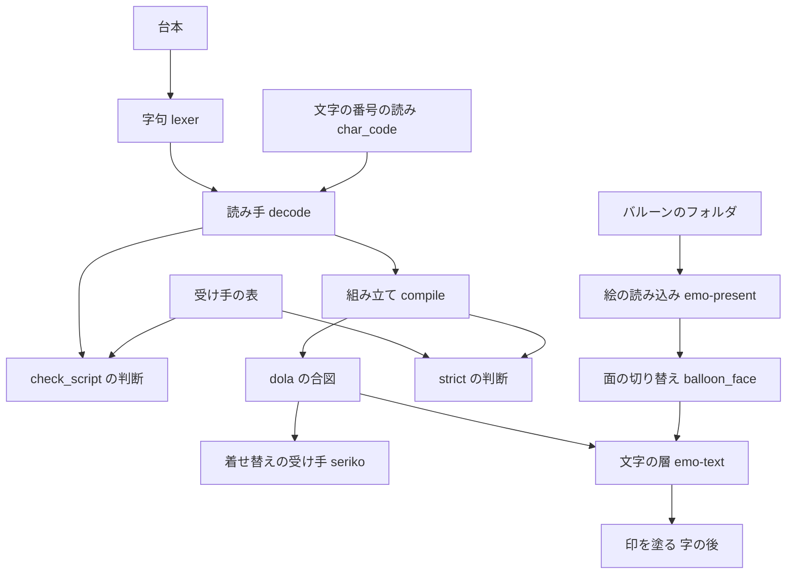
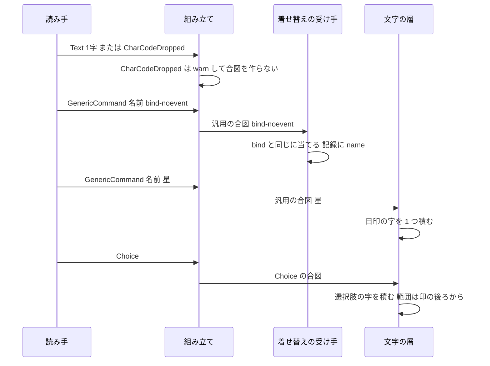
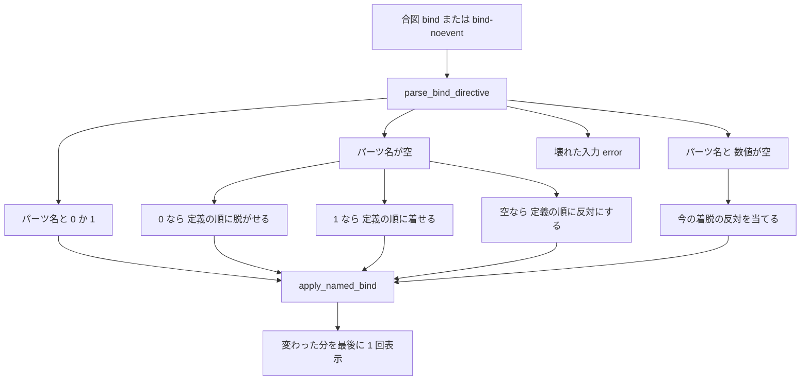

# 設計: script-small-tags

## Overview

**目的**: ゴーストの作者が書いた小さい台本のタグ 4 つ（`\_u[…]`・`\_m[…]`・`\![bind-noevent,…]`・`\![*]`）と、`\![*]` と同じ働きの `%*` を、SSP と同じに効かせる。ゴースト「窓際のぱすたさん」（以下「ぱすた」）が毎回の会話で使う字下げの全角の空白・選択肢の前の印・外見の戻しが、areka でも出るようにする。

**使う人**: ゴーストの作者（台本を書く・`check_script` で確かめる）と、ゴーストを使う利用者（バルーンの字と印を見る）。

**変わる所**: 今は 4 つのタグを捨てるか「無視した」として何も作らない。この設計の後は、読み手が文字の番号を字にし、着せ替えの受け手が 2 つの名前を受け、文字の層が行の中に印を描く。完了 `areka-P0-pasta-in-windows-verification` の申し送りの件 3・17・18 をこの spec の中で閉じる。

### Goals

- `\_u[…]`・`\_m[…]` の出せる番号を、本文に直に書いたのと同じ字として出す（SSP と同じ綴りを読む）。
- 出せない番号・読めない番号は捨てて、元の綴りと理由を警告の水準で記録に残す。
- `\![bind-noevent,…]` を `\![bind,…]` と同じに着せ替えへ届け、2 つの名前の違いを受け手の記録まで運ぶ。送るイベントは 0。
- `\![bind,…]`・`\![bind-noevent,…]` のカテゴリ単位の形とトグル形を、SSP を測った答えどおりに当てる。
- `\![*]`・`%*` の位置に、バルーンの印の絵（無ければ既定の灰色の丸）を行の中の 1 字分として出す。
- `check_script` と strict の台本の確かめが、4 つのタグを今の実物どおりに診る。
- 網羅台帳と互換の対応表 §8 を、着地した実物に合わせる。

### Non-Goals

- `OnDressupChanged`・`OnNotifyDressupInfo` の送出（起票済みの `dressup-change-events` の仕事）。
- 選択肢の印の見た目（マウスが乗った選択肢の飾り・`\f[cursor…]`・`choice-marker-styling`）。
- クリック待ちの印・オンラインの印・SSTP の印。
- 文字の配置と縦書きの決まりそのもの・選択肢の題に書いたタグの展開。
- 印の大きさ・色の設定、印の送り幅を絵の幅に合わせる仕組み（要件に無い）。
- 新しい外部の依存（足す依存は 0）。

## Boundary Commitments

### This Spec Owns

- **文字の番号の読み**: `\_u[…]`・`\_m[…]` の引数を番号として読み、出せる番号を字にし、出せない番号・読めない番号を「捨てた文字の番号」の命令にする決まり（読み手）。隣の本文とのまとめと、サロゲートの組の 1 字化。
- **捨てた番号の警告**: 組み立て（`compile`）が捨てた番号ごとに出す `warn!` の 1 行と、strict・`check_script` の診断の 1 種類（文言 `MSG_CHAR_CODE_DROPPED`）。
- **印の命令**: `\![*]` と `%*` を、名前 `*`（定数 `MARKER_COMMAND`）の汎用の `\!` 命令として出す読み。`\q` と畳まない。
- **受け手の表の 2 行**: `bind-noevent` → `Seriko`、`*` → `TextLayer`。
- **着せ替えの 2 つの名前とカテゴリ単位の形・トグル形**: seriko の受け手が `bind-noevent` を受け、名前を記録に残し、トグル形とカテゴリ単位形を当てる決まり。
- **印の絵の選びと読み込み**: バルーンの descript の `marker.filename` の鍵の読み、番号の無い 1 枚の名前の連鎖、面ごとの絵の読み込み、絵が無いときの記録。
- **行の中の印**: 文字の層が印を 1 字分の目印の字として積み、測り、絵か既定の丸として描くこと。
- **文書**: 網羅台帳の該当の行・互換の対応表 §8 の行・`doc/ssp-mcp/areka-tools.md` の診断の表・`roadmap.md` の「1 本だけの席」の行・`balloon-canon-residue` の brief の 1 か所・ぱすたの手順書での着地の後の確かめ。

### Out of Boundary

- SHIORI へのイベントの送出（`dressup-change-events`）。この spec は名前の違いを運ぶだけで、名前で分ける所は作らない。
- 選択肢の範囲の求め方（`actor_present.rs`・`choice-ranges-one-function`）と選択肢の飾り（`choice.rs`）。どちらも触らない。
- 起動の資源の読み込み（`emo2_boot/assets.rs`・`placement-measure-bake-once`）。触らない。
- 文字の層の折り返し・分かち書き・縦書きの決まり。印は 1 字として今の決まりに乗るだけ。
- 着せ替えの決まり（名前の解決・排他・`mustselect`・`multiple`・既定のパーツ）。カテゴリ単位の形とトグル形は今の決まりを続けて当てるだけで、決まりは変えない。
- `\_u` が無い台本の文字・既にある `\f`・アンカー・選択肢の読み。
- **ウェーブ C14 の兄弟との重なり 0**: `choice-ranges-one-function` の `actor_present.rs`・`actor_lookahead_shapes_tests.rs`・`choice_anchor_tests.rs`・`choice.rs`、`placement-measure-bake-once` の `emo2_boot/{mod,assets}.rs`・`placement/`・emo-present の `shell_target.rs`・`balloon.rs`（`prefix_chain` は呼ぶだけ）、`emo-atlas-palette-alpha` の wintf の `com/wic.rs`、`popup-menu-residue` の kanade の `actor.rs` は触らない。

### Allowed Dependencies

- 依存の向き（左から右へだけ使う）: `areka-parsers`（読み手・バルーンの鍵）→ `areka-sakura`（組み立て・strict の文言）→ `dola`（合図の型・変えない）→ `areka-seriko`・`areka-emo-present`・`areka-emo-text`（受け手）→ `areka`（結線・受け手の表・`check_script`）。
- `areka-emo-text` は今どおり `areka-emo-present` の `MarkerImage` と `areka-parsers` の型を使ってよい。
- wintf の既にある D2D の呼び口（`fill_ellipse`・`draw_bitmap`・絵の作り方）を使ってよい。wintf は変えない。
- 外部のクレートは足さない。`Cargo.toml` は触らない。

### Revalidation Triggers

- **`dressup-change-events`**: 着せ替えの受け手の名前の選別（`BIND_COMMAND`・`BIND_NOEVENT_COMMAND`）と記録の `name` の欄の形が変わったら、送り分けの所を確かめ直す。
- **受け手の表の鎖（`shell-scale-linkage`・`balloon-communicatebox`）**: 表の登記の数は 42 件になる。手書きの数・説明の一覧・見本の表は、着地の後の値から足す。
- **`choice-ranges-one-function`**: 選択肢の範囲は `Glyph` の数で数える。印は選択肢の前の `Glyph` として数えられる（範囲の外）。数え方を変えるなら印の扱いを確かめ直す。
- **`balloon-inline-image`**（`\_b[…,inline]`）: 行の中に絵を置く仕事は、この spec の目印の字の形（`inline_marker.rs`）が先例になる。同じ形を広げるか別の形にするかは、その spec が決める。
- **`ResolvedFont` の欄**: `inline_marker` の欄を足す。`ResolvedFont` を書き下す所が増えたら、既定の値を入れる。
- **`balloon-append-tags`・`decode.rs` を触る spec**: `\![*]` の畳みを消し、文字の番号の腕とまとめを足す。

## Architecture

### Existing Architecture Analysis

- 台本は「字句（`lexer.rs`）→ 読み手（`decode.rs`・`Instruction` と `Read`）→ 組み立て（`compile.rs`・dola の合図）→ 受け手（seriko・文字の層・窓の受け手）」の順に流れる。読み手は意味を決めない転記の層で、記録を出さない。
- `\!` の命令は、名前と引数を持つ汎用の合図（`CueCommand::command_carrier`）で全部の受け手へ届き、受け手が名前で自分の分を選ぶ。誰が受けるかは受け手の表（`consumer_ledger.rs`）が答え、`check_script` と strict はその表を写す。`\f` は運搬名 `FONT_TAG_CARRIER` → `TextLayer` の先例。
- 文字の層は字を書記素クラスタ 1 つずつ `TextItem::Glyph` にして積み、序数（現れる時刻・見た目・選択肢の範囲・行の中の位置）は `Glyph` だけを数える。描画は行の字を 1 本の文字列にして DirectWrite に組ませる。
- バルーンの絵（矢印）は emo-present の `load_scope_balloon_definitions` が面ごとに読み、`frame/balloon_face.rs` が面の切り替えのたびに文字の層へ渡す。名前の連鎖は `balloon_marker.rs` の印の族の表。
- 守る制約: 読み手は転記に徹する・記録の無い失敗の道を作らない・1 ファイル 1,000 行未満・テストは兄弟の `*_tests.rs`・受け手の表の行は末尾に足し手書きの数と見本を直す。

### Architecture Pattern & Boundary Map



**Architecture Integration**:
- 選んだ形: 既にある 3 つの流れ（台本の命令・`\!` の汎用の合図・面ごとのバルーンの絵）に、それぞれ小さく足す。新しい層・新しい受け口は作らない。
- 境目: 読み手は番号の読みと命令の形だけを決め、警告は組み立てが出す。着せ替えの決まりは seriko の `bind.rs` に閉じる。印の絵の選びは emo-present、印の並べと描画は emo-text。
- 守った形: 名前で自分の分を選ぶ汎用の合図・受け手の表を写す確かめ・印の族の名前の連鎖・アクターごとの値を解決で混ぜる形（背景色の先例）・字の後に塗る段（下線の先例）。
- 新しい物の理由: `char_code.rs`（番号の読みを小さな純粋な関数として分ける・`decode.rs` を太らせない）。`inline_marker.rs`（印の目印の字と形の計算を 1 か所に置く・emo-text の「1 ウェーブに 1 本だけの席」を使う）。
- steering: 依存は足さない・記録の無い失敗は作らない・試験は決定論・実機の根は `target\` の下。

### Technology Stack

| 層 | 使う物 / 版 | この機能での役 | 備考 |
|---|---|---|---|
| 読み手・組み立て | Rust（今の toolchain）・`areka-parsers`・`areka-sakura` | 番号の読み・命令・警告 | `tracing` は既にある依存 |
| 合図 | `dola`（変えない） | 汎用の `\!` の合図で運ぶ | 合図の型は増やさない |
| 着せ替え | `areka-seriko` | 2 つの名前・カテゴリ単位の形・トグル形 | 決まりは今の `bind.rs` |
| 絵の読み込み | `areka-emo-present`（`ElementDecoder`・`MarkerImage`） | `marker.filename` の絵を BGRA で読む | 矢印と同じ手順 |
| 描画 | `areka-emo-text`・wintf の D2D・DirectWrite | 行の中の印を塗る | wintf は変えない |
| 文書 | TOML の網羅台帳・Markdown | 台帳と §8 | 生成器は使わない（手で直す行） |

## File Structure Plan

### Directory Structure

```
crates/
├── areka-parsers/src/sakura/
│   ├── char_code.rs          # 新: \_u・\_m の引数を番号として読み、字か捨てる理由を返す純粋な関数
│   └── char_code_tests.rs    # 新: 綴りと理由ごとの表のテスト
└── areka-emo-text/src/
    ├── inline_marker.rs      # 新（純粋）: 目印の字・測るときの読み替え・印の見た目の型・丸と絵の置き場の計算
    └── inline_marker_tests.rs # 新: 置き場の計算・読み替え・合図の見分けのテスト
```

### Modified Files

- 読み手（`areka-parsers`）
  - `crates/areka-parsers/src/sakura/model.rs` — `Instruction::CharCodeDropped { raw, reason }` と `CharCodeDrop` を足す。`MARKER_COMMAND`（`"*"`）を足す。`ReadNote::MarkerIgnored` を消す。
  - `crates/areka-parsers/src/sakura/decode.rs` — `decode_tag` に `_u`・`_m` の腕。`decode_noted` の走査で、サロゲートの組の 1 字化と、隣の `Text` のまとめ。`fold_choice_marker`・`is_choice_marker` を消し、`\![*]` を `decode_bang` の汎用の道へ。`Token::SysVar("*")` を印の命令へ。
  - `crates/areka-parsers/src/sakura/lexer.rs` — `scan_sysvar` が `%` の直後の `*` を名前 `*` として取る。
  - `crates/areka-parsers/src/sakura/mod.rs` — `char_code` のモジュールの行と再輸出（要るものだけ）。
  - 兄弟のテスト: `decode_tests.rs`・`parse_noted_tests.rs`（242〜251 行目の畳みの檻を書き直す）・`lexer_substitute_tests.rs`（`%*` が置き換わらない）。
  - `crates/areka-parsers/src/balloon/marker.rs` — 鍵 `marker.filename` を読む（`arrow.filename` と同じに生の値のまま）。
  - `crates/areka-parsers/src/balloon/model.rs`・`parse.rs` — `BalloonModel::marker_filename(&self) -> Option<&str>` と、読んだ値を入れる 1 行。
- 組み立て（`areka-sakura`）
  - `crates/areka-sakura/src/compile.rs` — `CharCodeDropped` の腕（`warn!`・合図なし・strict の控え）。名前 `*` の特別扱いを消す。
  - `crates/areka-sakura/src/strict.rs` — `DetectionPoint::CharCodeDropped`（種類 `unreadable_argument`・文言 `MSG_CHAR_CODE_DROPPED`）を足し、`ReadMarkerIgnored` を消す。
  - 兄弟のテスト: `compile_strict_tests.rs`（130 行目あたりの印の檻）・`compile_arm_tests.rs`（新しい腕）・`strict_tests.rs`。
- 着せ替え（`areka-seriko`）
  - `crates/areka-seriko/src/actor.rs` — `BIND_NOEVENT_COMMAND` を足し、633・656 行目の名前の判定を「着せ替えの名前か」にする。670〜677 行目の読み飛ばしを、`bind.rs` の新しい関数の呼び出しに替える。着せ替えの道の記録の全行に `name` の欄。兄弟のテストの `#[path]` を 1 つ足す。
  - `crates/areka-seriko/src/bind.rs` — `apply_bind_directive`（トグル形・カテゴリ単位形を今の決まりで続けて当てる）を足す。
  - `crates/areka-seriko/src/lib.rs` — `BIND_NOEVENT_COMMAND` の再輸出。
  - 新しい兄弟のテスト: `crates/areka-seriko/src/actor_bind_noevent_tests.rs`（2 つの名前・記録の `name`・送るイベント 0）・`crates/areka-seriko/src/bind_forms_tests.rs`（トグル形・カテゴリ単位形と SSP の測りの 7 行）。`actor_bind_loop_tests.rs` の 2 本（`bind_toggle_form_warns_no_emit`・`bind_category_wide_form_warns_no_emit`）を新しい振る舞いへ書き直す。
- 受け手の表と確かめ（`areka`）
  - `crates/areka/src/emo2_boot/consumer_ledger.rs` — 表の末尾に `bind-noevent` → `Seriko`、`*` → `TextLayer` の 2 行。説明の一覧（368〜385 行目）。
  - `crates/areka/src/emo2_boot/consumer_ledger_tests.rs` — 手書きの数 40 → 42 と説明の文（298 行目と 333 行目あたり）。
  - `crates/areka/src/emo2_boot/consumer_ledger_agreement_tests.rs` — 見本に `("bind-noevent", None, …)`・`("*", None, vec![])`。
  - `crates/areka/src/mcp/check_script_judge.rs` — `CharCodeDropped` の腕。`MarkerIgnored` と名前 `*` の特別扱いを消す。兄弟の `check_script_judge_tests.rs`。
  - `crates/areka/src/emo2_boot/frame/balloon_face.rs` — 面の切り替えで、面の印の絵を文字の層へ渡す 1 行。
- 印の絵（`areka-emo-present`）
  - `crates/areka-emo-present/src/balloon_marker.rs` — `MARKER_FAMILY` と、番号の無い 1 枚を選ぶ `select_single_marker_name`・読む `resolve_single_marker`。兄弟のテスト。
  - `crates/areka-emo-present/src/balloon_definitions.rs` — `ScopeBalloonDefinitions` に面ごとの印の絵の非公開の欄と読み口 `inline_marker_for_face`。読み込みの中で絵を選び、5.3・5.4 の記録を出す。`FaceDefinition` と `load_scope_balloon_definitions` の形は変えない。兄弟のテスト。
- 文字の層（`areka-emo-text`）
  - `crates/areka-emo-text/src/state.rs` — `Custom` の腕の頭で印の合図を見分け、目印の字を 1 つ積む。
  - `crates/areka-emo-text/src/layout_styled.rs` — `glyph_style_advance` が目印の字を全角の空白として測る 1 行。
  - `crates/areka-emo-text/src/draw.rs` — `ResolvedFont` に `inline_marker: InlineMarkerLook`（既定は丸）。
  - `crates/areka-emo-text/src/actor.rs` — `TextLayerRuntime` にアクターごとの印の絵の表の欄。
  - `crates/areka-emo-text/src/actor_decoration.rs` — `set_inline_marker` と `stamp_inline_marker`（背景色の口の隣）。
  - `crates/areka-emo-text/src/actor_attach.rs`・`actor_box.rs` — 解いた直後に印の見た目を押す（3 か所）。
  - `crates/areka-emo-text/src/viewbox_draw.rs` — 描き手に印の絵の D2D の絵の記憶の欄。
  - `crates/areka-emo-text/src/viewbox_draw_render.rs` — 行の文字列を作る 3 か所を読み替えの関数にし、字の後に印を塗る。
  - `crates/areka-emo-text/src/lib.rs` — `inline_marker` のモジュールの行と、`PURE_SOURCES` の一覧（数 81 → 82）。
  - 兄弟のテスト: `state` の印の合図・`layout_styled_tests.rs`・`viewbox_draw_*_tests.rs` に読み戻しの 1 本。
- 文書
  - `doc/ukadoc-coverage/ledger/sakura-script.toml` — `\_u[0x0000]`・`\_m[0x00]`・`\![bind-noevent,…]`・`\![bind,…]`・`\![*]`・`%*` の行。
  - `doc/ukadoc-coverage/ledger/assets.toml` — `marker.filename` の行。
  - `doc/COMPAT_ARCHITECTURE.md` — §8 の表の末尾に行を足す。
  - `doc/ssp-mcp/areka-tools.md` — 診断の表（`ignored` の `\![*]` の行を消す・捨てた文字の番号の行を足す・2 件の例の差し替え）。
  - `.kiro/steering/roadmap.md` — 204 行目「1 本だけの席」の ⑵ を「C14 は `script-small-tags` が使う」に改め、C14 の行の ① の触るファイルにこの設計の一覧（`lexer.rs`・emo-present・emo-text・`frame/balloon_face.rs`）を足す。
  - `.kiro/specs/balloon-canon-residue/brief.md` — `marker*` の言及から `marker.filename` を外す。
  - `doc/pasta-real-run.md` — 5 節の段 2 の確かめの欄（着地の後の結果）。

## System Flows

### 台本の命令の流れ



- 印の合図はほかの受け手（seriko・窓の受け手）にも届き、名前が合わないので今どおり `debug!` で読み流す。
- 捨てた番号は合図を作らないので、受け手には何も届かない（2.7）。

### 着せ替えの形の判定



- どの形も、パーツ 1 つずつの当て方は今の `apply_named_bind`（排他・`mustselect`・`multiple`）。決まりは増やさない。

## Requirements Traceability

| 要件 | 要旨 | 担う物 | 契約 | 流れ |
|---|---|---|---|---|
| 1.1 | `\_u` の 16 進を字に | CharCodeReader・Decoder | `read_char_code` | 台本の命令 |
| 1.2 | `\_u` の 10 進を字に | CharCodeReader | `read_char_code` | 台本の命令 |
| 1.3 | `\_m` も同じに読む | Decoder（`_m` の腕も同じ関数） | `read_char_code` | 台本の命令 |
| 1.4 | `0x`/`0X`・大小・先頭の 0・空白・2 つ目からの引数 | CharCodeReader | `read_char_code` | — |
| 1.5 | 直に書いたのと同じ | Decoder（隣の `Text` のまとめ） | `decode_noted` のまとめ | 台本の命令 |
| 1.6 | 全角の空白だけでバルーンが開く | Decoder・既にある文字の合図 | — | 台本の命令 |
| 1.7 | 埋めた字を読み直さない | Decoder（`Text` として出す） | — | — |
| 1.8 | 書いた順・位置 | Decoder | — | — |
| 1.9 | サロゲートの組を 1 字に | Decoder | `decode_noted` の先読み | — |
| 2.1 | 0 を捨てて警告 | CharCodeReader・CompileArm | `CharCodeDrop::Zero` | 台本の命令 |
| 2.2 | 制御の文字を捨てて警告 | CharCodeReader・CompileArm | `CharCodeDrop::Control` | 台本の命令 |
| 2.3 | 片割れのサロゲートを捨てて警告 | Decoder・CompileArm | `CharCodeDrop::LoneSurrogate` | 台本の命令 |
| 2.4 | U+10FFFF より上を捨てて警告 | CharCodeReader・CompileArm | `CharCodeDrop::OutOfRange` | 台本の命令 |
| 2.5 | `\_m` も同じ決まり | Decoder | — | — |
| 2.6 | 読めない番号を捨てて警告 | CharCodeReader・CompileArm | `CharCodeDrop::Unreadable` | 台本の命令 |
| 2.7 | 代わりの字 0・続ける | CompileArm（合図を作らない） | — | 台本の命令 |
| 3.1 | `bind-noevent` の `1` | SerikoBindReceiver | 名前の選別 | 着せ替えの形 |
| 3.2 | `bind-noevent` の `0` | SerikoBindReceiver | 名前の選別 | 着せ替えの形 |
| 3.3 | どの形も `bind` と同じ扱い | SerikoBindReceiver・BindForms | `apply_bind_directive` | 着せ替えの形 |
| 3.4 | 表示・持ち越しも同じ | SerikoBindReceiver（同じ状態を変える）・既にある `shell_carry.rs` | — | — |
| 3.5 | 名前を記録に残し運ぶ | SerikoBindReceiver | 記録の `name` の欄 | — |
| 3.6 | 送るイベント 0 | SerikoBindReceiver（送る道を作らない） | — | — |
| 3.7 | ほかの受け手は読み流す | ConsumerLedgerRows | 表の行・見本 | — |
| 3.8 | `,,0` で全部脱がせる | BindForms | `apply_bind_directive` | 着せ替えの形 |
| 3.9 | トグル形 | BindForms | `apply_bind_directive` | 着せ替えの形 |
| 3.10 | `,,1`・カテゴリのトグルを SSP で決めて §8 へ | BindForms・CompatDocs | `apply_bind_directive`・§8 の行 | 着せ替えの形 |
| 4.1 | `\![*]\q` の印を渡す | Decoder（畳まない）・TextLayerMarker | `MARKER_COMMAND` | 台本の命令 |
| 4.2 | 単独の `\![*]` の印を渡す | Decoder・TextLayerMarker | `MARKER_COMMAND` | 台本の命令 |
| 4.3 | `%*` を同じに読む | Lexer・Decoder | `scan_sysvar` | 台本の命令 |
| 4.4 | 「無視した」にしない | Decoder・CompileArm・CheckJudge（特別扱いを消す） | — | — |
| 4.5 | 続けて書いた数だけ | Decoder・TextLayerMarker | — | — |
| 5.1 | 印 1 つに絵 1 つ | TextLayerMarker・MarkerPainter | `InlineMarkerLook` | 台本の命令 |
| 5.2 | 名前の連鎖 | MarkerImageLoader | `resolve_single_marker` | — |
| 5.3 | 書いた名前が無いとき | MarkerImageLoader | `warn!` | — |
| 5.4 | 絵が 1 枚も無いとき | MarkerImageLoader・MarkerPainter | 既定の丸・`info!` 1 回 | — |
| 5.5 | 印の後ろに字を並べる | TextLayerMarker（1 字分の送り幅） | `glyph_style_advance` | — |
| 5.6 | 消去・押し出し・スクロール | TextLayerMarker（`Glyph` として積む） | — | — |
| 5.7 | 選択肢の数・当たり・帯は同じ | TextLayerMarker（範囲の外に積む） | — | 台本の命令 |
| 6.1 | 出せる番号は「知らないタグ」でない | Decoder・CheckJudge | — | — |
| 6.2 | 捨てた番号は「読めない引数」 | CheckJudge | `MSG_CHAR_CODE_DROPPED` | — |
| 6.3 | strict も同じ | CompileArm・StrictPoint | `DetectionPoint::CharCodeDropped` | — |
| 6.4 | `bind-noevent` は「知らない命令」でない | ConsumerLedgerRows | 表の行 | — |
| 6.5 | `\![*]`・`%*` は無視・知らないでない | ConsumerLedgerRows・CheckJudge | 表の行 | — |
| 6.6 | SSP に合わせた綴りは誤りでない | CharCodeReader・CheckJudge | — | — |
| 7.1 | 台帳の 4 行と `bind` の行 | CoverageLedgerDocs | — | — |
| 7.2 | `\![*]` と `marker.filename` の行・持ち主 | CoverageLedgerDocs | — | — |
| 7.3 | §8 の行 | CompatDocs | — | — |
| 8.1 | 要件 1〜6 の決定論のテスト | 各兄弟のテスト | — | — |
| 8.2 | 名前の選びと並べのテスト | 各兄弟のテスト | — | — |
| 8.3 | 実機（ぱすたの手順書） | RealRunCheck | — | — |

## Components and Interfaces

| 担う物 | 層 | 役 | 要件 | 主な依存 | 契約 |
|---|---|---|---|---|---|
| CharCodeReader | 読み手 | 引数を番号として読み、字か捨てる理由を返す | 1.1〜1.4, 2.1, 2.2, 2.4, 2.6, 6.6 | なし（P0） | Service |
| Decoder | 読み手 | `_u`・`_m` の腕・まとめ・組・印の命令・`%*` | 1.1〜1.9, 2.3, 2.5, 4.1〜4.5, 6.1 | CharCodeReader（P0） | Service |
| Lexer | 字句 | `%*` を名前 `*` に | 4.3 | なし | Service |
| CompileArm | 組み立て | 捨てた番号の警告・strict の控え | 2.1〜2.7, 4.4, 6.3 | Decoder（P0） | Service |
| StrictPoint | 組み立て | 検出点と文言 | 6.2, 6.3 | なし | State |
| CheckJudge | 結線 | `check_script` の診断 | 4.4, 6.1, 6.2, 6.5, 6.6 | 受け手の表（P0） | Service |
| ConsumerLedgerRows | 結線 | 表の 2 行と檻 | 3.7, 6.4, 6.5 | seriko・文字の層の名前（P0） | State |
| SerikoBindReceiver | 着せ替え | 2 つの名前・記録・形の振り分け | 3.1〜3.7 | BindForms（P0） | Service |
| BindForms | 着せ替え | トグル形・カテゴリ単位形 | 3.3, 3.8〜3.10 | `apply_named_bind`（P0） | Service |
| MarkerImageLoader | 絵 | `marker.filename` と名前の連鎖・面ごとの絵 | 5.2〜5.4 | `ElementDecoder`（P0） | Service |
| FaceSwitchWiring | 結線 | 面の絵を文字の層へ | 5.1, 5.2 | MarkerImageLoader（P1） | — |
| TextLayerMarker | 文字の層 | 目印の字を積む・測る・見た目を押す | 4.1, 4.2, 4.5, 5.1, 5.5〜5.7 | `inline_marker.rs`（P0） | Service, State |
| MarkerPainter | 文字の層 | 字の後に丸か絵を塗る | 5.1, 5.4 | wintf の D2D（P1） | Service |
| CoverageLedgerDocs・CompatDocs・RealRunCheck | 文書 | 台帳・§8・実機 | 7.1〜7.3, 8.3 | — | — |

### 読み手

#### CharCodeReader（`crates/areka-parsers/src/sakura/char_code.rs`）

| 欄 | 中身 |
|---|---|
| 役 | `\_u`・`\_m` の最初の引数を番号として読み、出せる番号（サロゲートは別に返す）か捨てる理由を返す |
| 要件 | 1.1〜1.4, 2.1, 2.2, 2.4, 2.6, 6.6 |

**決まり**
- 引数の前後の空白を除く。2 つ目からの引数は渡さない（呼び手が `args.first()` だけを渡す）。
- 16 進: `0x` または `0X` に続く 1 桁以上の 16 進の数字（大小を問わない・先頭の 0 を問わない）。10 進: 1 桁以上の数字だけ。それ以外（空・`0x` だけ・符号・ほかの字・引数なし）は読めない番号。
- 桁が多すぎて 32 ビットに入らない数は「範囲の外」にする（読めない番号にしない）。
- 判定の順: 0 → 制御の文字（U+0001〜U+001F・U+007F〜U+009F）→ U+10FFFF より上 → サロゲート（U+D800〜U+DBFF は上位・U+DC00〜U+DFFF は下位）→ それ以外は字。

##### Service Interface

```rust
/// `\_u`・`\_m` の引数の読み（読み手の中だけで使う）。
pub(crate) enum CharCodeRead {
    /// 出せる番号の字。
    Char(char),
    /// サロゲートの番号（組にするかは呼び手が決める）。
    HighSurrogate(u16),
    LowSurrogate(u16),
    /// 捨てる。
    Drop(CharCodeDrop),
}

pub(crate) fn read_char_code(arg: Option<&str>) -> CharCodeRead;
```

- 前提: なし（どの入力も受ける・失敗しない）。
- 後で成り立つこと: `Char(c)` の `c` は U+0001〜U+10FFFF のうち制御の文字とサロゲートを除いたもの。

#### Decoder（`crates/areka-parsers/src/sakura/decode.rs`・`model.rs`）

| 欄 | 中身 |
|---|---|
| 役 | 文字の番号の腕・隣の本文とのまとめ・サロゲートの組・印の命令・`%*` |
| 要件 | 1.1〜1.9, 2.3, 2.5, 4.1〜4.5, 6.1 |

**決まり**
- `decode_tag` の `_u`・`_m` の腕は同じ関数（`read_char_code(args.first())`）を呼ぶ（2.5・`\_m` だけの決まりは持たない）。`Char(c)` は `Instruction::Text(c.to_string())`、`Drop(r)` は `Instruction::CharCodeDropped { raw, reason: r }`（`raw` はトークンの元の綴り）。
- **サロゲートの組（1.9）**: `decode_noted` の走査で、`_u`・`_m` の読みが上位のサロゲートのとき、次のトークンを先読みし、それが `_u`・`_m` で読みが下位のサロゲートなら 2 つを消化して 1 字の `Text` にする（範囲は 2 つを覆う）。組にならない上位・下位は `CharCodeDropped { reason: LoneSurrogate }`（2.3）。
- **隣の本文とのまとめ（1.5）**: `decode_noted` は、出した `Read` の命令が `Text` で、直前の `Read` の命令も `Text` なら、直前の `Read` へつなぐ（文字を足し、範囲を伸ばし、印を合わせる）。字句の段は本文のひと続きを 1 つの `Text` にするので、`Text` が続くのは埋め込みの隣だけ（research.md 9.1）。こうして `e\_u[0x0301]` は `é` の 1 つの `Text` になり、文字の層で 1 つのクラスタになる。捨てた番号は `Text` でないのでまとめない（自分の範囲で診断を出せる）。
- **印（4.1・4.2・4.5）**: `\![*]` は `decode_bang` の汎用の道で `GenericCommand { name: MARKER_COMMAND, raw_args: [] }` になる。直後の `\q[…]` は今どおりの `Choice` として別に出す（畳まない）。`Token::SysVar("*")` も同じ `GenericCommand` にする（4.3）。
- `ReadNote::MarkerIgnored` を消す（使う所が無くなる）。

##### Service Interface

```rust
// model.rs
pub const MARKER_COMMAND: &str = "*";

#[non_exhaustive]
pub enum Instruction {
    // …今の種類…
    /// 出せない・読めない文字の番号を捨てた（`\_u[…]`・`\_m[…]`）。
    CharCodeDropped { raw: String, reason: CharCodeDrop },
}

#[non_exhaustive]
#[derive(Clone, Copy, Debug, PartialEq, Eq)]
pub enum CharCodeDrop { Zero, Control, LoneSurrogate, OutOfRange, Unreadable }
```

- 前提: 字句の段の出力（`lex_spanned`）。
- 後で成り立つこと: 出力に `Text` が 2 つ続かない。どの埋め込みも `Text`（まとめた中を含む）か `CharCodeDropped` のどちらかになる。
- 変わらないこと: 読み手は記録を出さない。失敗しない（`Vec` を返す）。

#### Lexer（`crates/areka-parsers/src/sakura/lexer.rs`）

- `scan_sysvar` は、英数字と下線の名前が空で、`%` の直後が `*` のとき、`*` を名前として取る（`%*` → `SysVar("*")`・範囲は 2 字）。`substitute_system_vars` は同じ走査で名前 `*` を引くが、環境変数の答えは無い（sylphya の語彙は `%*` を解決の外としている）ので台本は変わらない（4.3）。

### 組み立て

#### CompileArm（`crates/areka-sakura/src/compile.rs`）・StrictPoint（`strict.rs`）

| 欄 | 中身 |
|---|---|
| 役 | 捨てた番号ごとの警告と strict の控え |
| 要件 | 2.1〜2.7, 4.4, 6.3 |

- `Instruction::CharCodeDropped { raw, reason }` の腕: `tracing::warn!(event = "char_code_dropped", raw = %raw, reason = ?reason, "[compile] 文字の番号を出せないので捨てる")` を 1 行出し、合図は作らない。strict の連れが居れば `DetectionPoint::CharCodeDropped` を控える。
- `Tracer::command` の名前 `*` の特別扱いと、`head` の `ReadNote::MarkerIgnored` の写しを消す。印の合図は表を引いて `TextLayer` の答えを得る（6.5）。
- `strict.rs`: `DetectionPoint::CharCodeDropped` を足す（種類 `unreadable_argument`・名前 `"CharCodeDropped"`）。`DetectionPoint::ReadMarkerIgnored` を消す。文言 `pub const MSG_CHAR_CODE_DROPPED: &str = "areka cannot show this character number; playback drops it";`（ASCII だけ）。
- `check_script` は組み立てを呼ばないので、確かめただけでは警告の行は出ない。

### 結線と確かめ

#### CheckJudge（`crates/areka/src/mcp/check_script_judge.rs`）

- `Instruction::CharCodeDropped { .. }` の腕で `Kind::UnreadableArgument`・`MSG_CHAR_CODE_DROPPED`（範囲は埋め込みの綴り・6.2）。
- `ReadNote::MarkerIgnored` の写しと、名前 `*` の特別扱いの腕を消す。`\![*]`・`%*` は表の `*` → `TextLayer` の答えで何も出さない（6.5）。
- 出せる番号は `Text` になるので、何も診ない（6.1・6.6）。

#### ConsumerLedgerRows（`consumer_ledger.rs` と 2 つの檻）

- 表の末尾（`RAISE_TAG_CARRIER` の行の後）に 2 行:
  - `try_register(areka_seriko::BIND_NOEVENT_COMMAND, None, CommandConsumer::Seriko)`
  - `try_register(areka_parsers::sakura::MARKER_COMMAND, None, CommandConsumer::TextLayer)`
- 説明の一覧（`canonical()` の doc）に 2 つの名前を足す。`consumer_ledger_tests.rs` の手書きの数 `40` → `42` とその文言・「40 件共存下でも」の文を `42` に。`consumer_ledger_agreement_tests.rs` の `samples()` に `("bind-noevent", None, vec!["腕", "伸び", "1"])` と `(MARKER_COMMAND, None, vec![])`。見本の檻がほかの受け口へ届かないこと（3.7）を見る。
- 新しい受け口は足さない（`emo2_boot/mod.rs`・`runtime_boot.rs` は触らない）。

#### FaceSwitchWiring（`crates/areka/src/emo2_boot/frame/balloon_face.rs`）

- `select_balloon_face` の中の `set_balloon_markers` の隣で、`runtime.set_inline_marker(actor.clone(), definitions.inline_marker_for_face(face))` を呼ぶ。

### 着せ替え

#### SerikoBindReceiver（`crates/areka-seriko/src/actor.rs`）

| 欄 | 中身 |
|---|---|
| 役 | `bind` と `bind-noevent` を受け、どちらの名前かを記録に残す |
| 要件 | 3.1〜3.7 |

- `pub const BIND_NOEVENT_COMMAND: &str = "bind-noevent";` を足し、`lib.rs` で再輸出する。
- 名前の判定（633 行目の壊れた運び物・656 行目の担当外）は「`BIND_COMMAND` か `BIND_NOEVENT_COMMAND` か」にする。名前の前置き（`starts_with`）では選ばない。
- 読み（`parse_bind_directive`）の後、`Malformed` は今どおり `error!`。それ以外の 3 つの形は `bind::apply_bind_directive` に渡し、返った結果の列を今の記録の決まり（`NoNamespace` は `warn!`・`NotFound` は `error!`・`MustSelectKept` は `warn!`・`Changed` は `info!` の「seriko: bind 適用」・`StateOnly`／`Unchanged` は `debug!`）で 1 つずつ記録する。
- 結果に `Changed` が 1 つ以上あれば、全部を当てた後に 1 回だけ `refresh` して表示を出す（途中の姿を出さない）。
- 着せ替えの道の記録の全行（壊れた運び物・読み飛ばし・壊れた入力・名前の解決の失敗・`mustselect`・適用・状態だけ）に `name = %name`（`bind` か `bind-noevent`）の欄を足す（3.5）。
- 行数: `actor.rs` は 908 行で、足すのは 30 行前後の見込み（940 行前後）。950 行を超えるなら、着せ替えの腕（読み・当て・記録）を新しい兄弟 `crates/areka-seriko/src/actor_bind.rs` へ出す（上限 1,000 行）。
- SHIORI へ送る道は作らない（3.6）。シェルとゴーストの読み直しの持ち越し（`emo2_boot/shell_carry.rs`）は今の着せ替えの状態を読んで流し直すので、`bind-noevent` で変えた状態もそのまま持ち越される（3.4・変えない）。

#### BindForms（`crates/areka-seriko/src/bind.rs`）

| 欄 | 中身 |
|---|---|
| 役 | パーツ名つき・トグル形・カテゴリ単位形を、パーツ 1 つずつの今の当て方の列にする |
| 要件 | 3.3, 3.8〜3.10 |

**決まり（research.md 2.11 の SSP の測りに合わせた）**
- `Apply { category, part, on }`: 今どおり `apply_named_bind` を 1 回。
- `Toggle { category, part }`（数値が空・省略）: パーツの名前を解き、今の集合（`current_binds`）に在れば `on = false`、無ければ `on = true` で `apply_named_bind` を 1 回（3.9）。`mustselect` のカテゴリで着ているパーツは今どおり `MustSelectKept`。
- `CategoryWide { category, on: Some(false) }`（`,,0`）: カテゴリのパーツを定義の順（`category_parts_in_order`）に `on = false` で 1 つずつ当てる（3.8）。`mustselect` なら各パーツが今どおり `MustSelectKept`＝何も脱がない（SSP の測りと同じ）。
- `CategoryWide { category, on: Some(true) }`（`,,1`）: 定義の順に `on = true` で 1 つずつ当てる。排他のカテゴリでは後のパーツが前を脱がせ、最後のパーツだけが残る（SSP の測り「妹だけを着る」と同じ）。`multiple` のカテゴリでは全部を着る（3.10）。
- `CategoryWide { category, on: None }`（`,,`・パーツ名も数値も空）: 定義の順にパーツごとに「その時点の着脱の反対」を当てる（Toggle を続けて当てる）。排他のカテゴリでは SSP の 3 行の測り（空 → 妹・おじさん → 妹・妹 → 妹）と全部合う。`multiple` のカテゴリではそれぞれが反対になる（3.10）。
- カテゴリのパーツが 0 個（名前の無いカテゴリ）のときは `NotFound` を 1 つ返す。スコープに名前の表が無いときは `NoNamespace` を 1 つ返す。どちらも記録が残る（黙って捨てない・3.10）。

##### Service Interface

```rust
/// 読んだ着せ替えの指令を、パーツ 1 つずつ今の当て方で当てる（`Malformed` は呼び手が先に除く）。
/// 返す列はパーツを当てた順。
pub fn apply_bind_directive(
    states: &mut crate::state::ScopeStates,
    resolver: &BindResolver,
    scope: &ActorKey,
    directive: &BindDirective,
) -> Vec<NamedBindResult>;
```

- 前提: 呼び手は `Malformed` を先に `error!` の腕で除く。`Malformed` を渡されたときは空の列を返す（状態を変えない）。
- `Malformed` 以外では、空の列を返さない（少なくとも 1 つの結果＝記録の 1 行がある）。
- 後で成り立つこと: 各パーツの当て方は `apply_named_bind` と同じ（排他・`mustselect`・`multiple` の決まりを変えない）。

### 印の絵

#### MarkerImageLoader（`balloon_marker.rs`・`balloon_definitions.rs`・`areka-parsers` の `balloon/marker.rs`）

| 欄 | 中身 |
|---|---|
| 役 | 面ごとに印の絵を 1 枚選んで読む・無ければ記録 |
| 要件 | 5.2〜5.4 |

- 鍵の読み: `balloon/marker.rs` が `marker.filename` を生の値のまま読み（拡張子なし・空は無いのと同じ）、`BalloonModel::marker_filename()` で返す。面の設定ファイルで書き換えた値は、その面の 2 層の合わせ（今の `BalloonModel` の作り方）でそのまま効く。
- 名前の連鎖: `MARKER_FAMILY = SeriesFamily { base: "marker", scope0_legacy: &["markers", "marker"], scope1_legacy: &["markerk"] }` を足し、今の `prefix_chain` を使う。候補の順は、書いた名前 → スコープの名前（本体側 `markerp0def`・`markers`／相方側 `markerp1def`・`markerk`／3 人目から `markerp{n}def`・`markerk`）→ 本体側の名前 → `marker`（5.2・完了 `balloon-scroll-arrows` の印の族と同じ形）。
- 選び: `select_single_marker_name` は番号の無い `<候補>.png`（矢印と同じ拡張子の扱い）を候補の順に探し、最初に在った 1 つを返す。
- 読み込み: `resolve_single_marker` は選んだ名前を矢印と同じ `ElementDecoder`・`AlphaParams` で BGRA の `MarkerImage` に読む。読めない絵（壊れたファイル）は今の矢印と同じ水準で記録して、次の候補へは進まず「絵なし」とする。
- `load_scope_balloon_definitions` は面ごとに、その面の `marker_filename()` で `resolve_single_marker` を呼ぶ（同じ名前は 1 回だけ読む記憶を使う・矢印の記憶と同じ形）。書いた名前の絵が無ければ `warn!`（書いた名前・スコープ・バルーンのフォルダ）を出して連鎖の残りで探し直す（5.3）。絵が 1 枚も無ければ `info!`（スコープ・バルーンのフォルダ・「既定の丸を描く」）を、同じ名前の記憶につき 1 回だけ出す（5.4・フレームごとには出さない）。
- `ScopeBalloonDefinitions` に非公開の欄（面の番号 → `Option<Arc<MarkerImage>>`）を足し、`single()` は「絵なし」で作る。`FaceDefinition` と `load_scope_balloon_definitions` の形は変えない（`emo2_boot/assets.rs` は触らない）。

##### Service Interface

```rust
// balloon_marker.rs
pub const MARKER_FAMILY: SeriesFamily;
pub fn select_single_marker_name<S: AsRef<str>>(names: &[S], chain: &MarkerChain) -> Option<String>;
pub struct SingleMarker {
    pub image: Option<Arc<MarkerImage>>,
    /// 書いた名前があり、その絵がフォルダに無かった。
    pub explicit_missing: bool,
}
pub fn resolve_single_marker(
    dirs: &[&Path],
    family: &SeriesFamily,
    scope: u32,
    explicit: Option<&str>,
    decoder: &impl ElementDecoder,
    alpha: AlphaParams,
) -> SingleMarker;

// balloon_definitions.rs
impl ScopeBalloonDefinitions {
    /// 面の印の絵（無い面は面 0 の値・絵が無いバルーンは None）。
    pub fn inline_marker_for_face(&self, face: u32) -> Option<Arc<MarkerImage>>;
}
```

### 文字の層

#### TextLayerMarker（`inline_marker.rs`・`state.rs`・`layout_styled.rs`・`draw.rs`・`actor*.rs`）

| 欄 | 中身 |
|---|---|
| 役 | 印の合図を 1 字分の目印の字として積み、1 字分で測り、アクターの印の見た目を描き手へ届ける |
| 要件 | 4.1, 4.2, 4.5, 5.1, 5.5〜5.7 |

**決まり**
- 目印の字 `MARKER_GLYPH = "\u{FFFC}"`（1 つのクラスタ・UTF-16 で 1 単位）。測るときと描くときは全角の空白 `MARKER_STAND_IN = "\u{3000}"`（UTF-16 で 1 単位）に読み替える。
- `state.rs` の `Custom` の腕は、`\f` の見分けの前に `is_marker_carrier(&cue.command)`（名前が `MARKER_COMMAND`）を見て、今の行き先の場所に目印の字を 1 つ積む。積み方は `Text` の腕と同じ（開いているアンカーを伸ばす・現れる時刻は `cue.at`・今の見た目の番号を与える）。
- 選択肢の `Choice` の合図より前に積むので、選択肢の範囲の始まり（`Glyph` の数）は印の後ろになる。選択肢の数・当たり・反転の帯は印の無いときと同じ選択肢を指す（5.7）。
- `glyph_style_advance` は目印の字を全角の空白として測る（1 行）。描くときも行の文字列で全角の空白に替えるので、印の後ろの字の位置は DirectWrite が描いた字と同じ物差しで決まる（5.5・横書きは行の向き・縦書きは列の向き）。
- 消去（`\c`・新しいトーク）・行の押し出し・スクロール・空回しは、目印の字が `Glyph` として項目の列に居るので、今の仕組みのまま字と一緒に動く（5.6）。
- 印の見た目: `ResolvedFont` に `inline_marker: InlineMarkerLook` を足す（既定は `Dot`）。runtime はアクターごとの印の絵（`set_inline_marker` で受ける）を覚え、解いた直後に `stamp_inline_marker` で押す。押す所は、装着（`register_actor_binding`）・再追従（`refresh_actor_binding` の比較の前）・箱（`actor_box.rs` の解決）の 3 か所。`set_inline_marker` は値が前と違うとき、そのアクターの今の場所の値にも押し直す（`layout_input` の値＝解いた値に、その時点の印の見た目を押したもの、という決まりを保つ）。箱でも、そのスコープの普通のバルーンの印を使う。

##### Service Interface

```rust
// inline_marker.rs（純粋）
pub const MARKER_GLYPH: &str = "\u{FFFC}";
pub const MARKER_STAND_IN: &str = "\u{3000}";
/// 既定の丸の直径（字の大きさに対する比）と、塗りの不透明度。
pub const DOT_DIAMETER_RATIO: f32 = 0.5;
pub const DOT_OPACITY: f32 = 0.64;

#[derive(Clone, Debug, PartialEq, Eq, Default)]
pub enum InlineMarkerLook {
    #[default]
    Dot,
    Image(Arc<MarkerImage>),
}

/// 1 字分の枠（バルーンの画像の画素・左上と右下）。COM の型を使わない純粋な数の組。
#[derive(Clone, Copy, Debug, PartialEq)]
pub struct CellRect { pub left: f32, pub top: f32, pub right: f32, pub bottom: f32 }

pub fn is_marker_carrier(command: &CueCommand) -> bool;
/// 測る・描く字（目印の字だけを全角の空白に替える）。
pub fn stand_in(text: &str) -> &str;
/// 1 字分の枠から、丸の中心 `(x, y)` と半径（直径＝`em × DOT_DIAMETER_RATIO`）。
pub fn dot_in_cell(cell: CellRect, em: f32) -> ((f32, f32), f32);
/// 1 字分の枠に、絵を原寸で真ん中に置く矩形（はみ出すときは縦横の比を保って枠に収める）。
pub fn image_in_cell(cell: CellRect, width: u32, height: u32) -> CellRect;

// actor_decoration.rs
impl TextLayerRuntime {
    pub fn set_inline_marker(&mut self, actor: ActorKey, image: Option<Arc<MarkerImage>>);
}
```

- 純粋の一覧の決まり: `inline_marker.rs` は COM も wintf の型も使わない（枠は `CellRect`）。D2D の型への写しは描き手（`viewbox_draw_render.rs`）の側で行う。`lib.rs` の `PURE_SOURCES` に載せ、数を 81 → 82 にする（兄弟のテストのファイルの載せ方は今の一覧の決まりどおり）。

#### MarkerPainter（`viewbox_draw_render.rs`・`viewbox_draw.rs`）

| 欄 | 中身 |
|---|---|
| 役 | 字の後の段で、印 1 つごとに丸か絵を塗る |
| 要件 | 5.1, 5.4 |

- 行の文字列を作る 3 か所（75・90・198 行目あたり）を、`stand_in` を通す 1 つの関数にする。
- 1 段目（行の準備）で、行の目印の字ごとに 1 字分の枠を、選択肢の帯と同じ求め方（`highlight_rect` の式・帯の太さは行の太さ・ずれ 0）で集める。
- 2 段目（字を描いた後・下線と同じ段）で塗る:
  - `Dot`: 中心＝枠の真ん中・直径＝その字の見た目の大きさ × `DOT_DIAMETER_RATIO`（字の大きさ 20 で 10 画素・SSP の測りと同じ）。色＝その位置の字の見た目の文字色（`\f[color]` を含む）を不透明度 `DOT_OPACITY` で塗る（5.4）。
  - `Image`: 絵を D2D の絵にして（作り方は `marker_surface.rs` の `bitmap_of` と同じ）`image_in_cell` の矩形へ描く。D2D の絵は描き手が `Arc` の同一性を鍵に 1 枚だけ覚える（同じ絵を毎フレーム作り直さない）。
- 枠は行の矩形の中に収まるので、描き直しの範囲（行の矩形）からはみ出さない。
- テスト専用の照合の写し（`draw.rs` の `DrawExecutor`）は印を塗らない（今の照合の場面は印を含まない）。

### 文書

- **CoverageLedgerDocs**: `sakura-script.toml` の `\_u[0x0000]`・`\_m[0x00]`（持ち主を `script-small-tags` に）・`\![bind-noevent,…]`・`%*`（持ち主を `script-small-tags` に）・`\![*]` を `implemented` と実物の説明に、`\![bind,…]` の「未登記の食い違い」を消してトグル形とカテゴリ単位形の実物の説明に書き直す（7.1）。`assets.toml` の `marker.filename` を `implemented`・持ち主 `script-small-tags` にし、`balloon-canon-residue` の brief の `marker*` の言及から `marker.filename` を外す（7.2）。
- **CompatDocs**: §8 の表の末尾に、下の「互換の対応表 §8 に足す行」の 7 行を足す（3.10・7.3）。
- **RealRunCheck**: `doc/pasta-real-run.md` 5 節の段 2 を回し、撮った物と記録を `target\` の下に置き、この spec の検証の記録に書く（8.3）。

## Data Models

### 互換の対応表 §8 に足す行（7.3・3.10）

| 項目 | areka の決め | 根拠 |
|---|---|---|
| `\_u`・`\_m` の読む綴り | `0x`／`0X`・16 進の大小・先頭の 0・前後の空白・2 つ目からの引数の無視・`\_m` の 10 進・`\_m` の ASCII の外・U+10FFFF まで・サロゲートの組を受け付ける | 正典は `\_u` を UCS-2・`\_m` を ASCII と書くだけ。SSP 2.9.23 で測った答え（research.md 2.10） |
| 出せない番号・読めない番号 | 0・制御の文字・片割れのサロゲート・U+10FFFF より上・読めない番号は捨て、`warn!` を 1 行残す。代わりの字は出さない | SSP は一部で「・」や箱の字を出すが、字の形の代わりなので写さない（要件の議題 2 の確定） |
| 結合文字などの埋め込み | 埋め込んだ字は隣の本文と 1 つの字の並びにまとめる（`e\_u[0x0301]` は `é`） | SSP の測り（research.md 2.10） |
| `\![*]`・`%*` の印の絵が無いバルーン | 字の大きさの半分の直径の丸を、その字の色の不透明度 0.64 で 1 字分の枠の真ん中に塗る。送り幅は全角の空白 1 つ | SSP の測り（research.md 2.10・2.11・字の大きさ 20 で 10×10 画素・中ほどの色は字の色 140,128,116 に対し 184,174,164）。色を別の色のバルーンで測ってはいない |
| 印の絵の大きさと送り幅 | 絵は原寸で 1 字分の枠の真ん中に置き、はみ出すときは縦横の比を保って枠に収める。送り幅は絵の大きさに依らず全角の空白 1 つ | 正典は「マーカーを表示する」だけ。SSP の絵ありのバルーンでは測っていない |
| `marker.filename` の面ごとの書き換え | 面ごとに読む（矢印と同じ） | 正典は descript の鍵としか書かない。矢印の扱いと揃えた |
| `\![bind,…]`・`\![bind-noevent,…]` のカテゴリ単位の `1` とカテゴリのトグル | カテゴリのパーツを定義の順に 1 つずつ、`1` なら着せる・空なら反対にする、を今の決まり（排他・`mustselect`・`multiple`）で続けて当てる。排他では最後のパーツが残る。`mustselect` の `,,0` は何も脱がない | 正典は中身を書かない。SSP 2.9.23 で測った 7 行の答えと全部合う（research.md 2.11）。`multiple` のカテゴリは測っていない |

### 記録の形

- 組み立ての警告: `event = "char_code_dropped"`・`raw`（元の綴り）・`reason`（`Zero`／`Control`／`LoneSurrogate`／`OutOfRange`／`Unreadable`）。
- 着せ替えの記録: 今の行に `name`（`bind`／`bind-noevent`）を足す。実機の確かめの目印は `seriko: bind 適用` の行の `name="bind-noevent"`。
- 印の絵の記録: 書いた名前が無い `warn!`（`name`・`scope`・`balloon_dir`）と、絵が 1 枚も無い `info!`（`scope`・`balloon_dir`）。

## Error Handling

### Error Strategy

- どの失敗も台本の再生を止めない。止めずに記録を残す（steering「記録の無い失敗の道を作らない」）。

| 場面 | 振る舞い | 記録 |
|---|---|---|
| 出せない番号・読めない番号 | 捨てる・合図なし・続ける | 組み立ての `warn!` 1 行・strict と `check_script` は「読めない引数」 |
| 片割れのサロゲート | 同上 | 同上（理由 `LoneSurrogate`） |
| 着せ替えの壊れた入力 | 今どおり読み飛ばす | `error!`（`name` つき） |
| 着せ替えの名前の解決の失敗・名前の表の無いスコープ・`mustselect` の脱衣 | 今どおり | 今の水準（`name` つき） |
| 名前の無いカテゴリへのカテゴリ単位形 | 何もしない | `error!`（`NotFound`・`name` つき） |
| 書いた印の絵が無い | 連鎖の残りで探し直す | `warn!` |
| 印の絵が 1 枚も無い | 既定の丸 | `info!` を 1 回 |
| 印の絵が壊れている | 絵なし（既定の丸） | 矢印と同じ水準 |
| D2D の絵を作れない | その印を塗らずに続ける（字は描く） | `error!`（描き手の今の失敗の扱い） |

### Monitoring

- 実機の確かめ（8.3）で、`char_code_dropped`・`seriko: bind 適用` の `name="bind-noevent"`・印の絵の `info!` を記録から grep する。

## Testing Strategy

### 単体のテスト（決定論）

- `char_code_tests.rs`: 1.1〜1.4・2.1・2.2・2.4・2.6 の表（`0x3000`・`8942`・`0X22ee`・`0x022EE`・` 0x22EE`・`0x1F600`・`0`・`0x09`・`0x7F`・`0x85`・`0x110000`・`0xFFFFFFFFFF`・空・`0x`・`abc`・`-1`・`+1`・サロゲートの上下）。
- `decode_tests.rs`／`parse_noted_tests.rs`: `\_u[0x3000]` が `Text("　")`・`\_m[65]` が `Text("A")`・`\_m[0x3042]` が `Text("あ")`・`本文\_u[0x3000]本文` が 1 つの `Text`・`e\_u[0x0301]` が `Text("é")`・`\_u[0xD83D]\_u[0xDE00]` が `Text("😀")`（範囲は 2 つを覆う）・片割れ・`\_m[0x5C]` が `Text("\\")`・`\![*]\q[題,ID]` が印の命令と `Choice` の 2 つ・`%*` が印の命令（範囲 2 字）・`\![*]%*` が 2 つ（4.5）。
- `compile_arm_tests.rs`: 「埋め込みの台本を組み立てた合図の列」と「同じ字を直に書いた台本の合図の列」が等しい（1.5〜1.8 を合図の列の等しさで確かめる。1.6 は `\_u[0x3000]` だけの台本と `　` だけの台本・ぱすたの起動の台本の形 `\_u[0x3000]` → 重なりの指令 → `\c`）。捨てた番号の理由ごとに `warn!` が 1 行出て合図が 0（2.1〜2.4・2.6・2.7・記録の捕まえは今の道具）。
- `bind_forms_tests.rs`: SSP の測りの 7 行（research.md 2.11）をそのまま期待値にする。加えて `multiple` のカテゴリの `,,1`（全部着る）と `,,`（それぞれ反対）・名前の無いカテゴリ・名前の表の無いスコープ。
- `actor_bind_noevent_tests.rs`: `bind-noevent` の `1`／`0`／トグル形／カテゴリ単位形／壊れた入力が `bind` と同じ結果と同じ水準の記録（3.1〜3.3・3.8・3.9）・記録の `name` の欄（3.5）・出力が表示の指令だけ（SHIORI への出力 0・3.6）。
- `balloon_marker` のテスト: 名前の連鎖の順（スコープ 0・1・2）・書いた名前の優先・番号つきの絵を選ばない（5.2・5.3）。
- `balloon_definitions` のテスト: 面ごとの `marker.filename`・書いた名前が無いときの `warn!`・絵が無いときの `info!` が 1 回（5.3・5.4）。
- `inline_marker_tests.rs`: `stand_in`・`is_marker_carrier`・丸の中心と半径（字の大きさ 20 で直径 10）・絵の置き場（小さい絵・大きい絵）。

### 結合のテスト（決定論）

- 文字の層の純粋な状態: `\![*]\q[晴れてる,X1]` の合図で、目印の字が 1 つ・選択肢の範囲がその後ろ・選択肢の数 1（5.7）。`\c` で印が消える・スクロールの窓に印の行が入る（5.6）。縦書きで印の位置が列の向きに 1 字分（5.5）。
- `check_script_judge_tests.rs`: 6.1・6.2（範囲）・6.4・6.5・6.6。`strict` の判定が同じ（6.3・`compile_strict_tests.rs`）。
- 受け手の表: 登記 42 件・見本の表と行が同じ組・`bind-noevent` と `*` がそれぞれ 1 つの受け口だけに届く（3.7・6.4・6.5）。
- `lexer_substitute_tests.rs`: `%*` が環境変数の展開で変わらない（4.3）。

### 実 GPU の読み戻し

- `viewbox_draw_*_tests.rs` に 1 本: 印の枠の真ん中の画素が丸の色、枠の角の画素が地の色（実 GPU・排他の机の決まりに従う）。

### 実機（8.3）

- `doc/pasta-real-run.md` 5 節の段 2: 全角の空白の埋め込み（件 17）・選択肢の前の印（件 3・撮った物）・`bind-noevent` とカテゴリ単位の形（件 18・見た目に出なければ `name="bind-noevent"` の記録で確かめた旨）。撮った物と記録はワークツリーの `target\` の下。

## Performance & Scalability

- 印 1 つにつき、毎フレームの描き直しの範囲の中で丸 1 つか絵 1 枚を塗るだけ。D2D の絵は絵ごとに 1 回だけ作る。
- 印の絵の読み込みはバルーンの読み込みのときに面ごとに 1 回（同じ名前は 1 回）。

## Supporting References

- 調べの記録と道の比べ: `research.md` 9 節（基準 `185fefd5`）。SSP の測り: `research.md` 2.10・2.11。
