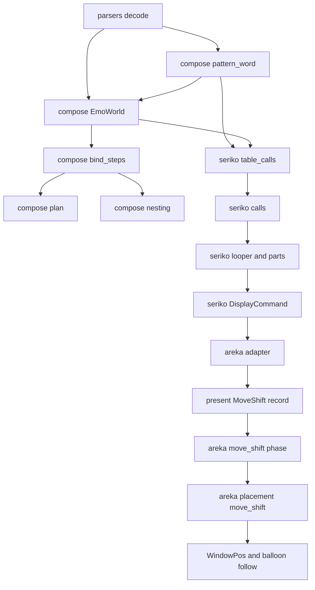
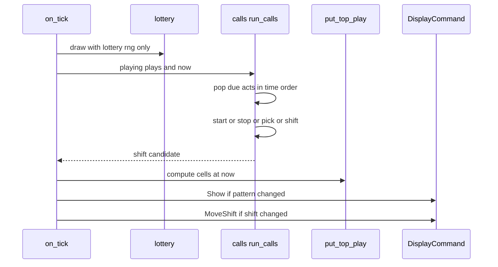
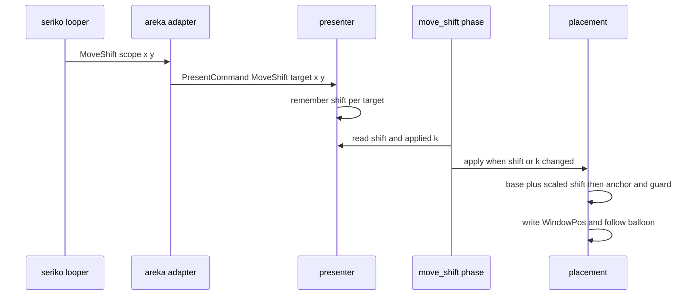

# 設計: seriko-pattern-calls

## Overview

**目的**: シェルの `surfaces.txt` の pattern定義に書いた、アニメーションを呼ぶ 7 語（`start`・`stop`・`alternativestart`・`alternativestop`・`parallelstart`・`parallelstop`・`insert`）と `move` を、正典どおりに働かせる。今はこの 8 語が重ね方の合成メソッドの表に無いため、読み込みのときに「未知の合成メソッド名」の WARN を出し、何も描かず、何も呼ばない。

**使う人**: シェルを作る人と、そのシェルを使う利用者。開発者のゴースト「．さくら」のシェル `master` では、`surface0` などの `alternativestart,(0,1)` でまばたきが動き、`surface12`・`surface22` の `move` で絵が下へずれるようになる。

**変わること**: 8 語を「描く語」から切り離して、pattern の「働き」として扱う。seriko の再生は、別のアニメーションを開始・停止させ、キャラクターの窓のずれを決める。合成は、着せ替え（interval が `bind`）の全部のコマを描き、`insert` で別の着せ替えを差し込む。置き方は、そのずれを窓の位置へ当てる。

### Goals

- 8 語に由来する WARN を 0 件にする。「．さくら」のシェル `master` で確かめる（1.4・9.3）。
- 7 語の呼び出しを、呼び出しのコマの予定の時刻に、待たずに当てる（「時刻は正確に」の原則・3.1）。
- `move` のずれを、キャラクター全体の窓の位置のずれとして運ぶ。表示の倍率をかけ、今の置き方の決まりを後から当てる（7.1・7.5・7.8）。
- SSP で測った M1〜M8 の振る舞いに合わせる（要件 8）。
- 決定論のテストで、時刻と選びを固定して確かめる（9.1〜9.3）。

### Non-Goals

- 旧 SERIKO 1.x の書式の読み取り（`seriko-legacy-pattern-format`）。
- 重ね方の合成メソッドの描画そのもの（`base`・`replace` など。`draw-methods-canon`・`draw-methods-blend`）。
- 台本のタグ `\i[*]`・`\![anim,…]`、`animation*.name` の読み取り（`seriko-script-triggers`）。
- サーフェス番号 `-2`、`animation*.option,exclusive`、`auto`、`move` を切る利用者の設定。
- 書き出しの時刻（`settle_time`）を、呼ばれたアニメーションの長さまで延ばすこと。今は `runonce` の待ちの合計の最大のままにする（9.6 は `move` を写さないことだけを求める）。

## Boundary Commitments

### This Spec Owns

- pattern定義の描画メソッドの欄にある 8 語の見分け（綴りの比べ方は今の合成メソッドと同じ）と、相手の欄の読み（番号 1 つ・候補の並び）。
- 読み手（`areka-parsers`）が、pattern定義の欄 2 の原文を運ぶこと。`(` で始まる欄を `)` まで継ぎ直すことも含む。
- seriko の再生表で、7 語と `move` のコマを「働きのコマ」として持つこと。interval が `never` と純 `bind` のアニメーションは、「呼ばれるだけの相手」として再生表に載せる。
- seriko の再生で、働きのコマを予定の時刻の順に当てること（開始・頭からのやり直し・停止・選び・巡回の止め）。一番上の面・入れ子の部品・バルーンの面のどれにも当てる。
- 選び（`alternative*`）に使う乱数を、抽選の乱数から分けること。
- `move` のずれの値を持つこと。面を出したときに元へ戻すこと。ずれを `DisplayCommand` で外へ出すこと。
- 合成で、有効な純 `bind` の全部のコマを pattern の番号の順に描き、`insert` を展開すること。
- 置き方で、ずれをキャラクターの窓（とバルーンの窓）の位置へ当て、今ある置き方の決まりを後から当てること。
- 8 語にかかわる読み込みのときの記録を、読み込みにつき 1 度だけ出すこと。
- 網羅台帳の 9 行と、`doc/COMPAT_ARCHITECTURE.md` の §8。

### Out of Boundary

- 重ね方の合成メソッドの描画（`base` を描くかどうかを含む）。`base,N` のコマは今のまま描画メソッドのコマとして扱い、描くかどうかは `draw-methods-canon` が決める。
- interval の抽選の規則（`seriko-interval-combinations`・`seriko-trigger-lottery-gaps`）。この spec は抽選の順と乱数の消費を変えない。
- `\i` の口（`seriko-script-triggers`）。この spec は相手を表に載せるところまでを持つ。
- element定義に書いた 8 語の扱い。今の `undrawn.rs` の記録（1 行 1 件の `warn!`・読み込みにつき 1 度）のまま変えない（5.3・6.6 は、このままで満たす）。
- 窓の置き方の決まりそのもの（下揃えの揃え直し・作業領域の中に置く決まり・見える範囲の守り）。この spec はこれらを呼ぶだけで、中身を変えない。

### Allowed Dependencies

- 依存の向きは今のまま: `areka-parsers` → `areka-emo-atlas` → `areka-emo-compose` → `areka-seriko`・`areka-emo-present` → `areka`。
- seriko は emo-compose の新しい語の表（`pattern_word`）を引いてよい。emo-compose は seriko を知らない。
- emo-atlas は emo-compose を引けない。8 語の写しは `manifest.rs` に残す（決めごと 12）。
- 新しい外部クレートは足さない。`bevy_ecs`・`tracing` など、今あるものだけを使う。

### Revalidation Triggers

- `areka_parsers::shell::Pattern` に欄 `target` が増える。構造体の書き方で `Pattern` を作るすべての所（テストが大半）を同じ変更の中で直す。
- `areka_seriko::LoopFrame` に欄 `act` が増え、`LoopTrigger` に `CallOnly` が増え、`SerikoLoopConfig` に欄 `pick_rng` が増え、`DisplayCommand` に 2 つの variant が増える（`#[non_exhaustive]` ではない＝下流の `match` を直す）。
- `PresentCommand` に `MoveShift` が増える（`#[non_exhaustive]`）。
- 合成の規則が変わる: 有効な純 `bind` は pattern0 だけでなく全部のコマを描く。純 `bind` のコマは、着せ替えが無効でも合流する。着せ替えの絵を使う spec（`draw-methods-canon` など）は、この 2 点を前提に見直す。
- `PlacementRoute` に `PatternMove` が増える。置き方の経路を数える見張り（`is_system_reanchor`・見送りが覆う経路・見える範囲の守りを当てる経路）を、同じ変更の中で直す。
- `build_plan` の引数は変えない。並走の `animated-surface-log-flood` が足す `compose_into_reusing` は直さなくてよい。

## Architecture

### Existing Architecture Analysis

- 読み手は「原文を写すだけ・意味は下流」の決まりで書かれている（`model.rs` の `DrawMethod`）。行を欄に割る `split_csv` は `[ ]` の中のカンマしか守らない。
- seriko の再生は、経過時刻から今のコマを毎回計算する（`timeline.rs` の `frame_at`）。「コマを通り過ぎた」という出来事を持たない。過去の時刻に始まった再生を表に入れる先例は、既にある。`runonce` などの `Armed::poll` は開始の時刻を返し、`fire_top_triggers` は `Playback { started_at_ms: 過去 }` を入れる。
- 抽選は面ごとに、animation の番号の昇順で回る（`looper.rs` の D-7）。再生中の animation・`always`・引き金の 3 語は、乱数を引く前に飛ばす。
- 合成は、有効な着せ替えの pattern0 を静的に積み、seriko のコマがあればコマで置き換える（`plan.rs` の `flatten_surface`）。着せ替えの pattern0 の語は、合成のたびに `ComposeMethod::from_name` で引いている。
- 窓の位置は `WindowPos` が唯一の正本である。書き込みはすべて `enqueue_window_set_pos` を通る。下揃えの揃え直しは `project_anchor`、見える範囲の守りは `apply_visibility_guard` が受け持つ。バルーンは `follow_balloon` が「キャラ窓の位置 ＋ 相対 offset」で追う。当たり判定は窓の中の座標なので、窓が動けば一緒に動く。
- 読み込みの記録の手本は 2 つある。emo-compose の `shape_issues`（シェルだけ・`shell_target.rs` が出す）と、seriko の表を作るときの `warn!` である。後者はシェルとバルーンの両方で、読み込みにつき 1 度出る。

### Architecture Pattern & Boundary Map



**どう組み込むか**:
- 採る形: **語の表を 1 か所に置き、働きは表を作るときに解く**。8 語の見分けと相手の欄の読みは emo-compose の `pattern_word.rs` だけが持つ。seriko の表と、合成の着せ替えの手順（`bind_steps`）は、読み込みのときに 1 度だけそこを引く。
- 役目の分け方:
  - 「呼び出し」（開始・停止）は seriko だけが持つ。
  - 「差し込み」（`insert`）は合成だけが持つ。
  - 「ずれ」（`move`）の値は seriko が決め、窓へ当てるのは置き方だけが持つ。
  - 合成は `move` を知らない（書き出しにずれが写らない＝9.6 を構造で満たす）。
- 守る今の形: 再生はコマの計算を経過時刻から行うまま（`frame_at` は変えない・働きのコマを除く `-1` の判定だけを足す）。抽選の順と乱数の消費、`PatternState` の形（emo-present の合成の覚えの鍵）、`build_plan` の引数は変えない。
- 新しい部品が要る理由: 1,000 行の上限に近い `looper.rs`（924）・`table.rs`（901）・`parts.rs`（893）・`actor.rs`（843）・`shell_target.rs`（865）に足す行を減らすため、働きの処理を兄弟の新しいファイルへ置く。
- steering との整合: 時刻は正確に、ログのない失敗の経路を作らない、新しい依存を足さない、テストは兄弟の `*_tests.rs` に置く。

### Technology Stack

| 層 | 選ぶもの / 版 | この機能での役目 | 備考 |
|----|---------------|------------------|------|
| 読み手 | `areka-parsers`（今のまま） | 欄 2 の原文を運ぶ | 依存の追加なし |
| 合成 | `areka-emo-compose` ＋ `bevy_ecs` 0.19 | 語の表・着せ替えの手順の資源 | `EmoWorld` の資源を 1 つ足す |
| 再生 | `areka-seriko` | 働きのコマ・選びの乱数・ずれ | 乱数は今の SplitMix64（`seeded_rng`）を 2 本目に使う |
| 提示 | `areka-emo-present` | ずれの値を表示の対象ごとに覚える | 合成の覚え（`cache.rs`）には触らない |
| 置き方 | `areka`（`placement`・`emo2_boot`） | 窓の位置へずれを当てる | 依存の追加なし |

## File Structure Plan

### Directory Structure

```
crates/
├── areka-parsers/src/shell/
│   ├── model.rs                         # 修正: Pattern に target（欄 2 の原文）
│   ├── decode.rs                        # 修正: pattern定義の欄 2 の継ぎ直しと target
│   ├── decode_tests.rs                  # 修正: mod pattern_target_tests を足す
│   └── decode_tests_pattern_target_tests.rs   # 新規: 欄の読みのテスト
├── areka-emo-compose/src/
│   ├── pattern_word.rs                  # 新規: 8 語の見分けと相手の欄の読み（唯一の正本）
│   ├── pattern_word_tests.rs            # 新規
│   ├── bind_steps.rs                    # 新規: 着せ替えの描く手順（読み込みのときに 1 度）と insert の展開
│   ├── bind_steps_tests.rs              # 新規
│   ├── method.rs                        # 修正: is_move_name を pattern_word へ寄せる・quiet_method
│   ├── world.rs                         # 修正: targets_animation_id を寄せる・BindSteps を作る
│   ├── plan.rs                          # 修正: 着せ替えの静的な寄与を bind_steps へ・D9-3 の門を狭める
│   ├── plan_extent.rs                   # 修正: 純 bind は全部のコマを外形に数える
│   ├── nesting.rs                       # 修正: bind_targets を BindSteps から・③の門を狭める
│   └── lib.rs                           # 修正: mod 2 行と pub use
├── areka-emo-atlas/src/manifest.rs      # 修正: bind_only_paths の語の写しに move を足す
├── areka-seriko/src/
│   ├── table_calls.rs                   # 新規: 働きのコマを作る・読み込みのときの検査と記録
│   ├── table_calls_tests.rs             # 新規
│   ├── table_calls_dot_sakura_tests.rs  # 新規: 「．さくら」で WARN 0 件
│   ├── calls.rs                         # 新規: 働きのコマを時刻の順に当てる純粋な係
│   ├── looper_calls.rs / parts_calls.rs # 新規（実装で分けた）: 一番上・部品の口（CallPlays の実装・ずれの持ち主 Shifts）
│   ├── calls_tests.rs                   # 新規
│   ├── looper_calls_tests.rs            # 新規: 一番上・バルーンの結合のテスト
│   ├── parts_calls_tests.rs             # 新規: 部品の結合のテスト
│   ├── table.rs                         # 修正: LoopFrame.act・CallOnly・table_calls を呼ぶ
│   ├── timeline.rs                      # 修正: frame_at の -1 判定を描くコマだけに・visible_frame
│   ├── looper.rs                        # 修正: pick_rng・Playback.acts_through・calls を呼ぶ・ずれ
│   ├── looper_trigger.rs                # 修正: Playback の欄
│   ├── parts.rs                         # 修正: PartAnim の欄・calls を呼ぶ・visible_frame
│   ├── parts_trigger.rs / trigger.rs    # 修正: CallOnly の腕
│   ├── actor.rs                         # 修正: 面を出したときにずれを戻す
│   ├── output.rs                        # 修正: DisplayCommand::MoveShift / MoveShiftBalloon
│   └── lib.rs                           # 修正: mod 2 行と pub use（FrameAct）
├── areka-emo-present/src/
│   ├── command.rs                       # 修正: PresentCommand::MoveShift
│   └── presenter/{hub.rs, target.rs, read.rs}   # 修正: ずれを覚えて読ませる
│   └── presenter/read_move_shift_tests.rs       # 新規
└── areka/src/
    ├── emo2_boot/adapter.rs             # 修正: MoveShift の写し
    ├── emo2_boot/mod.rs                 # 修正: pick_rng の種と info!
    ├── emo2_boot/frame.rs               # 修正: ずれの相を移動の相の後に呼ぶ
    ├── emo2_boot/frame/move_shift.rs    # 新規: ずれの相（提示の値 → 置き方）
    ├── emo2_boot/frame/move_shift_tests.rs      # 新規
    ├── placement/follow.rs              # 修正: mod move_shift と再輸出
    ├── placement/follow/move_shift.rs   # 新規: ずれの記録（部品）と窓への当て方
    ├── placement/follow_move_shift_tests.rs     # 新規（既存の並びに合わせた置き場）
    ├── placement/diag.rs                # 修正: PlacementRoute::PatternMove（is_system_reanchor の判定もここ＝見える範囲の守りの経路はこれで足りる）
    ├── placement/follow/window_move.rs  # 修正: 見送りが覆う経路に足す（2 行・上限超えの例外表に既にある）
    ├── placement/follow/drag_follow.rs  # 修正（967 行・上限に近い）: follow_balloon とキャラ・バルーンのドラッグの終わりに、move_shift.rs の口を呼ぶ 1〜2 行ずつだけ
    ├── placement/persist.rs             # 修正（928 行・上限に近い）: 保存のときに move_shift.rs の origin_position を呼ぶ 1 行だけ
    └── placement/follow/sticky_follow.rs        # 修正: 組の相手の保存でずれを引く（origin_position を呼ぶ）
doc/
├── ukadoc-coverage/ledger/assets.toml   # 修正: 9 行
└── COMPAT_ARCHITECTURE.md               # 修正: §8
```

### Modified Files（機械的な追随）

- `Pattern { … }` を構造体の書き方で作る所（約 24 ファイル・テストが大半・`emo-atlas`・`emo-compose`・`emo-present`・`parsers`・`seriko`）: `target: String::new()`（または欄 2 の原文）を足す。
- `SerikoLoopConfig { … }` を書く所（文字列では 31 件当たる・構造体の定義などを含むので、構造体の書き方で作る所の数はタスクの段で数え直す）: `pick_rng` を足す。`SerikoLoopConfig::disabled()` は `seeded_rng(0)` を入れる。
- `Playback { started_at_ms }` を作る 3 か所と `PartAnim::Playing { started_at_ms }`: `acts_through: None` を足す。
- `LoopFrame { … }` を作る 8 か所（`table.rs`・`timeline.rs`・`timeline_repeat_tests.rs`）: `act: FrameAct::Draw` を足す。

## System Flows

### 刻みの中の働きのコマ（一番上・部品・バルーンで同じ）



- 抽選は今と同じ位置で、今と同じ乱数だけを使う。`CallOnly` の animation は、乱数を引く前に飛ばす（3.6・11.1・11.3）。
- `run_calls` は、引き金の判定（`fire_top_triggers`）と `always` の始まり（`start_top_always`）の**後**、コマを置く前に走る。だから、この刻みで始まった再生の頭の働きのコマも、同じ刻みで当たる。
- 置く段（`put_top_play`）は、`run_calls` が直した再生の表を読む。だから、呼ばれて始まった相手の今のコマも、同じ刻みの `Show` に載る（1 フレーム遅らせない）。
- 出来事の時刻で動く `refresh`（台本の合図）も、頭のコマを置く前に同じ `run_calls` を呼ぶ。

### `move` のずれ



- ずれは `Show` と同じ流れ（同じ mpsc・同じ FIFO）で届く。だから、絵の変化とずれの順は崩れない。
- ずれの相は、移動の相（`run_move_drain_phase`）の後に毎フレーム走る。提示が覚えた値と倍率 k が、窓に当てた記録と同じなら何もしない。

## Requirements Traceability

| 要件 | 要約 | 部品 | 口 | 流れ |
|------|------|------|----|------|
| 1.1 | 8 語を重ね方として扱わない | PatternWord・TableCalls・BindSteps | `pattern_word`・`quiet_method` | 読み込み |
| 1.2 | 綴りの比べ方を揃える | PatternWord | `canonical_method_name` を使う | — |
| 1.3 | 欄 2 を面の番号にしない・絵を重ねない | TableCalls・Timeline・BindSteps | `FrameAct`・`visible_frame` | 刻み |
| 1.4 | 「．さくら」で WARN 0 | TableCalls・Plan | テスト `table_calls_dot_sakura_tests` | — |
| 1.5 | ほかの語は今のまま | TableCalls・BindSteps | 8 語以外は `from_name`／`shape_issues` のまま | — |
| 2.1 | start・stop・insert の欄 2 を番号で読む | PatternWord | `call_targets` | 読み込み |
| 2.2 | 候補の並びを 1 つに読む | Decode・PatternWord | `Pattern.target`・`call_targets` | 読み込み |
| 2.3 | `[ ]`・`.` も同じ並び | PatternWord | `call_targets` | — |
| 2.4 | 呼び出しの待ち・座標を無視・欠けた行 | TableCalls | 呼び出しの 6 語と insert の `wait_ms` を 0 に | 刻み |
| 2.5 | 読めない欄は何もしない・1 度記録 | TableCalls | `FrameAct::Inert`・`warn!` | 読み込み |
| 2.6 | ほかの行の読みを変えない | Decode | 継ぎ直しは pattern定義の欄 2 が `(` で始まるときだけ | — |
| 2.7 | 版の宣言に依らない | Decode | 今のまま | — |
| 3.1 | start を待たずに pattern0 から | TableCalls・Calls | `run_calls` | 刻み |
| 3.2 | parallelstart は同じ時刻に全部 | Calls | `FrameAct::Start { pick_one: false }` | 刻み |
| 3.3 | alternativestart は等しく 1 つ | Calls | `pick_rng(len)` | 刻み |
| 3.4 | 呼んだ側は止めずに進む | Calls・Timeline | 呼んだ側の再生はそのまま | 刻み |
| 3.5 | 呼ばれた側は今の規則で | Calls・Looper | `Playback` を入れるだけ | 刻み |
| 3.6 | 選びで抽選を変えない | Looper | `SerikoLoopConfig.pick_rng`（別の乱数） | 刻み |
| 3.7 | 選びを決め打てる | Looper | `pick_rng` の注入 | — |
| 3.8 | 部品とバルーンにも同じ規則 | Calls・Parts・Looper・MoveShiftPlacement | `CallPlays` の 2 つの実装 | 刻み |
| 3.9 | 再生中の相手は頭からやり直す | Calls | 開始は `Playback` の置き換え | 刻み |
| 4.1 | stop は -1 と同じ見え方 | Calls | `CallPlays::stop` | 刻み |
| 4.2 | parallelstop は同じ時刻に全部 | Calls | `FrameAct::Stop { pick_one: false }` | 刻み |
| 4.3 | alternativestop は全部の候補から | Calls | `pick_rng(len)`・再生中で絞らない | 刻み |
| 4.4 | 再生中でなければ何もしない | Calls | `stop` は無い再生を無視 | 刻み |
| 4.5 | 止めた後は -1 と同じ扱い | Calls・Looper | 再生を外すだけ（`always` は面を出し直すまで止めたまま） | 刻み |
| 5.1 | 相手が無い・未知の interval | TableCalls | `warn!` 1 度・実行時は何もしない | 読み込み |
| 5.2 | 巡回で固まらない | Calls | 同じ時刻の開始の集合 | 刻み |
| 5.3 | 着せ替え・element定義の使えない語 | TableCalls・undrawn.rs（今のまま） | `FrameAct::Inert`・`warn!` 1 度 | 読み込み |
| 5.4 | 記録を繰り返さない | TableCalls・Plan | 表を作るときだけ記録・合成のたびの記録なし | — |
| 5.5 | 着せ替えの未知の語も 1 度 | BindSteps・Plan | `quiet_method`（`shape_issues` が 1 度出す） | 読み込み |
| 5.6 | 無効の着せ替えも start で描く | TableCalls・Plan・Nest | `CallOnly`・D9-3 の門を `bind+random` だけに | 刻み・合成 |
| 5.7 | 有効の着せ替えは stop で消えない | BindSteps・Calls | 静的な寄与は再生と別 | 合成 |
| 6.1 | insert の位置に B を描く・本来の位置では描かない | BindSteps | `push_bind_contribution` | 合成 |
| 6.2 | B が無効なら何も描かない | BindSteps | 同上 | 合成 |
| 6.3 | 入れ子に差し込む | BindSteps | 再帰の展開 | 合成 |
| 6.4 | 巡回でも 1 度だけ描く・1 度記録 | BindSteps・TableCalls | 展開の集合・`warn!` 1 度 | 合成・読み込み |
| 6.5 | 相手が無い・bind でない | BindSteps・TableCalls | 手順に入れない・`warn!` 1 度 | 読み込み |
| 6.6 | 着せ替えでない・element定義 | TableCalls・undrawn.rs（今のまま） | `FrameAct::Inert`・`warn!` 1 度 | 読み込み |
| 6.7 | insert の行の座標を使わない | BindSteps | B 自身の座標で描く | 合成 |
| 6.8 | 有効な純 bind の全部のコマを順に | BindSteps・PlanExtent・Nest | `BindSteps` | 合成 |
| 7.1 | ウェイトの後にキャラクター全体をずらす・倍率をかける | TableCalls・Calls・MoveShiftPlacement | `FrameAct::Move`・`scale_signed` | ずれ |
| 7.2 | 次の move は元からの新しいずれ | Calls | ずれは絶対値・最後の値が勝つ | 刻み |
| 7.3 | 瞬間的に | Calls・MoveShiftPlacement | 補わない | ずれ |
| 7.4 | move の欄 2 を無視 | TableCalls | `FrameAct::Move` は欄 2 を読まない | — |
| 7.5 | 窓の大きさを変えない・欠けさせない | MoveShiftPlacement | 位置だけを書く | ずれ |
| 7.6 | 面を出したときだけ戻す | Looper・Actor | `on_surface_shown` | ずれ |
| 7.7 | base の後の move も土台ごと | Timeline・MoveShiftPlacement | 働きのコマは欄を書き換えない | 刻み |
| 7.8 | ずらした後に置き方の決まり | MoveShiftPlacement | `project_anchor`・`apply_visibility_guard` | ずれ |
| 8.1 | M1〜M7 を SSP と同じに | Calls・BindSteps・MoveShiftPlacement | 各行の決め（§決めの表） | — |
| 8.2 | 測りの記録 | research.md §3（済み） | — | — |
| 8.3 | SSP が黙るところも記録する | TableCalls | `warn!` 1 度 | 読み込み |
| 9.1 | 働きの決定論のテスト | 各 `*_tests.rs` | 時計と `pick_rng` の注入 | — |
| 9.2 | 並びの読み・境目のテスト | `decode_tests_pattern_target_tests`・`pattern_word_tests`・`table_calls_tests` | — | — |
| 9.3 | 「．さくら」の WARN 0 のテスト | `table_calls_dot_sakura_tests` | `sample_test_support` | — |
| 9.4 | 実機の 1 回 | 確かめの手順（Testing Strategy） | — | — |
| 9.5 | 既存のテストを通す | 全体 | — | — |
| 9.6 | 書き出しに move を写さない | Looper（ずれは `PatternState` の外）・settle | `settle_surface` は今のまま | — |
| 10.1 | 台帳の 9 行 | 文書 | — | — |
| 10.2 | §8 の読み | 文書 | — | — |
| 11.1 | never は抽選しない・相手として載せる | TableCalls・Looper | `LoopTrigger::CallOnly` | 読み込み |
| 11.2 | never も同じ規則で | Calls | 同上 | 刻み |
| 11.3 | 抽選の結果を変えない | Looper | `CallOnly` は乱数を引く前に飛ばす | 刻み |
| 11.4 | 未知の interval は今のまま | TableCalls | 今の `debug!` の非採録のまま | — |

### SSP の測りと決めの対応（8.1）

| 印 | 決め | 部品 |
|----|------|------|
| M1 | 再生中の相手を呼んでも、pattern0 から頭でやり直す | Calls（開始は再生の置き換え） |
| M2 | `alternativestop` は並びの全部から選ぶ。再生していない相手を選べば何もしない | Calls |
| M3 | ずれは終わり・`stop`・`-1` では戻らない。面を出したとき（同じ面を含む）にだけ戻る | Looper・Actor |
| M4 | キャラクター全体を窓ごとずらす（窓の大きさは同じ） | MoveShiftPlacement |
| M5 | 無効の純 `bind` を `start` すると描く。有効の純 `bind` を `stop` しても消えない | TableCalls・Plan・BindSteps |
| M6 | 有効な純 `bind` は全部のコマを番号の順に重ねる。どのコマの `insert` もその位置に差し込む | BindSteps |
| M7 | `base` の後の `move` は、差し替えた土台もずらし、`base` のコマを消さない | Timeline（働きのコマは欄を書き換えない） |
| M8 | 書き出しにずれは写らない | Looper（ずれは `PatternState` に入らない） |

## Components and Interfaces

| 部品 | 層 | 役目 | 要件 | 主な依存 | 契約 |
|------|----|------|------|----------|------|
| Decode（欄 2） | parsers | 欄 2 の原文を `Pattern.target` に運ぶ | 2.2, 2.6, 2.7 | — | State |
| PatternWord | emo-compose | 8 語の見分け・相手の欄の読み | 1.1, 1.2, 2.1–2.3 | method.rs（P0） | Service |
| BindSteps | emo-compose | 着せ替えの描く手順・insert の展開 | 5.5–5.7, 6.1–6.8 | PatternWord（P0）・EmoWorld（P0） | Service, State |
| Plan / PlanExtent / Nest の修正 | emo-compose | 手順を使う・純 bind の外形・門を狭める | 5.6, 6.8 | BindSteps（P0） | — |
| TableCalls | seriko | 働きのコマを作る・読み込みのときに検査する | 1.1, 1.3–1.5, 2.4, 2.5, 5.1, 5.3, 6.4–6.6, 7.4, 8.3, 11.1, 11.4 | PatternWord（P0） | Service |
| Calls | seriko | 働きのコマを時刻の順に当てる | 3.1–3.9, 4.1–4.5, 5.2, 7.1–7.3 | Timeline（P0） | Service |
| Looper / Parts / Actor の修正 | seriko | Calls を呼ぶ・選びの乱数・ずれの持ち主 | 3.6–3.8, 7.6, 9.6, 11.3 | Calls（P0） | State, Event |
| MoveShift の伝達 | seriko → areka → present | ずれを提示の対象ごとに覚える | 7.1, 7.6 | adapter（P0） | Event, State |
| MoveShiftPlacement | areka | ずれを窓の位置へ当てる | 7.1, 7.3, 7.5, 7.8, 3.8 | placement（P0）・presenter（P0） | Service, State |

### 読み手（areka-parsers）

#### Decode（欄 2）

| 欄 | 中身 |
|----|------|
| Intent | pattern定義の欄 2 の原文を、意味を解かずに運ぶ |
| Requirements | 2.2, 2.6, 2.7 |

**責務と制約**
- `Pattern` に `pub target: String` を足す。中身は欄 2 の原文（前後の空白は落とす。今の `split_csv` と同じ）。
- `decode_animations` の pattern定義の枝で、欄 2 が `(` で始まり、その欄に `)` が無いときだけ、`)` を含む欄（無ければ行の終わり）までを `,` で継ぎ直して 1 つの `target` にする。待ち・X・Y は、継ぎ直した欄の次から読む。
- 語の意味（どの語が並びを取るか）は知らない。だから「原文を写すだけ」の決まりのままである。継ぎ直しはこの 1 か所だけで、見出しの行・element定義・collision定義・ほかの欄には一切触れない（2.6）。
- `surface_id` は今のまま `field_i64(fields, 2)`（並びなら 0）。8 語では下流が読まない。

**契約**: State [x]

```rust
pub struct Pattern {
    pub index: u32,
    pub method: DrawMethod,
    pub surface_id: i64,
    /// 欄 2 の原文（`(` で始まる並びは `)` まで継ぎ直した原文）。8 語の相手の欄として下流が読む。
    pub target: String,
    pub wait: u32,
    pub x: i64,
    pub y: i64,
}
```

**実装の注**
- 確かめ: `(0,1)`・`( 0 , 1 )`・`(0.1)`・`[0,1]`・`[0.1]`・閉じない `(0` と、欄が欠けた行（`alternativestart,(0,1)`）を `decode_tests_pattern_target_tests.rs` で固定する。並びでない語の行（`overlay,10,50,0,0`）の結果が変わらないことも固定する。

### 合成（areka-emo-compose）

#### PatternWord

| 欄 | 中身 |
|----|------|
| Intent | 描画メソッドの語が 8 語のどれか、相手の番号はどれかを答える唯一の所 |
| Requirements | 1.1, 1.2, 2.1, 2.2, 2.3 |

**責務と制約**
- 綴りの比べ方は `canonical_method_name`（前後の空白を落とす・小文字にする・`-` と `_` を除く）を使う。
- `world.rs` の `targets_animation_id` と `method.rs` の `is_move_name` は、ここへの薄い呼び出しにする（今の呼び手はそのまま）。
- 記録は出さない（照会だけ）。

**契約**: Service [x]

```rust
/// pattern定義の描画メソッドの語の種類。
pub enum PatternWord {
    /// 8 語のどれでもない（重ね方の語・未知の語）。
    Draw,
    Start, Stop, AlternativeStart, AlternativeStop, ParallelStart, ParallelStop,
    Insert,
    Move,
}

pub fn pattern_word(method: &str) -> PatternWord;

/// 相手の欄が読めなかった（空・数でない・名前を含む・並びが空）。
pub struct UnreadableTarget;

/// `start`・`stop`・`insert` は番号 1 つ、並びの 4 語は `(…)`／`[…]` の中を `,` か `.` で割った番号の列。
/// 括弧の無い数だけの欄も並びの語では 1 つの並びとして受ける。番号は animation の番号（0 以上）。
/// Draw と Move には呼ばない（呼べば Err）。
pub fn call_targets(word: PatternWord, target: &str) -> Result<Box<[u32]>, UnreadableTarget>;
```
- emo-atlas の `manifest.rs` の `bind_only_paths` は emo-compose を引けないので、7 語の写しを持つ。この写しに `move` を足し、欄 2 を面の番号として数えないようにする（1.3）。写しを持つ旨の注記は今のまま両方に残す。
- 事前条件: `target` は `Pattern.target`。
- 事後条件: Ok の列は空でない。書いた順を保ち、重複も残す（重複の開始は巡回の止めが 1 度にする）。

#### BindSteps

| 欄 | 中身 |
|----|------|
| Intent | 着せ替えが描く手順を読み込みのときに 1 度だけ作り、合成と入れ子の辺が同じ手順を使う |
| Requirements | 5.5, 5.6, 5.7, 6.1–6.8 |

**責務と制約**
- `EmoWorld::build_with_images` の終わりで資源 `BindSteps`（面の番号 × animation の番号 → 手順の列）を作る。対象は interval が `bind` 種（`Bind`・`BindRandom`）の animation である。
  - 純 `bind`（`Interval::Bind`）: 全部の pattern を番号の昇順にたどる（6.8・M6）。
  - `bind+random`: 今のまま pattern0（`index == 0`）だけ。`bind+random` の 2 コマ目以降は seriko が再生するコマであり、静的に描くと閉じ目が目を覆う実機の欠陥（`plan.rs` の今の注記）に戻るからである。
- 各 pattern の扱い:
  - `pattern_word` が `Draw` で、`quiet_method` が描く語（今は `Overlay`）、かつ番号が 0 以上 → `Draw { surface, x, y }`。
  - 純 `bind` の `Insert` で、相手が同じ面の純 `bind` → `Insert { target }`。
  - それ以外（描かない語・負の番号・`bind+random` の `insert`・読めない相手・7 語の呼び出しと `move`）→ 手順に入れない。
- 記録は出さない。描かない語の記録は今の `shape_issues`（`UndrawnPattern`・シェルの読み込みにつき 1 度）が出す。8 語の記録は seriko の TableCalls が 1 度出す。`plan.rs` の合成のたびの `ComposeMethod::from_name` は消える（5.5）。
- `push_bind_contribution` は、`flatten_surface` の今の「コマ無しの有効 bind pattern0 静的経路」の代わりに呼ぶ。
  - 有効な純 `bind` A の手順を順に積む。`Insert { B }` は、B が有効なら、その位置で B の寄与（B に今のコマがあればそのコマ、無ければ B の手順）を B 自身の座標で積む（6.1・6.3・6.7）。B が無効なら何も積まない（6.2）。
  - 1 つの段の中で、差し込まれた B は、B の本来の番号の位置では積まない（6.1）。差し込む A が無効で展開されなかったときは、B は本来の位置に積む（正典は「表示順を予約するだけ」と書くので、予約が効かなければ本来の位置に戻す＝areka の読み）。この読みと次の「2 つの差し込み手」の読みは、SSP のオフラインダンプで測って確かめた（2026-10-30 設計議題 4・research.md §6.1）。
  - 1 つの段の中で、各着せ替えは 1 度だけ積む。展開中の A を再び差し込もうとした（巡回）ら、その枝を打ち切る。2 つの着せ替えが同じ B を差し込むときは、描く順で先に当たった方だけが積む（6.4）。
- 入れ子の辺（`nesting.rs` の `bind_targets`）と外形（`plan_extent.rs`）も同じ規則に揃える。
  - 入れ子の辺: `bind_targets` は `BindSteps` の `Draw` の相手から作る（純 `bind` は全部のコマ）。
  - 外形: 純 `bind` を `always` と同じく全部の pattern で数える（8 語と負の番号は数えない）。

**契約**: Service [x] / State [x]

```rust
pub(crate) enum BindStep {
    Draw { surface: u32, x: i64, y: i64 },
    Insert { target: u32 },
}

/// EmoWorld の資源（読み込みのときに 1 度作る・以後は読むだけ）。
pub(crate) struct BindSteps(BTreeMap<(u32, u32), Box<[BindStep]>>);

impl EmoWorld {
    pub(crate) fn bind_steps(&self, surface: u32, animation: u32) -> &[BindStep];
}

/// flatten_surface の層 (ii) の「コマ無しの有効 bind」の寄与を積む（insert を展開する）。
#[allow(clippy::too_many_arguments)]
pub(crate) fn push_bind_contribution(/* flatten_surface と同じスクラッチ・入力・offset ＋ 段の描いた集合 */);
```
- 不変: `build_plan` の引数と戻り値は変えない。`compose_into` と並走の `compose_into_reusing` は直さない。

**実装の注**
- D9-3 の門（`plan.rs` の `is_bind_animation`・`nesting.rs` の ③）を **`bind+random` だけ**に狭める。純 `bind` は今まで seriko のコマを持たなかったので、コマがあれば呼ばれて始まったものだけである。無効でも合流させる（5.6・M5）。`bind+random` の守り（外れた着せ替えの保持コマを出さない）は今のまま残る。
- 有効な純 `bind` に今のコマ（呼ばれて始まったもの）があれば、今の規則どおりコマが静的な寄与を置き換える。`stop` でコマが消えれば、静的な寄与（全部のコマ）に戻る＝消えない（5.7・M5）。
- 確かめ: `bind_steps_tests.rs` で、3 コマの A（後ろ・`insert,B`・前）と B、B が無効、入れ子、巡回、2 つの差し込み手、`bind+random` の pattern0 だけ、を固定する。合成を何度組んでも「未知の合成メソッド名」が 1 件も出ないことを `log_capture` で固定する（5.5）。

### 再生（areka-seriko）

#### TableCalls

| 欄 | 中身 |
|----|------|
| Intent | 再生表のコマを、描くコマと働きのコマに分けて作り、8 語の誤りを読み込みのときに 1 度だけ記録する |
| Requirements | 1.1, 1.3, 1.4, 1.5, 2.4, 2.5, 5.1, 5.3, 5.4, 6.4, 6.5, 6.6, 7.4, 8.3, 11.1, 11.4 |

**責務と制約**
- `table.rs` の interval の振り分け:
  - `Interval::Bind`（純 `bind`）と `Other("never")` → `LoopTrigger::CallOnly`（抽選しない・呼ばれたときだけ再生する）。
  - 未知の語は今のまま `debug!` で非採録（11.4）。
- コマの作り方（`loop_frame`）:
  - `pattern_word` が `Draw` → 今と同じ（`method` は `ComposeMethod::from_name`＝8 語以外の記録は今と同じ・1.5）。`act: FrameAct::Draw`。
  - 呼び出しの 6 語 → `FrameAct::Start { targets, pick_one }`／`FrameAct::Stop { targets, pick_one }`。`wait_ms` は 0（2.4）。
  - `move` → `FrameAct::Move`。`wait_ms`・`x`・`y` はそのコマのまま（7.1）。欄 2 は読まない（7.4）。
  - `insert` → `FrameAct::Inert`（差し込みは合成が持つ・再生では何もしない・`wait_ms` は 0）。
  - 相手が読めない・使えない所 → `FrameAct::Inert`（何もしない）。
  - 働きのコマの `method` は `ComposeMethod::Unknown(語)` を記録なしで入れる（使われない）。
- 面ごとの表を作った後、次を検査して、1 件ごとに 1 度だけ `warn!` を出す（面・animation・pattern・語・原文の欄）。表を作るのは読み込みにつき 1 度（シェルの表は 1 度、バルーンはスコープの読み込みごとに 1 度、オフラインの書き出しは自分の読み込みで 1 度）なので、5.4 を満たす。
  1. 相手の欄が読めない（2.5）。
  2. 呼び出しの相手の番号が、その面の再生表に無い（定義が無い・interval が未知の語・`k == 0` などで載らない）（5.1）。実行時はその相手だけ何もしない（並びの中の別の相手は働く）。
  3. 純 `bind` の animation に呼び出しの 6 語か `move` がある（5.3）。そのコマは `Inert`。
  4. `insert` が純 `bind` でない animation にある（6.6）。
  5. `insert` の相手が、その面に無いか、純 `bind` でない（6.5）。
  6. 純 `bind` の `insert` が巡回する（6.4）。
- `has_animated_parts` の数えから、働きのコマを外す（欄 2 を面の番号として数えない・1.3）。
- 「着せ替え」を純 `bind` と読む: 要件 5.3・5.6・5.7・6 の括弧書き「interval が `bind`」どおりである。`bind+random` は抽選で動く animation として、ほかの `random` と同じに 7 語と `move` を働かせる。

**契約**: Service [x]

```rust
pub enum FrameAct {
    /// 描くコマ（今までのコマ）。
    Draw,
    /// start・parallelstart（pick_one=false）／alternativestart（pick_one=true）。
    Start { targets: Box<[u32]>, pick_one: bool },
    /// stop・parallelstop（pick_one=false）／alternativestop（pick_one=true）。
    Stop { targets: Box<[u32]>, pick_one: bool },
    /// move: このコマの x・y が元の表示位置からのずれ（面の画素）。
    Move,
    /// 何もしない（insert・読めない相手・使えない所）。
    Inert,
}

pub struct LoopFrame {
    pub surface_id: i64,
    pub picture: Option<u32>,
    pub method: ComposeMethod,
    pub act: FrameAct,
    pub wait_ms: u32,
    pub x: i64,
    pub y: i64,
}

pub enum LoopTrigger { /* 今の 6 つ */ CallOnly }
```

**実装の注**
- `timeline.rs`:
  - `frame_at` の `Stopped` は、描くコマ（`act == Draw`）の負の番号だけにする（`move,-1,…` で止めない）。
  - `visible_frame(frames, i) -> Option<usize>`（`i` 以下で最後の描くコマ）を足す。一番上と部品が共有する。
  - 働きのコマが今のコマでも、欄には `visible_frame` のコマを置く。無ければ欄を外す。だから働きのコマは絵を重ねない（1.3）。`move` や呼び出しの後も前の絵（`base,2` を含む）が残る（7.7・M7）。
- 確かめ: `table_calls_tests.rs` で語ごとの `FrameAct`・待ちの 0・6 種の記録が 1 度だけ・`never`／純 `bind` が `CallOnly`・未知の interval は載らない、を固定する。`table_calls_dot_sakura_tests.rs` で「．さくら」のシェル `master` から表と `shape_issues` を作り、8 語に由来する `warn` が 0 件で、`surface0` の animation2 が `Start { targets: [0, 1], pick_one: true }` であることを固定する（1.4・9.3）。

#### Calls

| 欄 | 中身 |
|----|------|
| Intent | 前の刻みから今までに来た働きのコマを、予定の時刻の順に当てる純粋な係 |
| Requirements | 3.1–3.9, 4.1–4.5, 5.2, 7.1–7.3 |

**責務と制約**
- 再生中の各 animation について、まだ当てていない働きのコマのうち、予定の時刻 `at = 開始 + 累積の待ち`（`always` は周ごとに繰り返す）が `now` 以下のものを集める。時刻・animation の番号・pattern の番号の昇順の待ち行列で 1 つずつ当てる。
- 当てる前に、その出来事の再生が今も同じ開始の時刻で生きているかを確かめる。止められた・やり直された再生の出来事は捨てる。
- 当て方:
  - `Start`: 相手の再生を `開始 = at` で置き換える（頭からやり直す・3.1・3.9・M1）。相手の頭からの働きのコマも同じ待ち行列に入る（同じ刻みで連なる）。
  - `Stop`: 相手の再生と欄を外す（`-1` と同じ見え方・4.1）。再生していなければ何もしない（4.4）。相手が `always` なら、止めた印を `(scope, 面の段, animation)` ごとに残し、`start_top_always` はその印がある間は始め直さない。印は面を出したとき（同じ面の出し直しを含む・`on_surface_shown`）に消す（SSP の測り M2 で、止めた `always` は 0.1 秒後も止まったままだった・2026-10-30 設計議題 1）。
  - `pick_one`: `pick_rng(len)` で並びの全部から 1 つを選ぶ（3.3・4.3・M2）。並びの重さは等しい。
  - `Move`: ずれの候補を `(at, x, y)` にする。後の時刻が勝つ（ずれは元の表示位置からの絶対値＝7.2・7.3）。
- 巡回の止め: 1 つの時刻 `at` の中で、同じ animation を 2 度目に始めようとしたら何もしない（`debug!` だけ）（5.2）。待ちの合計が 0 の巡回は同じ時刻に閉じるので必ず止まる。待ちが正の巡回は時刻が進むので、1 回の刻みの中の数は「刻みの間 ÷ 待ち」までに限られる。
- 相手の番号が表に無いときは何もしない（記録は TableCalls が読み込みのときに 1 度出し済み）。
- 呼んだ側の再生は止めない（3.4）。

**契約**: Service [x]

```rust
/// 再生中の表（一番上は SlotPlayback、部品は Container の clocks）を Calls から見る口。
pub(crate) trait CallPlays {
    /// 再生中なら (開始の時刻, 働きのコマを当て終えた時刻)。
    fn playing(&self, animation: u32) -> Option<(u64, Option<u64>)>;
    fn set_acts_through(&mut self, animation: u32, through_ms: u64);
    /// 開始の時刻 at で頭から始める（今の再生は置き換える）。
    fn start(&mut self, animation: u32, at_ms: u64);
    /// 再生と欄を外す（-1 と同じ）。
    fn stop(&mut self, animation: u32);
    fn playing_ids(&self) -> Vec<u32>;
}

pub(crate) struct CallOutcome {
    /// この刻みで最後に当たった move（時刻・x・y）。無ければ None。
    pub shift: Option<(u64, i64, i64)>,
}

pub(crate) fn run_calls(
    plays: &mut impl CallPlays,
    animation_of: impl Fn(u32) -> Option<&LoopAnimation>,
    now_ms: u64,
    pick: &mut LoopRng,
) -> CallOutcome;
```
- 実装は 2 つ: 一番上は、その面の段の `SlotPlayback` と、作りかけの欄 `new_pattern` を一緒に借りる（`stop` が欄も外すため）。部品は `Container` の clocks と、部品の欄を借りる。`Residual`（終わって最後のコマを残したもの）は再生中に数えない（一番上で再生の表から外れた最後のコマと同じ）。
- 事前条件: `plays` の各再生の開始の時刻は `now_ms` 以下。
- 事後条件: 予定の時刻が `now_ms` 以下の働きのコマはすべて当て終えている（`acts_through` が進む）。乱数は `pick` だけから引く。
- 不変: 抽選の乱数には触らない。

**実装の注**
- 確かめ: `calls_tests.rs` で、遅れた刻み（呼ばれた側の開始が刻みの時刻でなく予定の時刻）・再生中の相手のやり直し・`parallel*` の同じ時刻・決め打った `pick` での選び・自分を呼ぶ／呼び合う巡回・止めた相手の後の出来事を捨てる・`move` の最後の値、を固定する。

#### Looper / Parts / Actor の修正

| 欄 | 中身 |
|----|------|
| Intent | Calls を一番上・部品・バルーンの刻みと合図に組み込み、選びの乱数とずれの持ち主になる |
| Requirements | 3.6, 3.7, 3.8, 7.6, 9.6, 11.1, 11.3 |

**責務と制約**
- `SerikoLoopConfig` に `pub pick_rng: LoopRng` を足す。`LoopRuntime` はこれを選びにだけ使う（3.6・3.7）。本番（`emo2_boot/mod.rs`）は、抽選の種とは別の `RandomState` の種で `seeded_rng` を作り、今の `info!` に 2 つの種を並べて出す（再現の手がかり）。`settle_surface` は `seeded_rng(0)`（書き出しは決定論）。
- 3.6 の読み: 選びは抽選の乱数を 1 つも引かない。呼び出しが animation を始めれば、その animation は再生中として抽選から外れる（今の規則「再生中は抽選せず乱数も引かない」）。だから、呼び出しを持つシェルで抽選に回る順が変わるのは、呼び出しそのものの結果である。呼び出しを持たないシェル（`never` のアニメーションだけを足したシェルを含む）では、同じ種なら今と同じ時刻に同じアニメーションが始まる。テストはこの 2 つで固定する。
- 抽選（`on_tick` の (b)）は `LoopTrigger::CallOnly` を、`Always` と同じく乱数を引く前に飛ばす（11.1・11.3）。`trigger.rs`・`looper_trigger.rs`・`parts.rs`・`parts_trigger.rs` の `match` にも同じ腕を足す（引き金の判定はしない）。
- `Playback` に `acts_through: Option<u64>` を足す（`PartAnim::Playing` にも同じ欄）。
- 一番上: 面の段ごとに、`fire_top_triggers` の後、再生中の番号の写しを取る前に、`SlotPlayback` を `CallPlays` として `run_calls` を呼ぶ。部品: `PartClocks` の `advance`／`refresh` の中で、その部品の `Container` の clocks を `CallPlays` として同じ関数を呼ぶ（相手は同じ部品の面の animation）。`refresh` も頭のコマを置く前に呼ぶ（合図の時刻で当てる）。
- `put_top_play` と部品の `progress` は、今のコマが働きのコマなら `visible_frame` のコマを置く。
- ずれの持ち主: `LoopRuntime` に `shifts: HashMap<(ActorKey, Slot), (i64, i64)>` を持つ。
  - 一番上と部品の `CallOutcome.shift` のうち時刻が後のものを、その面の段のずれにする。
  - 値が変わったら、`commit_pattern` の後に `DisplayCommand::MoveShift`（シェル）／`MoveShiftBalloon`（バルーン）を出す。
  - 部品の `move` もキャラクター全体のずれになる（3.8・7.1）。
- 戻す時（7.6・M3）:
  - `actor.rs` で、面を出す合図を解いた後、`ApplyOutcome` が `Changed` でも `Unchanged`（同じ面の出し直し）でも、`LoopRuntime::on_surface_shown(scope, slot)` を呼ぶ。ずれが 0 でなければ 0 にして `MoveShift(0, 0)` を送り箱に積み、actor が合図の `Show`／`Rebased` の後に `take_shifts` で出す（戻り値の `bool` は止めた `always` の印を消したかで、真なら合図の時刻で `refresh` する・実装 5.4 で決めた形）。
  - シェルの差し替え（`Replace`）でも同じく 0 へ戻して出す。
  - アニメーションの終わり・`stop`・`-1` では戻さない。
- 書き出し（9.6・M8）: ずれは `PatternState` に入らない。だから `settle_surface`（オフラインの書き出し）も MCP の `dump_surface`（提示の合成）も、ずれを写さない。

**契約**: State [x] / Event [x]

```rust
pub enum DisplayCommand {
    /* 今の 6 つ */
    /// キャラクターのずれ（面の画素・元の表示位置からの絶対値・(0,0) は元へ戻す）。
    MoveShift { scope: ActorKey, x: i64, y: i64 },
    /// バルーンのずれ（同じ意味）。
    MoveShiftBalloon { scope: ActorKey, x: i64, y: i64 },
}

impl LoopRuntime {
    pub(crate) fn on_surface_shown(&mut self, scope: &ActorKey, slot: Slot) -> bool; // (0, 0) は take_shifts で出す
}
```
- 届け方: `Show` と同じ `SurfaceOutput` の流れ。同じ刻みでは `Show` の後に出す。値が変わったときだけ出す（同じ値を繰り返さない）。

**実装の注**
- 上限: `looper.rs` に足すのは呼び出しの数行・欄・`on_surface_shown` だけにして、本体は `calls.rs` に置く（924 行 → 1,000 行未満）。`parts.rs`・`actor.rs` も同じ。
- 確かめ: `looper_calls_tests.rs` で次を固定する。
  - 「．さくら」の形の `alternativestart` で、animation0 か 1 が呼び出しの時刻に頭から始まる。
  - `never` を足しても抽選の結果が今と同じ（同じ種）。
  - `stop` の見え方が `-1` と同じ。
  - `MoveShift` が出る時と、同じ面の出し直しで `(0,0)` が出ること。
  - バルーンの面でも同じに動く。
- `parts_calls_tests.rs` では、部品の中の呼び出しとずれを固定する。

### 伝達と提示（areka・areka-emo-present）

#### MoveShift の伝達

- `adapter.rs` の `map_display_command` に 2 つの腕を足す。`MoveShift` → `PresentCommand::MoveShift { target: shell_target(scope), x, y }`、`MoveShiftBalloon` → `balloon_target(scope)`。数でない scope は今のまま `None`（`PresentBridge::send` が `warn!`）。
- `command.rs` に `PresentCommand::MoveShift { target, x, y }` を足す（応答なし）。
- `presenter/hub.rs` はそれを受け、`presenter/target.rs` の対象の欄 `move_shift: (i64, i64)` に書く。合成・可視性・覚え（`cache.rs`）には触らない。未装着の対象は今の `StageAck` と同じ扱いで捨てる（`debug!`）。
- `presenter/read.rs` に `pub fn move_shift(&self, target: TargetId) -> (i64, i64)` を足す（未登録は `(0,0)`）。
- `drain_present_commands` の畳み: `MoveShift` は `ShowSurface` ではないので区切りとして残る。順は崩れない。

**契約**: Event [x] / State [x]

#### MoveShiftPlacement

| 欄 | 中身 |
|----|------|
| Intent | 提示が覚えたずれを、倍率をかけて窓の位置へ当て、今の置き方の決まりを後から当てる |
| Requirements | 3.8, 7.1, 7.3, 7.5, 7.8 |

**責務と制約**
- 部品 `MoveShiftApplied { want: (i64, i64), ratio: ScaleRatio, applied: PointPx }` を、キャラ窓とバルーン窓の entity に持つ（無ければずれ 0）。
- ずれの相 `run_move_shift_phase`（`emo2_boot/frame/move_shift.rs`）は、フレームの順で `run_move_drain_phase` の直後に呼ぶ。各ゴーストの窓について次をする。
  1. 提示から `move_shift(target)` と `applied_ratio(target)` を読む。k が無い（まだ面を出していない）なら何もしない（次のフレームで当てる）。
  2. `(want, k)` が記録と同じなら何もしない。
  3. 窓の書き込みを見送る間（拡大率の相・報告寸の突合などの見送りの門）は、再スナップと同じ門で見送り、次のフレームで当てる。
- キャラ窓への当て方（`placement/follow/move_shift.rs` の `apply_char_shift`）:
  1. `base = 今の WindowPos − applied` とする（元の表示位置）。
  2. 当てる先は `base + (scale_signed(x, k), scale_signed(y, k))`（倍率は `\![move]` と同じ `scale_signed`・7.1・SSP との違いは §8）。`i64` の値は `i32` の範囲へ飽和させてから渡す（`9999` などの大きな値でも溢れない）。
  3. 次の順で今の置き方の決まりを通す（7.8）。
     1. `project_anchor`（下揃えでは y を作業領域の下の端に揃える）。下揃えでは揃えが勝ち、下へのずれは見えない（M4 の付記 2）。
     2. `balloon_limit::clamp_rect_to_work_area`（作業領域の中への寄せ・`work_area_clamp.rs` と同じ式）。`apply_visibility_guard` は y を動かさず、`project_anchor` も Free・Left・Right では y をそのまま返すので、この寄せが無いと揃えない置き方で `move,0,10,0,9999` の窓が画面の下へ出たままになる（設計の検証の指摘 1）。
     3. `apply_visibility_guard`（見える範囲の守り）。守りの入力（`raw`）も寄せた後の位置を渡す。作者の大きなずれを自分で寄せ戻したのを「画面の外から引き寄せた」（`OffscreenPull`）と記録しないため（実機 8.3 で決めた形）。
  4. 新しい経路 `PlacementRoute::PatternMove` で `move_window_with_route` に書く。窓の大きさは書かない（7.5）。バルーンはこの書き込みで今のまま追う。
  5. `applied = 実際に書いた位置 − base` を記録する。揃えや守りで変わった分も正しく引ける。
- バルーン窓への当て方（`apply_balloon_shift`）: バルーン窓の部品に `applied`（倍率をかけた値）を書き、そのキャラ窓の今の位置で `follow_balloon` を呼び直す。`follow_balloon` は提案の位置を「キャラ窓 ＋ 相対 offset ＋ バルーンのずれ」にする（1 行足す）。バルーンの面を出せば seriko が 0 を送るので、バルーンを置き直す経路とぶつからない。
- 瞬間的に当てる（補わない・7.3）。
- `PlacementRoute::PatternMove` は表示の側の置き直しとして扱う。
  - `is_system_reanchor` は true にする（既定の位置の追跡もずれに従い、「利用者が動かした」と数えない）。
  - 見える範囲の守りを当てる経路に入れる。
  - 見送りが覆う経路にも入れる。
- 他の書き手との関係:
  - 再スナップ・作業領域の変化・`\![move]` など、ほかの書き手は今のまま窓ごと動かす（記録 `applied` は変えない＝ずれは、動いた後の窓にもそのまま残る）。
  - 利用者のドラッグの終わり（キャラ窓は `on_char_drag_end`、バルーン窓は `on_balloon_drag_end`）だけは、その窓の `applied` を 0 にする。利用者が置いた所を新しい元の位置にする。バルーンは、0 にしてから相対 offset を作る（ずれを含んだ offset の上に `follow_balloon` がずれをもう 1 度足す二重の数えを防ぐ・設計の検証の指摘 2）。
  - 位置の初期化（`reset_pos.rs` の `reset_window_positions`）も、絶対の位置へ書くので、書いた後に `MoveShiftApplied` を外す（`rebase_shift`）。並べた位置が新しい元の位置になり、今のずれはずれの相が同じフレームで当て直す。保存は記録の無い並べた位置になる（実装 6.3 で決めた形）。
  - 本体は `placement/follow/move_shift.rs` に置き、上限に近い `drag_follow.rs`（967 行）と `persist.rs`（928 行）には呼び出しの数行だけを足す（設計の検証の指摘 3）。
  - 位置を保存する所（`persist_unremembered_char_positions`・組の相手の保存）は、`applied` を引いた元の位置を保存する（ずれが起動のたびに積もらない）。

**契約**: Service [x] / State [x]

```rust
#[derive(Component, Clone, Copy)]
pub(crate) struct MoveShiftApplied { want: (i64, i64), ratio: ScaleRatio, applied: PointPx }

pub(crate) fn apply_char_shift(world: &mut World, window: Entity, want: (i64, i64), k: ScaleRatio) -> bool;
pub(crate) fn apply_balloon_shift(world: &mut World, balloon: Entity, want: (i64, i64), k: ScaleRatio) -> bool;
/// 保存の側が引くための元の位置（ずれを引いた位置）。
pub(crate) fn origin_position(world: &World, window: Entity, pos: PointPx) -> PointPx;
```
- 失敗: 窓・`WindowPos`・作業領域が無いときは `warn!` ＋ false（今の `apply_move_directive` と同じ・次のフレームで当て直す）。

**実装の注**
- 当たり判定は窓の中の座標なので、直さない（M4）。
- 組の相手（sticky）は一緒に動かさない。動くのはそのキャラ窓とそのバルーンだけである（SSP の測りは 1 体だけ）。
- 確かめ: `move_shift_tests.rs` で次を固定する。
  - 倍率 k をかけること。
  - 下揃えで y が揃いに負けること。
  - 揃えない置き方でずれること。
  - `move,0,10,0,9999` の形が作業領域の中へ戻ること。
  - 0 で元へ戻ること。
  - ドラッグの後のずれ 0（キャラ窓とバルーン窓の両方。バルーンをドラッグした後にずれが二重に足されないこと）。
  - 揃えない置き方で `move,0,10,0,9999` の窓が作業領域の中へ寄ること。
  - 保存の値がずれを引くこと。
  - バルーンが追うこと。

### 文書

- `doc/ukadoc-coverage/ledger/assets.toml`: `start,ID`・`stop,ID`・`alternativestart`・`alternativestop`・`parallelstart`・`parallelstop`・`insert,ID`・`move` の 8 行と interval の `never` の行を、実装した状態と担当の spec（`seriko-pattern-calls`）へ（10.1）。
- `doc/COMPAT_ARCHITECTURE.md` §8 に、次の areka の読みを書く（10.2）。
  - 等しい確からしさ。
  - 巡回の止め。
  - `insert` の行の座標を使わない。
  - 使えない所・未定義の所は何もせず記録する。
  - M1〜M8 の結果。
  - `move` に倍率をかける（SSP はかけない）。
  - 着せ替えを純 `bind` と読む。
  - `always` を `stop` したら、面を出し直すまで止めたまま（SSP の測り M2）。
  - 差し込む側が無効なら、B は本来の位置に描く。

## Data Models

### Domain Model

- **働きのコマ**（`FrameAct`）: 描くコマ以外の pattern定義。待ちは 0（呼び出しの 6 語と `insert`）か、そのコマのまま（`move`）。欄（`PatternState`）には置かれない。
- **呼ばれるだけの animation**（`LoopTrigger::CallOnly`）: interval が `never` か純 `bind`。抽選・引き金の判定から外れ、働きのコマの相手としてだけ再生する。
- **ずれ**: (scope, 面の段) ごとの 1 つの値（面の画素・絶対値）。持ち主は seriko、提示は覚えるだけ、窓への当てと「元の表示位置」の記録は置き方。
- **着せ替えの手順**（`BindSteps`）: 読み込みのときに 1 度作る、描く手順と差し込みの列。合成と入れ子の辺の唯一の出どころ。

不変:
- 選びは選びの乱数だけを引く。
- ずれは `PatternState` に入らない。
- 1 つの時刻の中で同じ animation を 2 度始めない。
- 記録は表を作るときだけ出す。

## Error Handling

| 場面 | 振る舞い | 記録 |
|------|----------|------|
| 相手の欄が読めない（2.5） | そのコマは何もしない | 読み込みのときに `warn!` 1 件（面・animation・pattern・語・原文） |
| 相手が表に無い（5.1） | その相手だけ何もしない | 同上 |
| 純 bind に呼び出しか move（5.3） | 何もしない | 同上 |
| insert の誤り（6.4〜6.6） | 何も描かない・巡回は打ち切る | 同上 |
| element定義の 8 語 | 何もしない | 今の `undrawn.rs` の `warn!`（今のまま） |
| 巡回の開始（5.2） | 2 度目を始めない | `debug!`（刻みのたびに出うるので `warn` にしない） |
| ずれを当てる窓が無い | 当てない・次のフレームで当て直す | `warn!`（`apply_move_directive` と同じ） |
| 数でない scope の MoveShift | 捨てる | 今の `PresentBridge::send` の `warn!` |

- パニックの経路は作らない。`Err` を返す口は `call_targets`（呼び手が `Inert` と記録に変える）だけである。

## Testing Strategy

### 単体（純粋な関数）

- `decode_tests_pattern_target_tests.rs`（2.2・2.3・2.6・2.7）:
  - `(0,1)`・`[0,1]`・`(0.1)`・`[0.1]`・閉じない `(` を読む。
  - 欄が欠けた行を読む。
  - ほかの行の結果は変わらない。
- `pattern_word_tests.rs`（1.2・2.1〜2.3）:
  - 大文字・`-`・`_`・空白で綴りを比べる。
  - 番号 1 つと並びを読む。
  - 空・名前・負の数は `UnreadableTarget` になる。
- `calls_tests.rs`（3.1〜3.9・4.1〜4.5・5.2・7.2）:
  - 遅れた刻みでも予定の時刻で始まる。
  - 再生中の相手を呼ぶと頭からやり直す。
  - `alternativestop` は再生していない相手も選ぶ。
  - 巡回と自己呼び出しで固まらない。
  - `always` を止めると、面を出し直すまで始め直さない（同じ面の出し直しで印が消える）。
- `bind_steps_tests.rs`（5.5〜5.7・6.1〜6.8）:
  - A の 3 コマの間に B が差し込まれる。
  - B が無効、入れ子、巡回、2 つの差し込み手を扱う。
  - `bind+random` は pattern0 だけ。
  - 合成を繰り返しても WARN が 0 件。
- `table_calls_tests.rs`（1.1・1.3・1.5・2.4・2.5・5.1・5.3・5.4・6.4〜6.6・11.1・11.4）:
  - 語ごとの `FrameAct`。
  - 6 種の記録が表を作るたびに 1 度だけ出る。
  - 8 語以外の未知の語の記録は今と同じ。

### 結合

- `looper_calls_tests.rs`（3.6・3.8・4.1・7.6・9.6・11.3）:
  - 同じ種で、`never` と選びの有無にかかわらず抽選の結果が同じ。
  - 呼ばれた側のコマが同じ刻みの `Show` に載る。
  - `MoveShift` の出る時と、同じ面の出し直しで `(0,0)` が出ること。
  - バルーンの面でも同じに動く。
  - `settle_surface` の結果にずれが無い。
- `parts_calls_tests.rs`（3.8）: 部品の中の `start` と `move`。
- `presenter/read_move_shift_tests.rs` と `adapter` の写しのテスト: ずれが対象ごとに覚えられ、合成の覚えに触らない。
- `emo2_boot/frame/move_shift_tests.rs`・`placement/follow_move_shift_tests.rs`（7.1・7.5・7.8）:
  - 倍率をかける。
  - 下揃えで y が揃いに負ける。
  - 揃えない置き方でずれる。
  - 作業領域の中に戻る。
  - ドラッグの後と保存の値。
  - バルーンが追う。
- `table_calls_dot_sakura_tests.rs`（1.4・9.3）: 「．さくら」のシェル `master` で、8 語に由来する `warn` が 0 件。

### 実機（9.4・開発者が 1 回）

- 根・検体・一時フォルダはワークツリーの `target\` の下だけ。「．さくら」を絶対パスで起こし、`RUST_LOG` を seriko の `debug` まで開ける。
- 確かめること:
  1. 記録の中に、8 語に由来する WARN が 0 件。
  2. `surface0` などで、`alternativestart` が animation0 か 1 を始めた記録。
  3. areka の MCP で `\s[12]`・`\s[22]` を出す。デスクトップの下の端に揃えない置き方では、窓の矩形が `move` のとおりに下へずれる（最後の `9999` は作業領域の中へ戻る）。下揃えでは、ずれが見えない。
  4. 書き出しの写しにずれが写らない。

### 既存（9.5）

- seriko・emo-compose・emo-present・areka の今のテストを通す。純 `bind` の全部のコマを描く変更で期待が変わる黄金のテストは、M6 の測りを根拠に期待を直す（直したテストの名を作業の記録に残す）。

## Performance & Scalability

- 合成のたびの文字列の正規化（着せ替えの pattern0 の `from_name`）が無くなる。手順は読み込みのときに 1 度だけ作る。
- `run_calls` は、働きのコマを持つ再生がある刻みだけ待ち行列を作る（働きのコマが無い表では空の走査だけ）。
- ずれの相は、各窓で値を 2 つ比べるだけである（変わったフレームだけ書く）。

## Supporting References

- 調べの記録: `research.md` の §1（ギャップ分析）・§2（要件の議論）・§3（SSP の測り）・§4（`move` の議論）・§5（設計の調べと決め）。
- 正典: https://ssp.shillest.net/ukadoc/manual/descript_shell_surfaces.html （描画メソッドの節・`never`）。
