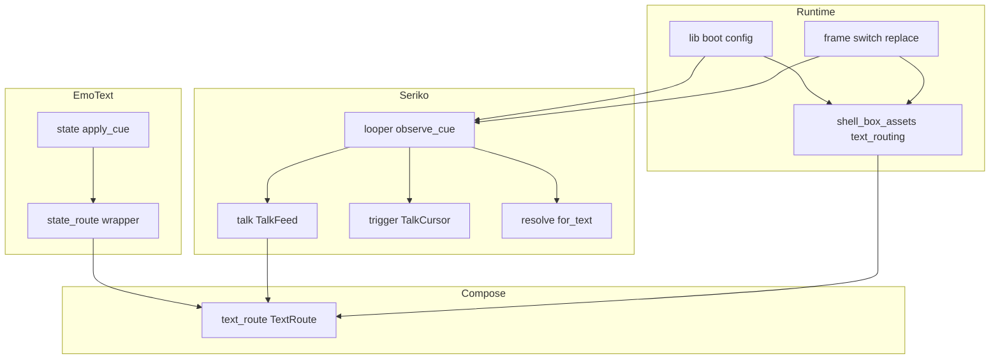
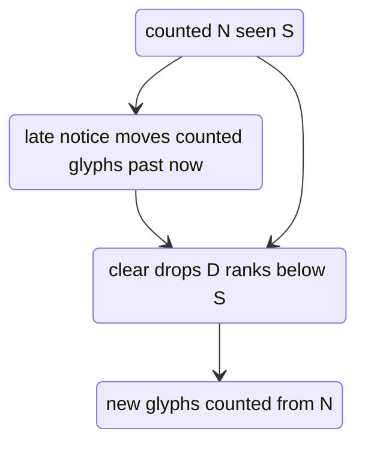

# 設計書: seriko-talk-clock-fidelity

## Overview

**Purpose**: SERIKO の interval `talk,数値`（口パク）が、⑴ 台詞の途中の消去や中断のあとも数値分の字ごとに遅れずに動き、⑵ 1 つのスコープの台詞が普通のバルーンとシェルの中の箱を行き来しても、印（`\![*]`・`%*`）を含んでも、区切りの字が画面に現れる時刻に動くようにする。

**Users**: 口パクを書いたシェルで台詞を聞く利用者と、口の時刻の土台を保つ開発者。

**Impact**: seriko の字の列（`TalkFeed`）を「スコープ 1 つ・場所ごとの前の字・時刻の順の序数」の形に替え、字の行き先の決め方を文字の層の `state_route.rs` から下のクレート（`areka-emo-compose`）の 1 つの純粋な型へ出して文字の層と seriko が同じ型を使う。数え（`TalkCursor`）は「数え始めの序数」の代わりに「数えた字の数」を持ち、0 で止まる天井という形を無くす。箱の表は起動の構成（`SerikoLoopConfig`）とシェルの差し替えの依頼（`SerikoReplace::Shell`）で seriko へ渡す。

### Goals

- 消去の後も、それまでに数えた字の数を 1 つも減らさない（数え始めの位置・字の時刻が後ろへ動いた後の消去に関わらない）。
- 字が普通のバルーンと箱の間を行き来しても、印を含んでも、seriko の区切りの字の時刻が文字の層のその字の時刻と同じになる。
- 1 つの場所にしか字を出さず印も無い台詞では、口の時刻と回数を 1 つも変えない。
- `dola-interrupt-ticks` が済ませた件（1 本の時計・1 本の字の時刻の式・中断の後の数え・部品の見え始め・1 回の刻みで 2 つ越え）を戻さない。

### Non-Goals

- 文字が現れる時刻そのもの（`chunk_reveal_offsets` の式・早送り・`\_q` など・現れ方の演出）を変えること。
- 文字の層の振る舞い（行き先の選び方の規則・消去で消す範囲・印が後ろの字を 1 字分押すこと・描画と配置）を変えること。行き先の決め方は置き場所を移すだけで、答えは変えない。
- `talk` をいつ鳴らすかの決まり（何文字ごと・再生中は見送る・面の切り替えで数え直す）と、抽選の引き金・引き金の後始末。
- 新しい時計・刻みの境目への丸め・1 刻み遅らせる直し。

## Boundary Commitments

### This Spec Owns

- 字の行き先の遷移（今のサーフェス番号・行き先・既定の求め方・`\s` の答えによる遷移・名前の形の `\b[名前]`・既定へ戻す・シェルの切替の戻り先）を持つ純粋な型 `TextRoute` と、文字の場所 `TextPlace`・`\s` の答え `SurfaceKeyOutcome`・箱の表の導き方 `box_index`（新しいファイル `crates/areka-emo-compose/src/text_route.rs`）。
- 文字の層の `state_route.rs` を、上の型を呼んで `\f` の指定の持ち運びと記録だけを足す形にすること（答えは変えない）。
- seriko の字の列 `TalkFeed`（場所ごとの前の字・字ごとの場所・時刻の順の序数・印を時刻の並びにだけ入れる・場所だけの消去・捨てた序数の報告）と、行き先の状態をスコープごとに持つこと。
- seriko の数え `TalkCursor`（数えた字の数を持つ）と文字の窓 `TalkWindow` の形、消去の後の揃え方 `Armed::realign_talk`。
- seriko が受け取る箱の材料 `TextRouting`（箱の表と面の表に在る番号）と、それを起動の構成・シェルの差し替えの依頼で運ぶ配線、`\s` の答えを文字の層と同じ規則で作る `SurfaceTarget::for_text`。
- 上の判断の分岐を固定する決定論のテスト、網羅台帳の `talk,数値` の行の note、`doc/COMPAT_ARCHITECTURE.md` §8 の 1 行、steering `structure.md` の seriko の 1 文。

### Out of Boundary

- 字の時刻の式 `areka_sakura::reveal::chunk_reveal_offsets`（呼び方だけを使う）。
- 文字の層の `state.rs` の `apply_cue` の振る舞い・`state_decoration.rs` の `\f` の持ち運びの中身・`lookahead.rs`・描画と配置。
- 合図の届く時刻・置き直しの知らせの届く時刻そのもの（台本の再生と配送の側）。
- `seriko-trigger-lottery-gaps` の件（引き金の後始末）と抽選の引き金・`runonce`・`periodic` の振る舞い。
- `emo-present` の `shell_target.rs`（箱の表の出どころ `fold_boxes` は読むだけ）。

### Allowed Dependencies

- 依存の向き（逆向きは誤り）: `areka-emo-compose`（`text_route.rs`）→ `areka-emo-text` と `areka-seriko` → `areka-runtime` → `areka`。
- `text_route.rs` が使ってよいのは `std` と同じクレートの `BoxName`・`BoxLayout` だけ（`areka-sakura`・`dola`・記録の `tracing` を使わない。純粋な核は事実を戻り値に載せるだけ）。
- seriko は `areka-emo-compose` の `TextRoute` 一式・`areka-sakura` の `chunk_reveal_offsets`・`cluster_count`・`areka-parsers` の `MARKER_COMMAND` を使う（どれも既存の依存の中）。`Cargo.toml` に依存を足さない。
- `areka-runtime` は `ShellBoxAssets` から `TextRouting` を組むだけで、seriko の中の状態に触れない。

### Revalidation Triggers

- 文字の層の行き先の規則（既定の箱の選び方・`\s` の答えの作り方・`\b[名前]` の見分け）を変える spec は、`text_route.rs` を変えれば両方へ届く。`state_route.rs` に規則を書き戻す変更は、この設計の前提を崩す。
- 字の速さを塊ごとに変える spec（`sakura-time-directives`・`talk-fast-forward`）は、seriko 側の直しを要さない。対のテスト（文字の層と seriko の字の時刻の一致）が見張る。
- 文字の層が印を数える単位や、印を時刻の並びに入れる形を変えると、seriko の `push_mark` も合わせて変える（対のテストが赤で知らせる）。
- `SerikoReplace::Shell` と `SerikoLoopConfig` の欄が増えたので、これらを直に組む所（テストを含む）を持つ spec は欄の追加を受ける。
- シェルの切替のときに箱の場所の字をどう扱うか（下の「シェルの切替」）を文字の層が変えたら、seriko の `rebase_boxes` を見直す。

## Architecture

### Existing Architecture Analysis

- seriko の字の列は今スコープごとに 1 本で、「前の字」（`TalkFeed.last`）もスコープに 1 つ。文字の層は「スコープ × 場所（普通のバルーン／箱）」ごとに列を持ち、前の字は場所の列の最後の字。`chunk_reveal_offsets` は前の字が塊の頭に重なるときだけ続きになるので、前の字が両者で違うと時刻がずれる。
- 今のコードで手で求め直した食い違い（`chunk_reveal_offsets` の本文に、コンパイラの出す合図の時刻と長さを当てた）:
  - 面 10 に箱が在るシェルで `\s[10]\q[はい,yes]\s[0]つづき`（全部の合図が時刻 T・選択肢の長さは 0・「つづき」の長さは 150 ms）。文字の層: 選択肢の字は箱に T・T、普通のバルーンの前の字は無いので「つづき」は T・T+50・T+100。seriko: 前の字は選択肢の T（p = 0・`0×3+150 ≥ 0` で続き）なので T+50・T+100・T+150。**口が 50 ms 遅れる**。
  - `あ\![*]いう`（「あ」は 0 から 50 ms・印は 50 で長さ 0・「いう」は 50 から 100 ms）。文字の層: 印は 50（p = −50・`−50×1+0 < 0` で頭から）、「い」「う」は p = 0 で続きになり 100・150。seriko は印を読まないので p = −50（`−50×2+100 = 0` で続き）で 50・100。**口が 50 ms 早い**。
- 数え `TalkCursor { base, seen }` は消去の後に `base` を `saturating_sub` で下げるので、`base` が捨てた数より小さいと数えた数が減る（`base = 0`・`seen = 5`・揃えた総数 3 なら数えた数が 5 から 3 へ）。
- 行き先の決め方は文字の層の `state_route.rs` だけが持ち、装飾の持ち運び（`carry_script_decor`）と絡んでいる。seriko へ写すと 2 つ目の写しになる。
- `\s` の答えは、文字の層では `areka-runtime` の `resolve_for_text`（seriko と同じ別名の材料で解決し、面の表に無い番号は「解決できない」）、seriko の表示では `SurfaceResolver::resolve`（面の表で絞らない）。行き先を求めるときは前者の規則に揃える必要がある。

### Architecture Pattern & Boundary Map



**Architecture Integration**:
- 選んだ形: 行き先の決め方を下のクレートの 1 つの純粋な型にし、文字の層と seriko が同じ型を同じ合図の順に当てる（字の時刻の式を 1 本の関数にした先例と同じ向き・写しを持たない）。
- 置き場のクレート: `areka-emo-compose`。箱の名前 `BoxName`・置き場所の表 `BoxLayout`・`fold_boxes` の持ち主で、文字の層と seriko の両方が既に依存している。`areka-sakura` は台本の層で箱を知らず、そこへ置くと台本の層が描画の層に依存する向きになるので採らない。
- 境界: 行き先の答えは `TextRoute` だけが決める。文字の層は答えが替わった瞬間に `\f` の指定を持ち運び、記録を出す。seriko は答えを字の場所の印に使うだけで、記録を出さない。
- 守る形: seriko の時計と起点を持たない形・`chunk_reveal_offsets` を呼ぶ形・`talk` の門（`has_talk`）・記録の出し先 `areka_seriko::trigger`・`glyph_wall` の `warn!`。
- steering との整合: 時刻は丸めない・新しい時計を作らない・1 フレーム遅らせない・`Cargo.toml` に依存を足さない・テストは兄弟のファイル・1 ファイル 1,000 行以下。

### Technology Stack

| Layer | Choice / Version | Role in Feature | Notes |
|-------|------------------|-----------------|-------|
| 純粋な型 | Rust（ワークスペースの版）・`std::collections` | `TextRoute` と箱の表 | 新しい外部の依存は 0 |
| seriko | `areka-seriko`・`dola` の `TimePoint`・`TimeSpan` | 字の列・数え・配線 | 既存の依存だけ |
| 結線 | `areka-runtime` | 箱の材料を seriko へ渡す | 既存の依存だけ |

## File Structure Plan

### Directory Structure

```
crates/areka-emo-compose/src/
├── text_route.rs        # 新: TextPlace・SurfaceKeyOutcome・TextRoute・BoxSelect・box_index（純粋・記録なし）
└── text_route_tests.rs  # 新: TextRoute の遷移の決定論テスト
crates/areka-seriko/src/
├── talk_place_tests.rs      # 新: TalkFeed の場所ごとの前の字・場所だけの消去・印・時刻の順の序数
├── trigger_realign_tests.rs # 新: 消去の後の揃え方（数え始めと捨てた数の大小・数えた字 0）
└── looper_talk_route_tests.rs # 新: observe_cue から刻みまで（行き先の切り替え・印・差し替え・門）
crates/areka-runtime/src/
└── receivers_follow_place_tests.rs # 新: 同じ合図の列を文字の層と seriko に通す対のテスト
```

新しい本番のファイルは `text_route.rs` の 1 つだけ。`areka-emo-text` には新しいファイルを足さない（ウェーブの emo-text の席を使わない）。

### Modified Files

**areka-emo-compose**
- `crates/areka-emo-compose/src/lib.rs` — `pub mod text_route;` と `pub use text_route::{BoxSelect, SurfaceKeyOutcome, TextPlace, TextRoute, box_index};` の 2 行（`#[cfg(test)]` より前の宣言の並び）。

**areka-emo-text**（答えを変えず、型の置き場だけを下へ移す）
- `crates/areka-emo-text/src/place.rs` — `TextPlace` の定義を消し、`pub use areka_emo_compose::TextPlace;` にする（`crate::place::TextPlace` の名は保つ）。
- `crates/areka-emo-text/src/state_route.rs` — `SurfaceKeyOutcome` の定義を消して `pub use areka_emo_compose::SurfaceKeyOutcome;`。`ScopeRoute` は `{ route: TextRoute, shared: TextPlace }` にし、`route_surface`・`route_select`・`reset_routes`・`fall_back_surfaces` は `TextRoute` を呼んで、答えが替わったときに `carry_script_decor` を呼ぶ・今の記録（`debug!` と `\b[名前]` の `warn!`・空回しの写しでは出さない）を出すだけにする。`boxes_of`・`default_dest` は消す。
- `crates/areka-emo-text/src/state.rs` — 名前の形の `\b` の見分けの腕の条件（`key.parse::<i64>().is_err()`）を `areka_emo_compose::TextRoute::is_box_key(key)` に替える 1 行。
- `crates/areka-emo-text/src/actor_box.rs` — 箱の表を組む式（`layout.surfaces().map(...)`）を `areka_emo_compose::box_index(&layout)` に替える。
- 触らない: `lib.rs`（`PURE_SOURCES` は増えない）・`state_decoration.rs`（`route.shared` の欄は残る）・`lookahead.rs`・`state_route_tests.rs` ほか既存のテスト（答えが同じことを既存のテストが見張る）。

**areka-seriko**
- `crates/areka-seriko/src/talk.rs` — `TalkFeed` を作り直す（下の Components）。`TextRouting` を定義する。
- `crates/areka-seriko/src/trigger.rs` — `TalkCursor { seen, counted }`・`TalkWindow { counted, prev_seen, now_seen, wall }`・`next_starts` の `Talk` の腕の式・`advance_talk`・`realign_talk(&[u64])`・`talk_window_bounds`。`ponytail:` の印の注を消す。新しい兄弟のテストを宣言する。
- `crates/areka-seriko/src/looper.rs` — `SerikoLoopConfig` に `text_routing: TextRouting`（`disabled()` は空）。`observe_cue` が `&SurfaceResolver` を受け、配線は `looper_trigger.rs` の自由関数へ渡す。`talk_window` の欄の名。`on_tick` の構成の分解に新しい欄。`replace_text_routing`・門が開いたときの種まき・門が閉じたときに列と行き先を捨てる。新しい兄弟のテストを宣言する。
- `looper.rs`（今 855 行）は 1,000 行以下を保つため、合図の振り分けと揃えの本体を `looper_trigger.rs`（今 218 行・「文字の列と数えの世話」の置き場）に置き、`looper.rs` には門と委ねる口だけを足す。
- `crates/areka-seriko/src/looper_trigger.rs` — 合図を字の列へ当てる自由関数 `observe_talk_cue`（文字・選択肢・印・`\s`・名前の形の `\b`・消去・全消去）と、`restart_talk` を「捨てた序数の列で全部の数えを揃える」形に。シェルの切替で箱の場所の字を捨てる `rebase_talk_boxes`。モジュールの doc の決まりを「数えた字の数を保つ」に直す。
- `crates/areka-seriko/src/resolve.rs` — `SurfaceTarget::for_text(self, surface_ids: &BTreeSet<u32>) -> SurfaceKeyOutcome`（文字の層の規則の唯一の置き場）。
- `crates/areka-seriko/src/actor.rs` — `SerikoReplace::Shell` に `text_routing: TextRouting`。`dispatch_message` は `observe_cue(&cue, resolver)`。差し替えの殻はシェルの差し替えで `replace_text_routing(text_routing, &fallback, &states)` を呼び、どちらの差し替えでも門が開いたら種を蒔かせる。
- `crates/areka-seriko/src/lib.rs` — `pub use talk::TextRouting;`。
- `crates/areka-seriko/src/settle.rs` — 構成を直に組む所に `text_routing: TextRouting::default()`。
- 既存のテストの追従（振る舞いの期待は変えず、型の欄だけ）:
  - `TalkWindow` を直に組む所: `trigger_tests.rs`・`parts_trigger_tests.rs`。`realign_talk(総数)` を呼ぶ所: `trigger_tests.rs`（捨てた序数の列へ）。
  - `observe_cue` を直に呼ぶ所: `looper_talk_tests.rs`。
  - `SerikoLoopConfig { … }` を直に組む所（欄を 1 つ足す）: `actor_calls_tests.rs`・`actor_event_time_tests.rs`・`actor_stage_tests.rs`・`actor_talk_tests.rs`・`actor_trigger_fixture_tests.rs`・`looper_always_tests.rs`・`looper_balloon_tests.rs`・`looper_calls_tests.rs`・`looper_order_tests.rs`・`looper_replace_tests.rs`・`looper_talk_part_tests.rs`・`looper_talk_tests.rs`・`looper_tests.rs`・`looper_trigger_tests.rs`・`table_calls_check_tests.rs`・`crates/areka-seriko/tests/loop_integration.rs`・`crates/areka-seriko/tests/sleep.rs`。
  - `SerikoReplace::Shell { … }` を直に組む所: `actor_calls_tests.rs`・`actor_replace_tests.rs`・`actor_strict_tests.rs`。
  - `actor_origin_tests.rs` — 要件 5.2 のテストを足す（今 118 行）。
  - 触らない: `talk_tests.rs`・`talk_origin_tests.rs`（`push_chunk`・`push_text`・`restart_chain` の形を保つので、場所が 1 つの期待はそのまま通る）・`looper_refresh.rs`（構成を `..` で分解し、窓の組は `(数えた数, 数え済み)` の組のまま）・`parts*.rs` の本番・`tests/common/mod.rs`。

**areka-runtime**
- `crates/areka-runtime/src/shell_box_assets.rs` — `ShellBoxAssets::text_routing(&self) -> TextRouting`（`box_index(&self.layout)` と `surface_ids` の写し）。`resolve_for_text` の本体を `resolver.resolve(key).for_text(surface_ids)` の 1 行にする（既存のテストはそのまま通る）。
- `crates/areka-runtime/src/lib.rs` — 起動の `SerikoLoopConfig` に `text_routing: boxes.text_routing()`（`boxes` を装着の束へ動かす前に組む）。「seriko は読まない」の注を直す。`#[cfg(test)] mod receivers_follow_place_tests;` を足す。
- `crates/areka-runtime/src/frame/switch.rs` — `SwapBuilt::Shell` を割る所で `SerikoReplace::Shell` に `text_routing: assets.boxes.text_routing()`（箱の束を後始末へ動かす前）。
- `crates/areka-runtime/src/same_script_test_support.rs` — `seriko_config()` に欄を足す。構成を受け取る `seriko_at` の変種（対のテストが箱のシェルの構成を渡す）。
- `crates/areka-runtime/src/film_playback_e2e_tests.rs` — 構成を直に組む 3 か所に欄を足す。

**areka**
- `crates/areka/src/runtime_tests/spine.rs` — 構成を直に組む所に欄を足す。

**文書**
- `doc/ukadoc-coverage/ledger/assets.toml` — `ukadoc:descript_shell_surfaces:talk_2c_6570_5024:1` の note だけ（判定・担当・優先度は変えない）。
- `doc/COMPAT_ARCHITECTURE.md` — §8 の表の末尾へ 1 行。
- `.kiro/steering/structure.md` — `areka-seriko` の項の「文字が現れる時刻は、文字の層と同じ式の写しを `talk.rs` に持つ（…）」の 1 文。

### 同じウェーブの兄弟と重なるファイル

| 兄弟 | 兄弟が触るファイル（要件・調べの記録から） | この spec と重なるもの |
|---|---|---|
| `draw-methods-canon` | `areka-emo-compose` の多くのファイル（合成の道・`method.rs`・`world.rs` か新しいファイル・計画の段）、`areka-emo-present`（`shell_target.rs`・`presenter/*`・`hit*.rs`）、`areka-emo-atlas`、seriko の `table.rs` のテストの期待 1 か所、`areka-runtime` の `frame/wiring.rs`・`balloon_background.rs`、本体の `offline_dump/render.rs`・`mcp/dump_surface.rs`、`wintf` | **`crates/areka-emo-compose/src/lib.rs` だけが重なりうる**（兄弟が新しいモジュールを足せば、宣言の並びの隣り合う行）。どちらの変更も宣言の行を足すだけなので、取り込みは行の和で済む。`boxes.rs`・`shell_target.rs`・`table.rs` は触らない |
| `talk-script-metadata` | `areka-sakura` の `drive.rs`・`contract.rs`、`areka-ghost` の `config.rs`、`areka-session` の `readme.rs`・`readme/opener.rs`・`runtime_boot.rs`、`StartTalk { … }` を組むテスト（`areka-kanade`・`areka-ghost`・`areka-sakura`・`areka-runtime/src/strict_judges_tests.rs`・`areka/src/runtime_tests/strict_judges_tests.rs`・`areka-seriko/tests/common/mod.rs`） | **無し**。この spec は `areka-sakura` に触らず（`lib.rs` も）、seriko の `tests/common/mod.rs`・`strict_judges_tests.rs` にも触らない |

各クレートの `lib.rs`: `areka-emo-compose` は触る（上の 1 件）・`areka-seriko` は触る（兄弟は触らない）・`areka-runtime` は触る（兄弟の `draw-methods-canon` は `frame/wiring.rs`・`balloon_background.rs` で `lib.rs` を挙げていない）・`areka-emo-text` と `areka-sakura` は触らない。

## System Flows

### 合図から口の判定まで（seriko）

```mermaid
sequenceDiagram
    participant Player as cue player
    participant Actor as seriko actor
    participant Loop as LoopRuntime
    participant Feed as TalkFeed
    participant Route as TextRoute
    participant Cursor as Armed
    Player->>Actor: cue
    Actor->>Loop: observe_cue with resolver
    Loop->>Feed: by command kind
    Feed->>Route: follow surface or select box
    Feed->>Feed: push glyphs to dest place chain
    Feed-->>Loop: dropped ranks on clear
    Loop->>Cursor: realign with dropped ranks
    Actor->>Loop: tick now
    Loop->>Cursor: next starts with window
    Loop->>Cursor: advance talk
    Loop->>Feed: prune before now seen
```

- 門: どの表にも `talk` が無い間、`observe_cue` は最初の真偽 1 つで戻る（行き先の遷移も字の列も触らない）。
- 消去は、捨てた字の序数（数え済みより前の物を含む）を昇順で返し、そのスコープの全部の数えがそれで揃える。数えた字の数は揃えで変わらない。

### 消去の後の数え（件 8 の道）



- 揃えの後は `seen = S − D`・`counted = N`。次に現れる字は数えた字の続き（N＋1 字目）として数える。

## Requirements Traceability

| Requirement | Summary | Components | Interfaces | Flows |
|-------------|---------|------------|------------|-------|
| 1.1 | 消去で列が数え済みより短くなっても数えた数を保つ | TalkCursor | `Armed::realign_talk` | 消去の後の数え |
| 1.2 | 消去の後の字は続きとして数え、和が倍数の字で動く | TalkCursor・TalkWindow | `next_starts`・`advance_talk` | 消去の後の数え |
| 1.3 | 遅れた置き直し → 数えた字が後ろへ → 消去 でも数えに残す | TalkFeed・TalkCursor | `restart_chain` の捨てた序数・`realign_talk` | 消去の後の数え |
| 1.4 | 消去の後の字を「まだ数えていない字」として数える | TalkCursor | `realign_talk`（`seen` を捨てた分だけ下げる） | 消去の後の数え |
| 1.5 | 短くならない間は変えない | TalkCursor | 捨てた序数が数え済みより前に無ければ何もしない | ― |
| 1.6 | 数えを持たない面では何もしない・記録しない | Armed | `talk` が `None` なら戻る | ― |
| 2.1 | 場所ごとの前の字から時刻を求める | TalkFeed・TextRoute | `push_chunk`（行き先の場所の前の字） | 合図から口の判定まで |
| 2.2 | 速さの違う塊でも場所の前の字から | TalkFeed | `chunk_reveal_offsets` に場所の前の字 | 同上 |
| 2.3 | 場所だけの消去は他の場所の字を残す | TalkFeed | `restart_chain`（行き先の場所だけ） | 同上 |
| 2.4 | 全消去は全部の場所の未表示を外す | TalkFeed | `restart_all` | 同上 |
| 2.5 | 数えはスコープで 1 本 | TalkFeed | 序数は場所をまたぐ時刻の順 | 同上 |
| 2.6 | 1 つの場所・印なしなら今と同じ | TalkFeed | 場所が 1 つなら列は末尾へ積むだけ | ― |
| 2.7 | 印を時刻の並びに入れる | TalkFeed | `push_mark` | 同上 |
| 2.8 | 印を数えに入れない | TalkFeed | `push_mark` は序数を作らない | ― |
| 3.1 | 1 本の関数で求め続ける | TalkFeed | `chunk_reveal_offsets` を呼ぶ形を保つ | ― |
| 3.2 | 中断の後も前の台詞の現れた字を残す | TalkFeed | `restart_all(at)` は `at` 以前を残す | ― |
| 3.3 | 部品は見え始めより前に始めない | Armed | `next_starts` の `.max(since)` を保つ | ― |
| 3.4 | 2 つ越えは古い順・同じ時刻は 1 つ | Armed・TalkFeed | 列は時刻の順なので序数の順＝時刻の順 | ― |
| 3.5 | 既存のテストを緑に保つ | 全部 | 既存のテスト | ― |
| 4.1 | `talk` の無いシェルで仕事を増やさない | LoopRuntime | `has_talk` の門・種まきは門が開いたときだけ | ― |
| 4.2 | 新しい時計・丸め・1 刻み遅らせを持ち込まない | TalkFeed・LoopRuntime | 合図の時刻・刻みの時刻だけを使う | ― |
| 4.3 | 抽選の乱数の並び・`runonce`・`periodic` を変えない | Armed・LoopRuntime | 変えた経路は乱数を読まない | ― |
| 4.4 | 記録の出し先と文言・水準を変えない | trigger・LoopRuntime | `log_fired` は触らない・新しい経路は記録しない | ― |
| 4.5 | 揃える経路・場所ごとの経路は `warn!` を出さない | TalkFeed・TalkCursor | 記録なし | ― |
| 4.6 | 序数が列に無いときは `warn!` と刻みの時刻 | looper_trigger | `glyph_wall` を保つ | ― |
| 5.1 | 揃え方の 4 つの場合を固定 | テスト | `trigger_realign_tests.rs` | ― |
| 5.2 | 件 8 の道を配線を通して固定 | テスト | `actor_origin_tests.rs` | 消去の後の数え |
| 5.3 | 同じ合図の列で文字の層と seriko が一致 | テスト | `receivers_follow_place_tests.rs` | 合図から口の判定まで |
| 5.4 | 偽の時刻が観測を追い越さない | テスト | 刻みの前にその時刻までの合図だけを渡す | ― |
| 5.5 | 兄弟のファイル・1,000 行以下 | テスト | File Structure Plan | ― |
| 5.6 | 実機の確かめを要件にしない | テスト | 決定論のテストと静的な証跡 | ― |
| 6.1 | note に裁量を書く | 文書 | 台帳の note | ― |
| 6.2 | note の古い文を直す | 文書 | 台帳の note | ― |
| 6.3 | 台帳の常時テストを緑・欄を変えない | 文書 | note だけを書き替える | ― |
| 6.4 | §8 の表の末尾へ 1 行 | 文書 | `COMPAT_ARCHITECTURE.md` | ― |
| 6.5 | steering の 1 文を直す | 文書 | `structure.md` | ― |

## Components and Interfaces

| Component | Domain/Layer | Intent | Req Coverage | Key Dependencies | Contracts |
|-----------|--------------|--------|--------------|------------------|-----------|
| TextRoute | emo-compose（純粋） | スコープ 1 つの字の行き先の遷移 | 2.1, 2.3, 2.4, 2.6 | BoxName（P0） | State |
| state_route の包み | emo-text | 答えが替わったときの `\f` の持ち運びと記録 | 2.6, 3.5 | TextRoute（P0） | Service |
| TalkFeed | seriko | 場所ごとの前の字と時刻の順の序数・行き先 | 1.3, 2.1〜2.8, 3.1, 3.2, 3.4 | TextRoute（P0）・chunk_reveal_offsets（P0） | State |
| TalkCursor・TalkWindow | seriko | 数えた字の数と区切りの判定 | 1.1〜1.6, 3.3, 3.4 | ― | State |
| 字の列の配線 | seriko | 合図を字の列へ当て、数えを揃える | 1.1〜1.6, 2.*, 4.1, 4.5 | TalkFeed（P0）・SurfaceTarget::for_text（P0） | Service |
| TextRouting の受け渡し | seriko・runtime | 箱の表と面の番号を seriko へ運ぶ | 2.1, 2.3, 4.1 | ShellBoxAssets（P0） | Event |
| 決定論のテスト | 各クレート | 判断の分岐の固定 | 3.5, 5.1〜5.6 | ― | ― |
| 文書 | doc・steering | 裁量と実態を書く | 6.1〜6.5 | ― | ― |

### 純粋な型（areka-emo-compose）

#### TextRoute

| Field | Detail |
|-------|--------|
| Intent | スコープ 1 つの「今のサーフェス番号」と「今の字の行き先」を、届いた指令の順に遷移させる |
| Requirements | 2.1, 2.3, 2.4, 2.6 |

**Responsibilities & Constraints**
- 規則は今の `state_route.rs` と同じ: 既定は「面の箱の列が空なら普通のバルーン、空でなければ先頭の箱」。`\s` で番号が替わったら、行き先の箱が新しい面の箱の列に在れば保ち、無ければ既定へ。`\s` が解決できなければ何も変えない。名前の形の `\b[名前]` は今の面の箱の列に在れば切り替え、無ければ変えない。
- 不変条件: 行き先が `Box(n)` のとき、`n` は今のサーフェスの箱の列に在る。箱の表が空なら行き先は普通のバルーンから動かない。
- 時計・窓・記録を持たない。スコープの鍵も持たない（鍵の表は呼び手が持つ）。

**Contracts**: State [x]

##### Service Interface

```rust
/// スコープの中の文字の場所。
#[derive(Clone, Debug, PartialEq, Eq, PartialOrd, Ord, Hash)]
pub enum TextPlace {
    Balloon,
    Box(BoxName),
}

/// `\s` の鍵を今のシェルで解決した結果。
#[derive(Clone, Copy, Debug, PartialEq, Eq)]
pub enum SurfaceKeyOutcome {
    Show(u32),
    Hide,
    Unresolved,
}

/// 名前の形の `\b[名前]` の結果。
#[derive(Clone, Copy, Debug, PartialEq, Eq)]
pub enum BoxSelect {
    /// 行き先がその箱へ替わった。
    Changed,
    /// もうその箱が行き先だった。
    Same,
    /// 今の面の箱の列にその名前が無い（行き先は変えない）。
    Missing,
}

/// スコープ 1 つの字の行き先（既定は非表示・普通のバルーン）。
#[derive(Clone, Debug, Default, PartialEq, Eq)]
pub struct TextRoute { /* surface: Option<u32>, dest: TextPlace */ }

impl TextRoute {
    pub fn surface(&self) -> Option<u32>;
    pub fn dest(&self) -> &TextPlace;
    /// `\s` の答えで番号と行き先を決める。行き先が替わったら真。
    pub fn follow_surface(&mut self, boxes: &BTreeMap<u32, Vec<BoxName>>, outcome: SurfaceKeyOutcome) -> bool;
    /// 名前の形の `\b[名前]`。
    pub fn select_box(&mut self, boxes: &BTreeMap<u32, Vec<BoxName>>, name: &str) -> BoxSelect;
    /// 台詞の頭・箱の表の差し替え: 行き先を今の番号の既定へ戻す（番号は変えない）。
    pub fn reset(&mut self, boxes: &BTreeMap<u32, Vec<BoxName>>);
    /// シェルの切替: 今の番号が新しいシェルに無いときだけ、候補の最初に在る番号（無ければ非表示）の答えを返す。
    /// 番号の集合が空・非表示・在る番号なら `None`。
    pub fn fallback_outcome(&self, surface_ids: &BTreeSet<u32>, candidates: &[u32]) -> Option<SurfaceKeyOutcome>;
    /// `\b` の鍵が名前の形か（整数として読めない）。
    pub fn is_box_key(key: &str) -> bool;
}

/// 箱の表（サーフェス番号 → element番号の昇順の箱の名前）。文字の層と seriko の唯一の導き方。
pub fn box_index(layout: &BoxLayout) -> BTreeMap<u32, Vec<BoxName>>;
```

- Preconditions: `boxes` はシェル 1 つの表（`box_index` の答え）。
- Postconditions: 上の不変条件を保つ。`reset` の後の行き先は `boxes` と今の番号だけで決まる。
- Invariants: 同じ指令の列と同じ表からは同じ答え（決定論）。

**Implementation Notes**
- Integration: 文字の層は `ScopeRoute { route: TextRoute, shared: TextPlace }` で持ち、seriko は `TalkFeed` の欄で持つ。
- Validation: `text_route_tests.rs` で遷移を固定。文字の層の既存の `state_route_tests.rs`・`actor_route_tests.rs` が答えの不変を見張る。
- Risks: 箱の表の順（element番号の昇順）が `fold_boxes` の順に依る点は今と同じ。

#### state_route の包み（areka-emo-text）

| Field | Detail |
|-------|--------|
| Intent | `TextRoute` の答えに、`\f` の指定の持ち運びと今の記録を足す |
| Requirements | 2.6, 3.5 |

**Responsibilities & Constraints**
- `route_surface`: `Unresolved` なら今の `debug!` を出して何もしない（スコープの記録も作らない）。それ以外は `follow_surface` を呼び、真なら `carry_script_decor(actor, 新しい行き先)`。
- `route_select`: `Changed` → 持ち運び・`Same` → 何もしない（どちらも今の `debug!`）・`Missing` → 空回しの写しでなければ今の `warn!` を出して真を返す。
- `reset_routes`: 今どおり `fold_shared_into_balloon` の後、各スコープで `reset` を呼び、行き先が普通のバルーンでなければ持ち運ぶ。
- `fall_back_surfaces`: 各スコープの `fallback_outcome` が `Some` なら今の `debug!` を出して `route_surface` を呼ぶ。
- 記録の文言・水準・回数は変えない。

**Contracts**: Service [x]（公開の名と署名は今のまま）

### seriko の字の列

#### TalkFeed

| Field | Detail |
|-------|--------|
| Intent | スコープ 1 つの「時刻の順の i 字目が現れる時刻」の列と、場所ごとの前の字と、字の行き先 |
| Requirements | 1.3, 2.1〜2.8, 3.1, 3.2, 3.4 |

**Responsibilities & Constraints**
- 字の時刻は塊ごとに、合図の発火時刻を塊の頭、**行き先の場所の前の字**（印を含む）を前の字として `chunk_reveal_offsets` で求める（文字の層の `extend_chunk` と同じ入力）。
- 列はスコープで 1 本・時刻の順（同じ時刻は届いた順）。序数＝その順の番号で、刈り込んだ分だけ頭の序数が進む。字ごとに場所の小さな番号を持ち、場所の名前は列ごとに 1 度だけ持つ。場所が 1 つなら、時刻は単調なので積むのはいつも末尾＝今の列と同じ（2.6）。
- 印は時刻の並びにだけ入る: 行き先の場所の前の字を、長さ `duration`・1 字の塊として進めるが、列に序数を作らない（2.7・2.8）。
- 消去は「発火時刻より後に現れる字」だけを捨て、捨てた字の序数を昇順で返す。`\c` は行き先の場所だけ、全消去は全部の場所。捨てた場所の前の字は無しに戻る。現れた字（発火時刻以前）は残す（3.2）。
- 置き直しの知らせ（`shift_after`）は全部の字と全部の場所の前の字へ当てる（今と同じ式。単調な写しなので列の順は崩れない）。

**Contracts**: State [x]

##### Service Interface

```rust
/// seriko が受け取る箱の材料（シェル 1 つ分・既定は箱の無いシェル）。
#[derive(Clone, Debug, Default, PartialEq, Eq)]
pub struct TextRouting {
    /// サーフェス番号 → element番号の昇順の箱の名前（`box_index`）。
    pub boxes: BTreeMap<u32, Vec<BoxName>>,
    /// 面の表に在るサーフェス番号（`\s` の答えを文字の層と同じに絞る）。
    pub surface_ids: BTreeSet<u32>,
}

impl TalkFeed {
    // 行き先
    pub(crate) fn follow_surface(&mut self, routing: &TextRouting, outcome: SurfaceKeyOutcome);
    pub(crate) fn select_box(&mut self, routing: &TextRouting, name: &str);
    pub(crate) fn seed_surface(&mut self, routing: &TextRouting, surface: Option<u32>);
    // 字（行き先の場所へ）
    pub(crate) fn push_text(&mut self, fire_time: TimePoint, duration: TimeSpan, text: &str);
    pub(crate) fn push_chunk(&mut self, fire_time: TimePoint, duration: TimeSpan, count: usize);
    pub(crate) fn push_mark(&mut self, fire_time: TimePoint, duration: TimeSpan);
    // 消去（捨てた序数を昇順で返す）
    pub(crate) fn restart_chain(&mut self, at: TimePoint) -> Vec<u64>; // 行き先の場所だけ
    pub(crate) fn restart_all(&mut self, at: TimePoint, routing: &TextRouting) -> Vec<u64>; // 全部の場所・行き先を既定へ
    pub(crate) fn rebase_boxes(&mut self, after: TimePoint, routing: &TextRouting, candidates: &[u32]) -> Vec<u64>;
    // 今と同じ
    pub(crate) fn shift_after(&mut self, effective_at: TimePoint, delta: TimeDelta);
    pub(crate) fn revealed_until(&self, t: TimePoint) -> u64;
    pub(crate) fn time_of(&self, g: u64) -> Option<TimePoint>;
    pub(crate) fn prune_before(&mut self, keep_from: u64);
}
```

- Preconditions: 合図は届いた順に当てる（文字の層と同じ順）。
- Postconditions: `revealed_until`・`time_of` は時刻の順の序数で答える。消去・`rebase_boxes` の戻り値は、捨てた字の消える前の序数（昇順・刈り込んだ序数は含まない）。
- Invariants: 列は時刻について単調非減少。印は序数を持たない。

**Implementation Notes**
- Integration: `push_chunk(fire, duration, count)`・`push_text`・`restart_chain(at)` の名と引数は保つので、場所が 1 つの既存のテスト（`talk_tests.rs`・`talk_origin_tests.rs`・`looper_trigger_tests.rs`）は変えずに通る。
- Validation: `talk_place_tests.rs` で、場所の切り替え・選択肢の直後の切り替え・速さの違う塊・場所だけの消去・印・遅れて届いた早い字の差し込みを固定。
- Risks: 別の場所の合図が遅れて届き、その字の時刻がもう数えた字より前になると、差し込みで数え済みの序数が 1 つずれる（数えた数は正しく、区切りの時刻はもう過ぎた字の時刻になる）。下の OPEN QUESTION 4。

#### TalkCursor・TalkWindow（trigger.rs）

| Field | Detail |
|-------|--------|
| Intent | 数え済みの序数と数えた字の数を持ち、区切りを越えた判定を返す |
| Requirements | 1.1〜1.6, 3.3, 3.4 |

**Responsibilities & Constraints**
- `TalkCursor { seen, counted }`: `seen`＝最後の判定までに数えた序数（列の序数）、`counted`＝構えてから数えた字の数。構える・現すときは `seen = 今現れている数`・`counted = 0`。
- `advance_talk(now_seen)`: `now_seen > seen` のときだけ `counted += now_seen − seen`・`seen = now_seen`（単調）。
- `realign_talk(dropped: &[u64])`: `d = 捨てた序数のうち seen より前の数`、`seen −= d`。`counted` は変えない（1.1・1.3）。`d = 0` なら何もしない（1.5）。数えを持たなければ何もしない・記録しない（1.6）。
- `next_starts` の `Talk { every }` の腕: 窓 `{ counted, prev_seen, now_seen }` から `now_counted = counted + now_seen.saturating_sub(prev_seen)`・越えた区切り `k` は `counted / every + 1 ..= now_counted / every`・区切り `k` の序数は `prev_seen + (k × every − 1 − counted)`（`k × every − 1 ≥ counted` なので負にならない）。開始の時刻は `wall(序数).max(since)`、同じ時刻は 1 つ（今と同じ）。

**Contracts**: State [x]

```rust
pub(crate) struct TalkWindow<'a> {
    /// 前の判定までに数えた字の数。
    pub(crate) counted: u64,
    /// 前の判定までに数えた序数。
    pub(crate) prev_seen: u64,
    /// 今見えている文字の序数。
    pub(crate) now_seen: u64,
    pub(crate) wall: &'a dyn Fn(u64) -> TimePoint,
}
impl Armed {
    pub(crate) fn realign_talk(&mut self, dropped: &[u64]);
    /// (数えた字の数, 数え済みの序数)。数えを持たなければ `None`。
    pub(crate) fn talk_window_bounds(&self) -> Option<(u64, u64)>;
}
```

- Invariants: 「列の頭の序数 ≤ seen ≤ 列の字の総数」を保つ（捨てた序数は刈り込んだ序数以上で、`seen` より前の捨てた字の数だけ `seen` を下げるので、残った数え済みの字がちょうど頭から `seen` 個になる）。

**Implementation Notes**
- Integration: 窓を組む所（`looper.rs` の `talk_window`・`looper_refresh.rs`）は組の形 `(u64, u64)` を変えないので、欄の名の付け替えは `talk_window` の 1 か所。
- Validation: `trigger_realign_tests.rs`（5.1 の 4 つの場合）・既存の `trigger_tests.rs` の期待は変えない。
- Risks: 無し（乱数を読まない・記録を出さない）。

#### 字の列の配線（looper.rs・looper_trigger.rs）

| Field | Detail |
|-------|--------|
| Intent | 合図を種類ごとに字の列と行き先へ当て、消去で全部の数えを揃える |
| Requirements | 1.1〜1.6, 2.1〜2.8, 4.1〜4.6 |

**Responsibilities & Constraints**
- `LoopRuntime::observe_cue(&mut self, cue: &TalkCue, resolver: &SurfaceResolver)`: `has_talk` が偽なら最初に戻る（4.1）。真なら `observe_talk_cue` へ。
- `observe_talk_cue` の振り分け（文字の層の `advance_state`・`apply_cue` と同じ順と見分け）:

| 合図 | 当てること |
|---|---|
| `Emote { key }` | `resolver.resolve(key).for_text(&routing.surface_ids)` を `follow_surface` |
| `BalloonSurface { key }` で `TextRoute::is_box_key(key)` | `select_box`（無い名前でも記録しない。警告は文字の層だけ） |
| `Text`・`Choice` | `push_text`（行き先の場所） |
| `Custom` で名前が `MARKER_COMMAND` | `push_mark`（行き先の場所） |
| `Clear` | `restart_chain(at)` → そのスコープの全部の数えを `realign_talk` |
| `ClearAll` | 全部のスコープで `restart_all(at, routing)` → それぞれ揃える |
| ほか | 何もしない |

- スコープの字の列は、字・`\s`・`\b` のどれかが初めて届いたときに作る（行き先は字より先に届くことがある）。
- `restart_talk` は「捨てた序数の列でそのスコープの全部の数えを揃える」。総数で揃える形は捨てる。
- 記録は出さない（字ごと・合図ごとの記録を増やさない・4.4）。`warn!` は `glyph_wall` だけ（4.5・4.6）。

**Contracts**: Service [x]

#### TextRouting の受け渡し（seriko actor・areka-runtime）

| Field | Detail |
|-------|--------|
| Intent | 文字の層と同じシェルの箱の表と面の番号を、起動とシェルの切替で seriko へ渡す |
| Requirements | 2.1, 2.3, 4.1 |

**Responsibilities & Constraints**
- 組むのは `ShellBoxAssets::text_routing()` だけ（文字の層へ渡す束と同じ材料・`box_index` の同じ導き方）。
- 起動: `SerikoLoopConfig.text_routing`。シェルの切替: `SerikoReplace::Shell.text_routing`（`fallback` と同じ束から、後始末へ動かす前に組む）。バルーンの切替は箱の表を変えない。
- 差し替えの殻の順: 定義 → スコープの状態（今の戻り先の処理）→ ループの表 → `replace_text_routing` → 合図。

**Contracts**: Event [x]
- Published: `SerikoReplace::Shell { …, text_routing: TextRouting }`・`SerikoLoopConfig { …, text_routing: TextRouting }`。
- Ordering: 差し替えの依頼は合図と同じ受け口に FIFO で並ぶ。

##### State Management（seriko の行き先と門）

- 行き先の状態はスコープの `TalkFeed` が持ち、門（`has_talk`）が閉じると字の列と一緒に捨てる（今の `feeds.clear()` と同じ）。`TextRouting` そのものは門に関わらず `LoopRuntime` が持ち続ける（差し替えのたびに置き換える・種まきと門が開いた後の行き先に使う）。
- **門が開いた直後の種まき**（仮定 1）: 差し替えで門が閉から開へ替わったとき、`ScopeStates` の各スコープの今のシェルの面の番号（`TextRouting.surface_ids` に在るものだけ・非表示や無い番号は「無し」）で `seed_surface` を呼び、行き先を既定にする。起動の時に門が開いているときは種を蒔かない（文字の層も `\s` が届くまで番号を持たない）。
- **門が開いたままのシェルの切替**（仮定 2）: `replace_text_routing(routing, &fallback, &states)` は、各スコープで `rebase_boxes(after, routing, candidates)` を呼ぶ: 箱の場所の字のうち `after`（最後の刻みの時刻・まだ刻みが無ければ全部）より後に現れる物を捨て、箱の場所の前の字を無しにし、新しい表で `reset`、`fallback_outcome` が在れば `follow_surface`。捨てた序数でそのスコープの数えを揃える。文字の層の `set_box_index`（箱の場所の字を捨て、行き先を既定へ）→ `fall_back_box_surfaces` と同じ順。

### 文書（6.1〜6.5）

- 台帳の note（`talk_2c_6570_5024:1`）: ⑴「区切りが同じ時刻に 2 つ以上来たときと、1 回の更新の間に区切りを 2 つ以上越えたときは、再生を最新の区切りの 1 回にまとめる」を「同じ時刻の区切りは 1 回にまとめ、1 回の更新の間に越えた区切りは古い順にそれぞれの区切りの字の時刻で判定する」に直す（6.2）。⑵「文字が現れる時刻は、バルーンの文字の層と同じ式で数える」を「文字の層と同じ 1 本の関数で、場所（普通のバルーン／箱）ごとにその場所の直前の字から求め、数えはスコープで 1 本に積む」に直す。⑶ 足す裁量: 箱に現れた字も数える（箱が描かれていない間も）・印（`\![*]`・`%*`）は字の時刻の並びに入れるが数えない・消去の後も数えた字の数は減らない（字の時刻が後ろへ動いた後に捨てられた字も数えたまま）（6.1）。`status`・`owner`・`priority` は変えない（6.3）。
- `doc/COMPAT_ARCHITECTURE.md` §8: 表の末尾に 1 行（正典が黙る所＝箱の字・印・消去の後の数え・場所をまたぐ字の時刻、決め＝上の ⑶ と ⑵、根拠＝正典は「数値分の文字がくるごとに」とだけ書く・字の時刻は画面の字に合わせる、spec 名）。既存の行は書き替えない（6.4）。4 つの決めはどれも正典が黙る所の areka の裁量なので、§8 の表に載せる決まりに当たる。
- steering `structure.md`: 「文字が現れる時刻は、文字の層と同じ式の写しを `talk.rs` に持つ（文字の層の式を変えたら写しも変える）」を「文字が現れる時刻は、文字の層と同じ 1 本の関数（`areka_sakura::reveal::chunk_reveal_offsets`）で場所ごとに求め、字の行き先は文字の層と同じ型（`areka_emo_compose::TextRoute`）で決める。時計も起点も持たない」に直す（6.5）。

## Data Models

### Domain Model

- スコープ 1 つの字の列（`TalkFeed`）= 行き先（`TextRoute`）＋場所ごとの前の字＋時刻の順の字の列（字ごとの場所の番号）＋刈り込んだ序数。
- 数え（`TalkCursor`）は面ごと（一番上の面だけ・部品は面の窓を借りる）。字の列と数えの間の決まり: 列の頭の序数 ≤ 数え済みの序数 ≤ 列の字の総数。

### Data Contracts & Integration

- `TextRouting` は値で運ぶ（複製は差し替えのたびに 1 回）。空の表は「全部の字が普通のバルーン」で、今の振る舞いと同じ。

## Error Handling

### Error Strategy
- 新しい失敗の道は無い。行き先の答えが「解決できない」「名前が無い」のときは今の文字の層と同じく何も変えない（seriko は記録しない・文字の層が今の `debug!`・`warn!` を出す）。
- 区切りの序数が列に無い（決まりの破れ）ときは今どおり `glyph_wall` が序数と時刻を添えた `warn!` を残し、刻みの時刻で代える（4.6）。

### Monitoring
- 記録の出し先 `areka_seriko::trigger`・文言・水準（`talk` は `debug!`）を変えない（4.4）。新しい経路は記録を出さない。

## Testing Strategy

偽の時刻は、刻みの前にその時刻までに出た合図と知らせだけを渡す形で書く（観測を追い越さない・5.4）。新しいテストは兄弟のファイルに置き、1 ファイル 1,000 行以下（5.5）。実機の確かめは要件にしない（5.6）。

### Unit Tests
1. `text_route_tests.rs`: 既定（箱の無い面・箱の在る面）・`\s` で箱を保つ／既定へ戻る・`Unresolved` で変えない・`\b[名前]` の `Changed`／`Same`／`Missing`・`reset`・`fallback_outcome`（番号の集合が空・非表示・在る・候補の最初に在る・どれも無い）・`is_box_key`。
2. `trigger_realign_tests.rs`（5.1）: 数え始めの序数（`seen − counted`）が捨てた数より小さい・等しい・大きい場合と数えた字 0 の場合で、揃えの後の `counted` が変わらないこと、次の区切りの字の序数（`realign` の後に字を積んで `next_starts` が返す時刻）。
3. `talk_place_tests.rs`: 場所ごとの前の字（選択肢の直後の場所の切り替えで頭から並ぶ）・速さの違う塊（遅い塊が速い塊の直後に別の場所で始まる）・`\c` は行き先の場所だけを捨てる・全消去は全部・印は前の字だけを進め序数を作らない・遅れて届いた早い字の差し込みで列が時刻の順を保つ・場所が 1 つなら今の列と同じ時刻。

### Integration Tests
1. `actor_origin_tests.rs`（5.2）: `ActorRig` に「全消去で構える → 字を数える → 効く時刻より遅れて届いた後ろへの置き直しで数えた字が今より後ろへ → 消去 → 新しい字」を時刻つきで渡し、次の口の動きの開始の時刻を固定の値で確かめる（直す前は区切りが遅れて赤になる）。
2. `looper_talk_route_tests.rs`: `observe_cue` から刻みまで、箱の在る面での場所の切り替え・名前の形の `\b`・`\c` の場所だけの消去・印・シェルの差し替えで箱の場所の字を捨てる・門が閉じている間は何もしない（行き先も作らない）・門が開いたときの種まき。
3. `receivers_follow_place_tests.rs`（5.3）: 箱の在るシェル（面 0 は箱なし・面 10 は箱あり・両方に `talk,1`）で、本物の再生機の台本（`\s[10]\q[はい,yes]\s[0]つづき`・`あ\![*]いう`・`\b[名前]` と `\c` を含む物）と手で組んだ合図の列（塊ごとに速さの違う字）を、窓なしの文字の層（`set_box_layout` に `fold_boxes` の表）と seriko（`TextRouting` を入れた構成）へ同じ時刻に渡し、文字の層の全部の場所の字の時刻（印を除き時刻の順に並べた物）と seriko の口の始まりが等しいこと。直す前は 50 ms の差で赤。

### 既存のテスト（3.5）
- `talk_tests.rs`・`talk_origin_tests.rs`・`looper_talk_tests.rs`・`parts_trigger_talk_tests.rs`・`looper_mouth_tests.rs`・`receivers_follow_tests.rs`・文字の層の `state_route_tests.rs`・`actor_route_tests.rs`・`state_marker_tests.rs`・`shell_box_assets_tests.rs` を期待を変えずに緑に保つ（型の欄の追従だけ）。

### 静的な証跡
- 台帳の整合を見張る常時テスト（6.3）・`cargo fmt`・`clippy`。

## Performance & Scalability

- `talk` の無いシェル: 合図ごとの仕事は今と同じ真偽 1 つ（4.1）。差し替えで `TextRouting` を 1 回複製する。
- `talk` の在るシェル: 字 1 つにつき列への差し込み 1 回（場所が 1 つなら末尾へ積むだけ）。`\c` は列を 1 回なめる。台本が大きくても列は刻みごとに刈り込まれる。

## Supporting References

- 決め・調べの記録は `research.md`（§1〜§8 はギャップ分析と要件の討議、§9 は設計の段）。

## Open Questions（設計の討議へ）

1. **門が閉じている間の行き先と、門が開いたときの種まき**: 要件 4.1 に従い、どの表にも `talk` が無い間は `\s` も追わない。門が開いた差し替えの直後は seriko の表示中の面の番号から種を蒔く（仮定 1）。文字の層と食い違いうるのは ⑴ そのスコープにまだ 1 度も `\s` が届いていない（文字の層は番号無し＝普通のバルーン、seriko の種は表示中の面）⑵ 前に面の表に無い番号へ `\s` した、の 2 つで、どちらも「`talk` の無いシェルから箱と `talk` の在るシェルへ、台詞の途中に切り替えた」ときだけ。代わりの形は「門に関わらず `\s` だけは追う」（`\s` の合図 1 つにつき表の書き込み 1 回が増える＝要件 4.1 の字面から外れる）。
2. **シェルの切替のときの箱の場所の字**: 文字の層は箱の場所の字を描き済みの物も含めて捨てる。seriko は最後の刻みの時刻より後に現れる箱の字を捨て、箱の場所の前の字を無しにする（仮定 2・要件は切替に黙る）。代わりの形は「捨てない（前の字だけ無しにする）」で、画面に出ない箱の字でも口が動く。
3. **印を数えに入れないことの SSP での確かめ（要件 2.8）**: 設計の段では測っていない。測るには `talk` を持つシェルで SSP の口のコマの時刻を字ごとに見る必要があり、画面の操作の順取りと、ウェーブの兄弟への知らせが要る。下書きは要件の討議の決め（印は数えない）のまま。測るかどうか・いつ測るかを決めたい。
4. **場所をまたぐ字の序数を「時刻の順」とすること**: 2 つの場所の字が届いた順と時刻の順が食い違うとき、数える順を時刻の順にした（「数値分の文字がくるごとに」を、その時刻までに現れた字の数と読む）。別の場所の合図が遅れて届き、その字がもう数えた字より早い時刻だと、差し込みで数え済みの序数が 1 つずれ、その区切りの開始の時刻がもう過ぎた字の時刻になる（数えた数は正しい）。届いた順で数える形は、時刻が前後する字で区切りの時刻が逆転するので採らなかった。
5. **`areka-emo-compose` の `lib.rs` の重なり**: 新しい型の宣言を `lib.rs` に 2 行足す（クレートの今の形）。`draw-methods-canon` も新しいモジュールを足すなら隣り合う行になる。代わりの形は `boxes.rs` の子のモジュールにして `areka_emo_compose::boxes::…` で引く（`lib.rs` に触らず `boxes.rs` に 2 行）。どちらで兄弟と突き合わせるかを決めたい。
