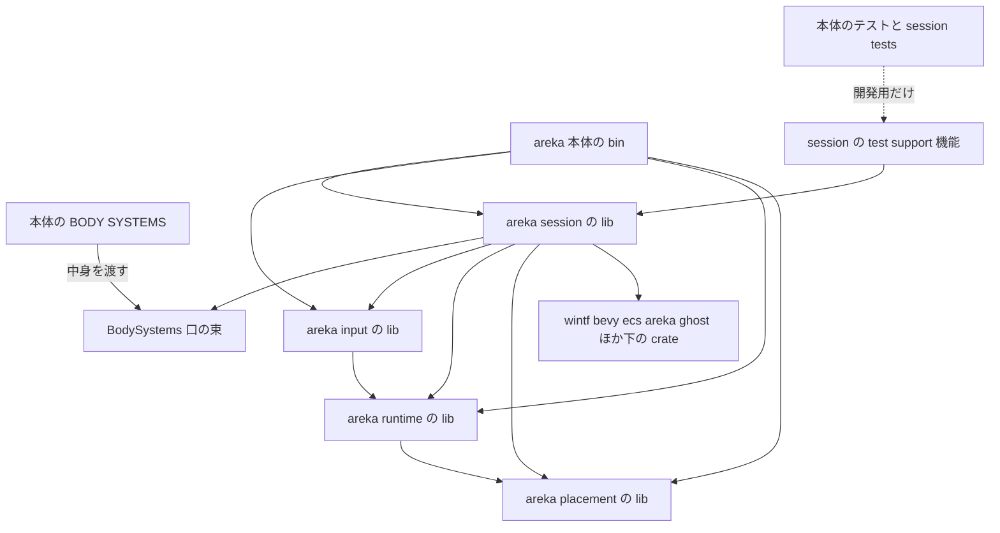
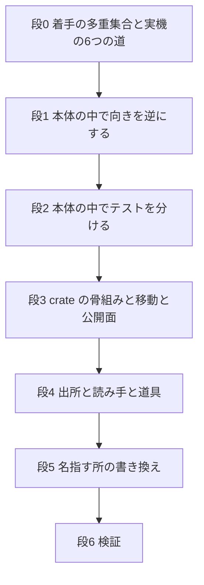
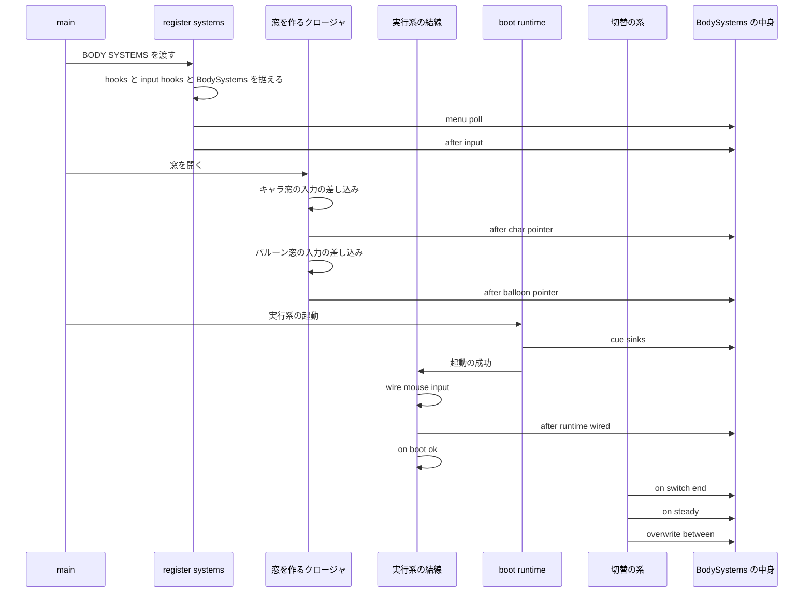

# 設計書: session-crate-split

## 概要

**目的**: 本体の `crates/areka/src/session/`（起動・終了・切替の層・122 ファイル）を新しい lib crate `crates/areka-session/` へ移す。移す前に、集めた層の本番が本体だけのモジュール（menu・install・update・`file_drop`）を直に呼ぶ 28 行（C1〜C5）を、本体が据えた口の束 `BodySystems` を通す形に逆にする。告知の判断が読む煙の自動終了（`smoke_exit.rs`）は向きを逆にせず、テストごと集めた層へ移す。振る舞いは変えない。

**使う人**: areka の開発者。集めた層を直す人と、見直し（`audit-areka-app`・`audit-areka-install-update`）を受け持ちごとに回す人。

**変わること**: 依存は `areka`（bin）→ `areka-session` → `areka-input` → `areka-runtime` → `areka-placement` の一方向になる。本体は「UI スレッドからエンジンへつなぐ」部分（main と起動オプション・MCP・メニュー・インストール・更新・投げ込み・オフラインの面の書き出し・SHIORI のデモ）と、本体の本物どうしをつなぐテストだけを持つ。`BodySystems` は今の 2 欄（系の登録）に 9 欄（口）を足し、`register_systems` が World の資源として据える。ログの出所の名前が `areka::session::…` から `areka_session::…` に変わるほかは、動く ukagaka のアプリとしての振る舞いは前と同じ。

### 目標

- 集めた層の本番が本体の項目を名指さない（向きを逆にした直後に本番 0 行を grep で示す・1.1〜1.10）。
- 逆にした口の呼ぶ順・呼ぶ時・回数が前と同じで、それを決定論のテストで示す（2.1〜2.5）。
- 集めた層の本番とテストが `crates/areka-session/` にあり、本体は path 依存で使う。`areka-session` は本体に依存しない（3.1〜3.9・4.7）。
- 外から使われる項目だけが `pub` になり、テストのためだけに開く項目は `test-support` のときだけ見える（4.1〜4.6・5.8）。
- テストの名前の多重集合（説明のつく差を除く）・警告 0・全体テスト・実機テスト・実機の 6 つの道の記録の順が、移す前と同じ合否を示す（8.1〜8.11）。

### 目標でないこと

- 振る舞いの直し・古い説明の直し（`smoke_exit.rs` の `//!` の「`main.rs` の 1,000 行の上限のため外へ出した」ほか）。`audit-areka-app`・`audit-areka-install-update` へ申し送る（8.1）。
- ゴーストの単位を複数にすること（`multi-ghost-runtime`）。
- menu・install・update・mcp・本体の roots（`edit`・`desk`・`pick`）・cli・offline_dump の crate 化。
- `areka-input` を直に呼ぶ入力の 5 件と `register_systems` の中の入力の系の登録、`app_exit.rs` の `MouseWiring`（C6）の向き（1.9）。
- 外から使われない `pub(crate)` の削除（4.2）。
- 本体の `Cargo.toml` の、移した後に本体が直に使わなくなる依存の行の整理（前例どおり `audit-areka-app` の持ち物。`Cargo.lock` は変わらない）。

## 境目の約束

### この仕様が持つもの

- 口の束 `BodySystems` の新しい欄 9 つと、口が据わっていないときの倒れ方（型と倒れ方は集めた層の `body_systems.rs`、中身は本体の `main.rs` の `BODY_SYSTEMS`）。
- 集めた層の本番の呼び先 28 行の書き換えと、`smoke_exit.rs`（＋テスト）の集めた層への移動。
- 新しい crate `crates/areka-session/` の骨組み（`Cargo.toml`・`lib.rs`・`test-support` 機能・テストの実行ファイルの落ちの報告）と、122 ファイルの移動。
- 公開面の付け替えと、そのために開けた項目の記録。
- テストの分け方: 本体に残すテストの置き場 `crates/areka/src/session_tests/`（新設）・`SwitchRig` の作り口の分け方・テストの支えの置き場（`crate_source_test_support`・`log_history` の写しの窓の排他・`resolve_boot_from`）。
- 呼ぶ順を確かめる新しいテスト（集めた層に 4 本・本体に 3 本）と落ちの報告の確かめ 1 本。
- ソースを読むテストの付け替えと、`t_zwi05` の受け口の列の字面。
- 本体の呼び手 117 ファイルと `tests/emo2_mcp_real_run.rs`・`tests/smoke_boot_loop_exit.rs` の書き換え。
- ログの出所の名前と、名前で読む所の書き換え。
- 集めた層のパスを名指すコメント・文書・台帳・`structure.md`・`tech.md`・2 本の audit の brief の「受け持つファイル」の書き換え。
- 道具 `tools/load-flake.ps1` の `-Binary` に `areka-session-lib`。
- 検証の手順と記録。`roadmap.md` の新旧のパスの対応表の行は完了の段（`/kiro-complete`）で書く。

### この仕様が持たないもの

- 振る舞い（8.1）。見つけた不具合・古い説明は申し送る。理由の文が移した後に事実でなくなる `#[allow(...)]` は、2026-11-22 の測りで集めた層に 0 件（`#[allow]` は `clippy::too_many_arguments`・`clippy::type_complexity` の 2 つだけで、どちらも理由の文を持たない）。0 件を申し送りに明記する。
- 同じウェーブの約束 ⑶ で触らない所: `crates/areka-placement/`・`crates/dola/`・`crates/areka-ghost/`・`crates/areka-seriko/`・本体の `crates/areka/src/placement_tests/`。`crates/areka-runtime/`・`crates/areka-kanade/` はパスを名指すコメントだけ。
- `areka-placement` の 4 か所のコメント（`diag.rs:46`・`persist.rs:330`・`resolver.rs:97`・`resolver_resolve_balloon_tests.rs:123`）の書き換え（除外の一覧に載せて `audit-areka-app` へ・7.3）。
- `log-capture-kit/tests/file_length_guard_test.rs`・`temp_path_guard_test.rs` ほか番人の表（集めた層を指す項目は 2026-11-22 の測りで 0 件・変えない）。
- 集めた層に触れると書いているほかの brief の書き換え・歴史の文書・日付つきの写し（Out of scope）。
- `audit-areka-app`・`audit-areka-install-update` の所見の文の中の古いパス（各 audit の要件の段で読み替える・7.6）。

### 使ってよい依存

- `areka-session` の本番の依存は次の 20 個に限る（3.6・2026-11-22 の測り・段 3 で `cargo tree -p areka-session -e normal` と照らして確定）: tracing・tracing-subscriber・bevy_ecs・windows・thiserror・async-io（`smoke_exit.rs`）・wintf・dola・areka-ghost・areka-kanade・areka-sylphya・areka-parsers・areka-seriko・areka-actor・areka-user-data・areka-update・areka-emo-present・areka-runtime・areka-placement・areka-input。どれも本体の表と `Cargo.lock` に既にある（3.5）。optional は `shiori-host32-host` だけ（`test-support` で付く）。
- `areka-session` の開発用の依存は、集めた層のテストが今使う crate に限る（見込み: log-capture-kit・sample-ghost-kit・temp-path-kit・shiori-host32-host・areka-emo-text・areka-emo-compose・areka-emo-atlas・areka-sakura・image・areka-runtime〔`test-support`〕・areka-placement〔`test-support`〕・areka-input〔`test-support`〕。段 3 のコンパイラのエラーで確定）。番人の 3 つの crate は本番の表に optional でも書かない（3.7・5.9）。
- `areka-session` の `test-support` は `["dep:shiori-host32-host", "areka-runtime/test-support"]`（`SwitchRig` が `areka_runtime::spine` と偽の SHIORI の型を使う）。番人の crate は連鎖させない。
- `areka-session` は `areka` に依存しない（3.4）。コードでも説明のリンクでも本体を引かない（4.6・4.7）。口の型が名指してよいのは下の crate の型（`World`・`GhostRuntime`・`BootCueSink`）だけ。

### 見直しの引き金

- `BodySystems` の欄か据え方が変わる → 本体の `main.rs` の `BODY_SYSTEMS`・`crates/areka/src/session_tests/body_systems_tests.rs`・集めた層の `body_systems_tests.rs`・`SwitchRig` の作り口 2 つを見直す。
- 受け口の列の並びが変わる → `runtime_boot_tests.rs` の 13 本の確かめと `t_zwi05` の字面を見直す。
- `areka-session` の公開面か `test-support` の中身が変わる → 本体の使い手（`main.rs`・menu・install・update・mcp・`runtime_tests/`・`session_tests/`）を見直す。
- ログの出所の名前が変わる → `log_history` の決まり・real-run-kit の名指し・`RUST_LOG` の文字列・手順書を見直す。
- `multi-ghost-runtime` は着地の後に新しい crate の形で測り直す（下流）。

### 同じウェーブとの重なり

- `test-name-work-tags`: 本体の `runtime_tests/zorder_wiring_tests.rs` には触らない約束（⑴）。この仕様は同じファイルの `include_str!` の 2 行（33・68 行）と `t_zwi05` の受け口の列の字面だけを書き換える。テストの名前は変えない。
- `dola-cue-test-builder`: 呼び手の名（runtime の `carrier_cue` ほか）を残す形なら、この仕様が `git mv` する `session/readme/readme_cue_tests.rs`・`session/runtime_boot_tests.rs` と、書き換える `update/update_cue_tests.rs`・`runtime_tests/consumer_ledger_agreement_tests.rs` の中の `carrier_cue` の行に向こうは触らない（⑵）。重なりは 0。
- `doc/COMPAT_ARCHITECTURE.md` §8: この仕様はパスの行だけ、`test-name-work-tags` は名の行だけ（⑷・許す重なり）。この仕様が書き換える行（353・355・411 の付近）は向こうの名の行（354・412）の隣なので、git は競合として出しうる。後から着地する側が、両方の書き換えを残して手で解く。
- `Cargo.lock`・`THIRD-PARTY-NOTICES.md` の席はこの仕様だけ（⑸）。
- roadmap の C25 の行の「触るファイル」に無く、この設計で足したファイル: `tools/package.ps1`（3 か所）・`tools/perf/judge-perf.py`（1 か所）・`doc/ukadoc-coverage/briefing-assets.md`・`.kiro/steering/tech.md`（1 か所）・`crates/areka-runtime/src/lib.rs:391`・`strict_judges.rs:5`（コメント）・網羅台帳 `doc/ukadoc-coverage/ledger/*.toml`・`doc/ideas/` の 8 ファイル・`.kiro/specs/audit-areka-app/brief.md`・`.kiro/specs/audit-areka-install-update/brief.md`・`tools/load-flake.ps1`・`crates/areka/src/session_tests/`（新設）・`crates/areka/src/sample_test_support.rs`・`crates/areka/src/crate_source_test_support.rs`（移す）・`crates/areka/src/smoke_exit{,_tests}.rs`（移す）・`crates/areka/src/install/startup.rs`。兄弟 2 本の触るファイルと重ならないことは、着手のときに兄弟の tasks.md の `_Boundary:_` と照らして確かめ、完了の報告で棚卸のセッションへ伝える。

## 構成

### 今の形

- `register_systems(world, kanade_stop_rx, body: BodySystems)` は本体だけのモジュールの系の登録を `BodySystems` の 2 欄（`menu_poll`・`after_input`）で受け、World に残さない。C1〜C5 の呼び先は `register_systems` の外（窓を作るクロージャ・実行系の結線・切替の系・読み直しの入口・実行系の起動）にあるので、欄を足すだけでは届かない。
- 前例の口 `SessionHooks`（`areka-runtime`）・`InputHooks`（`areka-input`）は World の資源で、`register_systems` の先頭 2 行で据わる。`SessionHooks::of` は無いとき `#[cfg(not(test))]` で `error!(session_hooks_missing)` を残し `NO_BODY` を返す。
- 呼び先はどれも、窓口（`InstallDesk`／`UpdateDesk`）が無いとき「何もしない／偽／受信端の無い送出端」で戻る。
- 本番で `register_systems` を呼ぶのは `main.rs` だけで、C1〜C5 の道（窓を開く・`boot_ghost`）は `register_systems` の後でしか通らない。オフラインの面の書き出し・SHIORI のデモ・cli は C1〜C5 の道を通らない（2026-11-22 の測り）。
- 本体のテストを組むとき、依存の lib は `cfg(test)` を立てずに組まれる。集めた層を crate へ出すと、集めた層の `#[cfg(test)]` の項目は本体のテストから見えず、`#[cfg(not(test))]` の記録の絞りは本体のテストのビルドでは効かない。

### 依存の図



- 実線は本番、点線は開発用の依存だけ。`areka-session` から本体へは、コードでも説明のリンクでも引かない。
- `BodySystems` は `areka-session` の型で、本体の `main.rs` が中身を持つ（`InputHooks` の型が `areka-input` に在り、中身を本体が据えるのと同じ向き）。

**構成の決め**:

- 形: 今のモジュールの境目をそのまま crate の境目にする。新しい層や包みは作らない。足す仕組みは無く、今ある `BodySystems` の欄を足して資源として据えるだけ（1.8）。
- 本体の呼び手は `areka_session::…` へ書き換え、出し直しは置かない（4.4）。
- steering との合致: ルートの `Cargo.toml` を変えない・外の依存を足さない・1,000 行の例外表を増やさない・1 フレーム遅らせない・口が無いときは `error!` を残す（3.5・3.8・2.3・1.11）。

### 技術の表

| 層 | 選んだもの | この仕様での役 | 備考 |
|---|---|---|---|
| ビルド | Cargo（`members = ["crates/*"]`・resolver 2） | 新しい crate を自動で拾う・`test-support` 機能 | 根の `Cargo.toml` は不変 |
| 言語 | Rust 2024（`edition.workspace = true`） | `pub` の付け替え・`cfg(any(test, feature = "test-support"))`・`#[macro_export]` | 外の依存は足さない |
| ECS | bevy_ecs（ワークスペースの版） | 口の束を `Resource` で据え、同期に呼ぶ | 前例 `SessionHooks`・`InputHooks` |
| ログ | tracing・tracing-subscriber | 出所の名前が `areka_session::…` になる | `areka=…` は `areka_session` も覆う。`areka::session=…` は何も覆わなくなる |
| テストの支え | log-capture-kit・sample-ghost-kit・temp-path-kit | 開発用の依存だけで使う | 番人の決まりは不変 |
| 道具 | `cargo about`・`tools/test-all.ps1`・`tools/load-flake.ps1`・`tools/mouse-input.ps1`・`ukadoc-survey` | 第三者の表・全体テスト・揺れの繰り返し・実機の操作・網羅の報告 | `test-all.ps1`・`mouse-input.ps1` は直さない |

### 設計の段で決めたこと

| # | 決めること | 決め | 主な代案 |
|---|---|---|---|
| D1 | 束の数（1.8） | 1 つ。今の `BodySystems` に欄を足し、`#[derive(Resource, Clone, Copy)]` にする。型は新しいファイル `body_systems.rs` へ移す（`ghost_session.rs` 897 行を増やさない）。名前と `register_systems` の引数の形は変えない。`register_systems` の先頭の口の据え付け 2 行（`hooks::install`・`install_input_hooks`）の直後に `world.insert_resource(body)` を 1 行足し、`(body.menu_poll)(world)`・`(body.after_input)(world)` は今のまま | 束を 2 つにする（登録の束はそのまま、口の束 `BodyHooks` を別に足す。型が 1 つ増え、`SwitchRig` へ渡す値が 2 つになる） |
| D2 | 欄（1.2〜1.6・2.1） | 今の 2 欄に 9 欄を足す（下の「部品と口」の BodySystems）。C1 は入力の 2 件との交互の順を保つため 2 欄、C3 の `on_steady` は install → update を本体の中で続けて呼ぶ 1 欄、C4 は読み直しが理由を分けて断るので 2 欄、C5 は 2 つの受け口を並びのとおり返す 1 欄 | C1 を 1 欄にする（入力の差し込みとの交互の順が崩れる）／C4 を「忙しい理由」を返す 1 欄にする（シェル・バルーンの切替は update だけを問うので答えの形が 2 通りになる） |
| D3 | 口が据わっていないとき（1.11） | `BodySystems::of(world)` が資源を写して返す。無ければ `#[cfg(not(test))]` で `error!(event = "body_systems_missing")` を残し、`NO_BODY`（系の登録と C1〜C3 は何もしない・C4 は偽・C5 は `areka_ghost::sink::DiscardSink` を 2 つ）を返す。前例 `SessionHooks::of` と同じ形 | 絞らずに記録する（前例 `InputHooks`。集めた層のテストで口を据えずに通る道〔`runtime_boot_tests.rs` ほか〕が記録で埋まる） |
| D4 | C5 の口が無いときの列（5.14） | 13 個を保つ（`DiscardSink` 2 つ）。`runtime_boot_tests.rs` の `sinks_are_thirteen_with_reload_then_window_state_last` は口の無い `World::new()` で 13 個と 12 番目・13 番目の受け口を確かめるので、11 個にすると中身を変えることになる | 11 個にする（テストの中身が変わる） |
| D5 | `smoke_exit.rs` の置き場（1.7） | `git mv` で `crates/areka-session/src/smoke_exit.rs`（テストも兄弟）へ。`pub fn arm`・`pub fn smoke_exit_ms` にする。本体の `main.rs:267`・`install/startup.rs:235` は移した先を呼ぶ。出所は `areka::smoke_exit` → `areka_session::smoke_exit` で、`log_history` のどの決まりにも当たらない（前後とも当たらない） | ― |
| D6 | `SwitchRig` の作り口（5.4） | `SwitchRig::with(sample: RigSample, body: BodySystems, scripts)` を `test-support` で開く。`RigSample` は検体の根・ゴーストのフォルダ・同梱バルーンの道と、寿命を持つ値（`Box<dyn Any>`）の 4 欄。集めた層は `#[cfg(test)]` の `SwitchRig::new(scripts)`（`SampleRoot::acquire("emo2")` と `NO_BODY` を渡す数行）を持ち、35 か所の呼び出しを変えない。本体は `sample_test_support.rs` に `switch_rig(scripts)`（`acquire_emo2()` と `crate::BODY_SYSTEMS` を渡す数行）を足し、22 か所の `SwitchRig::new(` を `switch_rig(` へ書き換える | 本体も `SwitchRig::new` の名で呼べるよう拡張の trait を置く（前例が無い・型が増える） |
| D7 | 本体に残すテストの置き場（5.1〜5.3） | `crates/areka/src/session_tests/`（新設・`main.rs` の `#[cfg(test)] mod session_tests;`）。前例の `placement_tests/`・`runtime_tests/` にならう。移すファイルは名前を変えず、`#[path]` の親子の形（`ghost_session_switch_tests.rs` の子 2 本ほか）を同じ並びで写す。`use super::*` は `use areka_session::<元の親のモジュール>::*` に替え、足りない私有の項目はコンパイラのエラーで 1 つずつ開く（4.5 の記録） | `crates/areka/src/session/` の名を残す（3.3 に反する） |
| D8 | 一部だけ本体を要るファイルの分け方（5.3） | 本体を要るテストだけを、元のファイルの名前に `_body` を足したファイルへ移す（例 `readonly_body_tests.rs`）。テストの名前と中身は変えない。小道具の扱いは 2 通り: ⑴ 本体へ移すテストだけが使う小道具は一緒に移す ⑵ 集めた層のテストと分け合う小道具は、番人の crate（log-capture-kit・temp-path-kit・sample-ghost-kit）に頼らなければ、元のファイルから兄弟の `<元の親>_test_support.rs`（`cfg(any(test, feature = "test-support"))`・`#[test]` を持たない）へ移して両方から使い、番人の crate に頼るなら分けずにファイルごと本体へ移す（`test-support` には番人の crate を入れられず、分けると小道具の写しが要る）。2026-11-22 の測りで ⑵ の後者は `reload_tests.rs`・`shell_balloon_switch_tests.rs`（足場が `TempPath`・`capture` に頼る）。対象は TestPlacement の表 | テストの中身を偽物の口に替えて集めた層に残す（5.2 に反する）／小道具を本体へ写す（写しが増える） |
| D9 | テストの置き場の表 | 下の「部品と口」の TestPlacement の表。偽物の組（`NO_BODY`）で走らせて赤になった集めた層のテストは、中身を変えずに本体へ移し、表に足す（Research Needed 1 の測り方） | ― |
| D10 | `crate_source_test_support` の置き場（5.6・5.13） | `git mv` で `crates/areka-session/src/crate_source_test_support.rs` へ。`lib.rs` で `#[cfg(any(test, feature = "test-support"))] pub mod crate_source_test_support;`、マクロは `#[macro_export]`（`areka_session::crate_source!`。中の `env!("CARGO_MANIFEST_DIR")` は呼び手の側で解けるので、本体のテストからも本体の置き場から読む）。本体は `areka_session::{crate_source, crate_source_test_support::crate_path}` を使う。ファイルの中の `mod tests` には `#[cfg(test)]` を付ける（`test-support` で開いたとき、使われない import の警告を出さない・8.4） | 各 crate がマクロを持つ（写しが増える・5.6 に反する） |
| D11 | 写しの窓の排他 `log_history::capture_tests::hold`（2.8 の下書き） | `WINDOW` と `hold` の 2 項目を `log_history_capture_tests.rs` から `log_history.rs` へ移し、`#[cfg(any(test, feature = "test-support"))] pub` にする。テストのモジュールは `cfg(test)` のまま（`test-support` で開くとテストが本体の実行ファイルにも入り、名前の多重集合が増える） | テストのモジュールごと `test-support` で開く（テストが二重になる） |
| D12 | `resolve_boot_from`（5.3） | `boot_config.rs` の `#[cfg(test)]` の口を `crates/areka/src/session_tests/mod.rs` へ移す（`areka_session::boot_config::resolve_boot_with` を `crate::cli::parse::parse` で呼ぶ 15 行）。使う本体の 2 本（`main_session_mark{,_fallback}_tests.rs`）と、本体へ移す 6 本はそこから使う | ― |
| D13 | 本体のテストが口を据えずに口の道を通るとき | 段 1（まだ 1 つの crate）で本体の効き目が無くなって赤になったテスト、段 3（crate を分けた後）で `body_systems_missing` の記録が増えて赤になったテストは、World を組んだ直後に `world.insert_resource(crate::BODY_SYSTEMS);` の 1 行を足す（前例 input-crate-split D3 の 1 行）。足したテストは一覧に記録する。表明は変えない | テストを集めた層へ移す（本体の部品を名指すものは移せない） |
| D14 | 呼ぶ順の確かめの形（2.2・5.5） | 記録する偽物の組で、集めた層の道が欄を呼ぶ順と回数を見る（集めた層）。C1 の 2 欄と入力の 3 件の交互の順は、同じクロージャの中の呼び出しの順なので、`ghost_session.rs` の字面で押さえる（集めた層のテストが自分のファイルを相対の `include_str!` で読む）。本体の側は、資源が据わること・口が無いときの記録・`after_input` の中の install → update → mcp の順を見る | 入力の差し込みの効き目（ハンドラの部品）を窓ごとに数える（部品の型が wintf の中で、測る形が決まらない） |
| D15 | 実機の 6 つの道の取り方（8.7） | 着手のとき（段 0）と完了の前（段 6）に、同じ使い捨ての手順（作業の木の `target\session-crate-split\real\` に置く PowerShell）で回す。emo2 を絶対パスで起こし、メニューの操作と `.nar` の投げ込み（エクスプローラーの窓からキャラ窓へのドラッグ）は既にある `tools/mouse-input.ps1`、MCP の `reload` は areka の MCP、煙の自動終了は `AREKA_APP_SMOKE_EXIT_MS` で起こす。標準エラーの記録を `RUST_LOG=info` で取り、出所の名前を除いた行の順を比べる。排他テストの机を取り、開発者の SendInput の許しの下で行う。手順の中身は検証の記録に写し、`tools/` には足さない | `tools/` に道具を足す（範囲の外の道具に触る） |

## ファイルの置き場

### 新しい crate

```
crates/areka-session/
├── Cargo.toml                        # lib・publish = false・test-support 機能（SessionCrate）
└── src/
    ├── lib.rs                        # 旧 session/mod.rs（宣言の並びは今のまま＋下の新しい宣言）
    ├── body_systems.rs               # 新設: BodySystems・of・NO_BODY（D1〜D4）
    ├── body_systems_tests.rs         # 新設: 記録する偽物で呼ぶ順を見る 4 本（D14・cfg(test)）
    ├── crash_report_tests.rs         # 新設: 落ちの報告の初期化子と確かめ 1 本（cfg(test)）
    ├── smoke_exit.rs                 # 本体の src/smoke_exit.rs を git mv（D5）
    ├── smoke_exit_tests.rs           # 同じくテスト
    ├── crate_source_test_support.rs  # 本体の src/crate_source_test_support.rs を git mv（D10・test-support）
    ├── ghost_switch_test_support.rs  # 旧 session/ のまま。RigSample と SwitchRig::with を足す（D6・test-support）
    ├── ghost_session_scope_rect_test_support.rs   # 新設: 親のテストから小道具を移す（D8 ⑵・test-support）
    ├── ghost_session_scope_scale_test_support.rs  # 同上
    ├── readme.rs・readme/            # 旧 session/readme.rs・readme/（11 ファイル）を同じ並びで git mv
    ├── roots/                        # 旧 session/roots/（7 ファイル）を同じ並びで git mv
    └── <旧 session/ の残りのファイル>  # 同じ名前・同じ平らな並びで git mv（本体へ移す下のファイルを除く）
```

- 旧 `session/` の 122 ファイル（`mod.rs` を含む）のうち、本体へ移すテスト（下の「本体の新しい置き場」）を除いた全部を移す。`#[path]` は宣言したファイルの置き場から解くので、同じ平らな並びのまま `src/` へ移せば解け方は変わらない。
- `lib.rs` に足す宣言: `pub mod body_systems;`・`pub mod smoke_exit;`・`#[cfg(any(test, feature = "test-support"))] pub mod crate_source_test_support;`・`#[cfg(test)] mod crash_report_tests;`。`ghost_switch_test_support` の宣言は `#[cfg(any(test, feature = "test-support"))] pub mod` へ。

### 本体の新しい置き場

```
crates/areka/src/session_tests/
├── mod.rs                                     # 新設: 宣言の並び・resolve_boot_from（D12）
├── body_systems_tests.rs                      # 新設: 据わる・無いときの記録・after_input の順の 3 本
├── session_end_tests.rs                       # ↓ 旧 session/ から git mv（名前は変えない・D7）
├── ghost_session_switch_tests.rs              #   子の ghost_session_switch_{fallback,memory}_tests.rs も同じ並び
├── ghost_session_switch_fallback_tests.rs
├── ghost_session_switch_memory_tests.rs
├── ghost_session_restart_tests.rs
├── ghost_session_reload_tests.rs
├── ghost_session_strict_tests.rs
├── ghost_session_scope_rect_boot_tests.rs
├── ghost_session_scope_scale_boot_tests.rs
├── shell_balloon_switch_session_tests.rs
├── shell_balloon_switch_session_update_tests.rs
├── boot_resolve_mark_text_tests.rs
├── readonly_run_tests.rs
├── readonly_sites_tests.rs
├── write_failure_sites_tests.rs
├── boot_config_module_policy_tests.rs
├── boot_config_{balloon,copy,input,option,roots,callghost}_tests.rs
├── reload_tests.rs                            # ファイルごと（D8 ⑵ の後者）
├── shell_balloon_switch_tests.rs              # ファイルごと（同上）
├── readonly_body_tests.rs                     # 新設: readonly_tests.rs から木を歩く 3 本と小道具 2 つ（D8 ⑴）
├── readme_body_tests.rs                       # 新設: readme_tests.rs から木を歩く 1 本
├── session_end_deadline_body_tests.rs         # 新設: session_end_deadline_tests.rs から木を歩く 2 本と小道具 3 つ
└── log_history_convention_body_tests.rs       # 新設: log_history_convention_tests.rs から在りかを確かめる 2 本と小道具 2 つ
```

- `ghost_session_scope_{rect,scale}_boot_tests.rs` が親のテストのモジュールから使う小道具（`LEFT_SCREEN`・`wiring::{fake_handle, placement}`・`applied` と、それが引く項目）は、D8 ⑵ の前者で集めた層の `ghost_session_scope_{rect,scale}_test_support.rs` へ移す（番人の crate に頼らない・2026-11-22 の測り）。

- `write_failure_sites_tests.rs` は今 `write_failure.rs` の `pub(crate) mod sites_tests` で、その `KINDS`・`drain_desk` を `readonly_sites_tests.rs` が使う。2 本とも本体へ移るので、本体の `session_tests/mod.rs` で `sites_tests` の名のまま宣言し、`readonly_sites_tests.rs` の `use` を書き換える。

### 移す集めた層のファイルの中で書き換えるもの

- 口を通す: `ghost_session.rs`（`BodySystems` を `body_systems.rs` へ出す・`register_systems` の 1 行・C1）・`ghost_session_runtime.rs`（C2）・`ghost_switch.rs`（C3）・`reload.rs`・`shell_balloon_switch.rs`（C4）・`runtime_boot.rs`（C5）・`alert.rs`（D5）。
- 支え: `ghost_switch_test_support.rs`（D6）・`log_history.rs`（決まりの 5 行・`hold`・D11）・`log_history_capture_tests.rs`（`hold` を外す）・`boot_config.rs`（`resolve_boot_from` を外す・本体へ移すテストの宣言を外す）・`write_failure.rs`・`readonly.rs`・`session_end.rs`・`ghost_session_scope_rect_tests.rs`・`ghost_session_scope_scale_tests.rs`・`boot_resolve.rs`（本体へ移すテストの宣言を外す）・`lib.rs`（宣言）。
- 分ける元: `readonly_tests.rs`・`readme_tests.rs`・`session_end_deadline_tests.rs`・`log_history_convention_tests.rs`（D8 ⑴）・`ghost_session_scope_rect_tests.rs`・`ghost_session_scope_scale_tests.rs`（小道具を新設の `ghost_session_scope_{rect,scale}_test_support.rs` へ・D8 ⑵）。
- 1 行だけ: `app_exit_escape_tests.rs`（`NO_BODY`）・`runtime_boot_tests.rs`（`SampleRoot::acquire("emo2")`）。ほかは `crate::session::` → `crate::` の行だけ。

### 変えるファイル

- `Cargo.lock` — `areka-session` の 1 項目と本体の依存の 1 行（`cargo` が書く）。
- `crates/areka/Cargo.toml` — `[dependencies]` に `areka-session = { path = "../areka-session" }`、`[dev-dependencies]` に `areka-session = { path = "../areka-session", features = ["test-support"] }`（前例の `areka-input` の 2 行と同じ形・理由の注つき）。81 行の説明のパスを移した先へ（7.2）。
- `crates/areka/src/main.rs` — `mod session;`・`mod smoke_exit;`・`mod crate_source_test_support;` を外し、`#[cfg(test)] mod session_tests;` を足す。`session::…` を `areka_session::…` へ。`BODY_SYSTEMS` に 9 欄と本体の小さな関数 4 つ（下の BodySlots）。
- `crates/areka/src/sample_test_support.rs` — `switch_rig(scripts)` を足す（D6）。
- 本体で `session::` を引く 117 ファイル（根 9・`install/` 20・`mcp/` 20・`menu/` 19・`update/` 11・`runtime_tests/` 24・`roots/` 6・`cli/` 4・`offline_dump/` 4。2026-11-22 の作業の木 `b21fd552` で数え直して一致）と `tests/emo2_mcp_real_run.rs`（出所の名前と説明）・`tests/smoke_boot_loop_exit.rs`（説明の `ghost_session::` だけ） — `crate::session::…`・`session::…` → `areka_session::…`（4.4）。`SwitchRig::new(` → `switch_rig(`（22 か所・D6）。
- `crates/areka/src/install/startup.rs` — 235 行の `crate::smoke_exit::smoke_exit_ms()` → `areka_session::smoke_exit::smoke_exit_ms()`。
- `crates/areka/src/runtime_tests/zorder_wiring_tests.rs` — 33・68 行の `include_str!("../session/…")` → `crate_source!("areka-session", "src/…")`。`t_zwi05` の受け口の列の字面（下の SourceGuards）。
- `crates/areka/src/offline_dump/offline_dump_tests.rs` — `hold` の `use` のパス（D11）。
- `crates/real-run-kit/src/{launch.rs,launch_tests.rs,close_tests.rs,bin/real-run-fake-areka.rs}` — 出所の名前（6.3）。
- `crates/areka-runtime/src/{talk_clock.rs:229,user_break_cue.rs:79,lib.rs:391,strict_judges.rs:5}`・`crates/areka-runtime/src/placement_tests/transition_judge_offset_signoff_tests.rs:57`・`crates/areka-kanade/src/schedule/script_log.rs:16` — コメントのパスだけ（7.1）。
- `crates/areka/tests/emo2_real_run.rs:58`・`crates/areka/src/runtime_tests/spine_move_cue_tests.rs:11` ほか本体のコメント（7.2）。
- `doc/COMPAT_ARCHITECTURE.md`（パスの行 38 か所）・`doc/ukadoc-coverage/ledger/{sakura-script,property,shiori,assets}.toml`（18・10・9・1）・`doc/ukadoc-coverage/briefing-assets.md`・`doc/testing.md`・`doc/ssp-mcp/log-convention.md`・`doc/pasta-real-run.md`（127・141 行）・`doc/ideas/` の 8 ファイル・`tools/package.ps1`（3 か所）・`tools/perf/judge-perf.py`（1 か所） — パスと出所の名前（6.3・7.4）。`doc/ukadoc-coverage/report/` は `ukadoc-survey` で作り直す。
- `tools/load-flake.ps1`（55・71・72・210・276 行の付近） — `areka-session-lib`（5.12）。
- `.kiro/steering/structure.md`・`.kiro/steering/tech.md` — 7.5。
- `.kiro/specs/audit-areka-app/brief.md`・`.kiro/specs/audit-areka-install-update/brief.md` — 「受け持つファイル」（7.6）。
- `THIRD-PARTY-NOTICES.md` — `cargo about generate` で作り直す（8.11）。

### パスの書き換えの対応

| 旧 | 新 |
|---|---|
| `crates/areka/src/session/mod.rs` | `crates/areka-session/src/lib.rs` |
| `crates/areka/src/session/<名>.rs`・`session/readme/…`・`session/roots/…`（本体へ移すテストを除く） | `crates/areka-session/src/<名>.rs`・`src/readme/…`・`src/roots/…` |
| `crates/areka/src/session/<本体へ移すテスト>.rs` | `crates/areka/src/session_tests/<同じ名>.rs` |
| `crates/areka/src/smoke_exit{,_tests}.rs`・`crate_source_test_support.rs` | `crates/areka-session/src/smoke_exit{,_tests}.rs`・`crate_source_test_support.rs` |
| `src/` を付けない書き方 `session/<名>.rs`（本体の集めた層を指すもの） | `areka-session/src/<名>.rs` の書き方 |
| モジュールの形 `areka::session::<子>`・本体の中の `crate::session::<子>`・`session::<子>` | `areka_session::<子>` |
| 集めた層の中の `crate::session::<子>` | `crate::<子>` |
| 出所 `areka::session[::<子>]`・`areka::smoke_exit` | `areka_session[::<子>]`・`areka_session::smoke_exit` |

## 流れ

### 段の並び



| 段 | すること | 段の終わりに緑であるもの |
|---|---|---|
| 0 | 枝の先頭で `cargo test --workspace --no-fail-fast -- --list` を取り `target/session-crate-split/tests-before.txt` に残す。D15 の手順で実機の 6 つの道を 1 回取り、記録を `target/session-crate-split/real-before/` に残す | （取るだけ） |
| 1 | まだ本体の中で: `session/body_systems.rs` を作り `BodySystems` を移す・欄を足す・`register_systems` で据える。28 行を口へ通す（`use crate::menu;` 2 行・`use crate::install::…`・`use crate::update::…` を外す）。`main.rs` の `BODY_SYSTEMS` に欄を足す。`smoke_exit.rs`＋テストを `session/` へ `git mv` し、`alert.rs:286`・`main.rs`・`install/startup.rs` を `crate::session::smoke_exit` へ。`t_zwi05` の字面。集めた層の `session/body_systems_tests.rs`（OrderTests の 1〜4）。D13 の 1 行（効き目が無くなって赤になったテスト） | `cargo test -p areka --bin areka`（赤が出たら赤のテストだけ回し直す）・1.10 の grep が本番 0 行・テストだけに残る参照の一覧 |
| 2 | まだ本体の中で: `crates/areka/src/session_tests/` を作り、TestPlacement の表の「本体」の行を `git mv`、「分ける」の行を D8 のとおり分ける。`SwitchRig::with`・`RigSample`（D6）・集めた層の `SwitchRig::new` を `NO_BODY` へ・本体の `switch_rig`・`resolve_boot_from` の移動（D12）。本体の `session_tests/body_systems_tests.rs`（OrderTests の 5・7）。偽物の組で赤になった集めた層のテストを本体へ移し、表に足す（D9） | `cargo test -p areka --bin areka`・集めた層の下のテストのファイルが `crate::BODY_SYSTEMS`・`crate::after_run` ほか根の関数・`crate::cli`・`crate::menu`・`crate::install`・`crate::update`・`crate::mcp`・`crate::shiori_host`・`crate::runtime_tests` を名指さない（grep 0 件。`crate_source_test_support`・`sample_test_support` は段 3 で解く） |
| 3 | `crates/areka-session/Cargo.toml` を作り、残る `session/` を `git mv`（`mod.rs` → `lib.rs`）、`smoke_exit*`・`crate_source_test_support.rs` を `git mv`（D10）。集めた層の中の `crate::session::` → `crate::`。本体の `session::` → `areka_session::`・`Cargo.toml` の 2 行・`main.rs` の宣言。コンパイラのエラー（E0603・E0616・E0624・E0364・`private_interfaces`・死んだコードの警告）を 1 件ずつ見て `pub` か `test-support` にし、4.5 の連れて開く型を記録する。`hold` の移動（D11）。OrderTests の 6（口が無いときの記録は、集めた層が本体のテストのビルドで `cfg(test)` でなくなるこの段から出る）。`runtime_boot_tests.rs` の `crate::sample_test_support::acquire_emo2` → `SampleRoot::acquire("emo2")`。落ちの報告。D13 の 1 行（記録が増えて赤になったテスト） | `cargo check --workspace --all-targets` 警告 0・`cargo check -p areka-session --lib --features test-support`・`cargo test -p areka-session`・`cargo test -p areka --bin areka`（赤のテストだけ回し直す）・4.7 の grep 0 件 |
| 4 | 出所の名前の直書き（6.2）・名前で読む所（6.3）・`tools/load-flake.ps1`（5.12）・見張りの根（5.13） | `cargo test -p areka-session -- log_history`・`cargo test -p areka --bin areka -- log_history session_tests::`・`cargo test -p real-run-kit`・`pwsh -NoProfile -File tools/load-flake.ps1 -SelfTest` |
| 5 | コメント・文書・台帳・`structure.md`・`tech.md`・2 本の audit の brief（7.1〜7.6）・網羅の報告の作り直しと `ukadoc-survey -- check` | 6.6・7.7 の grep が 0 件（除いた所の一覧つき）・`cargo run -p ukadoc-survey -- check` |
| 6 | 完了の多重集合・警告・`tools/test-all.ps1`・実機テスト（8.6）・実機の 6 つの道（D15・8.7）・`cargo about generate` | 8.2〜8.11 のすべて |

- 段 1・2 は crate を作る前に本体の中で済ませる（要件の Introduction の順）。段 2 の終わりで「集めた層が本体を引くのは段 3 で解く支え 2 つだけ」が本体の中で成り立ち、段 3 は移すだけになる。
- 段 1 では集めた層がまだ本体の `cfg(test)` の中にあるので、口が無いときの `error!` は本体のテストでも出ない。口を据えずに通るテストの赤は、段 1 では「本体の効き目が無くなった」もの、段 3 では「記録が増えた」ものとして別々に現れる（D13）。
- `git mv` は内容の書き換えと同じコミットに入れてもよいが、書き換えは行の単位に留める（git が移動として追える類似度を保つ）。どの段もコミットを分け、PR は 1 本。

### 起動と切替で口を通る流れ



- どの口も、今の呼び出しの所で同じ引数のまま同期に呼ぶ（2.3）。新しい系・チャネル・イベントは足さない。
- `register_systems` の中の順（`menu_poll` は `user_break` の後・`balloon` の前、`after_input` は入力の系の後）と、`after_input` の中の install → update → mcp は今のまま（2.1）。
- 起こし直し（読み直し・切替・shiori だけの読み直し `rebuild_runtime_in_place`）は今と同じ所を通るので、口を通る回数も今と同じ（2.4）。

## 要件の対応表

| 要件 | 要約 | 部品 | 口 | 流れ |
|---|---|---|---|---|
| 1.1 | 本番から本体の項目を名指す所を無くす | InversionSites・BodySystems | 28 行＋`alert.rs:286` | 段 1 |
| 1.2 | C1 の 3 件を同じクロージャ・同じ窓へ | InversionSites・BodySlots | `after_char_pointer`・`after_balloon_pointer` | 段 1 |
| 1.3 | C2 の 10 件を `wire_mouse_input` の後・`on_boot_ok` の前 | InversionSites・BodySlots | `after_runtime_wired` | 段 1 |
| 1.4 | C3 の 5 件を同じ節目・同じ引数 | InversionSites・BodySlots | `on_switch_end`・`on_steady`・`overwrite_between` | 段 1 |
| 1.5 | C4 の 3 件を同じ時点の状態で | InversionSites・BodySlots | `update_busy`・`install_busy` | 段 1 |
| 1.6 | C5 を列の同じ位置へ | InversionSites・BodySlots | `cue_sinks` | 段 1 |
| 1.7 | `smoke_exit.rs` をテストごと移す | SmokeExitMove | `areka_session::smoke_exit` | 段 1・3 |
| 1.8 | 前例にそろえた関数のポインタの束・同期 | BodySystems | D1・D2 | 段 1 |
| 1.9 | 入力の 5 件・C6 は逆にしない | InversionSites | 触らない一覧 | 段 1 |
| 1.10 | 逆にし終えたとき本番 0 行を grep で | Verification | 1.10 の式 | 段 1 |
| 1.11 | 口が無ければ `error!`・据わることを決定論で | BodySystems・OrderTests | D3・`register_systems_installs_body_systems` | 段 1・3 |
| 2.1 | 登録・差し込み・結線・受け口の順 | InversionSites・OrderTests | 流れの図 | 段 1 |
| 2.2 | 順を記録する決定論のテスト | OrderTests | D14 | 段 1 |
| 2.3 | 同じ呼び出しの中で・遅らせない | BodySystems | 同期の呼び出し | 段 1 |
| 2.4 | 起こし直しのたびに同じ回数 | OrderTests | 記録の回数 | 段 1 |
| 2.5 | ログの記録の中身と順 | InversionSites・Verification | 記録の比べ | 段 0・6 |
| 3.1 | lib・`publish = false`・慣習 | SessionCrate | `Cargo.toml` | 段 3 |
| 3.2 | 履歴を残す移動・`mod.rs` → `lib.rs` | SessionCrate | `git mv` | 段 3 |
| 3.3 | 本体が path 依存で使う・`session/` を持たない | SessionCrate・BodyRewire | 本体の `Cargo.toml` | 段 3 |
| 3.4 | 下の 3 crate に依存・本体に依存しない | SessionCrate | `cargo tree` | 段 3 |
| 3.5 | 根の `Cargo.toml` を変えない・外の依存を足さない | SessionCrate | `Cargo.lock` の差分 | 段 3 |
| 3.6 | 本番の依存 20 個 | SessionCrate | 使ってよい依存 | 段 3 |
| 3.7 | テストだけの crate を本番に入れない | SessionCrate・SessionTestSupport | 番人 | 段 3 |
| 3.8 | 1,000 行・例外表を増やさない | SessionCrate・BodySystems | `file_length_guard_test` | 段 1〜3・6 |
| 3.9 | crate の名前・`session_end.rs` の名前 | SessionCrate | ― | 段 3 |
| 4.1 | 外から使われる項目だけ `pub` | PublicSurface | 公開の一覧 | 段 3 |
| 4.2 | 使われない `pub(crate)` は残す | PublicSurface | ― | 段 3 |
| 4.3 | 自分を指すパス | PublicSurface | `crate::` | 段 3 |
| 4.4 | 本体の呼び手を `areka_session::…` へ・出し直しを置かない | BodyRewire | 117 ファイル | 段 3 |
| 4.5 | 連れて開く型の記録 | PublicSurface・BodyTestHost | 記録 | 段 3 |
| 4.6 | 本体の項目を指すリンクを地の文へ | PublicSurface | 0 件の確かめ | 段 3 |
| 4.7 | 本体を参照しないことの grep | Verification | 4.7 の式 | 段 3・6 |
| 5.1 | テストの置き場を 1 本ずつ記録 | TestPlacement | 表 | 段 2 |
| 5.2 | 本体の部品を偽物に替えない | TestPlacement・BodyTestHost | D8 | 段 2 |
| 5.3 | 根の関数の 7 本・CLI の 6 本・分けてよい | TestPlacement・BodyTestHost | D7・D8・D12 | 段 2 |
| 5.4 | `SwitchRig` が検体と登録の組を受ける | SessionTestSupport | D6 | 段 2 |
| 5.5 | 偽物で順と時を確かめるテストを集めた層に | OrderTests | D14 | 段 1 |
| 5.6 | 支えの置き場 3 つ・写しを作らない | SessionTestSupport | D10・D6・`SpineHarness` は本体 | 段 2・3 |
| 5.7 | 下の crate の支えを dev-dependency の機能で | SessionCrate | dev-dependency | 段 3 |
| 5.8 | 集めた層の支えを `test-support` で | SessionTestSupport | 機能つきの項目 | 段 3 |
| 5.9 | 番人の 3 crate の決まり | SessionCrate | 番人 | 段 3・6 |
| 5.10 | MTA と落ちの報告 | TestBinaryGuard | `.CRT$XCU` | 段 3 |
| 5.11 | 数え方と `test-all.ps1` | TestBinaryGuard | ― | 段 6 |
| 5.12 | `load-flake.ps1` に `areka-session-lib` | ToolUpdate | `-Binary` | 段 4 |
| 5.13 | ソースを読むテストの付け替え | SourceGuards | 根の並び | 段 2〜4 |
| 5.14 | `t_zwi05` の字面・13 個の順 | SourceGuards | 字面 | 段 1 |
| 6.1 | 出所が `areka_session::…` | LogTargets | crate の名前 | 段 3 |
| 6.2 | 直書きの出所の書き換え | LogTargets | 表 | 段 4 |
| 6.3 | 名前で読む所の書き換え | LogTargets | 表 | 段 4 |
| 6.4 | `areka_session::boot_config=info` で同じだけ出る | LogTargets | EnvFilter | 段 6 |
| 6.5 | `get_log` の分け方が同じ | LogTargets | 決まりの 5 行 | 段 4 |
| 6.6 | 古い出所の grep 0 件 | Verification | grep | 段 5・6 |
| 6.7 | ログの本文を変えない | LogTargets・InversionSites | ― | 全段 |
| 7.1 | 本体の外の crate のコメント | PathRewrite | 対応表 | 段 5 |
| 7.2 | 本体のコメント | PathRewrite | 対応表 | 段 5 |
| 7.3 | `areka-placement` の 4 か所は書き換えない | PathRewrite・Handover | 除外の一覧 | 段 5 |
| 7.4 | 文書と道具のパス・台帳・`report/` | PathRewrite | `ukadoc-survey` | 段 5 |
| 7.5 | `structure.md`・`tech.md` | PathRewrite | 節の追記 | 段 5 |
| 7.6 | 2 本の audit の brief | PathRewrite | 受け持つファイル | 段 5 |
| 7.7 | 古いパスの grep 0 件 | Verification | grep | 段 5・6 |
| 8.1 | 振る舞いを変えない・申し送り | Handover | 申し送りの一覧 | 全段 |
| 8.2 | 多重集合の前後 | Verification | `--list` | 段 0・6 |
| 8.3 | 差の対応表 | Verification | 差の表 | 段 6 |
| 8.4 | 警告 0 | Verification | `cargo check` | 段 3・6 |
| 8.5 | `test-all.ps1` 緑 | Verification | ― | 段 6 |
| 8.6 | `emo2_mcp_real_run.rs` | Verification | 実機テスト | 段 6 |
| 8.7 | 実機の 6 つの道の前後 | Verification | D15 | 段 0・6 |
| 8.8 | `WM_ENDSESSION` は決定論のテストで | Verification | ― | 段 6 |
| 8.9 | 実機は 8.6・8.7 だけ | Verification | ― | 段 6 |
| 8.10 | `get_log` の分け方を `log_history` のテストで | LogTargets | 既にあるテストの行 | 段 4 |
| 8.11 | `THIRD-PARTY-NOTICES.md` を作り直す | Verification | `cargo about generate` | 段 6 |

## 部品と口

### 部品の一覧

| 部品 | 層 | 役 | 要件 | 主な依存 | 口の種類 |
|---|---|---|---|---|---|
| BodySystems | 新しい crate | 本体だけのモジュールの系の登録と口の束・無いときの倒れ方 | 1.1・1.8・1.11・2.3 | bevy_ecs（P0）・areka-ghost（P0） | 状態（Resource） |
| InversionSites | 新しい crate | 28 行を口へ通す | 1.1〜1.6・1.9・2.1・2.5・6.7 | BodySystems（P0） | ― |
| BodySlots | 本体 | `BODY_SYSTEMS` の中身（本体の関数を順に呼ぶ） | 1.2〜1.6 | menu・install・update・file_drop（P0） | 関数のポインタ |
| SmokeExitMove | 新しい crate＋本体 | 煙の自動終了を集めた層へ | 1.7 | app_exit（P0）・async-io（P1） | 公開の関数 |
| SessionCrate | 新しい crate | lib の骨組み・依存・番人 | 3.1〜3.9・5.7・5.9 | areka-input・areka-runtime・areka-placement（P0） | Cargo の約束 |
| PublicSurface | 新しい crate | 外から使われる項目だけ `pub` | 4.1〜4.3・4.5・4.6 | 本体の使い手（P0） | 公開の型と関数 |
| BodyRewire | 本体 | 呼び手を `areka_session::…` へ | 3.3・4.4 | areka-session（P0） | パス |
| SessionTestSupport | 新しい crate | `SwitchRig`・`crate_source!`・`hold` ほかを `test-support` で | 5.4・5.6・5.8 | sample-ghost-kit を持たない（P0） | 機能つきの項目 |
| BodyTestHost | 本体 | 本体に残すテストの置き場 | 5.1〜5.3 | SessionTestSupport（P0） | テスト |
| TestPlacement | 両方 | テストの置き場を 1 本ずつ決める | 5.1〜5.3 | ― | 表 |
| OrderTests | 両方 | 呼ぶ順・回数・据わること | 1.11・2.1・2.2・2.4・5.5 | SwitchRig（P0） | テスト |
| SourceGuards | 両方 | ソースを読むテストの付け替え | 5.13・5.14 | `crate_source!`（P1） | テスト |
| TestBinaryGuard | 新しい crate | MTA と落ちの報告 | 5.10・5.11 | `areka_runtime::crash_report_test_support`（P0） | 初期化子 |
| LogTargets | 両方 | 出所の名前と読み手 | 6.1〜6.7・8.10 | `log_history`（P1） | 文字列 |
| ToolUpdate | 道具 | `load-flake.ps1` | 5.12 | ― | 道具の引数 |
| PathRewrite | 文書と説明 | 古いパスを新しいパスへ | 7.1〜7.6 | ― | 対応表 |
| Handover | 完了 | 申し送り | 7.3・8.1 | ― | brief |
| Verification | 手順 | 前後が同じことの証跡 | 1.10・2.5・4.7・6.6・7.7・8.2〜8.11 | ― | 手順 |

### 口

#### BodySystems

| 項目 | 中身 |
|---|---|
| 役 | 本体だけのモジュールの系の登録と、集めた層から本体へ向かう口を 1 つの束で持つ |
| 要件 | 1.1・1.8・1.11・2.3 |

**責務と約束**

- `crates/areka-session/src/body_systems.rs`（新設・約 80 行）が型・`of`・`NO_BODY` を持つ。中身は本体の `main.rs` の `BODY_SYSTEMS` が持つ（BodySlots）。
- `register_systems` が先頭の口の据え付け 2 行の直後に `world.insert_resource(body)` で 1 回据える。`main.rs` が窓を開く（251 行）・最初のゴーストを起こす（`boot_first_ghost`）より前で、本番で口が据わらない道は無い。
- 欄は全部、今の呼び出しの所で同期に呼ぶ（2.3）。束は `Copy` なので、呼び手は `let body = BodySystems::of(world);` で写してから `(body.<欄>)(world, …)` を呼ぶ（資源を借りたまま World を可変で渡さない）。

**口の種類**: 状態 [x]

```rust
// crates/areka-session/src/body_systems.rs
/// 本体だけのモジュールの系の登録と、集めた層から本体へ向かう口（本体の `BODY_SYSTEMS` が中身を持つ）。
#[derive(Resource, Clone, Copy)]
pub struct BodySystems {
    /// 入力の取り出しの系の間（`user_break` の後・`balloon` の前）で呼ぶ。
    pub menu_poll: fn(&mut World),
    /// 入力の系の後・`FrameFinalize` への足し込みの前で呼ぶ。
    pub after_input: fn(&mut World),
    /// 窓を開いた直後、キャラ窓の入力の差し込みの後で呼ぶ（メニューの解放の受け手）。
    pub after_char_pointer: fn(&mut World),
    /// 窓を開いた直後、バルーン窓の入力の差し込みの後で呼ぶ（投げ込み → 位置初期化の近道の受け手）。
    pub after_balloon_pointer: fn(&mut World),
    /// 入力の結線の後・起動成功の記憶の前で呼ぶ（メニューの結線・枠の登記 8 本・置換語の載せ直し）。
    pub after_runtime_wired: fn(&mut World, &GhostRuntime),
    /// 切替を終えたとき（真は切替先が定常に入った）に更新の窓口へ知らせる。
    pub on_switch_end: fn(&mut World, bool),
    /// 定常に届いたとき、インストール → 更新の順に窓口へ知らせる。
    pub on_steady: fn(&mut World),
    /// 降ろして全窓を閉じた直後・起こす前に、起動中のゴーストへ入れる一周を回す。
    pub overwrite_between: fn(&mut World),
    /// 更新の窓口が忙しいか。
    pub update_busy: fn(&World) -> bool,
    /// インストールの窓口が忙しいか。
    pub install_busy: fn(&World) -> bool,
    /// 受け口の列の 9・10 番目（インストール・更新の順）。
    pub cue_sinks: fn(&World) -> [Box<dyn BootCueSink>; 2],
}

impl BodySystems {
    /// 据えられた束。本番で無ければ `error!(body_systems_missing)` を出して [`NO_BODY`] を返す。
    pub fn of(world: &World) -> Self;
}

/// 本体が無いときの答え: 何もしない・偽・捨てる受け口 2 つ（窓口が無いときの答えと同じ）。
pub const NO_BODY: BodySystems;
```

- 事前条件: 本番では `register_systems` が呼ばれている。
- 事後条件: 束が据わっていれば、呼んだ前後の World の変化は今の直の呼び出しと同じ。据わっていなければ `error!` が 1 行（出所 `areka_session::body_systems`・`get_log` では error の種別・本体のテストのビルドでも出る）と、窓口が無いときと同じ答え。
- 不変: 集めた層は `menu`・`install`・`update`・`file_drop` と、`InstallCueSink`・`UpdateCueSink` の名を持たない。

**実装の注**

- `NO_BODY` の C5 は `areka_ghost::sink::DiscardSink` を 2 つ返す。今の「窓口が無い」ときの受け口（受信端の無い送出端を持つ `InstallCueSink`）とは、`url` の腕で取得のスレッドを起こすかが違う。口が無いのは結線の誤りのときだけで、`error!` が残るので、この差は振る舞いの変化に数えない（危うさ 3・議題）。
- 危うさ: 同じ型の欄（`fn(&mut World)` が 6 つ）の取り違えは型で止まらない。取り違えると本体の本物を見るテスト（menu・install・update の結果を見る本体のテスト）が赤になる見込み。前の spec の取り違えの実験（`session-module-gather` 13.10）では 2 欄の入れ替えで落ちたテストが 0 件だったので、欄を足す差分の見直しで `BODY_SYSTEMS` の 11 行を 1 行ずつ確かめる。

#### InversionSites

| 項目 | 中身 |
|---|---|
| 役 | 集めた層の本番の 28 行を口へ通す |
| 要件 | 1.1〜1.6・1.9・2.1・2.5・6.7 |

| 所（2026-11-22 の行） | 今 | 後 |
|---|---|---|
| `ghost_session.rs:18` | `use crate::menu;` | 外す |
| `ghost_session.rs:298` | `menu::attach_release_handlers(world)` | `(BodySystems::of(world).after_char_pointer)(world)` |
| `ghost_session.rs:304・307` | `crate::file_drop::attach_file_drop_receivers(world)`・`crate::menu::shortcut::attach_shortcut_receivers(world)` | `(BodySystems::of(world).after_balloon_pointer)(world)` の 1 行 |
| `ghost_session_runtime.rs:16` | `use crate::menu;` | 外す |
| `ghost_session_runtime.rs:34〜51` | `menu::wire_menu`・枠の `register` 8 本・`crate::install::names::reseed` | `(BodySystems::of(world).after_runtime_wired)(world, runtime)` の 1 行 |
| `ghost_switch.rs:504・525` | `crate::update::desk::on_switch_end(world, …)` | `(BodySystems::of(world).on_switch_end)(world, …)`（引数は今のまま） |
| `ghost_switch.rs:513・515` | `crate::install::desk::on_steady(world)`・`crate::update::desk::on_steady(world)` | `(BodySystems::of(world).on_steady)(world)` の 1 行 |
| `ghost_switch.rs:675` | `crate::install::desk::run_overwrite_between(world)` | `(BodySystems::of(world).overwrite_between)(world)` |
| `reload.rs:309・312` | `crate::update::desk::is_busy(world)`・`crate::install::desk::is_busy(world)` | `(body.update_busy)(world)`・`(body.install_busy)(world)`（関数の先で `let body = BodySystems::of(world);`） |
| `shell_balloon_switch.rs:131` | `crate::update::desk::is_busy(world)` | `(BodySystems::of(world).update_busy)(world)` |
| `runtime_boot.rs:24・26` | `use crate::install::install_cue::InstallCueSink;`・`use crate::update::update_cue::UpdateCueSink;` | 外す |
| `runtime_boot.rs:89・90` | `Box::new(InstallCueSink::new(…))`・`Box::new(UpdateCueSink::new(…))` | 列を作る前に `let [install_sink, update_sink] = (BodySystems::of(world).cue_sinks)(world);`、列の 9・10 番目に `install_sink, update_sink,` |
| `alert.rs:286` | `crate::smoke_exit::smoke_exit_ms()` | `crate::smoke_exit::smoke_exit_ms()`（移した先＝集めた層の中・D5） |

- 説明の行は、本体の関数の名を地の文で残す（例「メニューの解放の受け手（本体の `menu::attach_release_handlers`）を `BodySystems` から差す」）。説明のリンクにはしない（4.6）。測った範囲で、集めた層の本番の説明のリンクが本体の項目を指す所は 0 件（`app_exit.rs:268` の `menu::request_close` はリンクでない地の文）。
- 触らない: 入力の 5 件（`attach_char_pointer_handlers`・`attach_balloon_pointer_handlers`・`wire_mouse_input`・`wire_choice_drain`・`wire_balloon_choice`）・`register_systems` の中の入力の系の登録・`app_exit.rs` の `MouseWiring`（1.9）。
- 記録: 逆にした道の節目のログ（`ghost_switch_done`・`reload_refused`・`skin_switch_updating` ほか）は本文も順も変えない（2.5・6.7）。
- 1,000 行: `ghost_session.rs` は `BodySystems` が出て約 10 行減り、C1 で 2 行減る。`ghost_switch.rs`（928）は C3 で 1 行減る。`ghost_session_runtime.rs` は約 18 行減る。

#### BodySlots

| 項目 | 中身 |
|---|---|
| 役 | `BODY_SYSTEMS` の中身を本体の関数で持つ |
| 要件 | 1.2〜1.6 |

```rust
// crates/areka/src/main.rs
pub(crate) const BODY_SYSTEMS: areka_session::body_systems::BodySystems = BodySystems {
    menu_poll: menu::register_menu_poll,
    after_input: register_body_after_input,
    after_char_pointer: menu::attach_release_handlers,
    after_balloon_pointer: attach_body_receivers,   // file_drop → menu::shortcut の順
    after_runtime_wired: wire_body_after_runtime,   // wire_menu → 枠の登記 8 本（今の順）→ install::names::reseed
    on_switch_end: update::desk::on_switch_end,
    on_steady: tell_desks_steady,                   // install::desk::on_steady → update::desk::on_steady
    overwrite_between: install::desk::run_overwrite_between,
    update_busy: update::desk::is_busy,
    install_busy: install::desk::is_busy,
    cue_sinks: body_cue_sinks,                      // [InstallCueSink(install::desk::raw_sender), UpdateCueSink(update::desk::raw_sender)]
};
```

- 足す本体の関数は 4 つ（`attach_body_receivers`・`wire_body_after_runtime`・`tell_desks_steady`・`body_cue_sinks`）で、中身は今の集めた層の行をそのまま写す（呼ぶ順・引数・説明の 1 行ずつも写す）。`wire_body_after_runtime` の `wire_menu` へ渡す送り手は今と同じ `runtime.kanade().clone()`。
- `main.rs` は 623 行 → 約 690 行（上限の中）。

#### SmokeExitMove

- D5 のとおり `git mv`。中身は `use crate::session::app_exit;` → `use crate::app_exit;` と可視性（`pub fn arm`・`pub fn smoke_exit_ms`）だけ。`//!` の「`main.rs` の 1,000 行の上限のため外へ出した」は移した後に事実でなくなるが直さず、申し送る（8.1）。
- 本体の `main.rs:267` は `areka_session::smoke_exit::arm(&app)`、`install/startup.rs:235` は `areka_session::smoke_exit::smoke_exit_ms()`。
- 出所: `areka_session::smoke_exit`。`log_history` の決まり・real-run-kit の名指しに当たらない（前後とも 0・2026-11-22 の測り。`tools/perf/invoke-perf-run.ps1:736` の `smoke_exit=` は出所でない地の文）。

### crate と公開面

#### SessionCrate

| 項目 | 中身 |
|---|---|
| 役 | 集めた層を lib として持ち、本体へ公開面を出す |
| 要件 | 3.1〜3.9・5.7・5.9 |

**口の種類**: Cargo の約束 [x]

```toml
[package]
name = "areka-session"
workspace = "../.."
description = "areka session: boots, switches, reloads and ends a ghost on the UI thread"
version.workspace = true
edition.workspace = true
authors.workspace = true
license.workspace = true
publish = false # areka 本体の部品・areka の中でしか意味を持たない
repository.workspace = true

[features]
# 本体のテストだけが使う支え。本体は dev-dependency でだけ付ける。
test-support = ["dep:shiori-host32-host", "areka-runtime/test-support"]

[dependencies]
wintf = { path = "../wintf" }
dola = { path = "../dola" }
areka-ghost = { path = "../areka-ghost" }
areka-kanade = { path = "../areka-kanade" }
areka-sylphya = { path = "../areka-sylphya" }
areka-parsers = { path = "../areka-parsers" }
areka-seriko = { path = "../areka-seriko" }
areka-actor = { path = "../areka-actor" }
areka-user-data = { path = "../areka-user-data" }
areka-update = { path = "../areka-update" }
areka-emo-present = { path = "../areka-emo-present" }
areka-placement = { path = "../areka-placement" }
areka-runtime = { path = "../areka-runtime" }
areka-input = { path = "../areka-input" }
shiori-host32-host = { path = "../shiori-host32-host", optional = true }
bevy_ecs = { workspace = true }
thiserror = { workspace = true }
tracing = { workspace = true }
tracing-subscriber = { workspace = true }
async-io = { workspace = true }
windows = { workspace = true }

[dev-dependencies]
log-capture-kit = { path = "../log-capture-kit" }   # 番人の注を写す（[dependencies] へは決して置かない）
sample-ghost-kit = { path = "../sample-ghost-kit" }
temp-path-kit = { path = "../temp-path-kit" }
shiori-host32-host = { path = "../shiori-host32-host" }
areka-runtime = { path = "../areka-runtime", features = ["test-support"] }
areka-placement = { path = "../areka-placement", features = ["test-support"] }
areka-input = { path = "../areka-input", features = ["test-support"] }
# ほか集めた層のテストが使う crate（areka-emo-text ほか）は段 3 のコンパイラのエラーで足す
```

- `windows` は `{ workspace = true }`。足りない機能をコンパイラが言ったときだけ crate の側で `features = [...]` を上乗せする（根は変えない）。`tracing-subscriber` はワークスペースの表で `env-filter` を持つ（`log_history::init` が使う）。番人 4（`env-filter` を宣言するのは `wintf` だけ）は crate の側で宣言しなければ当たらない。
- 各行の上には、ほかの crate と同じ型の理由の注を写す。
- 1,000 行: 一番長い `ghost_switch_tests.rs`（982）は `crate::session::` → `crate::` で短くなるだけ。`ghost_switch_test_support.rs`（721）は `RigSample` と `with` で約 25 行増える。例外表に項目を足さない（3.8）。
- 確かめ: `cargo tree -p areka-session -e normal` に `areka` と番人の 3 crate が出ない（3.4・3.7）。`Cargo.lock` の差分が `areka-session` の 1 項目と本体の依存の 1 行だけ（3.5）。`git log --follow` で移したファイルの履歴が追える（3.2）。
- 危うさ: resolver 2 では `cargo test`・`cargo check --all-targets` のとき本体の dev-dependency が付けた `test-support` が同じビルドの `areka-session` にも効き、実機テストが起こす本体の exe も機能つきの rlib を結ぶ。機能の下の項目は呼ばれなければ動かず、動くものを持つ落ちの報告の初期化子は `#[cfg(test)]` の下だけに置くので、実機テストの exe の振る舞いは変わらない（前例 input-crate-split と同じ）。

#### PublicSurface

| 項目 | 中身 |
|---|---|
| 役 | 外から使われる項目だけを `pub` にする |
| 要件 | 4.1〜4.3・4.5・4.6 |

**責務と約束**

- 「外」は本体の本番・本体のテスト（`session_tests/` を含む）・`tests/` の統合テスト。2026-11-22 の作業の木で、本体が名指す集めた層の項目のパスは 157 通り（`git grep` で `session::<モジュール>[::<項目>]` を数えた）。確定は段 3 のコンパイラのエラー（E0603・E0616・E0624・E0364・`private_interfaces`）に数えさせる。
- モジュールは `pub(crate) mod` → `pub mod`（外から使われるものだけ）。`ghost_switch_test_support` は `#[cfg(any(test, feature = "test-support"))] pub mod`。
- 外から使われない `pub(crate)` はそのまま（4.2）。lib で crate の中から使われない `pub(crate)` が死んだコードの警告を出したら、外から使われているかを確かめて `pub` にする（消さない）。
- 本体のテストだけが使う集めた層の `#[cfg(test)]` の項目は `#[cfg(any(test, feature = "test-support"))] pub` にする。2026-11-22 の測りで次の 8 つ: `GhostSession::{for_test, with_memory_publisher, with_seriko_sink, dispatcher}`・`roots::single_env`・`shell_balloon_switch::SwapFinish` の出し直し・`log_history` の `hold`（D11）・`ghost_switch_test_support`（D6）。`boot_config::resolve_boot_from` は本体へ移す（D12）。`readme::FakeOs`（`temp_path_kit` に頼る）と `boot_seam::insert_persist_wiring` は本体が使わない（0 件）ので `#[cfg(test)]` のまま。
- 本体へ移すテストが `use super::*` で引いていた私有の項目は、D7 のとおりコンパイラのエラーで 1 つずつ開く。本体のテストだけが使う項目は素の `pub` にせず、`#[cfg(any(test, feature = "test-support"))] pub` にする（本番の公開面に中の関数を出さない）。本番の本体も使う項目だけを素の `pub` にする。数は段 2 の前に `use super::*` の先の私有の項目を数えて記録する。開けた項目は、使う本体のテストのファイルの名と一緒に記録し、`audit-areka-app` の申し送りに載せる（4.5）。
- 4.3: 集めた層の中の `crate::session::` → `crate::`。`pub(in crate::session)` が在れば字面を `pub(crate)` にする（前例 input-crate-split D7）。
- 4.6: 0 件の確かめを段 3 で `cargo doc -p areka-session --no-deps` の解けないリンクの警告に本体の名が無いことで見る。

**口の種類**: 公開の型と関数 [x]（中身は今の定義のまま・可視性だけを変える）

#### BodyRewire

- 本体の 117 ファイルの `crate::session::…`・`session::…` を `areka_session::…` へ（4.4）。`main.rs` の `use session::{…}`（122 行）は `use areka_session::{…}` へ。`main.rs` の `mod session;` は外し、出し直しは置かない。
- `t_zwi08` が押さえる `main.rs` の字面（`ghost_session::open_ghost_windows(app.world()…`）は、`use` の書き換えだけで変わらない。

### テストの支えと置き場

#### SessionTestSupport

| 支え | 立つ条件 | 頼る相手 | 使い手 |
|---|---|---|---|
| `ghost_switch_test_support::{SwitchRig, RigSample, FakeShiori, standard_script, BALLOON, …}`・`SwitchRig::with` | `#[cfg(any(test, feature = "test-support"))] pub` | `areka_runtime::spine`（runtime の `test-support`）・`shiori_host32_host`（optional）・std | 集めた層の 30 本・本体の 17 本＋`session_tests/` へ移す本 |
| `SwitchRig::new(scripts)` | `#[cfg(test)]` | `sample_ghost_kit::SampleRoot::acquire("emo2")`（dev-dependency）・`NO_BODY` | 集めた層のテスト（35 か所・呼び出しは変えない） |
| `crate_source_test_support::crate_path`・`crate_source!` | `#[cfg(any(test, feature = "test-support"))]`・マクロは `#[macro_export]` | `areka_runtime::source_text_test_support::crate_path` | 集めた層の 4 ファイル・本体の 11 ファイル・`session_tests/` の見張り |
| `log_history::hold` | `#[cfg(any(test, feature = "test-support"))] pub fn` | std | `log_history_capture_tests.rs`・本体の `offline_dump_tests.rs` |
| PublicSurface の 8 つ | 同上 | ― | 本体のテスト |

- `RigSample`:

```rust
/// 切替の足場へ渡す検体（根・ゴーストのフォルダ・同梱バルーンの道と、木の寿命を持つ値）。
pub struct RigSample {
    pub root: PathBuf,
    pub ghost: PathBuf,
    pub bundled_balloon: PathBuf,
    pub keep: Box<dyn std::any::Any>,
}

impl SwitchRig {
    /// 検体と系の登録の組を受けて足場を組む（呼び手の crate が検体を取って渡す）。
    pub fn with(sample: RigSample, body: BodySystems, scripts: Vec<(&str, FakeShiori)>) -> Self;
}
```

- `SwitchRig` の欄 `sample: SampleRoot` は `sample: RigSample` に替え、`sample.root()`・`sample.folder()`・`sample.balloon(BALLOON)` の 4 か所を欄の読みに替える。`register_systems(&mut world, notice_rx, crate::BODY_SYSTEMS)` は `register_systems(&mut world, notice_rx, body)` へ。
- 本体の作り口（`crates/areka/src/sample_test_support.rs`）:

```rust
#[cfg(test)]
pub(crate) fn switch_rig(scripts: Vec<(&str, FakeShiori)>) -> SwitchRig; // SwitchRig::with(RigSample{…acquire_emo2()…}, crate::BODY_SYSTEMS, scripts)
```

- `sample_test_support`（本体）は本体に残す。集めた層のテストで `crate::sample_test_support::acquire_emo2` を使う `runtime_boot_tests.rs` は `SampleRoot::acquire("emo2")` を直に呼ぶ（1 行・5.6）。
- `SpineHarness` は本体に置いたまま（使う `ghost_session_reload_tests.rs`・`ghost_session_restart_tests.rs` は本体へ移す）。

#### TestPlacement

| テストのファイル（旧 `session/`） | 置き場 | 理由 |
|---|---|---|
| `session_end_tests.rs`・`ghost_session_switch_fallback_tests.rs`・`ghost_session_switch_memory_tests.rs`・`readonly_run_tests.rs`・`readonly_sites_tests.rs`・`write_failure_sites_tests.rs`・`boot_config_module_policy_tests.rs` | 本体 | 根の関数（`after_run`・`finish_after_run`・`boot_first_ghost`・`install_boot_context`）を引く（5.3） |
| `boot_config_{balloon,copy,input,option,roots,callghost}_tests.rs` | 本体 | `resolve_boot_from` を通して `cli::parse` を引く（5.3・D12） |
| `ghost_session_restart_tests.rs`・`ghost_session_reload_tests.rs` | 本体 | `SpineHarness`・`BODY_SYSTEMS`・menu を引く（5.6） |
| `ghost_session_strict_tests.rs`・`ghost_session_switch_tests.rs`・`shell_balloon_switch_session_tests.rs` | 本体 | menu の本物（`MenuWiring` ほか）を見る（5.2） |
| `ghost_session_scope_rect_boot_tests.rs`・`ghost_session_scope_scale_boot_tests.rs` | 本体 | mcp・`shiori_host` の本物を見る（5.2） |
| `boot_resolve_mark_text_tests.rs`・`shell_balloon_switch_session_update_tests.rs` | 本体 | install・update の本物を見る（5.2） |
| `reload_tests.rs`（ファイルごと） | 本体 | `refusals_in_order_leave_one_record_each` が本物の `InstallDesk`・`UpdateDesk` を据えて断りの順を見る。足場（`rig`・`refuse`）が `TempPath`・`capture` に頼るので分けない（D8 ⑵） |
| `shell_balloon_switch_tests.rs`（ファイルごと） | 本体 | `refusals_in_order_leave_one_warning_each_and_send_nothing` が本物の `UpdateDesk` を据える。同じ理由で分けない |
| `readonly_tests.rs` の `engage_is_called_only_from_main`・`main_calls_engage_exactly_once_before_resolve_boot`・`withhold_everything_is_called_only_from_readonly`（小道具 `all_sources`・`files_calling` も） | 分ける → 本体 `readonly_body_tests.rs` | 本体の `main.rs`・`src` を読む（5.13）。3 本目は同じ小道具でワークスペースを歩くので一緒に移す |
| `readme_tests.rs` の `only_the_os_port_spells_shell_execute` | 分ける → 本体 `readme_body_tests.rs` | 本体の `src` を歩く（5.13） |
| `session_end_deadline_tests.rs` の `only_session_end_calls_the_bounded_shutdown`・`deadline_call_scan_turns_red_on_one_line_removed_or_added` | 分ける → 本体 `session_end_deadline_body_tests.rs` | 本体の `src` を歩く（5.13） |
| `log_history_convention_tests.rs` の `every_rule_target_names_a_module_or_literal_that_exists`・`locate_turns_red_for_missing_and_underivable_targets` | 分ける → 本体 `log_history_convention_body_tests.rs` | 決まりの出所（`areka::install` ほか本体のもの）の在りかを本体の `src` で確かめる（5.13） |
| `app_exit_escape_tests.rs` | 集めた層 | 見るのは集めた層の `quit_app` と `InputHooks` だけ。`crate::BODY_SYSTEMS` の 1 行を `NO_BODY` へ（中身の表明は変えない） |
| `runtime_boot_tests.rs` | 集めた層 | 口の無い World で 13 個（D4）。`acquire_emo2` を `SampleRoot::acquire("emo2")` へ |
| `boot_shell_tests.rs`・ほか `SwitchRig` を通る集めた層の 30 本と残りの全部 | 集めた層 | 本体の項目を名指さない。`SwitchRig::new` が `NO_BODY` を渡す |

- 偽物の組で赤になった集めた層のテストは、中身を変えずに本体へ移し、この表に足す（D9）。静かに読んだ見込み（走らせていない）: 本体の `update::register` が据える `UpdateDesk` は定常のたびに `homeurl` の照会を偽の SHIORI へ送るが、`SwitchRig` の記録はもともとこの照会を除いて見る（`ghost_switch_test_support.rs:446〜458`）。進みの目印（`progress_probe`）は照会も数えるので、待ちの打ち切りの時点が変わりうる。`exit_wait` の門（install・update）も据わらなくなる。この 2 つに当たるテストが赤になるかは段 2 で走らせて決める。
- 分けたファイルのテストは、名前と中身を変えない。小道具は D8 の 2 通りで扱い、写しを作らない。`test-support` へ移した小道具は 4.5 の記録に入れる。
- この表を検証の記録に写す（5.1）。

#### OrderTests

**集めた層の `crates/areka-session/src/body_systems_tests.rs`**（記録する偽物の組 `RECORDING`。各欄はスレッドの記録に名前と、そのときの World の印を足す）:

1. `body_slots_follow_the_boot_and_switch_order`（段 1 の最初に、`SwitchRig` の起動と切替の道が窓を作るクロージャ〔`open_ghost_windows`・`commit_ghost_windows`〕を通り、作業プールへ投函された閉包がこの World に当たるかを確かめる。当たらなければ、C1 の 2 欄の回数は字面の確かめ〔窓を作るクロージャの呼び手の数〕で示し、この表明から C1 を外す）: `SwitchRig::with(…, RECORDING, …)` の World に作業プール（`WintfTaskPool::with_threads(1)`・前例 `ghost_switch_balloon_tests.rs`）を据え、A を起こし、B へ切り替えて定常まで回す。記録が次の並びと回数であること（2.1・2.2・2.4）: 窓を開くたびに `after_char_pointer` → `after_balloon_pointer`、実行系を起こすたびに `cue_sinks` → `after_runtime_wired`（1 回目の起動では、このとき `MouseWiring` は在り、起動成功の記憶が差す `PersistWiring` はまだ無い）、切替では `overwrite_between` が次の `cue_sinks` より前、定常で `on_switch_end(true)` → `on_steady`。
2. `busy_slots_are_asked_update_first`: 記録の偽物で `update_busy` が真なら読み直しは `Updating` で断り `install_busy` を問わない、偽なら `install_busy` を問う。シェル・バルーンの切替は `update_busy` だけを問う（1.5）。
3. `menu_poll_and_after_input_sit_in_the_registration_order`: `register_systems` に記録の偽物を渡し、`menu_poll` と `after_input` が 1 回ずつこの順に呼ばれることと、そのときの `Input` の段の系の名に `user_break` の汲み出しが在り `balloon` の離脱が無い（`menu_poll`）・`balloon_wheel` が在る（`after_input`）ことを見る（2.1）。
4. `window_slots_sit_between_the_input_attachments`: `ghost_session.rs` の字面（自分のファイルを相対の `include_str!` で読み、`code_only`・`squeeze` の前例の形）で、窓を作るクロージャの中が `attach_char_pointer_handlers` → `after_char_pointer` → `attach_balloon_pointer_handlers` → `after_balloon_pointer` の順であること（2.1・D14）。

**本体の `crates/areka/src/session_tests/body_systems_tests.rs`**:

5. `register_systems_installs_body_systems`: `register_systems(…, crate::BODY_SYSTEMS)` の後に `BodySystems` の資源が在る（1.11 の「本番の組み立ての道で口が据わる」）。
6. `missing_body_systems_logs_and_answers_like_no_desk`: 口の無い World で `BodySystems::of` を呼び、`log_capture_kit::capture` で `body_systems_missing` の error が 1 行・`update_busy`・`install_busy` が偽・`cue_sinks` が 2 つ（1.11・D3。本体のテストのビルドでは `areka-session` は `cfg(test)` でないので記録が出る）。
7. `after_input_registers_install_update_mcp_in_order`: `(crate::BODY_SYSTEMS.after_input)(&mut world)` の後の `Input` の段の系の名が install → update → mcp の汲み出しの順（2.1）。

- 実装の注: 3・7 の系の名は `Schedules` の `Input` の段から登録の順に読む。読み方が bevy の版で決まらないときは、偽物の欄が呼ばれた時点の段の系の数で代える（議題 5）。

#### SourceGuards

| 所 | 今 | 後 |
|---|---|---|
| `runtime_tests/zorder_wiring_tests.rs:33` | `include_str!("../session/runtime_boot.rs")` | `crate_source!("areka-session", "src/runtime_boot.rs")` |
| `runtime_tests/zorder_wiring_tests.rs:68` | `include_str!("../session/ghost_session.rs")` | `crate_source!("areka-session", "src/ghost_session.rs")` |
| `t_zwi05` の受け口の列の字面 | `…Box::new(ChangeCueSink::new(change_tx)), Box::new(InstallCueSink::new(crate::install::desk::raw_sender(world))), Box::new(UpdateCueSink::new(crate::update::desk::raw_sender(world))), Box::new(SwitchCueSink::new(switch_tx)),…` | `…Box::new(ChangeCueSink::new(change_tx)), install_sink, update_sink, Box::new(SwitchCueSink::new(switch_tx)),…`。加えて `main.rs` の字面に `body_cue_sinks` の 2 つ（`InstallCueSink` → `UpdateCueSink` の順）が在ることを同じテストで押さえる（13 個の順・5.14・テストの名前は変えない） |
| `readonly_body_tests.rs`（本体へ分けた 3 本） | `CARGO_MANIFEST_DIR` の `src`・`src/main.rs`・`crates/` | `engage` を呼ぶ所を本体の `src` と `crate_path("areka-session", "src")` の 2 つで歩く（定義が移るので、定義のファイルの除き方の字面を新しい置き場へ）。`main.rs` を読む 1 本とワークスペースを歩く 1 本は今のまま |
| `readme_body_tests.rs`・`session_end_deadline_body_tests.rs` | 根の並び（本体・runtime・input） | 根の並びに `("areka-session", crate_path("areka-session", "src"))` を足す（数え上げの型は 3 → 4）。`session_end_deadline` の鍵は `"areka/session/…"` → `"areka-session/…"`。許可表と期待値は鍵の字面のほか変えない |
| `log_history_convention_body_tests.rs` | `crate_of("areka")` が本体の `src` | `crate_of` に `areka_session` → `crate_path("areka-session", "src")` の行を足す |
| `session_end_sync_send_tests.rs:326` | ワークスペースの `crates/` を歩く | そのまま（深さは同じ・`areka-session` を自動で拾う） |
| `boot_shell_tests.rs:347` | `crate_path("areka-emo-compose", …)` | そのまま（下の crate を読む） |
| `log_history_convention_tests.rs` の `the_convention_doc_table_equals_the_rules_and_the_two_convention_targets` | `CARGO_MANIFEST_DIR` からの文書 | そのまま（`crates/<x>/../../doc` で深さは同じ） |

- ソースを読むテストは依存の向きで自分より下の crate だけを読む（`crate_source_test_support` の決まり）。集めた層に残るテストは集めた層と下の crate だけを読み、本体を読む見張りは本体に置く（5.13）。

#### TestBinaryGuard

- 前例 input-crate-split の形をそのまま使う。`crates/areka-session/src/crash_report_tests.rs`（`lib.rs` の `#[cfg(test)]` の子）に初期化子の `static`（`#[used]`・`#[unsafe(link_section = ".CRT$XCU")]`・`areka_runtime::crash_report_test_support::install` を指す）3 行と、確かめのテスト `crash_filter_is_installed_before_the_tests_start` 1 本。中身の写しは作らない（5.10）。
- `areka-session` の lib のテストの実行ファイルは `cargo test --workspace -- --list` で拾われ、`tools/test-all.ps1`（crate の名を持たない）は直さずに走る（5.11）。

### 出所と道具と文書

#### LogTargets

| 所 | 旧 | 新 |
|---|---|---|
| `log_history.rs` の決まり 5 行 | `areka::session::{boot_config,boot_resolve,ghost_session,ghost_switch,readme}` | `areka_session::{…}`（種別は今のまま Status） |
| `log_history_tests.rs`（29）・`log_history_convention_tests.rs`（6）・`reload_tests.rs`（1）・`reload_skin_tests.rs`（1） | `"areka::session::…"` | `"areka_session::…"` |
| real-run-kit `launch.rs` の `RELIED_TARGETS`・`launch_tests.rs`（10）・`close_tests.rs`（1）・`bin/real-run-fake-areka.rs`（2） | `"areka::session::app_exit"` ほか | `"areka_session::app_exit"` ほか。`launch_tests.rs` の 246〜253 行の「似ているが違う」出所は `areka_session::app`・`areka_session::app_exits` にして同じ境目を確かめる |
| `crates/areka/tests/emo2_mcp_real_run.rs`（5） | `rust_log`・`BOOT_CONFIG_PREFIX`・説明 | 新しい名前 |
| `doc/pasta-real-run.md`（127・141 行）・`doc/ssp-mcp/log-convention.md`（6）・`doc/testing.md`（1）・`structure.md`（2） | `areka::session…` | `areka_session…` |

- 6.1: 出所はモジュールのパスから自動で付く。新しい記録 `body_systems_missing` も直書きしない。
- 6.2: 語彙として付けた直書き（`"areka::log::error"`・`"areka::persist::*"`・`"areka::perf"` ほか）と、本体に残る `areka::install`・`areka::update`・`areka::install::fetch_url`・`areka::install::install_cue` は変えない。
- 6.5・8.10: 決まりの照合は「自身か `::` で区切った下」なので、`areka_session::ghost_session` は今と同じく `ghost_session_runtime`（`ghost_session` の子のモジュール）を覆う。`areka`（完全一致）は本体の `main.rs` の出所だけに当たり、`areka_session` の根の出所は前（`areka::session`）と同じくどの決まりにも当たらない＝新しい行は足さない。`log_history_tests.rs` の既にあるテストの期待の行を新しい名前へ書き換えるだけで、テストの名前は増えない。
- 6.4: `RUST_LOG` の前方一致は素の文字列なので、`areka_session::boot_config=info` は前の `areka::session::boot_config=info` と同じファイルの記録を開く。

#### ToolUpdate

- `tools/load-flake.ps1`: `ValidateSet` に `'areka-session-lib'`、切り替えに `'areka-session-lib' { return '-p areka-session --lib' }`、自分の検査の表 `$want` に同じ対、説明の 55・71 行の列挙に 1 つ（5.12）。自分の検査は今の呼び方で緑。

#### PathRewrite

- 上の「パスの書き換えの対応」を「変えるファイル」の一覧に当てる。網羅台帳は別々の行だけを書き換え、`report/` は `ukadoc-survey` で作り直す（7.4）。
- `structure.md`: 新しい節「`areka-session`」（役・依存の向き・`BodySystems`・`test-support`・テストの置き場）を `areka-input` の節の後に足す。本体の節の `session/` の記述を「集めた層は `areka-session`・本体の本物どうしをつなぐテストは `session_tests/`」へ。`log-capture-kit` ほか使い手の crate の数に `areka-session` を数え入れる（7.5）。
- `tech.md`: 集めた層のパス 1 か所を移した先へ（7.5）。
- 2 本の audit の brief: 受け持つファイルを `crates/areka-session/`（`src/`・`Cargo.toml`）の該当するファイルと、本体の `session_tests/`・`main.rs` の `BODY_SYSTEMS` へ（7.6）。

#### Handover

- 完了の申し送り（`/kiro-complete` のとき）: ⑴ `audit-areka-app` へ、`areka-placement` の 4 か所のコメントの古いパス（7.3）・4.5 と `test-support` で開けた項目の一覧・D13 で 1 行を足したテストの一覧・`smoke_exit.rs` の `//!` の古い文・理由の文が古くなる `#[allow]` は 0 件であること ⑵ `audit-areka-install-update` へ、`NO_BODY` の受け口と今の「窓口が無い」受け口の差（`url` の腕・BodySystems の実装の注） ⑶ 棚卸のセッションへ、C25 の行に無く足したファイルの一覧（同じウェーブとの重なりの最後の項）。

#### Verification

| 要件 | 手順 | 証跡 |
|---|---|---|
| 1.10 | 段 1 の終わりに、`crates/areka/src/session/` の本番のファイル（`*_tests.rs`・`*test_support*.rs` を除く）のコードの行（`//` の説明の行と `#[cfg(test)]` の塊を除く）で `crate::(menu\|install\|update\|file_drop\|mcp\|cli\|offline_dump\|roots\|shiori_host\|shiori_session\|shiori_demo\|reference_brain\|thread_roles\|tick_gate_config\|png_image\|perf_thread_report\|smoke_exit\|BODY_SYSTEMS\|after_run\|finish_after_run\|boot_first_ghost\|install_boot_context)\b` と `use crate::\{` を数える（`crate::session::roots` は当たらない） | 本番 0 行。テストだけに残る参照を一覧で記録 |
| 2.5・8.7 | D15 の手順を段 0 と段 6 で 1 回ずつ | 6 つの道の記録で、出所の名前を除いた行の順と中身が同じ |
| 4.7 | `crates/areka-session/Cargo.toml` に `areka =` の行が無い・`cargo tree -p areka-session -e normal,dev` に `areka v` が無い・`crates/areka-session/src` のコードの行で `areka::` が 0 件 | 0 件 |
| 8.2・8.3 | 段 0 と段 6 で `cargo test --workspace --no-fail-fast -- --list` の `: test$` の行から名前の末尾の多重集合を作り比べる | 見込みの差は +8: OrderTests の 7 本・`crash_filter_is_installed_before_the_tests_start`（同名は本体・runtime・input にも在る）。移した・分けたテストは名前を変えないので差に出ない。差の対応表で 1 件ずつ説明する |
| 8.4 | `cargo check --workspace --all-targets` | 警告 0 |
| 8.5 | `pwsh -NoProfile -File tools/test-all.ps1` | 緑 |
| 8.6 | `emo2_mcp_real_run.rs` を今の手順で 1 回 | 緑（新しい出所の名前で行を拾う） |
| 8.8・8.9 | `WM_ENDSESSION` は `session_end_tests.rs` ほかの決定論のテストで。実機は 8.6・8.7 だけ | ほかは構造の証跡 |
| 6.6・7.7 | `git grep` で `crates/areka/src/session/`・`src/` を付けない `session/<名>.rs`（本体の集めた層を指すもの）・`areka::session`（`areka::session::`・`areka::session=`・行末）を 6.6・7.7 の範囲で数える | 0 件。除いた所（`roadmap-history.md`・`.kiro/specs/completed/`・`roadmap.md`・`doc/roadmap-overview-2026-10-16.html`・`areka-placement` の 4 か所）を一覧で残す |
| 8.11 | `cargo about generate`（今の呼び方） | `areka-session 0.1.0` の 1 行が増える見込み・手で書かない |
| 同じウェーブ | `git diff --stat main...HEAD -- crates/areka-placement crates/dola crates/areka-ghost crates/areka-seriko crates/areka/src/placement_tests` | 空。`crates/areka-runtime`・`crates/areka-kanade` はコメントの行だけ |

## 失敗の扱い

- 口が据わっていない: D3（`error!` 1 行と、窓口が無いときと同じ答え）。本番では起こらない（`register_systems` の後でしか口の道を通らない）。
- 口の先の失敗（窓口の中の失敗）: 今の本体の関数の記録のまま（変えない）。
- 新しい `panic!` は足さない。テストの支えの `expect` の文言は移す前と同じ。

## テストの方針

### 決定論のテスト（今あるものを移す・分ける・新しく足すのは 8 本）

- 集めた層のテストは中身を変えずに `areka-session` で走る（`crate::session::` → `crate::`・`SwitchRig::new` の中身・`acquire_emo2` の 1 行・`app_exit_escape_tests.rs` の 1 行だけが変わる）。
- 本体に残すテストは `session_tests/` で、本物の `BODY_SYSTEMS` と本物の menu・install・update・mcp を見る（5.2・5.3）。
- 呼ぶ順・回数・据わること・口が無いときの記録: OrderTests の 7 本（1.11・2.1・2.2・2.4・5.5）。
- 受け口の列: `sinks_are_thirteen_with_reload_then_window_state_last`（13 個・D4）と `t_zwi05`（字面・5.14）。
- `get_log` の分け方: `log_history_tests.rs` の既にあるテストの期待の行（6.5・8.10）。
- 落ちの報告: `crash_filter_is_installed_before_the_tests_start`（5.10）。

### 文字で読むテストと番人

- SourceGuards の表のとおり。番人（`with_default_guard_test`・`sample_path_guard_test`・`file_length_guard_test`・`temp_path_guard_test`）は無変更で緑（3.7・3.8・5.9）。

### 全体と実機

- `tools/test-all.ps1` を 1 回（8.5）。実機は 8.6 の 1 本と 8.7 の 6 つの道だけ（8.9）。高負荷の回し直しは赤のテストだけに絞る。

## 移し方

- 段 1〜6 の順で、各段の終わりに上の表の緑を確かめてからコミットする。PR は 1 本（squash）。
- 戻し方: 段ごとのコミットを戻せばよい（データの移行は無い）。

## 申し送りと危うさ

- **危うさ 1（中）**: 偽物の組で走らせたときに、どの集めた層のテストが本物の系（`UpdateDesk` の照会・`exit_wait` の門）に頼っていたかは走らせるまで分からない。対策: 段 2 で集めた層のテストを全部回し、赤のテストだけを中身を変えずに本体へ移す（D9）。移した数を記録する。
- **危うさ 2（中）**: 段 3 で、口を据えずに口の道を通る本体のテストが `body_systems_missing` の記録で赤になりうる（warn 以上を数えるテスト）。2026-11-22 の測りで、そうした道を通ると見込むのは `boot_ghost` を `register_systems` 無しで呼ぶ `ghost_session_strict_tests.rs`（記録は本文で絞るので当たらない見込み）だけで、error の 0 件を確かめるテスト（`install/procedure_tests.rs:483`・`install/worker_tests.rs:158・170`）は口の道を通らない（静かに読んだ見込み）。対策: D13 の 1 行。
- **危うさ 3（低）**: `NO_BODY` の C5 は `DiscardSink` で、今の「窓口が無い」受け口と `url` の腕の振る舞いが違う（口が無いのは結線の誤りのときだけ）。
- **危うさ 4（低）**: 公開面の取りこぼし。対策: コンパイラが E0603 ほかで出す（段 3）。`cargo check -p areka-session --lib --features test-support` で機能だけが立つビルドの警告も見る。
- **危うさ 5（低）**: `main_session_mark_tests.rs`（957 行）は `use` の書き換えで行が折れると増えうる。対策: 段 3 の終わりに `file_length_guard_test` を回す。
- 申し送り: Handover のとおり。

## 設計の討議への議題（仮の決めつき）

1. **束の数（D1）**: 仮の決め＝1 つ（今の `BodySystems` に 9 欄を足して資源として据える）。代案＝登録の束と口の束を分ける。
2. **口が無いときの記録の絞り（D3）**: 仮の決め＝前例 `SessionHooks` と同じく `#[cfg(not(test))]` で絞り、記録の確かめは本体のテスト（6 番）で行う。代案＝前例 `InputHooks` と同じく絞らない（集めた層のテストで口を据えずに通る道の記録が増える）。
3. **C5 の口が無いときの受け口（D4・危うさ 3）**: 仮の決め＝`DiscardSink` 2 つで 13 個を保つ。代案＝口が無いとき 11 個にする（`runtime_boot_tests.rs` の中身が変わる）。
4. **本体に残すテストの置き場と分け方（D7・D8・D9）**: 仮の決め＝`crates/areka/src/session_tests/`・分けたファイルは元の名前に `_body` を足す・偽物の組で赤になったテストは本体へ移す。分け合う小道具が番人の crate に頼る `reload_tests.rs`（859 行）・`shell_balloon_switch_tests.rs`（596 行）は分けずにファイルごと本体へ移す（集めた層だけのテストも本体の実行ファイルで走る）。代案＝本体を要る 1 本ずつだけを分け、足場（`rig`・`refuse` ほか約 100〜150 行）を本体の側へ写す。
5. **呼ぶ順の確かめの形（D14）**: 仮の決め＝記録する偽物の組（集めた層）＋C1 と入力の交互の順は字面＋`register_systems` の中の順は `Input` の段の系の名。系の名が読めなければ系の数で代える。
6. **`SwitchRig` の作り口（D6）**: 仮の決め＝`SwitchRig::with(RigSample, BodySystems, scripts)`・集めた層の `#[cfg(test)] SwitchRig::new`・本体の `switch_rig`（22 か所を書き換える）。
7. **口を据えずに口の道を通る本体のテスト（D13）**: 仮の決め＝赤になったものだけ `world.insert_resource(crate::BODY_SYSTEMS);` の 1 行を足して記録する。
8. **実機の 6 つの道の取り方（D15）**: 仮の決め＝作業の木の `target\session-crate-split\real\` の使い捨ての手順で、`.nar` の投げ込みはエクスプローラーの窓からのドラッグ（`tools/mouse-input.ps1 -Action drag`）。排他テストの机と開発者の SendInput の許しの下で行う。
