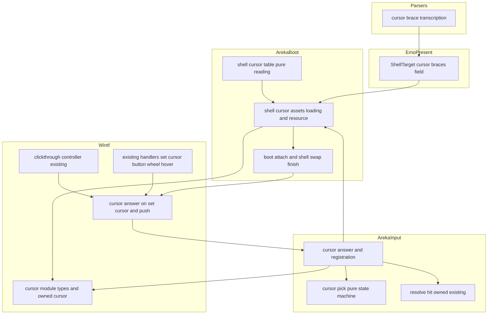
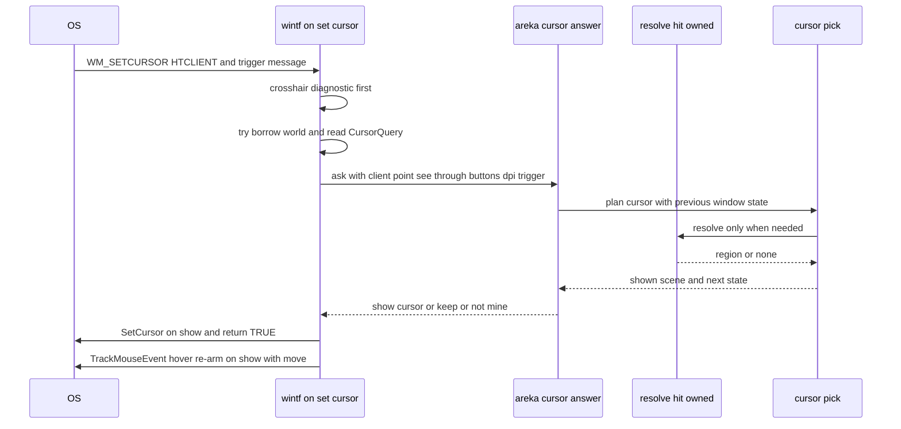
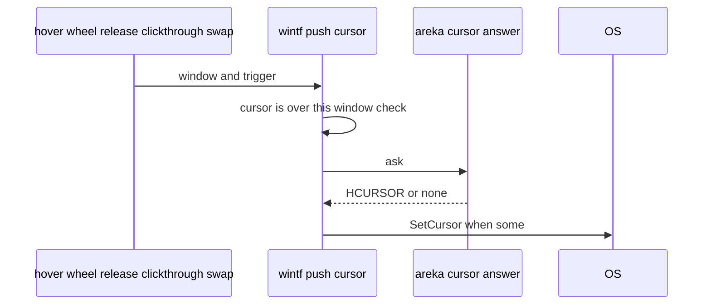
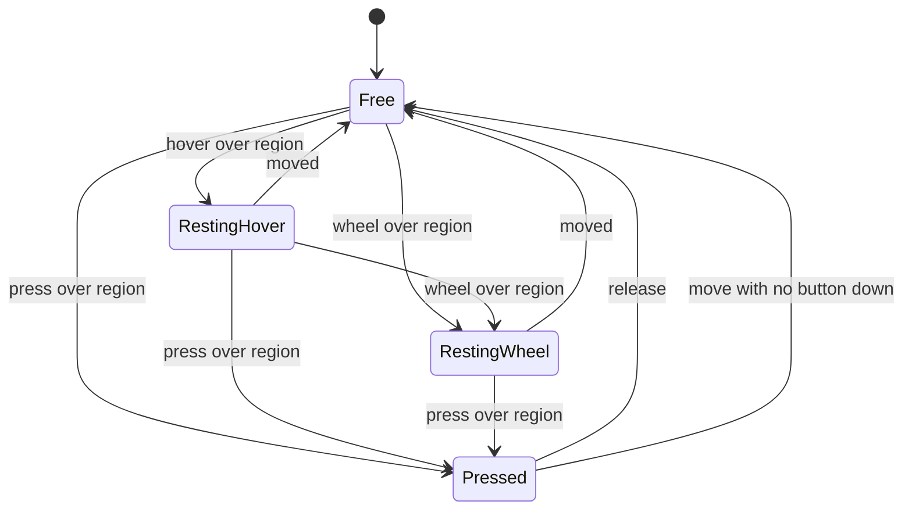

# 設計: shell-mouse-cursor

## Overview

**目的**: キャラクターの窓の当たり判定の上で、シェルの `surfaces.txt` の cursorブレスとゴーストの descript のカーソルの指定どおりにマウスカーソルの形を出す。乗る・押す・右を押す・止まる・ホイールの 5 つの場面と、当たり判定の無い所の矢印を、SSP と同じ選び方で出す。

**使う人**: 利用者（どこに触れられるかが形で分かる）・シェルとゴーストの作者（SSP 向けに書いた cursorブレスと `mousecursor.*` がそのまま効く）・開発者（決定論の自動テストと実機の読み取りで確かめる）。

**変わること**: 今はキャラクターの窓のどこでも矢印（窓のクラスのカーソル）が出る。本 spec の後は、形を決める問い合わせ（`WM_SETCURSOR`）にその場で当たり判定を引いて答え、カーソルの来ない場面（止まった・ホイール・捕まえたままの解放・シェルの入れ替え・クリック透過が外れた直後）だけ areka の側から出し直す。cursorブレスを書いていないゴーストでも、当たり判定の上は指差し（`bust` は手を開いた形）になる（要件討議の議題 1）。

### Goals

- 当たり判定をまたいだ瞬間・押した瞬間・放した瞬間に、描画の回を待たずに正しい形を出す（0 フレーム）。
- cursorブレス ＞ ゴーストの descript ＞ 既定の順で形を選ぶ決まりを、純関数と決定論のテストで固定する。
- 読めない行・読めないファイル・フォルダの外を指す名前を、黙って捨てずに読み込み 1 回につき 1 度だけ記録する。
- `system:hand`・`system:grip` に、選ばれた絵（`cursor-art/hand.svg`・`grip.svg`）から作った areka の手の形を出す。

### Non-Goals

- バルーンの窓の上のカーソル・入力ボックスの上のカーソル・プロパティでの読み書き（Boundary Context の Out of scope）。
- `OnMouseHover` の送出（`mouse-hover-event`）。本 spec は「止まった」を OS の `WM_MOUSEHOVER` で受けるが、SHIORI へは何も送らない。
- 当たり判定の形と解決の決まり・ドラッグの判定・クリック透過の判定の変更。
- 当たり判定の追跡（`HoverState`・`plan_hover`）の変更。本 spec はそれを読まず、同じ解決の関数をその場で呼ぶ。

## Boundary Commitments

### This Spec Owns

- cursorブレス（`sakura.cursor`・`kero.cursor`・`char*.cursor`）の転記と、行の検証・後勝ち・記録。
- ゴーストの descript の `cursor`・`mousecursor`・`mousecursor.arrow`・`mousecursor.hand`・`mousecursor.grip`・`mousecursor.text`・`mousecursor.wait` の読み取りと記録。
- カーソルのファイル（`.cur`・`.ani`）の探し方（シェル → `ghost\master`）・フォルダの外の拒否・読み込み・失敗の記録・持ち方と捨てる順。
- キャラクターの窓ごとの「形の状態」（押している・止まった／ホイールの形を出している・最後に見た位置）と、場面と形を選ぶ純関数。
- wintf の「形を問い合わせる口」（`CursorQuery`）と、出し直しの口（`push_cursor`）、`WM_MOUSEHOVER` の掛け直し。
- 同梱の手の形の絵（`crates/areka/cursor/`）と、それを作る道具 `tools/cursor-art.ps1`。
- `tools/mouse-input.ps1` の `cursor` の動詞・ぱすたの手順書の段 3 の書き足し・網羅台帳の 21 行・`doc/COMPAT_ARCHITECTURE.md` §8 の行・配布物の説明の出どころの 1 行。

### Out of Boundary

- 当たり判定の名前の解決（`emo2_boot/hit_region.rs`・presenter）と、`OnMouseEnter`／`OnMouseLeave` の追跡（`input_events/hover_region.rs` の `HoverState`・`char_watch` の決まり）。本 spec は呼ぶ・置き場を借りるだけで中身を変えない。
- `crates/areka/src/input_events/mod.rs`（後のウェーブの `balloon-scroll-arrows` との約束で 1 行も触らない）。
- `decode.rs`（画像の読み手）・バルーンの窓・クリック透過とドラッグの判定・ツールチップ。
- `OnMouseHover` の送出と、その止まった判定を SHIORI に見せること（`mouse-hover-event`）。

### Allowed Dependencies

- areka → wintf の新しい `wintf::ecs::cursor`（公開の型と関数だけ）。
- areka の新しいファイル → `input_events` の非公開の `resolve_hit_owned`・`char_scope`・`MouseWiring`（Rust の可視性で子孫のモジュールから読める＝`mod.rs` を変えない）。
- areka-emo-present の `ShellTarget` に 1 欄（cursorブレスの転記）。
- areka-parsers の `shell::lexer::lex`（同じ文面の 2 つ目の転記・`boxes.rs` と同じ型）。
- `placement::source::read_kv_lenient`（可視性を `pub(crate)` へ広げるだけ）。
- Win32: `LoadCursorW`・`LoadImageW`（`LR_LOADFROMFILE`・`LR_SHARED` なし）・`CreateIconFromResourceEx`・`DestroyCursor`・`SetCursor`・`GetCursor`・`GetCursorPos`・`ScreenToClient`・`WindowFromPoint`・`GetAsyncKeyState`・`GetDpiForWindow`・`GetSystemMetricsForDpi`・`TrackMouseEvent`。`windows` クレートの今の機能の範囲で、依存の追加は無い。
- 依存の向き: `wintf::ecs::cursor` ← `areka-emo-present`（触らない）／ `areka::emo2_boot::shell_cursor_*` ← `areka::input_events::{hover_region::cursor_pick, char_watch::cursor_answer}`。wintf は areka の型を知らない。`emo2_boot` は `input_events` の新しいファイルを呼ばない（出し直しは wintf の `push_cursor` を通す）。

### Revalidation Triggers

- `CursorQuery` の関数の形・`CursorAsk` の欄・`CursorTrigger` の種類が変わったとき（areka の答えの関数と wintf の口の両方）。
- `resolve_hit_owned` の返す当たり判定や、絵の透けた所の見分け方（`hit_test_in_window` の持ち主が窓そのもの）が変わったとき（`char_watch` と答えが食い違わないかのテスト）。
- `WM_MOUSEHOVER` の掛け直しを `mouse-hover-event` が使う・移すとき（止まったと見なす時間を共有する約束）。
- `ShellTarget`・`ShellAssets`・`BootAssets`・`SwapFinish::Shell` の欄の増減、シェルの入れ替えの後始末の順が変わったとき。
- カーソルのファイルの探す順（シェル → `ghost\master`）を変えるとき（箱のフォントの探す順と同じ並びを使っている）。

## Architecture

### Existing Architecture Analysis

- 窓の手続きは wintf の `dispatch_window_message` が `(world, entity, hwnd, wparam, lparam)` で各ハンドラへ配る。`WM_SETCURSOR` は今、環境変数 `WINTF_CROSSHAIR` のときだけ十字を出し、ほかは `None`（`DefWindowProcW`＝窓のクラスの矢印）。
- `WM_SETCURSOR` はカーソルの移動・ボタンの押下と解放のたびに、捕まえていない（`SetCapture` していない）窓へ届く。`lParam` の下位語が当たりの結果、上位語が引き金のマウスのメッセージ（メニューの中では 0）。
- 当たり判定の解決 `resolve_hit_owned(&World, scope, x, y)` は共有の借用だけで答える。`char_watch`（毎 tick）が出入りの見張りに同じ関数を呼ぶ。
- シェルの資産は `build_shell_assets` が起動では UI スレッドで、切り替えでは背景のスレッドで作り、`ShellAssets` → `BootAssets`／`SwapBuilt::Shell` → 装着の相（`frame/attach.rs`）／切り替えの後始末（`frame/switch.rs` の `finish_shell`）へ運ぶ。箱の束（`ShellBoxAssets::hand_to`）が同じ道の前例。
- 世界の借用の外に窓ごとの状態を置く前例は `nchittest_cache`（`thread_local`）。`unsafe` を 1 ファイルに閉じる前例は `tooltip/os.rs`。

### Architecture Pattern & Boundary Map

選んだ形は**その場で引く（プル）＋カーソルの来ない場面だけ出し直す（プッシュ）**（ギャップ分析の案 C）。カーソルの位置が変わった時点は OS が `WM_SETCURSOR` で教えてくれるので、そこでは問い合わせて答える。止まった・ホイール・捕まえたままの解放・シェルの入れ替え・クリック透過が外れた直後は、変わった時点を areka が知っているので、その場で出し直す。



**Architecture Integration**:
- 選んだ形: プル＋プッシュ。`WM_SETCURSOR` の中で当たり判定を引くので、境目をまたいだ瞬間に前の形が残らない（要件 2.3）。`HoverState`（1 tick 古い）だけで選ぶ案 A は 1 フレーム遅れるので採らない。
- 境目: Win32 は wintf の `ecs/cursor/` に閉じる。ukadoc の意味（場面・既定・`bust`・出どころの順）は areka の純関数に閉じる。当たり判定の解決は今の 1 か所のまま（wintf に写す案 B は採らない）。
- 前例の踏襲: 2 つ目の転記（`boxes.rs`）・箱の束の受け渡し（`hand_to`）・`unsafe` の閉じ込め（`tooltip/os.rs`）・読み込み 1 回につき 1 度だけの記録（`load_shell_target`）・`#[path]` の兄弟テスト。
- steering: 記録の無い失敗経路を持たない（logging.md）・OS の受け口を使う（`IDC_*`・`TrackMouseEvent`）・決定論のテストは判断の分岐に置き、Win32 の層は薄く。

### Technology Stack

| Layer | Choice / Version | Role in Feature | Notes |
|-------|------------------|-----------------|-------|
| UI フレームワーク | wintf（ワークスペース内） | `WM_SETCURSOR`・`WM_MOUSEHOVER` の受け口と `SetCursor` | 新しいモジュール `ecs/cursor/` |
| Win32 | windows 0.62.2（ワークスペースのピン） | カーソルの作成・表示・止まった通知 | 機能の追加なし |
| ECS | bevy_ecs 0.19 | `CursorQuery`（Resource）・`CharCursors` と `ShellCursorAssets`（NonSend） | 既存 |
| 道具 | PowerShell 7 ＋ GDI+（System.Drawing） | SVG から `.cur` を一度だけ作る | `tools/app-icon.ps1` と同じ道具立て。組み立て時の依存は増やさない |

## File Structure Plan

### Directory Structure

```
crates/areka-parsers/src/shell/
├── cursor.rs                  # 新: cursorブレスの転記 parse_cursor_braces（検証・記録なし・失敗しない）
└── cursor_tests.rs            # 新: 転記のテスト・画像の読み手の結果が変わらないこと（1.5）

crates/wintf/src/ecs/cursor/
├── mod.rs                     # 新: 公開の型 CursorTrigger・CursorAsk・CursorReply・CursorQuery・CursorError と再輸出
├── image.rs                   # 新: OwnedCursor（作る・捨てる）・stock_cursor・cursor_size_for_dpi（unsafe はここと answer.rs だけ）
├── cur_file.rs                # 新: .cur の目録の読みと寸法の選び（純関数）
├── cur_file_tests.rs          # 新
├── answer.rs                  # 新: on_set_cursor・on_mouse_hover・push_cursor・push_cursor_rc・trigger_of・止まった通知の掛け直し
└── answer_tests.rs            # 新: trigger_of と、問い合わせの口が無いときに今の振る舞いのままであること

crates/areka/src/emo2_boot/
├── shell_cursor_table.rs      # 新: cursorブレスとゴーストの descript の読み取り・検証・ファイル名の形の検査（純関数）
├── shell_cursor_table_tests.rs
├── shell_cursor_assets.rs     # 新: ファイルを探して作る・記録・ShellCursorAssets（NonSend）・hand_to
└── shell_cursor_assets_tests.rs

crates/areka/src/input_events/
├── cursor_pick.rs             # 新: hover_region.rs の #[path] の子。形の状態の遷移と形の選び（純関数）
├── cursor_pick_tests.rs
├── cursor_answer.rs           # 新: char_watch.rs の #[path] の子。登録・問い合わせへの答え・CharCursors・同梱の絵の寸法ごとの控え
└── cursor_answer_tests.rs

crates/areka/cursor/
├── hand.svg・grip.svg         # 新: 選んだ絵（spec の cursor-art から写す・焼き直しの入力）
├── hand.cur・grip.cur         # 新: 道具の出力（10 寸法・32 ビット BMP の項目）。include_bytes! で exe に入る
└── README.md                  # 新: 中身・作り直しの手順・当たりの点・出どころと権利

tools/
└── cursor-art.ps1             # 新: SVG → 寸法ごとに焼く → 外の黒地を透明・1 px の黒い縁 → .cur に詰める
```

### Modified Files

- `crates/areka-parsers/src/shell/mod.rs` — `mod cursor;`・`#[cfg(test)] mod cursor_tests;`・`pub use cursor::{CursorBrace, parse_cursor_braces};` の 3 か所。
- `crates/areka-emo-present/src/shell_target.rs` — `ShellTarget` に `cursor_braces: Vec<CursorBrace>` の欄と読み口 `cursor_braces()`、`load_shell_target` で `parse_cursor_braces(&content)` を 1 行、`Debug` に 1 行、構築で空の初期値（10 行以内）。
- `crates/wintf/src/ecs/mod.rs` — `pub mod cursor;`。
- `crates/wintf/src/ecs/window_proc/mod.rs` — `WM_MOUSEHOVER => crate::ecs::cursor::answer::on_mouse_hover(...)` の 1 行。
- `crates/wintf/src/ecs/window_proc/mouse_move.rs` — `WM_SETCURSOR` の十字の診断の後ろで `crate::ecs::cursor::answer::on_set_cursor(world, entity, hwnd, lparam)` を返す（数行・引数名の `_` を外す）。
- `crates/wintf/src/ecs/window_proc/mouse_click.rs` — `handle_button_message` の解放（`is_down == false`）の終わりで `push_cursor_rc(world, window_entity, CursorTrigger::Release)`（数行）。
- `crates/wintf/src/ecs/window_proc/mouse_dblclick_wheel.rs` — `WM_MOUSEWHEEL` で `push_cursor_rc(world, entity, CursorTrigger::Wheel)`（数行・`_world` を使う）。
- `crates/wintf/src/ecs/clickthrough/controller.rs` — `evaluate_targets` で透過を外した（`Opaque` の適用に成功した）窓に `push_cursor(world, window, CursorTrigger::Move)`（数行）。
- `crates/wintf/src/ecs/world/tick_wake.rs` — `WM_MOUSEHOVER` を `POINTER` の旗の表に足す（全走を避ける・1 語）。
- `crates/areka/src/input_events/hover_region.rs` — `#[path = "cursor_pick.rs"] pub(in crate::input_events) mod cursor_pick;`（2 行）。
- `crates/areka/src/input_events/char_watch.rs` — `#[path = "cursor_answer.rs"] pub(crate) mod cursor_answer;`（2 行）と、`register_char_watch` の中で `cursor_answer::register_char_cursor(world);`（1 行）。
- `crates/areka/src/emo2_boot/mod.rs` — `pub(crate) mod shell_cursor_table;`・`pub(crate) mod shell_cursor_assets;` と、`BootAssets` の分解と組み直しに `cursors` を足す。
- `crates/areka/src/emo2_boot/assets.rs` — `BootAssets`・`ShellAssets` に `cursors: ShellCursorAssets`、`build_shell_assets` で `build_shell_cursors(target.cursor_braces(), &ghost_kv, &shell_dir, &model.shiori.dir)`（ゴーストの descript は `read_kv_lenient` で読む）。
- `crates/areka/src/emo2_boot/frame/attach.rs` — 箱の束の受け渡しの隣で `cursors.hand_to(world)`（1〜2 行）。
- `crates/areka/src/emo2_boot/shell_balloon_switch.rs` — `SwapFinish::Shell` に `cursors` の欄。
- `crates/areka/src/emo2_boot/frame/switch.rs` — `SwapBuilt::Shell` から `SwapFinish::Shell` へ `cursors` を運び、`finish_shell` の箱の束の直後で `cursors.hand_to(world)`。
- `crates/areka/src/placement/source.rs` — `read_kv_lenient` を `pub(crate)` へ。
- 構造体の字面を書くテストと支え（`assets.rs` のテスト・`frame_test_support.rs`・`switch_finish_tests.rs`・`switch_tests.rs`・`balloon_visibility_*_tests.rs`・`reload_skin_tests.rs`・`shell_balloon_switch_tests.rs`・`spine.rs`・`input_events/balloon_test_support.rs`）— `cursors: ShellCursorAssets::default()` を足すだけ。
- `tools/mouse-input.ps1` — 動詞 `cursor`（(X, Y) へ動かして形を読む）。
- `doc/pasta-real-run.md` — 段 3 に `cursor` で読む 3 点と期待する答えを書く。
- `doc/ukadoc-coverage/ledger/assets.toml` — 21 行の `status`・`owner`・`note`。
- `doc/COMPAT_ARCHITECTURE.md` — §8 に本 spec の決めの行。
- `dist/README.txt` — 「■ 同梱物とライセンス」の areka 本体の欄に、手の形のカーソルの絵の出どころの 1 行。

行数の見込み: 新しいファイルはどれも 400 行以内。大きいファイル（`shell_target.rs` 855・`mouse_move.rs` 632・`emo2_boot/mod.rs` 795・`frame/switch.rs` 679）への足しはそれぞれ 10 行以内で、1,000 行の目安を超えない。

## System Flows

### 動かしたとき・押したとき（その場で答える）



- 問い合わせの口（`CursorQuery`）が無い・世界を借りられない・areka が「受け持たない」と答えた（キャラクターの窓でない）・当たりの結果が `HTCLIENT` でない、のどれでも `None` を返し、今の振る舞い（`DefWindowProcW`）のままにする。バルーンの窓には areka が答えないので要件 2.8 が保たれる。
- 絵の透けた所（`Shown::Pass`）は `Keep` と答え、既定の処理（窓のクラスの矢印）を止めて今出ている形のままにする（要件 2.5）。
- 当たり判定を引くのは「位置が変わった・初めて見た・押した・放した・ホイール」のときだけ。位置の変わらない `WM_SETCURSOR`（OS の合成の移動）は前の当たり判定と形を使う（要件 2.6 の「次にカーソルが動いた時点」・`char_watch` の「動いた」と同じ物差し）。

### 出し直す場面（カーソルの来ない場面）



| 場面 | 出どころ | 引き金 |
| --- | --- | --- |
| 止まった（要件 4.1・4.2） | OS の `WM_MOUSEHOVER`（`TrackMouseEvent(TME_HOVER, HOVER_DEFAULT)`＝OS の設定の時間・OS が計る） | `Hover` |
| ホイール（要件 4.3） | `WM_MOUSEWHEEL` の手続き | `Wheel` |
| 放した（要件 3.4） | `handle_button_message` の解放の終わり（捕まえていると `WM_SETCURSOR` が来ないので） | `Release` |
| クリック透過が外れた直後（要件 2.1） | `evaluate_targets` で `Opaque` の適用に成功した窓 | `Move` |
| シェル・ゴーストの入れ替え（要件 6.8） | `ShellCursorAssets::hand_to` | `Refresh` |

- 出し直しは、カーソルがその窓の上に居る（`WindowFromPoint` がその窓）ときだけ `SetCursor` する。ほかの窓の上の形には触らない。
- 世界の中（tick の中）から呼ぶもの（シェルの入れ替え・クリック透過の評価）は `push_cursor(&World, …)`、窓の手続きから呼ぶものは借用を試す `push_cursor_rc` を使う。

### 形の状態の遷移



- `Pressed` の間は、止まった・ホイールを受けない（要件 4.5）。当たり判定の外へ出ても、絵の透けた所に来ても、押したときの形と当たり判定名を保つ（要件 3.3）。
- 「動いた」は窓の中の位置（client 物理 px）が前と違うこと。止まった通知は `Free` からだけ効く（ホイールの形を止まったの形で上書きしない）。
- `Release` が届かなかったとき（メニューが解放を食べた・窓の外で放した）は、次の移動でボタンが 1 つも押されていなければ `Free` に戻す。

### シェル・ゴーストの入れ替えの順

1. 新しい資産（`ShellCursorAssets`）を NonSend へ入れ、前の資産を手元に受け取る。
2. 全部のキャラクターの窓へ `push_cursor(.., Refresh)` で、今の状態のまま新しい表で形を出し直す。
3. 前の資産を捨てる（`DestroyCursor` は「使っていないカーソル」でなければならないので、2 の後に限る）。

## Requirements Traceability

| Requirement | Summary | Components | Interfaces | Flows |
|-------------|---------|------------|------------|-------|
| 1.1 | 3 つの見出し・5 つの場面を組で読む | CursorTranscribe・CursorTable | `parse_cursor_braces`・`read_cursor_braces` | — |
| 1.2 | system 10 種と `.cur`・`.ani` を受け付ける | CursorTable | `parse_shape` | — |
| 1.3 | 読めない行を使わず見出し・原文・理由を記録 | CursorTable・CursorAssets | `CursorIssue::RowUnreadable` | 読み込み |
| 1.4 | 重なりは後勝ち・使わなかった行を記録 | CursorTable | `CursorIssue::RowReplaced` | 読み込み |
| 1.5 | ほかの読み取りを変えない | CursorTranscribe | 2 つ目の転記（`decode.rs` 不変） | — |
| 1.6 | 当たり判定名は綴りどおり・無い名前も持つ | CursorTable | `CursorRows` の鍵 | — |
| 2.1 | 当たり判定に入ったら `mouseup*` | CursorPick・CursorAnswer・CursorWndproc | `plan_cursor`・`pick_shape`・`on_set_cursor`・`push_cursor`（透過が外れた直後） | 動かしたとき |
| 2.2 | 行が無ければ既定（`bust` は hand・大小を区別しない） | CursorPick | `pick_shape` | — |
| 2.3 | 移ったその場で切り替え | CursorWndproc・CursorAnswer | `on_set_cursor` がその場で解決 | 動かしたとき |
| 2.4 | 当たり判定の無い所は矢印 | CursorPick | `Shown::Arrow` | — |
| 2.5 | 透けた所は決めない | CursorWndproc・CursorPick | `CursorAsk::see_through`・`Shown::Pass` → `CursorReply::Keep`（クリック透過中の窓には `WM_SETCURSOR` 自体が来ない） | 動かしたとき |
| 2.6 | 止まったまま面が替わったら次の移動で | CursorPick | 位置の変わらない引き金は前の当たり判定を使う | 動かしたとき |
| 2.7 | 窓ごと・スコープごと | CursorAnswer・CursorTable | `CharCursors` の鍵＝窓・`CursorRows` の鍵にスコープ | — |
| 2.8 | バルーンは今のまま | CursorAnswer | キャラクターの窓でなければ `None` | — |
| 3.1 | 右以外を押したら `mousedown*`・既定は `bust` で grip | CursorPick・CursorWndproc | `trigger_of`・`plan_cursor`・`pick_shape` | 動かしたとき |
| 3.2 | 右を押したら `mouserightdown*` | 同上 | `CursorTrigger::Press { right: true }` | 同上 |
| 3.3 | 押している間は押したときの形 | CursorPick | `Hold::Pressed` | 状態の遷移 |
| 3.4 | 放したらその位置の形 | CursorPick・CursorWndproc | `Release`・`push_cursor_rc` | 出し直す場面 |
| 3.5 | 当たり判定の無い所で押しても変えない | CursorPick | `Press` は `Spot::Region` のときだけ `Pressed` へ | 状態の遷移 |
| 3.6 | クリック等の動きと SHIORI へのイベントを変えない | CursorWndproc | 押下・解放の処理は元のまま、終わりに出し直しを足すだけ | — |
| 4.1 | 止まったら `mousehover*`・無ければ乗る形のまま | CursorPick・CursorWndproc | `on_mouse_hover`・`pick_shape` の落ち先 | 出し直す場面 |
| 4.2 | OS の設定の時間・丸めない | CursorWndproc | `TrackMouseEvent(TME_HOVER, HOVER_DEFAULT)` | 動かしたとき |
| 4.3 | ホイールで `mousewheel*`・無ければ乗る形のまま | CursorPick・CursorWndproc | `push_cursor_rc(.., Wheel)` | 出し直す場面 |
| 4.4 | 動いたら戻す | CursorPick | `Resting*` → `Free` | 状態の遷移 |
| 4.5 | 押している間は止まった・ホイールを出さない | CursorPick | `Pressed` の間は `Hover`・`Wheel` を無視 | 状態の遷移 |
| 5.1 | `mousecursor`／`cursor` が finger の既定を差し替える | CursorTable・CursorPick | `GhostCursorKeys::finger` | — |
| 5.2 | `mousecursor.hand` | 同上 | `GhostCursorKeys::hand` | — |
| 5.3 | `mousecursor.grip` | 同上 | `GhostCursorKeys::grip` | — |
| 5.4 | `mousecursor.arrow` | 同上 | `GhostCursorKeys::arrow` | — |
| 5.5 | cursorブレスの行が勝つ | CursorPick | `pick_shape` の順 | — |
| 5.6 | 両方あれば `mousecursor`・記録 | CursorTable | `CursorIssue::GhostBothSpellings` | 読み込み |
| 5.7 | text・wait を読み、出さず、1 回記録 | CursorTable・CursorAssets | `GhostCursorKeys::unused`・`info!` | 読み込み |
| 5.8 | descript の値も同じ受け付け・読めなければ記録して使わない | CursorTable | `parse_shape`・`CursorIssue::GhostValueUnreadable` | 読み込み |
| 6.1 | system の 8 種は OS の標準の形 | CursorAnswer・CursorApi | `stock_cursor(IDC_*)`（下の対応表） | — |
| 6.2 | hand・grip は同梱の絵 | CursorAnswer・CursorApi・道具 | `OwnedCursor::from_cur_bytes`・`hand.cur`・`grip.cur` | — |
| 6.3 | `.cur` は絵・`.ani` は動かして | CursorAssets・CursorApi | `OwnedCursor::load_file`（`LoadImageW`） | — |
| 6.4 | シェル → `ghost\master` の順で探す | CursorTable・CursorAssets | `candidate_paths` | 読み込み |
| 6.5 | 無い・読めない・壊れているは既定へ・記録 | CursorAssets | 失敗した行・値を表から外す（＝行が無いのと同じ既定） | 読み込み |
| 6.6 | フォルダの外を指す名前は読まない | CursorTable | `candidate_paths` の `PathReason` | 読み込み |
| 6.7 | 同じファイルの失敗は読み込み 1 回につき 1 度 | CursorAssets | 名前ごとに 1 度だけ読む | 読み込み |
| 6.8 | 替えた後は新しい定義だけ | CursorAssets・SwitchFinish | `hand_to`（入れる → 出し直す → 捨てる） | 入れ替えの順 |
| 6.9 | ファイルは読み込みで 1 回だけ読む | CursorAssets | 読み込みで作った `OwnedCursor` を持つ | 読み込み |
| 7.1 | 選び直したら詳しい段に記録 | CursorAnswer | `debug!`（形が変わったときだけ） | — |
| 7.2 | 決定論のテスト | 全部の純関数 | Testing Strategy | — |
| 7.3 | 実機で形を読み取る | 道具・手順書 | `mouse-input.ps1 -Action cursor` | — |
| 7.4 | 網羅台帳 21 行 | 台帳 | `assets.toml` | — |
| 7.5 | §8 の決め | 文書 | `COMPAT_ARCHITECTURE.md` §8 | — |

## Components and Interfaces

| Component | Domain/Layer | Intent | Req Coverage | Key Dependencies (P0/P1) | Contracts |
|-----------|--------------|--------|--------------|--------------------------|-----------|
| CursorTranscribe | areka-parsers | cursorブレスを原文のまま並べる | 1.1, 1.5 | lexer (P0) | Service |
| ShellTarget の欄 | areka-emo-present | 転記をシェルの読み込みに乗せて運ぶ | 1.1, 1.5 | CursorTranscribe (P0) | State |
| CursorTable | areka emo2_boot | 行・descript・ファイル名を検証する純関数 | 1.1〜1.4, 1.6, 5.1〜5.8, 6.4, 6.6 | なし | Service |
| CursorAssets | areka emo2_boot | ファイルを作り・記録し・資源として渡す | 1.3, 1.4, 5.6〜5.8, 6.3〜6.9 | CursorTable (P0), CursorApi (P0) | Service, State |
| CursorPick | areka input_events | 形の状態の遷移と形の選び（純関数） | 2.1〜2.7, 3.1〜3.5, 4.1, 4.3〜4.5, 5.1〜5.5 | CursorTable の型 (P0) | Service, State |
| CursorAnswer | areka input_events | 問い合わせへの答え・登録・同梱の絵の控え | 2.1, 2.3, 2.7, 2.8, 6.1, 6.2, 7.1 | CursorPick (P0), resolve_hit_owned (P0), CursorAssets (P0), CursorApi (P0) | Service, State |
| CursorApi | wintf ecs/cursor | 公開の型・カーソルの作成と破棄・.cur の目録 | 6.1〜6.3 | Win32 (P0) | Service |
| CursorWndproc | wintf ecs/cursor/answer.rs | 窓の手続きの答えと出し直し・止まった通知 | 2.1, 2.3, 2.5, 3.4, 3.6, 4.1〜4.3 | CursorQuery (P0), hit_test_in_window (P1) | Service, Event |
| 同梱の絵と道具 | crates/areka/cursor・tools | hand・grip の `.cur` を作って同梱する | 6.2 | GDI+ (P1) | Batch |
| 確かめの道具・文書 | tools・doc | 実機の読み取り・台帳・§8 | 7.3〜7.5 | — | — |

### wintf

#### CursorApi（`ecs/cursor/mod.rs`・`image.rs`・`cur_file.rs`）

| Field | Detail |
|-------|--------|
| Intent | areka が ukadoc を知らずに使える、カーソルの値と作り方と問い合わせの型 |
| Requirements | 6.1, 6.2, 6.3 |

**Responsibilities & Constraints**
- `unsafe` と Win32 の呼び出しは `image.rs` と `answer.rs` だけに置く。`cur_file.rs` は純関数。
- `OwnedCursor` は自分で作ったカーソルだけを持ち、`Drop` で `DestroyCursor` する。共有のカーソル（`LoadCursorW` の標準の形）は持たない（捨ててはならない）。
- `Drop` の前に、そのカーソルが今のスレッドで出ている（`GetCursor()` が同じ）なら標準の矢印へ替えてから捨てる（「使っていないこと」の守り）。捨てるのに失敗したら `warn!`。
- `LoadImageW` は `LR_LOADFROMFILE | LR_DEFAULTSIZE` で呼び、`LR_SHARED` を付けない（ファイルから作ったカーソルは共有にしない）。

**Contracts**: Service [x] / State [x]

##### Service Interface
```rust
/// 形を問い合わせた引き金（WM_SETCURSOR の上位語・出し直しの出どころ）。
#[derive(Clone, Copy, Debug, PartialEq, Eq)]
pub enum CursorTrigger { Move, Press { right: bool }, Release, Hover, Wheel, Refresh }

/// 問い合わせの材料（窓の手続きが Win32 から読んだ値）。
#[derive(Clone, Debug, PartialEq, Eq)]
pub struct CursorAsk {
    pub trigger: CursorTrigger,
    /// 窓の client 物理 px（GetCursorPos → ScreenToClient）。
    pub client: (i32, i32),
    /// その位置の持ち主が窓そのものか無い（絵の透けた所）。
    pub see_through: bool,
    /// 左・右・中・拡張 2 つのどれかが今押されている（GetAsyncKeyState）。
    pub buttons_down: bool,
    /// 窓の DPI（GetDpiForWindow）。
    pub dpi: u32,
}

/// 答え。Show はその形を出す。Keep は形に触らない（今出ている形＝下に見える窓の形のまま）。
#[derive(Clone, Copy, Debug, PartialEq, Eq)]
pub enum CursorReply { Show(HCURSOR), Keep }

/// 窓の形を答える関数（Resource。無ければ今の振る舞い）。None は「この窓は受け持たない」
/// （バルーンなど＝今の振る舞いの DefWindowProcW）。
#[derive(Resource, Clone, Copy)]
pub struct CursorQuery(pub fn(&World, Entity, &CursorAsk) -> Option<CursorReply>);

pub struct OwnedCursor(HCURSOR); // Drop: DestroyCursor。プロセスのどのスレッドからでも使える前提で unsafe impl Send
impl OwnedCursor {
    pub fn load_file(path: &Path) -> Result<Self, CursorError>;          // .cur・.ani
    pub fn from_cur_bytes(bytes: &[u8], size: u32) -> Result<Self, CursorError>; // 同梱の .cur
    pub fn handle(&self) -> HCURSOR;
}
pub fn stock_cursor(id: PCWSTR) -> Result<HCURSOR, CursorError>; // LoadCursorW(None, id)
pub fn cursor_size_for_dpi(dpi: u32) -> u32;                      // GetSystemMetricsForDpi(SM_CXCURSOR, dpi)

/// .cur の目録の 1 項目（cur_file.rs・純関数）。
pub struct CurEntry { pub width: u32, pub height: u32, pub hotspot: (u16, u16), pub data: std::ops::Range<usize> }
pub fn read_cur_directory(bytes: &[u8]) -> Result<Vec<CurEntry>, CurFileError>;
/// size 以上で最も小さい項目、無ければ最も大きい項目。
pub fn pick_cur_entry(entries: &[CurEntry], size: u32) -> Option<&CurEntry>;

#[derive(Debug, thiserror::Error)]
pub enum CursorError {
    #[error("カーソルのファイルを読めない: {path}")] Load { path: PathBuf, #[source] source: windows::core::Error },
    #[error("カーソルを作れない")] Create(#[source] windows::core::Error),
    #[error(".cur の形が壊れている: {0}")] CurFile(CurFileError),
    #[error("標準のカーソルを読めない")] Stock(#[source] windows::core::Error),
}
```
- `from_cur_bytes` は目録を読み、`pick_cur_entry` の項目の前に当たりの点の 2 語（x, y）を付けて `CreateIconFromResourceEx(.., fIcon = FALSE, 0x00030000, size, size, LR_DEFAULTCOLOR)` へ渡す。
- 事後条件: 返る `HCURSOR` は `OwnedCursor` が生きている間有効。`stock_cursor` の値は捨てない。

#### CursorWndproc（`ecs/cursor/answer.rs`）

| Field | Detail |
|-------|--------|
| Intent | 窓の手続きで問い合わせに答え、カーソルの来ない場面で出し直す |
| Requirements | 2.1, 2.3, 2.5, 3.4, 3.6, 4.1, 4.2, 4.3 |

**Responsibilities & Constraints**
- `on_set_cursor`: 当たりの結果が `HTCLIENT` のときだけ、世界を `try_borrow` し、`CursorQuery` があれば `CursorAsk` を組んで呼ぶ。`Show(h)` なら `SetCursor(h)` して `Some(LRESULT(1))`、`Keep` なら `SetCursor` せずに `Some(LRESULT(1))`（既定の処理を止めて今の形のまま＝要件 2.5）、`None` なら `None`。`Show` で引き金が `Move` なら `TrackMouseEvent(TME_HOVER | TME_LEAVE, HOVER_DEFAULT)` を掛け直す（掛け直すと止まった時計が始めからになる＝最後に動いてから OS の時間）。借りられなければ `trace!` して `None`（tick の中に入力の `WM_SETCURSOR` は来ない。来るのは OS の合成の移動だけで、次の移動で正しい形になる）。
- `on_mouse_hover`: `push_cursor_rc(.., Hover)` を呼び、`Some(LRESULT(0))`。
- `push_cursor(&World, window, trigger)`: 窓の `WindowHandle` から HWND を取り、`WindowFromPoint(GetCursorPos())` がその窓のときだけ問い合わせて、`Show(h)` なら `SetCursor` する（`Keep`・`None` は何もしない）。`push_cursor_rc` は借用を試してから同じことをする。
- `trigger_of(msg)`: `WM_MOUSEMOVE`・0（メニュー）・知らない値 → `Move`、`WM_[LMX]BUTTONDOWN`・`WM_[LMX]BUTTONDBLCLK` → `Press { right: false }`、`WM_RBUTTONDOWN`・`WM_RBUTTONDBLCLK` → `Press { right: true }`、`WM_*BUTTONUP` → `Release`。
- 十字の診断（`WINTF_CROSSHAIR`）は今のまま先に判定する（診断の意味を保つ）。
- クリック・ドラッグ・メニューの流れには触らない。解放の出し直しは `handle_button_message` の処理が終わった後に足す（要件 3.6）。

**Contracts**: Service [x] / Event [x]

##### Event Contract
- 受けるもの: `WM_SETCURSOR`（同期・移動と押下と解放のたび・捕まえていない窓だけ）、`WM_MOUSEHOVER`（OS が投函・本 spec が掛けた窓だけ）、`WM_MOUSEWHEEL`・ボタンの解放（既存のハンドラから）。
- 出すもの: `SetCursor` だけ。SHIORI へのイベントは出さない。
- 順序: 1 つのメッセージの中で答えが決まる（tick を待たない）。

**Implementation Notes**
- Integration: `mouse_move.rs` の `WM_SETCURSOR` は十字の後ろで `on_set_cursor` を返すだけにし、本体は新しいファイルに置く。
- Validation: `trigger_of` と、`CursorQuery` が無い世界で `push_cursor` が何もしないことを決定論で固定。`SetCursor` を含む結線は実機の確かめで見る。
- Risks: `ReleaseCapture` の後に OS が合成の移動を送るかは文書に無い。窓の上で放したときは本 spec の出し直しが必ず効く。窓の外で放したときは、その位置の窓の形に関わらない（次の移動で OS が決める）。

### areka-parsers

#### CursorTranscribe（`shell/cursor.rs`）

| Field | Detail |
|-------|--------|
| Intent | `surfaces.txt` の cursorブレスを原文のまま登場順に並べる |
| Requirements | 1.1, 1.5 |

```rust
#[derive(Clone, Debug, PartialEq)]
pub struct CursorBrace {
    /// 見出しの原文（例 `sakura.cursor`・`char2.cursor`）。
    pub heading: String,
    /// 本体の行（欄の列のまま・登場順）。
    pub lines: Vec<Vec<String>>,
}
/// 見出しの先頭の欄が `.cursor` で終わる閉じたブレスだけを転記する（純粋・失敗しない）。
pub fn parse_cursor_braces(text: &str) -> Vec<CursorBrace>;
```
- `boxes.rs` と同じく `lexer::lex` を使い、閉じたブレスだけを見る。検証も記録もしない（厳しく読むのは下流の CursorTable、記録は CursorAssets）。

### areka emo2_boot

#### CursorTable（`shell_cursor_table.rs`）

| Field | Detail |
|-------|--------|
| Intent | cursorブレスとゴーストの descript を検証して表にする純関数 |
| Requirements | 1.1, 1.2, 1.3, 1.4, 1.6, 5.1, 5.2, 5.3, 5.4, 5.6, 5.7, 5.8, 6.4, 6.6 |

**Responsibilities & Constraints**
- 見出し: `sakura.cursor` → 0、`kero.cursor` → 1、`char<数>.cursor` → その数。ほかの `*.cursor` は見出しごと使わず記録する。
- 行: 欄が 3 つ未満 → 「欄が足りない」。第 1 欄は `mouseup`・`mousedown`・`mouserightdown`・`mousehover`・`mousewheel` のどれかに続けて 1 文字以上の数字。名前が違えば「場面の名前が 5 つのどれでもない」、続きが数字でなければ「`*` が数でない」。第 2 欄が空 → 「当たり判定名が空」。第 3 欄以降は `,` で継ぎ直して値とする（ファイル名の `,` を失わない）。
- 値（`parse_shape`）: `system:` で始まれば続きを 10 種の名前と ASCII の大小を区別せずに比べる。ほかは拡張子が `.cur`・`.ani`（大小を区別しない）のファイル名。違えば「`system:` の名前が 10 種のどれでもない」「拡張子が `.cur`／`.ani` でない」。
- 重なり: 鍵（スコープ・当たり判定名・場面）が同じなら後の行を使い、前の行を「使わなかった」として報告する。当たり判定名は綴りどおりで、面の当たり判定と突き合わせない（1.6）。
- descript: `mousecursor` があれば `mousecursor`、無ければ `cursor` を finger の差し替えにする。両方あれば `cursor` を使わなかったと報告する。`mousecursor.hand`・`.grip`・`.arrow` は同じく `parse_shape`。`mousecursor.text`・`.wait` は値を読んで `unused` に名前を並べる（出さない）。読めない値は報告してその差し替えを使わない（5.8）。
- ファイル名の形（`candidate_paths`）: 絶対パス・ドライブ付き・根から始まる・`..` を含む名前は「フォルダの外を指す」として断る。それ以外はシェルのフォルダ、`ghost\master` の順の候補を返す（実在の確かめは CursorAssets）。

**Contracts**: Service [x]

##### Service Interface
```rust
#[derive(Clone, Copy, Debug, PartialEq, Eq, PartialOrd, Ord, Hash)]
pub(crate) enum CursorScene { Up, Down, RightDown, Hover, Wheel }
#[derive(Clone, Copy, Debug, PartialEq, Eq)]
pub(crate) enum SystemCursor { Arrow, Cross, Finger, Grip, Hand, Help, Move, No, Text, Wait }
/// F は読んだ段では String（ファイル名）、作った段では usize（作ったカーソルの番号）。
#[derive(Clone, Debug, PartialEq, Eq)]
pub(crate) enum Shape<F> { System(SystemCursor), File(F) }

#[derive(Clone, Debug, Default, PartialEq)]
pub(crate) struct CursorRows<F> { pub rows: BTreeMap<(u32, String, CursorScene), Shape<F>> }
#[derive(Clone, Debug, Default, PartialEq)]
pub(crate) struct GhostCursorKeys<F> {
    pub finger: Option<Shape<F>>, pub hand: Option<Shape<F>>,
    pub grip: Option<Shape<F>>, pub arrow: Option<Shape<F>>,
    /// 読んだが出さない鍵（`mousecursor.text`・`mousecursor.wait`）。
    pub unused: Vec<&'static str>,
}

#[derive(Clone, Debug, PartialEq, Eq)]
pub(crate) enum CursorIssue {
    HeadingUnreadable { heading: String },
    RowUnreadable { heading: String, line: String, reason: RowReason },
    RowReplaced { heading: String, line: String },
    GhostValueUnreadable { key: &'static str, value: String, reason: ShapeReason },
    GhostBothSpellings { ignored: String },
}
pub(crate) enum RowReason { TooFewFields, UnknownScene, NumberNotDigits, EmptyRegion, Shape(ShapeReason) }
pub(crate) enum ShapeReason { UnknownSystemName, NotCurOrAni }
pub(crate) enum PathReason { OutsideFolder }

pub(crate) fn read_cursor_braces(braces: &[CursorBrace]) -> (CursorRows<String>, Vec<CursorIssue>);
pub(crate) fn read_ghost_cursor_keys(kv: &BTreeMap<String, String>) -> (GhostCursorKeys<String>, Vec<CursorIssue>);
pub(crate) fn parse_shape(value: &str) -> Result<Shape<String>, ShapeReason>;
pub(crate) fn candidate_paths(name: &str, dirs: &[&Path]) -> Result<Vec<PathBuf>, PathReason>;
```
- 行の原文（`line`）は欄を `,` で継いだもの。

#### CursorAssets（`shell_cursor_assets.rs`）

| Field | Detail |
|-------|--------|
| Intent | 表のファイル名を探して作り、記録し、UI スレッドの資源として渡す |
| Requirements | 1.3, 1.4, 5.6, 5.7, 5.8, 6.3, 6.4, 6.5, 6.6, 6.7, 6.8, 6.9 |

**Responsibilities & Constraints**
- `build_shell_cursors` は失敗しない（シェルの読み込みを止めない）。CursorTable の報告を全部記録し、ファイル名ごとに 1 度だけ探して `OwnedCursor::load_file` で作る。作れなかった名前を使う行と descript の差し替えは表から外す（行が無いのと同じ既定になる＝6.5）。
- 記録は読み込み（`build_shell_assets` の 1 回＝起動・ゴーストの切り替え・シェルの切り替え・読み直し）につき 1 度だけ出す。描くたびには出さない（6.7）。ゴーストの descript もこの読み込みで読むので、5.7 の 1 行もこの単位で 1 度。
- 起動では UI スレッド、シェルの切り替えでは背景のスレッドで作る。`OwnedCursor` はプロセスのどのスレッドからでも使え、捨てるのは UI スレッド（入れ替えの後）。
- `hand_to(self, world)`: NonSend の `ShellCursorAssets` を入れ替え、全部のキャラクターの窓へ `push_cursor(world, e, Refresh)` を呼んでから、前の資源を捨てる（System Flows の順）。

**Contracts**: Service [x] / State [x]

##### Service Interface
```rust
/// シェル 1 つぶんのカーソル（NonSend の資源そのもの）。既定値は「行も差し替えも無い」。
#[derive(Default)]
pub(crate) struct ShellCursorAssets {
    pub rows: CursorRows<usize>,
    pub ghost: GhostCursorKeys<usize>,
    /// 作ったファイルのカーソル（番号＝Shape::File の値）。
    pub files: Vec<OwnedCursor>,
}
pub(crate) fn build_shell_cursors(
    braces: &[CursorBrace],
    ghost_kv: &BTreeMap<String, String>,
    shell_dir: &Path,
    ghost_dir: &Path, // ghost\master
) -> ShellCursorAssets;
impl ShellCursorAssets {
    pub(crate) fn hand_to(self, world: &mut World);
}
```

##### 記録（logging.md の段）

| 事実 | 段 | 欄 |
| --- | --- | --- |
| 見出し・行が読めない | `warn!` | 見出し・行の原文・理由 |
| 重なった行の前の行を使わない | `warn!` | 見出し・行の原文 |
| descript の値が読めない | `warn!` | 鍵・値・理由 |
| `mousecursor` と `cursor` の両方 | `warn!` | 使わなかった `cursor` の値 |
| `mousecursor.text`・`.wait` を読んだが出さない | `info!` | 鍵の名前 |
| ファイルが無い・読めない・壊れている | `warn!` | ファイル名・探した場所・理由 |
| フォルダの外を指す | `warn!` | ファイル名・理由 |
| 読み終わり | `debug!` | 行の数・作ったファイルの数 |

### areka input_events

#### CursorPick（`cursor_pick.rs`・`hover_region.rs` の子）

| Field | Detail |
|-------|--------|
| Intent | 窓 1 つの形の状態の遷移と、出す形とその出どころを決める純関数 |
| Requirements | 2.1, 2.2, 2.3, 2.4, 2.5, 2.6, 2.7, 3.1, 3.2, 3.3, 3.4, 3.5, 4.1, 4.3, 4.4, 4.5, 5.1, 5.2, 5.3, 5.4, 5.5 |

**Contracts**: Service [x] / State [x]

##### Service Interface
```rust
#[derive(Clone, Debug, PartialEq, Eq)]
pub(in crate::input_events) enum Spot { Region(String), Plain, SeeThrough }
#[derive(Clone, Debug, PartialEq, Eq)]
pub(in crate::input_events) enum Hold {
    Free,
    Pressed { scene: CursorScene, region: String }, // Down か RightDown
    Resting(CursorScene),                            // Hover か Wheel
}
#[derive(Clone, Debug, PartialEq, Eq)]
pub(in crate::input_events) struct WindowCursor { pub client: (i32, i32), pub spot: Spot, pub hold: Hold }
#[derive(Clone, Debug, PartialEq, Eq)]
pub(in crate::input_events) enum Shown { Region { scene: CursorScene, region: String }, Arrow, Pass }
#[derive(Clone, Copy, Debug, PartialEq, Eq)]
pub(in crate::input_events) enum Origin { Brace, GhostDescript, Default }

/// 前の状態と引き金から、次の状態と出す場面を決める。resolve は当たり判定を引くとき
/// （位置が変わった・初めて・押した・放した・ホイール・前の状態が無い）だけ呼ぶ。
pub(in crate::input_events) fn plan_cursor(
    prev: Option<&WindowCursor>,
    trigger: CursorTrigger,
    client: (i32, i32),
    buttons_down: bool,
    resolve: impl FnOnce() -> Spot,
) -> (WindowCursor, Shown);

/// 出す場面から形を選ぶ。Pass は None。
pub(in crate::input_events) fn pick_shape<F: Clone>(
    scope: u32, shown: &Shown, rows: &CursorRows<F>, ghost: &GhostCursorKeys<F>,
) -> Option<(Shape<F>, Origin)>;
```

**決まり（`plan_cursor`）**

| 引き金 | 前の hold | 当たり判定 | 次の hold | 出す場面 |
| --- | --- | --- | --- | --- |
| Move（位置が同じ） | どれでも | 前のまま | 前のまま | 前と同じ |
| Move（位置が変わった） | Pressed かつボタンが押されている | 引き直す | Pressed のまま | 押したときの場面と当たり判定名 |
| Move（位置が変わった） | Pressed かつボタンが押されていない | 引き直す | Free | その位置の場面 |
| Move（位置が変わった） | Free・Resting | 引き直す | Free | その位置の場面 |
| Press | Free・Resting | 引き直す・Region(r) | Pressed（右なら RightDown、ほかは Down・r） | 押したときの場面 |
| Press | Free・Resting | 引き直す・Region 以外 | Free | その位置の場面（変えない） |
| Press | Pressed | 引き直す | Pressed のまま（先に押したほう） | 押したときの場面 |
| Release | どれでも | 引き直す | Free | その位置の場面 |
| Hover | Free | 前のまま・Region | Resting(Hover) | Region（Hover） |
| Hover | Resting・Pressed、または Region 以外 | 前のまま | 前のまま | 前と同じ |
| Wheel | Free・Resting | 引き直す・Region | Resting(Wheel) | Region（Wheel） |
| Wheel | Pressed、または Region 以外 | 引き直す | 前のまま | 前と同じ（Pressed）／その位置の場面 |
| Refresh | どれでも | 前のまま（前が無ければ引く） | 前のまま | 前の hold から決まる場面 |

「その位置の場面」は Region(r) → Region（Up・r）、Plain → Arrow、SeeThrough → Pass。

**決まり（`pick_shape`）**

1. Region（場面 s・当たり判定 r）: 表に（スコープ・r・s）があればそれ（Brace）。
2. 無ければ場面ごとの既定。`bust`（ASCII の大小を区別しない）の Up は `ghost.hand` → `system:hand`、`bust` の Down は `ghost.grip` → `system:grip`、それ以外の Up・Down と RightDown は `ghost.finger` → `system:finger`（descript から取れば GhostDescript、それ以外は Default）。
3. Hover・Wheel に行が無ければ、同じ r の Up として 1〜2 で選ぶ（SSP の測り・要件 4.1・4.3）。
4. Arrow: `ghost.arrow` → `system:arrow`。
5. Pass: None。

#### CursorAnswer（`cursor_answer.rs`・`char_watch.rs` の子）

| Field | Detail |
|-------|--------|
| Intent | wintf の問い合わせに、キャラクターの窓だけ答える。窓ごとの状態と同梱の絵の控えを持つ |
| Requirements | 2.1, 2.3, 2.7, 2.8, 6.1, 6.2, 7.1 |

**Responsibilities & Constraints**
- `register_char_cursor(world)`: `CursorQuery(answer_char_cursor)` を Resource、`CharCursors` を NonSend として入れる（`register_char_watch` から 1 回）。標準の形 8 つをここで 1 度だけ読み、読めなかったら `error!`（その形は `None`＝今の振る舞いへ）。
- `answer_char_cursor(world, window, ask) -> Option<CursorReply>`: `CharWindowMarker` が無い窓・`MouseWiring` が無い世界・`ShellCursorAssets` が無い世界は `None`。スコープは `char_scope`、当たり判定は `resolve_hit_owned(world, scope, ask.client)`（`see_through` なら `Spot::SeeThrough`、名前が無ければ `Plain`）。`plan_cursor` → `pick_shape` → HCURSOR の順で `Show`、`Shown::Pass` は `Keep`。
- 状態は `CharCursors` の中の `RefCell`（`&World` のまま書ける。UI スレッドだけ）。消えた窓の状態は答えるたびに刈る（キャラクターの窓は高々数枚）。
- 形の対応（6.1）: arrow → `IDC_ARROW`・cross → `IDC_CROSS`・finger → `IDC_HAND`（Windows の指差し）・help → `IDC_HELP`・move → `IDC_SIZEALL`・no → `IDC_NO`・text → `IDC_IBEAM`・wait → `IDC_WAIT`。hand・grip → 同梱の絵（6.2）。
- 同梱の絵: `include_bytes!("../../cursor/hand.cur")`・`grip.cur` を、`cursor_size_for_dpi(ask.dpi)` の寸法ごとに 1 度だけ `from_cur_bytes` で作って控える。作れなければ `error!` をその寸法で 1 度だけ出し、`IDC_HAND` を出す。
- 記録（7.1）: 窓の出す形（場面・当たり判定名・形・出どころ）が前と変わったときだけ `debug!`（スコープ・当たり判定名・場面・形・出どころ）。

**Contracts**: Service [x] / State [x]

##### State Management
- 状態: `HashMap<Entity, (WindowCursor, Option<Picked>)>`（Picked＝最後に出した形と出どころ・記録の比べに使う）と、同梱の絵の控え `HashMap<(SystemCursor, u32), Option<OwnedCursor>>`。
- 持続: プロセスの間（`register_char_cursor` が 1 回入れる）。シェルの入れ替えで状態は消さない（押したまま入れ替わっても押したときの形を保つ）。
- 並行: UI スレッドだけ。tick の中から（`push_cursor(&World)`）と窓の手続きから（借用を試す）の両方で読まれるが、どちらも同じスレッドで重ならない。

### 同梱の絵と道具（Batch）

- 入力: `crates/areka/cursor/hand.svg`・`grip.svg`（`cursor-art/` から写した、黒の背景の上の白い手。`hand.svg` は指の間の黒い線も持つ）。
- `tools/cursor-art.ps1`（引数なし＝作る・`-SelfTest`＝`target\cursor-art-selftest\` で同じバイトが 2 回出るかを見る）:
  1. SVG の `path`（`M`・`L`・`C`・`Q`・`Z` の絶対座標だけ。ほかの命令が出たら `FAIL input`）を GDI+ の `GraphicsPath` に写す。
  2. 白い塗りの経路の外接矩形から、寸法 n の正方形の内側 1 px を残して縦横の比を保って収まる倍率と置き場所を決める。
  3. 寸法ごとに、全部の経路を元の色で滑らかに焼く。
  4. 画素の縁から暗い画素（輝度 50% 未満）を塗りつぶしで透明にする（手の中の黒い線は残る）。
  5. 不透明な画素の 8 近傍の透明な画素を黒（不透明）にする＝1 px の黒い縁。
  6. 当たりの点＝不透明な画素の外接矩形の中心（各寸法の整数の画素）。
  7. 寸法 32・40・48・56・64・72・80・88・96・128（Windows の拡大率 100〜300% の 25% 刻みと 128）を、32 ビットの BMP（色の面＋1 ビットの覆い）の項目として `.cur` に詰め、一時ファイルへ書けてから置き換える。
- 出力: `hand.cur`・`grip.cur`（コミットする。組み立てでは焼かない）。端末へは ASCII の 1 行ずつ（`OK wrote <file> (10 images)`／`FAIL ...`）。
- README: 中身の表・作り直しの手順・当たりの点の決め方・出どころ（2026-10-29・fal の Ideogram Vector・選んだ案 `hand-a`・`grip-a`）と許諾の要約（Ideogram の利用規約 2.1・fal の利用規約 4(c)）。「Powered by Ideogram」の表示が fal 経由に及ぶか確かめられなかったので、`dist/README.txt` の areka 本体の欄に「手の形のカーソル 2 つの絵は Ideogram（fal 経由・Powered by Ideogram）で作った」を 1 行書く（安全側）。

### 確かめの道具と文書

- `tools/mouse-input.ps1 -Action cursor -X <x> -Y <y>`: (X, Y) へ動かして位置を読み戻した後、`GetCursorInfo` の `hCursor` を `LoadCursorW(NULL, IDC_*)` の 14 種（ARROW・IBEAM・WAIT・CROSS・UPARROW・SIZENWSE・SIZENESW・SIZEWE・SIZENS・SIZEALL・NO・HAND・APPSTARTING・HELP）と比べ、`ok cursor x=<X> y=<Y> shape=<名前|custom> handle=0x<16進>` を 1 行出す（SSP の測りと同じ読み方）。
- `doc/pasta-real-run.md` 段 3: 身体の点 → `custom`（同梱の手を開いた形）・× とボール → `HAND`・当たり判定の無い白地 → `ARROW` を `cursor` で読む手順と期待を書く。
- 網羅台帳（7.4）と §8（7.5）: Data Models の後の「台帳と §8 の書き方」。

## Data Models

### Domain Model

- **カーソルの表**（シェル 1 つぶん）: 鍵（スコープ・当たり判定名・場面）→ 形。形は system の 10 種か、作ったファイルのカーソルの番号。
- **ゴーストの差し替え**: finger・hand・grip・arrow の 4 つの任意の形と、読んだが出さない鍵の名前。
- **窓の形の状態**: 最後に見た位置・その位置の当たり判定（Region・Plain・SeeThrough）・hold（Free・Pressed・Resting）。
- 不変条件: 表とゴーストの差し替えの `File(n)` は必ず `files[n]` を指す（作れなかったファイルは表に残らない）。表を入れ替えてから前のカーソルを捨てる。

## Error Handling

### Error Strategy

- 読み取りの失敗（行・値・ファイル）はシェルの読み込みを止めず、その行や差し替えを使わずに既定へ落とす。記録は読み込み 1 回につき 1 度（CursorAssets の記録の表）。
- 表示の失敗は形を出さずに今の振る舞いへ落とす（`None`）。同梱の絵が作れないときは指差し。

### Error Categories and Responses

| 失敗 | 応答 | 記録 |
| --- | --- | --- |
| cursorブレス・descript の読めない値 | その行・差し替えを使わない | `warn!`（読み込みに 1 度） |
| ファイルが無い・壊れている・フォルダの外 | 表から外して既定 | `warn!`（ファイル名ごとに 1 度） |
| 標準の形が読めない | その形は `None`（窓のクラスの矢印） | `error!`（登録で 1 度） |
| 同梱の絵が作れない | `IDC_HAND` | `error!`（寸法ごとに 1 度） |
| 世界を借りられない（`WM_SETCURSOR`） | `None`（今の振る舞い） | `trace!` |
| `TrackMouseEvent` の失敗 | 次の移動で掛け直す | `debug!` |
| `DestroyCursor` の失敗 | 何もしない（解放されないだけ） | `warn!` |

### Monitoring

- 形の選び直しは `debug!`（既定の `info` では出ない）。実機の確かめでは `RUST_LOG=areka::input_events=debug` を開ける（記憶「判定の分岐の段まで開ける」）。

## Testing Strategy

### Unit Tests（純関数・決定論）

1. `parse_cursor_braces`（`cursor_tests.rs`）: 3 つの見出しと本体の行を原文のまま拾う・`surface*`・`balloon.*`・`descript` は拾わない・閉じていないブレスは拾わない。cursorブレスを足しても `parse()` の結果が等しい（1.5）。
2. `read_cursor_braces`・`parse_shape`（`shell_cursor_table_tests.rs`）: スコープ 0・1・`char2` が 2、5 つの場面、読めない理由の 1 つずつ（欄不足・知らない場面・番号が数でない・当たり判定名が空・知らない system 名・拡張子違い）、知らない見出し、重なりの後勝ちと前の行の報告、面に無い当たり判定名も残る、system 名と拡張子の大小、第 3 欄以降の継ぎ直し。
3. `read_ghost_cursor_keys`・`candidate_paths`: `mousecursor` と `cursor` の両方・片方ずつ、hand・grip・arrow、text・wait が `unused` に並ぶ、読めない値、絶対パス・ドライブ付き・`\` 始まり・`..` の拒否、シェル → `ghost\master` の順。
4. `plan_cursor`・`pick_shape`（`cursor_pick_tests.rs`）: 状態の表の全行。乗る → 別の当たり判定へ直に移る（その場で替わる）→ 当たり判定の無い所（矢印）→ 透けた所（Pass）。左・中・右の押下と `bust`／ほか、押したまま外へ・透けた所へ・放す、当たり判定の無い所で押す、解放を落としたときの戻り、止まった（行あり・行なし＝乗る形のまま）、ホイール（同）、押している間の止まった・ホイールの無視、ホイールの形を止まったで上書きしない、位置の変わらない移動で状態が変わらない（2.6）、Refresh。出どころの順（ブレス ＞ descript ＞ 既定）・`Bust`・`BUST`、スコープの分離（2.7）。
5. `read_cur_directory`・`pick_cur_entry`・`trigger_of`（wintf の兄弟テスト）: 目録の頭と項目の読み・壊れた目録（短い・型が 2 でない・範囲の外）・寸法の選び（ちょうど・間・最大より大きい）・引き金の対応表。

### Integration Tests

1. `answer_char_cursor`（`cursor_answer_tests.rs`・`RegionSource::Mock` と手で組んだ `ShellCursorAssets`）: キャラクターの窓で期待の標準の形の `Show` が返る・透けた所で `Keep`（2.5）・バルーンの印の窓では `None`（2.8）・`MouseWiring` が無ければ `None`・形が変わったときだけ `debug!` が 1 行（`log-capture-kit`・対照イベント付き）。
2. 同じ点で `char_watch` が覚える当たり判定名と、答えが引く当たり判定名が等しい（2 か所で引く危うさの檻）。
3. `build_shell_cursors`（`shell_cursor_assets_tests.rs`・`temp-path-kit` で `target\` の下に組んだシェルとゴースト）: シェルの `.cur` が使われる・シェルに無く `ghost\master` に在れば使われる・無いファイル・壊れたファイル（中身がでたらめ）・フォルダの外で `warn!` が名前ごとに 1 度だけ出て表から外れる・同じ名前を 2 行が使っても読むのは 1 度。
4. 同梱の `hand.cur`・`grip.cur` が目録として読め、10 寸法がそろい、当たりの点が絵の中に在り、32 と 64 で `from_cur_bytes` が作れる。
5. `hand_to`: 入れ替えの後の答えが新しい表から選ばれ、前の表の形が返らない（6.8）。

### E2E（実機・排他テストの机）

1. ぱすたの手順書の段 3（7.3）: 身体の点 `custom`・× とボール `HAND`・白地 `ARROW` を `mouse-input.ps1 -Action cursor` で読む。
2. 同じ机で、身体の上で左を押して `custom`（握った手）、放して `custom`（開いた手）を `GetCursorInfo` の handle の違いで見る。ホイールと止まったは、ぱすたに行が無いので形が替わらない（SSP と同じ）ことを読む。
3. シェルの切り替えの後に身体の上で読み、前のシェルの形が出ないこと。

### Performance

- `WM_SETCURSOR` は移動のたびに来る。当たり判定は位置が変わったときだけ引くので、引く回数は `OnMouseMove` の解決と同じ桁。`TrackMouseEvent` の掛け直しは移動 1 回に 1 回。

## 台帳と §8 の書き方（7.4・7.5）

- `assets.toml`: cursorブレスの 5 場面・system 10 種・ゴーストの `cursor／mousecursor`・`mousecursor.arrow／hand／grip` を `implemented`、`mousecursor.text／wait` を「読むが使う場面が無い」の注記付き（`degraded`）、全 21 行の `owner = "shell-mouse-cursor"`。バルーンの descript の行とプロパティの行は変えない。
- §8 の行（項目／裁量／根拠）:
  - 止まったと見なす時間＝OS の設定（`TrackMouseEvent` の `HOVER_DEFAULT`・既定 400 ミリ秒）。
  - `mousehover*`・`mousewheel*` の行が無い場面は乗ったときの形のまま。ukadoc の既定 `system:arrow` は使わない（SSP 2.9.23 の 2026-10-29 の測り）。
  - ホイール・止まったの形から戻るのは位置が変わったとき（窓の中の位置）。
  - 押している間はボタンを放すまで押したときの形（外へ出ても）。
  - 同じスコープ・当たり判定名・場面の行の重なりは後勝ち・記録。
  - `mousecursor` と `cursor` の両方があれば `mousecursor`・記録。
  - `system:hand`・`system:grip` は areka 同梱の絵（`crates/areka/cursor/`）。`system:*` の残り 8 種と `IDC_*` の対応表。
  - `bust` は ASCII の大小を区別しない。`system:` の名前と拡張子も大小を区別しない。
  - descript の値のファイルも cursorブレスと同じくシェル → `ghost\master` の順で探す。

## Security Considerations

- シェルとゴーストは他人の作ったファイル。カーソルのファイル名は探す場所のフォルダの中に限り（絶対パス・`..` を断る）、フォルダの外のファイルを読まない（6.6）。
- `.cur`・`.ani` の解釈は OS（`LoadImageW`）に任せる。areka 自身が読むのは同梱の `.cur` の目録だけで、範囲の外を指す項目は `CurFileError` で断る。

## Open Questions / Risks

- **作ったスレッドと別のスレッドでカーソルを使う・捨てる**: 文書に縛りの記載が無く、カーソルはプロセスの持ち物として扱う前提（`unsafe impl Send`）。実機の確かめ 3（シェルの切り替えの後）で見る。
- **ファイルのカーソルの寸法**: `LR_DEFAULTSIZE` はプロセスの既定の DPI の寸法で、モニターごとの DPI には追わない（読み込みで 1 回だけ読む 6.9 を優先）。同梱の絵だけ窓の DPI に追う。
- **窓の外で放したとき**: 窓の外の形は OS と下の窓が決める。`ReleaseCapture` の後に OS が形を出し直すかは文書に無いので、実機の確かめで見る（本 spec の要件の範囲は窓の上）。
- **`WM_SETCURSOR` が tick の中に届く**: 入力からは来ないが、来たときは今の振る舞い（窓のクラスの矢印）になり、次の移動で正しくなる。
