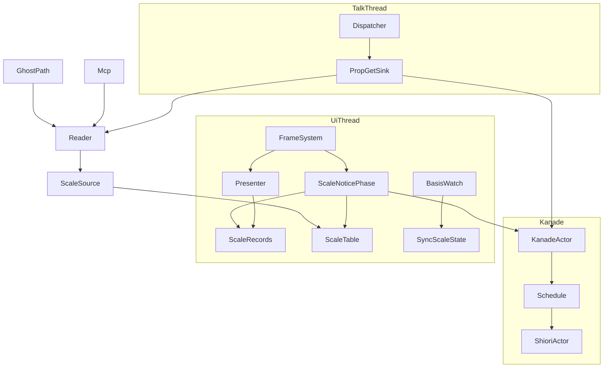
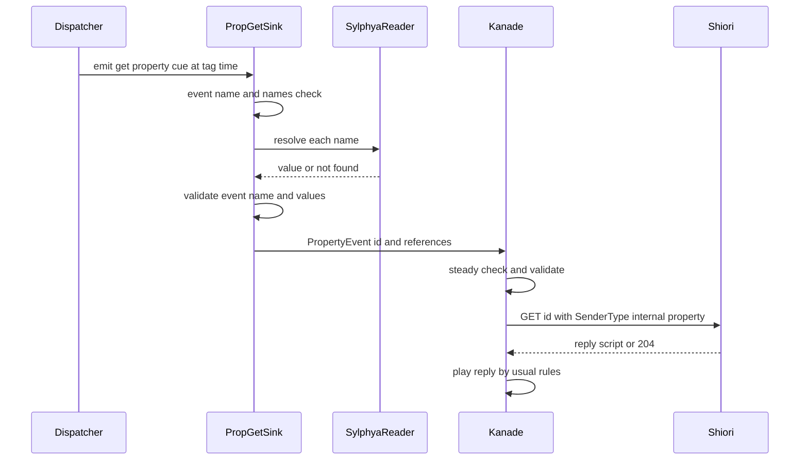
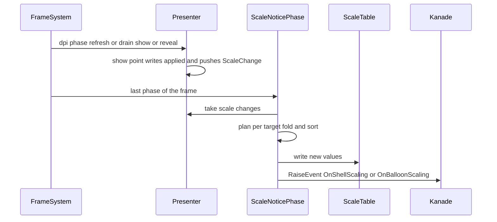
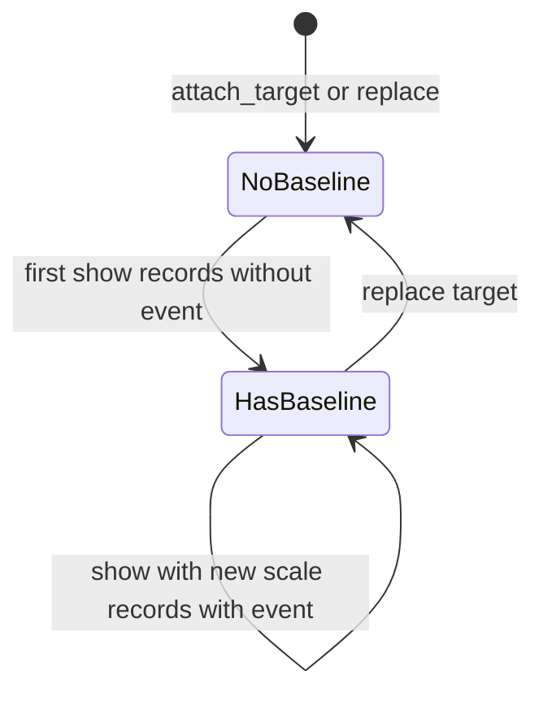

# 設計書: shell-scale-linkage

> 本ブランチ `claude/kiro-start-shell-scale-linkage-773a37`（`06701198`）のコードで確かめた（2026-11-01）。コードは「何の定義か」（関数名・型名＋ファイルパス）で指し、行番号では指さない。調べの記録と案の比べは `research.md` の 12 節。

## Overview

**Purpose**: ゴーストの作者（ぱすた）と SSP 向けに書かれたゴーストが、台本 `\![get,property,イベント名,プロパティ名,…]` で聞いた値を指定のイベントの Reference で受け取り、各スコープの窓とバルーンの実効の倍率と画面の DPI を読み、窓ごとの描画の倍率が変わったときに `OnShellScaling`・`OnBalloonScaling` を受け取れるようにする。自動試験の道具は MCP の `get_property` で同じ 4 つの値を数で確かめられる。

**Users**: ぱすたは `OnSecondChange` の応答で倍率と DPI を聞いて窓の絵（面 10・11・12）を選び、倍率の変わりの合図とドラッグの終わりの両方で窓の位置と重なりの順を付け直す。開発者は実機で 200% と 150% の画面をまたがせ、MCP で値を読む。

**Impact**: 今は黙って捨てられる `\![get,property]`・2 つのイベント・`balloon.syncscale` に受け手を立てる。DPI 追従の倍率の決め方・窓の置き方・大きさの決め方は変えない。表示層（emo-present）には「絵にかかった倍率が変わった」を表示成立点で積む口を 1 つ足し、kanade には名前の自由な返しのイベントの種類を 1 つ足す。

### Goals

- `\![get,property]` がタグの時点で値を引き、指定の名前のイベントを `SenderType: internal,property`・`SecurityLevel: local` の GET で送る（Reference0 から台本の順・値なしは空で番号を保つ）。
- 4 つの値（`currentghost.scope(ID).scaling`・`currentghost.balloon.scope(ID).scaling`・`currentghost.scope(ID).currentmonitor.dpi`・areka 独自の `currentghost.balloon.scope(ID).currentmonitor.dpi`）を、MCP とゴーストの道で同じ値として読める。値は描いた絵と食い違わない。
- 窓ごとの最終の描画の倍率が変わったフレームのうちに、変わった窓ごとに `OnShellScaling`／`OnBalloonScaling` を送る（Reference0〜3 は正典・Reference4 はシェル番号）。初めて決まったとき（起動・切り替え・読み直し）は送らない。
- ゴーストとシェルの descript の `balloon.syncscale` を論理和で読み、スコープごとの指定として持つ。
- どの判断の分岐も決定論のテストで固定する。

### Non-Goals

- `\![set,property]`・`%property[…]`・`\![embed]`（`property-query-channels`）。
- 利用者が倍率を変える道・`syncscale` を利用者の切り替えに効かせること（`shell-balloon-scale-setting`）。
- `\![set,scaling]`・`surfaces.txt` の `scaling`・ほかの `currentghost.*`（`currentghost-property-tree`・`currentghost-property-others`）。
- 画面をまたぐドラッグの置き方（`dpi-realign-remembered-chain`）・窓の組の連れ動き（`window-link-directives`）・DPI 追従の基本の設計の変更。

## Boundary Commitments

### This Spec Owns

- `\![get,property,…]` の受け口 `PropGetCueSink`（`areka-ghost`）と、受け手の表の 1 行 `("get", Some("property"))`。
- kanade の返しのイベントの種類 `EventId::Property`・知らせ `KanadeMsg::PropertyEvent`・運行表の腕 `on_property_event`・出どころの組 `ScriptOrigin::PROPERTY`。
- 許可の表の 2 語 `OnShellScaling`・`OnBalloonScaling` と、それを送る相 `run_scale_notice_phase`。
- 表示層の「適用した倍率の記録」（`ScaleChange`・`EmoPresenter::take_scale_changes`）と、装着ごとの起点の欄。
- 倍率と DPI の表 `ScopeScaleTable` と読み手 `ScopeScaleSource`（4 つの名前の形）・百分率の文字の作り方。
- `balloon.syncscale` の読み（`read_balloon_syncscale`）と、その値を持つ資源 `BalloonSyncScaleState`。
- 網羅台帳の対象の行（`sakura-script.toml` 1・`shiori.toml` 2・`property.toml` 3・`assets.toml` 4）と、`doc/COMPAT_ARCHITECTURE.md` 8 節の areka 裁量の行。

### Out of Boundary

- 実効の倍率そのものの決め方（`derive_scale`・`ScalePolicy`）。本 spec は表示成立点で決まった k を読むだけで、k を計算し直さない。
- 窓の DPI の追従・整合待ち（`run_dpi_phase`・`DpiSyncHold`）・窓寸の照合（`take_pending_resize`）。
- 2 つのイベントの応答の台本の振る舞いのうち、黙っているときの再生（今日の `on_shiori_reply` の規則に乗る）。
- `syncscale` の値をバルーンの倍率に効かせること（本 spec は持つだけ・要件 6.6）。
- 汎用の通知の入口 `KanadeMsg::RaiseEvent` の受理の規則（定常だけ）そのもの。

### Allowed Dependencies

- `areka-sylphya` の `SylphyaReader::register_pull`・`resolve_dotted_str`・`PullShape`・`PullSource`（✅ `mcp-scope-rect-property`）。
- `areka-kanade` の `KanadeMsg::RaiseEvent`（✅ `mcp-kanade-tools`）・`sstp::validate_notify`・`RequestOrigin`（✅ `areka-P0-script-security-level`）。
- `areka-talk` の `ScriptOrigin`・`SenderWord::Property`。
- `areka-emo-present` の `EmoPresenter`・`TargetId`・`ScaleRatio`、`areka-emo-compose` の `ScaleRatio`。
- `crate::emo2_boot::target_map`（scope ↔ `TargetId` の正本）・`crate::placement::reset_pos::DefaultPlacementBasis`・`crate::placement::config::{scoped_value, scope_prefixes}`・`crate::ghost_session::GhostSlot`。
- 依存の向き（左から右へだけ import する）: `areka-talk`（語彙）→ `areka-kanade`（運行）→ `areka-ghost`（受け口）→ `areka`。表示の側は `areka-emo-compose` → `areka-emo-present` → `areka`。`areka` の中は `emo2_boot::target_map`（std だけの葉）→ `ghost_session::ghost_session_scope_scale`（表・読み手・百分率の文字）→ `emo2_boot::frame`（`Emo2Wiring` が表を持ち、`scale_notice` が書く）・`ghost_session_runtime`（`Emo2Wiring` から表を取り出して `wire` へ渡す）。`ghost_session_scope_scale` は `emo2_boot` のうち `target_map` だけを import し、`Emo2Wiring` を知らない。`areka-emo-present` は kanade・sylphya・スコープを知らない。
- 新しい外のクレート・`[patch]`・フォークは使わない。

### Revalidation Triggers

- 表示成立点の外で `PresentTarget.applied` を書き換える道が足される・`apply_replace` の引き継ぎの規則が変わる（倍率の記録が漏れる）。
- `target_map` の採番（シェル＝`2*scope`・バルーン＝`2*scope+1`）が変わる。
- `KanadeMsg::RaiseEvent` の受理の規則（定常だけ）・`on_shiori_reply` の応答の再生の規則が変わる。
- `rewire_runtime_consumers` の呼び手が毎フレームの排他の系の内側へ移る（`Emo2Wiring` を読めない）。
- `shell-balloon-scale-setting` が `ScalePolicy.app_scale` を動かす（倍率は表示成立点を通る限りこの記録に乗るが、`app_scale` を変えた後に表示し直す道があることを同 spec で確かめる）。
- SSP の測りで小数の桁が分かる（百分率の文字の 1 関数を直す）。
- `property-query-channels` が同じ受け口・受け手の表の行を広げる。

## Architecture

### Existing Architecture Analysis

| 仕組み | 今の形 | 本 spec の使い方 |
|---|---|---|
| 台本の命令の運び | dola の汎用の運び手が全受け口へ cue を配り、受け口が名前と第 1 引数で自分の分を選ぶ。受け手の表 `ConsumerLedger::canonical`（42 件）が一意性を宣言する | `("get", Some("property"))` を 1 行足し、`areka-ghost` の受け口が選ぶ（`PropSetCueSink` と同じ emo2 の外の担当） |
| 値の読み口 | `SylphyaReader` は写しに無い点付きの名前を登録された読み手へ回す。MCP の `get_property` とゴーストの道（`shiori_host.rs` の `GetProperty`）は同じ `resolve_dotted_str` を通る | 4 つの形を登録する。受け口も同じ関数を同じ問い手で呼ぶ |
| 絵にかかる k | `apply_show` の表示成立点が `applied` の唯一の更新点。DPI の替わり・差し替え・出し直しはここを通る | ここで（k・DPI）の組の変わりを積む |
| 毎フレームの相 | `emo2_frame_system`（`Update`・排他）が attach → dpi → drain → 差し替え → 可視性 → … → 文字 → 届けの順に回す | 届けの相の後ろに `scale_notice` の相を 1 つ足す |
| 汎用の通知 | `KanadeMsg::RaiseEvent` は許可の表の名前を定常でだけ送る（`frame/switch.rs` の `raise_changed` が UI から送る手本） | 2 語を許可の表に足して同じ口で送る |

### Architecture Pattern & Boundary Map



- 選んだ形: 受け口の自己選別（受け手の表に 1 行）＋表示成立点からのプッシュ＋読み手の登録。どれも先例の形。
- 責務の分け方: 台本のスレッドは値を引いて送るだけ。UI スレッドは倍率の変わりを表へ書いてからイベントを送るだけ。読み手はどのスレッドからでも表を読むだけ。kanade は名前の検査と定常の判定だけ。
- 新しい部品の理由: 返しのイベントは名前の自由な出どころ `internal,property` を名乗る種類が今は無い（`EventId::Sstp` は `external,sstp` に固定）。倍率の変わりは表示成立点の外へ知らせる口が今は無い。

### Key Decisions

| # | 決め | 理由（代わりの案は `research.md` 12.3） |
|---|---|---|
| D1 | 返しのイベントは新しい種類 `EventId::Property` と知らせ `KanadeMsg::PropertyEvent` で運ぶ | `RaiseEvent` の送り手 9 か所と許可の表の規則に触れない。出どころの導きは `of_event` の 1 腕 |
| D2 | 返しのイベントは定常でだけ送る（起動の挨拶の最中は送る・終了の最中は `warn!` で捨てる） | `RaiseEvent` と同じ線。終了の台本を応答で差し替えない（2026-09-20 裁定「終了イベントのトークは必ず終了で終わる」） |
| D3 | 倍率の変わりは表示成立点で積み、毎フレームの相の最後が取り出す | 変わる時点を areka 自身が知っている＝プッシュ。毎フレームの見比べはしない（比べるのは k を書くその場の 1 回） |
| D4 | 切り替えは「装着ごとの起点」の欄で見分ける（`attach_target` が空にし、差し替えは引き継がない） | 1 フレーム遅らせず、印を別に配らず、状態の形で要件 5.7 を満たす |
| D5 | `currentmonitor.dpi` は k を出したその時の窓の DPI | 整合待ちの間も値と絵が食い違わない（要件 4.2） |
| D6 | 百分率は割り切れれば整数・割り切れなければ小数第 2 位まで（第 3 位で四捨五入・末尾の 0 は落とすが小数点の後に 1 桁は残す） | ukadoc「小数点以下が出る場合あり」。SSP の桁は未測定＝この 1 関数だけが持つ |
| D7 | 倍率の表は `Emo2Wiring` が持つ | ゴーストの起動ごとに新しく、SHIORI だけの読み直しでは窓と一緒に残る |
| D8 | `balloon.syncscale` は `DefaultPlacementBasis` の入れ直しで読み、論理和で持つ | `placement/mod.rs` に 1 行だけ・起動・シェルの差し替え・descript の読み直しを 1 つの印で覆う |
| D9 | areka 独自の `currentghost.balloon.scope(ID).currentmonitor.dpi` は網羅台帳でなく `doc/COMPAT_ARCHITECTURE.md` 8 節に書く | 台帳は ukadoc の名前の表（要件 3.11）。areka 裁量の正本は 8 節 |

### Technology Stack

| Layer | Choice / Version | Role in Feature | Notes |
|---|---|---|---|
| 言語・ECS | Rust（ワークスペースの版）・bevy_ecs（既存） | 毎フレームの相・資源の変更検出 | 新しい依存なし |
| メッセージ | `std::sync::mpsc`（既存の `KanadeMsg` の線） | 台本のスレッド・UI スレッド → kanade | 新しい線は作らない |
| 値の置き場 | `Arc<RwLock<_>>`（`ghost_session_scope_rect.rs` と同じ） | UI が書き、どのスレッドも短く読む | 保存しない |
| 記録 | `tracing`（steering `logging.md`） | 失敗は `warn!`／`error!`・通常は `debug!`・倍率の変わりは `info!` | |

## File Structure Plan

### Directory Structure

```
crates/
├── areka-talk/src/origin.rs                      # 修正: ScriptOrigin::PROPERTY（internal,property・SSTP でない・local）
├── areka-kanade/src/
│   ├── msg.rs                                    # 修正: EventId::Property・KanadeMsg::PropertyEvent
│   ├── request_origin.rs                         # 修正: of_event の腕（areka・PROPERTY）
│   ├── actor.rs                                  # 修正: KanadeMsg → Input の写し・記録の名札・送出の許可の判定の 3 腕
│   └── schedule/
│       ├── types.rs                              # 修正: Input::PropertyEvent
│       ├── mod.rs                                # 修正: 振り分けの 1 腕
│       ├── change.rs                             # 修正: on_property_event（定常の判定と名前の検査）
│       ├── change_property_tests.rs              # 新規: on_property_event の檻
│       └── events.rs                             # 修正: 許可の表に 2 語・property_event（EventId::Property の唯一の構築点）・記録の名札 PROPERTY_EVENT_ORIGIN
├── areka-ghost/src/
│   ├── prop_get_sink.rs                          # 新規: PropGetCueSink（\![get,property] の受け口）＋檻
│   ├── runtime.rs                                # 修正: boot_with_origin の単一登録点で受け口を足す
│   └── lib.rs                                    # 修正: pub mod prop_get_sink
├── areka-emo-compose/src/scale.rs                # 修正: ScaleRatio::parts（読むだけ）
├── areka-emo-present/src/
│   ├── presenter/scale_change.rs                 # 新規: AppliedScale・ScaleChange・take_scale_changes
│   ├── presenter/target.rs                       # 修正: 装着ごとの起点の欄 scale_baseline
│   ├── presenter/hub.rs                          # 修正: 記録の列の欄・new と attach_target の初期値
│   ├── presenter/show.rs                         # 修正: 表示成立点で記録を積む（数行）
│   ├── presenter.rs                              # 修正: mod scale_change・再輸出・檻の接続
│   ├── presenter_scale_change_tests.rs           # 新規: 記録の檻（GPU）
│   └── lib.rs                                    # 修正: AppliedScale・ScaleChange の再輸出
└── areka/src/
    ├── ghost_session_scope_scale.rs              # 新規: ScopeScaleTable・ScopeScaleSource・百分率の文字・wire
    ├── ghost_session_scope_scale_tests.rs        # 新規: 読み手と 2 つの道の檻
    ├── ghost_session.rs                          # 修正: #[path] mod の 2 行・syncscale の系の登録 1 行
    ├── ghost_session_runtime.rs                  # 修正: rewire_runtime_consumers に wire の 1 行
    ├── ghost_session_scope_rect.rs               # 修正: scope_selector と ScopeSelector を pub(crate) に（語だけ）
    ├── emo2_boot/
    │   ├── consumer_ledger.rs                    # 修正: (get, property) の 1 行・CommandConsumer::PropertyRead・説明の一覧
    │   ├── consumer_ledger_tests.rs              # 修正: 数 42→43・行の一覧
    │   ├── consumer_ledger_agreement_tests.rs    # 修正: emo2_sink_of に PropertyRead => None
    │   ├── target_map.rs                         # 修正: 逆写像 target_scope（TargetId → scope と窓の種類）
    │   ├── frame.rs                              # 修正: mod scale_notice と相の呼び出し（相の並びの最後）
    │   └── frame/
    │       ├── wiring.rs                         # 修正: 倍率の表の欄と読み口 scope_scale_table
    │       ├── scale_notice.rs                   # 新規: run_scale_notice_phase・plan_scale_notices・ScaleEventSeam
    │       └── scale_notice_tests.rs             # 新規: 計画の檻と同じフレームの檻
    ├── mcp/check_script_judge_tests.rs           # 修正: \![get,property,…] を受け手の無い命令と報告しない見本
    └── placement/
        ├── descript_window_keys.rs               # 修正: read_balloon_syncscale・BalloonSyncScale
        ├── balloon_syncscale.rs                  # 新規: BalloonSyncScaleState・読み直しの系・register
        └── mod.rs                                # 修正: pub(crate) mod balloon_syncscale の 1 行
doc/
├── ukadoc-coverage/ledger/{sakura-script,shiori,property,assets}.toml   # 修正: 対象の行を implemented へ
└── COMPAT_ARCHITECTURE.md                        # 修正: 8 節に areka 裁量の行
```

テストは実装と同じディレクトリの兄弟ファイル（`#[cfg(test)] #[path = "…"] mod …;`）に置く。既存のテストの兄弟（`areka-kanade/src/msg_tests.rs`・`request_origin_tests.rs`・`schedule/events_change_tests.rs`・`areka-talk/src/origin_tests.rs`・`areka-emo-compose` の `scale` の檻・`areka/src/placement` の descript の檻）には、その型の檻を足す。

### Modified Files（行の上限に近いもの）

- `crates/areka/src/placement/mod.rs`（970 行）— `pub(crate) mod balloon_syncscale;` の 1 行だけ（ウェーブの約束 1〜2 行の内）。
- `crates/areka/src/ghost_session.rs`（940 行）— `#[path = "ghost_session_scope_scale.rs"] pub(crate) mod ghost_session_scope_scale;` の 2 行と `placement::balloon_syncscale::register(world);` の 1 行（＋3 行）。
- `crates/areka-kanade/src/schedule/events.rs`（913 行）— 置き換えの述語に 2 語（数行）・許可の表の 2 語（各 1 行の `// ukadoc:` 証拠つき）・冒頭の表の 2 行・構築関数 `property_event`（20 行前後）。上限の内。
- `crates/areka/src/emo2_boot/consumer_ledger.rs`（547 行）— 本 spec の 1 行だけ（42→43・ウェーブの約束）。

### ウェーブの表 ① に無いファイル（開発者の承認を仰ぐ）

`roadmap.md` の C15 の行 ① の欄に載っていないが、本設計が触るもの。C15 の ②〜⑥ の触るファイルとは重ならない（⑤ は emo-present の `shell_target.rs`・`balloon.rs`・emo-compose の `fold.rs`・emo-atlas の `lib.rs`、⑥ は kanade の `schedule/resources.rs`・`menu/captions.rs`・`shiori.toml` の別の 1 行）。

| ファイル | 触り方 | なぜ要るか |
|---|---|---|
| `crates/areka-ghost/src/prop_get_sink.rs`（新規）・`runtime.rs`（＋数行）・`lib.rs`（＋1 行） | 受け口と単一登録点 | 読み口・問い手・kanade の送出端が揃うのはここだけ（`emo2_boot` の受け口の組み立ては起動の前） |
| `crates/areka-emo-present/src/presenter/{scale_change.rs（新規）, target.rs, hub.rs, show.rs}`・`presenter.rs`・`lib.rs`・`presenter_scale_change_tests.rs`（新規） | 表示成立点の記録 | k の唯一の更新点。ここ以外で見ると毎フレームの見比べになる |
| `crates/areka-emo-compose/src/scale.rs` | `parts()` の読み口 1 つ | 百分率を正確に作る（`as_f32` を使わない） |
| `crates/areka/src/emo2_boot/frame/scale_notice.rs`・`scale_notice_tests.rs`（新規） | 倍率の変わりの相 | ① の欄の「新しい `frame/property_get.rs`」の代わり（受け手は UI を通らないので、UI の相は倍率の通知だけになった） |
| `crates/areka/src/emo2_boot/target_map.rs` | 逆写像 1 つ | 採番の正本はこのモジュールだけが持つ（DD-3） |
| `crates/areka/src/ghost_session_scope_rect.rs` | `scope_selector` の可視性の語だけ | 選択子の読みを 2 つに分けない |
| `crates/areka/src/ghost_session_scope_scale_tests.rs`（新規）・`placement/balloon_syncscale.rs`（新規） | 檻と descript の資源 | 新しい部品の置き場 |
| `crates/areka-kanade/src/schedule/change_property_tests.rs`（新規）・`schedule/events_change_tests.rs`（数 64→66）・`request_origin_tests.rs`・`areka-talk/src/origin_tests.rs` | 檻 | 新しい腕の固定 |
| `doc/COMPAT_ARCHITECTURE.md` | 8 節に行 | areka 独自の名前と意味の正本（D9） |

**2026-11-01 開発者が承認**（設計討議の議題 1）: 上の表のファイルを触ってよい。`roadmap.md` の C15 の ① の欄は、完了のとき（`/kiro-complete` の roadmap の更新）にこの表で書き直す。

① の欄にあって本設計が**触らない**もの: `emo2_boot/mod.rs`・`emo2_boot/runtime_boot.rs`・`emo2_boot/frame/dpi.rs`・`placement/config.rs`。

## System Flows

### Flow 1: `\![get,property]` の往復



- 受け口は値を引いて送るだけで、再生を止めない（要件 1.6）。kanade への送出は非同期の線で、待たない。
- 名前なし（`\![get,property,イベント名]`）は値を引く前に打ち切る（`debug!`・要件 2.4）。名前が空・空白だけは `warn!`（要件 2.2）。改行・NUL は値を引いた後に検査して `warn!`（要件 2.3）。
- kanade は定常でなければ `warn!` で捨てる（D2）。応答は `on_shiori_reply` の今日の規則で再生する（話している最中なら今の台詞を置き換える・要件 1.7）。

### Flow 2: 倍率の変わり → 表 → イベント（同じフレーム）



- 相は `emo2_frame_system` の並びの最後（届けの相 `run_status_report_phase` の後）。k を書く点（dpi 相の `refresh_scale`・drain 相の `apply_show`・差し替えの相・可視性の相の `show_target`）はどれもこれより前にある＝k を書いたのと同じフレームで表とイベントが出る（要件 5.5・1 フレーム遅らせない）。
- 表を書いてからイベントを送る。イベントの応答の台本の `\![get,property]` はこの表を読むので、変わった後の値が返る（要件 5.5）。
- 記録が無いフレームは相がすぐ戻る（定常のフレームは何もしない）。

### Flow 3: 装着ごとの起点（イベントを送るかどうか）



- 起点が空からの最初の記録は「初めて決まった」で、表を書くだけ（要件 5.7）。起動・ゴーストの切り替え・読み直しは表示層ごと新しく、シェル・バルーンの切り替え（`ReplaceTarget`）は `attach_target` を通るので起点が空になる。
- 最初の表示の後、kanade が定常に入る前（起動の SHIORI の往復の間）に窓が別の DPI の画面へ移った記録は、起点があるのでイベントになり、kanade が `warn!(raise_event_not_steady)` で捨てる（意図した振る舞い・2026-11-01 設計討議の議題 2）。表は書かれているので、ゴーストは定常に入ってから `\![get,property]` で読める。
- 起点があり k が変わった記録だけがイベントになる。DPI だけが変わり k が同じ（作者の基準と表示の倍率で打ち消す）記録は表を書くだけ（要件 5.6）。

## Requirements Traceability

| Requirement | Summary | Components | Interfaces | Flows |
|---|---|---|---|---|
| 1.1 | タグの時点で MCP と同じ規則で引く | PropGetCueSink | `SylphyaReader::resolve_dotted_str` | Flow 1 |
| 1.2 | 指定のイベントへ Reference0 から順に | PropGetCueSink・KanadePropertyEvent | `KanadeMsg::PropertyEvent`・`events::property_event` | Flow 1 |
| 1.3 | `SenderType: internal,property` | KanadePropertyEvent | `ScriptOrigin::PROPERTY`・`RequestOrigin::of_event` | Flow 1 |
| 1.4 | 値なしは空で番号を保つ | PropGetCueSink | `DottedResolution::NotFound` → `""` | Flow 1 |
| 1.5 | 名前に縛らない | PropGetCueSink | `resolve_dotted_str` | Flow 1 |
| 1.6 | 再生を止めない | PropGetCueSink | `CueSink::emit`（非同期の送出） | Flow 1 |
| 1.7 | 応答はほかのイベントと同じ規則で再生 | KanadePropertyEvent | `on_shiori_reply`・`value_replaces_active_talk`・`Replied::reply_origin` | Flow 1 |
| 1.8 | `check_script` が受け手の無い命令と報告しない | ConsumerLedgerRow | `ConsumerLedger::canonical` | — |
| 2.1 | `On` で始まらない名前も受ける | PropGetCueSink・KanadePropertyEvent | `validate_notify`（許可の表を見ない） | Flow 1 |
| 2.2 | 空・空白だけは送らず warn | PropGetCueSink・KanadePropertyEvent | `NotifyArgError::EmptyEvent` | Flow 1 |
| 2.3 | 改行・NUL は送らず warn | PropGetCueSink・KanadePropertyEvent | `NotifyArgError::ControlCharacter` | Flow 1 |
| 2.4 | 名前なしは送らず debug | PropGetCueSink | — | Flow 1 |
| 2.5 | 送ったことを debug | PropGetCueSink | `event = "property_get_sent"` | Flow 1 |
| 3.1 | キャラクターの窓の倍率 | ScopeScaleSource・PresenterScaleRecord | `TargetWindow::Shell`・`ScaleQuantity::Scaling` | Flow 2 |
| 3.2 | バルーンの窓の倍率 | ScopeScaleSource | `TargetWindow::Balloon` | Flow 2 |
| 3.3 | 実効の倍率＝DPI 追従 × 表示の倍率（100%） | PresenterScaleRecord | 表示成立点の `scale`（`derive_scale` の結果をそのまま） | Flow 2 |
| 3.4 | 移った先の画面の実効の倍率 | PresenterScaleRecord・ScaleNoticePhase | `ScaleChange` | Flow 2 |
| 3.5 | キャラクターの窓の DPI（10 進の整数） | ScopeScaleSource | `AppliedScale::dpi_x`・`ScaleQuantity::Dpi` | Flow 2 |
| 3.6 | 「横,縦」・空白なし | ScopeScaleSource | `scaling_text` | — |
| 3.7 | 整数か小数 | ScopeScaleSource | `percent_text`（D6） | — |
| 3.8 | 150% → `150,150`・`144` | ScopeScaleSource | `percent_text`・`dpi_text` | — |
| 3.9 | 窓の無いスコープは値なし | ScopeScaleSource | `PullSource::read` → `None` | — |
| 3.10 | MCP とゴーストの道で同じ値 | ScopeScaleSource | 同じ `SylphyaReader` | — |
| 3.11 | バルーンの窓の DPI（areka 独自） | ScopeScaleSource・CompatDocs | `currentghost.balloon.scope(*).currentmonitor.dpi` | — |
| 4.1 | 新しい倍率が絵にかかった後は新しい値 | ScaleNoticePhase | 表の書き込み（同じフレーム） | Flow 2 |
| 4.2 | かかる前に新しい値・後に古い値を答えない | PresenterScaleRecord・ScaleNoticePhase | 表示成立点の（k・DPI）を一緒に積む（D5） | Flow 2 |
| 4.3 | 他のスレッドを待たない | ScopeScaleSource | `RwLock` の短い読み | — |
| 4.4 | 変わった時点だけ出す | PresenterScaleRecord | 起点と違うときだけ記録 | Flow 3 |
| 4.5 | 切り替え・読み直し・起動し直しで前の値を答えない | ScopeScaleTable（`Emo2Wiring` が持つ）・wire | `rewire_runtime_consumers` | Flow 3 |
| 4.6 | 保存しない | ScopeScaleTable | メモリの表だけ | — |
| 5.1 | キャラクターの窓の倍率の変わりで `OnShellScaling`・Reference0〜4 | ScaleNoticePhase | `plan_scale_notices`・`KanadeMsg::RaiseEvent` | Flow 2 |
| 5.2 | バルーンの窓で `OnBalloonScaling` | ScaleNoticePhase | 同上 | Flow 2 |
| 5.3 | Reference0〜3 は正典・Reference4 にシェル番号 | ScaleNoticePhase | `ScaleEvent::references` | — |
| 5.4 | Reference の数の形は `scaling` と同じ | ScaleNoticePhase | `percent_text` | — |
| 5.5 | 同じフレームで送る・応答の照会は新しい値 | ScaleNoticePhase | 相の位置・表 → イベントの順 | Flow 2 |
| 5.6 | 同じ DPI・同じ百分率なら送らない | PresenterScaleRecord・ScaleNoticePhase | 起点の比べ・`percent_text(before.ratio) != percent_text(after.ratio)`（要件 5.6 の「百分率が同じ」を答える文字で比べる・既約の比が違っても同じ文字なら送らない＝Reference0 と 1 が同じ数のイベントを出さない） | Flow 3 |
| 5.7 | 初めて決まるときは送らない | PresenterScaleRecord | 装着ごとの起点（D4） | Flow 3 |
| 5.8 | 窓ごとに 1 回・スコープの若い順 | ScaleNoticePhase | `plan_scale_notices`（target ごとに畳み・`TargetId` の順） | Flow 2 |
| 5.9 | どのスコープでも同じ規則 | ScaleNoticePhase | `target_scope` | Flow 2 |
| 5.11 | 話している最中の 2 つのイベントの応答は台詞を差し替えない | ScaleEventIds | `events::value_replaces_active_talk` | — |
| 5.10 | ドラッグでまたいだらドラッグの終わりに加えて届く | ScaleNoticePhase（実機の確かめ） | 今の `OnMouseDragEnd` は不変 | Flow 2 |
| 6.1 | ゴーストの `balloon.syncscale` | BalloonSyncScaleReader | `read_balloon_syncscale` | — |
| 6.2 | シェルの `sakura.`・`kero.`・`char*.` | BalloonSyncScaleReader | 同上 | — |
| 6.3 | どちらかが `true` なら連動 | BalloonSyncScaleReader | `BalloonSyncScale::is_synced` | — |
| 6.4 | `true` 以外は指定なし・起動を止めない | BalloonSyncScaleReader | 同上 | — |
| 6.5 | 切り替え・読み直しで読み直す | BalloonSyncScaleState | `DefaultPlacementBasis` の変更検出 | — |
| 6.6 | 持つだけ | BalloonSyncScaleState | 読み口 `is_synced` だけ | — |
| 6.7 | スコープごとに debug | BalloonSyncScaleReader | `event = "balloon_syncscale_read"` | — |
| 7.1 | 要件 1・2 の決定論のテスト | テスト（kanade・areka-ghost・mcp） | — | — |
| 7.2 | 要件 3・4 の決定論のテスト（2 つの道） | テスト（ghost_session_scope_scale・emo-present） | — | — |
| 7.3 | 要件 5 の決定論のテスト・同じフレーム | テスト（scale_notice） | — | — |
| 7.4 | 要件 6 の決定論のテスト | テスト（descript_window_keys・balloon_syncscale） | — | — |
| 8.1 | 排他テストの机を持って実機 | 実機の手順 | `areka-impl-watch` | — |
| 8.2 | 200%・150% をまたぐドラッグで記録を確かめる | 実機の手順 | 記録の語（Monitoring） | — |
| 8.3 | 各段で MCP で 4 つの値・ずれの台詞が出ない | 実機の手順 | MCP の `get_property` | — |
| 8.4 | SSP の基準と並べて書き分ける | 実機の手順 | 確かめの記録 | — |
| 8.5 | 網羅台帳の行を改める | LedgerRows | 4 本の toml | — |

## Components and Interfaces

| Component | Domain/Layer | Intent | Req Coverage | Key Dependencies (P0/P1) | Contracts |
|---|---|---|---|---|---|
| PropGetCueSink | areka-ghost（台本のスレッド） | `\![get,property]` を選び、値を引き、返しのイベントを頼む | 1.1, 1.2, 1.4, 1.5, 1.6, 2.1–2.5 | SylphyaReader (P0)・KanadeMsg (P0) | Service, Event |
| KanadePropertyEvent | areka-kanade・areka-talk | 名前の自由な返しのイベントを出どころ `internal,property` で送る | 1.2, 1.3, 1.7, 2.1–2.3 | validate_notify (P0)・on_shiori_reply (P0) | Event, State |
| ScaleEventIds | areka-kanade | 許可の表に 2 語 | 5.1, 5.2 | ALLOWED_EVENT_IDS (P0) | — |
| PresenterScaleRecord | areka-emo-present・areka-emo-compose | 表示成立点で（k・DPI）の変わりを積む | 3.3, 3.4, 4.2, 4.4, 5.6, 5.7 | apply_show (P0) | Service, State |
| ScopeScaleTable / ScopeScaleSource | areka（ghost_session_scope_scale） | 4 つの名前に表から答える | 3.1–3.11, 4.3, 4.5, 4.6 | register_pull (P0)・rewire_runtime_consumers (P1) | Service, State |
| ScaleNoticePhase | areka（emo2_boot/frame） | 記録を取り出し、表を書き、2 つのイベントを送る | 4.1, 4.2, 5.1–5.10 | PresenterScaleRecord (P0)・RaiseEvent (P0)・target_map (P0) | Batch, Event |
| BalloonSyncScaleReader / State | areka（placement） | `balloon.syncscale` を論理和で読み、持つ | 6.1–6.7 | DefaultPlacementBasis (P0) | State |
| ConsumerLedgerRow | areka（emo2_boot） | `(get, property)` の 1 行 | 1.8 | ConsumerLedger (P0) | — |
| LedgerRows / CompatDocs | doc | 台帳 4 本と 8 節の行 | 3.11, 8.5 | — | — |

### areka-ghost（台本のスレッド）

#### PropGetCueSink

| Field | Detail |
|---|---|
| Intent | `\![get,property,イベント名,名前…]` の cue を名前と第 1 引数で選び、値を引いて kanade へ頼む |
| Requirements | 1.1, 1.2, 1.4, 1.5, 1.6, 2.1, 2.2, 2.3, 2.4, 2.5 |

**Responsibilities & Constraints**
- 担当は `name == "get"` かつ第 1 引数 `== "property"` の cue だけ。ほかは記録つきで読み飛ばす（`PropSetCueSink` と同じ段の分け方: 自分宛の非正準は `warn!`・担当外は `debug!`）。
- 値は MCP の `get_property` と同じ問い手（`ghost_asker_id(&mount.shiori.dir)` の `AskerContext`）・同じ関数（`resolve_dotted_str`）で引く。名前は手直ししない（英字の大小の扱いは読み口の規則に任せる・要件 1.1）。
- 送出は `Sender<KanadeMsg>::send` の 1 回だけで、待たない（要件 1.6）。kanade が止まっていれば `warn!`。
- 定義箇所に証拠の 1 行を置く: `// ukadoc: https://ssp.shillest.net/ukadoc/manual/list_sakura_script.html#_5c_21_5bget_2cproperty_2c_30a4_30d9_30f3_30c8_540d_2c_30d7_30ed_30d1_30c6_30a3_540d_2c_30d7_30ed_30d1_30c6_30a3_540d_2c:1`（選びの腕）。

**Dependencies**
- Inbound: dispatcher（`spawn_dispatcher` の受け口の列）— cue の配送（P0）
- Outbound: `SylphyaReader`— 値の解決（P0）／`KanadeMsg::PropertyEvent`— 返しのイベントの依頼（P0）
- External: なし

**Contracts**: Service [x] / Event [x]

##### Service Interface
```rust
/// `\![get,property,…]` の運搬名と選別子。
pub const PROP_GET_CUE_NAME: &str = "get";
pub const PROP_GET_SELECTOR: &str = "property";

#[derive(Clone)]
pub struct PropGetCueSink {
    reader: SylphyaReader,
    asker: AskerContext,
    kanade: Sender<KanadeMsg>,
}

impl PropGetCueSink {
    pub fn new(reader: SylphyaReader, asker: AskerId, kanade: Sender<KanadeMsg>) -> Self;
}

impl CueSink for PropGetCueSink {
    fn emit(&mut self, cue: TalkCue);
}
```
- Preconditions: `boot_with_origin` の単一登録点（`PropSetCueSink` の直後）で、その実行系の読み口・問い手・kanade の送出端から作る。
- Postconditions（`tokens = ["property", イベント名?, 名前…]`）:
  1. イベント名が無い・空・空白だけ → 送らない。`warn!(event = "property_get_empty_event", tokens = ?tokens)`（要件 2.2）。
  2. 名前が 1 つも無い → 送らない。`debug!(event = "property_get_no_names", name)`（要件 2.4）。
  3. 名前ごとに `resolve_dotted_str` → `Value(v)` は `v`、`NotFound` は `""`（要件 1.4・番号はずらさない）。
  4. `validate_notify(イベント名, &references)` が `Err(ControlCharacter)` → 送らない。`warn!(event = "property_get_control_char", name = ?イベント名)`（要件 2.3）。
  5. `KanadeMsg::PropertyEvent { id, references }` を送る。成功で `debug!(event = "property_get_sent", name, count)`（要件 2.5）。失敗で `warn!(event = "property_get_kanade_gone", name)`。
- Invariants: 受け口は許可の表も `On` 接頭も見ない（要件 2.1）。再生の時刻・duration に触れない。

**Implementation Notes**
- Integration: `runtime.rs` の `options.sinks.push(Box::new(PropSetCueSink::new(…)))` の隣に 1 行。受け手の表の行（ConsumerLedgerRow）と組で入れる。
- Validation: 檻は `prop_get_sink.rs` の中（`prop_sink.rs` の檻と同じ偽の読み口の作り方）で、偽の kanade の受信端に届いた知らせを見る。
- Risks: 読み口の解決が名前の書式の誤りで `warn!` を出す（今の `resolve_dotted_str` の規則）＝書き損じの名前は記録に残る。

### areka-kanade・areka-talk

#### KanadePropertyEvent

| Field | Detail |
|---|---|
| Intent | 返しのイベントを `EventId::Property` で、出どころ `internal,property`・`local` の GET として送る |
| Requirements | 1.2, 1.3, 1.7, 2.1, 2.2, 2.3 |

**Responsibilities & Constraints**
- `ScriptOrigin::PROPERTY` = `{ sender_type: internal + [Property], sstp: NotSstp, level: Local }`（`areka-talk/src/origin.rs`）。
- `RequestOrigin::of_event(EventId::Property(_))` = `{ sender: Areka, origin: PROPERTY }`（応答の台本の基本の出どころも `PROPERTY`）。
- 運行表の腕は定常でだけ送る（D2）。名前と Reference は `validate_notify` で検査する（信頼の境界）。
- 送出の許可の判定（`actor.rs`）は `EventId::Property(name) => validate_notify(name, references).is_ok()`。記録の名札は固定のラベル `PROPERTY_EVENT_ORIGIN = "PropertyEvent"`（`schedule/events.rs`・`actor.rs` から `crate::schedule::events::` で見える所に置く。`value_replaces_active_talk` は真＝話している最中の応答は今の台詞を置き換える）。
- `EventId::Property` を作るのは `schedule::events::property_event` だけ。

**Contracts**: Event [x] / State [x]

##### Event Contract
```rust
// msg.rs
pub enum EventId {
    Static(&'static str),
    Choice(String),
    Sstp(String),
    Translate(RequestOrigin),
    /// `\![get,property]` の返しのイベント（`schedule::events::property_event` だけが作る・逐語）。
    Property(String),
}

pub enum KanadeMsg {
    // …既存…
    /// `\![get,property]` の返しのイベント（台本のスレッド → kanade）。定常でだけ送る。
    PropertyEvent { id: String, references: Vec<String> },
}

// schedule/types.rs
pub enum Input {
    // …既存…
    PropertyEvent { id: String, references: Vec<String> },
}

// schedule/events.rs
pub(crate) const PROPERTY_EVENT_ORIGIN: &str = "PropertyEvent";
pub fn property_event(id: String, references: Vec<String>, snapshot: &ExecutionSnapshot) -> ShioriCall; // GET

// schedule/change.rs
pub(super) fn on_property_event(state: State, id: String, references: Vec<String>) -> (State, Vec<Action>);

// areka-talk/src/origin.rs
impl ScriptOrigin { pub const PROPERTY: ScriptOrigin; }
```
- Trigger: `KanadeMsg::PropertyEvent`（`PropGetCueSink` だけが送る）。
- Payload: `id` は逐語のイベント名、`references` は値の列（欠番は空・詰めない）。
- 判断（`on_property_event`）: ⑴ 定常でない → `warn!(target: "kanade", event = "property_event_not_steady", id, phase)` で空の一括 ⑵ `validate_notify` が `Err` → `warn!(event = "property_event_invalid", error, name, reference_count)` で空の一括 ⑶ それ以外 → `Action::ShioriRequest(events::property_event(…))` を 1 つ。
- 線の上の形: `GET SHIORI/3.0`・`ID: <イベント名>`・`Sender: areka`・`SenderType: internal,property`・`SecurityLevel: local`・`SecurityOrigin: null`・`Status` は今日の導き・`Reference0..n`。
- Ordering: kanade の受信の線は FIFO。台本の順のまま届く。べき等ではない（タグ 1 つで 1 回）。

**Implementation Notes**
- Integration: `actor.rs` の `KanadeMsg` → `Input` の写し・記録の名札・許可の判定、`schedule/mod.rs` の振り分け、`request_origin.rs` の `of_event` の 5 腕（既定の腕は置かない＝コンパイラが求める）。
- Validation: `change_property_tests.rs`（定常・定常でない・空の名前・改行・NUL・`On` で始まらない名前）、`request_origin_tests.rs`（4 つのヘッダの文字列）、`msg_tests.rs`（`as_str`）、`origin_tests.rs`（`render` が `internal,property`）。
- Risks: なし（新しい種類は既存の種類の判断に入らない）。

#### ScaleEventIds

- `ALLOWED_EVENT_IDS` に `"OnShellScaling"`・`"OnBalloonScaling"` を足す（64 → 66・数の檻 `events_change_tests.rs` を直す）。各要素の上に証拠の 1 行:
  - `// ukadoc: https://ssp.shillest.net/ukadoc/manual/list_shiori_event.html#OnShellScaling:1`
  - `// ukadoc: https://ssp.shillest.net/ukadoc/manual/list_shiori_event.html#OnBalloonScaling:1`
- 応答の扱い（要件 5.11・設計討議の議題 3）: 応答の置き換えの述語 `events::value_replaces_active_talk` に `OnShellScaling`・`OnBalloonScaling` を足す（`OnSecondChange` と同じく、話している最中の Value は今の台詞を差し替えない）。捨てるときは `info!(target: "kanade", event = "scale_reply_dropped_while_talking", origin)` を残す。黙っているときの Value は今日の規則で再生する。
- 冒頭の表に 2 行（`GET（汎用の入口）`・`Ref0〜3=横の後・横の前・縦の後・縦の前の百分率・Ref4=シェル番号（渡された列のまま）`）。

### areka-emo-present・areka-emo-compose

#### PresenterScaleRecord

| Field | Detail |
|---|---|
| Intent | 表示成立点で、装着ごとの起点と（k・その k を出した DPI）の組が違えば記録を積む |
| Requirements | 3.3, 3.4, 4.2, 4.4, 5.6, 5.7 |

**Responsibilities & Constraints**
- 記録を積む点は `apply_show` の `target.applied = Some(scale)` の直後の 1 か所だけ。比べるのはその場の 1 回で、毎フレームの走査はしない。
- 起点（`PresentTarget.scale_baseline`）は `attach_target` が `None` にし、`apply_replace` は引き継がない（`applied` の引き継ぎは寸法の照合のために今のまま）。
- `dpi_x` は同じ表示成立点で `derive_scale` に渡した窓の `DPI` の `dpi_x`（`DPI` が無ければ `None`）。
- 表示層は kanade・sylphya・スコープを知らない（`TargetId` のまま渡す）。

**Contracts**: Service [x] / State [x]

##### Service Interface
```rust
// presenter/scale_change.rs
/// 絵にかかった倍率と、それを出した窓の DPI。
#[derive(Debug, Clone, Copy, PartialEq, Eq)]
pub struct AppliedScale {
    pub ratio: ScaleRatio,
    pub dpi_x: Option<u16>,
}

/// 表示成立点で（倍率・DPI）が装着ごとの起点と違った記録。
#[derive(Debug, Clone, Copy, PartialEq, Eq)]
pub struct ScaleChange {
    pub target: TargetId,
    /// 起点（`None`＝この装着で初めて決まった）。
    pub before: Option<AppliedScale>,
    pub after: AppliedScale,
}

impl EmoPresenter {
    /// 積まれた記録を積んだ順に全部取り出す（無ければ空・確保しない）。
    pub fn take_scale_changes(&mut self) -> Vec<ScaleChange>;
}

// areka-emo-compose/src/scale.rs
impl ScaleRatio {
    /// 既約の分子・分母（読むだけ・不変条件は変えない）。
    pub fn parts(self) -> (u32, u32);
}
```
- Preconditions: UI スレッド（`EmoPresenter` は `!Send`）。
- Postconditions: 表示成立点で `scale_baseline != Some(now)` のときだけ `ScaleChange { before: scale_baseline, after: now }` を積み、`scale_baseline = Some(now)`。失敗の経路（表示成立点より前の早期の return）では積まない＝絵にかからなかった k は記録に出ない（要件 4.2）。
- Invariants: 同じ target の記録の `before` は、その前の記録の `after`（装着が替わった後は `None`）。

**Implementation Notes**
- Integration: `hub.rs` の `EmoPresenter` に `scale_changes: Vec<ScaleChange>` の欄・`new` と `attach_target` の初期値、`target.rs` に `scale_baseline: Option<AppliedScale>` の欄、`show.rs` に数行、`presenter.rs` と `lib.rs` に再輸出。
- Validation: `presenter_scale_change_tests.rs`（GPU・`make_world_with_gpu`・`spawn_window_with_dpi` の既存の支え）: 初回の表示は `before: None`／同じ DPI の再表示は記録なし／DPI の替わり（`refresh_scale`）は `before: Some`／差し替え（`ReplaceTarget`・作者 DPI が違う）は `before: None`／失敗した表示は記録なし／`take_scale_changes` の 2 回目は空。`parts` は emo-compose の `scale` の檻に 1 件（`new(120, 96).parts() == (5, 4)`）。
- Risks: 表示成立点の外で `applied` を書く道が後で足されると漏れる（再確認の引き金）。

### areka（値の口）

#### ScopeScaleTable / ScopeScaleSource

| Field | Detail |
|---|---|
| Intent | スコープ → （キャラクター・バルーン）の `AppliedScale` の表から、4 つの名前に答える |
| Requirements | 3.1, 3.2, 3.3, 3.4, 3.5, 3.6, 3.7, 3.8, 3.9, 3.10, 3.11, 4.3, 4.5, 4.6 |

**Responsibilities & Constraints**
- 表は `Arc<RwLock<ScopeScaleTable>>`。書き手は `ScaleNoticePhase` だけ（UI スレッド）、読み手はどのスレッドからでも鍵を短く取る（`ghost_session_scope_rect.rs` と同じ・poison でも中身で続ける・要件 4.3）。
- 表の持ち主は `Emo2Wiring`（D7）。`rewire_runtime_consumers` が `Emo2Wiring` から表を取り出して `wire(runtime.sylphya_reader(), table)` を呼び、`wire` は新しい実行系の読み口へ 4 つの形で登録する。`Emo2Wiring` が無い（LogSink の起動）なら呼び手は `None` を渡し、`wire` は空の表で登録して `debug!(event = "scope_scale_no_wiring")` を残す（どの名前も値なしで正しい）。
- 選択子は `ghost_session_scope_rect::scope_selector`（`pub(crate)` に上げる）で読む。番号に表の行が無い・負の番号・書式の誤り・その窓の行が `None` → `None`（要件 3.9）。DPI の名前で `dpi_x` が `None` → `None`。
- 表示が一度も成立していない窓（シェルが最初の `\s` まで出ていない間など）は表に行が無い＝値なし（窓が無いのと同じ答え）。
- 保存のファイルにも写しにも書かない（要件 4.6）。
- 登録の定義箇所に証拠の行を置く: `// ukadoc: https://ssp.shillest.net/ukadoc/manual/list_propertysystem.html#currentghost.scope_28ID_29.scaling:1`・`…#currentghost.balloon.scope_28ID_29.scaling:1`・`…#currentghost.scope_28ID_29.currentmonitor.dpi:1`（areka 独自の 4 つ目には ukadoc の行を置かず、`doc/COMPAT_ARCHITECTURE.md` 8 節を指す注記の 1 行）。

**Contracts**: Service [x] / State [x]

##### Service Interface
```rust
pub(crate) type SharedScopeScaleTable = Arc<RwLock<ScopeScaleTable>>;

#[derive(Clone, Copy, Debug, Default, PartialEq, Eq)]
pub(crate) struct ScopeScales {
    pub character: Option<AppliedScale>,
    pub balloon: Option<AppliedScale>,
}

#[derive(Clone, Debug, Default, PartialEq, Eq)]
pub(crate) struct ScopeScaleTable(BTreeMap<u32, ScopeScales>);

// 窓の種類は採番の正本 `emo2_boot::target_map::TargetWindow`（Shell・Balloon）を使う。
impl ScopeScaleTable {
    pub(crate) fn set(&mut self, scope: u32, window: TargetWindow, value: AppliedScale);
    pub(crate) fn get(&self, scope: u32, window: TargetWindow) -> Option<AppliedScale>;
}

#[derive(Clone, Copy, Debug, PartialEq, Eq)]
pub(crate) enum ScaleQuantity { Scaling, Dpi }

pub(crate) struct ScopeScaleSource { window: TargetWindow, quantity: ScaleQuantity, table: SharedScopeScaleTable }
impl PullSource for ScopeScaleSource { fn read(&self, path: &PropPath) -> Option<String>; }

/// 4 つの形を登録する（`rewire_runtime_consumers` から・同期）。`None` は空の表で登録する。
pub(crate) fn wire(reader: &SylphyaReader, table: Option<SharedScopeScaleTable>);

/// 百分率の文字（D6）。
pub(crate) fn percent_text(ratio: ScaleRatio) -> String;
/// `scaling` の値＝`"{p},{p}"`。
pub(crate) fn scaling_text(ratio: ScaleRatio) -> String;
```
- 登録する形と答え:

| 形 | 窓 | 量 | 答えの例（作者の基準 96・150% の画面） |
|---|---|---|---|
| `currentghost.scope(*).scaling` | Shell | Scaling | `150,150` |
| `currentghost.balloon.scope(*).scaling` | Balloon | Scaling | `150,150` |
| `currentghost.scope(*).currentmonitor.dpi` | Shell | Dpi | `144` |
| `currentghost.balloon.scope(*).currentmonitor.dpi`（areka 独自） | Balloon | Dpi | `144` |

- `percent_text` の規則（`(num, den) = ratio.parts()`・整数だけで計算する）: `100·num` が `den` で割り切れれば `100·num/den` の 10 進。割り切れなければ `h = (2·10000·num + den) / (2·den)`（百分率の 100 分の 1・0 から遠い側へ丸め・u128 で計算）を `h/100` と `h%100` の小数 2 桁で書き、末尾の `0` を落とす（小数点の後に少なくとも 1 桁は残す）。符号・空白・前ゼロは付けない（要件 3.6）。
- `dpi_text` は `u16` の 10 進（要件 3.5）。

**Implementation Notes**
- Integration: `ghost_session_runtime.rs` の `rewire_runtime_consumers` の `ghost_session_scope_rect::wire` の隣に 1〜2 行（`world.get_non_send::<Emo2Wiring>().map(Emo2Wiring::scope_scale_table)` を `wire` へ渡す）。`ghost_session.rs` に `#[path]` の `mod` 宣言。
- Validation: `ghost_session_scope_scale_tests.rs`（偽の読み口と手で書いた表）: 4 つの形の答え／窓の無い番号・負の番号・`x`・空・`+1` の選択子は値なし／`dpi_x` が無い行の DPI は値なし／`percent_text` の表（96/96→`100`・144/96→`150`・192/96→`200`・120/144→`83.33`・135/120→`112.5`・1/3→`33.33`・2/3→`66.67`）／MCP の `get_property` の `handle` とゴーストの道（`ShioriHostSink` の `GetProperty`）が同じ名前に同じ文字を返す（要件 3.10・7.2）／表を書き換えた後の読みは新しい値（要件 4.1）／`wire` を 2 回呼んだ（SHIORI だけの読み直し）後も同じ表を読む・新しい `Emo2Wiring`（ゴーストの切り替え）の後は前の値を答えない（要件 4.5）。
- Risks: なし。

### areka（毎フレームの相）

#### ScaleNoticePhase

| Field | Detail |
|---|---|
| Intent | 表示層の記録を取り出し、表を書き、変わった窓ごとに `OnShellScaling`／`OnBalloonScaling` を送る |
| Requirements | 4.1, 4.2, 5.1, 5.2, 5.3, 5.4, 5.5, 5.6, 5.7, 5.8, 5.9, 5.10 |

**Responsibilities & Constraints**
- `emo2_frame_system` の相の並びの最後（`run_status_report_phase` の後）に 1 回呼ぶ。記録が空なら何もしない。
- 純粋な計画 `plan_scale_notices` と、書き込み・送出の殻に分ける（判断は計画にだけ置く）。
- 計画: target ごとに畳む（最初の `before`・最後の `after`）→ `TargetId` の昇順（＝スコープの若い順・同じスコープはシェル → バルーン）→ 各 target について表への書き込みを 1 つ、`before` が `Some` かつ `percent_text(before.ratio) != percent_text(after.ratio)` のときだけイベントを 1 つ。
- イベントの名前は窓の種類で決める（シェル → `OnShellScaling`・バルーン → `OnBalloonScaling`）。Reference は `[percent(after), percent(before), percent(after), percent(before), scope]`（横と縦は同じ数・要件 5.3・5.4）。
- 殻は表を全部書いてから、イベントを計画の順に `KanadeMsg::RaiseEvent { id, references, method: Get, reply: None }` で送る。送り先は `ScaleEventSeam`（テストだけが入れる資源）があればそれ、無ければ `GhostSlot` の実行系の `kanade()`。
- `TargetId` → スコープと窓の種類は `target_map::target_scope`（採番の正本の逆）。

**Dependencies**
- Inbound: `emo2_frame_system`（P0）
- Outbound: `EmoPresenter::take_scale_changes`（P0）・`ScopeScaleTable`（P0）・`KanadeMsg::RaiseEvent`（P0）
- External: なし

**Contracts**: Batch [x] / Event [x]

##### Batch / Job Contract
```rust
pub(super) fn run_scale_notice_phase(wiring: &mut Emo2Wiring, world: &mut World);

#[derive(Debug, Clone, PartialEq, Eq)]
pub(super) struct ScaleEvent {
    pub id: &'static str,            // "OnShellScaling" | "OnBalloonScaling"
    pub scope: u32,
    pub references: Vec<String>,     // 5 つ
}

#[derive(Debug, Clone, Default, PartialEq, Eq)]
pub(super) struct ScaleNoticePlan {
    pub writes: Vec<(u32, TargetWindow, AppliedScale)>,
    pub events: Vec<ScaleEvent>,
}

pub(super) fn plan_scale_notices(changes: &[ScaleChange]) -> ScaleNoticePlan;

/// テストだけが入れる送り先（本番は入れない）。
#[derive(Resource, Clone)]
pub(crate) struct ScaleEventSeam(pub(crate) std::sync::mpsc::Sender<KanadeMsg>);

// emo2_boot/target_map.rs
#[derive(Debug, Clone, Copy, PartialEq, Eq)]
pub enum TargetWindow { Shell, Balloon }
pub fn target_scope(target: TargetId) -> (u32, TargetWindow);
```
- Trigger: 毎フレーム（記録があるフレームだけ働く）。
- Input / validation: 記録は表示層が積んだもの。検査は要らない。
- Output / destination: 表（`Emo2Wiring` の欄）と kanade。
- Idempotency & recovery: 記録は取り出したら消える（同じ記録で 2 度送らない）。kanade が受け取れない（実行系が無い・止まった）ときは表は書いたまま、イベントごとに `warn!(event = "scale_event_not_sent", id, scope)`。kanade が定常でなければ kanade の側が `warn!(raise_event_not_steady)` で捨てる。

**Implementation Notes**
- Integration: `frame.rs` に `mod scale_notice;` と呼び出し 1 行、`frame/wiring.rs` に表の欄（`Emo2Wiring::new` の中で空の表を作る＝引数は変えない）と読み口 `pub(crate) fn scope_scale_table(&self) -> SharedScopeScaleTable`。記録: 書き込みは `debug!(event = "scope_scale_table_updated", scope, window, scaling, dpi)`、送出は `info!(event = "scale_event_raised", id, scope, before, after)`。
- Validation: `scale_notice_tests.rs` — 計画の檻（純粋）: 初めて決まった記録は書き込みだけ／本体の倍率の変わり／スコープ 1 だけ／バルーンだけ／同じ百分率（DPI だけ違う）は書き込みだけ／同じ target が 1 フレームに 2 回変わったら 1 回に畳む・戻ったら送らない／複数の窓は `TargetId` の順／Reference の 5 つの並びとスコープ番号。同じフレームの檻（x64・多フレーム駆動ハーネス・`ScaleEventSeam`）: 窓の `DPI` を 144 → 192 に替えて `emo2_frame_system` を 1 回回すと、その 1 回の中で表が `200,200` になり `OnShellScaling` の知らせが 1 件届く（要件 7.3）／attach の最初のフレームは知らせ 0 件／シェルの差し替え（作者 DPI が違う）の巡は知らせ 0 件。
- Risks: 相を後ろへ動かすと同じフレームの約束が崩れる＝同じフレームの檻が固定する。

### areka（descript）

#### BalloonSyncScaleReader / BalloonSyncScaleState

| Field | Detail |
|---|---|
| Intent | ゴーストとシェルの descript の `balloon.syncscale` を論理和で読み、スコープごとの指定として持つ |
| Requirements | 6.1, 6.2, 6.3, 6.4, 6.5, 6.6, 6.7 |

**Responsibilities & Constraints**
- 読み（`descript_window_keys.rs`・I/O なし・`crate::` を見ない）: ゴーストの `balloon.syncscale`、シェルの `sakura.`＞`char0.`（スコープ 0）・`kero.`＞`char1.`（スコープ 1）・`char<n>.`（n は 10 進の 2 以上・先頭の 0 なし）の `balloon.syncscale`。値は前後の空白を除いて `true` と完全に一致するときだけ有効、ほか（`false`・空・ほかの文字）は「指定なし」（要件 6.4）。
- 判定（要件 6.3）: `is_synced(scope) = ghost || shell_scopes.contains(scope)`。
- 記録（要件 6.7）: 読んだ鍵ごとに `debug!(event = "balloon_syncscale_read", key, scope, value, synced)`（ゴーストの鍵は `scope = "all"`）。
- 資源 `BalloonSyncScaleState`（`placement/balloon_syncscale.rs`）は、`DefaultPlacementBasis` が入れ直された巡（bevy の変更検出・`Update`）で `source.ghost_kv`・`source.shell_kv` から読み直して丸ごと置き換える（前の指定を残さない・要件 6.5）。
- 値を使う下流は無い（要件 6.6）。バルーンの倍率の働きは変えない。
- 証拠の行（読みの定義箇所）: `// ukadoc: https://ssp.shillest.net/ukadoc/manual/descript_ghost.html#balloon.syncscale_2ctrue:1`・`…/descript_shell.html#sakura.balloon.syncscale_2ctrue:1`・`…#kero.balloon.syncscale_2ctrue:1`・`…#char_2a.balloon.syncscale_2ctrue:1`。

**Contracts**: State [x]

##### State Management
```rust
// placement/descript_window_keys.rs
#[derive(Debug, Clone, Default, PartialEq, Eq)]
pub struct BalloonSyncScale {
    ghost: bool,
    shell_scopes: BTreeSet<u32>,
}
impl BalloonSyncScale {
    pub fn is_synced(&self, scope: u32) -> bool;
}
pub fn read_balloon_syncscale(
    ghost_kv: &BTreeMap<String, String>,
    shell_kv: &BTreeMap<String, String>,
) -> BalloonSyncScale;

// placement/balloon_syncscale.rs
#[derive(Resource, Debug, Clone, Default, PartialEq, Eq)]
pub(crate) struct BalloonSyncScaleState(pub(crate) BalloonSyncScale);
pub(crate) fn register(world: &mut World); // Update に読み直しの系を 1 つ
```
- 持ち方: World の資源。保存しない。ゴーストの切り替えは起動の窓づくりで `DefaultPlacementBasis` が入れ直されるので読み直す。

**Implementation Notes**
- Integration: `placement/mod.rs` に `pub(crate) mod balloon_syncscale;` の 1 行、`ghost_session.rs` の `register_systems` に `placement::balloon_syncscale::register(world);` の 1 行。
- Validation: `descript_window_keys` の檻に読みの表（ゴーストだけ・シェルの `sakura.` だけ・`char0.` の別名・`kero.`・`char2.`・`char02.` は読まない・両方・`false`・空・`True`・` true `）、`balloon_syncscale.rs` の檻に資源の置き換え（`DefaultPlacementBasis` を入れ直すと前の指定が消える・入れ直さない巡は読まない）。
- Risks: なし。

### areka（受け手の表）

#### ConsumerLedgerRow

- `CommandConsumer::PropertyRead`（`areka_ghost::prop_get_sink::PropGetCueSink`）を足し、`ConsumerLedger::canonical` に `("get", Some("property"))` を 1 行（42 → 43）。説明の一覧（モジュールの冒頭と `canonical` の doc）に足す。`emo2_boot` の 11 の受け口の数は変わらない（emo2 の外の担当）。
- `consumer_ledger_tests.rs` の手書きの数と行の一覧、`consumer_ledger_agreement_tests.rs` の `emo2_sink_of` に `CommandConsumer::PropertyRead => None`。
- `mcp/check_script_judge_tests.rs` に `\![get,property,OnX,currentghost.scope(0).scaling]` が受け手の無い命令として報告されない見本 1 件（要件 1.8）。

### doc

#### LedgerRows / CompatDocs

- `doc/ukadoc-coverage/ledger/`（要件 8.5）: `sakura-script.toml` の `\![get,property,…]`・`shiori.toml` の `OnShellScaling`・`OnBalloonScaling`・`property.toml` の 3 行・`assets.toml` のゴーストの `balloon.syncscale` とシェルの 3 行を `implemented` に改め、根拠への道を `note` に書く。シェルの 3 行の `owner` に `shell-scale-linkage`。`property.toml` の `scaling` の 2 行の「値の源」を「画面の DPI への追従の倍率 × 表示の倍率（今は 100%）」へ書き直す。`shiori.toml` の 2 行の注記に「窓ごとの最終の描画の倍率の変わりで送る・初めて決まるときは送らない・Reference4 にシェル番号を足した」を書く。`assets.toml` の 4 行は「読んで持つだけ（効かせるのは `shell-balloon-scale-setting`）」を書く。
- `doc/COMPAT_ARCHITECTURE.md` 8 節に行を足す（D9）: ⑴ `scaling` の意味（DPI 追従の倍率 × 表示の倍率・SSP の「画面を移っても変わらない」に合わせない）と 2 つのイベントの送る場面（窓ごと・理由を問わない・初めて決まるときは送らない）と Reference4 のシェル番号 ⑵ areka 独自の `currentghost.balloon.scope(ID).currentmonitor.dpi` ⑶ `\![get,property]` の名前なし・空の名前・定常でないときの扱いと百分率の小数の桁。

## Data Models

### Domain Model

- **AppliedScale**（値の組）: 絵にかかった `ScaleRatio` と、それを出した窓の `dpi_x`。表示成立点でだけ生まれる。
- **ScaleChange**（出来事）: target・起点・新しい値。表示層が積み、相が取り出して消す。
- **ScopeScaleTable**（集約）: スコープごとのキャラクター・バルーンの `AppliedScale`。書き手は相 1 つ。ゴーストの起動ごとに新しい。
- **BalloonSyncScale**（値）: ゴーストの段の真偽とシェルの段のスコープの集合。

### Data Contracts & Integration

**返しのイベント（`\![get,property]`）**

| 欄 | 値 |
|---|---|
| メソッド | `GET` |
| `ID` | 台本のイベント名（逐語） |
| `Sender` / `SenderType` / `SecurityLevel` | `areka` / `internal,property` / `local` |
| `Reference(n−1)` | n 番目の名前の値（無ければ空） |

**`OnShellScaling`・`OnBalloonScaling`**

| Reference | 中身 | 例（150% → 200%・本体） |
|---|---|---|
| 0 | 横の変わった後 | `200` |
| 1 | 横の変わる前 | `150` |
| 2 | 縦の変わった後 | `200` |
| 3 | 縦の変わる前 | `150` |
| 4 | シェル番号（areka が足した・`OnMouseClick` の Reference3 と同じ番号） | `0` |

## Error Handling

### Error Strategy

失敗はどれも回復できるもので、起動も再生も止めない。各分岐は値と理由を記録に残し、黙って捨てない。`panic!` は使わない（固定の形の `PullShape::parse` の `expect` だけは今の先例どおり、書き損じは起動の檻が捕まえる）。

### Error Categories and Responses

| 場面 | 振る舞い | 記録 |
|---|---|---|
| イベント名が無い・空・空白だけ | 送らない・再生を続ける | `warn!(property_get_empty_event, tokens)` |
| 名前が 1 つも無い | 送らない | `debug!(property_get_no_names, name)` |
| イベント名か値に CR・LF・NUL | 送らない | 受け口 `warn!(property_get_control_char)`・kanade `warn!(property_event_invalid)` |
| 名前の書式が読めない・値が無い | その番号を空にして送る | 読み口の `warn!`（書式）／`debug!`（無い） |
| kanade が止まっている（受け口・相） | 送らない | `warn!(property_get_kanade_gone)`／`warn!(scale_event_not_sent)` |
| kanade が定常でない | 送らない（積まない） | `warn!(property_event_not_steady)`／`warn!(raise_event_not_steady)` |
| 自分宛の非正準の cue | 読み飛ばす | `warn!`（`PropSetCueSink` と同じ段） |
| `Emo2Wiring` が無い（LogSink の起動） | 空の表で登録・値なし | `debug!(scope_scale_no_wiring)` |
| `syncscale` の値が `true` 以外 | 指定なし | `debug!(balloon_syncscale_read, synced = false)` |

### Monitoring

実機の確かめ（要件 8.2・8.3）で読む記録の語: `property_get_sent`（`name = OnPastaShellScale`・`count = 2`）・`scale_event_raised`（`id = OnShellScaling`・`scope`・`before`・`after`）・`scope_scale_table_updated`。判定の分岐の段（`debug`）まで `RUST_LOG` を開ける（`areka=debug,areka_ghost=debug,areka_kanade=debug`）。

## Testing Strategy

### Unit Tests（決定論・x64）

1. `PropGetCueSink`（`prop_get_sink.rs` の檻・要件 7.1）: 値の並ぶ順／無い名前の空の Reference で番号を保つ／名前を問わない（`baseware.name` など）／`On` で始まらない名前を送る／空の名前・空白だけ・イベント名が無いは送らず warn 1 件／名前なしは送らず debug／改行・NUL は送らず warn／担当外（`\![get,other]`・`\![set,property]`）は読み飛ばす／kanade が落ちていても panic しない。
2. kanade（`change_property_tests.rs`・`request_origin_tests.rs`・`msg_tests.rs`・`origin_tests.rs`・`events_change_tests.rs`）: 定常で GET を 1 つ・定常でない（起動の段・終了の段）は空の一括と warn／検査の失敗は空の一括と warn／4 つのヘッダの文字列が `areka`・`internal,property`・`local`・`null`／応答の台本が `on_shiori_reply` の規則で再生され、話している最中は置き換える（要件 1.7）／許可の表の数 66。
3. 値の口（`ghost_session_scope_scale_tests.rs`・要件 7.2）: 4 つの形の答え・百分率の表・選択子の誤り・窓の無いスコープ・`dpi_x` 無し・MCP とゴーストの道の一致・表の差し替え後の値・ゴーストの切り替えの後に前の値を答えない。
4. 応答の扱い（`schedule` の檻・要件 5.11）: 話している最中の `OnShellScaling`・`OnBalloonScaling` の Value は今の台詞を差し替えず `info!` を残して捨てる／黙っているときは再生する／ほかのイベント（例 `OnMouseClick`）は今までどおり差し替える。起動の途中（定常の前）の倍率の変わりは、`RaiseEvent` が kanade に届いて `raise_event_not_steady` の warn で捨てられる（同じフレームの檻の 1 場面・議題 2）。
5. 計画（`scale_notice_tests.rs` の純粋な部・要件 7.3）: 送る場面と送らない場面・畳み・順・Reference の並び（Reference4 のスコープ番号）。
6. `syncscale`（`descript_window_keys` の檻・`balloon_syncscale.rs` の檻・要件 7.4）: ゴーストだけ・シェルだけ・両方・`true` 以外・別名・切り替えで前の指定が消える。

### Integration Tests

1. 表示層の記録（`presenter_scale_change_tests.rs`・実 GPU）: 初回・同じ DPI・DPI の替わり・差し替え・失敗した表示（要件 7.2・7.3 の土台）。
2. 同じフレーム（`scale_notice_tests.rs` の多フレーム駆動ハーネス・x64・実 GPU）: DPI を替えた 1 回の `emo2_frame_system` の中で表と知らせが揃う／attach の巡と差し替えの巡は知らせ 0 件（要件 7.3）。
3. `check_script` の見本（`check_script_judge_tests.rs`・要件 1.8）。
4. 受け手の表の数と合意（`consumer_ledger_tests.rs`・`consumer_ledger_agreement_tests.rs`）。

### 実機の確かめ（要件 8・排他テストの机）

- 机を持ってから areka を起こし、終わったらすぐ返す（要件 8.1）。根・一時のフォルダはワークツリーの `target\` の下。ぱすたは取り寄せた書庫の木（`target\pasta-verify\root\ghost\pasta-in-windows`）を使い、外の実物を動かさない。
- 段: 起動の直後 → 同じ画面の中のドラッグの後 → 拡大率の違う画面（200% と 150%）へ移した後。各段で MCP の `get_property` で 4 つの値を読み、窓の居る画面の拡大率と一致すること、`OnPastaShellScale` が `count = 2` で届くこと、移した後に `OnShellScaling` が `scope = 0` で届くこと、ぱすたが付け直すこと、`＊バルーン倍率のずれ` が出ないこと（ぱすたは `baseware.name` が `areka` なら出さない）を記録で確かめる（要件 8.2・8.3・5.10）。
- 確かめの記録は `.kiro/specs/shell-scale-linkage/` に置き、SSP の基準（`150,150` のまま・`OnShellScaling` なし）と並べ、数の形が同じこと、値と届き方の違いが DPI 追従の方針によることを書き分ける（要件 8.4）。

### Performance

- 定常のフレームは記録が空で、相はすぐ戻る。表示成立点の追加は（k・DPI）の組の比べ 1 回だけ。読み手は鍵を短く取って 1 つの文字を作るだけ。

## Security Considerations

- 返しのイベントは `SecurityLevel: local`（ゴースト自身の台本の照会）。応答の台本の出どころは `PROPERTY`（local）で、外からの台本の制限（`script_restriction.rs`）には掛からない。`\![get,property]` は ukadoc が出どころで制限しないので、制限の表に足さない。
- 受け口は MCP と同じ問い手で読む＝ほかのゴーストの区画は読めない。
