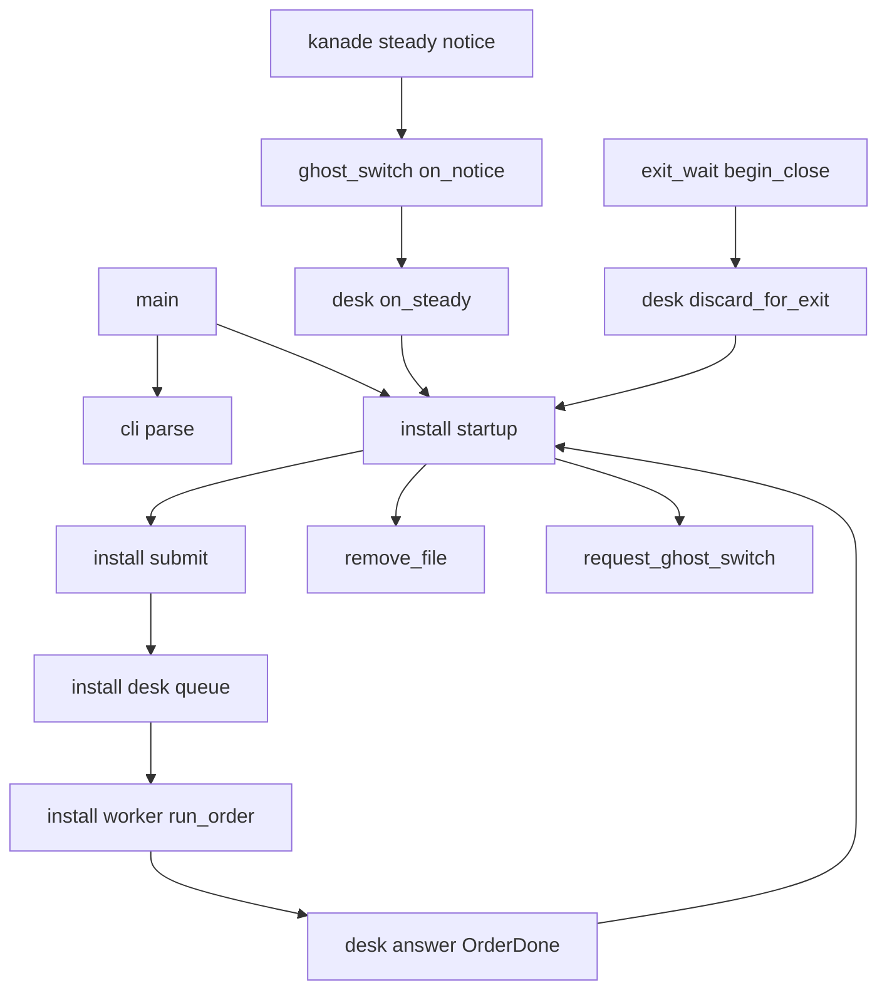
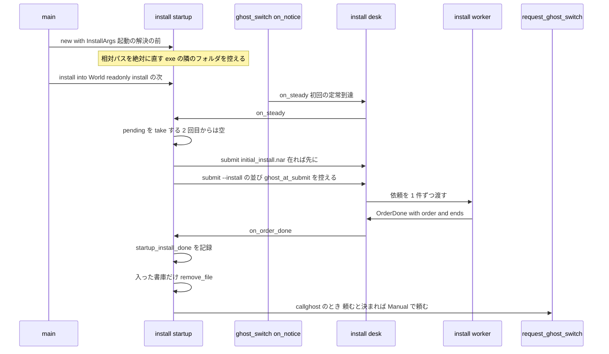
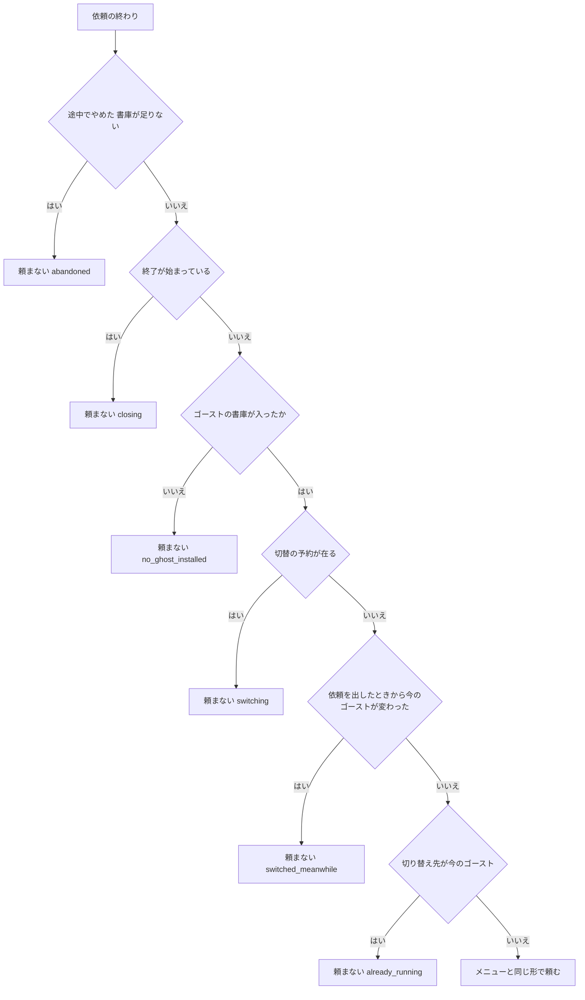

# 設計: startup-install-option

> 2026-10-29・本ブランチ `fbf3d87e`（main `932d2c30` の上）。コードは「何の定義か」（関数名・型名＋ファイルパス）で指し、行番号は添え物。
> 要件の番号は `requirements.md` のとおり。調べと比べの詳しいところは `research.md` の「設計の段の調べと決め」にあり、決めたことはこの文書にも書く。

## Overview

**目的**: `areka.exe --install a.nar b.nar --option callghost,deletesource` の 1 行と、exe の隣に置いた `initial_install.nar` で、areka が起動の後に NAR を入れられるようにする。入れ方は窓への投げ込みと同じ手続きで、変えない。

**使う人**: 自動の試験を回す開発者と AI のエージェント（画面に触らずに「入れる → 起こす → MCP で確かめる」を 1 本で回す）と、ゴーストを areka に同梱して配りたい人（最初の起動で黙って入れる）。

**変わること**: 起動オプションの読み手が `--install` の値と `callghost`・`deletesource` を扱う語として受ける。新しい持ち物 `StartupInstall` が、最初のゴーストが定常に着いたときに 1 回だけ、`initial_install.nar` と `--install` の並びを別々の依頼としてインストールの唯一の口 `install::submit` へ渡す。背景のスレッドが依頼の終わりに書庫ごとの終わり方を窓口へ返すようになり、それを受けて「入った書庫だけ消す」と「入れたゴーストへ切り替えを頼む」を行う。

### Goals
- `--install`（`-i`・`/i`）の値を書いた順に 1 件の依頼として、最初の定常到達の後に 1 回だけ出す。
- `deletesource` と `initial_install.nar` で、終わり方が「入った」の書庫だけを消す。
- `callghost` で、並びの最後に入ったゴーストへ、メニューの「ゴースト」と同じ道（`OnGhostChanging` の Reference1 は `manual`）で切り替えを頼む。
- 読み取りだけの走りでは、今ある断り（`submit` の先頭）でどれも断られ、記録に出どころの語が出る。
- 決定論のテストで、並びの順・消す／残す・切り替えを頼む／頼まない・readonly の断りを固定する。

### Non-Goals
- 起動中の areka や SSP へインストールを任せる仕組み（SSTP の受け口・二重起動の確かめの後）。
- ゴーストが 1 体も無いときに、起動の解決の前に入れてから起動を続ける道（完了の段で別の spec として起票する＝要件 10.2）。
- `callghost` を 2 体目として呼ぶ形（`ghost-call`・`multi-ghost-runtime` の後＝要件 10.1）。
- インストールの手続き（判定・置き場・上書き・利用条件・警告・ゴーストへの知らせの中身と順）と切り替えの手続きの変更。
- `--option kiosk`（今までどおり「まだ扱わない」）・`--ukagaka-link`・`--ssf`。

## Boundary Commitments

### This Spec Owns
- 起動オプションの読み手の `--install` の腕と、`--option` の語 `callghost`・`deletesource`、その組みの記録（`install_option_empty`・`install_word_without_install`）。
- 読んだ値の型 `cli::InstallArgs`（`StartupOptions::install`）。
- インストールの依頼の出どころの語 `InstallOrigin::StartupArgs`・`InstallOrigin::InitialInstall`。
- 新しい持ち物 `install::startup::StartupInstall`（起動の解決の前に作り、World の資源へ移す）と、その口: 作る・World へ据える・最初の定常到達で 1 回だけ依頼を出す・依頼の終わりを受けて消す／頼む・出さずに終わるなら記録する。
- 「入った書庫だけ消す」の判断（純粋な関数 `sources_to_delete`）と消す所。
- `callghost` の判断（純粋な関数 `decide_call_ghost`）と切り替えの頼み方（`callghost_request`）。
- 背景のスレッドから窓口への終わりの知らせ `DeskAsk::OrderDone` に、依頼と終わり方の並びを載せること。
- `dist/README.txt` の「■ 起動オプション」の 62 行目・79 行目と、新しい小見出し 1 つ。

### Out of Boundary
- `install::submit` の中身（readonly の断り・`Empty`・`NoDesk`・`Closing`）と、手続き `install::procedure::run_order` の中身と記録。この spec は呼ぶだけで、記録の語も変えない。
- 切り替えの入口 `emo2_boot::ghost_switch::request_ghost_switch` の中身（予約・目録の突き合わせ・`Busy` の記録）。
- `crates/areka/src/ghost_session.rs`・`crates/areka/src/emo2_boot/ghost_switch.rs`（同じウェーブの約束で触らない）。
- 使っている最中のフォルダへの上書きの守り（`install-live-target-hazards`）。
- 起動の解決 `boot_resolve`・`boot_config::resolve_boot` の振る舞い（ゴーストが居ないときの告知の道は変えない）。
- `dist/README.txt` のほかの行（`default-balloon-selfmade`・`bridge-store-user-root` が触る）。

### Allowed Dependencies
- `cli` → なし（純粋なまま。パスの絶対化もしない）。
- `install::startup` → `install::submit`・`install::desk`（窓口の門）・`install::procedure::ArchiveEnd`・`emo2_boot::ghost_switch::{request_ghost_switch, SwitchRequest, GhostSpec, SwitchInFlight}`・`boot_config::BootContext`・`roots::user_root::exe_dir`・`areka_ghost::same_folder_name`・`areka_kanade::ChangeOrigin`・`std::path::absolute`・`std::fs::remove_file`。
- `install::desk` → `install::startup`（呼ぶ行 3 つ）。
- `main` → `install::startup`（呼ぶ行 2 つ：作る・据える）。
- 新しいクレートの依存は足さない。

### Revalidation Triggers
- `DeskAsk::OrderDone` の形（依頼と終わり方を載せる）を変えるとき: 窓口と `startup` と `worker_tests.rs`・`desk_tests.rs` を見直す。
- `ArchiveEnd` に終わり方を足す・意味を変えるとき（特に `Installed` の意味）: `sources_to_delete` と `decide_call_ghost` を見直す（取り消せない消去に効く）。
- `InstalledItem` の `place`（入れた先のフォルダの絶対パス）・`kind` の語を変えるとき: `decide_call_ghost` の切り替え先を見直す。
- 定常到達の知らせの道（`ghost_switch::on_notice` → `install::desk::on_steady`）が変わるとき: 1 回だけ出す口を見直す。
- 切り替えの入口の型 `SwitchRequest` が変わるとき・メニューの「ゴースト」の頼み方（`menu/ghost_frame.rs`）が変わるとき: `callghost_request` を揃える。
- `callghost` を 2 体目として呼ぶ形へ移すとき（`ghost-call` の着地）。

## Architecture

### Existing Architecture Analysis
- インストールの依頼は、どの入口からも `install::submit(world, InstallOrder { archives, origin })` の 1 本を通る。`submit` の先頭で readonly なら断る（`info!(readonly_refused, origin)`）。積んだ依頼は窓口 `InstallDesk`（World の NonSend）の待ち行列に入り、取り出しの系 `desk::drain`（Input の段）が背景のスレッド `install` へ 1 件ずつ渡す。
- 背景のスレッドは `run_order` を走らせ、書庫ごとの `ArchiveEnd` の並びを得るが、窓口へは中身の無い `DeskAsk::OrderDone` を送るだけ（`install/worker.rs` の `spawn_worker`）。
- 定常到達は kanade の起動の段が出し（`areka-kanade/src/schedule/boot.rs` の `Phase::BootVersion` の腕）、`emo2_boot/frame.rs` の `run_ghost_quit_phase` → `ghost_switch::on_notice` の `KanadeNotice::Steady` の腕の末尾から、どの定常到達でも `install::desk::on_steady` が呼ばれる。初回の起動もここを通る。
- 終了の後始末 `exit_wait::begin_close`（利用者の終了と OS のセッションの終了の 2 か所）が `install::desk::discard_for_exit` を呼ぶ。`app.run()` が戻った後は `drain` が回らない。
- 切り替えの入口は `request_ghost_switch` 1 本。メニューの「ゴースト」は `GhostSpec::Folder`・`raise_event: true`・`ChangeOrigin::Manual`・`boot_event: None` で頼む（`menu/ghost_frame.rs`）。
- 上限の近いファイル: `main.rs` 981 行・`ghost_switch.rs` 926 行・`ghost_session.rs` 935 行。

### Architecture Pattern & Boundary Map



**決めたこと**:
- 形: 判断を新しい `install/startup.rs` へ寄せ、今あるファイルには呼ぶ行だけを足す（`research.md` の案 B を縮めた形）。`cli/install_args.rs` は作らない（`parse.rs` の今の腕に数行で入る）。
- 終わり方の受け渡し: `DeskAsk::OrderDone { order, ends }`（R1）。
- 1 回だけ出す所: `desk::on_steady` から `startup::on_steady` を呼び、持ち物を `take` する（T1）。
- 起動の値を World へ: `main` から 2 行（H1）。持ち物は起動の解決の前に作り、窓のアプリの World へ移す。出さずに落ちたら `Drop` が記録する（起動が止まったどの道でも黙って捨てない）。
- 依存の向き: `cli`（純粋）← `main` → `install::startup` → `install::{submit, desk, procedure}`・`emo2_boot::ghost_switch`（入口だけ）。`install::desk` は `install::startup` の口を呼ぶだけで、`startup` は窓口の中身（門）だけを読む。逆向き（`ghost_switch` → `startup`）は作らない。
- steering に合わせたこと: 失敗は記録（`error!`／`warn!`）に残し、メッセージボックスを出さない。時刻の待ちを置かない（状態の形で解く）。テストは兄弟の `*_tests.rs`。

### Technology Stack

| 層 | 使う物 | この機能での役 | 注 |
|---|---|---|---|
| 起動オプション | `crates/areka/src/cli`（自前） | `--install` と 2 つの語を読む | 依存なし |
| アプリの World | `bevy_ecs`（ワークスペースのピンのまま） | 持ち物 `StartupInstall` を資源として置く | 新しい依存なし |
| ファイル | `std::path::absolute`・`std::fs::remove_file`・`Path::is_file` | 相対パスの絶対化・消す・exe の隣を見る | `offline_dump` と同じ絶対化 |
| 記録 | `tracing`（`logging.md` の形） | 新しい記録 9 種 | テストは `log-capture-kit` |

## File Structure Plan

### Directory Structure
```
crates/areka/src/
├── cli/
│   ├── mod.rs                     # InstallArgs を足し、StartupOptions に install の欄
│   ├── parse.rs                   # --install の腕・callghost/deletesource・組みの記録
│   ├── parse_install_tests.rs     # 新: 要件 9.1 の起動オプションの判定
│   └── parse_tests.rs             # 今の期待の書き換え（--install を扱わない名前の例から外す・pending の語から 2 つを外す）
├── install/
│   ├── mod.rs                     # mod startup・InstallOrigin に 2 語
│   ├── startup.rs                 # 新: 起動の依頼の持ち物・1 回だけ出す・終わりを受けて消す／頼む・終了の記録・純粋な判断
│   ├── startup_tests.rs           # 新: 純粋な判断（消す書庫・切り替えを頼む／頼まない・頼み方）と消す所
│   ├── desk.rs                    # on_steady・answer の OrderDone・discard_for_exit から startup を呼ぶ 3 か所
│   ├── desk_tests.rs              # OrderDone の形の書き換え 2 か所・子のテストの宣言 1 つ
│   ├── desk_startup_tests.rs      # 新: 窓口との結線（1 回だけ・2 件の順・readonly・終わりを受けて消す・終了の記録）
│   ├── worker.rs                  # DeskAsk::OrderDone に order と ends を載せる
│   └── worker_tests.rs            # OrderDone の形の書き換え 2 か所
└── main.rs                        # 2 行（起動の解決の前に作る・readonly::install の次に据える）
crates/areka/tests/
└── startup_install_real_run.rs    # 新: 実機（--install → 置き場に入る・callghost で起動中・deletesource で写しが消える）
dist/
└── README.txt                     # 62 行目・79 行目・新しい小見出し
```

### Modified Files
- `crates/areka/src/cli/mod.rs` — `InstallArgs` の型と `StartupOptions::install` の欄。
- `crates/areka/src/cli/parse.rs` — 表の `install` の行を `Kind::Install` へ。`--option` の語の分岐から `callghost`・`deletesource` を効く側へ。読み終えた後の組みの記録 2 種。`ParseNote` に 2 つ。`#[path = "parse_install_tests.rs"]` の宣言。
- `crates/areka/src/cli/parse_tests.rs` — `--install` を「扱わない名前は値も飲む」の例にしていた 2 件を `--fmo-name` などへ、`/o kiosk,callghost,deletesource` の期待を `kiosk` だけ `pending` へ。そのほかの `--install` を扱わない前提の期待（research.md §2.1 の表の 4 か所）を直す。
- `crates/areka/src/install/mod.rs` — `pub(crate) mod startup;`・`InstallOrigin::{StartupArgs, InitialInstall}`。
- `crates/areka/src/install/worker.rs` — `DeskAsk::OrderDone { order: InstallOrder, ends: Vec<ArchiveEnd> }`。`spawn_worker` は `run_order` の後に依頼と結果を載せて送る。
- `crates/areka/src/install/desk.rs` — ⑴ `on_steady` の末尾で `super::startup::on_steady(world)` ⑵ `answer` の `OrderDone` の腕で `busy` を下ろした後に `super::startup::on_order_done(world, &order, &ends, closing)` ⑶ `discard_for_exit` の先頭で `super::startup::discard_for_exit(world)`。判断は入れない（約 8 行の増え）。
- `crates/areka/src/install/desk_tests.rs`・`worker_tests.rs` — `OrderDone` の形の書き換え（4 か所）と、子のテスト `desk_startup_tests.rs` の宣言。
- `crates/areka/src/main.rs` — `--offline-dump` の早い戻りの後に `let startup_install = install::startup::StartupInstall::new(opts.install);`、`readonly::install(..)` の次に `install::startup::install(app.world().borrow_mut().world_mut(), startup_install);`（981 → 983 行）。
- `dist/README.txt` — 62 行目から `callghost`・`deletesource`・`--install` を外す。79 行目の「断る物」に `--install` と `initial_install.nar` を足す。63 行目の後（「--sstp-listen と MCP の待受:」の前）に小見出し「--install と initial_install.nar:」を足す。

## System Flows

### 起動から依頼の終わりまで



- 2 件の依頼は同じ呼び出しの中で `initial_install.nar` → `--install` の順に `submit` するので、窓口の待ち行列（届いた順）でもその順に扱われる（要件 4.7）。
- `on_steady` は依頼を積むだけで、手続きの終わりを待たない（要件 2.6）。ゴーストのトークも利用者の操作も止めない。
- `submit` が `Queued` を返さなかった（`ReadOnly`・`Closing`・`NoDesk`）ときは、終わりの控えを置かない。だから消す所と頼む所は動かない（要件 6.3・6.4・7.4）。記録は `submit` の今の記録だけ。

### `callghost` の判断



- 頼まないときは、どの枝も info `startup_callghost_skipped` を理由つきで 1 件残す（要件 5.2・5.3・5.4）。
- 待ちの時間は置かない。比べるのは「依頼を出した時点」と「終わりの知らせを受けた時点」の 2 点だけ（時刻の大原則・`research.md` 議題 8 の決め）。

## Requirements Traceability

| 要件 | 要約 | 部品 | 口 | 流れ |
|---|---|---|---|---|
| 1.1 | `--install`（`-i`・`/i`）の値を順に受ける | CliParse | `parse`・`InstallArgs::archives` | — |
| 1.2 | 相対パスは起動したときの今のフォルダから | StartupInstall | `install`（`std::path::absolute`） | 起動 |
| 1.3 | 値なしは warn 1 件で依頼を出さない | CliParse | `ParseNote::InstallEmpty` | — |
| 1.4 | `callghost`・`deletesource` を扱う語に | CliParse | `--option` の語の分岐 | — |
| 1.5 | `--install` の値なしの語は warn 1 件で効かない | CliParse | `ParseNote::InstallWordWithoutInstall` | — |
| 1.6 | `--offline-dump` と一緒なら効かない | CliParse・main | `others` に `install`・`main` の早い戻り | — |
| 1.7 | 書庫が無い・読めないで起動を止めない | StartupInstall（渡すだけ）・既存の手続き | `submit` → `run_order` の `Failed` | 起動 |
| 2.1 | 最初の定常到達で 1 回だけ 1 件の依頼 | StartupInstall・DeskHooks | `on_steady`（`take`） | 起動 |
| 2.2 | 投げ込みと同じ手続き | StartupInstall | `submit`（出どころで分けない） | 起動 |
| 2.3 | 同じイベントを同じ順で | 既存の手続き | `run_order` | 起動 |
| 2.4 | 失敗した書庫の後も続ける | 既存の手続き | `run_order` | 起動 |
| 2.5 | 受けた・書庫ごとの結果が出どころつきで読める | StartupInstall・InstallOrigin | `install_order_queued`・`install_begin`・`startup_install_done` | 起動 |
| 2.6 | トークと操作を待たせない | StartupInstall | `on_steady` は積むだけ | 起動 |
| 2.7 | 定常の前に終了なら出さず warn 1 件 | StartupInstall・DeskHooks | `discard_for_exit` | — |
| 2.8 | 途中で終了なら残りを扱わない | 既存の手続き | `run_order` の `Abandoned` | — |
| 3.1 | 入った書庫だけ消す | StartupInstall | `sources_to_delete`・`delete_sources` | 起動 |
| 3.2 | 同じパスは扱い終えてから 1 回だけ | StartupInstall | `sources_to_delete`（重ねを 1 つに） | 起動 |
| 3.3 | 消したら info 1 件 | StartupInstall | `startup_source_deleted` | — |
| 3.4 | 消せなければ warn・続ける | StartupInstall | `startup_source_delete_failed` | — |
| 3.5 | 語が無ければ消さない | StartupInstall | `ArgsFollowup::delete_source` | — |
| 3.6 | 書いた書庫のファイルのほかは消さない | StartupInstall | `remove_file` だけ・並びのパスだけ | — |
| 4.1 | exe の隣を最初の定常到達で 1 回見る（大小を問わない） | StartupInstall | `on_steady`・`initial_install_path` | 起動 |
| 4.2 | 1 本の依頼として同じ手続きで | StartupInstall | `submit(InitialInstall)` | 起動 |
| 4.3 | 入ったら消して info | StartupInstall | `sources_to_delete`・`startup_source_deleted` | 起動 |
| 4.4 | 入らなければ残す | StartupInstall | `sources_to_delete` | 起動 |
| 4.5 | 消せなければ warn で続ける | StartupInstall | `startup_source_delete_failed` | — |
| 4.6 | 無ければ warn 以上を残さない | StartupInstall | `on_steady`（debug だけ） | 起動 |
| 4.7 | `initial_install.nar` が先・別の依頼 | StartupInstall | `on_steady` の submit の順 | 起動 |
| 4.8 | 出どころの語が別 | InstallOrigin | `InitialInstall` | — |
| 4.9 | `--offline-dump` では見ない | main | 窓より前の早い戻り | — |
| 4.10 | 利用条件と警告の画面は今のまま | 既存の手続き | `terms_step`・`warn_skipped` | — |
| 5.1 | 最後に入ったゴーストへ Manual で頼む | StartupInstall | `decide_call_ghost`・`callghost_request` | `callghost` |
| 5.2 | 起動中のゴーストなら頼まない | StartupInstall | `CallGhostSkip::AlreadyRunning` | `callghost` |
| 5.3 | 間に切り替えがあったら頼まない | StartupInstall | `Switching`・`SwitchedMeanwhile` | `callghost` |
| 5.4 | ゴーストが入らなければ頼まない | StartupInstall | `NoGhostInstalled` | `callghost` |
| 5.5 | 受け付けられなければ今の道のとおり | 既存の切り替えの入口 | `SwitchVerdict` | `callghost` |
| 5.6 | 頼んだら info 1 件 | StartupInstall | `startup_callghost_requested` | `callghost` |
| 5.7 | 語が無ければ自分から切り替えない | StartupInstall | `ArgsFollowup::call_ghost` | — |
| 5.8 | 2 体目として起こさない | StartupInstall | 切り替えの入口だけを使う | — |
| 6.1 | readonly は断り、イベントを送らない | 既存の `submit` | `SubmitVerdict::ReadOnly` | 起動 |
| 6.2 | 断りの記録に出どころ | InstallOrigin・既存の `submit` | `readonly_refused` の `origin` | — |
| 6.3 | readonly なら消さない | StartupInstall | 控えを置かない | — |
| 6.4 | readonly なら頼まない | StartupInstall | 控えを置かない | — |
| 6.5 | 断りは他の出どころと同じ | 既存の `submit` | 同じ腕 | — |
| 7.1 | ゴーストが居ないときは warn 1 件 | StartupInstall・main | `Drop`（`reason=boot_stopped`） | — |
| 7.2 | 足す道の失敗は理由つきの記録 | StartupInstall | 記録の表（Error Handling） | — |
| 7.3 | メッセージボックスを出さない | StartupInstall | 画面を出す口を持たない | — |
| 7.4 | 受け付けられなければ消さず頼まない | StartupInstall | `Queued` のときだけ控える | — |
| 8.1 | まだ扱わないの文から外す | Readme | 62 行目 | — |
| 8.2 | `--install`・語の書き方と限り | Readme | 新しい小見出し | — |
| 8.3 | `initial_install.nar` の書き方 | Readme | 新しい小見出し | — |
| 8.4 | readonly の断る物に足す | Readme | 79 行目 | — |
| 8.5 | 1 行の例 | Readme | 新しい小見出し | — |
| 9.1 | 起動オプションのテスト | Tests | `parse_install_tests.rs` | — |
| 9.2 | 1 件の依頼・順・出どころのテスト | Tests | `desk_startup_tests.rs` | — |
| 9.3 | `deletesource` のテスト | Tests | `startup_tests.rs`・`desk_startup_tests.rs` | — |
| 9.4 | `initial_install.nar` のテスト | Tests | `startup_tests.rs`・`desk_startup_tests.rs` | — |
| 9.5 | `callghost` のテスト | Tests | `startup_tests.rs` | — |
| 9.6 | readonly のテスト | Tests | `desk_startup_tests.rs` | — |
| 9.7 | 根と写しは `target\` の下 | Tests | `TempPath::under_target` | — |
| 9.8 | 実機 | Tests | `startup_install_real_run.rs` | — |
| 10.1 | 議題 1 の決めと `ghost-call` への申し送り | StartupInstall・完了の段 | `callghost_request`・`.kiro/specs/ghost-call/brief.md` | — |
| 10.2 | 議題 2 の決めと別 spec の起票 | StartupInstall・完了の段 | 定常の後だけ・`/kiro-discovery` | — |
| 10.3 | 議題 3 の決め | 既存の手続き | 画面を飛ばす印を作らない | — |
| 10.4 | 議題 4 の決め | StartupInstall | 積むだけ | — |
| 10.5 | 議題 5 の決め | StartupInstall・CliParse | 2 件の順・語は `--install` の依頼だけ | — |

## Components and Interfaces

| 部品 | 層 | 役 | 要件 | 主な依存 | 契約 |
|---|---|---|---|---|---|
| CliParse | 起動オプション | `--install` と 2 つの語を読み、組みを記録する | 1.1, 1.3〜1.6, 9.1, 10.5 | なし（純粋） | Service |
| InstallOrigin（語 2 つ） | インストールの窓口 | 出どころを記録に出す | 2.5, 4.8, 6.2 | — | State |
| StartupInstall | インストールの窓口 | 起動の依頼の持ち物・1 回だけ出す・終わりを受けて消す／頼む | 1.2, 1.7, 2.1, 2.2, 2.5〜2.7, 3.1〜3.6, 4.1〜4.9, 5.1〜5.8, 6.3, 6.4, 7.1〜7.4, 10.1, 10.2, 10.4, 10.5 | `submit`（P0）・`request_ghost_switch`（P0）・`exe_dir`（P1） | Service, State |
| DeskHooks | インストールの窓口 | 窓口と背景のスレッドから `startup` を呼ぶ・終わり方を運ぶ | 2.1, 2.5, 2.7, 3.1, 5.1 | `startup`（P0） | Event |
| MainWiring | 起動 | 持ち物を起動の解決の前に作り、World へ渡す | 1.2, 1.6, 4.9, 7.1 | `startup`（P0） | — |
| Readme | 説明書 | 使い方と限り | 8.1〜8.5 | — | — |
| Tests | テスト | 判断と結線と実機 | 9.1〜9.8 | `log-capture-kit`・`temp-path-kit`・`real-run-kit` | — |

### 起動オプション

#### CliParse

| 欄 | 中身 |
|---|---|
| 役 | `--install` の値の並びと 2 つの語を読み、組みの誤りを記録の材料にする |
| 要件 | 1.1, 1.3, 1.4, 1.5, 1.6, 9.1, 10.5 |

**責務と縛り**
- 純粋なまま（ファイル・環境変数・時計・今のフォルダに触らない）。値は書いた綴りのまま `PathBuf` にする。絶対化は `StartupInstall::install` の役。
- 表の `install` の行を `spec("install", Some('i'), Arity::Many, Kind::Install)` にする。短い形 `-i`・旧 `/i` は今の `lookup_short` のまま効く。
- `Kind::Install` は `others` に名前を入れる（`--offline-dump` があれば `OfflineIgnored`＝要件 1.6）。値は `InstallArgs::archives` の末尾へ足す（`--install` を重ねたら続けて足す・`Repeated` は出さない）。
- `--option` の語 `callghost`・`deletesource` は `nobootcheck` などと同じ効く側の腕へ移し、`InstallArgs::call_ghost`・`delete_source` を立て、まとめの `effective` に並べる。`kiosk` は今のまま `WordPending`。
- 読み終えた後（`--offline-dump` が無い枝）: `--install` が渡されて値が 0 本なら `ParseNote::InstallEmpty` を 1 件、名前 `install` をまとめの `ignored` へ移す（要件 1.3）。値が 0 本で `call_ghost`・`delete_source` が立っていれば、語ごとに `ParseNote::InstallWordWithoutInstall` を 1 件、旗を下ろし、語をまとめの `ignored` へ移す（要件 1.5・10.5）。
- `--offline-dump` がある枝では今のまま: `install` と `option` は `OfflineIgnored`、語は `effective` から `ignored` へ移る。値は読み手の中に残るが、`main` が窓より前に戻るので使われない。
- 書式の決まり: `-` か `/` で始まる値は起動オプションの名前として読まれる（今の `is_option`）。説明書に書く。

**契約**: Service [x]

```rust
// crates/areka/src/cli/mod.rs
#[derive(Debug, Default, Clone, PartialEq, Eq)]
pub(crate) struct InstallArgs {
    /// `--install` の値（書いた順・書いた綴りのまま・空の値は入らない）。
    pub archives: Vec<PathBuf>,
    /// `--option callghost`（値が 0 本なら偽に下ろす）。
    pub call_ghost: bool,
    /// `--option deletesource`（値が 0 本なら偽に下ろす）。
    pub delete_source: bool,
}

pub(crate) struct StartupOptions {
    // 今の欄はそのまま
    pub install: InstallArgs,
}

// crates/areka/src/cli/parse.rs（足す 2 つ）
pub(crate) enum ParseNote {
    // 今の腕はそのまま
    /// `--install` に値が無い（要件 1.3）。warn `install_option_empty`
    InstallEmpty,
    /// `--install` の値なしの `callghost`・`deletesource`（要件 1.5）。warn `install_word_without_install`
    InstallWordWithoutInstall { word: String },
}
```
- 事前条件: `args[0]` は exe。
- 事後条件: `install.archives` が空なら `call_ghost`・`delete_source` は偽。`Err` は返さない。

### インストールの窓口

#### InstallOrigin（語 2 つ）

- `InstallOrigin::StartupArgs`（起動の引数 `--install`）と `InstallOrigin::InitialInstall`（exe の隣の `initial_install.nar`）を足す。手続きは分かれない（今の注のまま）。
- `?origin` で出る今の 4 つの記録（`install_order_queued`・`install_order_refused`・`readonly_refused`・`install_begin`）に、`StartupArgs`／`InitialInstall` の綴りで載る。`origin` で分かれる `match` は今のコードに無い（確かめ済み）。

#### StartupInstall

| 欄 | 中身 |
|---|---|
| 役 | 起動の依頼の持ち物を 1 つ持ち、最初の定常到達で 1 回だけ依頼を出し、終わりを受けて消す・切り替えを頼む |
| 要件 | 1.2, 1.7, 2.1, 2.2, 2.5, 2.6, 2.7, 3.1〜3.6, 4.1〜4.9, 5.1〜5.8, 6.3, 6.4, 7.1〜7.4, 10.1, 10.2, 10.4, 10.5 |

**責務と縛り**
- 持ち物は `StartupInstall` 1 つ。本番は `main` が起動の解決の前に `new` で作り、`install` で World の資源へ 1 度だけ移す。テストの World に無ければ、口はどれも何もしない。
- 出さずに落ちる持ち物は、`Drop` が warn `startup_install_not_submitted`（`reason=boot_stopped`）を 1 件残す。起動の解決がゴーストを見つけられない（要件 7.1）・書けるかの確かめ・窓を開けない・最初のゴーストを起こせない、のどの道で起動が止まっても、`main` が戻るときに落ちて記録が出る。終了の後始末（`discard_for_exit`）は先に `pending` を取り出して `reason=exit_before_steady` で記録するので、二重にならない。
- 「1 回だけ」は持ち物の形で決める: `pending: Option<Pending>` を最初の `on_steady` で `take` する。2 回目からの定常到達（切り替え・読み直し・上書きの起こし直し）では空なので何もしない（要件 2.1・4.1）。
- 起動の引数の依頼の終わりの控え `args_followup: Option<ArgsFollowup>` は、`submit` が `Queued` を返したときだけ置き、終わりの知らせで `take` する。`initial_install.nar` の依頼は控えを持たない（いつも「入ったら消す」・語は効かない＝要件 10.5）。
- 消すのは `std::fs::remove_file` だけ。消す候補は、終わった依頼の `archives` のうち終わり方が `Installed` のパスだけ（`sources_to_delete`）。フォルダ・入れた先は消さない（要件 3.6）。
- 切り替えは `request_ghost_switch` だけを通す。2 体目は作らない（要件 5.8）。
- 画面を出す口を持たない（要件 7.3）。

**依存**
- Inbound: `main`（`new`・`install`）・`install::desk`（`on_steady`・`on_order_done`・`discard_for_exit`）（P0）
- Outbound: `install::submit`（P0）・`emo2_boot::ghost_switch::request_ghost_switch`（P0）・`install::desk::InstallDesk` の門（読むだけ・P1）・`boot_config::BootContext`（今のゴーストのフォルダ名・P1）
- External: `std::path::absolute`・`std::fs::remove_file`・`Path::is_file`（P1）

**契約**: Service [x] / State [x]

```rust
// crates/areka/src/install/startup.rs
pub(crate) const INITIAL_INSTALL_FILE: &str = "initial_install.nar";

#[derive(bevy_ecs::prelude::Resource, Debug, Default)]
pub(crate) struct StartupInstall {
    /// 最初の定常到達で取り出す（取り出したら None＝1 回だけ）。
    pending: Option<Pending>,
    /// 起動の引数の依頼が積まれた後の控え（終わりを受けたら None）。
    args_followup: Option<ArgsFollowup>,
}

#[derive(Debug)]
struct Pending {
    /// 絶対に直した `--install` の値（書いた順）。
    archives: Vec<PathBuf>,
    call_ghost: bool,
    delete_source: bool,
    /// exe の本当の場所のフォルダ（解けなければ None＝`initial_install.nar` を見ない）。
    exe_dir: Option<PathBuf>,
}

#[derive(Debug)]
struct ArgsFollowup {
    call_ghost: bool,
    delete_source: bool,
    /// 依頼を積んだときの今のゴーストのフォルダ名（要件 5.3 の比べの片方）。
    ghost_at_submit: Option<String>,
}

impl StartupInstall {
    /// `main` から 1 度だけ（`--help`・`--offline-dump` の早い戻りの後・起動の解決の前）。
    /// 相対パスを今のフォルダから絶対に直し、`roots::user_root::exe_dir()` を控える。
    pub(crate) fn new(args: InstallArgs) -> StartupInstall;
    /// `new` の中身（テストは exe の隣の代わりに `target\` の下のフォルダを渡す）。
    pub(crate) fn new_with(args: InstallArgs, exe_dir: Option<PathBuf>) -> StartupInstall;
}

/// 出さずに落ちた（`pending` が残っている）なら、入れる物が在るときだけ warn 1 件（`reason=boot_stopped`）。
impl Drop for StartupInstall {
    fn drop(&mut self);
}

/// `main` から 1 度だけ（`readonly::install` の次）。持ち物を World の資源へ移す。
pub(crate) fn install(world: &mut World, startup: StartupInstall);

/// `install::desk::on_steady` の末尾から（どの定常到達でも呼ばれる）。
pub(crate) fn on_steady(world: &mut World);

/// `install::desk::answer` の `OrderDone` の腕から（`busy` を下ろした後）。
pub(crate) fn on_order_done(
    world: &mut World,
    order: &InstallOrder,
    ends: &[ArchiveEnd],
    closing: bool,
);

/// `install::desk::discard_for_exit` の先頭から（終了の後始末）。
pub(crate) fn discard_for_exit(world: &mut World);

/// 純粋: 消す書庫（`Installed` のパスだけ・重ねは最初の 1 つ・書いた順）。
pub(crate) fn sources_to_delete(archives: &[PathBuf], ends: &[ArchiveEnd]) -> Vec<PathBuf>;

/// 純粋: `callghost` を頼むか。
pub(crate) fn decide_call_ghost(facts: &CallGhostFacts<'_>) -> CallGhost;

pub(crate) struct CallGhostFacts<'a> {
    pub archives: usize,
    pub ends: &'a [ArchiveEnd],
    /// 窓口の門が閉じている（終了が始まっている）。
    pub closing: bool,
    /// 切替の予約 `SwitchInFlight` が在る。
    pub switching: bool,
    pub ghost_at_submit: Option<&'a str>,
    pub ghost_now: Option<&'a str>,
}

#[derive(Debug, Clone, PartialEq, Eq)]
pub(crate) enum CallGhost {
    /// 切り替え先のフォルダ名（最後に入ったゴーストの書庫の本体の `place` の末尾）。
    Request { folder: String },
    Skip(CallGhostSkip),
}

#[derive(Debug, Clone, Copy, PartialEq, Eq)]
pub(crate) enum CallGhostSkip {
    Abandoned,
    Closing,
    NoGhostInstalled,
    Switching,
    SwitchedMeanwhile,
    AlreadyRunning,
}

/// 純粋: メニューの「ゴースト」と同じ形の頼み（Folder・raise_event 真・Manual・boot_event なし）。
pub(crate) fn callghost_request(folder: String) -> SwitchRequest;
```

**口ごとの振る舞い**
- `new` / `new_with`: `archives` を 1 本ずつ `std::path::absolute` で絶対に直す（直せなければ書いた綴りのまま・warn `install_path_not_absolute` を 1 件）。`pending` を置く。`args` が空で `exe_dir` が在っても置く（`initial_install.nar` を見るため）。areka はどこでも今のフォルダを変えないので、ここで直すのは「起動したときの今のフォルダ」から読むのと同じ（要件 1.2）。
- `install`: 持ち物を World の資源として足す。資源を World へ足すのはここだけ。
- `on_steady`: `pending` を `take`。空なら無操作。最初の定常到達は、起動の解決で既定のゴーストへ移ったときや、最初の起動に失敗して既定のゴーストへ戻したときは、そのゴーストのもの（要件 2.1）。⑴ `exe_dir` が在り `exe_dir.join(INITIAL_INSTALL_FILE).is_file()` なら `submit(InstallOrder { archives: vec![path], origin: InitialInstall })`。無ければ debug `initial_install_absent` だけ（要件 4.6）。Windows の名前は大小を区別しないので、`Initial_Install.NAR` も当たる（要件 4.1）。⑵ `archives` が空でなければ、今のゴーストのフォルダ名（`BootContext.current.ghost.folder`）を控えてから `submit(InstallOrder { archives, origin: StartupArgs })`。`Queued` のときだけ `args_followup` を置く。
- `on_order_done`: 出どころが `StartupArgs`・`InitialInstall` でなければ無操作。⑴ info `startup_install_done` を 1 件（`origin`・書庫ごとの `(パス, 終わり方の語)`。終わり方の語は `installed`・`refused`・`declined`・`failed`・`abandoned`、並びの残りは `not_started`）。⑵ `InitialInstall` なら `sources_to_delete` の書庫を消す。`StartupArgs` なら `args_followup` を `take` し、`delete_source` が真なら消し、`call_ghost` が真なら `decide_call_ghost` で決めて頼む／頼まない。控えが無ければ（readonly などで積まれなかった・既に受けた）何もしない。
- 消す所（`delete_sources`・内部）: 1 本ごとに `remove_file`。消せたら info `startup_source_deleted`（`origin`・`archive`）、消せなければ warn `startup_source_delete_failed`（`origin`・`archive`・`error`）。1 本の失敗でほかをやめない（要件 3.3・3.4・4.3・4.5）。
- 頼む所（内部）: `Request { folder }` なら `request_ghost_switch(world, callghost_request(folder))`、info `startup_callghost_requested`（`folder`・`verdict`）を 1 件。受け付けられなかったときの記録と振る舞いは入口のまま（要件 5.5・5.6）。`Skip(reason)` なら info `startup_callghost_skipped`（`reason`）を 1 件。
- `discard_for_exit`: `pending` が残っていて、`archives` が空でないか `initial_install.nar` が在れば、warn `startup_install_not_submitted`（`reason=exit_before_steady`・`archives`・`initial_install`）を 1 件（要件 2.7）。`pending` を落とす。`args_followup` が残っていて `delete_source` か `call_ghost` が立っていれば（積んだ依頼の終わりを終了の前に受けられなかった）、warn `startup_followup_dropped`（`delete_source`・`call_ghost`）を 1 件残して落とす（消さず頼まない理由を記録に残す＝要件 7.2）。
- `Drop`: `pending` が残っていて、`archives` が空でないか `initial_install.nar` が在れば、warn `startup_install_not_submitted`（`reason=boot_stopped`・`archives`・`initial_install`）を 1 件（要件 7.1・7.2）。

**`sources_to_delete` の決まり**（取り消せない消去の判断・全部をテストで固定する）
- `archives[i]` と `ends[i]` を添字で組む。`ends` が短い（`Abandoned` で抜けた）とき、`ends` の無い書庫は「まだ扱っていない」＝消さない。
- 終わり方が `Installed(_)` のときだけ候補。`Refused`・`Declined`・`Failed(_)`・`Abandoned` は消さない（要件 3.1・4.4）。
- 同じパス（文字列を小文字にして比べる）が並びに 2 回以上あり、そのうち 1 回でも `Installed` なら、最初に出た綴りで 1 回だけ候補にする。消すのは並びを全部扱い終えた後＝終わりの知らせを受けた時だけ（要件 3.2）。
- 返す並びは、並びの中で最初に出た順。

**`decide_call_ghost` の決まり**（上の流れ図の順に見る）
1. `ends.len() < archives` か `ends` に `Abandoned` がある → `Skip(Abandoned)`（要件 5.1 の「途中でやめたときは頼まない」）。
2. `closing` → `Skip(Closing)`。
3. `ends` を後ろから見て、`Installed(items)` で `items[0].kind == "ghost"` の最初のもの。無ければ `Skip(NoGhostInstalled)`（要件 5.4）。切り替え先は `Path::new(&items[0].place).file_name()`（入れた先のフォルダ名）。
4. `switching` → `Skip(Switching)`（要件 5.3）。
5. `ghost_at_submit` と `ghost_now` が違う（両方 Some なら `same_folder_name` で比べ、片方だけ None なら違う）→ `Skip(SwitchedMeanwhile)`（要件 5.3）。
6. `ghost_now` が Some で切り替え先と `same_folder_name` で同じ → `Skip(AlreadyRunning)`（要件 5.2）。
7. それ以外 → `Request { folder }`（要件 5.1）。
- 限り: 依頼の間に A → B → A と切り替わって戻ったときは 5 で見分けられず、7 へ進む。切り替えの始まりを押す口を作るには `ghost_switch.rs` に手を入れる必要があり、並走の約束と上限に触れるので取らない（コードに `shortcut:` の注を残す・`research.md` 議題 8）。

**状態の扱い**
- 状態の形: `pending`（据えた → 取り出した）と `args_followup`（無い → 積んだ → 受けた）の 2 つ。どちらも `Option` の `take` で 1 回だけ進む。
- 永続化しない（起動ごとに起動の行から作り直す）。
- 並行: すべて UI スレッドの World の中。背景のスレッドとは `DeskAsk::OrderDone` の 1 本で受け渡す。

**Implementation Notes**
- 結線: 今のファイルに足すのは呼ぶ行だけ（DeskHooks・MainWiring）。
- 確かめ: 純粋な 3 関数（`sources_to_delete`・`decide_call_ghost`・`callghost_request`）は World にもファイルにも触らずに枝を 1 つずつ固定する。結線は窓口の rig で確かめる。
- 危うさ: 終了の間に終わった依頼は、`app.run()` が戻った後で `drain` が回らないので消さない（安全側）。`hand_next_order` が背景のスレッドを失う（今の `install_worker_gone` の error）と終わりの知らせが来ず、消さず頼まない（記録は今の error 1 件）。

#### DeskHooks

| 欄 | 中身 |
|---|---|
| 役 | 窓口と背景のスレッドから `startup` の口を呼び、終わり方を運ぶ |
| 要件 | 2.1, 2.5, 2.7, 3.1, 5.1 |

**契約**: Event [x]

```rust
// crates/areka/src/install/worker.rs
pub(crate) enum DeskAsk {
    // 今の腕はそのまま
    /// 依頼 1 件が終わった（次の依頼を受け取れる）。依頼と、書庫ごとの終わり方（書庫の順・途中でやめたら短い）。
    OrderDone { order: InstallOrder, ends: Vec<ArchiveEnd> },
}
```
- 送る所: `spawn_worker` の `run_inbox` の閉包。`run_order(&order, ..)` の後、`gate.end()` と `debug!(install_order_done)` は今のまま、`DeskAsk::OrderDone { order, ends }` を送る。
- 受ける所: `desk::answer` の最初の腕（終了の後でも捌く今の扱いのまま）。`busy = false` の後に `startup::on_order_done(world, &order, &ends, closing)`。
- 順の約束: 依頼 1 件につき 1 回。窓口の待ち行列は届いた順、背景のスレッドは 1 件ずつなので、`initial_install.nar` の依頼の終わりが `--install` の依頼より先に届く。
- `desk::on_steady` の末尾に `super::startup::on_steady(world)`、`desk::discard_for_exit` の先頭（窓口の有無を見る前）に `super::startup::discard_for_exit(world)`。

#### MainWiring

- `--offline-dump` の早い戻りの後・`readonly::engage` の前に `let startup_install = install::startup::StartupInstall::new(opts.install);`（`opts.install` だけを動かす＝ほかの欄は後でも使える）。起動の解決が `Err` で戻ると、この値が落ちて要件 7.1 の記録が出る（`Err(scene)` の腕は変えない）。
- `readonly::install(..)` の次に `install::startup::install(app.world().borrow_mut().world_mut(), startup_install);`。
- `--offline-dump` と `--help` は今のまま持ち物を作る前に戻るので、`initial_install.nar` を見ず、入れず、消さず、記録も出さない（要件 1.6・4.9）。

### 説明書

#### Readme（`dist/README.txt`・summary だけ）
- 62 行目: まだ扱わない語を `kiosk` だけに、まだ扱わない起動オプションから `--install` を外す（要件 8.1）。
- 79 行目: 「断る物」に「起動オプション `--install` と、areka.exe の隣の `initial_install.nar`（入れず、消しません）」を足す（要件 8.4）。
- 新しい小見出し「--install と initial_install.nar:」を 63 行目の後に置き、次を書く（要件 8.2・8.3・8.5）: 書き方（空白で区切って複数・書いた順・相対パスは起動したときのフォルダから・`-`／`/` で始まる綴りは使えない）・入れ始める時（最初のゴーストが起動した後・トークは止めない）・手続きは窓へ落としたのと同じ（利用条件の画面と警告もそのまま）・`deletesource`（入った NAR だけ消える・入らなかった NAR は残る・NAR のほかは消さない）・`callghost`（並びの最後に入ったゴーストへ、メニューの「ゴースト」と同じに切り替える・起動中のゴーストへ上書きしたとき・ゴーストやメニューで先に切り替わったときは切り替えない・2 体目としては呼ばない）・2 つの語は `--install` と組んだときだけ効く・ゴーストが居ないときは入れない・起動中の areka や SSP には任せない・`initial_install.nar`（areka.exe の本当の場所の隣・最初のゴーストが起動した後に確かめずに上書きで入る・`--install` より先・入ったら消える・消せないと次の起動でまた入る・利用条件の画面は出る）・1 行の例 `areka.exe --install C:\work\my.nar --option callghost,deletesource`。

## Data Models

### Domain Model
- 起動の依頼の持ち物 `StartupInstall` は 1 回の走りに 1 つ。中身は `Pending`（まだ出していない）と `ArgsFollowup`（出した後の控え）。
- 依頼 `InstallOrder` と終わり方 `ArchiveEnd` は今の型。終わり方の並びは書庫の並びと添字で対応し、`Abandoned` があればそこで短くなる（`run_order` の今の約束）。
- 不変の約束: ⑴ 起動の依頼は 1 回の走りで高々 2 件（`InitialInstall` 1 件・`StartupArgs` 1 件）⑵ 消すのは終わり方が `Installed` の書庫のファイルだけ ⑶ `callghost` の頼みは高々 1 回。

## Error Handling

### Error Strategy
- 起動を止めない。この spec で足す道の失敗は、どれも理由のわかる記録を 1 件残して続ける（要件 7.2）。画面は出さない（要件 7.3）。インストールの手続きの失敗（書庫が無い・読めない）は今の手続きが `OnInstallFailure` と記録で扱う（要件 1.7・2.4）。

### 記録の表（新しい物）

| event | 段 | 出る時 | 主な欄 | 要件 |
|---|---|---|---|---|
| `install_option_empty` | warn | `--install` に値が無い | — | 1.3 |
| `install_word_without_install` | warn | `--install` の値なしの語 | `word` | 1.5 |
| `install_path_not_absolute` | warn | 相対パスを絶対に直せない | `archive`・`error` | 1.2, 7.2 |
| `initial_install_absent` | debug | `initial_install.nar` が無い | `dir` | 4.6 |
| `startup_install_done` | info | 起動の依頼が終わった | `origin`・`results` | 2.5 |
| `startup_source_deleted` | info | 書庫を消した | `origin`・`archive` | 3.3, 4.3 |
| `startup_source_delete_failed` | warn | 書庫を消せない | `origin`・`archive`・`error` | 3.4, 4.5, 7.2 |
| `startup_callghost_requested` | info | 切り替えを頼んだ | `folder`・`verdict` | 5.6 |
| `startup_callghost_skipped` | info | 切り替えを頼まなかった | `reason` | 5.2, 5.3, 5.4 |
| `startup_install_not_submitted` | warn | 依頼を出さずに終わる | `reason`（`boot_stopped`・`exit_before_steady`）・`archives`・`initial_install` | 2.7, 7.1, 7.2 |
| `startup_followup_dropped` | warn | 積んだ起動の引数の依頼の終わりを受ける前に終了の後始末に入った（`deletesource`・`callghost` を行わない） | `delete_source`・`call_ghost` | 2.8, 7.2 |

- 前置きは今の窓口と同じ `[install]`、起動オプションは `[cli]`（`logging.md`）。
- 今の記録はそのまま使う: `install_order_queued`・`install_order_refused`・`readonly_refused`・`install_begin`（`origin` つき）、`install_done`・`install_failed`・`install_abandoned` ほか（手続き）、`ghost_switch_busy`・`ghost_switch_unknown`（切り替えの入口）。

## Testing Strategy

### 単体（`crates/areka/src/install/startup_tests.rs`）
- `sources_to_delete`: 終わり方 5 つ（`Installed`・`Refused`・`Declined`・`Failed`・`Abandoned`）を 1 つずつ並べて、`Installed` だけが返ること。`Abandoned` で短い並びの残りが返らないこと。同じパス（綴りの大小違い）が 2 回で片方だけ `Installed` のとき 1 回だけ返ること（要件 3.1・3.2・4.3・4.4・9.3）。
- `decide_call_ghost`: 7 つの枝（`Abandoned`・`Closing`・`NoGhostInstalled`〔シェルだけ・バルーンだけ・追加ファイルだけ・全部失敗〕・`Switching`・`SwitchedMeanwhile`・`AlreadyRunning`・`Request`）を 1 つずつ。切り替え先が「最後に入ったゴースト」になること（ゴースト A・失敗・ゴースト B → B）（要件 5.1〜5.4・9.5）。
- `callghost_request`: メニューの頼み方と同じ（`GhostSpec::Folder`・`raise_event: true`・`ChangeOrigin::Manual`・`boot_event: None`）であること（要件 5.1・10.1）。
- 消す所: `TempPath::under_target` の下の書庫の写しで、消せたら info 1 件・既に無いファイルは warn 1 件で次へ進むこと・フォルダは消えないこと（要件 3.3・3.4・3.6・9.7）。

### 結線（`crates/areka/src/install/desk_startup_tests.rs`・`desk_tests.rs` の `Rig` を借りる）
- 定常到達を 2 回送っても依頼は 1 件で、書庫の並びが書いた順・出どころ `StartupArgs`（`install_order_queued` の `origin`）であること（要件 2.1・9.2）。
- `target\` の下の exe の代わりのフォルダに `initial_install.nar`（と `Initial_Install.NAR`）を置くと、`InitialInstall` の依頼が `StartupArgs` の依頼より先に積まれること。無ければ依頼が無く warn 以上の記録が無いこと（要件 4.1・4.6・4.7・9.4）。
- `OrderDone { order, ends }` を送ると、`deletesource` ありで `Installed` の写しだけが消え、なしでは消えないこと。`InitialInstall` は語なしで消えること（要件 3.1・3.5・4.3・9.3・9.4）。
- `ReadOnlyRun` を足した World で、2 件とも `readonly_refused` に `origin` が載り、待ち行列が空で、終わりの控えが無く、写しが消えないこと（要件 6.1〜6.5・9.6）。
- 起動の依頼でない依頼（`Menu`・`Script`・`WindowDrop`）が `Installed` で終わっても、`deletesource` の控えが残っている最中でも、その書庫は消えず控えも残ること。`InitialInstall` の依頼は語の旗に関わらず、その依頼の書庫（exe の隣のファイル）だけを消すこと（要件 3.5・3.6・9.3・9.4・取り消せない消去の檻）。
- 定常到達の前に終了の後始末を呼ぶと warn `startup_install_not_submitted`（`reason=exit_before_steady`）が 1 件出て、依頼が積まれず、その後に World を落としても 2 件目が出ないこと（要件 2.7）。
- 起動の引数の依頼を積んだ後、終わりを受ける前に終了の後始末を呼ぶと、`deletesource`・`callghost` が立っていれば warn `startup_followup_dropped` が 1 件出て、写しが消えず切り替えも頼まないこと（要件 2.8・7.2）。
- 定常到達の前に持ち物を落とすと warn `startup_install_not_submitted`（`reason=boot_stopped`）が 1 件出ること。入れる物が無ければ出ないこと。取り出した後に落としても出ないこと（要件 7.1・7.2）。

### 起動オプション（`crates/areka/src/cli/parse_install_tests.rs`）
- `--install a b`・`-i a`・`/i a`・`--install=a b`・`--install a --install b` の並びと順、値なし（`InstallEmpty`）、`callghost`・`deletesource` の大小とカンマと `--option` の重ね、`--install` なしの語（`InstallWordWithoutInstall`・旗が偽）、`--offline-dump` との組み（`OfflineIgnored` と、まとめで `ignored`）（要件 1.1・1.3〜1.6・9.1）。
- 今の `parse_tests.rs` の期待の書き換え（`--install` を扱わない例から外す・`kiosk` だけが `pending`）。

### 実機（`crates/areka/tests/startup_install_real_run.rs`）
- `real-run-kit` で検体 `emo2` を起こし、`.arg` で `--install <写し> --option callghost,deletesource` を足す。写しは `TempPath::under_target` の下に `vendors/sample_ghost/` の利用条件の無いゴーストの書庫（第一候補 `konnoyayame.nar`・820,368 バイト・`terms` なし）を写したもの。`call_until("get_active_ghost_list", ..)` で入れたゴーストが起動中になったこと、置き場（窓口の根）の `ghost\<フォルダ>` が在ること、写しが消えたことを確かめ、利用者と同じ閉じ方で閉じる（要件 9.7・9.8）。
- 子には窓口の既定で `AREKA_NO_ALERT=1` が渡る（利用条件つきの書庫は拒否になる）ので、利用条件の無い書庫を使う。`initial_install.nar` の実機の確かめはしない（`target\debug\` を共有するほかの試験を汚すため・`research.md` 調べ 5）。

## Security Considerations
- 取り消せない消去は、利用者が起動の行に書いたパスと、exe の隣の決まった名前の 1 つのファイルだけ。終わり方が `Installed` のときだけ、`remove_file`（フォルダは消せない）で消す。読み取りだけの走りでは消さない。
- `initial_install.nar` は、exe の隣に書ける人（＝areka を置いた人）が置く物として扱う。中身の検査と利用条件の画面は今の手続きのまま（飛ばす印を作らない＝要件 10.3）。

## 完了の段でやること（要件 10.1・10.2）
- `.kiro/specs/ghost-call/brief.md` へ「`callghost` を、2 体目として呼ぶ働きが着地したらその形へ移す（今は `install::startup::callghost_request` がメニューと同じ切り替えを頼む）」の申し送りを書く（要件 10.1）。
- ゴーストが 1 体も無いときに、起動の解決の前に入れてから起動を続ける形を、`/kiro-discovery` で別の spec として起票する（要件 10.2）。

## Open Questions / Risks（設計の討議の候補・どれも推す形で書いてある）
1. **`callghost` の「間に切り替えがあった」の見分け**: 依頼を出した時点と終わった時点の今のゴーストを比べる（推す）。依頼の間に A → B → A と戻ったときは見分けられない。見分けるには `ghost_switch.rs` に切り替えの始まりを押す口が要る（並走の約束と上限に触れる）。
2. **終了の間に終わった依頼の書庫**: `app.run()` が戻った後は `drain` が回らないので消さない（推す・安全側）。要件 3.1 の「途中でやめた」は、終了以外の理由（ゴーストが居ない）で途中でやめたときに当てはまり、そのときは入った書庫を消す。
3. **記録の出どころ**: 終わりのまとめ `startup_install_done` 1 件に書庫ごとの結果と出どころを並べる（推す）。手続きの 1 件ごとの記録（`install_done` ほか）には足さない（`procedure.rs` に触らない）。
4. **出さずに終わる記録を `Drop` で出す**: 起動の解決の失敗を含め、起動が止まったどの道でも 1 件出る（推す）。終了の後始末の道だけは明示の呼び出しで出す（OS のセッションの終了で `Drop` が走らないことがあるため）。
5. **同じ書庫の比べ方**: 絶対に直した後に小文字で比べる（推す）。短い名前（8.3）・リンクは同じと見ない。見損ねても「既に無い」の warn が 1 件増えるだけ。
6. **`initial_install.nar` の実機の確かめ**: しない（推す）。`target\debug\` に置くと同じ時に走るほかの実機の試験を汚す。決定論のテストで `target\` の下のフォルダを渡して固定する。
7. **消すのは UI スレッド**: 起動の行に書いた数本の `remove_file` なので UI スレッドで行う（推す）。背景のスレッドへ寄せると `InstallOrder` を組む所すべてに欄が増える。

## Supporting References
- 調べの記録・形の比べ・決めの引き換え: `research.md` の「設計の段の調べと決め」。
- 正典: SSP ヘルプ「起動オプション一覧」 https://ukatech.shillest.net/ukadoc-ssp/functions/option/ （`requirements.md` の「正典（SSP）の位置づけ」に逐語の引用）。
