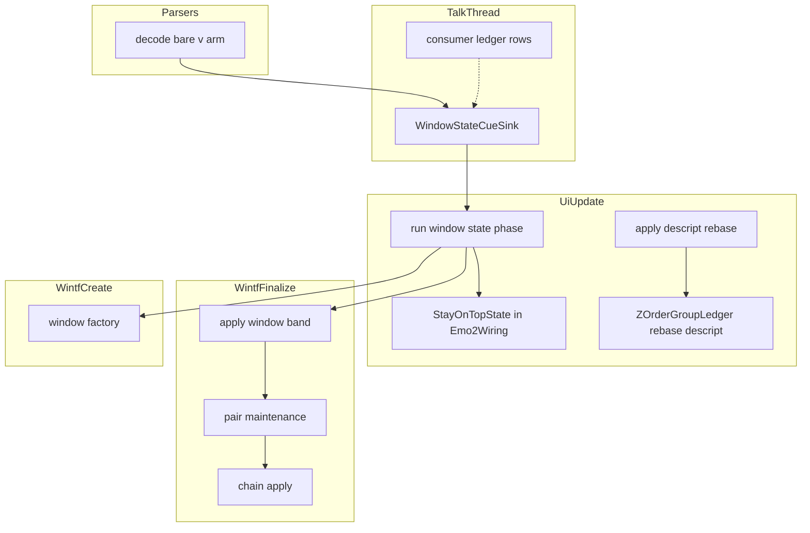
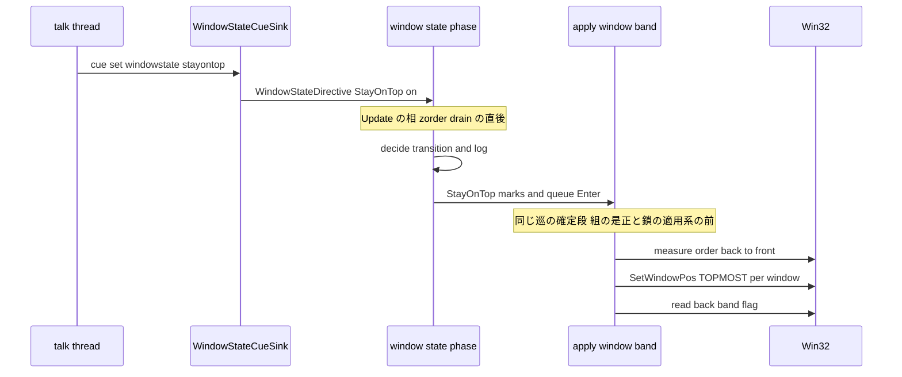
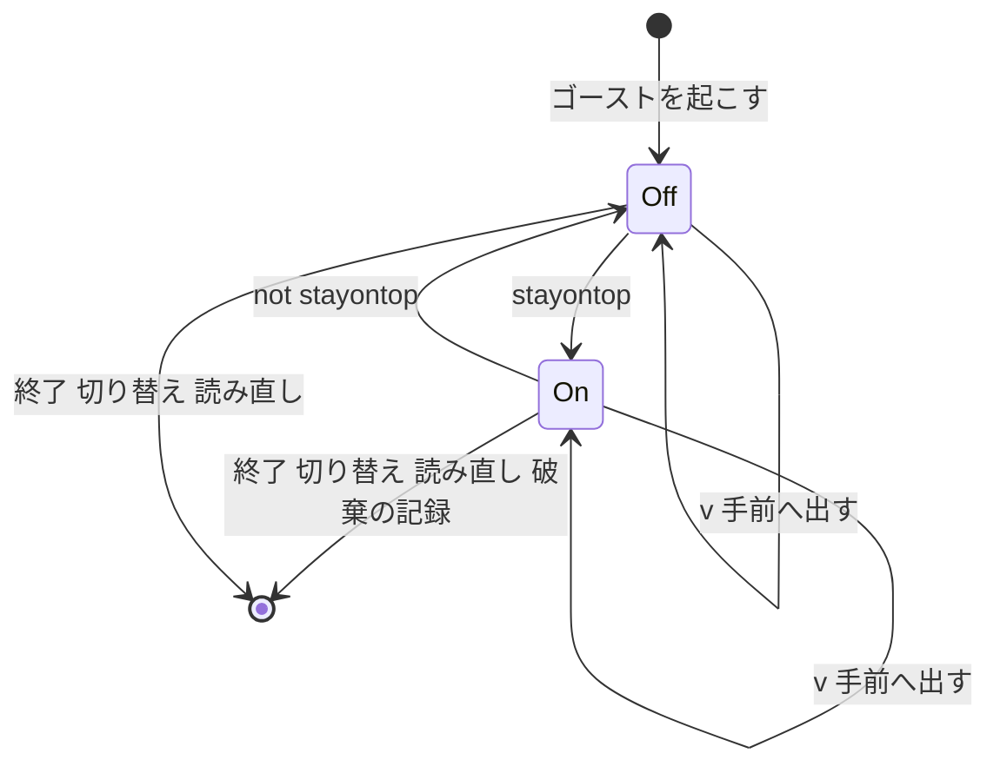
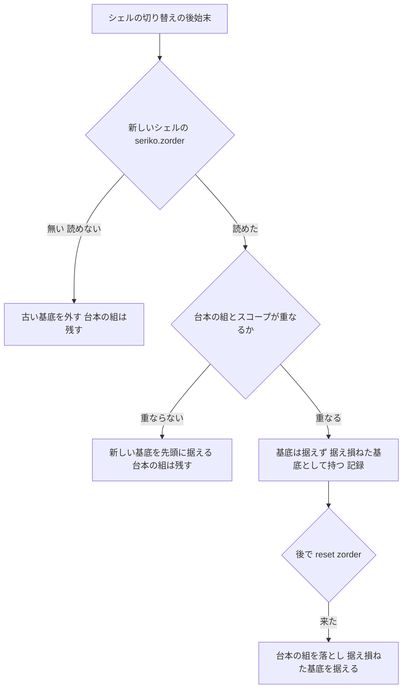

# 設計書: stay-on-top-directives

## Overview

**目的**: ゴーストの作者が台本の `\![set,windowstate,stayontop]`・`\![set,windowstate,!stayontop]` でゴーストの窓を常に手前に出したり普通の重なりへ戻したりでき、`\v` でゴーストの窓を今いる帯の最上へ 1 回出せるようにする。あわせて、「ゴースト終了まで有効」の指令（常に手前の状態と台本の重なりの組）を、シェルの切り替えとゴーストの読み直しの前後で正典どおりの寿命にする。

**使う人**: ゴーストの作者（台本の 3 つの指令）、ゴーストを常駐させる利用者（他のアプリの窓に隠れない）、areka の開発者（記録と決定論のテストで重なりの不具合を切り分ける）。ゴースト「窓際のぱすたさん」の起動の台本の `\![set,windowstate,!stayontop]` と「重ね順」の `\1\v` が SSP と同じに効く（v0.1.0 のゴール）。

**変わること**: 今の areka は 3 つの指令を黙って捨て、ゴーストの窓は常に普通の窓である。この設計の後は、ゴーストごとに常に手前の状態（既定オフ）を持ち、オンのあいだはゴーストの窓が全部、常に手前の窓の重なり（以下「帯」）に居る。シェルの切り替えでは台本の重なりの組が残る。オフのあいだの重なりの決まり（完了 `areka-P0-ghost-window-zorder`）は変わらない。

### Goals

- 3 つの指令を読み、受け手の表に担当を置く（`check_script` が「知らないタグ」「知らない命令」と答えない）。
- オン・オフ・手前へ出すを、指令を受けた巡のうちに、ゴーストの窓の並び（組・鎖・バルーンのすぐ手前）を崩さずに行う。
- 常に手前の状態と台本の重なりの組の寿命を、ゴーストの終了・切り替え・読み直し、SHIORI だけの読み直し、シェルとバルーンの切り替えごとに決める。
- 判断の分岐を全部、実際の画面を使わない決定論のテストで押さえる。帯の見張りの守り（G1〜G8）を着地に合わせてそろえて書き直す。

### Non-Goals

- 右クリックのメニューの「常に手前に表示」と `alwaysstayontopbutton.caption`（作らない・台帳に理由を書く）。
- `\![set,windowstate,minimize]` と最小化・復帰（`tasktray-minimize`）。全画面のアプリを見た自動の最小化。
- 常に手前の状態を次の起動へ持ち越すこと。
- `check_script` の `\![set,windowstate,…]` の第 2 引数の診断（`check-script-arg-checks` へ申し送り済み）。
- スコープどうしの並びの決まり（`\![set,zorder]` の解釈・鎖と組の形）と、窓の位置と大きさ。
- ゴーストの窓でない窓（メニュー・入力の箱・ツールチップ・タスクトレイのバルーン）の重なり。

## Boundary Commitments

### This Spec Owns

- 台本の読み手の `\v` の腕（運搬名 `RAISE_TAG_CARRIER` の汎用コマンドへ写す）。
- 受け手の表の 2 行（`("set", Some("windowstate"))`・`(RAISE_TAG_CARRIER, None)`）と新しい担当 `CommandConsumer::WindowStateSink`。
- 受け口 `WindowStateCueSink`（`\![set,windowstate,…]` の第 2 引数の読み分け・余りと読めない値の記録）と線 `WindowStateDirective`。
- ゴーストごとの常に手前の状態（`Emo2Wiring` の欄）と、それを動かす取り出しの相 `run_window_state_phase`。状態の変化・変わらなかったこと・`\v`・終了と読み直しでの破棄の記録。
- wintf の帯の働き `window_band.rs`: 窓の印 `StayOnTop`・帯の指令の列 `WindowBandQueue`・確定段の系 `apply_window_band`。`HWND_TOPMOST`・`HWND_NOTOPMOST` を本番で書くのはこのファイルだけ（既存のツールチップの 1 か所を除く）。
- 窓を作るときに印を見て `WS_EX_TOPMOST` を足すこと（`window_factory.rs`）。
- 組の是正の判断 `decide_pair_fix` の帯の避け方への 1 条件（キャラクターも帯に居れば帯の中で隣に置く）と、沈降の観測の記録の 1 欄。
- 台帳の切り替え専用の口 `ZOrderGroupLedger::rebase_descript` と、それを呼ぶ `apply_descript_rebase` の書き直し（台本の組を保つ）。
- 守り G1〜G8 の書き直し、網羅台帳の 4 行、`doc/COMPAT_ARCHITECTURE.md` §8 の行、実機の確かめの手順と記録。

### Out of Boundary

- `\![set,zorder]` の解釈・台帳の追加と解除の規則・鎖の合成と適用の 1 巡の順・`PairReleased`（完了 `areka-P0-scope-zorder-pinning`・`areka-P0-zorder-scope-inversion` のもの。この設計は読むだけ）。
- 起動の段の基底の据え方（`apply_descript_base`・`set_descript_base`）。今のまま残す。
- `minimize` の腕（`tasktray-minimize` が同じ受け口へ足す）。最小化から戻すときに常に手前を戻すことも `tasktray-minimize` のもの。
- `check_script` の第 2 引数の診断（`check-script-arg-checks`）。
- 窓の位置・大きさ・透過・クリックの通り抜け・ドラッグの仕組み（触らない。帯を落とさないことを確かめるだけ）。
- メニュー（`menu/`）とツールチップの重なり。

### Allowed Dependencies

- 依存の向き: `areka-parsers`（読み手）→ `areka-sakura`（台本の組み立て・変更なし）→ `areka` の `emo2_boot`（受け口・取り出しの相）→ `wintf` の `ecs::window`（帯の働き）。wintf は areka を知らない。
- areka の取り出しの相が使ってよい wintf の面: `StayOnTop`・`WindowBandQueue`・`BandOp`（新）。帯の系の登録は areka の `placement/spawn.rs` の `wire_zorder_pair` の確定段の並びに 1 つ足す。
- wintf の帯の働きが使ってよいもの: `guarded_set_window_pos`（`command.rs`）・`api::is_window_always_on_top`・`WindowHandle`・Win32 の `GetWindow`／`GetTopWindow`。
- 新しい外部クレートは足さない。外部クレートをフォークも `[patch]` もしない。

### Revalidation Triggers

- ゴーストの窓を起動の後から作る道（`GhostWindows` へ後から entity を足す・窓を作り直す）ができたとき。今の設計は「ゴーストの窓の entity は起動で全部そろう」を前提に、状態の変化の時点だけで印を付け外す。
- 組の是正・鎖の後押し・`WindowPos.zorder` に、帯の窓を普通の窓の後ろへ置く書き込みが増えたとき（帯から落ちる）。
- `tasktray-minimize` が `WindowStateCueSink` に `minimize` を足すとき（受け手の表は変えない・受け口の腕だけ）。
- `multi-ghost-runtime` で 1 プロセスに複数のゴーストが住むとき（状態は `Emo2Wiring`＝ゴーストごとのまま。印と帯の指令の列がゴーストの窓だけを指すことを確かめ直す）。
- 受け手の表の行・手書きの数を変える並走の spec（`script-small-tags`・`shell-scale-linkage`・`balloon-communicatebox` ほか）。

## Architecture

### Existing Architecture Analysis

- **台本から窓までの線**: 台本の読み手（`decode.rs`）→ 台本の組み立て（`compile.rs`。汎用コマンドは再生時間 0 の合図として `offset` に載る）→ talk スレッドの受け口（「名前＋第 1 引数」で自分宛だけ拾い `Sender` へ）→ UI スレッドの `Emo2Wiring` の受信端 → `frame.rs` の相（`Update` に載る）→ wintf の確定段 `FrameFinalize`（`establish_owner_links` → `apply_zorder_pair_maintenance` → `apply_zorder_chain`）→ 巡の終わりに予約の列（`SetWindowPosCommand`）が流れる。確定段は同じ巡のうちに `Update` の後に回る。
- **重なりの書き込みは 2 か所だけ**: 組の是正（窓に HWND が付いた直後の 1 回・予約の列）と鎖の後押し（鎖の中身が変わった巡・直に書く・基準は鎖の自分の窓）。窓を作る・動かす `SetWindowPos` は `SWP_NOZORDER`。
- **帯を避ける今の判断**: 組の是正は、キャラクターのすぐ手前の窓が帯に居ると `HWND_TOP`（`TopOfNormalBand`）を選ぶ。キャラクターが帯に居ないときの避け方としては正しいが、キャラクターも帯に居ると、バルーンが帯の最上へ飛んで隣が崩れる（研究 12.1）。
- **寿命**: `Emo2Wiring` はゴーストの切り替え・読み直しで作り直され、SHIORI だけの読み直し・シェルとバルーンの切り替えでは残る。台帳 `ZOrderGroupLedger` はその欄。シェルの切り替えの後始末 `apply_descript_rebase` が `set_descript_base` で台本の組まで落としている（申し送りの件 1）。
- **1,000 行の上限**: `zorder_chain_apply.rs`（930）は触らない。`zorder_pair.rs`（892）は十数行、`ghost_switch.rs`（938）は 2 行だけ足す。

### Architecture Pattern & Boundary Map



**Architecture Integration**:
- 選んだ形: 既存の「受け口 → 線 → 取り出しの相 → wintf の確定段」の型に、新しい受け口・線・相・系を 1 本ずつ足す（研究の案 C）。重なりの受け口 `ZOrderCueSink` と鎖・組のファイルには相乗りしない。
- 境目: 「状態（オン・オフ）とその寿命」は areka、「窓を帯へ入れる・出す・手前へ出す働き」は wintf。wintf は状態を持たず、印（その窓は帯に居るべき）と指令の列だけを受け取る。
- 守る既存の型: 受け口の自己選別と「名前＋第 1 引数」の表・`\j` の運搬名の前例・取り出しの相が窓の正本（`GhostWindows`）の無い間は取り出さない（チャネルが保留を兼ねる）・判断は純関数＋観測の型・記録は先に残して止めない。
- 新しい部品が要る理由: 受け口と線（語の見張りの対象のファイルへ語を入れないため・`minimize` の足し場所）、帯の系（帯を書く持ち主を 1 か所に絞るため）、台帳の口（起動の意味を変えずに切り替えだけ変えるため）。
- steering: 失敗は記録して続ける（`logging.md` の水準）・1 フレーム遅らせない・外部クレートはそのまま・1,000 行・兄弟のテストファイル。

### 帯を当てる手順（測っていない事実に寄りかからない形）

オン・オフ・手前へ出すは、どれも「ゴーストの窓を、今の並びを保ったまま、ある帯の最上へ置く」である。帯の働きは次の 1 つの手順で 3 つを行う。

1. 対象の窓（HWND の付いたゴーストの窓の全部・隠れている窓も含む）の今の重なりの順位を、最上の窓から `GW_HWNDNEXT` で辿って測る（上限 4096 枚・測れなかった窓は奥の端へ置き `warn!`）。
2. 奥の窓から手前の窓の順に、1 枚ずつ `SetWindowPos(窓, 指定, 0, 0, 0, 0, SWP_NOMOVE | SWP_NOSIZE | SWP_NOACTIVATE)` を直に書く（予約の列を通さない）。指定は 入る＝`HWND_TOPMOST`・出る＝`HWND_NOTOPMOST`・手前へ出す＝`HWND_TOP`。
3. 入る・出るのときは、当てた後に各窓の帯の印を読み直し、合わない窓を `warn!` で残す。

どの指定も「その窓をその帯の最上へ置く」なので、奥から順に当てると最後の並びは当てた順＝元の並びになる。

- **R1（所有の根を上げると持たれる窓も上がるか）に寄りかからない**: 上がっても上がらなくても、各窓の位置は最後に当てた 1 回で決まる。
- **R3（`SWP_NOOWNERZORDER` の要否）に寄りかからない**: 持たれる窓が一緒に動いても動かなくても、続く窓への 1 回が上書きする。持ち主が奥・持たれる窓が手前の決まり（OS が守る）は、今の並びが既に満たしているので、奥から順に当てても破らない。
- **R2（帯から落とす既存の書き込み）**: 研究 12.1 で本番の書き込みを 2 か所に読み切り、帯の窓どうしでは落ちない形にする（組の是正への 1 条件・下の `PairFixBandCondition`）。それでも OS が帯を変えなかった窓は手順 3 が記録する。実機での確かめはタスクに置く。

### Technology Stack

| Layer | Choice / Version | Role in Feature | Notes |
|-------|------------------|-----------------|-------|
| 台本の読み手 | `areka-parsers`（既存） | `\v` の腕・運搬名の定数 | 変更は数行 |
| アプリ層 | `areka`（Rust 2024・bevy_ecs 0.19） | 受け口・状態・取り出しの相・台帳の口・記録 | 新しいファイル 2 つ（＋兄弟のテスト） |
| UI 基盤 | `wintf`（bevy_ecs 0.19・`windows` 0.62.2） | 帯の働き・窓を作るときの拡張スタイル・組の是正の条件 | 新しいファイル 1 つ（＋兄弟のテスト）。Win32 の `SetWindowPos`・`GetWindow`・`GetTopWindow` を使う。機能フラグの追加は無い見込み（`WindowsAndMessaging` は既に使用中） |
| 記録 | `tracing`（既存） | 状態の変化・失敗の記録 | 新しい依存なし |

## File Structure Plan

### Directory Structure

```
crates/
├── areka-parsers/src/sakura/
│   ├── model.rs                       # 変更: 運搬名 RAISE_TAG_CARRIER = "\\v" を足す
│   └── decode.rs                      # 変更: decode_bare に "v" の腕（ukadoc の URL の証拠つき）
├── areka/src/emo2_boot/
│   ├── window_state_cue.rs            # 新: WindowStateCueSink・WindowStateDirective・parse_window_state（純関数）
│   ├── window_state_cue_tests.rs      # 新: 読み分け・綴り・余り・読めない値・宛名・送り出しの失敗
│   └── frame/
│       ├── window_state.rs            # 新: StayOnTopState・run_window_state_phase・decide_transition（純関数）・log_stay_on_top_discard
│       └── window_state_tests.rs      # 新: 遷移・重ね・印の付け外し・帯の指令の列・記録・GhostWindows の無い間の保留
└── wintf/src/ecs/window/
    ├── window_band.rs                 # 新: StayOnTop・BandOp・WindowBandQueue・apply_window_band・back_to_front（純関数）・band_insert_after
    ├── window_band_tests.rs           # 新: 純関数の全分岐・偽の OS で系の分岐（失敗・読み直しの不一致・HWND の無い窓・印つきで HWND が付いた窓）
    └── window_band_real_tests.rs      # 新: 実際の窓で並びを保って帯へ入る・出る・手前へ出る（既存の実窓の門 AREKA_WINTF_REAL_WINDOW_ZORDER）
```

### Modified Files

- `crates/areka-parsers/src/sakura/decode.rs`（502）— `decode_bare` に `"v" => Instruction::GenericCommand { name: RAISE_TAG_CARRIER, raw_args: [] }`。兄弟の読み手のテストに `\v` の 1 件（`UnknownTag` の印が付かない）。`script-small-tags` と直列。
- `crates/areka-parsers/src/sakura/model.rs`・`mod.rs` — 定数 `RAISE_TAG_CARRIER` と公開。
- `crates/areka/src/emo2_boot/consumer_ledger.rs`（504）— 担当 `WindowStateSink` と 2 行の登記。注記（27 行目の `\![set,windowstate]` を「担当なし」の例に挙げる文と 41〜48 行目の一覧）を直す。
- `crates/areka/src/emo2_boot/consumer_ledger_tests.rs`（G6・G7）・`consumer_ledger_agreement_tests.rs`（G8）— 例の選別子を表に無い語へ替える・手書きの数に 2 を足す・見本 2 件と受け口の名簿に `WindowStateCueSink`。
- `crates/areka/src/emo2_boot/runtime_boot.rs`（232）— `CueSinkSources` に `window_state_tx`、`runtime_sinks` の末尾に 13 本目 `WindowStateCueSink`（注記の「12 本」を 13 本へ）。`runtime_boot_tests.rs` は束の組み立て 1 か所と、本数と「最後が読み直しの受け口」の主張（`sinks.len() == 12`・`last_mut()`）を「13 本・12 本目が読み直し・13 本目が `WindowStateCueSink`（線へ届く）」へ書き直す。
- `crates/areka/src/emo2_boot/mod.rs`（804）— `mod window_state_cue;`・線を作る・送出端を束へ・受信端を `Emo2Wiring::attach_window_state_rx` で渡す（`insert_non_send` の前・`seed_zorder_descript_base` と同じ所）。
- `crates/areka/src/emo2_boot/frame/wiring.rs`（382）— 欄 `window_state: StayOnTopState`（既定＝受信端なし・オフ）と口 `attach_window_state_rx`。`Emo2Wiring::new` の引数は変えない（27 の呼び手を動かさない）。
- `crates/areka/src/emo2_boot/frame.rs`（636）— `mod window_state;`・`run_zorder_drain_phase` の直後に `run_window_state_phase` を 1 行。
- `crates/areka/src/emo2_boot/ghost_switch.rs`（938）— `take_down` の 2 か所の直前に `log_stay_on_top_discard(world, …)` を 1 行ずつ（読み直しか切り替えかは `reload::carries_shell_state` で分ける）。
- `crates/areka/src/app_exit.rs`（322）— `quit_app` の頭に `log_stay_on_top_discard(world, DiscardReason::Exit)` を 1 行。
- `crates/areka/src/placement/spawn.rs`（810）— `wire_zorder_pair` の確定段の並びの `establish_owner_links` の直後（組の是正と鎖の適用系の前）に `apply_window_band`。
- `crates/areka/src/placement/zorder_group_ledger.rs`（657）— 欄 `pending_base` と口 `rebase_descript`、`reset_to_descript` が据え損ねた基底を据える 1 分岐、`set_descript_base` が `pending_base` を消す 1 行。兄弟の状態の檻のテストに分岐を足す。
- `crates/areka/src/emo2_boot/frame/zorder_descript.rs`（105）— `apply_descript_rebase` を `rebase_descript` で書き直し、保った組・取り替えた基底・据えなかった基底を記録する。`zorder_descript_tests.rs` の `t_zdb13` を書き直し、5.1・5.2・5.5 の分岐を足す。
- `crates/wintf/src/ecs/window/mod.rs` — `mod window_band; pub use window_band::*;`。
- `crates/wintf/src/runtime/window_factory.rs`（493）— 窓を作るときに `StayOnTop` の印があれば `WS_EX_TOPMOST` を足す（`compute_ex_style` は変えず、呼ぶ所で足す小さな関数 `creation_ex_style`）。兄弟のテストに 2 件。
- `crates/wintf/src/ecs/window/zorder_pair.rs`（892）— `PairObservation` に `measured_below_is_always_on_top: bool`、`decide_pair_fix` の手前に置く腕の条件を 1 つ足す。注記を直す。
- `crates/wintf/src/ecs/window/zorder_pair_maintain.rs`（557）— キャラクターの帯を測って観測に載せる（測れなければ `false`）。`pair_fix_command` の注記（`HWND_TOP` は帯の外の窓では帯のすぐ外の最上）を正確にする。
- `crates/wintf/src/ecs/window/zorder_pair_sink.rs`（211）・`zorder_pair_diag.rs`（231）— 沈降の観測の記録に `in_band` の欄。
- 守りの書き直し（G1〜G8）: `crates/wintf/src/ecs/window/zorder_pair_deferred_vocabulary_tests.rs`・`zorder_pair_tests.rs`・`zorder_pair_maintain_always_on_top_tests.rs`・`crates/areka/src/placement/spawn_zorder_pair_deferred_tests.rs`・`spawn_assembly_tests.rs`（内容は Testing Strategy）。
- `crates/areka/src/mcp/check_script_judge.rs` の兄弟のテスト — 3 つの指令が `unknown_tag`・`unknown_command` を出さない 1 件（判定のコードは変えない）。
- `doc/ukadoc-coverage/ledger/sakura-script.toml`・`doc/ukadoc-coverage/ledger/shiori.toml`・`doc/COMPAT_ARCHITECTURE.md` §8・`doc/pasta-real-run.md`（段 1 の「着地で変わるはずの所」）。
- `.kiro/specs/stay-on-top-directives/verification.md`（新・タスクで作る）— 実機の確かめの手順と記録（要件 8・R1〜R3 の測り）。

## System Flows

### 指令 1 つが窓へ届くまで（同じ巡）



- 取り出しの相は `GhostWindows` が World に無い間は取り出さない（チャネルが保留を兼ねる。起動の台本の指令も落ちない）。
- 1 巡に複数の指令が届けば到着順に状態を動かし、帯の指令の列へ同じ順に積む。帯の系は列を順に当てる。同じ巡で `\![set,zorder,…]` が先に届いていれば、帯を当てた後に鎖の適用系が帯の中で並びを組み直す（鎖の後押しは鎖の自分の窓の後ろへしか置かないので、帯の窓どうしで閉じ、帯から落とさない）。組の是正は帯を当てた後の重なりを測って決めるので、巡の終わりに流れる是正が帯を崩さない（設計の議題 1）。

### 常に手前の状態の寿命



- 状態は `Emo2Wiring` に在るので、作り直される経路（ゴーストの切り替え・読み直し・終了）で消え、新しいゴーストはオフから始まる。残る経路（SHIORI だけの読み直し・シェルとバルーンの切り替え）では窓も残り、印も帯もそのまま残る。

### シェルの切り替えでの重なりの組



## Requirements Traceability

| Requirement | Summary | Components | Interfaces | Flows |
|-------------|---------|------------|------------|-------|
| 1.1 | `\v` で今いる帯の最上へ出す・状態は変えない | DecodeRaiseArm・WindowStateCueSink・WindowStatePhase・WindowBand | `WindowStateDirective::Raise`・`BandOp::Raise` | 指令 1 つ |
| 1.2 | オンの指令 | WindowStateCueSink・WindowStatePhase | `WindowStateDirective::StayOnTop { on: true }` | 指令 1 つ・寿命 |
| 1.3 | オフの指令 | 同上 | `StayOnTop { on: false }` | 同上 |
| 1.4 | 中断で来なかった指令は効かない | 台本の組み立て（既存・再生時間 0 の合図） | — | — |
| 1.5 | 第 2 引数が読めない（`minimize`・空を含む） | WindowStateCueSink | `parse_window_state` → `Unrecognized` | — |
| 1.6 | 第 3 引数以降は記録して第 2 引数で決める | WindowStateCueSink | `ParsedWindowState.extra` | — |
| 1.7 | 小文字ちょうど | WindowStateCueSink | `parse_window_state` | — |
| 1.8 | `check_script` が知らないと答えない | DecodeRaiseArm・ConsumerLedgerRows | 受け手の表の 2 行 | — |
| 2.1 | オフ→オンで今在る全部の窓を同じ巡で帯へ | WindowStatePhase・WindowBand | `BandOp::Enter` | 指令 1 つ |
| 2.2 | オンのあいだ他のアプリが活性でも奥へ回さない | WindowBand（OS の帯の性質）・PairFixBandCondition | — | — |
| 2.3 | 新しく現れる窓を現れた時点から帯で出す | WindowBand（印）・CreationExStyle | `StayOnTop`・`creation_ex_style` | — |
| 2.4 | バルーンのすぐ手前と組の並びを保つ | WindowBand（奥から順）・PairFixBandCondition | `back_to_front` | 帯を当てる手順 |
| 2.5 | 組で決まらないスコープどうしは利用者しだい | WindowBand（今の並びを測って保つ） | `back_to_front` | 同上 |
| 2.6 | 透過・通り抜け・ドラッグ・位置・大きさは同じ | WindowBand（`SWP_NOMOVE|SWP_NOSIZE`・スタイルを書かない） | — | — |
| 2.7 | 指令を出したゴーストの窓だけ | WindowStatePhase（`GhostWindows` の entity だけに印） | — | — |
| 2.8 | オンの重ねは動かさない | WindowStatePhase | `decide_transition` → `Unchanged` | 寿命 |
| 2.9 | `\v` は並びを保ち同じ巡で 1 回・状態は変えない | WindowStatePhase・WindowBand | `BandOp::Raise` | 指令 1 つ |
| 2.10 | `\v` の後に他のアプリが活性になればオフなら今の決まり | WindowBand（`HWND_TOP` は帯を変えない＝印を残さない） | — | — |
| 3.1 | オン→オフで全部の窓を帯から外し並びを保つ | WindowStatePhase・WindowBand | `BandOp::Leave` | 指令 1 つ |
| 3.2 | オフの重ねは動かさない | WindowStatePhase | `Unchanged` | 寿命 |
| 3.3 | オフのあいだは今の決まり | PairFixBandCondition（キャラクターが帯の外なら今と同じ） | `decide_pair_fix` | — |
| 3.4 | 起動はオフから | StayOnTopState（既定オフ）・spawn の窓の作り（変えない） | — | 寿命 |
| 4.1 | 終了・切り替えで捨て、切り替え先はオフ | StayOnTopState（`Emo2Wiring` と一緒に消える）・DiscardLog | `log_stay_on_top_discard` | 寿命 |
| 4.2 | ゴーストの読み直しはオフから | 同上 | 同上 | 寿命 |
| 4.3 | SHIORI だけの読み直しで保つ | StayOnTopState（`Emo2Wiring` が残る）・`CueSinkSources` の送出端 | — | 寿命 |
| 4.4 | シェルの切り替えで保ち、窓を帯で出す | StayOnTopState・WindowBand（窓と印が残る） | — | 寿命 |
| 4.5 | バルーンの切り替えで保つ | 同上 | — | 寿命 |
| 5.1 | シェルの切り替えで台本の組を保ち基底だけ取り替える | DescriptRebase | `rebase_descript` | シェルの切り替え |
| 5.2 | 台本の組と重なる基底は作らず記録 | DescriptRebase | `RebaseOutcome.refused_scopes` | 同上 |
| 5.3 | ゴーストの読み直しで台本の組を捨てる | 既存（`Emo2Wiring` の作り直し）・テストで固定 | — | — |
| 5.4 | SHIORI だけの読み直しで保つ | 既存（`Emo2Wiring` が残る）・テストで固定 | — | — |
| 5.5 | 切り替えの後の `\![reset,zorder]` で今のシェルの基底へ | DescriptRebase | `reset_to_descript`（据え損ねた基底を据える） | 同上 |
| 6.1 | 状態の変化の記録 | WindowStatePhase・WindowBand | 記録の欄（下の Error Handling） | — |
| 6.2 | 変わらなかった記録 | WindowStatePhase | 同上 | — |
| 6.3 | OS が帯を変えられない窓を記録して続ける | WindowBand | 同上 | 帯を当てる手順 3 |
| 6.4 | 終了・読み直しで戻したことと理由 | DiscardLog | `log_stay_on_top_discard` | — |
| 6.5 | シェルの切り替えで保った組と取り替えた組 | DescriptRebase | `log_group_applied`／`log_group_rejected` | — |
| 6.6 | オンのあいだ奥へ回らないことを失敗としない | SinkObservationField | 沈降の観測の行の `in_band` | — |
| 6.7 | `\v` の記録 | WindowStatePhase | 同上 | — |
| 7.1 | 読み取りの分岐の決定論のテスト | WindowStateCueSink・DecodeRaiseArm | — | — |
| 7.2 | 状態の遷移の分岐の決定論のテスト | WindowStatePhase・寿命のテスト | — | — |
| 7.3 | 並べ方と手前へ出す判断の決定論のテスト | WindowBand・PairFixBandCondition | — | — |
| 7.4 | 台本の組の寿命の決定論のテスト | DescriptRebase・寿命のテスト | — | — |
| 7.5 | 守り G1〜G8 をそろえて書き直す | GuardRewrite | — | — |
| 8.1 | 実機: オン・オフ・切り替え・`\v` | RealMachineCheck | — | — |
| 8.2 | 実機: バルーンのすぐ手前と組の並び | RealMachineCheck | — | — |
| 8.3 | ぱすたで SSP の基準と見比べる | RealMachineCheck | — | — |
| 8.4 | 実機: シェルの切り替えの後に組と状態が残る | RealMachineCheck | — | — |
| 9.1 | `sakura-script.toml` の 3 行 | CoverageAndCompat | — | — |
| 9.2 | `shiori.toml` の 1 行 | CoverageAndCompat | — | — |
| 9.3 | `COMPAT_ARCHITECTURE.md` §8 | CoverageAndCompat | — | — |

## Components and Interfaces

| Component | 層 | Intent | Req Coverage | Key Dependencies | Contracts |
|-----------|----|--------|--------------|------------------|-----------|
| DecodeRaiseArm | areka-parsers | `\v` を運搬名 `\v` の汎用コマンドへ写す | 1.1, 1.8, 7.1 | `decode_bare`（P0） | Service |
| ConsumerLedgerRows | areka emo2_boot | 2 行と担当 `WindowStateSink` | 1.8, 7.5 | `consumer_ledger.rs`（P0） | State |
| WindowStateCueSink | areka emo2_boot | 自分宛を拾い、第 2 引数を読み分けて線へ送る | 1.1〜1.7, 7.1 | `dola::cue::CueSink`（P0）・`tick_wake`（P1） | Service, Event |
| WindowStatePhase | areka emo2_boot frame | 状態を動かし、印と帯の指令を出し、記録する | 1.1〜1.3, 2.1, 2.7〜2.9, 3.1, 3.2, 3.4, 4.1〜4.5, 6.1, 6.2, 6.7, 7.2 | `Emo2Wiring`（P0）・`GhostWindows`（P0）・WindowBand（P0） | Service, State |
| DiscardLog | areka emo2_boot frame | オンのまま降ろすときに理由と一緒に記録 | 4.1, 4.2, 6.4 | `ghost_switch.rs`・`app_exit.rs`（P1） | Service |
| WindowBand | wintf ecs window | 窓の印・帯の指令の列・奥から順に当てる系 | 2.1〜2.6, 2.9, 2.10, 3.1, 6.3, 7.3 | `guarded_set_window_pos`（P0）・`is_window_always_on_top`（P1） | Service, State, Batch |
| CreationExStyle | wintf runtime | 印のある窓を作るときに `WS_EX_TOPMOST` を足す | 2.3, 4.4 | `window_factory.rs`（P0） | Service |
| PairFixBandCondition | wintf ecs window | キャラクターも帯に居れば帯の中で隣に置く | 2.2, 2.4, 3.3, 7.3 | `decide_pair_fix`（P0） | Service |
| SinkObservationField | wintf ecs window | 沈降の観測の行に帯の欄 | 6.6 | `zorder_pair_sink.rs`（P2） | — |
| DescriptRebase | areka placement・frame | シェルの切り替えで台本の組を保ち基底だけ取り替える | 5.1, 5.2, 5.5, 6.5, 7.4 | `ZOrderGroupLedger`（P0） | Service, State |
| GuardRewrite | テスト | G1〜G8 を着地に合わせてそろえる | 7.5 | 各守り（P0） | — |
| RealMachineCheck | 手順と記録 | 実機の確かめ（R1〜R3 の測りを含む） | 8.1〜8.4 | 排他テストの机（P0） | Batch |
| CoverageAndCompat | 文書 | 網羅台帳と互換の対応表 | 9.1〜9.3 | 台帳の検査（P1） | — |

### areka-parsers

#### DecodeRaiseArm

| Field | Detail |
|-------|--------|
| Intent | 裸の `\v` を `Instruction::GenericCommand { name: RAISE_TAG_CARRIER, raw_args: [] }` へ写す |
| Requirements | 1.1, 1.8, 7.1 |

**Responsibilities & Constraints**
- 転記だけを行う（意味づけは受け口）。`\j` の前例と同じく、運搬名は台本から `\![…]` で書けない綴り `"\\v"` にする。`\v` を正典の `\![set,windowstate,stayontop]` へ写さない（`\v` は状態を変えない）。
- 腕の上に ukadoc の `\v` の URL の 1 行の注記を置く（網羅台帳の検査の証拠の流儀）。
- 角括弧付きの `\v[…]` は正典に無いので `decode_tag` に腕を作らない（`\+` の前例）。

**Contracts**: Service [x]

```rust
// crates/areka-parsers/src/sakura/model.rs
pub const RAISE_TAG_CARRIER: &str = "\\v";
```

### areka emo2_boot

#### ConsumerLedgerRows

| Field | Detail |
|-------|--------|
| Intent | 受け手の表に 2 行を登記し、`check_script` と strict の記録を黙らせる |
| Requirements | 1.8, 7.5 |

- `CommandConsumer::WindowStateSink`（新）。登記は `try_register("set", Some("windowstate"), WindowStateSink)` と `try_register(RAISE_TAG_CARRIER, None, WindowStateSink)`。
- `("set", Some("windowstate"))` は第 2 引数に関わらず担当あり（`minimize` も表の上では担当あり＝受け口が記録して捨てる・`tasktray-minimize` が同じ受け口に腕を足す）。第 2 引数の誤りを `check_script` に出すのは `check-script-arg-checks`。

#### WindowStateCueSink

| Field | Detail |
|-------|--------|
| Intent | 自分宛の合図だけを拾い、第 2 引数を読み分けて `WindowStateDirective` を送る |
| Requirements | 1.1, 1.2, 1.3, 1.5, 1.6, 1.7, 7.1 |

**Responsibilities & Constraints**
- 自己選別: `(RAISE_TAG_CARRIER, _)` と `("set", Some("windowstate"))` だけを拾う。他は `debug!` で読み飛ばす。開けない荷物は `ZOrderCueSink` と同じ宛名の規律（`set` の開けない荷物を警告する持ち主は `ZOrderCueSink` のまま＝ここは `debug!` だけ。二重の警告を出さない）。
- 読み分けは純関数 `parse_window_state` に置く。第 2 引数は小文字ちょうどで比べる。`cue.actor`（どのスコープで書いたか）は読まない（裁定 1・`\1\v` もゴーストの窓の全部）。
- 送り出しの後に `tick_wake::mark(tick_wake::ZORDER)` を立てる（重なりの仕事が増えた旗を兄弟と共用する）。受信端が閉じていれば `warn!` を残して台本を続ける。
- `stayontop`・`!stayontop` の腕の上に ukadoc の URL の注記を置く（網羅台帳 `implemented` の証拠）。

**Contracts**: Service [x] / Event [x]

```rust
// crates/areka/src/emo2_boot/window_state_cue.rs
#[derive(Debug, Clone, Copy, PartialEq, Eq)]
pub enum WindowStateDirective {
    /// `\![set,windowstate,stayontop]`（on = true）・`\![set,windowstate,!stayontop]`（on = false）
    StayOnTop { on: bool },
    /// `\v`：今いる帯の最上へ 1 回出す（状態は変えない）
    Raise,
}

#[derive(Debug, PartialEq, Eq)]
pub enum ParsedWindowState<'a> {
    Directive { directive: WindowStateDirective, extra: &'a [&'a str] },
    /// 第 2 引数が `stayontop`・`!stayontop` 以外（`minimize`・空・大文字の混じった綴り・無い）
    Unrecognized { value: Option<&'a str> },
    /// 自分宛でない
    NotMine,
}

pub fn parse_window_state<'a>(name: &str, params: &'a [&'a str]) -> ParsedWindowState<'a>;

#[derive(Clone)]
pub struct WindowStateCueSink { tx: std::sync::mpsc::Sender<WindowStateDirective> }
impl WindowStateCueSink { pub fn new(tx: std::sync::mpsc::Sender<WindowStateDirective>) -> Self; }
impl dola::cue::CueSink for WindowStateCueSink { fn emit(&mut self, cue: dola::cue::TalkCue); }
```

- `params` は選別子 `windowstate` を含む汎用キャリアの引数の列（`params[0] == "windowstate"`・`params[1]` が第 2 引数・`params[2..]` が余り）。`\v` は `params` が空でも余りがあっても `Raise`（余りは記録）。
- 事後条件: `Directive` のときだけ送る。`Unrecognized` は `warn!`（値をそのまま）で残して送らない。`extra` が空でなければ `debug!` で残す。

#### WindowStatePhase（`frame/window_state.rs`）

| Field | Detail |
|-------|--------|
| Intent | 届いた指令を到着順に状態へ当て、窓の印と帯の指令を出し、記録する |
| Requirements | 1.1, 1.2, 1.3, 2.1, 2.7, 2.8, 2.9, 3.1, 3.2, 3.4, 4.1〜4.5, 6.1, 6.2, 6.7, 7.2 |

**Responsibilities & Constraints**
- `frame.rs` の `run_zorder_drain_phase` の直後に呼ぶ（同じ台本で `\![set,zorder]` が先に来ていれば、台帳から鎖の計画が先に出る）。
- `GhostWindows` が無ければ取り出さない（チャネルが保留を兼ねる・起動の台本の指令も落ちない）。受信端が無い（テストの結線）ときは何もしない。
- 状態の判断は純関数 `decide_transition`。オフ→オン・オン→オフのとき: `GhostWindows` の全部の窓の entity（キャラクターとバルーン・全スコープ）に印 `StayOnTop` を付ける／外す。帯の指令の列へ `Enter`／`Leave` を同じ entity の列で積む。変わらないとき: 何も積まず、変わらなかったことを記録する。`Raise`: 状態は変えず、列へ `Raise` を全部の窓の entity で積む。
- 印と列は `GhostWindows` の entity だけを指す＝別のゴーストや他の窓（メニュー・ツールチップ）には触れない（2.7）。
- 窓の entity は起動で全部そろい、シェルとバルーンの切り替えでは作り直されないので、印は状態の変化の時点で付け外すだけで足りる（毎フレームの見張りは置かない）。後から HWND が付く窓は wintf の印と窓の作りが拾う（2.3）。

**Contracts**: Service [x] / State [x]

```rust
// crates/areka/src/emo2_boot/frame/window_state.rs
#[derive(Default)]
pub(in crate::emo2_boot) struct StayOnTopState {
    rx: Option<std::sync::mpsc::Receiver<WindowStateDirective>>,
    on: bool,
}

#[derive(Debug, PartialEq, Eq)]
pub(crate) enum Transition { TurnOn, TurnOff, Unchanged { on: bool }, Raise { on: bool } }

/// 純関数：今の状態と指令から遷移を決める
pub(crate) fn decide_transition(on: bool, directive: WindowStateDirective) -> Transition;

/// Update の相：受信端を到着順に取り出して当てる
pub(in crate::emo2_boot) fn run_window_state_phase(state: &mut StayOnTopState, world: &mut bevy_ecs::world::World);

#[derive(Debug, Clone, Copy, PartialEq, Eq)]
pub(crate) enum DiscardReason { Exit, Switch, Reload }

/// オンのまま降ろすときだけ info! で残す（オフなら何も書かない）
pub(crate) fn log_stay_on_top_discard(world: &bevy_ecs::world::World, reason: DiscardReason);
```

- 状態の欄は `Emo2Wiring` に `window_state: StayOnTopState`（既定＝受信端なし・オフ）として置き、起動の結線が `Emo2Wiring::attach_window_state_rx(rx)` で受信端を渡す（`Emo2Wiring::new` の引数は変えない）。
- 送出端は `CueSinkSources.window_state_tx`（窓の側が 1 度作る）なので、SHIORI だけの読み直しで受け口を組み直しても同じ線に届く（4.3）。
- 記録のゴーストの名は `BootContext` の今のゴーストのフォルダの名（無ければ `-`）。

#### DiscardLog

- `ghost_switch.rs` の `take_down(world)` の 2 か所の直前で `log_stay_on_top_discard` を呼ぶ。理由は、読み直しの予約（`reload::carries_shell_state(world)` が真）なら `Reload`、それ以外は `Switch`。既定へ戻す道（落ちたゴーストの後）は `Switch`。`app_exit.rs` の `quit_app` の頭で `Exit`。
- 状態そのものは `Emo2Wiring` と一緒に消える＝この口は記録だけを持ち、状態を動かさない。

### wintf ecs window

#### WindowBand（`window_band.rs`）

| Field | Detail |
|-------|--------|
| Intent | 印と帯の指令の列を受け取り、確定段で奥から順に窓を帯へ入れる・出す・手前へ出す |
| Requirements | 2.1, 2.2, 2.3, 2.4, 2.5, 2.6, 2.9, 2.10, 3.1, 6.3, 7.3 |

**Responsibilities & Constraints**
- 本番で `HWND_TOPMOST`・`HWND_NOTOPMOST` を書くのはこのファイルだけ（ツールチップの既存の 1 か所を除く）。状態（オン・オフ）は持たない。
- 系 `apply_window_band` は areka の `wire_zorder_pair` で確定段の並び `(establish_owner_links, apply_window_band, apply_zorder_pair_maintenance, apply_zorder_chain).chain()` の 2 番目に載る（同じ巡・組の是正と鎖の適用系の前）。組の是正は予約の列に積まれて巡の終わりに流れるので、帯を当てる前に置くと「帯を当てる前の観測で決めた是正が、帯を当てた後に上書きする」崩れ（バルーンが帯から落ちる・隣り合いが崩れる・オフの巡で他のアプリの帯の窓の後ろへ引き戻される）が起きない。UI スレッド固定（`NonSendMarker`）。
- 系の 1 回の仕事: ⑴ 列の指令を積まれた順に当てる（「帯を当てる手順」）。entity が居ない・HWND がまだ無い窓は飛ばして `debug!`（後から HWND が付けば ⑵ が拾う）。⑵ この巡に HWND が付いた窓（`Added<WindowHandle>`）のうち印のある窓の帯を読み、帯に居なければ `Enter` を当てる（作る時点で間に合わなかったときの保険）。⑶ 列を空にする。
- 書き込みは `guarded_set_window_pos` で直に行い、`SWP_NOMOVE | SWP_NOSIZE | SWP_NOACTIVATE` だけを立てる（位置・大きさ・活性・スタイルを変えない＝2.6）。`Raise` は `HWND_TOP` なので帯を変えない（オフで手前へ出した窓は普通の窓のまま＝他のアプリが活性になれば今の決まりで奥へ回る・2.10）。
- オンのあいだ他のアプリが活性になっても、帯の窓は普通の窓の後ろへ回らない（OS の帯の性質・2.2）。組の是正と鎖の後押しが帯の窓を帯から落とさないことは PairFixBandCondition と研究 12.1 で押さえる。

**Contracts**: Service [x] / State [x] / Batch [x]

```rust
// crates/wintf/src/ecs/window/window_band.rs
/// この窓は常に手前の帯に居るべき（窓を作るときと HWND が付いた巡に読む）
#[derive(bevy_ecs::component::Component, Debug, Default, Clone, Copy)]
pub struct StayOnTop;

#[derive(Debug, Clone, Copy, PartialEq, Eq)]
pub enum BandOp { Enter, Leave, Raise }

#[derive(bevy_ecs::prelude::Resource, Debug, Default)]
pub struct WindowBandQueue { ops: Vec<(BandOp, Vec<bevy_ecs::entity::Entity>)> }
impl WindowBandQueue {
    pub fn push(&mut self, op: BandOp, windows: Vec<bevy_ecs::entity::Entity>);
}

/// 確定段の系（establish_owner_links の後・組の是正と鎖の適用系の前）
pub fn apply_window_band(world: &mut bevy_ecs::world::World);

/// 純関数：今の重なりの順位（0 が最上）で奥から手前へ並べる。順位が測れない窓は奥の端へ（元の順を保つ）
pub(crate) fn back_to_front(windows: &[(bevy_ecs::entity::Entity, HWND)], rank: impl Fn(HWND) -> Option<usize>) -> Vec<(bevy_ecs::entity::Entity, HWND)>;

/// 純関数：指令 → 挿入位置（Enter = HWND_TOPMOST・Leave = HWND_NOTOPMOST・Raise = HWND_TOP）
pub(crate) fn band_insert_after(op: BandOp) -> HWND;

/// 純関数：当てた後に帯の印が期待どおりか（Raise は確かめない＝None）
pub(crate) fn expected_band(op: BandOp) -> Option<bool>;
```

- 事前条件: 列の entity はゴーストの窓（areka が `GhostWindows` から積む）。
- 事後条件: 当てた窓は、元の並びのまま、指令の帯の最上に居る。`Enter`・`Leave` の後に帯の印が期待と違う窓は `warn!` で残る。
- Win32 の呼び出し（順位の測り・書き込み・印の読み）は兄弟の偽の OS（`#[cfg(test)]` の差し替え口・`zorder_chain_apply.rs` の `double` と同じ流儀）で差し替えられる形にし、系の分岐を実際の画面なしで回す。

#### CreationExStyle（`runtime/window_factory.rs`）

- 窓を作るとき、entity に `StayOnTop` があれば `compute_ex_style(&style) | WS_EX_TOPMOST` を `CreateWindowExW` へ渡す。`compute_ex_style` の中身と、印の無い窓の拡張スタイルは変えない（G3 の主張は残る）。
- 今の areka で起動の後に作られる窓は無い。ゴーストの窓の HWND が付く前にオンの指令が届いた（起動の台本の頭）ときに、この道で窓が初めから帯に居る（2.3「後ろに出る瞬間を作らない」）。

#### PairFixBandCondition（`zorder_pair.rs`・`zorder_pair_maintain.rs`）

- `PairObservation` に `measured_below_is_always_on_top: bool`（キャラクターが帯に居るか）を足す。維持の系が `measure_below_is_always_on_top(キャラクター)`（`zorder_pair.rs`・読み取りに失敗したら `warn!` を出して `false`）で測り、測れなければ `false`（今の避け方へ倒す）。挿入位置の窓を測る `measure_window_is_always_on_top` は失敗を `true` に倒すので使わない。
- 手前に置く腕の決め:

| キャラクターの手前の窓 | 手前の窓が帯 | キャラクターが帯 | 決め |
|---|---|---|---|
| 有る | はい | いいえ | `TopOfNormalBand`（今と同じ） |
| 有る | はい | はい | `After(手前の窓)`（帯の中ですぐ手前・新） |
| 有る | いいえ | どちらでも | `After(手前の窓)`（今と同じ） |
| 無い | — | どちらでも | `TopEdge`（今と同じ） |

- キャラクターが帯に居ないときの決めは 1 つも変わらない（3.3）。返り値に帯へ入れる指定は足さない（帯の窓の手前の窓は必ず帯の窓なので、`After` が帯の外の窓を帯へ引き込むことは無い）。状態（オン・オフ）は判断へ持ち込まない。

#### SinkObservationField

- 沈降の観測の行（`zorder_pair_diag.rs` の `sink-observed`）に `in_band=<bool>`（バルーンが帯に居るか・測れなければ `-`）を足す。水準は `debug!` のまま。オンのあいだの `behind_foreground=false` を、記録の読み手が失敗でないと読める（6.6）。

### areka placement・frame（件 1）

#### DescriptRebase

| Field | Detail |
|-------|--------|
| Intent | シェルの切り替えで、台本の組を保ち、descript の基底だけを新しいシェルの値へ取り替える |
| Requirements | 5.1, 5.2, 5.5, 6.5, 7.4 |

**Responsibilities & Constraints**
- 起動の口（`apply_descript_base` → `set_descript_base`）は変えない（起動では台本の組がまだ無い）。シェルの切り替えの口（`apply_descript_rebase`）だけが新しい `rebase_descript` を呼ぶ。
- 基底は先頭に置く（`reset_to_descript` が先頭の基底を残す今の規則のまま）。台本の組と重なる基底は据えず、「据え損ねた基底」として持ち、`\![reset,zorder]` で台本の組を落としたときに据える（5.5）。
- 記録は今の唯一の入口（wintf の `log_group_applied`／`log_group_rejected`）を通す。本文は areka が組む。

**Contracts**: Service [x] / State [x]

```rust
// crates/areka/src/placement/zorder_group_ledger.rs
pub struct RebaseOutcome {
    /// 残した台本の組の ID（追加の順）
    pub kept_tag_ids: Vec<u32>,
    /// 外した古い基底の ID（無ければ None）
    pub dropped_base_id: Option<u32>,
    /// 据えた新しい基底の ID（無い・据えなかったら None）
    pub seated_base_id: Option<u32>,
    /// 台本の組と重なって据えなかったスコープ（重なりが無ければ空）
    pub refused_scopes: Vec<u32>,
}

impl ZOrderGroupLedger {
    /// シェルの切り替え専用：台本の組を残し、基底だけを取り替える（空の列＝基底なし）
    pub fn rebase_descript(&mut self, members: Vec<GroupElement>) -> RebaseOutcome;
}
```

- 不変条件: 1 つのスコープは 1 つの組だけ（据え損ねた基底は組として載らないので破らない）・基底は高々 1 つ・基底は先頭。版は内容が動いたときだけ進む。
- `set_descript_base`（起動）と `rebase_descript` は「据え損ねた基底」を消してから始める。`reset_to_descript` は台本の組を落とした後、基底が無く据え損ねた基底があればそれを据えて先頭に置く。
- `apply_descript_rebase(ledger, raw)`: `raw` が無い・読めない → `rebase_descript(Vec::new())`（読めないときは今と同じく拒否の記録）。読めた → `rebase_descript(members)`。`refused_scopes` が空でなければ `log_group_rejected`（理由「台本の組がスコープを持つ」・値）。保った組と取り替えた基底は `log_group_applied` の本文 `action=rebase kept=[…] base=旧→新` で 1 行（6.5）。

## Data Models

### Domain Model

- **常に手前の状態**（ゴーストごと・`Emo2Wiring` の欄）: `on: bool`（既定 `false`）。持ち越さない・保存しない。
- **窓の印** `StayOnTop`（wintf の部品）: 状態がオンのあいだ、そのゴーストの全部の窓の entity に付く。状態の写しであって正本ではない（正本は areka の `on`）。印は窓の entity と一緒に消える。
- **帯の指令の列** `WindowBandQueue`（wintf の資源）: 同じ巡のうちに積まれ、確定段で空になる。
- **台帳の据え損ねた基底** `pending_base: Option<Vec<GroupElement>>`（`ZOrderGroupLedger` の欄）: シェルの切り替えで台本の組と重なった新しい基底。`\![reset,zorder]` で据わる。起動の基底と次の切り替えで消える。

## Error Handling

### Error Strategy

失敗はどれも記録を残して続ける。ゴーストも台本も止めない。1 枚の窓の失敗は残りの窓の処理を止めない。状態は指令のとおりに持つ（OS が帯を変えられなかった窓があっても、状態は戻さない・6.3）。

### 記録の一覧

| 場面 | 水準 | 欄 | 出す所 | 要件 |
|---|---|---|---|---|
| 状態が変わった | `info!` | ゴースト・指令（`stayontop`／`!stayontop`）・前・後・窓の数 | WindowStatePhase | 6.1 |
| 状態が変わらなかった | `debug!` | ゴースト・指令・状態 | WindowStatePhase | 6.2・2.8・3.2 |
| `\v` で手前へ出した | `debug!` | ゴースト・今いる帯（`topmost`／`normal`）・窓の数 | WindowStatePhase | 6.7 |
| 帯へ当てた結果 | `debug!` | 指令・当てた窓の数・飛ばした窓の数 | WindowBand | 6.1 |
| `SetWindowPos` の失敗 | `warn!` | hwnd・指令・誤り | WindowBand | 6.3 |
| 当てた後に帯の印が違う | `warn!` | hwnd・指令・期待・実際 | WindowBand | 6.3 |
| 順位が測れなかった窓 | `warn!` | hwnd | WindowBand | 6.3 |
| 第 2 引数が読めない | `warn!` | 書かれていた値（無い・空を含む） | WindowStateCueSink | 1.5・1.7 |
| 余りの引数 | `debug!` | 余りの列 | WindowStateCueSink | 1.6 |
| 送り出しの失敗（受信端が閉じた） | `warn!` | — | WindowStateCueSink | 6.3 の流儀 |
| オンのまま降ろした | `info!` | ゴースト・理由（`exit`／`switch`／`reload`） | DiscardLog | 6.4 |
| シェルの切り替えで組を保った・基底を取り替えた | `debug!`（`log_group_applied`・既存の入口の水準。実機の確かめでは zorder の記録を debug まで開ける） | 保った組の ID・旧と新の基底 | DescriptRebase | 6.5 |
| 台本の組と重なる基底を据えなかった | `warn!`（`log_group_rejected`） | 理由・値・スコープ | DescriptRebase | 5.2 |
| 沈降の観測 | `debug!`（今のまま） | `in_band` を足す | SinkObservationField | 6.6 |

- 記録の先頭の名乗りはファイル単位でそろえる（wintf は `[window_band]`、areka は `WindowStateCueSink:`・`[window_state]`）。`logging.md` の構造化の欄（`hwnd = format!("0x{:X}", …)`）に従う。

## Testing Strategy

すべての判断の分岐を決定論のテストで押さえ、テストは実装と同じフォルダの兄弟のファイルに置く。記録を確かめるテストは `log-capture-kit` を通す。

### 単体（純関数）

- `parse_window_state`（`window_state_cue_tests.rs`）: `stayontop`→オン・`!stayontop`→オフ・`StayOnTop`／`STAYONTOP`→読めない・`minimize`→読めない・空→読めない・第 2 引数なし→読めない・第 3 引数以降→余りつきで決まる・`\v`（引数なし・余りあり）→手前へ出す・他人宛（`(set,zorder)`・`(change,ghost)`）→自分宛でない（1.5〜1.7・7.1）。
- `decode_bare` の `\v`（`decode.rs` の兄弟のテスト）: 運搬名の汎用コマンドになり `UnknownTag` の印が付かない。`\v` を含む台本が `check_script` で `unknown_tag`・`unknown_command` を出さない（1.8・7.1）。
- `decide_transition`（`window_state_tests.rs`）: 4 つの組（オフ＋オン指令→`TurnOn`、オン＋オン→`Unchanged`、オン＋オフ→`TurnOff`、オフ＋オフ→`Unchanged`）と `Raise` の 2 つ（状態を変えない）（2.8・3.2・7.2）。
- `back_to_front`・`band_insert_after`・`expected_band`（`window_band_tests.rs`）: 順位どおりに奥から並ぶ・測れない窓は奥の端・元の順を保つ・3 つの指令の挿入位置・`Raise` は帯を確かめない（2.4・2.5・7.3）。
- `decide_pair_fix`（`zorder_pair_tests.rs`）: 上の表の 4 行を全部。キャラクターが帯の外のときの決めが今と同じであること（3.3・7.3）。
- `rebase_descript`・`reset_to_descript`（台帳の状態の檻）: 台本の組を保つ・古い基底を外す・新しい基底が先頭・重なる基底は据えず `refused_scopes`・空の列＝基底なし・据え損ねた基底が `\![reset,zorder]` で据わる・起動の `set_descript_base` が据え損ねた基底を消す・版の進み方（5.1・5.2・5.5・7.4）。

### 結線（ECS と相・偽の OS）

- 取り出しの相（`window_state_tests.rs`）: `GhostWindows` が無い間は取り出さず、生えた最初の巡で到着順に当たる。オンで全部の窓の entity（全スコープのキャラクターとバルーン）に印が付き、列に `Enter` が 1 件。オフで印が外れ `Leave`。重ねで列が空。`\v` で印が変わらず `Raise`。`GhostWindows` の外の entity に印が付かない（2.1・2.7・2.9・3.1・7.2）。
- 帯の系（`window_band_tests.rs`・偽の OS）: 積まれた順に当たる・奥から手前の順で書く・HWND の無い窓を飛ばす・居ない entity を飛ばす・1 枚の書き込みの失敗の後も残りを書く・読み直しの不一致を記録する・印のある窓に HWND が付いた巡に帯の外なら `Enter` を当てる・帯に居れば書かない・列が空になる（2.1・2.3・3.1・6.3・7.3）。
- 確定段の並び（`spawn.rs` の兄弟のテスト）: `apply_window_band` が `establish_owner_links` の後・`apply_zorder_pair_maintenance` と `apply_zorder_chain` の前に回ることを固定する。オンの指令と同じ巡に組の是正が要る場面（帯を当てる前は帯の外の観測）で、是正が帯を当てた後の観測から決まり、流れた後もバルーンが帯の中でキャラクターのすぐ手前に居ること（偽の OS）を 1 件（2.1・2.4・3.1・6.3・7.3）。
- 窓の作り（`window_factory.rs` の兄弟のテスト）: 印のある窓は `WS_EX_TOPMOST` 付きで作る・印の無い窓の拡張スタイルは今と同じ（2.3・3.4）。
- 寿命（`ghost_switch_reload_tests.rs` ほかの足場 `SwitchRig`）: オンにした後、ゴーストの読み直しでオフ・台本の組が空（descript の基底だけ）・オンのまま降ろした記録の理由が `reload`。ゴーストの切り替えでオフ・理由 `switch`。SHIORI だけの読み直しで状態と台本の組が残る。シェルの切り替え・バルーンの切り替えで状態と印が残る（4.1〜4.5・5.3・5.4・6.4・7.2・7.4）。
- シェルの切り替えの後始末（`zorder_descript_tests.rs`・`switch_finish_tests.rs`）: `t_zdb13` を「台本の組を保ち基底を取り替える」へ書き直す・重なる基底の拒否の記録・保った組の記録・切り替えの後の `\![reset,zorder]` で新しい基底へ戻る（5.1・5.2・5.5・6.5）。
- 記録（`log-capture-kit`）: 状態の変化・変わらなかった・`\v`・読めない第 2 引数・余り・降ろした理由の各行の欄（6.1・6.2・6.4・6.7）。沈降の観測の行に `in_band` が載り、水準が `debug!` のまま（6.6）。

### 実際の窓（実窓の門 `AREKA_WINTF_REAL_WINDOW_ZORDER`・排他テストの机）

- `window_band_real_tests.rs`: 持ち主の関係を張った自分のトップレベルの窓 4 枚（キャラクター 2・バルーン 2・鎖あり）で、`Enter` の後に全部が帯に居て並びが元のまま・`Leave` の後に全部が帯の外で並びが元のまま・`Raise`（帯の外）で並びが元のまま普通の窓の最上・`Raise`（帯の中）で帯の最上・どれも位置と大きさと拡張スタイル（`WS_EX_TOPMOST` 以外）が変わらない（2.4・2.6・2.9・3.1・7.3）。
- `zorder_pair_maintain_always_on_top_tests.rs`: キャラクターとバルーンが帯に居て、間に他の帯の窓が居るとき、組の是正がバルーンを帯の中のすぐ手前に置き、検証が通る 1 件を足す（2.4）。このファイルは今 838 行なので、足して 1,000 行を超えるなら、帯の中の組の主張を兄弟の新しいテストファイルへ分ける。

### 守りの書き直し（G1〜G8・7.5）

| # | 守り | 書き直し |
|---|---|---|
| G1 | wintf の語の走査（`zorder_pair_deferred_vocabulary_tests.rs`） | 語の表を 2 つに分ける。`minimize`・`iconic`・`onwindowstate`・`onfullscreenapp`・`appwindow`・`taskbar` は「先送りの語」のまま（持ち主 `tasktray-minimize` ほか）。`topmost`・`stayontop`・`windowstate` は「帯を書くのは `window_band.rs` だけ」の語へ言い直し、`zorder_*` の本番ファイルに無いことを主張し続ける。対照として `window_band.rs` のコードに `HWND_TOPMOST` が在ることを足す。注記の行番号（`api.rs:126`）を直す |
| G2 | areka の語の走査（`spawn_zorder_pair_deferred_tests.rs`） | G1 と同じ分け方。帯の語の持ち主は `emo2_boot/window_state_cue.rs`・`emo2_boot/frame/window_state.rs`。既定のスタイルに `WS_EX_TOPMOST` が無いことの主張は残す |
| G3 | `spawn_assembly_tests.rs` の `t_i2_no_window_has_ws_ex_topmost` | 残す（起動の作りはオフ）。注記を「既定はオフ・オンは印と窓の作りで足す」へ |
| G4 | `decide_pair_fix_covers_every_arm_without_ever_yielding_always_on_top`（改名後 `decide_pair_fix_covers_every_arm_and_uses_a_band_window_as_base_only_for_a_character_in_the_band`） | 観測の行列に新しい欄を足す。「帯の外のキャラクターに帯の窓を基準に選ばない」「キャラクターが帯なら手前の帯の窓の後ろ」を主張へ。名前を中身に合わせる |
| G5 | `zorder_pair_maintain_always_on_top_tests.rs` | オフの主張（確立と維持が帯の印を付けない・帯の外の組は帯の外のまま）は残す。注記「本番の経路へ常時最前面の指定を持ち込まない」を「組と鎖は帯を書かない・帯は `window_band.rs`」へ。上の 1 件を足す |
| G6 | `consumer_ledger_tests.rs:94`・`:138-148` | 「担当なし」と「後から別の担当を足せる」の例の選別子を表に無い語へ替える |
| G7 | 手書きの数（`consumer_ledger_tests.rs:298`）と `consumer_ledger.rs` の一覧 | 着地のときの値に 2 を足す。一覧に 2 行 |
| G8 | `consumer_ledger_agreement_tests.rs` | 2 行の見本と、受け口の名簿に `WindowStateCueSink` |

### 実機の確かめ（要件 8・`verification.md`）

- 画面のロックを外した排他テストの机で、他のアプリの窓を前に出してから送る。8.1（オン・後から出たバルーン・オフ・ゴーストの切り替え・オフのあいだの `\v` とその後に他のアプリを前に出す）・8.2（バルーンのすぐ手前・`\![set,zorder]` の組の並び）・8.4（シェルの切り替えの後に組と状態が残る）を、窓の重なりの順と `WS_EX_TOPMOST` を読んで記録する。
- 8.3: ぱすたの手順書 `doc/pasta-real-run.md` 5 節の段 1 で起動の重なりを SSP の基準（窓の枠が奥・バルーンの字・ぱすたが手前）と見比べ、違えば原因を調べ、範囲なら直し、範囲外なら `/kiro-discovery` で起票して記録する。
- 測っていない事実の確かめ: R1（根だけを帯へ上げると持たれる窓も上がるか）・R2（オンのあいだにシェルの切り替え・バルーンの表示・ドラッグ・`\![set,zorder]` の組み替えをしても帯から落ちないか）・R3（奥から順に当てて並びが保たれるか）を記録する。設計はどの答えでも正しく動く形にしてあり、測りは確かめとして残す。

## 網羅台帳と互換の対応表（CoverageAndCompat）

- `sakura-script.toml`: `\![set,windowstate,stayontop]`・`\![set,windowstate,!stayontop]` は `implemented`・持ち主 `stay-on-top-directives`（証拠は受け口の ukadoc の URL の注記）。`\v`（`ukadoc:list_sakura_script:_5cv:1`）は `degraded`・持ち主 `stay-on-top-directives`・注記に「ukadoc の字面（常に最前面になる）でなく SSP 2.9.26 の働き（常に手前の状態を変えず、ゴーストの窓の全部を並びを保って今いる帯の最上へ 1 回出す）に合わせた」と測った証拠（研究 11 節）。`minimize` の行は変えない（9.1）。
- `shiori.toml`: `alwaysstayontopbutton.caption` は `vocabulary-only` のまま・持ち主 `stay-on-top-directives`・注記に「メニューの『常に手前に表示』の項目を作らない（要件の段の裁定 11）」（9.2）。
- `doc/COMPAT_ARCHITECTURE.md` §8（9.3）: 新しい行に 3 つの指令の対応・`\v` を SSP の働きに合わせたことと証拠・SSP が `stayontop` で組の並びを逆にする癖を写さないこと・完了 `areka-P0-ghost-window-zorder` の要件 4.3・8.1 の読み替え（台本が常に手前を求めたときを除く）・常に手前の状態の寿命。既にある 3 行（`areka-P0-scope-zorder-pinning` の裁量「基底を据えるとき台本の組を残さない」・`areka-P0-window-link-directives` の行の「食い違う」の文・シェルの差し替えの行の定義点 `apply_descript_rebase`）を、起動の段（今のまま）とシェルの切り替え（台本の組を保つ・重なる基底は据えず `\![reset,zorder]` で据える）に分けて書き直し、この spec が上書きしたことを名指しで残す。

## Migration Strategy

- 保存する値は無い（状態も据え損ねた基底も持ち越さない）ので、移し替えは無い。
- 着地の順の縛り: 受け手の表の行と手書きの数は並走の spec と 1 本ずつ（着地のときの値に 2 を足す）。`decode.rs` は `script-small-tags` と直列。`spawn.rs` は `actor-thread-log-capture` も挙げている（この spec の変更は確定段の並びの 1 行だけ）。
- 守り G1〜G8 は、帯の働き・受け手の表・台帳の口を入れるタスクと同じタスクの中で書き直す（片方だけ古いまま残さない）。
