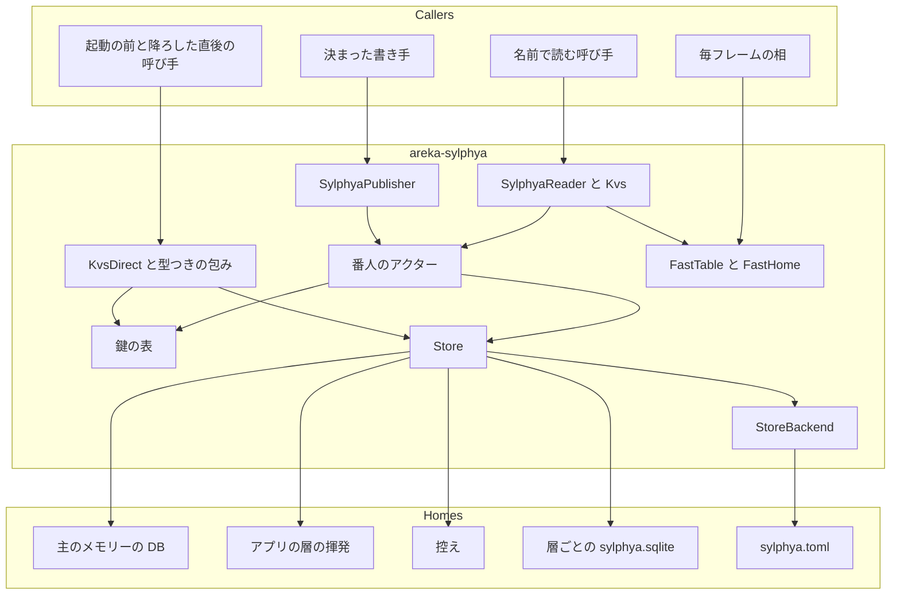
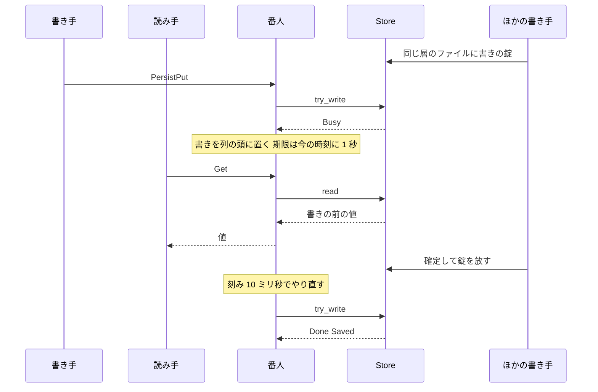
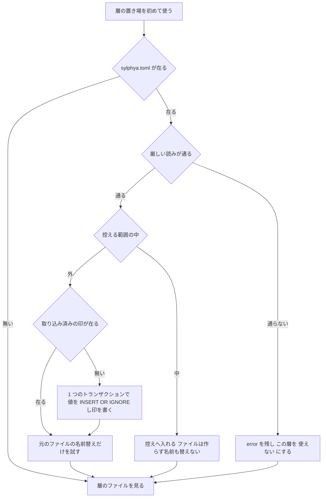

# Design Document: sylphya-sqlite-kvs

> 調べと試作の記録は `research.md` の後半（「Research & Design Decisions（設計の段）」）に在る。この文書は決めと契約を自分で持ち、`research.md` は背景としてだけ指す。
> 仮定を置いて書いた点は、末尾の「Open Questions」に番号つきでまとめてある。本文では〔仮定 N〕と書く。

## Overview

**Purpose**: `areka-sylphya` の値の持ち方を、鍵の名前と層の名前だけで読む・書く・消す 1 つの口（KVS の口）にまとめる。値の住み場所（速い住み場所・メモリーの sqlite・ファイルの sqlite）は鍵の表が決め、呼び手は選ばない。覚える値の保存は、層ごとの `sylphya.toml` から層ごとの `sylphya.sqlite` へ移す。

**Users**: areka に設定や記憶を足す開発者（鍵の表に 1 行足すだけで、書く・起動し直して読む・層を重ねて読む・消すができる）と、areka に前回の状態を覚えさせている利用者（版を上げても記憶が残り、書き手が何人でも値が消えない）。

**Impact**: 共有の写し（`SharedMirror`）と「読んで重ねて丸ごと書く」保存（`PersistIo`・錠のファイル・プロセスの門）を外し、rusqlite の接続を 1 本持つ同期の核 `Store` に置き換える。ゴーストごとの番人のアクターが `Store` を 1 つ持ち、読みも書きも番人を通る。番人が居ない時点（起動の前・降ろした直後）の読み書きは、同じ `Store` を呼んだスレッドの上で使う同期の口を通る。

### Goals

- 鍵の名前と層の名前だけで読む・書く・消す口と、結果の 4 つの形（書けた・断った・書けなかった・控えた）。
- 鍵の表 1 つが、住み場所・名前で書いてよいか・既定値を決める。
- バルーン → シェル → ゴースト → アプリの重ね読みと、バルーンの層の置き場。
- 同じ層のファイルへ、同じプロセスの複数の接続と別のプロセスが書いても、「書けた」で返った書きが 1 つも消えない。
- `sylphya.toml` の一度だけの取り込み（元のファイルは名前を変えて残す）。
- 書けなかったときの知らせ・読み取りだけの走り・今の読みの見え方を保つ。
- 記憶のファイルを口を通さずに読み書きする所を 0 か所にする。

### Non-Goals

- MCP から名前で書く道具（`mcp-set-property`）。
- SHIORI の SetProperty（in-proc の受け口の自前の表）と台本の `\![set,property]` を KVS の口へつなぐこと。
- ECS の値・窓の矩形を住み場所へ移すこと（窓の矩形は、読まれた時に OS へ聞く今の読み手のまま）。
- `currentghost.*`・`system.*` などの property の値を集めて流し込むこと。
- 複数のゴーストを同時に動かす仕組み（この spec は書き手が何人でも消えない土台だけを渡す）。
- 値に型を持たせること（今どおり文字列）。新しい版が書いた記憶を古い版が読めること。
- 負荷の試験・aarch64 での実行の確かめ・ネットワークの共有フォルダと取り外しのできる媒体の確かめ。

## Boundary Commitments

### This Spec Owns

- KVS の口（`Kvs`・`KvsDirect`）と、今の形を保つ 2 つの口（`SylphyaReader`・`SylphyaPublisher`）の中身。
- 鍵の表（`KEY_TABLE`）と、そこから決まる書き込みの仕分け（`classify_set`）。
- 3 つの住み場所の実体（`FastTable`・メモリーの sqlite・ファイルの sqlite）と、層ごとの記憶のファイルの名前・表の形・形の版。
- 4 つの層の置き場の決まり（バルーンの層 `<バルーン>\profile\areka\` を新しく決める）と、シェル・バルーンを替えたときの層の付け替え。
- 書きの錠と待ちの決まり（1 回の書きは 1 つの層・上限 1 秒・番人は錠を待って止まらない）。
- `sylphya.toml` の取り込みと、取り込み済みの印。
- 読み取りだけの走りの控えの中身（鍵の単位）。
- 試験の偽物の保存（`MemBackend`）と失敗の注ぎ込み口。
- 倍率と DPI の表の、速い住み場所への載せ替え。
- 持ち越しの 2 件（`RuntimeCommandSink`／`runtime_sink` を消す・`apply` を自由な関数にする）。
- rusqlite の追加と、それに伴う `Cargo.lock`・`THIRD-PARTY-NOTICES.md`・`tech.md`・`structure.md` の追随。
- 説明書（`dist/README.txt`）と告知の文のうち、記憶のファイルの名前に関わる部分。

### Out of Boundary

- 書けなかったときの告知の場面・出る条件・終了コード（完了 `write-failure-notice` のまま。この spec は `PersistFailure` を同じ形で渡すだけ）。
- 読み取りだけの走りを立てる所（`crates/areka-session/src/readonly.rs`）と、起動の前の書けるかの確かめ（`write_failure.rs` の `check_boot`）。どちらも触らない。
- 利用者ごとの置き場への写しの手続き（`crates/areka-user-data` の本番のコード。触らない＝写しは今のまま、付随のファイルごと写る）。
- 起動するゴースト・シェル・バルーンの決め方（`boot_resolve.rs` の判断の部分。読み書きの口だけを替える）。
- 鍵を使うだけの呼び手（`ghost_switch.rs`・`install/desk.rs`・`persist_save.rs`・`switch_assets.rs`・`boot_seam.rs` の `persist_put`／`persist_remove`）。触らない。
- 完了 spec の文書。

### Allowed Dependencies

- `areka-sylphya` の `[dependencies]`: std・`thiserror`・`tracing`・`toml`（取り込みの読みだけ）・`areka-actor`・**`rusqlite` 0.43.0（`default-features = false`・`bundled`・`cache`）**。上流の areka の crate は引かない（最下層の決まりのまま）。
- `areka-sylphya` の `[dev-dependencies]`: 今の `log-capture-kit`・`temp-path-kit` に、`areka-user-data` を足す（写しの試験のため。`areka-user-data` は `tracing` だけを引く葉で、`areka-sylphya` を引かない）。
- 外部のクレートはそのまま使う（フォークも `[patch]` もしない）。SQLite の組み立ての旗も足さない。
- 速い住み場所の住人の型（`AppliedScale`・`ScaleRatio`）を知るのは `areka-runtime` と `areka-session` だけ。`areka-sylphya` は 64 ビットの値と文字列しか知らない。
- `windows` クレートを `areka-sylphya` に足さない（長いパスは std の `std::path::absolute` と SQLite の VFS で扱う）。

### Revalidation Triggers

- `PersistKey`・`PersistScope`・`ScopeRoots`・`PersistOutcome`・`PersistFailure`・`SylphyaPublisher` の公開の形が変わる（鍵を使うだけの呼び手と、告知の言葉の出どころが変わる）。
- 鍵の表の欄（住み場所・名前で書いてよいか・既定値）や、行の見つけ方の順が変わる（`mcp-set-property`・`shell-balloon-scale-setting` が乗る）。
- 層の重ね読みの順・層の置き場・記憶のファイルの名前・表の形・形の版が変わる。
- 書きの待ちの上限・1 回の書きが 1 つの層である決まりが変わる（`multi-ghost-runtime`）。
- 番人の数（ゴーストごとに 1 本）や、層のファイルを掴む間（操作の間だけ）が変わる。
- rusqlite の版を上げる（組み上がり・`cargo deny`・長いパスと錠の試験をやり直す）。

## Architecture

### Existing Architecture Analysis

- 今の読みは共有の写しを待たずに読み、書きはゴーストごとのアクターへ投げっぱなし、保存は層ごとの `sylphya.toml` を「門 → 錠のファイル → 読む → 重ねる → 一時ファイル → 名前替え」で丸ごと書く。
- 4 つの層の値は、読むと同じ区画（`dotted_global`）へ混ざり、層の順は書いた順で変わる。
- アクターを通らない読み書きが 8 か所在る（`boot_resolve.rs`・`roots/mod.rs`・`roots/edit.rs`・`placement/persist.rs` ほか・ギャップ分析 2.5 節）。
- 保つ物: アクターの決まり（`areka-actor`・受信の箱 1 つ・`Close` で即停止）・判断を純粋な関数に寄せる形（`apply` が効果の並びを返す）・語彙の表（`vocab/`）・名前の畳み（`key.rs`）・外の一次情報源から取る読み手（`pull.rs`）・書けなかった中身を受け口へ送る道（`spawn_sylphya_with_failures`）。
- 外す物: `mirror.rs`（写し）・`persist/io.rs`（`PersistIo`・`FsPersistIo`・`FakePersistIo`・錠のファイル）・`persist/mod.rs` の TOML への書き・`persist/format.rs` の書きの側・`persist/withhold.rs` の「パス → 中身」の控え。

### Architecture Pattern & Boundary Map



**Architecture Integration**:

- **選んだ形**: 同期の核（`Store`）＋それを 1 つ持つ番人のアクター（ゴーストごと）＋番人が居ない時点の同期の口。開発者の決め（案 A＝番人のアクターが接続 1 本を持ち、層のファイルと揮発のメモリーの DB を ATTACH し、読みも書きも番人を通す）のまま。写しを残す形（brief が採らなかった案）は使わない。
- **依存の向き**: `keytable` → `store`（`backend` ← `locate`・`schema` ← `read`・`write`・`import`）→ `kvs`（`KvsDirect`）／`guardian` → `actor`（電文・`apply`・送り口）・`reader`。`fast` は `key` だけを引く。左の物は右の物を引かない。`persist/mod.rs` の型（`PersistScope`・`PersistKey` ほか）はどこからでも引ける。
- **保つ形**: 判断は純粋な関数 `apply` が効果の並びで返し、番人の受信の輪はそれを実行するだけ。読み口と送り口の公開のメソッドの形。語彙の表。
- **新しい物の理由**: `Store`＝読み書きの決まりを 1 か所に集める／`StoreBackend`＝本番のファイルと試験の偽物を、同じ SQL の上で差し替える／鍵の表＝3 つの語彙の表と `PersistKey` に分かれていた決まりを 1 つにする／`FastTable`＝ロックなしで読む取っ手。
- **steering の追随**: `structure.md` の sylphya の節の「読みは同期・無待機」「同期の読みの道でほかのアクターへ聞くことは禁止」「依存は std・thiserror・tracing・toml・areka-actor だけ」は、この spec の着地で書き直す（要件 12.3）。

### Technology Stack

| Layer | Choice / Version | Role in Feature | Notes |
|-------|------------------|-----------------|-------|
| Data / Storage | **rusqlite 0.43.0**（`default-features = false`・`bundled`・`cache`）／libsqlite3-sys 0.40.0／SQLite 3.54.1 | ファイルの住み場所とメモリーの住み場所 | 新しい外部の依存はこの 1 本。`Cargo.lock` に足されるのは 7 クレート（`research.md` (a)）。ライセンスは MIT と Zlib |
| Data / Storage | SQLite の VFS `win32-longpath`・`memdb` | 長い置き場／接続の間で分け合うメモリーの DB | どちらも同梱の SQLite に入っている |
| Data / Storage | toml 1（今のまま） | `sylphya.toml` の取り込みの読みだけ | 書きの側は消す |
| Messaging | `areka-actor`（今のまま） | 番人のアクターと返信の部品（`reply_channel`） | 変えない |
| Runtime | std の `AtomicU64`・`OnceLock` | 速い住み場所の取っ手 | 外部の依存を足さない・`unsafe` を使わない |

### 設計の決め

| # | 決め | 根拠 | 要件 |
|---|---|---|---|
| D1 | 番人はゴーストごとに 1 本。番人が居ない時点は同期の口（`KvsDirect`） | 今のアクターの寿命のまま。ATTACH の上限（10）が同時に動くゴーストの数を縛らない。書き手が複数の接続になるのは要件の前提 | 4.6・6.1・6.9・10.1・10.2・11.5 |
| D2 | 層のファイルは、1 回の読み・1 回の書きの間だけ ATTACH する〔仮定 1〕 | ATTACH している間はフォルダの `rename`・削除が拒まれる（試作）。今の `sylphya.toml` は保存の間しか開かれない。別のプロセスの書きが次の読みで見える | 1.10・5.3・5.5 |
| D3 | ジャーナルは DELETE・`synchronous` は FULL（SQLite の既定のまま・設定しない） | 読み取りだけで作るファイル 0・書けないフォルダで読める、を満たすのは DELETE だけ（試作） | 3.5・6.5・9.1・9.6 |
| D4 | 書きは錠を待たずに試み、`SQLITE_BUSY` は巻き戻す。番人は保留して刻み（10 ミリ秒）ごとにやり直し、1 秒で「書けなかった」にする | 番人が錠の待ちで止まらないので、待っている書きが読みを止めない。時計を差し込めるので試験が眠らない | 6.6・6.7・6.10・14.6・14.11 |
| D5 | 1 回の書きは、遅らせる `BEGIN` の最初の文を書きにして、1 つの層のファイルだけに錠を取る | `BEGIN IMMEDIATE` は ATTACH した全部の DB に錠を取る（試作） | 6.2・6.3・6.4 |
| D6 | アプリの層の揮発の値は、名前つきのメモリーの DB（memdb）。生かしておく接続は置き場の口が持つ | 接続を全部閉じると消える（試作）。共有キャッシュは待ちが効かないので使わない | 4.6・11.5・14.10 |
| D7 | ゴースト・シェル・バルーンの層の揮発の値は、番人の接続の主の DB（その接続だけのメモリー） | 番人を閉じれば消える＝ゴーストを降ろすと捨てる、が作りから出る | 4.10・11.4・11.5 |
| D8 | 読み取りだけの走りの控えは、鍵の単位の重ね書き（消した印つき）を名前つきのメモリーの DB に置く | ファイルは毎回読むので、ふだんどおりの読みと、別の areka が書いた値の見え方が変わらない | 9.1〜9.5・1.10 |
| D9 | 置き場のパスは絶対パスに `\\?\` を付け、`file:` の URI（`vfs=win32-longpath`・`mode=ro／rw／rwc`）で渡す | 今の保存は 260 文字を超える置き場で通る（試作）。素のパスでは SQLite が開けない | 8.6・8.7・14.13 |
| D10 | 記憶のファイルは `sylphya.sqlite`、付随のファイルは `sylphya.sqlite-journal`、残す元のファイルは `sylphya.toml.imported`（在れば `.imported.1`・`.imported.2`…）〔仮定 2〕 | 今の名前と並ぶ。上書きしない | 5.1〜5.3・7.2・13.1 |
| D11 | `PersistKey` は今の 10 種の型つきの別名として残す。ファイルの表の鍵は正規名。新しい覚える鍵は鍵の表の 1 行だけ | ウェーブの約束（`PersistKey` と送り口の形を保つ）と「1 行足すだけ」の両立 | 2.3・2.7・2.9・4.8 |
| D12 | 起動中の印は、空の文字を書く代わりに消す口で消す。取り込みは、今の読みと同じく空の文字の印を「無し」として扱う | 空の文字を値として保つ決まり（1.7）を鍵ごとの例外なしで通す | 1.7・10.2・10.5 |
| D13 | 速い住み場所の取っ手は `FastTable`（鍵 → 64 ビットに収まる値・読みは原子の読みだけ）。型と文字列の行き来は `FastHome` が持ち、住人の型を知る crate が実装して読み口へ登録する | 外部の依存を足さず `unsafe` も使わずにロックなしで読める。`areka-sylphya` が上流の型を知らずに済む | 3.1〜3.3・3.8・3.9 |
| D14 | 倍率と DPI の 4 つの名前は、ゴーストの層の速い住み場所に置く〔仮定 9〕 | 今の表の寿命（実行系の作り直しまで）と同じ。シェル・バルーンを替えても値が残る＝今の見え方のまま | 3.8・11.2 |
| D15 | 取り込みと取り込み済みの印を 1 つのトランザクションに入れ、その後で元のファイルの名前を替える。値は `INSERT OR IGNORE`。同じ番号に読める 2 つの綴りは先の綴りを採る | 名前替えの前に落ちても二重に入らない。先の綴りは、今の版の起動で利用者が目にしている値（直読みの側） | 7.1〜7.11 |
| D16 | 偽物の保存は、memdb の上で動く本物の sqlite（`MemBackend`）。失敗は置き場の口へ注ぎ込む | 偽物の上でも SQL・層・トランザクションは本物が動く | 14.5・14.9 |
| D17 | `PersistFailure` の形は変えない。表の行だけの鍵が書けなかったときは、`keys` に入れず、記録（error）に正規名を書く〔仮定 5〕 | `alert.rs` は文だけ直す、を守る | 8.1・13.2 |
| D18 | 点付きの全体の値（`baseware.*`）はアプリの層の揮発、平らな名前と層を名指ししない書きはゴーストの層の揮発に置く〔仮定 8〕 | 今の「ゴースト別の区画 → 全体の区画」の読みの順が、ゴースト → アプリの重ね読みにそのまま写る | 4.9・11.2・11.4 |

## File Structure Plan

### Directory Structure

```
crates/areka-sylphya/
├── Cargo.toml                    # rusqlite を足す・dev に areka-user-data を足す
└── src/
    ├── lib.rs                    # 宣言と再輸出（頭の説明を書き直す）
    ├── keytable.rs               # 新: 鍵の表（KEY_TABLE・rule_of・validate）
    ├── kvs.rs                    # 新: KVS の口（Kvs・KvsDirect・WriteOutcome）
    ├── fast.rs                   # 新: 速い住み場所（FastTable・FastValue・FastHome・登録の表）
    ├── guardian.rs               # 新: 番人のアクターの受信の輪（起動・保留の列・失敗の中継）
    ├── actor.rs                  # 直: 電文・効果・自由な関数 apply・classify_set・送り口（受信の輪は guardian.rs へ）
    ├── reader.rs                 # 直: SylphyaReader（番人への問い合わせ・速い住み場所・読み手）
    ├── pull.rs                   # そのまま
    ├── key.rs / value.rs / asker.rs / vocab/   # そのまま
    ├── mirror.rs                 # 消す
    ├── store/
    │   ├── mod.rs                # 新: Store（接続 1 本・層を開く・読み・書きの試み・層の付け替え）
    │   ├── backend.rs            # 新: StoreBackend・FsBackend・MemBackend・fs_backend()
    │   ├── locate.rs             # 新: 置き場 → ファイルの名前と URI（\\?\・百分率の置き換え）
    │   ├── schema.rs             # 新: 表の形・形の版・開いたときの検査・直しの段
    │   ├── read.rs               # 新: 重ね読みの SQL（層の組・控え・住み場所ごと）
    │   ├── write.rs              # 新: 1 層 1 トランザクションの書きの試み（WriteAttempt）
    │   └── import.rs             # 新: sylphya.toml の取り込み（読み・印・名前替え）
    └── persist/
        ├── mod.rs                # 直: 型（PersistScope・ScopeRoots・PersistKey・PersistFailure・PersistOutcome）と、型つきの包み 3 本・ensure_root_dir
        ├── format.rs             # 直: TOML の読みだけを残す（取り込み用）
        ├── withhold.rs           # 直: 控える範囲の旗だけを残す（中身の控えは store へ）
        └── io.rs                 # 消す
crates/areka-sylphya/tests/
└── two_process_writers_test.rs   # 新: 別のプロセスの書き手 2 つの試験（1 本）
```

- 試験は兄弟のファイル（`<名前>_tests.rs`）に置く。新しい試験のファイルは Testing Strategy に挙げる。どのファイルも 1,000 行を超えない（今の `actor.rs` 891 行は、受信の輪を `guardian.rs` へ出して減る）。

### Modified Files

印: **［外］**＝brief の「触るファイル」に無いファイル。

**`areka-sylphya` の外の本番のコード**

- `crates/areka-ghost/src/sylphya_wiring.rs` — `spawn_ghost_sylphya` が `SylphyaInit`（`roots`・`backend`）で起こす。`runtime_sink: None` を消す。
- `crates/areka-ghost/src/runtime.rs` — 起動の派生の関数 `boot_with_balloon`（バルーンのフォルダを受ける）を足し、`boot_with_origin` はそれへ `None` を渡す。`set_shell_dir` がシェルの層を付け替える。`set_balloon_dir` を足す。ゴーストの記憶のフォルダを先に作る所は `areka_sylphya::persist::ensure_root_dir` を呼ぶ。
- `crates/areka-ghost/src/lib.rs` ［外］ — `boot_with_balloon` の再輸出。
- `crates/areka-ghost/src/prop_sink.rs` — 本番のコードは変えない。同じファイルの中の試験の支え（`FakePersistIo`・`runtime_sink: None`）を直す。
- `crates/areka-session/src/boot_resolve.rs` — `read_last`・`save_app` が型つきの包みを新しい置き場の口で呼ぶ。`clear_session_mark` は消す口（`remove_scope_keys`）を呼ぶ。起動中の印の書き手の「実行系が動いていない間だけ」の注を消す。
- `crates/areka-session/src/roots/mod.rs` — `read_memory` が新しい置き場の口で読む。
- `crates/areka/src/roots/edit.rs` — ゴーストが居ないときの書きが新しい置き場の口で書く。
- `crates/areka-placement/src/persist.rs` — `load_restored_state` が新しい置き場の口で読む。
- `crates/areka-session/src/alert.rs` ［外・要件が先に挙げた］ — 直し方の文 `MEMORY_FILE_FIX` だけ。
- `crates/areka-session/src/runtime_boot.rs` ［外］ — 捨てていた `balloon_root` を `boot_with_balloon` へ渡す。
- `crates/areka-session/src/ghost_session.rs` ［外］ — もう 1 つの `boot_with_origin` の呼び手。今のバルーンのフォルダを渡す。
- `crates/areka-session/src/ghost_session_handle.rs` ［外］ — `set_balloon_dir` を足す（`set_shell_dir` の隣）。
- `crates/areka-session/src/hooks.rs` ［外］ — `set_current_balloon` が、実行系のバルーンの層も付け替える。
- `crates/areka-session/src/ghost_session_scope_scale.rs` ［外・要件が先に挙げた］ — 読み手 `ScopeScaleSource` を `FastHome` の実装に替え、`register_fast` で登録する。
- `crates/areka-runtime/src/scope_scale.rs` ［外・要件が先に挙げた］ — `Arc<RwLock<ScopeScaleTable>>` を、`FastTable` 4 つを束ねた取っ手に替える。
- `crates/areka-runtime/src/frame/scale_notice.rs` ［外・要件が先に挙げた］ — 表の書きを取っ手の `set` に替える（書きの鍵を取らない）。
- `crates/areka-runtime/src/frame/wiring.rs` ［外・要件が先に挙げた］ — 欄 `scope_scale` と `scope_scale_table()` の型。
- コメントの中の `sylphya.toml` の名前だけを直すファイル ［外］: `crates/areka-session/src/boot_seam.rs`（158 行目の説明）・`crates/areka-placement/src/lib.rs`（362・759 行目の説明）・`crates/areka-placement/src/follow/drag_follow.rs`（157 行目の注）。コードは変えない。同じウェーブの spec と重なるなら、この 3 つは直さずに残してよい（締めの検査はコメントの行を読まない）。

**根と文書**

- `Cargo.toml`（根）・`Cargo.lock` — `[workspace.dependencies]` に rusqlite。
- `THIRD-PARTY-NOTICES.md` — `cargo about generate` で作り直す。
- `deny.toml` — 確かめるだけ（変えない見込み）。
- `.kiro/steering/tech.md` — Key Libraries に rusqlite を足し、toml の行を「取り込みの読みだけ」に直す。
- `.kiro/steering/structure.md` ［外・要件 12.3］ — sylphya の節（Architecture・Modules・Dependencies）と、`areka-ghost`・`areka-session` の節のうち記憶の読み書きに触れる文。
- `dist/README.txt` ［外・要件 13］ — 「■ 記憶の置き場」「■ 起動オプション」の `readonly` の説明。
- `doc/COMPAT_ARCHITECTURE.md` ［外・要件 8.8］ — 記録の語彙の表（足す名前・意味の変わる名前）。

**触らない見込み**（呼んでいる口の形が変わらないことをソースで確かめた。組んで確かめるのは実装の段）: `crates/areka-session/src/{ghost_switch.rs, write_failure.rs, readonly.rs, boot_seam.rs, ghost_session_runtime.rs}`・`crates/areka/src/install/desk.rs`・`crates/areka-placement/src/persist_save.rs`・`crates/areka-runtime/src/switch_assets.rs`・`crates/areka/src/mcp/get_property.rs`・`crates/areka-ghost/src/prop_get_sink.rs`・`crates/areka-user-data/src/`（本番）・`crates/real-run-kit/`。

**追随する試験のファイル**

- `runtime_sink: None` を書く 19 ファイル（28 か所）: `crates/areka-ghost/src/{prop_get_sink_tests.rs, prop_sink.rs, runtime_tests.rs, sylphya_wiring.rs}`・`crates/areka-input/src/drag_test_support.rs`・`crates/areka-placement/src/{follow_test_support.rs, persist_finalize_save_tests.rs}`・`crates/areka-runtime/src/{frame_persist_test_support.rs, move_cue_apply_move_tests.rs, placement_tests/reset_balloon_pos_tests.rs}`・`crates/areka-session/src/{boot_resolve_last_used_tests.rs, boot_seam_persist_wiring_tests.rs}`・`crates/areka-sylphya/src/{actor_actor_criteria_cage.rs, actor_actor_integration_tests.rs, actor_barrier_within_tests.rs, actor_case_fold_tests.rs, actor_failure_sink_tests.rs}`・`crates/areka/src/{install/desk_record_tests.rs, runtime_tests/frame/switch_finish_tests.rs}`。
- `FakePersistIo`・`FsPersistIo`・自前の `PersistIo` を使う試験（上と重なる分を除く）［外］: `crates/areka-placement/src/{follow_drag_end_persist_tests.rs, test_support.rs}`・`crates/areka-ghost/src/runtime_origin_tests.rs`・`crates/areka-session/src/{boot_shell_tests.rs, session_end_test_support.rs}`・`crates/areka/src/session_tests/{mod.rs, readonly_sites_tests.rs, ghost_session_switch_memory_tests.rs}`。
- 写し（`SharedMirror`・`MirrorImage`）から読み口を作る試験 ［外］: `crates/areka-session/src/{ghost_session_scope_rect_tests.rs, ghost_session_scope_scale_tests.rs}`・`crates/areka-placement/src/zorder_property_deferral_tests.rs`（`apply` の呼び方も直す）。
- 倍率の表を使う試験 ［外］: `crates/areka/src/runtime_tests/frame_scale_notice_integration_tests.rs`・`crates/areka/src/session_tests/ghost_session_scope_scale_boot_tests.rs`。
- `sylphya.toml` を綴る試験（書いた後の中身を読むものは新しい口で読む形へ。検体として植えるだけのものは、取り込みを通るのでそのまま通る見込み）［外］: `crates/areka-ghost/src/runtime_tests.rs`・`crates/areka-ghost/tests/ghost/{inproc_fixture.rs, spine_e2e_test_s7_second_boot_record_present.rs}`・`crates/areka-placement/src/{follow_drag_end_persist_tests.rs, persist_io_wiring_tests.rs, placement_prepare_tests.rs}`・`crates/areka-runtime/src/{frame_persist_test_support.rs, placement_tests/transition_judge_offset_signoff_tests.rs}`・`crates/areka-session/src/{alert_memory_write_tests.rs, boot_seam_restore_tests.rs, ghost_switch_test_support.rs}`・`crates/areka/src/session_tests/boot_config_balloon_tests.rs`・`crates/areka-user-data/src/{establish_locate_tests.rs, establish_readonly_tests.rs, establish_tests.rs, test_support.rs}`・`crates/areka-mcp-bridge/src/config_prepare_tests.rs`・`crates/sample-ghost-kit/{src/devroot_sweep_tests.rs, tests/nar_sample_path_test.rs}`。`areka-user-data`・`areka-mcp-bridge`・`sample-ghost-kit` の分はファイルの名前を文字として持つだけなので、触らずに済む見込み（実装の段で 1 つずつ確かめる）。
- 置き場のフォルダを走っている間に差し替える試験の支え（`crates/areka/src/session_tests/mod.rs` の `unwritable`）は、D2 によりそのまま通る。
- `crates/areka-sylphya/src/` の今の試験（`persist/*_tests.rs`・`actor_*_tests.rs`・`reader.rs` と `mirror.rs` の中の試験・`pull_tests.rs`）は、新しい作りの上へ書き直すか、役目を終えたものは消す（判定する中身は Testing Strategy の新しい試験が持つ）。

## System Flows

### 名前での読みと、待っている書き



- 列に書きが在る間、番人は受信を 10 ミリ秒で区切り、区切りごとに列の頭をやり直す。読み・揮発の書き・平らな名前の読み書きは、列を待たずに受ける。
- 列は 1 本（覚える値の書き・消し・層の付け替え・反映待ち）。後から届いた覚える値の書きは、別の層あてでも列の後ろに並ぶ（同じ送り手の書きの順を保つ）。
- 期限は、その書きが列の頭になって最初に試みた時刻から 1 秒（置き場の口の時計で測る）。越えたら巻き戻して `Degraded(Io(待ちの上限))` にし、失敗の受け口へ送って次へ進む。
- 反映待ち（`barrier`）は、それより前に届いた書きが全部片づいた（書けた・書けなかった・控えた）後で返す。`Close` は今と同じく即停止で、列の残りは捨てる（終了の統括は先に `barrier` を待つ・今のまま）。

### 層を初めて使うときの流れ（取り込み）



- 「厳しい読み」は今の `parse_toml_str`（壊れている・形の版が違うと失敗）。通ったら、今の `load_scope` と同じ変換で（鍵, 値）の並びにする。
- 「使えない」にした層は、読みは今ある新しい記憶のファイル（無ければ値なし）で続け、覚える値の書きは `Degraded(Unusable(理由))` を返す〔仮定 7〕。
- 名前替えの失敗は warn を残して続ける。相手が先に替えていて元のファイルが無い場合は失敗に数えない。

## Requirements Traceability

| Requirement | Summary | Components | Interfaces | Flows |
|-------------|---------|------------|------------|-------|
| 1.1, 1.2 | 名前だけ／名前と層で読む | Kvs・KvsDirect・Store | `get`・`get_in`・`Store::read` | 名前での読み |
| 1.3, 1.4 | 書く・消す（結果 4 つ） | Kvs・KvsDirect・番人 | `set`・`unset`・`put`・`remove`・`WriteOutcome` | 待っている書き |
| 1.5 | 住み場所を選ばせない | 鍵の表 | 口の引数に住み場所が無い | — |
| 1.6 | 書いた後はすぐ読める | 番人・Store | 返事は確定の後に返す | 待っている書き |
| 1.7 | 文字列のまま・空と値なしの区別 | Store・D12 | `kv.value TEXT NOT NULL` | — |
| 1.8, 1.9 | 名前の畳みと解けない名前 | `key.rs`・Store | 正規名を表の鍵にする | — |
| 1.10 | 別のプロセスが書いた値 | Store・D2 | 読みのたびに ATTACH | — |
| 2.1, 2.2, 2.4 | 鍵の表・住み場所は 1 つ・仕分け | 鍵の表 | `KEY_TABLE`・`rule_of`・`classify_set` | — |
| 2.3, 2.7 | 今の 10 種は表に載り、名前では書けない | 鍵の表 | `ByName::Refused(FixedWriterOnly)` | — |
| 2.5 | 自由な鍵はメモリー | 鍵の表・Store | `KeyMatch::Free` | — |
| 2.6 | 断った＋warn | 番人・`apply` | `WriteOutcome::Refused` | — |
| 2.8 | 既定値 | 鍵の表・Kvs | `KeyRule::default` | — |
| 2.9 | 1 行足すだけ | 鍵の表・Store・D11 | 表を引数で受ける起動 | — |
| 2.10 | 起動記録の締めの書き口 | `prop_sink.rs`（変えない） | `persist_put(Ghost, …)` | — |
| 3.1, 3.2, 3.3 | 取っ手で読む・名前と取っ手の行き来 | FastTable・FastHome | `FastTable::get／set`・`FastHome::read_text／write_text` | — |
| 3.4 | 速い値と揮発の値を書かない | Store・FastTable | 主の DB と memdb はメモリー | — |
| 3.5 | 書けたら落ちても読める | Store・D3 | `synchronous` FULL | — |
| 3.6 | メモリーの sqlite・ファイルの sqlite | Store | 主の DB・memdb・`sylphya.sqlite` | — |
| 3.7 | 窓の矩形は今の読み手 | `pull.rs`（変えない）・SylphyaReader | `register_pull` | — |
| 3.8, 3.9 | 倍率と DPI は速い住み場所の 1 つだけ | `scope_scale.rs`・`ghost_session_scope_scale.rs` | `ScopeScaleCells`・`register_fast` | — |
| 4.1, 4.2, 4.3 | 重ね読みの順 | Store（`read.rs`） | 重ね読みの SQL | 名前での読み |
| 4.4 | ほかの層を変えない | Store（`write.rs`） | 1 層 1 トランザクション | — |
| 4.5 | 置き場の無い層 | Store | `PersistFailureCause::NoRoot` | — |
| 4.6 | 層はゴーストごと・アプリは全員 | 番人（D1）・D6・D7 | 接続ごとの主の DB・`appvol` | — |
| 4.7, 4.10 | シェル・バルーンを替える | 番人・`GhostRuntime` | `set_layer_root`・`set_shell_dir`・`set_balloon_dir` | — |
| 4.8 | 10 種の層を変えない | 呼び手（変えない） | 今の `PersistScope` の渡し方 | — |
| 4.9 | 層を名指ししない書き | `apply` | `SylphyaMsg::Set` → ゴーストの層 | — |
| 5.1, 5.2, 5.3 | 置き場と作るファイル | `locate.rs`・`runtime.rs` | `sylphya.sqlite`・`profile_areka_root` | — |
| 5.4, 5.5 | フォルダは初めて書くときに作る | Store・StoreBackend | `ensure_dir`・`mode=rwc` は書きだけ | — |
| 5.6, 5.7, 5.8 | 形の版・直し・使えないファイル | `schema.rs` | `user_version`・`application_id`・`LayerState::Unusable` | — |
| 6.1, 6.2, 6.9 | 何人書いても消えない | Store・D1・D5 | 鍵の単位の `INSERT … ON CONFLICT` | 待っている書き |
| 6.3, 6.4 | 全部か 0・1 回 1 層 | `write.rs` | `FileWrite`（層は 1 つ） | — |
| 6.5 | 落ちても壊れない | D3 | ロールバックのジャーナル | — |
| 6.6, 6.7 | 待ちの上限 1 秒 | 番人・KvsDirect | `WRITE_WAIT`・`WriteAttempt::Busy` | 待っている書き |
| 6.8 | 取っ手の読みを待たせない | FastTable | 番人を通らない | — |
| 6.10 | 待っている書きが読みを止めない | 番人（D4） | 保留の列 | 待っている書き |
| 7.1, 7.4, 7.8 | 取り込む値 | `import.rs` | 今の `doc_to_entries` と同じ変換・知らない表と値の数を記録 | 取り込み |
| 7.2, 7.10 | 名前を変えて残す・替えられないとき | `import.rs`・StoreBackend | `retire_legacy` | 取り込み |
| 7.3, 7.9, 7.11 | 一度だけ・落ちても同じ・2 つ同時 | `import.rs` | `meta` の印を同じトランザクションで書く | 取り込み |
| 7.5, 7.6 | 読めない `sylphya.toml` | `import.rs` | `LayerState` の「使えない」・次の起動でまた試す | 取り込み |
| 7.7 | 新しいファイルの値を残す | `import.rs` | `INSERT OR IGNORE` | 取り込み |
| 7.12 | 読み取りだけの取り込み | `import.rs`・控え | 控えへ入れる | 取り込み |
| 8.1, 8.3, 8.4 | 失敗の記録と告知の道 | 番人・KvsDirect | `PersistFailure`・失敗の受け口 | — |
| 8.2 | 起動の前の確かめ | `write_failure.rs`（変えない） | — | — |
| 8.5 | 揮発の書きの失敗 | 番人 | `WriteFailed::Volatile` | — |
| 8.6, 8.7 | 置き場の退行 0・開けない置き場 | `locate.rs`（D9） | URI の形 | — |
| 8.8 | 記録の語彙 | Error Handling の表 | — | — |
| 8.9 | 書けるときは告知 0 | 番人 | 失敗のときだけ送る | — |
| 9.1, 9.2, 9.6 | 作らず変えず・ふだんどおり読む | Store・StoreBackend | `mode=ro`・控える範囲では作らない | — |
| 9.3, 9.4, 9.5 | 控えた・読み返せる・捨てる | 控え（D8） | `PersistOutcome::Withheld`・`held` の表 | — |
| 9.7 | 完了 `readonly-mode` の試験 | Testing Strategy | — | — |
| 10.1, 10.2 | 起動の前の読み・印と並びの書き | KvsDirect・型つきの包み | `load_scope`・`save_scope`・`remove_scope_keys` | — |
| 10.3 | 口を通さない所 0 | 締めの検査 | ソースを読む試験 | — |
| 10.4, 10.5 | イベント・記録の数・印の時点 | 呼び手（判断は変えない） | — | — |
| 11.1 | トークの写し | SylphyaReader・番人 | `talk_snapshot` | — |
| 11.2 | 今読める名前 | SylphyaReader | `resolve_flat`・`resolve_dotted` | — |
| 11.3 | 名前を消す | 番人 | `RemoveFlat` | — |
| 11.4, 11.5 | 自由な鍵の見え方と寿命 | D7 | 主の DB の `vol` | — |
| 11.6, 11.7 | SET 有効群・書けない正準の語彙 | 鍵の表・`apply` | `Effect::RuntimeCommandReserved`・`Effect::NotSettable` | — |
| 11.8 | 新しい SHIORI イベント 0 | — | 足さない | — |
| 12.1 | 差し替えの口を消す | `actor.rs` | `RuntimeCommandSink`・`runtime_sink` を消す | — |
| 12.2 | `apply` を自由な関数に | `actor.rs` | `pub fn apply(msg) -> Vec<Effect>` | — |
| 12.3, 12.4 | 依存は rusqlite だけ・2 つの形 | Technology Stack | — | — |
| 12.5 | `sylphya.toml` は取り込みだけ | `import.rs`・`format.rs` | 書きの側を消す | — |
| 13.1, 13.3, 13.4, 13.5 | 説明書 | `dist/README.txt` | — | — |
| 13.2 | 告知の文 | `alert.rs`・`store/` の理由の文 | — | — |
| 14.1, 14.2, 14.3, 14.4, 14.5 | 表・15 通り・取り込み・同時の書き・失敗の注ぎ込み | Testing Strategy | — | — |
| 14.6, 14.7 | 眠らない・`target\` の下 | StoreBackend の時計・`temp-path-kit` | — | — |
| 14.8 | 実機の確かめ | Testing Strategy | — | — |
| 14.9, 14.10, 14.11, 14.12, 14.13 | 完了 spec の試験・寿命・待ち・写し・長い置き場 | Testing Strategy | — | — |
| 15.1, 15.2, 15.3, 15.4 | 利用者ごとの置き場への写し | `areka-user-data`（変えない）・Store | 付随のファイルごと写る・開いたときに巻き戻る | — |

## Components and Interfaces

| Component | Domain/Layer | Intent | Req Coverage | Key Dependencies (P0/P1) | Contracts |
|-----------|--------------|--------|--------------|--------------------------|-----------|
| 鍵の表（`keytable.rs`） | 決まり | 鍵ごとの住み場所・名前で書けるか・既定値 | 2.1〜2.9, 11.6, 11.7 | `vocab/dotted.rs`（P0）・`key.rs`（P0） | Service |
| `Store`（`store/`） | 住み場所 | 接続 1 本で、層を開き、読み、書きを試みる | 1.x, 3.4〜3.6, 4.x, 5.x, 6.1〜6.5, 9.x | rusqlite（P0）・`StoreBackend`（P0） | Service, State |
| `StoreBackend` | 住み場所の継ぎ目 | 置き場 → DB の在りか・古いファイル・時計・控える範囲 | 5.4, 7.2, 8.6, 9.1, 14.5〜14.7 | std（P0）・rusqlite（P0） | Service |
| 取り込み（`store/import.rs`） | 住み場所 | `sylphya.toml` を一度だけ取り込む | 7.1〜7.12, 12.5 | `persist/format.rs`（P0） | Batch |
| 番人のアクター（`guardian.rs`） | アクター | `Store` を 1 つ持ち、電文を順に片づける | 1.6, 6.6〜6.10, 8.1, 8.5, 11.x | `areka-actor`（P0）・`Store`（P0） | Event, State |
| KVS の口（`kvs.rs`・`reader.rs`・`actor.rs`） | 口 | 呼び手が見る面 | 1.1〜1.10, 10.1〜10.3, 11.1〜11.5 | 番人（P0）・`Store`（P0） | Service |
| 速い住み場所（`fast.rs`） | 住み場所 | ロックなしで読む取っ手と、名前との行き来 | 3.1〜3.3, 3.8, 3.9, 6.8 | std（P0） | Service, State |
| 倍率と DPI の載せ替え | 使い手 | 共有の表を速い住み場所へ移す | 3.8, 3.9 | `fast.rs`（P0） | State |
| 使い手の移し替え | 使い手 | 直の読み書き・層の付け替え・文 | 4.7, 10.x, 12.x, 13.x | 型つきの包み（P0） | — |

### 決まり

#### 鍵の表（`keytable.rs`）

| Field | Detail |
|-------|--------|
| Intent | 鍵（または鍵の形）ごとに、住み場所・名前で書いてよいか・既定値を定める 1 つの表 |
| Requirements | 2.1, 2.2, 2.3, 2.4, 2.5, 2.6, 2.7, 2.8, 2.9, 11.6, 11.7 |

**Responsibilities & Constraints**

- 表は `KEY_TABLE` の 1 つだけ。行の見つけ方は 5 種で、上から順に当てる（今の `classify_set` と同じ優先）: ⑴ SET 有効群 25 件（半角の英字の大小を区別しない完全一致）⑵ 名前の形（選択子を `(*)` に寄せた正準の文字・`PullShape` と同じ作り方）⑶ 根が 10 本のどれか ⑷ 葉が汎用の名前 17 種のどれか ⑸ それ以外（自由な鍵）。
- ⑴⑶⑷ は `vocab/dotted.rs` の今の定数（`SET_EFFECTIVE`・`DOTTED_ROOTS`・`GENERIC_PROP_NAMES`）をそのまま指す。語彙を表に書き写さない。
- 住み場所は 1 行に 1 つ（⑴ は「どこにも書かない」）。同じ形の行が 2 つ在れば `validate` が失敗する。
- 今の `PersistKey` の 10 種は、名前の形 12 行（窓の位置と相対位置は x と y の 2 行ずつ）で載る。`PersistKey::to_canonical_key` の返す名前は、必ずこの 12 行のどれかに当たる（試験で固定）。

| 行 | 見つけ方 | 住み場所 | 名前で書く | 既定値 |
|---|---|---|---|---|
| SET 有効群 25 件 | ⑴ | 無し | 断る（運行の命令の予約） | 無し |
| `areka.window.scope(*).x`／`.y`・`areka.balloon.offset.scope(*).x`／`.y`・`areka.window.scope(*).adjacent`・`areka.boot.count`・`areka.vanish.count`・`areka.last.ghost`／`.balloon`／`.shell`／`.running`・`areka.baseware.roots` | ⑵ | ファイル | 断る（決まった書き手だけ） | 無し |
| `currentghost.scope(*).scaling`・`currentghost.balloon.scope(*).scaling`・`currentghost.scope(*).currentmonitor.dpi`・`currentghost.balloon.scope(*).currentmonitor.dpi` | ⑵ | 速い | 断る（決まった書き手だけ） | 無し |
| 根の枝 10 本 | ⑶ | メモリー | 断る（書けない正準の語彙） | 無し |
| 汎用の名前 17 種 | ⑷ | メモリー | 断る（書けない正準の語彙） | 無し |
| 自由な鍵 | ⑸ | メモリー | 書ける | 無し |

**Contracts**: Service [x]

```rust
pub enum Home { Fast, Memory, File }
pub enum ByName { Writable, Refused(Refusal) }
pub enum Refusal { FixedWriterOnly, RuntimeCommand, NotSettable }
pub enum KeyMatch { SetEffective, Shape(&'static str), Root, Leaf, Free }
pub struct KeyRow {
    pub matches: KeyMatch,
    pub home: Option<Home>,
    pub by_name: ByName,
    pub default: Option<&'static str>,
}
pub static KEY_TABLE: &[KeyRow];

/// 鍵の決まりを引く（解けない名前は自由な鍵）。
pub fn rule_of(table: &'static [KeyRow], key: &str) -> &'static KeyRow;
/// 同じ形の行が 2 つ在る・形が解けない、を見つける（試験と起動のときの debug_assert が呼ぶ）。
pub fn validate(table: &[KeyRow]) -> Result<(), String>;
/// 今の 3 つの分かれ方（`RuntimeCommand`・`NotSettable`・`StoreWrite`）。表から導く。
pub fn classify_set(key: &str) -> SetClass;
```

- Preconditions: `rule_of` に渡す表は `validate` を通っている。
- Postconditions: `classify_set` は、`areka.*` の 12 行と倍率・DPI の 4 行を `NotSettable` と答える（今は `areka.*` を自由な鍵と答える＝要件討議の決め 10 による変更）。ほかの名前の答えは今と同じ。
- Invariants: 番人と同期の口は、表を引数（`&'static [KeyRow]`）で受ける。本番は `KEY_TABLE`。試験は行を足した表を渡して「1 行足すだけ」を確かめる。

**Implementation Notes**

- `classify_set` は今 `actor.rs` に在る。`keytable.rs` へ移し、`actor.rs` と `lib.rs` から同じ名前で再輸出する。
- Risks: 汎用の名前の「葉だけで決める」既知の食い違い（`vocab/dotted.rs` の TODO）は、この spec では直さない（表の ⑷ として今の形のまま載せる）。

### 住み場所

#### `Store`（`store/mod.rs`・`read.rs`・`write.rs`・`schema.rs`・`locate.rs`）

| Field | Detail |
|-------|--------|
| Intent | rusqlite の接続を 1 本持ち、層のファイルを操作の間だけ ATTACH して、読みと書きの試みを行う同期の核 |
| Requirements | 1.1, 1.2, 1.6, 1.7, 1.8, 1.9, 1.10, 3.4, 3.5, 3.6, 4.1, 4.2, 4.3, 4.4, 4.5, 4.6, 4.7, 4.10, 5.1, 5.2, 5.3, 5.4, 5.5, 5.6, 5.7, 5.8, 6.1, 6.2, 6.3, 6.4, 6.5, 9.1, 9.2, 9.3, 9.4, 9.6 |

**Responsibilities & Constraints**

- 1 つの `Store` は 1 つのスレッドだけが使う（番人のスレッド、または同期の口を呼んだスレッド）。
- **付けっぱなしにする DB**（どれもメモリー・フォルダを掴まない）: 主の DB（その接続だけ・`vol` と `flat` の表）／`appvol`（アプリの層の揮発・アプリの置き場ごとの名前つきの memdb）／`held`（控え。控える範囲の中の層を初めて扱った時点で付け、以後は付けたまま）。
- **操作の間だけ付ける DB**: 層のファイル `app`・`ghost`・`shell`・`balloon`。読みは、鍵の住み場所がファイルのときだけ、在るファイルを `mode=rw`（控える範囲の中は `mode=ro`）で ATTACH し、SQL 1 回の後に DETACH する。層を名指しした読みと書きは、その層だけを付ける。
- ATTACH・DETACH はトランザクションの外で行う。ATTACH と読みは、ほかの書き手が確定している間だけ上限つきで待つ（`READ_WAIT`＝1 秒・`busy_timeout`）〔仮定 6〕。書きは待たない（下の `try_write`）。
- **層を開いたときの検査**（`schema.rs`・ATTACH のたび）: 0 バイト → 空の層として扱う／`application_id` が areka の番号で `user_version` が 1〜今の版 → 使う（古い版は、直しの段を 1 つのトランザクションで順に当ててから使う）／それ以外（SQLite のファイルでない・番号が違う・知らない新しい版・壊れている）→ その層を「使えない（理由）」にして DETACH する。使えない層は、読みは飛ばし（warn）、覚える値の書きは `Degraded(Unusable(理由))`。上書きしない。
- **重ね読み**（`read.rs`）: 住み場所ごとに SQL を組む。ファイルの鍵＝付けた層を `UNION ALL` でつなぎ、層の順（バルーン 0・シェル 1・ゴースト 2・アプリ 3）で並べて先頭の 1 行。メモリーの鍵＝主の DB の `vol`（バルーン・シェル・ゴースト）と `appvol`（アプリ）を同じ順で。控える範囲の中の層は、`held` に行が在ればその行（値が NULL なら「この層には無い」）、無ければファイルの行。
- **書きの試み**（`write.rs`）: `busy_timeout(0)` → `BEGIN`（遅らせる形）→（新しいファイルなら表と番号を作る）→ 鍵ごとの `INSERT … ON CONFLICT(key) DO UPDATE`・`DELETE` → `COMMIT`。どの文でも `SQLITE_BUSY` なら `ROLLBACK` して `WriteAttempt::Busy`。ほかの失敗は `ROLLBACK` して `Done(Degraded(Io(理由)))`。1 回の試みが触る層のファイルは 1 つ。
- **初めて書く層**: 置き場のフォルダを作り（`StoreBackend::ensure_dir`）、`mode=rwc` で ATTACH する。読みだけではフォルダもファイルも作らない。
- **控える範囲の中の書き**: ファイルに触らず、`held` へ（置き場, 鍵, 値／NULL）を書いて `Done(Withheld)`。置き場の無い層は、控える範囲の中でも `Degraded(NoRoot)`（今と同じ）。
- **層の付け替え**（`set_root`）: その層の `vol` の行を消し、置き場を替え、取り込みの済みの覚えを戻す。
- 準備済みの文は rusqlite の使い回し（`prepare_cached`）に任せる。SQL の文字は「付けた層の組」と「控えの有無」だけで決まる。鍵・値・置き場・問い手は必ず束縛の引数で渡す（SQL の文字に埋めない）。

**Dependencies**

- Outbound: `StoreBackend` — 置き場 → URI・フォルダを作る・時計・控える範囲（P0）
- Outbound: 取り込み — 層を初めて使うとき（P0）
- External: rusqlite 0.43.0 — 接続・文・トランザクション（P0）。使う機能は `bundled`・`cache` だけ

**Contracts**: Service [x] / State [x]

```rust
pub(crate) struct Store { /* 接続・置き場・置き場の口・層ごとの覚え */ }

/// 1 回の覚える値の書き（層は 1 つ）。`typed` は失敗の中身に載せる型つきの別名。
pub(crate) struct FileWrite {
    pub layer: PersistScope,
    pub puts: Vec<(String, String)>,
    pub removes: Vec<String>,
    pub typed: Vec<PersistKey>,
}
pub(crate) enum WriteAttempt { Done(PersistOutcome), Busy }

impl Store {
    pub(crate) fn open(roots: ScopeRoots, backend: Arc<dyn StoreBackend>) -> Result<Store, String>;
    /// `layer` が `None` なら重ね読み。`home` は鍵の表が決めた住み場所（`File` か `Memory`）。
    pub(crate) fn read(&mut self, asker: &AskerId, key: &str, layer: Option<PersistScope>, home: Home) -> Option<String>;
    /// 1 つの層のファイルの全部の（鍵, 値）（型つきの包み `load_scope` 用）。
    pub(crate) fn read_layer(&mut self, layer: PersistScope) -> Vec<(String, String)>;
    pub(crate) fn try_write(&mut self, write: &FileWrite) -> WriteAttempt;
    pub(crate) fn write_volatile(&mut self, layer: PersistScope, asker: &AskerId, key: &str, value: Option<&str>) -> Result<(), String>;
    pub(crate) fn write_flat(&mut self, asker: &AskerId, name: &str, value: Option<&str>) -> Result<bool, String>;
    pub(crate) fn read_flat(&mut self, asker: &AskerId, name: &str) -> Option<String>;
    pub(crate) fn flat_snapshot(&mut self, asker: &AskerId) -> BTreeMap<String, String>;
    pub(crate) fn set_root(&mut self, layer: PersistScope, root: Option<PathBuf>);
}
```

- Preconditions: `try_write` の `puts` と `removes` の鍵は正規名（解けない名前は渡された綴りのまま）。
- Postconditions: `try_write` が `Done(Saved)` を返したら、その中身はディスクに在り、同じプロセスのどの接続の次の読みにも現れる。`Busy` を返したら、層のファイルは 1 バイトも変わっていない。
- Invariants: `Store` は、操作から戻った時点で層のファイルを 1 つも ATTACH していない。トランザクションを開いたまま戻らない。

**Implementation Notes**

- Integration: 置き場 → URI は `locate.rs` の 1 か所（`std::path::absolute` → `\\?\`／`\\?\UNC\` を付ける → `%`・`?`・`#`・`\` を百分率の形に置き換える → `file:` と `?vfs=win32-longpath&mode=…`）。UTF-16 として正しくないパスは `Io` の失敗にする〔仮定 4〕。
- Validation: 「操作の後に層を掴んでいない」は、走っている番人の置き場のフォルダを `rename` できることで試験する。
- Risks: 読み取りだけの走りで、落ちた後のジャーナルが残っている層は `mode=ro` で開けない（`SQLITE_READONLY_ROLLBACK`）。その走りではその層を値なしで続け、error を 1 件残す〔仮定 3〕。

#### `StoreBackend`（`store/backend.rs`）

| Field | Detail |
|-------|--------|
| Intent | 層の置き場を、DB の在りか・古いファイル・時計へ結ぶ継ぎ目（本番はファイル・試験は memdb） |
| Requirements | 5.4, 7.2, 7.10, 8.6, 9.1, 14.5, 14.6, 14.7 |

**Responsibilities & Constraints**

- `areka-sylphya` でファイルシステムに触れるのは `FsBackend` だけ（今の「触れるのは `FsPersistIo` だけ」の決まりを引き継ぐ）。
- 名前つきの memdb（`appvol`・`held`）を生かしておく接続を持つ。`FsBackend` はプロセスに 1 つ（`fs_backend()`）で、areka が終わるまで生きる＝アプリの層の揮発の値と控えの寿命になる。
- `MemBackend` は、層のファイルの代わりに自分だけの名前の memdb を指す（実体の数だけ名前を変えるので、同じ偽の置き場を使う試験どうしが混ざらない）。古いファイルはメモリーの表で持つ。
- 控える範囲は、今の `persist/withhold.rs` の旗（`withhold_everything`・`WithholdGuard::under`）をそのまま読む。`WithholdGuard` を落とすと、その根の下の `held` の行を消す。

**Contracts**: Service [x]

```rust
pub enum Access { ReadOnly, ReadWrite, Create }
pub enum Located { Uri(String), Missing }

pub trait StoreBackend: Send + Sync {
    /// 層の置き場の記憶の DB を ATTACH する先。`Create` のほかは、無ければ `Missing`。
    fn locate(&self, root: &Path, access: Access) -> std::io::Result<Located>;
    fn ensure_dir(&self, root: &Path) -> std::io::Result<()>;
    /// 古い `sylphya.toml`（無ければ `None`）。
    fn read_legacy(&self, root: &Path) -> std::io::Result<Option<String>>;
    /// 古いファイルを、上書きせずに別の名前へ替える（もう無ければ `Ok`）。
    fn retire_legacy(&self, root: &Path) -> std::io::Result<()>;
    fn withholds(&self, root: &Path) -> bool;
    /// アプリの層の揮発の DB・控えの DB の在りか（生かしておく接続をここで持つ）。
    fn volatile_uri(&self, app_root: Option<&Path>) -> String;
    fn held_uri(&self) -> String;
    /// 待ちの時計（単調）と、同期の口が取り直しの間を空ける口。
    fn now(&self) -> std::time::Duration;
    fn pause(&self, span: std::time::Duration);
    /// 書きの直前に呼ばれる（本番は常に `Ok`・偽物は注ぎ込まれた失敗を 1 回返す）。
    fn before_write(&self, root: &Path) -> std::io::Result<()>;
}

pub struct FsBackend { /* … */ }
pub fn fs_backend() -> Arc<dyn StoreBackend>;   // プロセスに 1 つ

/// 試験の偽物（今の `FakePersistIo` の後継・`#[cfg(test)]` に閉じない）。
pub struct MemBackend { /* … */ }
impl MemBackend {
    pub fn new() -> Arc<MemBackend>;
    pub fn fail_next_write(&self);                       // OS が拒む
    pub fn mark_unusable(&self, root: &Path);            // 既にある記憶のファイルが使えない
    pub fn hold_writer(&self, root: &Path) -> WriterHold; // 別の書き手が錠を持つ（落とすと放す）
    pub fn advance(&self, span: std::time::Duration);    // 時計を進める（眠らない）
    pub fn plant_legacy(&self, root: &Path, toml: &str); // sylphya.toml を植える
    pub fn legacy_names(&self, root: &Path) -> Vec<String>;
}
```

- Postconditions: `FsBackend::pause` は実時間で眠る（本番の同期の口の取り直し）。`MemBackend::pause` は自分の時計を進めるだけで眠らない。本物のファイルの上で待ちを試す試験のために、`FsBackend` も試験の時計（進めるだけ・眠らない）を受けて作れる（`FsBackend::with_manual_clock()`。本番の `fs_backend()` は実時間の時計）。
- Invariants: `locate` は `Create` のとき以外、ファイルもフォルダも作らない。

#### 取り込み（`store/import.rs`）

| Field | Detail |
|-------|--------|
| Intent | 層の置き場の `sylphya.toml` を、その層を初めて使うときに一度だけ取り込む |
| Requirements | 7.1, 7.2, 7.3, 7.4, 7.5, 7.6, 7.7, 7.8, 7.9, 7.10, 7.11, 7.12, 12.5 |

**Contracts**: Batch [x]

- **Trigger**: `Store` が、ある層の置き場を初めて読む・書く直前（`Store` の中に「この置き場は済んだ」を覚える。`set_root` で戻る）。起動の前の直読み（前回のゴースト・置き場の並び・窓の位置）もこの道を通るので、取り込みは「読みより前」に済む。
- **Input / validation**: `StoreBackend::read_legacy` → 今の `parse_toml_str`（壊れている・形の版が違う → 失敗）→ 今の `doc_to_entries` と同じ変換（`import.rs` へ移す）。同じ番号に読める綴りが 2 つ在る鍵は、先に現れた綴りの値を採る。空の文字の起動中の印は無し。知らない表・値・番号に読めない綴りは数だけ数える。
- **Output / destination**: 層のファイルの `kv` へ `INSERT OR IGNORE`（正規名）、`meta` へ取り込み済みの印。同じトランザクション。書きの錠が取れなければ、置き場の口の時計で 1 秒まで取り直す。控える範囲の中では、`held` に無くファイルにも無い鍵だけを `held` へ入れ、印も `held` に置く（ファイルは作らず、名前も替えない）。
- **Idempotency & recovery**: 印が在れば値は入れない（名前替えだけを試す）。確定の前に落ちれば何も入っていない。確定の後・名前替えの前に落ちれば、次は印を見て名前替えだけを行う。2 つの areka が同時でも、後の方は印を見て入れない。失敗した層は、`sylphya.toml` が在るかぎり次の起動でまた試す。
- 取り込みのほかに `sylphya.toml` を読む所・書く所は無い。`persist/format.rs` は読みの側（`parse_toml_str`・`FormatDoc`・`AxisPair`）だけを残す。

### アクターと口

#### 番人のアクター（`guardian.rs`・`actor.rs`）

| Field | Detail |
|-------|--------|
| Intent | ゴースト 1 体につき 1 本。`Store` を 1 つ持ち、電文を届いた順に片づける |
| Requirements | 1.3, 1.4, 1.6, 2.6, 4.7, 4.9, 4.10, 6.6, 6.7, 6.10, 8.1, 8.4, 8.5, 8.9, 11.1, 11.3, 11.4, 11.5, 11.6, 11.7, 12.1, 12.2 |

**Responsibilities & Constraints**

- 起こし方は今の `spawn_sylphya`／`spawn_sylphya_with_failures` のまま（返す物も `SylphyaParts` の 3 つ）。`SylphyaInit` は `roots`・`backend`・（試験が差し替える）鍵の表を持ち、`SylphyaInit::new(roots, backend)` で作る（表は `KEY_TABLE`。後で欄が増えても呼び手を変えずに済むよう、構造体リテラルでは作らない）。`runtime_sink` の欄と `RuntimeCommandSink` は消す。
- 判断は自由な関数 `apply(msg) -> Vec<Effect>` に置く（`SylphyaCore` は消す）。`Set` の 3 つの結果（`RuntimeCommandReserved`・`NotSettable`・`SetDottedPerAsker`）の名前と欄と出る条件は、`areka.*` の 12 行と倍率・DPI の 4 行が `NotSettable` になる点を除いて今と同じ。warn の文も今と同じ場所（`apply`）で出す。
- 今の効果のうち、写しの区画を名指す 5 つ（`SetFlatPerAsker`・`RemoveFlatPerAsker`・`SetDottedGlobal`・`RemoveDottedGlobal`・`SetDottedPerAsker`）は名前と欄を保ち、行き先を読み替える: ゴースト別の平らな区画＝主の DB の `flat`／全体の区画＝アプリの層の揮発／ゴースト別の点付きの区画＝ゴーストの層の揮発。`PersistPut`・`PersistRemove` は、写しへの効果を出さなくなる（覚える値はファイルの住み場所だけに住む）。
- 受信の輪の順は System Flows のとおり。列に書きが無い間は、今と同じく受信を待つだけ。
- 失敗の中継: 覚える値の書き・消しが `Degraded` になったら、今と同じ受け口へ `PersistFailure` を 1 件送る（返事を待つ呼び手が居ても送る）。揮発の書きの失敗は error を残して返事にだけ載せ、受け口へは送らない。
- 止まった後: 送り口の投げっぱなしは今と同じ warn で捨てる。読み口の問い合わせは warn を 1 件残して値なし（平らな名前は縮退の決まり）を返す〔仮定 10〕。

**Contracts**: Event [x] / State [x]

##### Event Contract

今の電文 8 種（`PublishStatic`・`RemoveFlat`・`PublishShiori`・`Set`・`PersistPut`・`PersistRemove`・`Barrier`・`Close`）は、名前と欄を変えない。足す電文:

| 電文 | 中身 | 返事 |
|---|---|---|
| `Get` | 問い手・鍵（正規名）・層（任意）・住み場所 | `Option<String>` |
| `GetFlat` | 問い手・平らな名前 | `Option<String>` |
| `TalkSnapshot` | 問い手 | `BTreeMap<String, String>` |
| `Write` | 書き手の種類（名前で／決まった書き手）・問い手・層・書く（鍵, 値）・消す鍵 | `WriteOutcome` |
| `SetLayerRoot` | 層（シェルかバルーン）・新しい置き場（任意） | 無し |

- Ordering / delivery guarantees: 1 つの送り口から届いた電文は届いた順に片づく。覚える値の書きは列に並び、返事は確定（または失敗・控え）の後に返る。読みは、列の書きを待たずに返る（列の書きの前の値を返す）。

##### State Management

- State model: `Store`（接続）・保留の列（先頭の書きの期限つき）・反映待ちの返事。
- Persistence & consistency: 番人の中に覚える値の写しは持たない。
- Concurrency strategy: 番人のスレッド 1 本だけが `Store` に触る。ほかの番人・同期の口・別のプロセスとは sqlite の錠で並ぶ。

#### KVS の口（`kvs.rs`・`reader.rs`・`actor.rs`・`persist/mod.rs`）

| Field | Detail |
|-------|--------|
| Intent | 鍵の名前と層の名前だけで読む・書く・消す。番人を通る形と、番人が居ない時点の同期の形 |
| Requirements | 1.1, 1.2, 1.3, 1.4, 1.5, 1.6, 1.7, 1.8, 1.9, 1.10, 2.6, 2.8, 3.7, 10.1, 10.2, 10.3, 11.1, 11.2 |

**Contracts**: Service [x]

```rust
/// 書き・消しの結果（4 つの形）。
pub enum WriteOutcome { Written, Refused, Failed(WriteFailed), Withheld }
pub enum WriteFailed {
    /// 覚える値を書けなかった（告知の道へ渡る中身と同じ物）。
    Persist(PersistFailure),
    /// 揮発の値・速い値を書けなかった（告知の道へは渡らない）。
    Volatile { key: String, reason: String },
}

/// 番人を通る口（`SylphyaReader::kvs(asker)` で得る・複製できる）。
impl Kvs {
    pub fn get(&self, key: &str) -> Option<String>;                                   // 重ね読み
    pub fn get_in(&self, layer: PersistScope, key: &str) -> Option<String>;           // その層だけ
    pub fn set(&self, layer: PersistScope, key: &str, value: &str) -> WriteOutcome;   // 名前で書く
    pub fn unset(&self, layer: PersistScope, key: &str) -> WriteOutcome;              // 名前で消す
    pub fn put(&self, layer: PersistScope, entries: &[(&str, &str)]) -> WriteOutcome; // 決まった書き手
    pub fn remove(&self, layer: PersistScope, keys: &[&str]) -> WriteOutcome;         // 決まった書き手
}

/// 同期の口（番人が居ない時点・呼んだスレッドの上で行う）。メソッドは `Kvs` と同じ 6 つ。
impl KvsDirect {
    pub fn open(roots: ScopeRoots, backend: Arc<dyn StoreBackend>) -> KvsDirect;
}

/// 型つきの鍵の包み（今の 3 つの関数の名前と戻り値のまま・`io` の引数が置き場の口に替わる）。
pub fn load_scope(scope: PersistScope, roots: &ScopeRoots, backend: &Arc<dyn StoreBackend>) -> Vec<(PersistKey, String)>;
pub fn save_scope(scope: PersistScope, roots: &ScopeRoots, backend: &Arc<dyn StoreBackend>, entries: Vec<(PersistKey, String)>) -> PersistOutcome;
pub fn remove_scope_keys(scope: PersistScope, roots: &ScopeRoots, backend: &Arc<dyn StoreBackend>, keys: Vec<PersistKey>) -> PersistOutcome;
impl PersistKey { pub fn from_canonical_key(key: &str) -> Option<PersistKey>; }

/// 今の形を保つ読み口（中身は番人への問い合わせ）。
impl SylphyaReader {
    pub fn resolve_flat(&self, asker: &AskerContext, name: &str) -> FlatResolution;
    pub fn resolve_dotted(&self, asker: &AskerContext, path: &PropPath) -> DottedResolution;
    pub fn resolve_dotted_str(&self, asker: &AskerContext, key: &str) -> DottedResolution;
    pub fn talk_snapshot(&self, asker: &AskerContext) -> BTreeMap<String, String>;
    pub fn register_pull(&self, shape: PullShape, source: Arc<dyn PullSource>);
    pub fn register_fast(&self, shape: PullShape, layer: PersistScope, home: Arc<dyn FastHome>);
    pub fn kvs(&self, asker: AskerId) -> Kvs;
}

/// 今の形を保つ送り口。今の 9 つのメソッドは名前も引数も変えない。足すのは 1 つ。
impl SylphyaPublisher {
    pub fn set_layer_root(&self, layer: PersistScope, root: Option<PathBuf>);
}
```

- Preconditions: `set`・`unset` は、外から来た名前を書くときに使う（鍵の表が断りうる）。`put`・`remove` は、areka の中の決まった書き手だけが使う（鍵の表の「名前で書く」を見ない。住み場所は表が決める）。型つきの `persist_put`・`persist_remove`・`save_scope`・`remove_scope_keys` は、決まった書き手の口の型つきの形。
- Postconditions:
  - `get`: 鍵の表で住み場所を決める → 速い住み場所なら登録された `FastHome` を読む（番人を通らない）→ それ以外は番人へ `Get` → 値が無ければ、登録された読み手（`PullSource`）へ聞く（今と同じ順＝住み場所の後）→ それも無く、表の行に既定値が在ればそれ → 無ければ値なし。
  - `resolve_dotted` は `get` と同じ道。`DottedResolution::Value`／`NotFound` に写す。
  - `resolve_flat`・`talk_snapshot` は主の DB の `flat` だけを読む（ファイルを開かない）。値が無い平らな名前は、今と同じ縮退の決まりを返す。
  - `set`・`unset` が断るとき: 何も書かず、warn を 1 件残し、`Refused` を返す。投げっぱなしの `SylphyaPublisher::set` は結果を捨てる（呼び出しは成功のまま・今と同じ）。
  - 無い鍵を消す頼みは、何も変えずに `Written`。
  - 解けない名前: 読みは warn を残して値なし。名前での書きは、渡された綴りのままの自由な鍵として受ける。
- Invariants: どの口も、住み場所の名前を引数に取らない。

**Implementation Notes**

- Integration: `KvsDirect` の覚える値の書きは、`Store::try_write` が `Busy` を返す間、`StoreBackend::pause(10 ミリ秒)` を挟んで取り直し、`now()` で 1 秒を越えたら `Degraded(Io(待ちの上限))`。失敗の記録（error）は `Store` が残し、告知の道へ渡すのは今と同じく呼び手（`write_failure::fatal`・`stop_boot`）。
- Validation: 鍵を使うだけの呼び手（`persist_put`・`persist_remove` の 10 か所）は、1 字も変えずに組めることを確かめる。
- Risks: `load_scope` の戻り値の順は正規名の文字の順になる（今は表の順）。本番の呼び手は鍵で探すだけなので順に頼らない（試験で順を見ているものは直す）。

#### 速い住み場所（`fast.rs`）

| Field | Detail |
|-------|--------|
| Intent | Rust のコードがロックなしで読む取っ手と、同じ値を名前で読み書きする口 |
| Requirements | 3.1, 3.2, 3.3, 3.4, 3.8, 3.9, 6.8 |

**Contracts**: Service [x] / State [x]

```rust
/// 64 ビットに収まる値（0 は「値なし」に使うので、どの値も 0 以外に写す）。
pub trait FastValue: Copy + Send + Sync + 'static {
    fn to_bits(self) -> u64;
    fn from_bits(bits: u64) -> Self;
}

/// 鍵（番号）→ 値の表。複製は同じ表を指す取っ手。
pub struct FastTable<V: FastValue> { /* … */ }
impl<V: FastValue> FastTable<V> {
    pub fn new() -> Self;
    pub fn get(&self, key: u32) -> Option<V>;       // 原子の読みだけ
    pub fn set(&self, key: u32, value: Option<V>);
    pub fn clear(&self);
}

/// 名前の形 1 つぶんの速い住み場所（住人の型を知る crate が実装して登録する）。
pub trait FastHome: Send + Sync {
    fn read_text(&self, path: &PropPath) -> Option<String>;
    fn write_text(&self, path: &PropPath, value: &str) -> Result<(), String>;
    fn clear(&self);
}
```

- State model: `FastTable` の中身は、`OnceLock` でつないだ固定長の区画（鍵の欄と値の欄はどちらも `AtomicU64`）。`get` は区画をたどって原子の値を読むだけで、ロックもほかのスレッドの返事もファイルも待たない。`set` は鍵の欄を比較と交換で取り、値を書く（区画を足すときだけ `OnceLock` の初期化が走る）。行は消さず、`clear` は全部の値を 0 にする。`unsafe` は使わない。
- Concurrency strategy: 読みはどのスレッドからでも待たない。書き手は何人でもよい（今の住人は毎フレームの相の 1 人）。
- 登録の表（名前の形 → 層と `FastHome`）は、読み口の複製どうしと番人が分け合う（今の `PullRegistry` と同じ形）。名前での読みは登録の表の読みの鍵を取る（取っ手の読みは取らない）。
- 名前での書き（鍵の表が「書ける」とする速い鍵）は、番人が `write_text` を呼ぶ。`Err` は `Failed(Volatile)`。層を付け替えたら、その層に登録された `FastHome` の `clear` を呼ぶ。

**Implementation Notes**

- Risks: 1 つの `FastTable` の値は 64 ビットまで。2 つの表にまたがる値（倍率と DPI）は、2 つの書きの間を別のスレッドが見ることがありうる（名前 1 つの読みは 1 つの表だけを読むので割れない）。

### 使い手

#### 倍率と DPI の載せ替え

- `crates/areka-runtime/src/scope_scale.rs`: `SharedScopeScaleTable`（`Arc<RwLock<ScopeScaleTable>>`）を、`FastTable` 4 つ（キャラの倍率・キャラの DPI・バルーンの倍率・バルーンの DPI）を束ねた取っ手 `ScopeScaleCells` に替える。`set(scope, window, AppliedScale)` は倍率と DPI の 2 つを書き、`get(scope, window)` は 2 つを読んで `AppliedScale` に戻す。倍率は（分子, 分母）を 64 ビットに、DPI は 16 ビットの値に 1 を足して写す（`FastValue` は、この crate の中に置く新しい型で実装する。Rust では、外の crate の trait を外の crate の型へ実装できないため）。`percent_text`・`scaling_text` は変えない。
- `frame/scale_notice.rs`: 表の書きを `ScopeScaleCells::set` に替える。記録 `scope_scale_table_updated` と、表を全部書いてからイベントを送る順は変えない。
- `frame/wiring.rs`: 欄と `scope_scale_table()` の型だけ。
- `crates/areka-session/src/ghost_session_scope_scale.rs`: `ScopeScaleSource`（`PullSource`）を `FastHome` の実装に替え、4 つの形をゴーストの層で `register_fast` する。名前で読んだ値（表示がまだ成立していない番号・負の番号・書式の誤りは値なし）は今の `read` の中身のまま。`write_text` は `Err`（鍵の表が先に断るので届かない）。
- 値を持つ場所は `ScopeScaleCells` の 1 つだけになる（共有の表は無くなる）。

#### 層の置き場と付け替え

- バルーンの層の置き場は `profile_areka_root(<バルーンのフォルダ>)`＝`<バルーン>\profile\areka\`。
- `areka-ghost` の起動: `boot_with_balloon(options, kanade_stop, origin, shell, balloon_dir, persist_failures)` を足す（今の派生の関数の習いどおり、`GhostBootOptions` に欄を足さない）。`boot_with_origin` は `balloon_dir = None` で呼ぶ。本番の 2 つの呼び手（`runtime_boot.rs`・`ghost_session.rs`）は、今のバルーンのフォルダを渡す。
- `GhostRuntime::set_shell_dir` は、今の書き換えに加えて `set_layer_root(Shell, Some(新しい置き場))` を送る。`GhostRuntime::set_balloon_dir` を足し、`set_layer_root(Balloon, …)` を送る。呼ぶのは、バルーンの差し替えが今のバルーンを書き換える所（`hooks.rs` の `set_current_balloon`）。
- 付け替えで捨てるのは、その層の揮発の値（主の DB の `vol` の行と、その層に登録された速い住み場所）。覚える値はファイルに残る。

#### 直の読み書きの移し替え

| 場所 | 今 | 後 |
|---|---|---|
| `boot_resolve.rs` の `read_last`・`save_app` | `load_scope`／`save_scope` に `&FsPersistIo` | 同じ関数に `&fs_backend()` |
| `boot_resolve.rs` の `clear_session_mark` | 空の文字を `save_app` | `remove_scope_keys(App, [LastRunning])`。記録の名前と結果の分け方は変えない |
| `boot_resolve.rs` の `keep_session_mark` | `withhold::withholds` を読む | 変えない |
| `roots/mod.rs` の `read_memory` | `load_scope` に `&FsPersistIo` | `&fs_backend()` |
| `roots/edit.rs` の `apply`（ゴーストが居ないとき） | `save_scope` に `&FsPersistIo` | `&fs_backend()`。ゴーストが居るときの送り口の道は変えない |
| `placement/persist.rs` の `load_restored_state` | `load_scope` に `&FsPersistIo` | `&fs_backend()` |
| `runtime.rs` の、ゴーストの記憶のフォルダを先に作る所 | `FsPersistIo::ensure_root_dir` | `areka_sylphya::persist::ensure_root_dir`（控える範囲の中では作らない・記録 `persist_root_dir_withheld` は今のまま） |

- 起動中の印の書き手に付いていた「実行系が動いていない間だけ呼ぶ」の決まりは要らなくなる（鍵の単位で書くので、同時に書いてもほかの鍵を戻さない）。呼ぶ時点は変えない。

#### 説明書と告知の文

- `dist/README.txt`「■ 記憶の置き場」: 置き場 4 か所（バルーンの記憶を足す）／ファイルは `sylphya.sqlite`、書いている間だけ `sylphya.sqlite-journal` ができること／前の版の `sylphya.toml` は一度だけ取り込み、`sylphya.toml.imported` の名前で残すこと／古い版へ戻すと新しい版で覚えたことは読まれず、残したファイルを `sylphya.toml` へ戻せば古い版がそれを読むこと／シェルとバルーンの記憶のフォルダは、覚える値を初めて書くときにできること（今の版にその操作は無い）／ネットワークの共有フォルダと取り外しのできる媒体に置いた記憶は確かめていないこと。「■ 起動オプション」の `readonly` の「書かない物」に、バルーンの記憶と新しいファイルの名前を足す。
- 告知の文 5 つ: 直し方の文（`alert.rs` の `MEMORY_FILE_FIX`）は、理由の文に出るファイル（`sylphya.sqlite` か、取り込む前の `sylphya.toml`）を直すか別の名前に変える、という 1 文にする。理由の文 4 つ（今は `persist/mod.rs`・`persist/io.rs`・`persist/format.rs` に在る）は、`store/` の中の対応する失敗（開けない・待ちの上限・壊れている・形の版が違う）へ移し、使えなかったファイルの名前（`sylphya.sqlite` または `sylphya.toml`）を名指す。告知の場面の数と出る条件は変えない。

## Data Models

### Physical Data Model

**層の記憶のファイル `sylphya.sqlite`**（層の置き場ごとに 1 つ）

```sql
PRAGMA application_id = 0x61726B61;  -- 'arka'（areka の記憶のファイルの印）
PRAGMA user_version = 1;             -- 形の版
CREATE TABLE kv   (key  TEXT PRIMARY KEY, value TEXT NOT NULL) WITHOUT ROWID;
CREATE TABLE meta (name TEXT PRIMARY KEY, value TEXT NOT NULL) WITHOUT ROWID;
-- meta の行: 'imported-sylphya-toml' = '1'（取り込み済みの印）
```

- `kv.key` は正規名（`parse_dotted` → `to_canonical_string`。解けない名前は渡された綴り）。`kv.value` は書かれた文字列そのまま（空の文字も 1 行）。
- 形の版が上がるときは、`schema.rs` の直しの段（版 n → n+1 の関数の並び）に 1 つ足す。開いたときに、1 つのトランザクションで順に当てる。今の版は 1 で、段は空。

**主の DB（接続ごとのメモリー）**

```sql
CREATE TABLE vol  (layer INTEGER, asker TEXT, key TEXT, value TEXT NOT NULL, PRIMARY KEY (layer, asker, key)) WITHOUT ROWID;
CREATE TABLE flat (asker TEXT, name TEXT, value TEXT NOT NULL, PRIMARY KEY (asker, name)) WITHOUT ROWID;
```

**アプリの層の揮発 `appvol`**（アプリの置き場ごとの名前つきの memdb）: `kv(key TEXT PRIMARY KEY, value TEXT NOT NULL)`。

**控え `held`**（置き場の口ごとの名前つきの memdb）: `held(root TEXT, key TEXT, value TEXT, PRIMARY KEY (root, key))`。`value` が NULL の行は「この走りで消した」。`key` が空の行は「この置き場の `sylphya.toml` はこの走りで読み込み済み」。

### Domain Model

- **層**＝今の `PersistScope`（`App`・`Ghost`・`Shell`・`Balloon`）。重ね読みの順は `Balloon` → `Shell` → `Ghost` → `App`。
- **住み場所**＝`Home`（`Fast`・`Memory`・`File`）。1 つの鍵に 1 つ。
- **1 回の書き**＝1 つの層・1 つの住み場所。覚える値の書きは全部入るか 1 つも入らないか。
- **寿命**: ファイルの値＝消すまで／アプリの層の揮発の値と控え＝areka が終わるまで（置き場の口が生きている間）／ゴースト・シェル・バルーンの層の揮発の値＝番人が閉じるまで、またはその層を付け替えるまで／速い値＝登録した取っ手を持つ物が生きている間。

## Error Handling

### Error Strategy

失敗は必ず記録し、覚える値の失敗は今の告知の道へ渡す。読みの失敗は起動を止めず、値なしで続ける（今の寛容な読みと同じ）。番人は panic しない。

| 場面 | 結果 | 記録 | 告知の道 |
|---|---|---|---|
| 層の置き場が決まっていない層へ覚える値を書く | `Degraded(NoRoot)` | warn（今と同じ文） | 渡す |
| フォルダを作れない・開けない・OS が拒む | `Degraded(Io(理由))` | error | 渡す |
| 1 秒待っても錠を取れない | `Degraded(Io(待ちの上限の文))` | error `persist_lock_failed` | 渡す |
| 新しい記憶のファイルが使えない（SQLite でない・番号が違う・知らない新しい版・壊れている） | 読み＝その層を飛ばす／書き＝`Degraded(Unusable(理由))` | 読み warn・書き error `persist_existing_unusable` | 書きだけ渡す |
| `sylphya.toml` が読めない・壊れている・版が違う | 読み＝今ある新しいファイルか値なし／書き＝`Degraded(Unusable(理由))` | error `persist_import_failed`（置き場・理由） | 書きだけ渡す |
| 取り込んだ後に名前を替えられない | 取り込んだ値で続ける | warn `persist_import_rename_failed` | 渡さない |
| 読みが 1 秒待っても錠を取れない | 値なし | error `persist_read_busy` | 渡さない |
| 読み取りだけの走りで、落ちた後のジャーナルが残っている | その層を飛ばす | error `persist_readonly_needs_recovery` | 渡さない |
| 控える範囲の中の書き | `Withheld` | debug `persist_withheld`（今と同じ） | 渡さない |
| 名前では書けない鍵へ名前で書く | `Refused` | warn（今の 2 つの文＋決まった書き手だけの鍵の文） | 渡さない |
| 揮発の値・速い値を書けない | `Failed(Volatile)` | error | 渡さない |
| 番人が止まった後の読み | 値なし（平らな名前は縮退の決まり） | warn | 渡さない |

### Monitoring

- 記録の出所は `areka_sylphya::persist`（今の名前）と `areka_sylphya::store`（新しい）。今ある 4 つの名前（`persist_lock_failed`・`persist_existing_unusable`・`persist_withheld`・`persist_root_dir_withheld`）は名前も水準も変えない。`persist_lock_failed` の意味は「錠のファイルを取れない」から「書きの錠を 1 秒待っても取れない」に替わる。
- 足す名前: `persist_imported`（info・置き場・入れた数・飛ばした数・知らない表と値の数）・`persist_import_failed`・`persist_import_rename_failed`・`persist_schema_upgraded`（info）・`persist_read_busy`・`persist_readonly_needs_recovery`。
- 覚える値の失敗の error には、層・置き場のフォルダ・理由・書けなかった鍵の正規名（型つきの別名の無い鍵も含む）を書く。
- 語彙の変更は、同じ変更で `doc/COMPAT_ARCHITECTURE.md` と、名前を読む試験を直す。
- 起動・切り替え・読み直し・終了の場面で今出ている記録は、同じ場面に同じ数だけ出す。取り込みの記録は、取り込みが起きた回にだけ足される〔仮定 11〕。

## Testing Strategy

どの試験も眠らず（待ちは置き場の口の時計か、返事の受け取りで行う）、暦の時刻・乱数・プロセスの番号に依らない。ファイルを使う試験の根は `temp-path-kit` で `target\` の下に作る（14.6・14.7）。

### Unit Tests（`crates/areka-sylphya/src/`）

- `keytable_tests.rs` — 表の検査（同じ形の行が 2 つで失敗）／`PersistKey` の 10 種の正規名が 12 行に当たる／`classify_set` が今の試験（`actor_case_fold_tests.rs`・`vocab/dotted_set_ledger_tests.rs`）と同じ答えを返し、`areka.*` と倍率・DPI だけが `NotSettable` に変わる（2.1〜2.7・11.6・11.7・14.9）。
- `store/table_rows_tests.rs` — 鍵の表の行を 1 つずつ回す同じ試験: 書く・読む・消す。ファイルの行は `Store` を開き直して読む。行を 1 つ足した表（試験の中の表）でも同じ試験が通り、足した行だけで「書く・開き直して読む・層を重ねて読む・消す」ができる（2.9・14.1）。
- `store/layered_read_tests.rs` — 4 つの層のうち値の在る層の組み合わせ 15 通りを、ファイルの鍵とメモリーの鍵の両方で回す。消した後は次の層・既定値・値なし。ほかの層は変わらない。置き場の無い層は飛ばす（4.1〜4.5・2.8・14.2）。
- `store/schema_tests.rs` — 0 バイト・SQLite でないファイル・番号の違うファイル・知らない新しい版は上書きされず、読みは値なし、書きは `Unusable`。試験の中の 2 段の直しの並びで、古い版が値を失わずに上がる（5.6〜5.8）。
- `store/locate_tests.rs` — 置き場 → URI（`\\?\`・UNC・百分率の置き換え）。日本語の名前の置き場と、260 文字を超える置き場で、書いて開き直して読む。同じ置き場で、今の保存と同じ手順（std）が通ることも同じ試験で測る（8.6・14.13）。
- `fast_tests.rs` — `FastTable` の読み書き・区画が増える鍵の数・`clear`・複数のスレッドからの読み（返事の受け取りで同期）。試験の中の「名前で書ける速い行」で、名前で書いた値が取っ手で読め、取っ手で書いた値が名前で読める（3.1〜3.3）。
- `actor_tests.rs`（書き直し） — 自由な関数 `apply` の効果の並び（今の `Set` の 3 つの結果・`PersistPut` が写しの効果を出さないこと）（12.2）。

### Integration Tests

- `store/import_tests.rs` — 覚える鍵 10 種の 1 つずつ／壊れた `sylphya.toml`／形の版が違う／知らない表を持つ／確定の後・名前替えの前に落ちた形のやり直し／名前を替えられない（`MemBackend` の注ぎ込み）／新しい記憶のファイルに既に値が在る／同じ番号の 2 つの綴り／残した名前が既に在る／2 つの `Store` が同じ層を同時に取り込む／読み取りだけ（ファイルができず、名前も替わらず、値は読める）（7.1〜7.12・14.3）。
- `store/writers_tests.rs` — 別々に開いた 3 つの `Store`（番人 2 つと同期の口 1 つに当たる）が、同じ層のファイルへ別々の鍵と同じ鍵を書き、「書けた」の全部が読める。書きの手順は試験が 1 手ずつ進め、1 つが錠を持つ間にほかが試みて `Busy` を受け、放した後に通る場面を含む。1 回の書きの 2 つの鍵は、両方入るか 1 つも入らないか（`MemBackend::fail_next_write`）。1 回の書きがほかの層のファイルを変えない（6.1〜6.4・6.9・14.4 の前半）。
- `guardian_wait_tests.rs`（本物のファイル） — 別の接続が書きの錠を持つ間に、番人へ覚える値の書きと名前での読みを送る。読みの返事が、書きの返事がまだ無い（`try_recv` が空）うちに届き、値は書きの前の値。時計を 1 秒より先へ進めると書きは `Degraded(Io)` で返り、失敗の受け口に 1 件届く。錠を放した後の書きは `Saved`（6.6・6.7・6.10・14.11）。
- `guardian_tests.rs` — 書いた後の同じ鍵の読みが、反映待ちなしで書いた後の値を返す（返事を受けた後）／名前を消す口（`RemoveFlat`）の後、3 つの名前が値なし／層を名指ししない書きがゴーストの層の揮発に入り、ほかの問い手から見えず、ファイルが変わらない／アプリの層の揮発の値が、番人を閉じて別の番人を起こした後も読め、ゴースト・シェル・バルーンの層の揮発の値は読めない／シェル・バルーンを付け替えた後、前の層の揮発の値が読めず、覚える値は戻すと読める／走っている番人の置き場のフォルダの名前を替えられる（1.6・4.6・4.7・4.10・11.3〜11.5・14.10）。
- `store/withhold_tests.rs`（今の `persist/withhold_tests.rs` の後継） — 控える範囲の中の書きは `Withheld`、同じ走りの別の `Store` から同じ値が読め、消した鍵は値なし、置き場のファイルとフォルダの一覧と中身が前と同じ。書けないフォルダに在る記憶を、ファイルを作らずに読む（9.1〜9.6）。
- `tests/two_process_writers_test.rs`（`areka-sylphya` の結合の試験・1 本） — 試験の実行ファイルが自分を 2 つ起こし直し（環境変数で子の役を知らせる・子の番号は親が渡す）、2 つの子が同じ層のファイルへ決まった数の鍵を 1 つずつ書く。上限に当たった書きは子がやり直す。親は子の終了を待ってから、2 つの子の鍵が全部読めることを判定する（6.1・14.4 の後半）。補助の実行ファイルは足さない。
- `store/copy_tree_tests.rs` — `areka_user_data::copy_tree_atomic` で記憶のフォルダを写す。写しの元に新しい記憶のファイルだけが在る場合と、別の接続が書きの途中（ジャーナルが在る）の場合に、写した先で「書けた」の値が全部読め、写しの元は名前も中身も変わらない（15.1〜15.3・14.12）。写せないとき（15.4）は今の `app_memory_migrate_failed` の道のままで、`areka-user-data` の今の試験が持つ。
- 上の crate の試験（追随） — 完了 `write-failure-notice` の 13 種の行列（`write_failure_sites_tests.rs`）・完了 `readonly-mode` の行列（`readonly_sites_tests.rs`）・`property-name-case-fold` の試験を、判定する中身を変えずに新しい保存の上で通す。書けない場面 4 つ（置き場が無い・OS が拒む・待ちの上限・使えないファイル）が失敗の受け口へ届くことを、`MemBackend` の注ぎ込みで 1 つずつ判定する（8.1・9.7・14.5・14.9）。
- `crates/areka-session/src/ghost_session_scope_scale_tests.rs`・`crates/areka/src/runtime_tests/frame_scale_notice_integration_tests.rs`（追随） — 4 つの名前で読んだ値と、名前では書けないことが今と同じ。値を持つ場所が 1 つであること（3.8・3.9）。

### 締めの検査

- **口を通さない所 0**（10.3・12.5）: 本番のソースで `sylphya.toml`・`sylphya.sqlite` を綴るのは、`crates/areka-sylphya/src/store/`・`persist/format.rs`・`crates/areka-session/src/alert.rs`（文）だけ、`rusqlite` を綴るのは `crates/areka-sylphya/src/store/` だけ、であることをソースを読む試験で固定する（`areka-session` の `crate_source_test_support` を使う。コメントの行は読まない）。
- **使われない口 0**（12.1）: `runtime_sink`・`RuntimeCommandSink`・`SylphyaCore` の字面がワークスペースに無いこと。
- **2 つの形**（12.4）: `cargo build` を x64 と `aarch64-pc-windows-msvc` で行い、足された警告が 0 であること。`cargo deny check`・`cargo about generate` は `tools/test-all.ps1 -License` で回す。

### 実機の確かめ（14.8）

実 emo2 で、有界の自動終了つきの起動を 2 回行う。根は `target\` の下に作り、アプリの置き場とゴーストの置き場に、窓の位置と前回のゴーストを持つ `sylphya.toml` を植える。1 回目: 位置とゴーストが戻ること・`persist_imported` が 2 件・`sylphya.toml` が `sylphya.toml.imported` へ替わり `sylphya.sqlite` ができること。2 回目: `persist_imported` が 0 件で、同じ位置とゴーストが戻ること。どちらも記録の検索とフォルダの一覧で判定する。

## Migration Strategy

組み替えは、木が毎段組める順で進める。

1. **土台を足す**（今の物と並べて置く）: rusqlite の追加と依存の確かめ → `keytable.rs` → `store/`（置き場の口・層を開く・読み・書きの試み・取り込み）→ `fast.rs`。この段では今の読み書きはまだ古い作りのまま。
2. **番人を替える**: `guardian.rs` を足し、`actor.rs` の電文・効果・`apply`（自由な関数）を新しい形にし、`reader.rs` を番人への問い合わせに替える。`SylphyaInit` の形が変わるので、`runtime_sink: None` を書く 19 ファイルと、偽物の保存を使う試験は同じ段で直す。`mirror.rs` を消す。
3. **型つきの包みを替える**: `persist/mod.rs` の 3 つの関数を `Store` の上に載せ替え、直の読み書きの 4 つのファイルを新しい置き場の口へ。`persist/io.rs` と TOML への書きを消す。控えを `held` へ移す。
4. **層を足す**: バルーンの層の置き場・層の付け替え（`areka-ghost`・`areka-session`）。
5. **速い住み場所の住人**: 倍率と DPI の表の載せ替え（`areka-runtime`・`areka-session`）。
6. **文と締め**: 説明書・告知の文・`structure.md`・`tech.md`・`doc/COMPAT_ARCHITECTURE.md`・締めの検査・別のプロセスの試験・実機の確かめ。

- 継ぎ（古い作りと新しい作りを同時に本番で動かす段）は置かない。段 2 と段 3 の間、覚える値は古い保存で書かれ続けるが、どの段も利用者へ出る版ではない（1 本の PR で着地する）。
- 取り込みは一方向。古い版へ戻す道は説明書に書く（残した `sylphya.toml.imported` を元の名前へ戻す）。

## Open Questions

設計の討議で確かめる点。どれも下の仮定で本文を書いてある。

1. **層のファイルを掴む間**。brief の案 A は「接続に層のファイルを ATTACH する」と書く。試作で、ATTACH している間はフォルダの名前替え・削除が拒まれると分かった（バルーンの入れ直し・利用者がフォルダを消す操作に響く）。**仮定**: 1 回の読み・書きの間だけ ATTACH する（読みは 1 回 約 1.5 ミリ秒・付けたままなら約 0.2 ミリ秒）。
2. **ファイルの名前**。**仮定**: 新しい記憶のファイル＝`sylphya.sqlite`・付随のファイル＝`sylphya.sqlite-journal`・残す元のファイル＝`sylphya.toml.imported`（在れば `.imported.1`…）。
3. **読み取りだけの走りで、前の走りが書きの途中で落ちていた層**。巻き戻すにはファイルを変える必要があり、読み取りだけでは開けない。**仮定**: その走りではその層を値なしで続け、error を 1 件残す（告知はしない）。ふつうの起動を 1 回すれば直る。
4. **UTF-16 として正しくない名前のフォルダ**。今の保存（std）は通るが、SQLite は UTF-8 でしかパスを受けない（動かして確かめてはいない）。**仮定**: 要件 8.7 の道（記録と告知）へ渡し、要件 8.6 の退行には数えない。
5. **鍵の表の行だけの鍵が書けなかったときの告知の語**。`PersistFailure.keys` は今の 10 種しか運べない。**仮定**: `PersistFailure` の形は変えず、告知の「覚えられなかったもの」は層の語（例「ゴーストの記憶」）にする。記録（error）には正規名を書く。語を足したい下流の spec は、型つきの別名と語を足す。
6. **読みが錠で待つ上限**。ほかの書き手が確定している間（数ミリ秒）は読みが待つ。**仮定**: 上限は書きと同じ 1 秒。越えたら error を残して値なし（今の「読めなければ空」と同じ向き）。
7. **壊れた `sylphya.toml` と新しい記憶のファイルの両方が在る層**。要件 7.5 は、新しいファイルが無い場合を書いている。**仮定**: 読みは新しいファイルの値で続け、覚える値の書きは「既にある記憶のファイルが使えない」で告知する（利用者が `sylphya.toml` を直すか名前を変えるまで）。
8. **`baseware.*` の住み場所**。今はアクターごとの全体の区画。**仮定**: アプリの層の揮発（どのゴーストからも同じ値で見える・areka が終わるまで持つ）。
9. **倍率と DPI の層**。**仮定**: ゴーストの層（シェル・バルーンを替えても捨てない＝今と同じ）。シェルの層・バルーンの層に置くと、替えた直後から次の表示の成立まで値なしになる。
10. **番人が止まった後の読み**。今は最後の写しで読み続けられる。**仮定**: warn を残して値なし。番人は終了の統括の最後に止まるので、本番でその後に読む所は無い。
11. **取り込みの記録の行**。要件 10.4 は記録の行の数を変えないと言う。**仮定**: 今ある行は同じ場面に同じ数だけ出し、取り込みが起きた回にだけ新しい行（`persist_imported` ほか）が足される。
12. **利用者ごとの置き場への写しの最中に、別の areka が写しの元へ書いている場合**。写しはファイルの写しなので、半端な DB が写りうる（今の `sylphya.toml` は名前替えで守られていた）。**仮定**: 手当てしない。写しの元と写す先を同時に使うのは、置き場の決め方が違う 2 つの起動に限られる。

## Supporting References

- 試作のコマンドと結果（rusqlite の版・memdb・ジャーナル・空のファイル・長いパス・錠と待ち・費用）: `research.md` の「Research Log」(a)〜(f)。
- 比べた作り（番人の数・ATTACH の持ち方・控え・偽物の保存・取っ手）: `research.md` の「Architecture Pattern Evaluation」「Design Decisions」。
