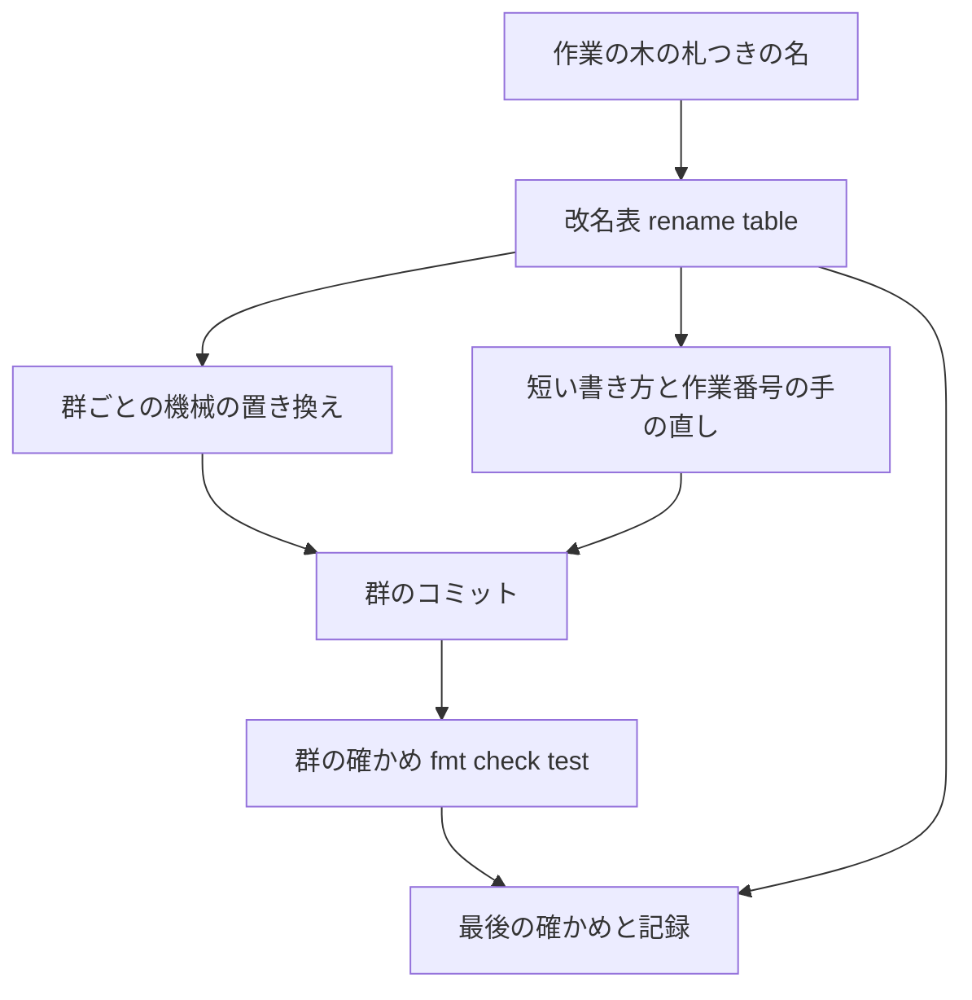
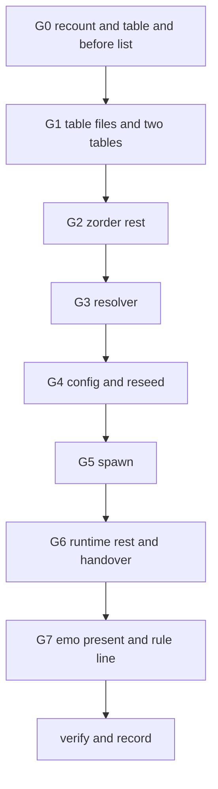

# 設計: test-name-work-tags

## Overview

**Purpose**: テストの関数の名の頭に残る作業番号の札（`t_i4_`・`t_c3_`・`t_zgp1_` ほか）を外し、名を読めば何を確かめるテストかが分かる形にする。あわせて、その名を指す所（コメント・本体の表・`doc/COMPAT_ARCHITECTURE.md` §8・未完了の spec の brief）を新しい名へ直し、注釈に書かれた設計の作業番号（`T-K5`・`zwi01／02` ほか）を消す。

**Users**: 開発者と、テストを読み書きするセッション。名から札が消え、文書やコメントから辿った名でテストが見つかる。CLAUDE.md の決まりに「テストの名にも書かない」が載り、新しいテストが札を写さなくなる。

**Impact**: 変わるのはテストの名・名指し・注釈・CLAUDE.md の 1 行だけ。テストの本文・期待値・本数・本番の振る舞いは変わらない。本体の `runtime_tests/zorder_wiring_tests.rs` の札つきの 2 本は `audit-areka-app` が後で改める。

### Goals

- 範囲の 28＋2 ファイルの札つきのテスト 284 本（`fn t_[a-z]+[0-9]+[a-z]?_` の 282 本と `t_zbc_`・`t_zic_` の 2 本）から札を外す。
- 改めた名の名指しが、歴史の場所とこの spec の文書のほかで、古い名・札だけの短い書き方を 0 にする。
- 全体テストが整形と静的検査の段を含めて緑のまま。

### Non-Goals

- 名の言い回しの直し（札の外の綴りは変えない・要件 1.4）。
- テストの本文・置き場・ファイル名の直し、本番のコードの直し。
- 札を見張る照合のテスト（要件 7.2）。
- 歴史の場所の書き換え、`doc/COMPAT_ARCHITECTURE.md` のファイルの改名。

## Boundary Commitments

### This Spec Owns

- 次の 28＋2 ファイルの札つきのテストの名（一覧は File Structure Plan）: `crates/areka-placement/src/` の 20 ファイル、`crates/areka-runtime/src/` の 8 ファイル、本体の `crates/areka/src/placement_tests/zorder_group_branch_coverage_tests.rs`・`zorder_inversion_branch_coverage_tests.rs`（表と札つきのテスト各 1 本）。
- 改めた名の名指し: 範囲の crate のコメント（本番のファイル `zorder_group_ledger.rs:667` のコメントを含む）、本体の 2 つの表、`doc/COMPAT_ARCHITECTURE.md` §8 の 196・226・354・412 行の名、`.kiro/specs/extra-character-windows/brief.md:133`、`.kiro/specs/zorder-property/brief.md` の 59・81・94 行。
- 注釈の設計の作業番号: `crates/areka-placement/`・`crates/areka-runtime/` の `T-*` と `t_` の無い札、`crates/areka-emo-present/` の 2 行（`T-N3`）。
- `crates/areka-runtime/src/consumer_ledger_test_support.rs` の 28 行のコメント（許す重なり）。
- `.kiro/specs/audit-areka-app/brief.md` への申し送りの 1 項目。
- CLAUDE.md の `## Comments` の 97 行目に語を足すこと。
- 改名表 `rename-table.tsv` と、`research.md` の確かめの記録。

### Out of Boundary

- 本体の `crates/areka/src/runtime_tests/zorder_wiring_tests.rs`（札つきの 2 本と 4・5・10・11・13 行の名指し）＝`audit-areka-app` の持ち物。`session-crate-split` が同じウェーブで `include_str!` の道を直す。
- `consumer_ledger_test_support.rs` の 126 行からの塊、`carrier_cue`・`actor_carrier_cue` の呼び出しと名＝`dola-cue-test-builder` の持ち物。
- `doc/COMPAT_ARCHITECTURE.md` §8 のパスの行＝`session-crate-split` の持ち物。
- `crates/areka/src/placement_tests/zorder_branch_coverage_test_support.rs` の検査の見本の文字列（`t_one`・`t_gone`・`t_only_in_a_comment`・`t_real_one`）。
- 札でない頭（`spine_`・`real_`・`row1_`〜`row7_`）、`crates/areka-sakura/` の局所変数 `t_wait1`・`t_wait2`。
- `doc/COMPAT_ARCHITECTURE.md:412` の「旧 `t_c3_char_n_prefix_adds_scope_n`」と「テスト T-C3」（歴史の文・要件 4.8）。
- 名指しの行に在る、名のほかの古い記述（例: `zorder-property/brief.md` の古い道 `crates/areka/src/placement/…`）。
- 歴史の場所（`.kiro/specs/completed/`・`doc/archive/`・`.kiro/steering/roadmap-history.md`）。

### Allowed Dependencies

- 道具: `git grep`・python（使い捨ての置き換えの式）・`cargo fmt`・`cargo check`・`cargo test`・`pwsh -NoProfile -File tools/test-all.ps1`。新しい crate・新しい依存は足さない。
- 本体の表の検査 `check_table`（`zorder_branch_coverage_test_support.rs`）を、各コミットの名の照合に使う（中身は変えない）。
- 置き換えの式は作業の木の `target/test-name-work-tags/` に置き、コミットしない。

### Revalidation Triggers

- 着手のときの数え直しで、札つきの名の数・名指しの行が起票の数え（284 本・research.md 2.3・2.4）と違う → 改名表と群を作り直す。
- C25 の相手（`session-crate-split`・`dola-cue-test-builder`）の着地で、範囲のファイルや §8 の行が動いた → 取り込んでから数え直す。
- `zorder-property`・`zorder-chain-residue` が範囲のファイルを触って走り始めた → そのファイルの群を後に回す（要件 6.4）。
- この spec の着地の後: `audit-areka-app` は申し送りの新しい名を読む。`zorder-property`・`zorder-chain-residue`・`extra-character-windows` は新しい名を読む。

## Architecture

### Existing Architecture Analysis

- テストの名に依る作りは 1 つだけ: 本体の `placement_tests/` の 2 つの表（`COVERAGE`）が、`crate_source!` で他の crate のテストのファイルを読み、表の名ごとに `"\n#[test]\nfn {name}("` の字面が在るかを `check_table` で照合する。表が読む札つきのファイルは 10 本（G1 の一覧）。
- 名から一時フォルダやログの名を作る所・マクロで名を作る所・`#[ignore]`・`#[should_panic]`・スナップショットは、範囲のファイルに無い。`tools/`・`.github/`・nextest の設定に、名で絞る所は無い。
- 古い名の全体 284 本は全体で重ならない。札を外した名は同じモジュールの中で何ともぶつからない。別のモジュールで同じ名になる組は 6 組（research.md 2.2 の ⑴〜⑹・要件 1.3 で許す）。

### Architecture Pattern & Boundary Map



**Architecture Integration**:
- 型: 「改名表 1 つ ＋ 群ごとのコミット」。改名表が置き換えと確かめの両方の正本になる。
- 群の決まり: ある群のテストの名を改めるコミットは、その名の名指しを、どのファイルに在っても同じコミットで直す（要件 4.1）。
- 残す型: 本体の表の検査（`check_table`）をそのまま通す。`config.rs` は本番のファイルで、`mod tests` の中の名とテストを指すコメントだけを変える。
- steering: CLAUDE.md の `## Comments`（spec・要件・タスクの番号をコードに書かない）をテストの名にも当てる。

### Technology Stack

| Layer | Choice / Version | Role in Feature | Notes |
|-------|------------------|-----------------|-------|
| 数えと確かめ | `git grep -E`／`-P`・`-wF -f` | 札・古い名・短い書き方の数え、較正（改める前の木 `00877299` へ同じ式） | 既にある道具 |
| 置き換え | python 3（標準の `re`・バイトで読み書き） | 改名表の行ごとに単語の境で置き換える | 使い捨て・コミットしない |
| 整形・検査 | `cargo fmt --all`・`cargo check --workspace --all-targets`・`cargo test` | 各コミットの緑 | 既にある |
| 全体テスト | `pwsh -NoProfile -File tools/test-all.ps1 -Format -License` | 要件 3.5 | 完了の門の正本 |

## File Structure Plan

### Directory Structure

```
.kiro/specs/test-name-work-tags/
├── rename-table.tsv        # 改名表（新しく作る・コミットする）
└── research.md             # 確かめの記録を足す
target/test-name-work-tags/ # 使い捨て（コミットしない）
├── rename.py               # 表を作る・群を置き換える・短い書き方を数える式
├── tests-before.txt        # 改める前の名の一覧（モジュールのパスつき）
└── tests-after.txt         # 改めた後の名の一覧
```

`rename-table.tsv` の形: 1 行 1 本・タブ区切り・見出しの行 1 つ。欄は `group`（G1〜G6）・`file`（リポジトリの根からの道）・`tag`（`t_zgp1` ほか・数字の無い札は `t_zbc`・`t_zic`）・`old`・`new`。行は 284 本（着手のときの数え直しで足されたものを含む）。

### Modified Files（群ごと・本数は 2026-11-22 の数え）

**G1 — 本体の表が読む 10 ファイルと 2 つの表（146 本）**
- `crates/areka-placement/src/zorder_group_ledger_tests.rs`（23）・`zorder_group_ledger_state_tests.rs`（21）・`zorder_group_ledger_written_order_tests.rs`（10）・`zorder_chain_compose_tests.rs`（17）・`zorder_chain_compose_written_order_tests.rs`（5）
- `crates/areka-runtime/src/zorder_cue_tests.rs`（16）・`frame/zorder_descript_tests.rs`（19）・`frame/zorder_drain_tests.rs`（11）・`frame/zorder_drain_projection_tests.rs`（14）・`frame/zorder_drain_written_order_tests.rs`（8）
- `crates/areka/src/placement_tests/zorder_group_branch_coverage_tests.rs`・`zorder_inversion_branch_coverage_tests.rs`（表の名と札つきの各 1 本）
- G1 の名指しの見込み: `zorder_group_ledger_tests.rs` 8・9・10・24・25・315・357・472 行（範囲の書き方と短い書き方）・`zorder_group_ledger_written_order_tests.rs:167`・`zorder_group_ledger_state_tests.rs:20`・`zorder_drain_projection_tests.rs` 522・531 行・`window_state_cue_tests.rs:324`（`t_zcs14`）・`consumer_ledger_test_support.rs:28`（`t_zcs1／t_zcs2`）・`doc/COMPAT_ARCHITECTURE.md:226`

**G2 — `areka-placement` の zorder の残り（17 本）**
- `crates/areka-placement/src/zorder_group_ledger_rebase_tests.rs`（9）・`zorder_property_deferral_tests.rs`（8）
- 名指しの見込み: `zorder_group_ledger.rs:667`（本番のファイルのコメント・`t_zrb9`）・`zorder_property_deferral_tests.rs` の doc コメントのリンクと 268・307・308・453・487 行の短い書き方・`.kiro/specs/zorder-property/brief.md` 59・81・94 行

**G3 — 配置の解決（42 本）**
- `crates/areka-placement/src/resolver_resolve_tests.rs`（15）・`resolver_balloon_keyword_tests.rs`（12）・`resolver_resolve_free_tests.rs`（6）・`resolver_resolve_balloon_tests.rs`（6）・`resolver_union_tests.rs`（3）
- 名指しと注釈の見込み: 同じ 5 ファイルの `T-K1`〜`T-K9`・`T-R8` ほか 67 行・`resolver_balloon_keyword_tests.rs:54`・`doc/COMPAT_ARCHITECTURE.md:196`（`t_k5`）

**G4 — 設定と再配置（47 本）**
- `crates/areka-placement/src/config.rs`（20・`mod tests` の中だけ）・`config_limit_tests.rs`（2）・`reseed_tests.rs`（14）・`balloon_limit_tests.rs`（9）・`source_tests.rs`（2）
- 名指しの見込み: `doc/COMPAT_ARCHITECTURE.md` 354・412 行・`.kiro/specs/extra-character-windows/brief.md:133`

**G5 — 窓の作成（12 本）**
- `crates/areka-placement/src/spawn_cleanup_tests.rs`（6）・`spawn_follow_pipeline_tests.rs`（3）・`spawn_clickthrough_tests.rs`（3）
- 名指しの見込み: `spawn_assembly_tests.rs:154`

**G6 — `areka-runtime` の残り（20 本）**
- `crates/areka-runtime/src/window_state_cue_tests.rs`（13）・`zorder_wiring_tests.rs`（5）・`frame_schedule_tests.rs`（2）
- 名指しと注釈の見込み: `zorder_wiring_tests.rs` 7・8・11・18・182 行（`zwi01／02` ほか・`T-N10`）・`frame_schedule_tests.rs:14`（`t_zwi06`）・`.kiro/specs/audit-areka-app/brief.md`（申し送り）

**群に属さない直し（G7）**
- `crates/areka-emo-present/src/presenter_dpi_scale_tests.rs:24`・`presenter_test_support.rs:229`（`T-N3`）
- `CLAUDE.md:97`

「名指しの見込み」は今の測りで、正本は改名表から機械で引いた当たり（RenameScript の `refs`）。見込みに無い当たりが出たら、その群のコミットで直す。

### 部品とファイルの対応

- RenameTable → `.kiro/specs/test-name-work-tags/rename-table.tsv`
- RenameScript → `target/test-name-work-tags/rename.py`（コミットしない）
- RenamePrinciple・GroupCommit・ManualEdit → G1〜G6 の Modified Files（決まりと進め方で、ファイルを足さない）
- DocFollow → `doc/COMPAT_ARCHITECTURE.md`・`.kiro/specs/zorder-property/brief.md`・`.kiro/specs/extra-character-windows/brief.md`
- AuditHandover → `.kiro/specs/audit-areka-app/brief.md`
- RuleLine → `CLAUDE.md`
- VerificationRecord → `.kiro/specs/test-name-work-tags/research.md`（記録）・`target/test-name-work-tags/tests-before.txt`・`tests-after.txt`（コミットしない）

## System Flows



- 群の順は G1 を先頭に固定する（いちばん大きく、表の照合が効く所なので、置き換えの式の誤りを早く見つける）。G2〜G7 は互いに独立で、順を入れ替えてよい。1 つの作業の木で 1 群ずつ直列に進める。
- 各群の閉じ方: ⑴ `refs` の当たりと、その群の札の短い書き方の当たりが 0 ⑵ `cargo fmt --all` ⑶ `cargo check --workspace --all-targets` が警告 0 ⑷ 改めた crate の `cargo test -p <crate>`（G1 は `areka-placement`・`areka-runtime` と、本体の表の検査 `cargo test -p areka --bin areka placement_tests::zorder`）⑸ コミット。
- 戻すきっかけ: 群の中でテストの合否か本数が変わったら、その群の中で直す（次の群へ持ち越さない）。

## Requirements Traceability

| Requirement | Summary | Components | Interfaces | Flows |
|-------------|---------|------------|------------|-------|
| 1.1 | 札だけを外す | RenameTable | `build` の `new` の作り方 | S0 |
| 1.2 | 同じモジュールでぶつかれば語を足す | RenameTable | `build` のぶつかりの検査（今は 0） | S0 |
| 1.3 | 別のモジュールの同じ名は許す | RenameTable, VerificationRecord | `build` の同じ名の一覧（6 組） | S0, S8 |
| 1.4 | 札の外の綴りを変えない | RenameTable | `new` は札を外した残り | S0 |
| 1.5 | 数字の無い札（`t_zbc_`・`t_zic_`） | RenameTable | `build` が 2 本だけを名で足す | S0, S1 |
| 1.6 | 意味のある頭を変えない | RenameTable | 札の式が `spine_`・`real_`・`row1_` に当たらない | S0 |
| 2.1 | 28 ファイル 282 本 | RenameTable, GroupCommit | G1〜G6 | S1〜S6 |
| 2.2 | 本体の表のファイルの各 1 本 | GroupCommit | G1 | S1 |
| 2.3 | 本体の `runtime_tests/zorder_wiring_tests.rs` に触らない | RenameTable, VerificationRecord | `build` の除くファイル・`git diff --name-only` | S0, S8 |
| 2.4 | 着手のときの数え直し | RenameTable | `build` の数え・記録 | S0 |
| 3.1 | 本文・属性・`mod` を変えない | RenamePrinciple, VerificationRecord | 置き換えは名の全体だけ・名の一覧の比べ | S1〜S6, S8 |
| 3.2 | crate ごとの本数が同じ | VerificationRecord | 名の一覧の比べ | S0, S8 |
| 3.3 | 本番のコードを変えない | RenamePrinciple | `config.rs` は `mod tests` の中・本番はコメントだけ | S2, S4 |
| 3.4 | ファイル名と置き場・1,000 行 | RenamePrinciple, VerificationRecord | 行数の確かめ | S8 |
| 3.5 | 全体テストが緑 | VerificationRecord | `tools/test-all.ps1 -Format -License` | S8 |
| 4.1 | 同じコミットで名指しを直す | GroupCommit | 群の決まり・`refs` | S1〜S6 |
| 4.2 | コメントの名指し（doc のリンクを含む） | RenameScript, ManualEdit | `apply`・短い書き方の手の直し | S1〜S6 |
| 4.3 | 本体の表の名と表の検査 | GroupCommit | G1 で `check_table` を通す | S1 |
| 4.4 | §8 の名だけ | DocFollow | 196・226・354・412 行 | S1, S3, S4 |
| 4.5 | 未完了の spec の文書 | DocFollow | 2 つの brief | S2, S4 |
| 4.6 | 数え直しで見つかった名指し | RenameScript, DocFollow | `refs` を steering と未完了の spec の文書へも当てる | S0〜S6 |
| 4.7 | 歴史の場所を書き換えない | RenameScript | 除く場所 | S1〜S6 |
| 4.8 | 412 行の歴史の文を残す | DocFollow | 「旧 …」と「テスト T-C3」を置き換えの外に | S4 |
| 4.9 | 短い書き方・範囲の書き方 | ManualEdit | 札 → 新しい名の全体・範囲は文で | S1〜S6 |
| 4.10 | 注釈の作業番号 | ManualEdit | `T-*`・`t_` の無い札 | S3, S6, S7 |
| 4.11 | 同じ名の名指しにファイルを添える | ManualEdit | 同じ名の一覧に当たる名指し | S1, S2 |
| 5.1 | 札の式の当たりは本体の 2 本だけ | VerificationRecord | 式 1 | S8 |
| 5.2 | 数字の無い札の式は見本だけ | VerificationRecord | 式 2 | S8 |
| 5.3 | 古い名が残らない | VerificationRecord | 式 3（改名表の `old` の名簿） | S8 |
| 5.4 | 式・数・場所と較正の記録 | VerificationRecord | 改める前の木へ同じ式 | S8 |
| 5.5 | 短い書き方と大文字の作業番号 | VerificationRecord | 式 4・5 と例外の表 | S8 |
| 6.1 | 本体は `placement_tests/` の 2 ファイルだけ | GroupCommit, VerificationRecord | `git diff --name-only` | S8 |
| 6.2 | cue の 3 ファイルは名と名指しだけ | GroupCommit | G1・G6 の差分を名の行とコメントに限る | S1, S6 |
| 6.3 | §8 は名の行だけ | DocFollow | 196・226・354・412 行だけ | S1, S3, S4 |
| 6.4 | 走っている相手のファイルは後に回す | RenameTable | 着手のときの確かめ・記録 | S0 |
| 6.5 | `consumer_ledger_test_support.rs:28` と知らせ | GroupCommit | G1 の前に相手へ知らせる | S1 |
| 6.6 | `audit-areka-app` への申し送り | AuditHandover | G6 | S6 |
| 7.1 | CLAUDE.md の 1 行に語を足す | RuleLine | G7 | S7 |
| 7.2 | 照合のテストを足さない | RuleLine | 足さない | S7 |

## Components and Interfaces

| Component | Domain/Layer | Intent | Req Coverage | Key Dependencies | Contracts |
|-----------|--------------|--------|--------------|------------------|-----------|
| RenameTable | 記録 | 改める名の正本（古い名 → 新しい名） | 1.1〜1.6, 2.1, 2.3, 2.4, 6.4 | 作業の木（P0） | State |
| RenameScript | 使い捨ての道具 | 表を作る・群を置き換える・名指しを数える | 4.2, 4.6, 4.7 | RenameTable（P0） | Batch |
| RenamePrinciple | 決まり | 変えてよい字の範囲 | 3.1, 3.3, 3.4 | — | — |
| GroupCommit | 進め方 | 1 群 1 コミットと閉じ方 | 2.1, 2.2, 4.1, 4.3, 6.1, 6.2, 6.5 | RenameScript（P0）・`check_table`（P0） | — |
| ManualEdit | 手の直し | 短い書き方・範囲・作業番号・同じ名の名指し | 4.2, 4.9, 4.10, 4.11 | RenameTable（P0） | — |
| DocFollow | 文書 | §8 と brief の名 | 4.4〜4.8, 6.3 | RenameTable（P0） | — |
| AuditHandover | 文書 | 本体の残りを受け持つ spec への申し送り | 6.6 | RenameTable（P1） | — |
| RuleLine | 決まり | CLAUDE.md の 1 行 | 7.1, 7.2 | — | — |
| VerificationRecord | 確かめ | 検索・名の一覧・全体テストと記録 | 1.3, 2.3, 3.1〜3.5, 5.1〜5.5, 6.1 | RenameTable（P0） | — |

### 記録と道具

#### RenameTable

| Field | Detail |
|-------|--------|
| Intent | 改める名の正本。置き換えと最後の確かめが同じ表を読む |
| Requirements | 1.1, 1.2, 1.3, 1.4, 1.5, 1.6, 2.1, 2.3, 2.4, 6.4 |

**Responsibilities & Constraints**
- 着手のときの木から作る。式: `fn t_[a-z]+[0-9]+[a-z]?_[a-z]` の定義（`#[test]` が付かないものが出たら記録する・2026-11-22 は 284 本とも `#[test]`）、それに名で `t_zbc_the_table_covers_every_branch_with_executed_tests`・`t_zic_the_table_covers_every_branch_with_executed_tests` の 2 本。`new` は `old` から札（`t_` と英小文字と数字の続きと、その後ろの `_`）を外した残り（1.1・1.4・1.5）。
- 除くファイル: 本体の `crates/areka/src/runtime_tests/zorder_wiring_tests.rs`（2.3）と、`zorder_branch_coverage_test_support.rs`（見本の文字列）。数え直しで C25 の相手の持ち物のファイル（`session-crate-split`・`dola-cue-test-builder` の触るファイルで、範囲の 3 つの cue のファイルの他）に札つきの名が見つかったら、表に入れず記録する（2.4）。
- 作るときの検査（どれかが崩れたら表を作らずに止まる）:
  - `old` は全体で重ならない。
  - `new` が同じファイルの他の `fn`・`const`・`static`・`struct`・`enum`・`mod`・`type` の名とぶつからない。ぶつかったら、その行の `new` の後ろに中身を表す語を足し、決めた訳を記録する（1.2・今は 0）。
  - `new` が Rust の予約語でなく、数字で始まらない。
  - 別のファイルで同じ `new` になる組を一覧にし、research.md 2.2 の 6 組と比べる（1.3）。増えたら記録し、名指しの文にファイルを添える対象（4.11）に足す。
- 札の式は `spine_`・`real_`・`row1_` に当たらない（`t_` で始まらない・1.6）。
- 範囲のファイルを触る別の spec（`zorder-property`・`zorder-chain-residue` ほか）が走っていないかを着手のときに確かめ、走っていればそのファイルの群を後に回して記録する（6.4・2026-11-22 は 3 本とも brief だけ）。

**Contracts**: State [x]

##### State Management
- 形: `group\tfile\ttag\told\tnew`（見出しつきの TSV・UTF-8・LF）。`group` は File Structure Plan の G1〜G6。
- 着手のコミット（G0）でコミットし、その後は書き換えない。数え直しの結果は `research.md` に書く。

#### RenameScript（使い捨て・`target/test-name-work-tags/rename.py`）

| Field | Detail |
|-------|--------|
| Intent | 表を作り、群の名を置き換え、残る名指しを数える |
| Requirements | 4.2, 4.6, 4.7 |

**Contracts**: Batch [x]

##### Batch / Job Contract
- `build`: RenameTable の決まりで `rename-table.tsv` を書く。数え（ファイルごと・crate ごと）と同じ名の一覧を端末へ出す。
- `apply <group>`: その群の各行について、`git ls-files` の全部のファイルから除く場所（`.kiro/specs/completed/`・`doc/archive/`・`.kiro/steering/roadmap-history.md`・`.kiro/specs/test-name-work-tags/`・本体の `runtime_tests/zorder_wiring_tests.rs`）を外した所で、`\b<old>\b` を `<new>` へ置き換える。古い名は単語の境で区切るので、長い名の一部には当たらない。ファイルはバイトで読み書きし、文字コード・改行・逆斜線を含む他の文字列を保つ。`doc/COMPAT_ARCHITECTURE.md:412` の「旧 `t_c3_char_n_prefix_adds_scope_n`」は表に無い名なので当たらない（4.8）。
- `refs <group>`: 置き換えた後に、その群の `old` の全体と、その群の札の短い書き方 `\b<tag>\b(?!_[a-z])`（その札を持つ行が群の中に 1 本だけのもの）の当たりを出す。手の直し（ManualEdit）が済めば 0。
- 端末へ出すのは ASCII の数行（数と道）だけ。
- 冪等: 同じ群に 2 度当てても、古い名はもう無いので何も変わらない。

#### RenamePrinciple

- 変えてよいのは、テストの `fn` の行の名・名指し（名の全体と短い書き方）・注釈の作業番号・CLAUDE.md の 1 行だけ（3.1）。
- 本番のファイルで変えてよいのは、テストを指すコメントだけ（`zorder_group_ledger.rs:667`）。`config.rs` は `#[cfg(test)] mod tests` の中の名とコメントだけで、`mod limit_tests;` ほかの宣言は変えない（3.3）。
- テストのファイルの名・置き場は変えない。名が短くなるだけなので 1,000 行を越えるファイルは出ない（いちばん長い `zorder_chain_compose_tests.rs` が 720 行・3.4）。

### 進め方

#### GroupCommit

| Field | Detail |
|-------|--------|
| Intent | 1 群 1 コミット。群の名の名指しは、どこに在っても同じコミット |
| Requirements | 2.1, 2.2, 4.1, 4.3, 6.1, 6.2, 6.5 |

- 群は File Structure Plan の G1〜G6。コミットの順と閉じ方は System Flows。
- G1 は本体の表が読む 10 ファイルと 2 つの表を 1 コミットに入れ、`cargo test -p areka --bin areka placement_tests::zorder` の表の検査を緑にして閉じる（4.1・4.3）。
- G1 に入る `consumer_ledger_test_support.rs:28` は、手を付ける前に `dola-cue-test-builder` のセッションへ「28 行のコメントの名だけを直す・126 行からの塊に触らない」と知らせる（6.5）。
- `window_state_cue_tests.rs`・`zorder_cue_tests.rs`・`zorder_wiring_tests.rs`（`areka-runtime`）の差分は、`fn` の行の名とコメントだけ（6.2）。`carrier_cue` ほかの呼び出しの行は差分に出ない。
- 本体の crate で触るのは `placement_tests/` の 2 ファイルだけ（6.1）。

### 手の直し

#### ManualEdit

| Field | Detail |
|-------|--------|
| Intent | 機械の置き換えが拾わない名指しと作業番号を、同じ群のコミットで直す |
| Requirements | 4.2, 4.9, 4.10, 4.11 |

- **札だけの短い書き方**（`t_zgp20`・`t_zpd10`・`t_zrb9`・`t_k5` ほか）: 改名表で札から 1 本を引き、新しい名の全体へ書き直す（4.9）。doc コメントのリンクの見出し（`[`t_zdp10`]: t_zdp10_…`）は、見出しも新しい名の全体にする。
- **範囲の書き方**（`zorder_group_ledger_tests.rs` の `t_zgp1`〜`t_zgp14` ほか）: 名を並べず、そのまとまりの中身の言葉で言い直す（例: 「受理 3 形と拒否 4 分岐…（`t_zgp1`〜`t_zgp14`）」→「受理 3 形と拒否 4 分岐…」。括弧の番号だけを消し、すでに在る中身の言葉を残す）（4.9）。
- **大文字の作業番号**（`T-K1`〜`T-K9`・`T-R8` ほか）: 節の見出しや doc コメントの頭の番号は消し、説明の文を残す。他のテストを指す所は、ファイルとテストの新しい名で書き直す（`frame_schedule_tests.rs`（T-N10）→ そのファイルの 2 本の新しい名・`display_tests.rs` の T-N3 → `display_tests.rs` の `surface_size_matches_scaled_extent_within_one_pixel`）。番号でまとめて指す所（「T-R8 群」）は、ファイルと中身の言葉で指す（4.10）。
- **`t_` の無い札**（`zwi01／02`・`zwi06／07`・`zwi09`）: 消して、中身の言葉の説明を残す。`areka-runtime` の `zorder_wiring_tests.rs:18` が本体の 2 本を指す「（zwi05）」「（zwi08）」も消し、ファイルの道と中身の言葉で指す形を残す（本体の 2 本はまだ新しい名を持たないため・仮定・議題 4）（4.10）。
- **同じ名の名指し**: 名指しの名が別のファイルの同じ名（RenameTable の同じ名の一覧）に当たるときは、「`zorder_group_ledger_rebase_tests.rs` の `version_moves_only_when_the_contents_move`」の形でファイルを添える。2026-11-22 の測りでは `zorder_group_ledger_state_tests.rs:20`（G1）と `zorder_group_ledger.rs:667`（G2）（4.11）。
- 新しく書く文は、すでにあるコメントの言い回しに合わせ、作業番号・spec の名を足さない。

### 文書

#### DocFollow

| Field | Detail |
|-------|--------|
| Intent | §8 と未完了の spec の文書の名を新しい名へ |
| Requirements | 4.4, 4.5, 4.6, 4.7, 4.8, 6.3 |

- `doc/COMPAT_ARCHITECTURE.md` §8: 196 行（`t_k5`・G3）・226 行（`t_zdb13`〜`t_zdb17`・G1）・354 行（`t_rs01`・`t_rs02`・`t_rs05`・G4）・412 行（`t_c3`・`t_l2`・`t_rs01`・G4）の名だけを直す。同じ行の他の記述と、他の行（`session-crate-split` が直すパスの行を含む）は変えない。412 行の「旧 `t_c3_char_n_prefix_adds_scope_n`」と「テスト T-C3」は残す（4.4・4.8・6.3）。
- `.kiro/specs/zorder-property/brief.md`: 94 行（名の全体）・59・81 行（`t_zpd40` の短い書き方を名の全体へ）・G2。同じ行の古い道は直さない（4.5）。
- `.kiro/specs/extra-character-windows/brief.md:133`（3 本の名・G4）。同じ brief の 131 行の「テスト T-C3」は、完了 spec の設計の番号を書く歴史の文で、412 行と同じく残す（仮定・議題 3）（4.5）。
- steering とほかの未完了の spec の文書は、各群の `refs` で当たりを見る。当たれば同じ群で直す（4.6）。2026-11-22 の測りでは、改める名の名指しは無い（`roadmap.md` の当たりはこの spec の行の札の例で、名指しではない・議題 3）。
- 歴史の場所は `apply` の除く場所なので書き換わらない（4.7）。

#### AuditHandover

| Field | Detail |
|-------|--------|
| Intent | 本体の `runtime_tests/zorder_wiring_tests.rs` の名指しの直しを `audit-areka-app` へ渡す |
| Requirements | 6.6 |

- G6 のコミットで、`.kiro/specs/audit-areka-app/brief.md` の「棚卸㊷からの申し送り」の節に 1 項目を足す。中身: そのファイルの 2 本の改名と同じコミットで、4・5・10・11・13 行の名指し（`areka-runtime` の側の改めたテストを指す所）を新しい名へ直し、番号の札を消すこと。新しい名は改名表から引いて書く（`areka-runtime` の `zorder_wiring_tests.rs` の 6 本と、`frame_schedule_tests.rs`・`frame/zorder_descript_tests.rs` ほか当たるもの）。古い札は書かず、行の番号と新しい名で指す。
- 既にある項目（159 行）は書き換えない。

### 決まり

#### RuleLine

| Field | Detail |
|-------|--------|
| Intent | 作業番号をテストの名にも書かない決まりを CLAUDE.md に載せる |
| Requirements | 7.1, 7.2 |

- CLAUDE.md 97 行目 `Do not reference `.kiro` specs, requirement IDs, or task numbers in code.` の `in code` の後に、テストの名を含むことを足す（例: `in code, test names included.`）。同じ行の後ろの文と、他の行は変えない（7.1）。
- 照合のテストは足さない（7.2）。

### 確かめ

#### VerificationRecord

| Field | Detail |
|-------|--------|
| Intent | 「全部外した」「名だけが変わった」を数えで示し、`research.md` に残す |
| Requirements | 1.3, 2.3, 3.1, 3.2, 3.3, 3.4, 3.5, 5.1, 5.2, 5.3, 5.4, 5.5, 6.1 |

検索の式（どれも `git grep`・式・数・当たった場所を research.md に書く）:
1. 札の形（5.1）: `git grep -nE "fn t_[a-z]+[0-9]+[a-z]?_" -- crates` の当たりが、本体の `runtime_tests/zorder_wiring_tests.rs` の 2 本だけ。
2. 数字の無い札の形（5.2）: `git grep -nE "fn t_[a-z]+_" -- crates` から式 1 の当たりを除いたものが、`zorder_branch_coverage_test_support.rs` の見本の文字列だけ。
3. 古い名（5.3）: 改名表の `old` を名簿にして `git grep -nwF -f <名簿>` を、歴史の場所と `.kiro/specs/test-name-work-tags/` を除くリポジトリ全体へ当てて 0。
4. 札だけの短い書き方（5.5）: `git grep -nP "\bt_[a-z]+[0-9]+[a-z]?"` を `crates/`・`doc/`・`.kiro/steering/`・未完了の spec の文書へ（歴史の場所を除く）。
5. 大文字の作業番号（5.5）: `git grep -nP "\bT-[A-Z]{1,4}[0-9]{1,2}[a-z]?\b"` を同じ範囲へ。
- 式 4・5 の当たりは、例外の表（`research.md` 8.4 の下書き）と 1 件ずつ突き合わせ、例外ごとに訳を書く。例外の表: 本体の `runtime_tests/zorder_wiring_tests.rs` の申し送った行と札つきの 2 本・`doc/COMPAT_ARCHITECTURE.md:412` の歴史の文・`t_wait1`・`t_wait2`、それに仮定で足す `extra-character-windows/brief.md:131`・`audit-areka-app/brief.md` の本体の 2 本の名・`roadmap.md` のこの spec の行・この spec の文書（議題 3）。
- 較正（5.4）: 式 1〜5 を改める前の木（`00877299`・`git grep … 00877299 -- …`）へ当て、式 1 が 284、式 2 が 4、式 3 が `fn` の定義の 284 行と research.md 2.3 の名指し、式 4・5 が research.md 2.4 の当たりを出すことを同じ記録に書く。
- 名の一覧（3.1・3.2・1.3）: G0 で `cargo test --workspace --no-fail-fast -- --list` の `: test$` の行をモジュールのパスつきで `tests-before.txt` に取る。最後に同じ形で `tests-after.txt` を取り、前の一覧の最後の名を改名表で写して並べ直したものと 1 行も違わないことを示す。crate ごとの本数も添える。
- 触らない所（2.3・6.1・3.3）: `git diff --name-only main...HEAD` が File Structure Plan のファイルと spec の文書だけ。本体は `placement_tests/` の 2 ファイルだけで、`runtime_tests/` は 0。本番のファイルの差分は `zorder_group_ledger.rs` のコメントの 1 行と、`config.rs` の `mod tests` の中だけ。
- 行数（3.4）: 触ったファイルのどれも 1,000 行以下。
- 全体テスト（3.5）: `pwsh -NoProfile -File tools/test-all.ps1 -Format -License` が緑。完了の門（`/kiro-complete`）の 1 回と重ねてよい。

## Data Models

保存する値の形は変わらない。新しい記録は `rename-table.tsv` だけ（形は RenameTable）。

## Error Handling

- 新しい失敗の道は作らない。作業の失敗は全部ビルドかテストか検索で止まる: 古い名を表に残したまま改めるとコンパイル（`fn` の行）か表の検査（`check_table`）が赤、名指しの取り残しは各群の `refs` と最後の式 3〜5 で見える。
- 改名表を作るときの検査が崩れたら（重なり・ぶつかり・数えの違い）、表を作らずに止まり、訳を記録してから直す。
- 並走の相手の持ち物に触らなければ済まない名指しが見つかったら、そのファイルを変えずに申し送り、相手のセッションに相談する（6.4・6.5 の型）。

## Testing Strategy

### 各群の確かめ

- 本体の表の検査（`zorder_group_branch_coverage_tests.rs`・`zorder_inversion_branch_coverage_tests.rs` の `the_table_covers_every_branch_with_executed_tests` の 2 本）: G1 で、表の 68 の名が改めたファイルの `#[test]` つきの `fn` に在る（4.1・4.3）。
- 改めた crate のテスト（`cargo test -p areka-placement`・`-p areka-runtime`）: 各群で合否が前と同じ（3.1）。
- `cargo check --workspace --all-targets` の警告 0: 改名で使われない道具や、隠された本番の関数が出ていない（research.md 2.2 で 0 と測った）。
- `cargo fmt --all` の後の `--check` が差分 0（表の畳みは research.md 8.2 で 4 行の見込み）。

### 最後の確かめ

- VerificationRecord の式 1〜5 と較正、名の一覧の比べ、触らない所、行数、全体テスト。

## 設計の議題（設計の討議へ）

1. **コミットの切り方**: 改める群ごと（G0〜G8 の 9 タスク）にした。全部を 1 コミットで置き換える形（4〜5 タスク）もある。群ごとを推す訳＝レビューの単位が小さく、brief の見込み（8〜12 タスク）に合い、G1 で置き換えの式の誤りを早く見つけられる。
2. **記録の置き場**: 改名表 `rename-table.tsv` は spec の文書の隣にコミットし（後の spec が古い名を引ける）、名の一覧の前後と式は `target/test-name-work-tags/` に置いてコミットしない（数と比べの結果は research.md に書く）。前の spec（`session-module-gather`）は名の一覧を spec の文書にコミットしていた。
3. **要件 5.5 の例外の表を広げる**: 要件 5.5 が挙げる例外のほかに、式 4・5 が当てる所が 4 つある（`extra-character-windows/brief.md:131` の「テスト T-C3」＝412 行と同じ歴史の文・`audit-areka-app/brief.md:159` の本体の 2 本の名＝まだ在るテストを正しく指す・`roadmap.md` 514・2033・2039 行のこの spec の札の例・この spec の文書）。仮定: どれも書き換えず、例外として訳つきで記録する（要件 5.3 がこの spec の文書を除くのと同じ扱い）。
4. **`areka-runtime` の `zorder_wiring_tests.rs:18` の「（zwi05）」「（zwi08）」**: 本体の 2 本は着地の後も札を持つ。仮定: 番号だけを消し、すでに在る「`areka` の `runtime_tests/` の同じ名前のファイル」と中身の言葉で指す形を残す。別案は本体の 2 本の今の名の全体（`t_zwi05_…`）を書くことで、そうすると `audit-areka-app` の申し送りにこの行も足す必要がある。
