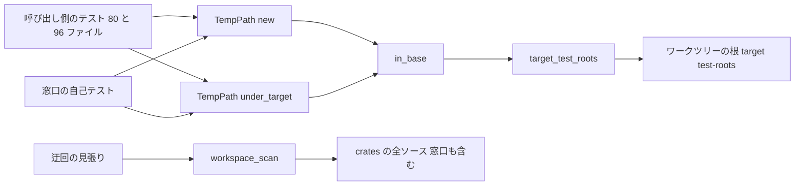
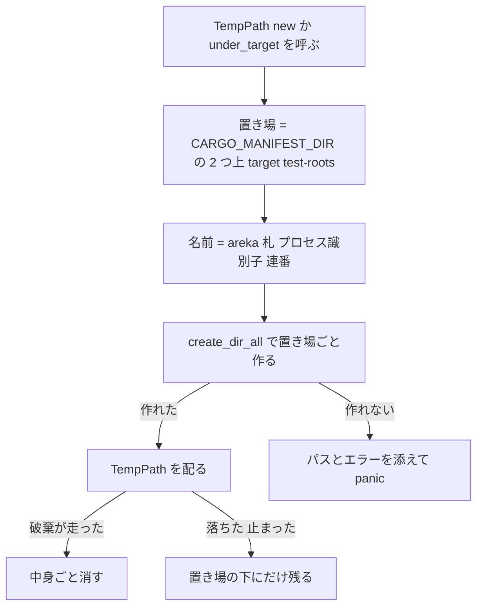

# 設計: test-roots-under-target

> 2026-11-01・`requirements.md`（2026-10-31 の要件討議で 4 件とも推奨案で確定）と `research.md`（ギャップ分析と 11 節の設計の調べ）にもとづく。調べの経緯は `research.md` に置き、ここには決めたことと形だけを書く。

## Overview

**Purpose**: テスト用の一時フォルダの窓口 `temp_path_kit::TempPath` の入口 `TempPath::new` が作る一時フォルダを、OS の一時フォルダ（`%TEMP%`）から、`TempPath::under_target` と同じワークツリーの `target\test-roots\` へ移す。呼び出しの 80 ファイル・240 か所は書き換えず、入口の中身 1 行を替えるだけで一度に移る。

**Users**: ワークスペースのテストを回す開発者と AI。テストが落ちたり途中で止まったりして残った一時フォルダが、ワークツリーか `target` を消すだけで片付くようになる。

**Impact**: 窓口の 2 つの入口は同じ置き場・同じ働きになる。見張りは「窓口の中で OS の一時フォルダを引く呼び出しが 1 か所ある」を確かめる形から、「窓口の中にも 0 件・例外表の 19 ファイルの外に 0 件」を確かめる形に改まる。

### Goals

- `TempPath::new` と `TempPath::under_target` のどちらから求めても、一時フォルダが `<ワークツリーの根>\target\test-roots\` の直下にできる（要件 1）。
- 呼び出し側のファイルを 1 つも書き換えず、テストの結果を変えない（要件 2）。
- 以後、入口を OS の一時フォルダへ戻すと、窓口の自己テストと迂回の見張りの両方が赤になる（要件 4）。

### Non-Goals

- `TempPath::new` の呼び出しの書き換え・入口を 1 つに寄せること・入口の廃止の印。
- 見張りの例外表の 19 ファイル（その 18 ファイルのテストは本 spec の後も OS の一時フォルダを使う）。
- 名前を短くする備え・`CARGO_TARGET_DIR` を見る形・残ったフォルダの掃除の仕組み・Defender の設定。
- `real_pasta_test.rs` の「`pasta.dll` を単体で写す」既知の欠陥の直し。

## Boundary Commitments

### This Spec Owns

- `TempPath::new` の置き場（`target_test_roots()` を使うこと）と、窓口の説明（crate の利用手順・`new`・`under_target`・置き場の式の doc）。
- 窓口の自己テストの置き場の確かめ（2 つの入口の両方）。
- 迂回の見張りの「窓口の中に 0 件」の確かめと、その陽性の対。
- `devroot.rs` 冒頭の doc の、窓口の置き場を述べる文（コメントだけ）。
- 要件 3.2 の実物の `pasta.dll` の走行の記録（`tasks.md` の `## Implementation Notes`）。

### Out of Boundary

- `TempPath::new`（80 ファイル・240 か所）と `TempPath::under_target`（96 ファイル）の呼び出し側。
- 見張りの例外表 `ALLOWED_ENTRY_POINT_USES` の中身と件数の定数（19・16・2・1）。
- ほかのクレートのテストと本番のコード、`Cargo.toml`・`Cargo.lock`、ほかの見張り（1,000 行の番人・姉妹の `sample_path_guard_test.rs`）。
- steering `structure.md` の「Temp Path Kit Crate」の節（完了の手順で直す）。
- 例外表の 18 ファイルを移す追跡の spec の起票（完了の棚卸で `/kiro-discovery`）。

### Allowed Dependencies

- 窓口: 標準ライブラリだけ（依存 0 のまま）。置き場の式は窓口のクレートのビルドの時に埋まる `CARGO_MANIFEST_DIR` だけから求める（環境変数は見ない）。
- 窓口の自己テスト: 窓口の中の項目（`TempPath`・`compose_name`）だけ。OS の一時フォルダを引く呼び出しは使わない（要件 4.2 と食い違うため）。
- 迂回の見張り: 既にある走査器 `crates/log-capture-kit/tests/workspace_scan/mod.rs` の公開の関数だけ。`temp-path-kit` への依存は足さない。

### Revalidation Triggers

- 置き場の式（`target_test_roots()`）の変更、または `temp-path-kit` のクレートの置き場所の移動（式は「クレートの 2 つ上」に頼る）。
- 窓口のファイルの増減（見張りの窓口のファイルの一覧が名指しする 2 ファイル）。
- 例外表を動かす spec（例外表の 18 ファイルの追跡の spec・`clippy-199-lints`）の着地。本 spec の見張りの件数の主張と突き合わせる。
- `areka-test-binary-stability` が静かな机で測っている間（本 spec の着地で全部のテストの一時フォルダの置き場が動く）。

## Architecture

### Existing Architecture Analysis

- 窓口（`crates/temp-path-kit/src/lib.rs`・148 行）は、入口 2 つが共通の `in_base(base, label)` を通る。名前の組み立て `compose_name`・連番・`create_dir_all`・作れないときの panic・破棄での削除は `in_base` と `Drop` が持つ。入口の違いは `base` だけ（`new` は `std::env::temp_dir()`、`under_target` は `target_test_roots()`）。
- `target_test_roots()` は `env!("CARGO_MANIFEST_DIR")`（`crates/temp-path-kit`）の 2 つ上に `target\test-roots` を足す。呼ぶ側のクレート・作業フォルダ・`CARGO_TARGET_DIR`・doctest の実行場所に左右されない（`research.md` 3 節）。
- 迂回の見張り（`crates/log-capture-kit/tests/temp_path_guard_test.rs`・783 行・16 本）は、`crates/**/*.rs` をコメントを除いて走査し、OS の一時フォルダの入口の 2 通りの綴りが例外表の外に無いことを確かめる。今は窓口の定義（`crates/temp-path-kit/src/`）を走査から外し、外した領域に当たりが `{lib.rs}` だけあることを別の 1 本で確かめている。

### Architecture Pattern & Boundary Map



- 形: 既にある「入口 → 共通の作る処理 → 置き場の式」をそのまま使い、`new` の行き先だけを `target_test_roots()` に替える。新しい部品は無い。
- 依存の向き: 呼び出し側 → 窓口 → 標準ライブラリ。見張りは窓口に依存せず、ソースの字面だけを読む（今のまま）。窓口の自己テストは窓口の中の項目だけを使う。

### Technology Stack

| 層 | 選んだもの | 役目 | 注 |
|---|---|---|---|
| 窓口 | Rust 標準ライブラリ（`std::fs`・`std::path`・`std::sync::atomic`） | 一時フォルダを作り、破棄で消す | 依存 0 のまま |
| 見張り | 既にある `workspace_scan`（ファイル列挙・コメント除去・語の走査） | 入口の呼び出しを数える | 変更 0 |
| 実物の走行 | i686 の `shiori-host32-helper`・検体 `emo2` の `pasta.dll` | 要件 3.2 の 1 度の走行 | 環境変数が無ければ飛ぶテスト。全体テストの対象外 |

## File Structure Plan

### Modified Files

- `crates/temp-path-kit/src/lib.rs` — `TempPath::new` の本体を `Self::in_base(&target_test_roots(), label)` に替える。説明を新しい置き場に合わせる（下の「窓口」の項）。署名・名前・連番・破棄は変えない。
- `crates/temp-path-kit/src/lib_tests.rs` — 今の `under_target_lives_in_workspace_target_test_roots_and_is_removed_on_drop` を、2 つの入口を回す 1 本に改める（下の「窓口の自己テスト」の項）。ほかの 8 本は変えない。
- `crates/log-capture-kit/tests/temp_path_guard_test.rs` — 窓口の定義を走査から外す仕組みを消し、窓口のファイルも主検査に入れる。`the_gateway_is_the_only_excluded_region_and_it_really_holds_the_entry_point` を「窓口の 2 ファイルが走査に入っていて、当たりが 0 件」の 1 本に置き換える（下の「迂回の見張り」の項）。例外表と件数の定数は変えない。
- `crates/sample-ghost-kit/src/devroot.rs` — 冒頭の doc の「一時パスの窓口（`temp-path-kit`）は OS の一時フォルダの下に置き場を取るが」を、窓口も `target\test-roots\` に置き場を取ること、本仕様の根はそれと分けた専用の名前空間（`nar-samples`）を使うことに書き直す。コメントだけで、働きの変更 0。

触るファイルはこの 4 本だけ。作るファイルは無い。行数の見込みは `lib.rs` 約 160・`lib_tests.rs` 約 170・見張り約 775・`devroot.rs` ±0〜2 行で、どれも 1,000 行を下回る。

## System Flows

置き場の決まり方は 1 本道で、分かれ道は「作れたか」だけ。



## Requirements Traceability

| 要件 | 要約 | 担う部品 | 確かめ |
|---|---|---|---|
| 1.1 | `new` を置き場の直下に作る | 窓口（`new` の本体） | 窓口の自己テスト（2 つの入口） |
| 1.2 | OS の一時フォルダに作らない | 窓口 | 窓口の自己テスト・迂回の見張り（窓口に 0 件） |
| 1.3 | 落ちても置き場の下にだけ残る | 窓口（作る場所が置き場だけ） | 1.1・1.2 から従う。掃除の仕組みは足さない |
| 1.4 | 置き場が無ければ作る | 窓口（`in_base` の `create_dir_all`・変更 0） | 既存の働き。`target` を消した後の最初の走行で働く |
| 1.5 | `CARGO_TARGET_DIR` を見ない | 窓口（`target_test_roots()`・変更 0） | 窓口の自己テスト（`target` の親がワークツリーの根） |
| 1.6 | 名前・一意性・破棄・`child` を保つ | 窓口（`compose_name`・`in_base`・`Drop`・変更 0） | 既存の自己テスト 8 本 |
| 1.7 | 作れなければ panic・逃げない | 窓口（`in_base`・変更 0） | 既存の働き（別の置き場への切り替えを足さない） |
| 2.1 | 呼び出しを書き換えない | File Structure Plan（4 本だけ） | 差分のファイル一覧 |
| 2.2 | `under_target` を変えない | 窓口（`under_target` の本体・変更 0） | 窓口の自己テスト |
| 2.3 | 触るのは 4 本だけ | File Structure Plan | 差分のファイル一覧 |
| 2.4 | 前に緑のテストを赤にしない | 全体 | 全体テスト 1 回 |
| 2.5 | 赤が出たら書き換える前に裁定へ | 進め方（Error Handling） | 全体テストの結果 |
| 2.6 | 説明が新しい置き場を述べ、doctest が通る | 窓口の説明 | `cargo test -p temp-path-kit`（doctest 1 本） |
| 3.1 | 長くなっても通る長さ | 窓口（置き場の式・変更 0） | 静的な見積もりの記録（余白 33 字） |
| 3.2 | 実物の `pasta.dll` を 1 度回して記録 | 実物の走行の手順 | `tasks.md` の Implementation Notes |
| 3.3 | 札の長いテストが通る | 窓口 | 全体テスト 1 回 |
| 3.4 | 短くする備えを入れない・要るなら裁定 | 進め方（Error Handling） | 3.2 と全体テストの結果 |
| 4.1 | `new` が置き場の直下にあることの確かめ | 窓口の自己テスト | 入口を戻すと赤になることの一度きりの確かめ |
| 4.2 | 窓口の中に 0 件 | 迂回の見張り（主検査・窓口の 1 本） | 見張り 16 本 |
| 4.3 | 0 件の陽性の対 | 迂回の見張り（窓口の 2 ファイルが走査に在る・合成入力の検出） | 見張り 16 本 |
| 4.4 | 例外表の外に 0 件・表は変えない | 迂回の見張り（主検査・表の検査・変更 0） | 見張り 16 本 |
| 4.5 | 新しい迂回はファイルと行を示して赤 | 迂回の見張り（主検査・変更 0） | 既存の合成入力の検査 |
| 4.6 | 1,000 行 | 4 本のファイル | 1,000 行の番人（`file_length_guard_test.rs`） |
| 5.1 | 測りの間は着地しない | 着地の条件 | 着地の前に、`areka-test-binary-stability` が静かな机で測っていないことを、机の状態（`areka-impl-watch.exe status`）と `roadmap.md` の行で確かめる |
| 5.2 | 全体テスト 1 回で確かめる | 着地の条件 | 全体テスト 1 回 |

## Components and Interfaces

| 部品 | 置き場所 | 役目 | 要件 | 依存 |
|---|---|---|---|---|
| 窓口 | `crates/temp-path-kit/src/lib.rs` | 2 つの入口から置き場の下に一時フォルダを作る | 1.1〜1.7・2.2・2.6・3.1 | 標準ライブラリ |
| 窓口の自己テスト | `crates/temp-path-kit/src/lib_tests.rs` | 2 つの入口の置き場を確かめる | 1.1・1.2・1.5・4.1 | 窓口 |
| 迂回の見張り | `crates/log-capture-kit/tests/temp_path_guard_test.rs` | 窓口の中と例外表の外に入口の呼び出しが無いことを確かめる | 1.2・4.2〜4.5 | `workspace_scan` |
| 検体の作業フォルダの説明 | `crates/sample-ghost-kit/src/devroot.rs` | 古くなる 1 文を直す | 2.3 | なし |

### 窓口

**Contracts**: Service [x]

```rust
impl TempPath {
    /// 置き場 = <ワークツリーの根>\target\test-roots\ の直下。
    pub fn new(label: &str) -> Self;          // 本体を in_base(&target_test_roots(), label) に替える
    /// 置き場・働きとも new と同じ（変更 0）。
    pub fn under_target(label: &str) -> Self;
    pub fn path(&self) -> &Path;               // 変更 0
    pub fn child(&self, name: &str) -> PathBuf; // 変更 0
}
fn target_test_roots() -> PathBuf;            // 変更 0（doc だけ「2 つの入口の置き場」へ）
```

- 事前条件: なし（置き場が無くても作る）。
- 事後条件: `path().parent()` が `<ワークツリーの根>\target\test-roots`。フォルダは実在する。名前は `areka-{札}-{プロセス識別子}-{連番}`。
- 不変条件: 窓口の定義の中に OS の一時フォルダを引く呼び出しは 0 件。

**説明の直し（要件 2.6）**:

- crate の利用手順に、置き場の短い節を 1 つ足す: 「どちらの入口もワークツリーの `target\test-roots\` の下に作る。テストが落ちて残ったフォルダは `cargo clean` かワークツリーの削除で消える」。doctest は今のまま変えない（OS の一時フォルダとの比べを例に入れない）。
- `new` の doc: 置き場を一言書く。
- `under_target` の doc: 107〜110 行の「`new` は OS の一時フォルダの下に作るが…」を、「置き場・名前・一意性・破棄とも `new` と同じ。呼び出しを書き換えずに済ませるために 2 つの入口を残している。どちらを使ってもよい」に替える。廃止の印（`#[deprecated]`）は付けない。
- `target_test_roots()` の doc: 「`under_target` の置き場」を「2 つの入口の置き場」に替える。
- crate doc の「なぜ要るか」（固定名の奪い合いの話）は置き場の話ではないので変えない。

### 窓口の自己テスト

- 今の `under_target_lives_in_workspace_target_test_roots_and_is_removed_on_drop` を、2 つの入口を表で回す 1 本 `both_entry_points_live_in_workspace_target_test_roots_and_are_removed_on_drop` に改める。

```rust
let entries: [(&str, fn(&str) -> TempPath); 2] =
    [("new", TempPath::new), ("under_target", TempPath::under_target)];
```

- 各入口について、今と同じ 4 つを確かめる: 親の名前が `test-roots`・その親が `target`・そのまた親に `crates/temp-path-kit/Cargo.toml` がある（置き場の式とは別の手がかり）・破棄で消える。失敗の文に入口の名前を入れる。
- OS の一時フォルダを引く呼び出しは使わない。入口が OS の一時フォルダへ戻ると、親の名前が `test-roots` でなくなって赤になる。
- 本数は 9 本のまま（1 本を改めるだけ）。module doc に、置き場の確かめが 2 つの入口を回すことを 1 文足す。

### 迂回の見張り（案 B）

- 消すもの: 定数 `GATEWAY_DEFINITION_PREFIX` とその doc、`gateway_sources()`、`watched_sources()` の絞り込み（`watched_sources()` は全ソースを返す）。
- 足すもの: 窓口のファイルを名指しする定数 `GATEWAY_FILES: [&str; 2] = ["crates/temp-path-kit/src/lib.rs", "crates/temp-path-kit/src/lib_tests.rs"]`。
- 置き換える 1 本 `the_gateway_is_scanned_and_holds_no_entry_point`: ⑴ `watched_sources()` が `GATEWAY_FILES` の 2 つを含む（陽性の対・要件 4.3）。⑵ 同じ 2 ファイルを `TOKEN_PROCESS_ID`（`std::process::id(`）で走査すると `lib.rs` に 1 件以上当たる（`compose_name` の呼び出しのコードの行。2 ファイルの中身を本当に走査していることの陽性の対・要件 4.3）。⑶ `scan_sources(GATEWAY_FILES)` の当たりが 0 件で、当たりがあれば `render` でファイルと行を示す（要件 4.2）。
- 主検査の名前を `no_temp_dir_entry_point_lives_outside_the_allow_table` に改める（窓口の除外がなくなるため）。主張・文面の中身は変えない。
- module doc の「窓口 crate の定義と例外表の外に 1 件も無いこと」「入口の呼出は、窓口の中か例外表の中にしか存在してはならない」を、「例外表の中にしか存在してはならない（窓口の中にも置かない。窓口は置き場の式だけから一時フォルダを作る）」に改める。
- 例外表 `ALLOWED_ENTRY_POINT_USES` の doc の「窓口の `src/` を除き」（2026-08-27 の実測の方法）は中身を直さず、それが当時の測り方の記録であることを一言添える（今の規則と取り違えないため）。
- 変えないもの: 例外表の中身・件数の定数・ほかの 15 本の主張。窓口のファイルに当たりが 0 件なので、主検査・「実測の集合が表と一致する」・「表の全項目に当たりがある」は今と同じ結果になる。本数は 16 本のまま。

### 実物の `pasta.dll` の走行（要件 3.2）

コードは変えない。手順だけを決める。

- 前に要るもの: PowerShell 7（Git Bash では i686 のリンクが落ちる）・i686 の helper（`cargo build --manifest-path "<w>\Cargo.toml" -p shiori-host32-helper --target i686-pc-windows-msvc`。テストは `HOST32_HELPER_EXE` か `target\i686-pc-windows-msvc\{debug,release}\` から探す）・検体 `emo2` の `pasta.dll`（`cargo run -q --locked --manifest-path "<w>\Cargo.toml" -p sample-ghost-kit --bin nar-sample-path -- emo2` が出す `folder=` の `ghost\master\pasta.dll`。リポジトリの書庫なので取り寄せは要らない）。
- 回し方: 同じ PowerShell の中だけで `PASTA_DEBUG` を消し（SSP のぱすたが 127.0.0.1:9276 を持っていても LOAD が落ちないように）、`HOST32_PASTA_DLL` に `pasta.dll` の絶対パスを入れ、`cargo test --manifest-path "<w>\Cargo.toml" -p areka-ghost --test ghost real_pasta_boot_observes_a_cue_then_shuts_down_cleanly -- --nocapture` を回す。有界（観測 60 秒＋終了 30 秒）。排他テストの机は要らない（画面の操作も負荷も無い 1 本）。
- 回す回数（推す形）: 入口を替える**前**に 1 度（較正）、替えた**後**に 1 度。`write_real_pasta_ghost_fixture` は `pasta.dll` を単体で写すので、辞書が無くて起動の一周が 60 秒で切れる既知の赤がある（完了 `areka-P0-shiori4-test-ghost` の `tasks.md` 6.2）。前と後が同じ所で同じ色なら、**helper の作業フォルダと DLL の読み込みは**パスの長さのせいではないと読める。
- **この走行で確かめられる範囲**: helper の作業フォルダと `pasta.dll` の読み込み（`LoadLibraryW`）まで。フィクスチャが辞書を写さないので、`pasta.dll` の中の Lua がゴーストの下のファイルを開く経路（C の実行時ライブラリの `fopen`）には一度も触れない。記録にもこの範囲をそのまま書く（設計の検証の重大な問題 1）。
- 記録（`tasks.md` の `## Implementation Notes`）: 前と後それぞれの、緑か赤か・赤なら止まった所（`boot` の失敗か、観測の 60 秒切れか、終了か）・`ghost\master\pasta.dll` までのパスの長さ（ワークツリーの根の字数＋`\target\test-roots\`＋名前＋`\ghost\master\pasta.dll` を数えたもの・このワークツリーで約 198 字）・上の「確かめられる範囲」の一文。あわせて静的な見積もり 3 つ: ⑴ 既定で走る `runtime_tests.rs` の `inproc_wiring_boots_drives_and_shuts_down_through_real_test_dll`（移った後 226 字・上限 259 字まで余白 33 字・ワークツリーの名前が 74 字までなら通る）。⑵ Lua が開くファイルの深さ: 検体 `vendors/sample_ghost/emo2.nar` の `ghost/master/` の下で最も長い相対パス（2026-11-01 で 35 字・`scripts/pasta/shiori/event/boot.lua`）を実装の時に数え直し、`real_pasta_test.rs` の `ghost\master\` まで約 189 字と足して約 224 字、`snapshot_capture_test.rs`（回さない）の約 183 字と足して約 218 字（どちらも 260 字未満）と書く。⑶ pasta が走行中に新しく書くファイル（保存など）の深さは測っていない、と書く。
- 後だけが赤、または前と違う所で止まったときは、名前を短くする備えを入れずに裁定へ上げる（要件 3.4）。

## Error Handling

- **一時フォルダを作れない**: 今のまま、作れなかったパスとエラーを添えて panic する。OS の一時フォルダなど別の置き場へ逃げる分かれ道は足さない（要件 1.7）。
- **置き場の移動で赤に変わるテストが全体テストに出た**: 4 本の外の呼び出し側を書き換えず、そのテストの名前・赤の文・パスの長さを添えて開発者の裁定へ上げる（要件 2.5）。
- **パスの長さで赤が出た（全体テストか 3.2 の走行）**: 名前を短くする備えを先回りして入れず、裁定へ上げる。裁定で短くすると決まったときも、呼び出し側の札は書き換えず、残ったフォルダ名からテスト群が分かることを保つ（要件 3.4）。その形は裁定の後に決める。
- **見張りの赤**: 主検査は今と同じく、例外表の外の当たりをファイルと行で示す（要件 4.5）。窓口の中に当たりが出たときは、主検査と窓口の 1 本の両方が同じファイルと行を示す。

## Testing Strategy

### 窓口の単体テスト（`cargo test -p temp-path-kit`）

- 2 つの入口の置き場の確かめ（改めた 1 本）: 親が `test-roots`・その親が `target`・そのまた親に `crates/temp-path-kit/Cargo.toml`・破棄で消える（1.1・1.2・1.5・4.1）。
- 名前・一意性・破棄・`child` の既存の 8 本が今のまま緑（1.6）。
- 利用手順の doctest 1 本が今のまま通る（2.6）。
- 一度きりの赤の確かめ（コミットしない）: `new` の本体を一時的に OS の一時フォルダへ戻し、改めた 1 本が `new` の行で赤になり、迂回の見張りの主検査と窓口の 1 本が `lib.rs` の行を示して赤になることを見てから戻す。結果を `tasks.md` の Implementation Notes に書く（4.1・4.2 の確かめが恒真でないことの裏）。

### 迂回の見張り（`cargo test -p log-capture-kit --test temp_path_guard_test`）

- 置き換えた 1 本: 窓口の 2 ファイルが走査に在り、当たり 0 件（4.2・4.3）。
- 主検査・表の件数と種別・表の全項目の当たり・実測と表の一致・較正の 1 件外し・合成入力の検出の 15 本が今のまま緑（4.4・4.5）。
- 1,000 行の番人（`file_length_guard_test.rs`）が緑（4.6）。

### 全体（着地の前）

- 全体テスト 1 回で、前に緑だったテストが緑のまま（2.4・3.3・5.2）。前後の比べ・静かな机・負荷の走行は置かない。OS の一時フォルダの中身の比べも置かない（並べて回るほかのワークツリーが同じ形の名前を作るため）。
- 実物の `pasta.dll` の走行の前後 2 回と記録（3.1・3.2）。

## 設計の討議で選べること

推す案はどれも本書の本文に書いた形。違う案を選ぶと、本文の該当の項を直す。

1. **見張りの形**: **推す＝案 B（窓口の除外をなくし、窓口のファイルも主検査に入れる）**。もう一つは案 A（除外を残し、外した領域に当たりが 0 件・窓口のファイルが 2 つあることを確かめる）。B は規則が「例外表の中にしか無い」の 1 つになり、何も外さない除外が残らない。A は差分が少し小さく、姉妹の `sample_path_guard_test.rs` と形がそろう（姉妹は窓口が検体の置き場を綴る必要があるので除外が要る。こちらは綴ってはならない側に変わる）。
2. **要件 4.1 の確かめの形**: **推す＝今の `under_target` の 1 本を、2 つの入口を表で回す 1 本に改める**。もう一つは `new` 用を 1 本足す（`under_target` の 1 本はそのまま・本数は 10 本）。前者は確かめの式が 1 つで済む。後者は今のテストの名前と中身が動かない。
3. **要件 3.2 の走行の回数**: **推す＝入口を替える前と後に 1 度ずつ（後の 1 度が要件の走行、前の 1 度はコードを変えない較正）**。もう一つは後の 1 度だけで、赤なら止まった所から読む。`pasta.dll` を単体で写す既知の欠陥があるため、後の 1 度だけでは赤の原因がパスの長さか辞書の欠けかを読み分けにくい。前の 1 度の手間は 1〜2 分。どちらの形でも、走行が確かめるのは DLL の読み込みまで（Lua が開くファイルの深さは静的な見積もり ⑵ で補う）。
4. **2 つの入口の説明での位置づけ**: **推す＝「同じ置き場・同じ働き。呼び出しを書き換えずに済ませるために 2 つ残している。どちらを使ってもよい」と書き、廃止の印は付けない**。もう一つは「新しく書くテストは `new` を使う」のように片方を勧める。片方へ寄せる仕事は呼び出しの書き換えになり、ウェーブの約束の外なので、本 spec では勧めを書かない形を推す。

決まり済みで選ぶ余地の無いこと: `CARGO_TARGET_DIR` は見ない（要件 1.5）・名前を短くする備えは入れない（要件 3.4）・`devroot.rs` は本 spec で、`structure.md` は完了の手順で直す（要件 2.3）・例外表の 18 ファイルの追跡の spec は完了の棚卸で起票する・Defender の走査は何もしない（設定に触らない）・残ったフォルダの掃除の仕組みは足さない（`cargo clean` かワークツリーの削除で消える）。
