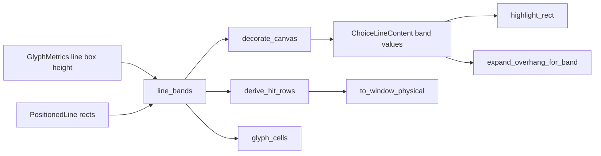
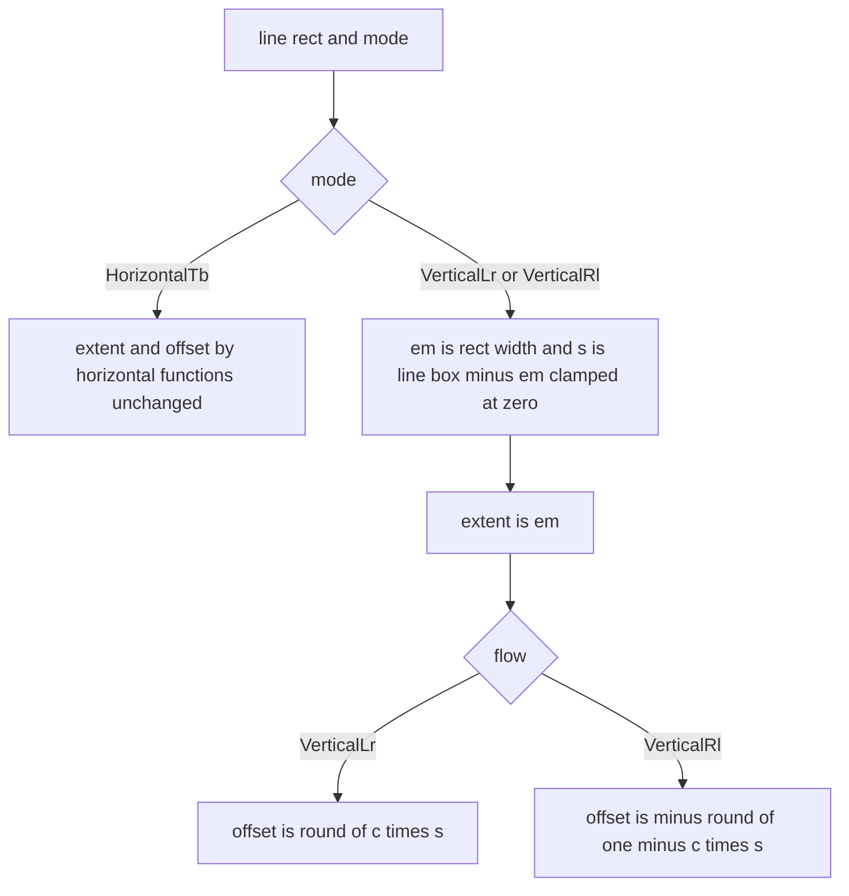

# 設計書: vertical-choice-hover-band

## Overview

**目的**: 縦書きのバルーンで選択肢（とアンカー）にマウスを乗せたときの反転の帯を、列の字の em の箱に重ねて塗り、当たりの範囲も同じ所にする。版は v0.1.0（ゴールの 2 つ目「ぱすたが SSP と同じに動く」）。崩れ 23（`pasta-in-windows-verification` の `verification.md`）を閉じる材料を作る。

**使う人**: ゴーストの利用者（縦書きの選択肢を読んで選ぶ）と、バルーンの作者ぱすた（`pasta_tategaki`＝`vertical,1`・`cursor.style,square`・`font.height,20`・游ゴシック Medium）。

**変わること**: 帯の厚みと寄せを行ごとに 1 度だけ決める `line_bands`（`crates/areka-emo-text/src/choice.rs`）の縦書きの枝を、横書きの式から切り離す。厚みは列の em（SSP の測り＝em）、寄せは「行矩形の左辺から em の箱の左辺までの符号つきの量」になる。右から左の列送りでは寄せが負になり、帯は列の左へ出る。塗り・当たり・字の矩形はこの 2 値をそのまま足し算で使うので書き換えない。消し残しの手当て（`expand_overhang_for_band`）だけが、帯が行矩形の左へ出る分を描き替えの範囲へ入れる。

### Goals

- 右から左（`VerticalRl`）と左から右（`VerticalLr`）の両方で、帯が列の字のインクをブロックの軸の全幅で覆い、隣の列のインクと帯にかからない（1.1〜1.6）。
- 帯の形が SSP 2.9.23 の測り（`research.md` 9 節: 厚み em・インクにほぼ中央・行内は字の範囲）と同じになる（4.2）。
- 当たりの範囲が塗りと数値まで同じ（2.1）。アンカーも同じ形（1.7）。
- 横書きは数値も画素も変わらない（5.1〜5.3）。
- 実フォントの読み戻しの決定論のテストで、2 つの向きの形を固定する（6.1〜6.4）。

### Non-Goals

- 横書きの帯の厚み・寄せ（変えない）。
- 縦書きの列の並べ方（列の位置・列送り・字の置き方）。完了 `balloon-vertical-canon` の持ち分。
- `cursor.*` の色・混ぜ方・描き方、選択肢のマーカーの見た目（`choice-marker-styling`）、色の見比べ（`verification.md` 6 節の案 B）。
- 選択肢の前の `\![*]` の印（`script-small-tags`）、選択肢の範囲の関数のまとめ（`choice-ranges-one-function`）。
- マウスがバルーンの外へ出たときに帯を残す SSP の挙動（要件の討議 議題 3＝今のまま消す）。

## Boundary Commitments

### This Spec Owns

- `line_bands` の縦書きの枝（厚みと符号つきの寄せの決め方）と、その値の意味（`LineBand.offset`＝行矩形の左辺〔横書きは上辺〕からの符号つきの量）。
- 縦書きで帯が行矩形の左へ出る分の描き替えの範囲（`expand_overhang_for_band` の縦書きの枝の `left`）。
- `ChoiceLineContent.band_extent`／`band_offset` の説明（意味の書き換えに合わせる・コードは変えない）。
- 縦書きの帯の決定論のテスト（実フォントの読み戻し・純粋の検査）と、崩れた形を固めていた今の検査の書き換え（6.7）。
- 実フォントの読み戻しで決める定数 c（em の箱が列の箱の余りのどこに乗るか）と、その根拠の数の記録。
- 実機の確かめ（6.5・6.6）の手順と記録。

### Out of Boundary

- 横書きの `highlight_band_extent`・`highlight_band_offset` とその呼び方（1 文字も変えない）。
- `derive_hit_rows`・`highlight_rect`・`glyph_cells`・`to_window_physical` の足し算（符号つきの寄せを今のまま受けるので変えない）。
- 列の位置・列送り・行の TextLayout の作り方（`layout.rs`・`draw_line_store.rs`・`draw.rs` の `DirectionRecipe`）。
- 当たりの判定（`crates/areka/src/input_events/balloon.rs` の `hit_choice_row` の半開区間）。
- 帯が離れたときに消える決まり（完了 `areka-P0-choice-interact` の要件 1.3・本 spec の要件 3.3 は消し残しが無いことだけを持つ）。
- `GlyphMetrics` の trait（`layout.rs`）。下の「行き止まり」のときだけ触る候補で、そのときは設計を直してから。

### Allowed Dependencies

- 純粋層: `GlyphMetrics::line_box_height`・`line_pitch`（今ある口だけ）、`PositionedLine.rect`、`WritingMode`。
- COM 層（テストだけ）: `DWriteMetrics::new`・`ResolvedFont::resolve`・`ViewboxExecutor`・`Rig`・`live_diff_model_font`・`block_axis_ink_span`（どれも今ある物）。
- 依存（crate）は足さない。emo-text に新しいソースファイルを足さない。どのファイルも 1,000 行を超えない。
- 依存の向き: `choice.rs`（純粋）→ `canvas.rs`（純粋データ）→ `viewbox_draw_render.rs`（COM）。純粋層は COM を読まない。

### Revalidation Triggers

- `LineBand.offset` の意味（行矩形の左辺・上辺からの符号つきの量）を変える、または帯を使う所を新しく作る（`choice-ranges-one-function`・`balloon-link-hover` は同じ帯を使う）。
- 縦書きの行の TextLayout の作り方（幅＝em・段落の寄せ NEAR・列送り）や列の並べ方を変える（c を読み戻しで決め直す）。
- `GlyphMetrics` に縦書きの em の箱の口を足す（行き止まりの道。`layout.rs` に届く）。
- 縦書きの帯を使うバルーンの既定フォントの比が 1 でなくなる（既定フォントの縦書きの画素が動く）。

## Architecture

### Existing Architecture Analysis

- 帯の 2 値（厚み・寄せ）は `line_bands` が行ごとに 1 度だけ決め、`actor_present.rs:289` から `decorate_canvas`（塗りの住人へ焼く）・`derive_hit_rows`（当たり）・`glyph_cells`（字の矩形）へ同じ列が配られる（「ハイライト矩形＝ヒット矩形と同一」の単一の源）。この形は保つ。
- 3 つの使う所はどれも「行矩形の左辺（横書きは上辺）＋ `offset` から `extent` 分」の足し算で、`offset` の符号を見ない（`glyph_cells` は `near.min(near + offset)` で負も受ける）。
- 崩れの原因（`research.md` 2・3・10 節）: ⑴ 右から左の列は DirectWrite が行矩形の**右辺**に揃えて左へ（行の箱 − em）はみ出すのに、寄せは 0 以上で左辺から右へ伸ばしていた（当て方）。⑵ 厚みを横書きと同じ「行の箱を行送りで頭打ち」（ぱすたで 22）にしていたが、SSP は em（20）（決め方）。

### Architecture Pattern & Boundary Map



- **選んだ形**: 単一の源で符号つきの寄せを出す（`research.md` 10 節の案 B）。鏡の判断は `line_bands` の 1 か所だけ。
- **直すコード**: `LineBands` の縦書きの枝と `Dirty` の縦書きの `left` の 2 か所。ほかの節点は書き換えない。
- **保つ形**: 横書きの式・単一の源・半開区間の当たり・×k の一点適用・純粋層と COM 層の分け方。
- **新しい部品**: 無し（関数・型・ファイルを足さない）。足すのは名前つきの定数 c 1 つ。

### Technology Stack

| 層 | 選んだ物 / 版 | 役目 | 注 |
|---|---|---|---|
| 純粋層 | Rust（ワークスペースの版）・`areka-emo-text` の `choice.rs` | 帯の 2 値を決める | 変更は縦書きの枝だけ |
| COM 層 | DirectWrite／Direct2D（`windows` crate・ワークスペースのピン） | 帯の塗りと描き替えの範囲 | 変更は `expand_overhang_for_band` の 1 枝 |
| テスト | `cargo test`・実 GPU の `Rig`・実フォント（Yu Gothic UI・游ゴシック Medium） | 読み戻しと純粋の検査 | 新しい依存なし |

## File Structure Plan

### Modified Files

- `crates/areka-emo-text/src/choice.rs`（748 行）— `line_bands` の縦書きの枝を「厚み＝em・寄せ＝符号つき」に替える。定数 c（`VERTICAL_EM_BOX_LEFT_SHARE: f32`・値は最初のタスクで決める）とその根拠（読み戻しの数）を説明に書く。`LineBand.offset` の説明を「行矩形の左辺（横書きは上辺）からの符号つきの量」に替える。`derive_hit_rows`・`glyph_cells` の説明の「近端＝left」を同じ意味に揃える（コードは変えない）。
- `crates/areka-emo-text/src/viewbox_draw_render.rs`（657 行）— `expand_overhang_for_band` の縦書きの枝に `left = max(実測の left, −offset)` を足す。`highlight_rect` と呼ぶ所（106 行目付近）の説明を符号つきの寄せに揃える。横書きの枝は変えない。
- `crates/areka-emo-text/src/canvas.rs` — `ChoiceLineContent.band_extent`／`band_offset` の説明だけを書き換える（縦書きは厚み em・符号つきの寄せ）。コードは変えない。C11 のほかの 7 本は emo-text に触らない（`roadmap.md` の C11 の行）ので重ならない。
- `crates/areka-emo-text/src/viewbox_draw_choice_hover_tests.rs`（465 行）— 実フォントの読み戻しの検査を足す（下の「Testing Strategy」の R・P・S）。
- `crates/areka-emo-text/src/choice_decorate_tests.rs`（487 行）— 縦書きの純粋の検査を足す（焼いた帯＝当たり・隣の列・大きい字）。
- `crates/areka-emo-text/src/choice_anchor_tests.rs`（273 行）— 縦書きのアンカーの帯が選択肢と同じ形であることの検査を足す。書字方向を固定している手伝いの関数 `hit` は向きを引数に取る形へ書き換えてよい。
- `crates/areka-emo-text/src/choice_glyph_cells_tests.rs`（323 行）— 6.7 の書き換え（下の表）。
- `crates/areka-emo-text/src/choice_tests.rs`（967 行）— 6.7 の書き換えだけ（検査を足さない・1,000 行以下）。
- `.kiro/specs/vertical-choice-hover-band/research.md` — 読み戻しの数と c の決め、6.7 の元の期待値と新しい期待値、6.4 の赤の確かめ、実機の確かめの記録。
- `.kiro/specs/vertical-choice-hover-band/evidence/` — 実機の撮った物（6.5）。

触らない: `layout.rs`・`draw_metrics.rs`・`layout_styled.rs`・`draw_line_store.rs`・`draw.rs`・`actor_present.rs`・`crates/areka/`。`draw_metrics.rs` と `layout.rs` は下の行き止まりの道でだけ候補になる。

## System Flows

縦書きの帯の 2 値の決め方（`line_bands` の 1 行ぶん）:



- s ＝ `max(0, line_box_height(em) − em)`（列の箱が em を越える分）。既定フォント（比 1）は s ＝ 0 なので、縦書きでも厚み em・寄せ 0＝今と同じ。
- 帯のブロック軸の範囲は、どの向きでも `[行矩形の左辺 + offset, 行矩形の左辺 + offset + extent]`（横書きは上辺）。

## Requirements Traceability

| 要件 | 要約 | 部品 | 口 | 流れ |
|---|---|---|---|---|
| 1.1 | 右から左で帯が列のインクを全幅で覆う | LineBandSource | `line_bands`（`VerticalRl` の枝） | 帯の決め方 |
| 1.2 | 左から右も同じ | LineBandSource | `line_bands`（`VerticalLr` の枝） | 帯の決め方 |
| 1.3 | 行内は字の範囲 | 今の `annotate_lines`・`derive_hit_rows`・`highlight_rect`（変えない） | `inline_range` | — |
| 1.4 | 隣の列のインクと帯にかからない | LineBandSource（厚み em＜列送り） | `line_bands` | 帯の決め方 |
| 1.5 | 折り返した選択肢は列ごと | 今の行ごとの `LineChoiceSegment`（変えない） | `line_bands` は行ごと | — |
| 1.6 | 大きい字の列 | LineBandSource（em＝行矩形の幅＝列で一番大きい em） | `line_bands` | 帯の決め方 |
| 1.7 | アンカーも同じ形 | LineBandSource（アンカーも同じ列を使う） | `line_bands` | — |
| 2.1 | 当たり＝塗りの数値 | LineBandSource（単一の源）・今の使う所 | `decorate_canvas`・`derive_hit_rows` | 構図の図 |
| 2.2 | 帯の中のクリックで選ぶ | 今の `to_window_physical`・`hit_choice_row`（変えない） | `HitRectPx` | — |
| 2.3 | 境の点はたかだか 1 つ | 半開区間（変えない）・同じ大きさの列の帯は行間ぶん離れる | `hit_choice_row` | — |
| 3.1 | スクロール | 今の `block_offset`（塗り）・`committed`（当たり）（変えない） | `highlight_rect`・`to_window_physical` | — |
| 3.2 | 等倍でない倍率 | 今の ×k（変えない）・寄せは整数の画素 | `SetTransform`・`to_window_physical` | — |
| 3.3 | 消し残しなし | DirtyBandExpansion | `expand_overhang_for_band` | 構図の図 |
| 4.1 | SSP の測り | 済み（`research.md` 9 節） | — | — |
| 4.2 | SSP と同じ形 | LineBandSource（厚み em・em の箱に重ねる） | `line_bands` | 帯の決め方 |
| 4.3 | SSP と要件 1 の食い違いは開発者へ | 測りでは食い違いなし。実装で出たら止める（下の「行き止まり」） | — | — |
| 4.4 | 色は比べない | Non-Goals | — | — |
| 5.1 | 横書きは変えない | LineBandSource の横書きの枝・DirtyBandExpansion の横書きの枝（変えない） | — | — |
| 5.2 | 横書きの検査を全部通す | Testing Strategy の H | — | — |
| 5.3 | 既定フォントの画素の一致 | 横書きの枝を変えない・縦書きも s＝0 で不変 | — | — |
| 6.1 | 2 つの向きの塗りの読み戻し | 読み戻しの検査 R | — | — |
| 6.2 | 2 つの向きの当たり＝塗り | 読み戻しの検査 R・純粋の検査 P1 | — | — |
| 6.3 | 比 1 より大きい書体 | R の書体（Yu Gothic UI・游ゴシック Medium） | — | — |
| 6.4 | 直しを外すと赤 | 手順 T6.4 | — | — |
| 6.5 | 実機の確かめ | 手順 RealRun | — | — |
| 6.6 | 違うなら完了としない | 手順 RealRun | — | — |
| 6.7 | 崩れを固めた検査の書き換え | 書き換えの表 | — | — |

## Components and Interfaces

| 部品 | 層 | 役目 | 要件 | 主な依存 | 契約 |
|---|---|---|---|---|---|
| LineBandSource（`line_bands` の縦書きの枝） | 純粋（`choice.rs`） | 行ごとの帯の厚みと符号つきの寄せを決める | 1.1, 1.2, 1.4, 1.6, 1.7, 2.1, 4.2, 5.1, 5.3 | `GlyphMetrics::line_box_height`（P0） | Service |
| DirtyBandExpansion（`expand_overhang_for_band` の縦書きの枝） | COM（`viewbox_draw_render.rs`） | 帯が行矩形の外へ出る分を描き替えの範囲へ入れる | 3.3, 5.1 | `LineOverhang`（P0） | Service |
| BandDocs（`canvas.rs` の 2 欄の説明） | 純粋データ | 意味の書き換えを伝える | 2.1 | — | 説明のみ |

### 純粋層

#### LineBandSource

| 欄 | 中身 |
|---|---|
| 役目 | 行ごとの帯の 2 値を 1 度だけ決め、塗り・当たり・字の矩形へ同じ列を配る |
| 要件 | 1.1, 1.2, 1.4, 1.6, 1.7, 2.1, 4.2, 5.1, 5.3 |

**持ち物と決まり**

- 横書きの枝は今の 1 行（`highlight_band_extent`・`highlight_band_offset`）のまま。
- 縦書きの枝は、em ＝ `rect.right − rect.left`、s ＝ `max(0, line_box_height(em) − em)`、厚み ＝ em。寄せは左から右 ＝ `round(c·s)`、右から左 ＝ `−round((1−c)·s)`。
- c は定数 `VERTICAL_EM_BOX_LEFT_SHARE`（em の箱の左に置かれる列の箱の余りの割合）。値は最初のタスクの読み戻しで、候補 0・0.5・1 から決める（撮った物の当てでは 0）。根拠の数（書体・大きさ・向きごとのインクの範囲）を説明に書く。

**Dependencies**

- Inbound: `actor_present.rs` の 1 か所の呼び出し・テスト（P0）。
- Outbound: `GlyphMetrics::line_box_height`（P0）・`line_pitch`（横書きの枝だけ）。

**Contracts**: Service [x]

##### Service Interface

```rust
/// 1 行分の帯（描画とヒットの単一の源）。
pub struct LineBand {
    /// 帯のブロック軸の丈。横書き＝highlight_band_extent（変えない）・縦書き＝列の em。
    pub extent: f32,
    /// 行矩形の左辺（横書きは上辺）から帯の起点までの符号つきの量。
    /// 横書き＝highlight_band_offset（0 以上・変えない）・縦書きの左から右＝round(c·s)・
    /// 縦書きの右から左＝−round((1−c)·s)（負になり得る）。
    pub offset: f32,
}

/// 署名は変えない。
pub fn line_bands<M: GlyphMetrics + ?Sized>(
    lines: &[PositionedLine],
    mode: WritingMode,
    metrics: &M,
) -> Vec<LineBand>;
```

- 事前条件: `lines` は配置の結果（行矩形のブロック軸の幅＝その行で一番大きい em）。
- 事後条件: 出力は `lines` と 1:1。どの向きでも帯のブロック軸の範囲は `[辺 + offset, 辺 + offset + extent]`（辺＝縦書きは `rect.left`・横書きは `rect.top`）。縦書きは `extent == em`。s ＝ 0 なら縦書きは `offset == 0`。
- 不変条件: 純粋・決定論・失敗の道なし。横書きの出力は今と 1 ビットも変わらない。

**Implementation Notes**

- 統合: 使う所（`decorate_canvas`・`derive_hit_rows`・`glyph_cells`・`highlight_rect`）は今の足し算のまま正しい位置になる。
- 確かめ: 下の R（実フォントの読み戻し）と P1〜P4（純粋）。
- 危険: c が書体ごとに違う・em の箱がインクを覆わない→「行き止まり」。

### COM 層

#### DirtyBandExpansion

| 欄 | 中身 |
|---|---|
| 役目 | 塗りの帯が行矩形の外へ出る分を、その行の描き替えの範囲（`LineOverhang`）に入れる |
| 要件 | 3.3, 5.1 |

**Contracts**: Service [x]

##### Service Interface

```rust
/// 署名は変えない。
fn expand_overhang_for_band(
    measured: LineOverhang,
    band_extent: f32,
    band_offset: f32,
    font_height: f32,
    mode: WritingMode,
) -> LineOverhang;
```

- 事後条件（縦書き）: `right = max(measured.right, max(0, band_offset + band_extent − font_height))`（今のまま）、`left = max(measured.left, max(0, −band_offset))`（足す）。横書きは今のまま。
- 不変条件: 純粋（COM を呼ばない関数）・失敗の道なし。広げるだけで狭めない。

**Implementation Notes**

- 統合: 描き替えの範囲（`viewbox_diff.rs:330` の `x0 − overhang.left`）とスクロールの残りの判定（`block_axis_overhang`）は `left` を既に読む。
- 確かめ: 下の S（hover の移動と解除で塗りが 1 画素も残らない）。

## Data Models

### Domain Model

- `LineBand`（値の型・2 欄）の `offset` の意味を「近い辺から内へ（0 以上）」から「行矩形の左辺（横書きは上辺）からの符号つきの量」へ広げる。横書きの値は 0 以上のままなので、横書きでは前の意味と同じ。
- `ChoiceLineContent.band_extent`／`band_offset`（`canvas.rs`）は `LineBand` の写し。説明だけを同じ意味へ書き換える。

## Error Handling

### Error Strategy

- 変える関数はどれも純粋で失敗の道が無い（ログの行も足さない）。
- 実フォントの読み戻しの検査は、書体が見つからず代替へ縮退したとき**飛ばさず赤**にする。前置きは「`DWriteMetrics` の行の箱が em より大きいこと」（既定のＭＳ ゴシックへ縮退すると比がちょうど 1 で赤）。游ゴシック Medium は仮名が全角なので、今の `actor_choice_contract_tests.rs` の前置き（「あ」の送りが em 未満）は使えない。

### 行き止まり（設計を直す・開発者に知らせる所）

- **c が決まらない**: 読み戻しで、候補 0・0.5・1 のどれでも 2 書体・2 大きさ・2 拡大率の全部でインクを覆えない、または書体ごとに合う c が違う。→ 行の箱の比だけでは em の箱の置き場が決まらない。`GlyphMetrics` に既定の実装つきの口（縦書きの em の箱の左の置き場）を 1 つ足し、`DWriteMetrics` が測る形になる。`layout.rs`・`draw_metrics.rs` に届き C11 の約束の外になるので、その場で止めて設計を直し、開発者に知らせる。
- **大きさの違う列が隣り合って帯が重なる**: P3 で重なりの量が 0 より大きい。→ 字の箱そのものが隣の列へ食い込んでいる（列の並べ方の持ち分）見込みで、1.1・1.6 と 1.4 を同時に満たせない。完了とせず、量を添えて開発者の決めを仰ぐ。
- **横倒しの欧文の字がはみ出す**: R の記録で "Ag" の列のインクが em の帯の外に出る。→ 4.2（SSP の形＝em）と 1.1 の食い違い。4.3 と同じく開発者の決めを仰ぐ（合否には入れない）。
- **ぱすたの書体の名前が引けない**: `pasta_tategaki` の `font.name`（游ゴシック Medium）を areka の本番と同じ解決で引くと代替へ縮退する。→ 本番のぱすたも代替の書体で出ている＝本 spec の外の未対応。`/kiro-discovery` で起票し、R はその書体を除いた残り（Yu Gothic UI）で回す。開発者に知らせる。

## Testing Strategy

検査の名前は案。置き場は File Structure Plan のとおり（`choice_tests.rs` には足さない）。

### 実フォントの読み戻し（`viewbox_draw_choice_hover_tests.rs`）

- **R（6.1・6.2・6.3・1.1・1.2・1.3・1.4・3.2・4.2）** `vertical_band_covers_column_ink_readback`: 書体 2 つ（Yu Gothic UI・`pasta_tategaki` の `font.name` を本番と同じ解決で引いた物）× 大きさ 20・28 × `VerticalRl`・`VerticalLr` × 拡大率 1・2。台本はぱすたの測りと同じ並び（「晴れてる」「雨だよ」「曇ってる」「ないしょ」を列ごと）。本番と同じ道（`DWriteMetrics` で配置 → `line_bands` → `decorate_canvas` → `ViewboxExecutor` で描く）。確かめる事:
  - 乗せていない面で測った、乗せた列の字のインクの x 範囲が、乗せた面の塗りの x 範囲に入る（1.1・1.2）。
  - 塗りの x の幅が em × k（4.2。横書きの式に戻すと 22 × k で赤＝6.4）。
  - 塗りの x 範囲が隣の列のインクの x 範囲と交わらない（1.4）。
  - 塗りの y 範囲が選択肢の字の範囲（1.3）。
  - 同じ帯の列から `derive_hit_rows` → `to_window_physical` で出した当たりの四角の x・y が、塗りの範囲と画素まで同じ（6.2）。
  - 記録だけ: 行の TextLayout の `GetMetrics`（left・width）と `GetLineMetrics`（height・baseline）、列ごとのインクの範囲、"Ag" の列のインク。
- **S（3.1・3.3）** `vertical_band_follows_scroll_and_leaves_no_residue_readback`: 右から左・左から右で、列があふれて `block_offset` が 0 でない状態で、乗せる列を移し、さらに解除する。塗りが今乗せている列の帯の中にだけ在り、解除の後は面の全域で塗りの画素が 0。
- 今の `vertical_band_offset_shifts_paint_on_block_axis`（左から右・寄せの差）はそのまま通る（足し算は変えない）。
- 当たりの側のスクロール（3.1）と、帯の中の点で選ぶこと（2.2）は、足し算を変えないので今の檻が受け持つ: `choice_tests.rs` の `to_window_physical_vertical_puts_committed_on_x_block_axis`・`to_window_physical_parameterized_over_k_committed_and_modes`、areka の `input_events/balloon_pure_core_tests.rs`（`hit_choice_row` の半開区間）。R の「当たり＝塗り」がその入口の四角を固める。

### 純粋の検査

- **P1（2.1・6.2）** `choice_decorate_tests.rs`: 右から左・左から右で、`decorate_canvas` が焼いた `band_extent`／`band_offset` から組んだ帯と、`derive_hit_rows` の当たりの四角のブロック軸の範囲が数値まで同じ。右から左の寄せが負であることも見る。
- **P2（1.4・2.3）** `choice_decorate_tests.rs`: 同じ大きさの隣り合う列（`LayoutEngine` で並べた物）の帯は重ならず、間は行間の分。境の点は半開区間でたかだか 1 列に当たる。
- **P3（1.6）** `choice_decorate_tests.rs`: em 40 の字を含む列の帯の厚みは 40。隣の em 20 の列との帯の重なりの量を測り、0 であることを見る（0 でなければ「行き止まり」）。
- **P4（1.7）** `choice_anchor_tests.rs`: 縦書きのアンカー（`\_a`）の当たりの帯が、同じ字の範囲の選択肢の帯と同じ。

### 横書きを変えないこと（5.1〜5.3）

- **H**: 横書きの帯と当たりの今ある検査（`choice_tests.rs` の横書きの全部・`actor_choice_contract_tests.rs` の Yu Gothic UI の読み戻し・既定フォントのバイトの一致）を 1 本も変えずに通す。

### 書き換える今の検査（6.7）

新しい期待値の数は c が決まってから入れる（下の数は c ＝ 0 のときの見込み）。書き換えた検査ごとに元の期待値と新しい期待値を `research.md` に残す。

| 検査 | 元の期待値 | 新しい期待値（c ＝ 0 の見込み） |
|---|---|---|
| `choice_tests.rs` `line_bands_read_the_block_axis_in_vertical_modes` | 右から左・列幅 40 の帯の丈 42 | 丈 40（em）。寄せ −round(13.2) ＝ −13 も見る |
| `choice_tests.rs` `hit_row_vertical_block_band_uses_band_extent_from_left_edge` | 2 つの向きとも明示の帯（丈 13・寄せ 0）で x 377..390 | 帯を `line_bands`（`FixedMetrics`・em 10・s 3.3）から取り、右から左 x 374..384・左から右 x 377..387 |
| `choice_tests.rs` `derive_hit_rows_shifts_vertical_band_by_offset_on_block_axis` | 2 つの向きとも寄せ 2 を右へ（x 379..392） | 右から左は負の寄せ（行矩形の左へ出る）、左から右は round(c·s) の寄せ。数は c で決まる |
| `choice_glyph_cells_tests.rs` `block_axis_is_union_of_line_rect_and_band` | 右から左と左から右で字の矩形が同じ値 | 右から左は負の寄せの帯（字の矩形が行矩形の左へ広がる）の値 |
| `choice_glyph_cells_tests.rs` `every_choice_hit_row_lies_inside_the_glyph_cells` の前置き | 3 方向とも「帯の遠い辺が em を越える」 | 「帯が行矩形の外へ出る（offset ＜ 0 か offset ＋ extent ＞ em）」。出ない向き（c ＝ 0 の左から右）は前置きから外す |

実装の途中でほかの縦書きの期待値が崩れた形を固めていると分かったら、同じ扱い（消さず書き換え・記録）にする。`choice_tests.rs` は 1,000 行以下を保つ。

### 手順

- **T1（最初のタスク・R1・R2）**: 式を変える前に R を書いて回し、インクの範囲と列の箱の数を `research.md` に残して c を決める。今の式では右から左の R が赤になること（崩れ 23 の再現）も記録する。
- **T6.4**: 直した後、縦書きの枝を横書きの式へ一時的に戻して R・P1 が赤になるのを 1 度確かめて記録し、戻す。
- **RealRun（6.5・6.6）**: 開発者の許しを得て、ぱすたの縦書きのバルーン（新しい書庫か `doc/pasta-real-run.md` の入れ方）で `research.md` 9 節と同じ台本を出し、「雨だよ」と「晴れてる」に乗せて撮る。`evidence/` に置き、`ssp-choice-hover-amedayo.jpg`・`ssp-choice-hover-hareteru.jpg` と並べて開発者の目視の判定（同じ／違う）を受け、置き場と判定を `research.md` に残す。違うなら完了とせず、直すか開発者の決めを仰ぐ。

## Performance & Scalability

- 行ごとの計算は今と同じ回数（掛け算と丸めが 1 つずつ）。描き替えの範囲は右から左の選択肢の行だけ数画素広がる。測る目標は置かない。
