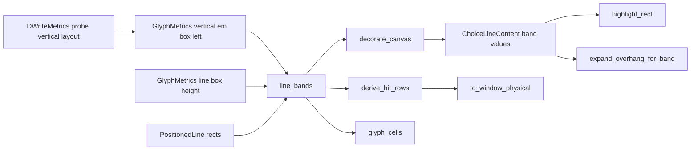
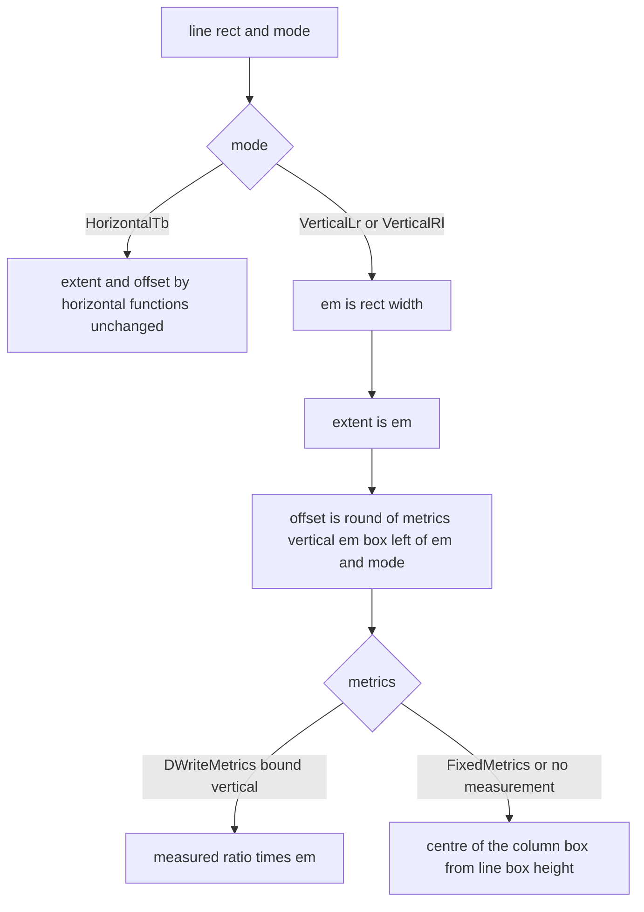

# 設計書: vertical-choice-hover-band

## Overview

**目的**: 縦書きのバルーンで選択肢（とアンカー）にマウスを乗せたときの反転の帯を、列の字の em の箱に重ねて塗り、当たりの範囲も同じ所にする。版は v0.1.0（ゴールの 2 つ目「ぱすたが SSP と同じに動く」）。崩れ 23（`pasta-in-windows-verification` の `verification.md`）を閉じる材料を作る。

**使う人**: ゴーストの利用者（縦書きの選択肢を読んで選ぶ）と、バルーンの作者ぱすた（`pasta_tategaki`＝`vertical,1`・`cursor.style,square`・`font.height,20`・游ゴシック Medium）。

**変わること**: 帯の厚みと寄せを行ごとに 1 度だけ決める `line_bands`（`crates/areka-emo-text/src/choice.rs`）の縦書きの枝を、横書きの式から切り離す。厚みは列の em、寄せは「行矩形の左辺から em の箱の左辺までの符号つきの量」になる。右から左の列送りでは寄せが負になり、帯は列の左へ出る。塗り・当たり・字の矩形はこの 2 値をそのまま足し算で使うので書き換えない。消し残しの手当て（`expand_overhang_for_band`）だけが、帯が行矩形の左へ出る分を描き替えの範囲へ入れる。

**改め（2026-10-23・実機の確かめ 4.2 の判定「違う」の後・開発者「フォントに対して中央になるのが正しい。案 1 で進めて」）**: em の箱の置き場を、Yu Gothic UI だけで合わせた割合の定数 c（`VERTICAL_RL_EM_BOX_LEFT_SHARE`・`VERTICAL_LR_EM_BOX_LEFT_SHARE`）から決めるのをやめ、**書体と大きさごとに DirectWrite で測る**。字の寸法を渡す口 `GlyphMetrics`（`layout.rs`）に既定の実装つきのメソッド `vertical_em_box_left` を 1 つ足し、`DWriteMetrics`（`draw_metrics.rs`）が、行の箱の比を測るのと同じ所（生成のとき 1 度だけ）で、縦書きの列の TextLayout の基線（列の中心）の位置を測って上書きする。寄せ＝round（列の箱の左辺の行矩形からの位置 ＋ 基線 − em/2）＝「em の箱を書体の縦書きの基線に中央で重ねた所」。SSP の帯は参考にとどめる（要件 4.2 の改め）。これは下の「行き止まり」の 1 つ目（c が決まらない）の道で、行き止まりに当たったものとして設計を直した。

### Goals

- 右から左（`VerticalRl`）と左から右（`VerticalLr`）の両方で、帯が列の字のインクをブロックの軸の全幅で覆い、隣の列のインクと帯にかからない（1.1〜1.6）。
- 帯が、どの書体でも列の字の em の箱を書体の縦書きの基線に中央で重ねた所（厚み em・行内は字の範囲）に乗る。置き場は書体と大きさごとに DirectWrite で測り、書体に合わせた定数を持たない（4.2 の改め）。SSP 2.9.23 の測り（`research.md` 9 節）は参考。
- 当たりの範囲が塗りと数値まで同じ（2.1）。アンカーも同じ形（1.7）。
- 横書きは数値も画素も変わらない（5.1〜5.3）。
- 実フォントの読み戻しの決定論のテストで、2 つの向きの形を固定する（6.1〜6.4）。

### Non-Goals

- 横書きの帯の厚み・寄せ（変えない）。
- 縦書きの列の並べ方（列の位置・列送り・字の置き方）。完了 `balloon-vertical-canon` の持ち分。
- `cursor.*` の色・混ぜ方・描き方、選択肢のマーカーの見た目（`choice-marker-styling`）、色の見比べ（`verification.md` 6 節の案 B）。
- 選択肢の前の `\![*]` の印（`script-small-tags`）、選択肢の範囲の関数のまとめ（`choice-ranges-one-function`）。
- マウスがバルーンの外へ出たときに帯を残す SSP の挙動（要件の討議 議題 3＝今のまま消す）。

## Boundary Commitments

### This Spec Owns

- `line_bands` の縦書きの枝（厚みと符号つきの寄せの決め方）と、その値の意味（`LineBand.offset`＝行矩形の左辺〔横書きは上辺〕からの符号つきの量）。
- 縦書きで帯が行矩形の左へ出る分の描き替えの範囲（`expand_overhang_for_band` の縦書きの枝の `left`）。
- `ChoiceLineContent.band_extent`／`band_offset` の説明（意味の書き換えに合わせる・コードは変えない）。
- 縦書きの帯の決定論のテスト（実フォントの読み戻し・純粋の検査）と、崩れた形を固めていた今の検査の書き換え（6.7）。
- ~~実フォントの読み戻しで決める定数 c~~（2026-10-23 の判定で取りやめ・タスク 5.2 で消す）。代わりに、`GlyphMetrics::vertical_em_box_left`（縦書きの em の箱の左辺の、行矩形の左辺からの位置）の口と既定の実装、`DWriteMetrics` がそれを DirectWrite で測る実装（生成のとき 1 度だけ測って比で持つ）。
- 実機の確かめ（6.5・6.6）の手順と記録。

### Out of Boundary

- 横書きの `highlight_band_extent`・`highlight_band_offset` とその呼び方（1 文字も変えない）。
- `derive_hit_rows`・`highlight_rect`・`glyph_cells`・`to_window_physical` の足し算（符号つきの寄せを今のまま受けるので変えない）。
- 列の位置・列送り・行の TextLayout の作り方（`layout.rs`・`draw_line_store.rs`・`draw.rs` の `DirectionRecipe`）。ただし、大きさの違う列の字のインクそのものが重なると T1 で測れたときだけ、`layout.rs` の縦書きの列送りを本 spec で直す（設計の討議 議題 1）。
- 当たりの判定（`crates/areka/src/input_events/balloon.rs` の `hit_choice_row` の半開区間）。
- 帯が離れたときに消える決まり（完了 `areka-P0-choice-interact` の要件 1.3・本 spec の要件 3.3 は消し残しが無いことだけを持つ）。
- `GlyphMetrics` の trait（`layout.rs`）のうち、足す 1 つのメソッドの外（今あるメソッドの意味と `FixedMetrics` の今の値）。行き止まりの道に当たったので、2026-10-23 の改めで足す 1 つだけは本 spec の持ち物になった。
- `DWriteMetrics` の行の箱の比（`line_box_ratio`・`measure_line_box_ratio`）と送り幅の測り。横書きの帯はこれを読むので変えない（要件 5）。
- 書体の名前の解決（`FontCatalog::pick`）。ぱすたの書体名が引けない件は本 spec の外（起票）。

### Allowed Dependencies

- 純粋層: `GlyphMetrics::line_box_height`・`line_pitch`（今ある口）と、足す `GlyphMetrics::vertical_em_box_left`（既定の実装は `line_box_height` から出す）、`PositionedLine.rect`、`WritingMode`。
- COM 層（本番）: `DWriteMetrics::new_shared` の中で、束縛した書式（`create_text_format` の出力・本番と同じ書体と方向のレシピ）から試しの `IDWriteTextLayout` を 1 つ作り、`GetMetrics`（left・width）と `GetLineMetrics`（baseline）を読む。どれも `windows` crate の今ある API（ワークスペースのピン）。
- COM 層（テストだけ）: `DWriteMetrics::new`・`ResolvedFont::resolve`・`FontCatalog::pick`・`ViewboxExecutor`・`Rig`・`live_diff_model_font`・`block_axis_ink_span`（どれも今ある物）。
- 依存（crate）は足さない。emo-text に新しいソースファイルを足さない（2.2 で足した兄弟のテストファイル `viewbox_draw_vertical_band_scroll_tests.rs` は例外として記録・下の File Structure Plan）。どのファイルも 1,000 行を超えない。
- 依存の向き: `choice.rs`（純粋）→ `canvas.rs`（純粋データ）→ `viewbox_draw_render.rs`（COM）。純粋層は COM を読まない。

### Revalidation Triggers

- `LineBand.offset` の意味（行矩形の左辺・上辺からの符号つきの量）を変える、または帯を使う所を新しく作る（`choice-ranges-one-function`・`balloon-link-hover` は同じ帯を使う）。
- 縦書きの行の TextLayout の作り方（幅＝em・段落の寄せ NEAR・列送り・行の間隔の設定）や列の並べ方を変える（`DWriteMetrics` の試しの TextLayout を同じ作り方に揃え直す）。
- `GlyphMetrics::vertical_em_box_left` の意味（行矩形の左辺からの、丸める前の符号つきの量）を変える、または縦書きの列の中で書体を変える字（`\f[name,…]`）の em の箱を列ごとに測る形へ広げる（今は束縛した書体の値を全部の列に使う・`line_box_height` と同じ限り）。
- 既定フォント（ＭＳ ゴシック）の縦書きで、測った em の箱の左が 0 でない（既定フォントの縦書きの画素が動く・タスク 5.1 で 0 であることを確かめる）。

## Architecture

### Existing Architecture Analysis

- 帯の 2 値（厚み・寄せ）は `line_bands` が行ごとに 1 度だけ決め、`actor_present.rs:289` から `decorate_canvas`（塗りの住人へ焼く）・`derive_hit_rows`（当たり）・`glyph_cells`（字の矩形）へ同じ列が配られる（「ハイライト矩形＝ヒット矩形と同一」の単一の源）。この形は保つ。
- 3 つの使う所はどれも「行矩形の左辺（横書きは上辺）＋ `offset` から `extent` 分」の足し算で、`offset` の符号を見ない（`glyph_cells` は `near.min(near + offset)` で負も受ける）。
- 崩れの原因（`research.md` 2・3・10 節）: ⑴ 右から左の列は DirectWrite が行矩形の**右辺**に揃えて左へ（行の箱 − em）はみ出すのに、寄せは 0 以上で左辺から右へ伸ばしていた（当て方）。⑵ 厚みを横書きと同じ「行の箱を行送りで頭打ち」（ぱすたで 22）にしていたが、SSP は em（20）（決め方）。
- 4.2 の実機で残ったずれの原因（`research.md` 16 節・見立て）: 列の箱の幅と em の箱の置き場を、書体の `ascent + descent` の比（`line_box_height`）と Yu Gothic UI で合わせた割合 c から出していた。DirectWrite が実際に組む列の箱（行の間隔の設定を変えていないので、書体の行間〔lineGap〕も入り得る）と基線は書体ごとに違い、比と c からは決まらない。ぱすたの書体の候補列は本番で Yu Gothic UI でない書体に引ける（16 節）。⇒ 置き場は DirectWrite の列の TextLayout から測る。

### Architecture Pattern & Boundary Map



- **選んだ形**: 単一の源で符号つきの寄せを出す（`research.md` 10 節の案 B）。鏡の判断は `line_bands` の 1 か所だけ。
- **直すコード**: `LineBands` の縦書きの枝と `Dirty` の縦書きの `left` の 2 か所（済み）。2026-10-23 の改めで、`EmBox`（`GlyphMetrics` に足す 1 メソッドと既定の実装）と `DWrite`（`DWriteMetrics` の測りと上書き）の 2 か所を足し、`LineBands` の縦書きの枝は `EmBox` を読む形に替える。`Metrics`（`line_box_height`）は横書きの枝と `EmBox` の既定の実装だけが読む。
- **保つ形**: 横書きの式・単一の源・半開区間の当たり・×k の一点適用・純粋層と COM 層の分け方（純粋層は測った値を `GlyphMetrics` の口で受け取るだけで、COM を読まない＝`line_box_height` と同じ形）。
- **新しい部品**: `GlyphMetrics::vertical_em_box_left`（既定の実装つきのメソッド 1 つ）と、`DWriteMetrics` の欄 1 つ（測った比）と測る関数 1 つ。型・ファイルは足さない。2.1 で足した 2 つの定数 c は消す。

### Technology Stack

| 層 | 選んだ物 / 版 | 役目 | 注 |
|---|---|---|---|
| 純粋層 | Rust（ワークスペースの版）・`areka-emo-text` の `choice.rs`・`layout.rs` | 帯の 2 値を決める・縦書きの em の箱の置き場の口 | 変更は縦書きの枝と trait のメソッド 1 つ |
| COM 層 | DirectWrite／Direct2D（`windows` crate・ワークスペースのピン） | 帯の塗りと描き替えの範囲・縦書きの基線の測り | 変更は `expand_overhang_for_band` の 1 枝と `DWriteMetrics` の測り |
| テスト | `cargo test`・実 GPU の `Rig`・実フォント（Yu Gothic UI・ぱすたの `font.name` の候補列を本番の解決で引いた書体・ＭＳ ゴシック〔記録〕） | 読み戻しと純粋の検査 | 新しい依存なし |

## File Structure Plan

### Modified Files

1〜4 のタスク（済み）で触った物:

- `crates/areka-emo-text/src/choice.rs`（今 792 行）— `line_bands` の縦書きの枝を「厚み＝em・寄せ＝符号つき」に替えた。`LineBand.offset` の説明を「行矩形の左辺（横書きは上辺）からの符号つきの量」に替え、`derive_hit_rows`・`glyph_cells` の説明の「近端＝left」を同じ意味に揃えた（コードは変えない）。2.1 で置いた定数 c（`VERTICAL_RL_EM_BOX_LEFT_SHARE`・`VERTICAL_LR_EM_BOX_LEFT_SHARE`）は 5.2 で消す（下）。
- `crates/areka-emo-text/src/viewbox_draw_render.rs` — `expand_overhang_for_band` の縦書きの枝に `left = max(実測の left, −offset)` を足した。横書きの枝は変えない。
- `crates/areka-emo-text/src/canvas.rs` — `ChoiceLineContent.band_extent`／`band_offset` の説明だけを書き換えた。C11 のほかの 7 本は emo-text に触らない（`roadmap.md` の C11 の行。⑤ の持ち物に「原因しだいで `draw_metrics.rs`」と書いてある）ので重ならない。
- `crates/areka-emo-text/src/viewbox_draw_choice_hover_tests.rs`（今 874 行）— 実フォントの読み戻し R。
- `crates/areka-emo-text/src/viewbox_draw_vertical_band_scroll_tests.rs`（今 238 行・2.2 で足した兄弟のテストファイル）— スクロールと消し残しの読み戻し S。`viewbox_draw_choice_hover_tests.rs` へ足すと 1,000 行を超えるため分けた（「emo-text に新しいソースファイルを足さない」の例外。テストのファイルで `lib.rs` の純粋な一覧の数は動かさない）。
- `crates/areka-emo-text/src/choice_decorate_tests.rs`（今 731 行）— P1〜P3。
- `crates/areka-emo-text/src/choice_anchor_tests.rs`（今 305 行）— P4。
- `crates/areka-emo-text/src/choice_glyph_cells_tests.rs`（今 332 行）・`choice_tests.rs`（今 980 行）— 6.7 の書き換え。

5 のタスク（2026-10-23 の改め）で触る物:

- `crates/areka-emo-text/src/layout.rs`（今 502 行）— `GlyphMetrics` に既定の実装つきのメソッド `vertical_em_box_left` を 1 つ足す（下の VerticalEmBoxSource）。`FixedMetrics` は上書きしない（既定の実装＝列の箱の真ん中）。
- `crates/areka-emo-text/src/draw_metrics.rs`（今 413 行）— `DWriteMetrics` に欄を 1 つ（測った比 `vertical_em_box_left_ratio: Option<f32>`）と、測る関数 1 つ（`measure_vertical_em_box_left_ratio`）を足し、`new_shared` の中の `measure_line_box_ratio` の隣で 1 度だけ呼ぶ。`vertical_em_box_left` を上書きする。
- `crates/areka-emo-text/src/choice.rs` — `line_bands` の縦書きの枝を `offset = round(metrics.vertical_em_box_left(em, mode))` に替え、2 つの定数 c とその説明を消す。`LineBand.offset` の説明を新しい決め方に揃える。横書きの枝は 1 文字も変えない。
- `crates/areka-emo-text/src/canvas.rs`・`viewbox_draw_render.rs` — 説明の中の「c」の言い回しが在れば揃える（コードは変えない）。
- `crates/areka-emo-text/src/draw_metrics_styled_tests.rs`（今 321 行）— `DWriteMetrics` の測りの検査 M を足す（COM が書けるファイル）。
- `crates/areka-emo-text/src/viewbox_draw_choice_hover_tests.rs` — R の書体にぱすたの候補列を足し、引けた書体の名前を固定する（数行）。
- `crates/areka-emo-text/src/choice_decorate_tests.rs` — 純粋の検査 P5・P6 を足し、P1・P3 の数を書き換える（下の 5.2 の書き換えの表）。
- `crates/areka-emo-text/src/choice_anchor_tests.rs`・`choice_tests.rs`・`viewbox_draw_vertical_band_scroll_tests.rs` — 5.2 の書き換えの表のとおり（`choice_tests.rs` には足さない・1,000 行以下）。
- `.kiro/specs/vertical-choice-hover-band/research.md` — 5.1 の測りの数、5.2 の書き換えの元と新しい期待値、5.3 の赤の確かめ、4.2 の撮り直しの記録。
- `.kiro/specs/vertical-choice-hover-band/evidence/` — 実機の撮った物（6.5・撮り直しを含む）。

触らない: `layout_styled.rs`・`draw_line_store.rs`・`draw.rs`（`create_text_format`・`DirectionRecipe`）・`draw_catalog.rs`（`FontCatalog::pick`）・`actor_present.rs`・`crates/areka/`。`layout.rs` は足すメソッド 1 つだけ（列送りは 1.2 の測りで直さないと決まった）。`draw_metrics.rs` は測りの欄と関数を足すだけで、`line_box_ratio`・送り幅の測りは変えない。

## System Flows

縦書きの帯の 2 値の決め方（`line_bands` の 1 行ぶん・5.2 の後）:



- `vertical_em_box_left(em, mode)` ＝ 行矩形の左辺から、em の箱の左辺までの丸める前の符号つきの量。em の箱は、書体の縦書きの基線（列の中心）に中央で重ねた箱。
- 既定の実装（列の箱の真ん中に em の箱を置く）: L ＝ `line_box_height(em)`、s ＝ `max(0, L − em)` として、右から左 ＝ `−s/2`、左から右 ＝ `+s/2`（列の箱は右から左で行矩形の右辺に、左から右で左辺に揃う・`research.md` 12.3 節）。既定フォント（比 1）は s ＝ 0 なので 0。
- `DWriteMetrics` の実装: 生成のとき 1 度だけ測った比 r に em を掛ける（r ＝ 測った量 ÷ 束縛した大きさ）。測れなかったとき・束縛した向きが横書きのとき・問われた向きが束縛した向きと違うときは既定の実装。
- 帯のブロック軸の範囲は、どの向きでも `[行矩形の左辺 + offset, 行矩形の左辺 + offset + extent]`（横書きは上辺）。
- Yu Gothic UI の見込み（12.3 節の記録から）: 大きさ 20 で右から左 −6.60 ＋ 13.30 − 10 ＝ −3.30 → −3、左から右 ＋3.30 → 3。28 で −4.62 → −5、＋4.62 → 5。どれも 13.1 節の「インクを覆う寄せの範囲」の中（28・右から左は −4 から −5 へ動く）。

## Requirements Traceability

| 要件 | 要約 | 部品 | 口 | 流れ |
|---|---|---|---|---|
| 1.1 | 右から左で帯が列のインクを全幅で覆う | LineBandSource・VerticalEmBoxSource | `line_bands`（`VerticalRl` の枝）・`vertical_em_box_left` | 帯の決め方 |
| 1.2 | 左から右も同じ | LineBandSource・VerticalEmBoxSource | `line_bands`（`VerticalLr` の枝）・`vertical_em_box_left` | 帯の決め方 |
| 1.3 | 行内は字の範囲 | 今の `annotate_lines`・`derive_hit_rows`・`highlight_rect`（変えない） | `inline_range` | — |
| 1.4 | 隣の列のインクと帯にかからない | LineBandSource（厚み em＜列送り） | `line_bands` | 帯の決め方 |
| 1.5 | 折り返した選択肢は列ごと | 今の行ごとの `LineChoiceSegment`（変えない） | `line_bands` は行ごと | — |
| 1.6 | 大きい字の列 | LineBandSource（em＝行矩形の幅＝列で一番大きい em） | `line_bands` | 帯の決め方 |
| 1.7 | アンカーも同じ形 | LineBandSource（アンカーも同じ列を使う） | `line_bands` | — |
| 2.1 | 当たり＝塗りの数値 | LineBandSource（単一の源）・今の使う所 | `decorate_canvas`・`derive_hit_rows` | 構図の図 |
| 2.2 | 帯の中のクリックで選ぶ | 今の `to_window_physical`・`hit_choice_row`（変えない） | `HitRectPx` | — |
| 2.3 | 境の点はたかだか 1 つ | 半開区間（変えない）・同じ大きさの列の帯は行間ぶん離れる | `hit_choice_row` | — |
| 3.1 | スクロール | 今の `block_offset`（塗り）・`committed`（当たり）（変えない） | `highlight_rect`・`to_window_physical` | — |
| 3.2 | 等倍でない倍率 | 今の ×k（変えない）・寄せは整数の画素 | `SetTransform`・`to_window_physical` | — |
| 3.3 | 消し残しなし | DirtyBandExpansion | `expand_overhang_for_band` | 構図の図 |
| 4.1 | SSP の測り（参考） | 済み（`research.md` 9 節） | — | — |
| 4.2 | 書体に対して中央（em の箱を縦書きの基線に中央で重ねる・書体ごとに測る） | LineBandSource（厚み em）・VerticalEmBoxSource（置き場を DirectWrite で測る） | `line_bands`・`vertical_em_box_left`・`DWriteMetrics::new_shared` | 帯の決め方 |
| 4.3 | 中央の帯が要件 1 を満たさないなら開発者へ | 5.1 の測りと R で見る。出たら止める（下の「行き止まり」の 5 つ目） | — | — |
| 4.4 | 色は比べない | Non-Goals | — | — |
| 5.1 | 横書きは変えない | LineBandSource の横書きの枝・DirtyBandExpansion の横書きの枝（変えない） | — | — |
| 5.2 | 横書きの検査を全部通す | Testing Strategy の H | — | — |
| 5.3 | 既定フォントの画素の一致 | 横書きの枝を変えない・縦書きも s＝0 で不変 | — | — |
| 6.1 | 2 つの向きの塗りの読み戻し | 読み戻しの検査 R | — | — |
| 6.2 | 2 つの向きの当たり＝塗り | 読み戻しの検査 R・純粋の検査 P1 | — | — |
| 6.3 | 比 1 より大きい書体・ぱすたの書体 | R の書体（Yu Gothic UI・ぱすたの候補列を本番の解決で引いた書体〔名前を固定〕） | — | — |
| 6.4 | 直しを外すと赤 | 手順 T6.4 | — | — |
| 6.5 | 実機の確かめ（判定は書体に対して中央か・SSP は参考） | 手順 RealRun（5 のタスクの後に撮り直す） | — | — |
| 6.6 | 中央でないなら完了としない | 手順 RealRun | — | — |
| 6.7 | 崩れを固めた検査の書き換え | 書き換えの表 | — | — |

## Components and Interfaces

| 部品 | 層 | 役目 | 要件 | 主な依存 | 契約 |
|---|---|---|---|---|---|
| LineBandSource（`line_bands` の縦書きの枝） | 純粋（`choice.rs`） | 行ごとの帯の厚みと符号つきの寄せを決める | 1.1, 1.2, 1.4, 1.6, 1.7, 2.1, 4.2, 5.1, 5.3 | `GlyphMetrics::vertical_em_box_left`（P0）・`line_box_height`／`line_pitch`（横書きの枝） | Service |
| VerticalEmBoxSource（`GlyphMetrics::vertical_em_box_left` と既定の実装） | 純粋（`layout.rs`） | 縦書きの em の箱の置き場を、字の寸法の口から渡す | 4.2, 1.1, 1.2 | `GlyphMetrics::line_box_height`（既定の実装だけ） | Service |
| VerticalEmBoxProbe（`DWriteMetrics` の上書きと測り） | COM（`draw_metrics.rs`） | 束縛した書体と向きで、縦書きの基線の位置を DirectWrite で 1 度だけ測る | 4.2, 6.3 | `create_text_format` の書式・`IDWriteTextLayout::GetMetrics`／`GetLineMetrics`（P0） | Service |
| DirtyBandExpansion（`expand_overhang_for_band` の縦書きの枝） | COM（`viewbox_draw_render.rs`） | 帯が行矩形の外へ出る分を描き替えの範囲へ入れる | 3.3, 5.1 | `LineOverhang`（P0） | Service |
| BandDocs（`canvas.rs` の 2 欄の説明） | 純粋データ | 意味の書き換えを伝える | 2.1 | — | 説明のみ |

### 純粋層

#### LineBandSource

| 欄 | 中身 |
|---|---|
| 役目 | 行ごとの帯の 2 値を 1 度だけ決め、塗り・当たり・字の矩形へ同じ列を配る |
| 要件 | 1.1, 1.2, 1.4, 1.6, 1.7, 2.1, 4.2, 5.1, 5.3 |

**持ち物と決まり**

- 横書きの枝は今の 1 行（`highlight_band_extent`・`highlight_band_offset`）のまま。
- 縦書きの枝（5.2 の後）は、em ＝ `rect.right − rect.left`、厚み ＝ em、寄せ ＝ `metrics.vertical_em_box_left(em, mode).round()`。向きの鏡（右から左は負）は `vertical_em_box_left` の値が持つ。`line_bands` は割合の定数を持たない。
- （済み・5.2 で置き換え）2.1 の形: s ＝ `max(0, line_box_height(em) − em)`、寄せは左から右 ＝ `round(c·s)`、右から左 ＝ `−round((1−c)·s)`、c は Yu Gothic UI の読み戻しの真ん中（右から左 0.5455・左から右 0.5303・`research.md` 13 節）。4.2 の実機で、ぱすたの本番の書体では字に対して中央にならないと判じられた（16 節）。

**Dependencies**

- Inbound: `actor_present.rs` の 1 か所の呼び出し・テスト（P0）。
- Outbound: `GlyphMetrics::vertical_em_box_left`（縦書きの枝・P0）・`line_box_height`／`line_pitch`（横書きの枝だけ）。

**Contracts**: Service [x]

##### Service Interface

```rust
/// 1 行分の帯（描画とヒットの単一の源）。
pub struct LineBand {
    /// 帯のブロック軸の丈。横書き＝highlight_band_extent（変えない）・縦書き＝列の em。
    pub extent: f32,
    /// 行矩形の左辺（横書きは上辺）から帯の起点までの符号つきの量。
    /// 横書き＝highlight_band_offset（0 以上・変えない）・
    /// 縦書き＝round(metrics.vertical_em_box_left(em, mode))（右から左は負になり得る）。
    pub offset: f32,
}

/// 署名は変えない。
pub fn line_bands<M: GlyphMetrics + ?Sized>(
    lines: &[PositionedLine],
    mode: WritingMode,
    metrics: &M,
) -> Vec<LineBand>;
```

- 事前条件: `lines` は配置の結果（行矩形のブロック軸の幅＝その行で一番大きい em）。
- 事後条件: 出力は `lines` と 1:1。どの向きでも帯のブロック軸の範囲は `[辺 + offset, 辺 + offset + extent]`（辺＝縦書きは `rect.left`・横書きは `rect.top`）。縦書きは `extent == em`・`offset == vertical_em_box_left(em, mode).round()`。
- 不変条件: 純粋・決定論・失敗の道なし。横書きの出力は今と 1 ビットも変わらない。

**Implementation Notes**

- 統合: 使う所（`decorate_canvas`・`derive_hit_rows`・`glyph_cells`・`highlight_rect`）は今の足し算のまま正しい位置になる。
- 確かめ: 下の R（実フォントの読み戻し）と P1〜P6（純粋）。
- 危険: 書体に対して中央の em の箱がインクを覆わない→「行き止まり」の 5 つ目。

#### VerticalEmBoxSource

| 欄 | 中身 |
|---|---|
| 役目 | 縦書きの列で、em の箱（書体の縦書きの基線に中央で重ねた em 角の箱）の左辺が行矩形の左辺からどれだけの所に在るかを渡す |
| 要件 | 4.2, 1.1, 1.2 |

```rust
pub trait GlyphMetrics {
    // …今の 4 つのメソッドは変えない…

    /// 縦書きの列で、em の箱の左辺の、行矩形の左辺からの符号つきの量（image px・丸める前）。
    /// em の箱は書体の縦書きの基線（列の中心）に中央で重ねる。横書きでは意味を持たない（0）。
    ///
    /// 既定の実装は列の箱の真ん中に置く: L ＝ line_box_height(h)、s ＝ max(0, L − h) として、
    /// 右から左 ＝ −s/2・左から右 ＝ +s/2（列の箱は右から左で行矩形の右辺に、左から右で
    /// 左辺に揃う）。実測の metrics（DWriteMetrics）は DirectWrite の列の基線で上書きする。
    fn vertical_em_box_left(&self, font_height: f32, mode: WritingMode) -> f32 {
        let s = (self.line_box_height(font_height) - font_height).max(0.0);
        match mode {
            WritingMode::VerticalRl => -s / 2.0,
            WritingMode::VerticalLr => s / 2.0,
            WritingMode::HorizontalTb => 0.0,
        }
    }
}
```

- 事後条件: 純粋・決定論・失敗の道なし。比 1 の書体（s ＝ 0）は 0。`FixedMetrics`（比 1.33）は上書きしないので既定の実装の値（em 10 で ∓1.65・20 で ∓3.3・28 で ∓4.62・40 で ∓6.6）。
- 既存の 2 つの実装（`FixedMetrics`・`DWriteMetrics`）と、`layout.rs` の試験の偽の実装（`viewbox_draw_scroll_retain_tests.rs` ほか）は、上書きしなければ今のまま通る（既定の実装つきなので）。
- 純粋層の字面検査（`lib.rs` の `PURE_SOURCES`）は `layout.rs` に `windows` を書かせない。この口は数を受け取るだけで COM を読まない。

### COM 層

#### VerticalEmBoxProbe

| 欄 | 中身 |
|---|---|
| 役目 | `DWriteMetrics` が束縛した書体・大きさ・向きで、縦書きの列の基線の位置を生成のとき 1 度だけ測り、`vertical_em_box_left` を上書きする |
| 要件 | 4.2, 6.3 |

**持ち物と決まり**

- 測る所: `new_shared` の中、`measure_line_box_ratio` の隣（生成のとき 1 度だけ）。束縛した書式（本番の描画と同じ `create_text_format` の出力＝同じ書体・同じ方向のレシピ・行の間隔の設定なし）から、仮名 1 字（「あ」）の試しの `IDWriteTextLayout` を、行の TextLayout と同じ幅（束縛した大きさ h）で 1 つ作る。
- 測る量: `GetMetrics` の `left`・`width`（列の箱の位置と幅）と `GetLineMetrics` の 1 行目の `baseline`。基線の行矩形の左辺からの位置 x を、左から右は `left + baseline`、右から左は「`left + width − baseline`（列の箱の右辺から測る）」か「`left + baseline`」のどちらか。どちらが DirectWrite の決まりかは、基線が列の箱のちょうど半分でない書体でだけ分かれる（Yu Gothic UI は半分なので同じ値）。タスク 5.1 で、基線が半分でない書体（ぱすたの書体が当たれば、それ）の読み戻しで字のインクと照らして決め、決めた式とその根拠を説明に書く。半分でない書体が見つからなければ、`left + width/2`（列の箱の中心）と `left + baseline` が一致することを 5.1 で記録し、`left + baseline` を採る。
- 持つ値: 比 r ＝ （x − h/2）÷ h（em の箱の左辺の、行矩形の左辺からの位置を大きさで割った物）。欄 `vertical_em_box_left_ratio: Option<f32>`。上書きは、問われた向きが束縛した向き（縦書き）と同じで r が在れば `r × font_height`、そうでなければ既定の実装。
- 値の出し方（push／pull の決まり）: 書体の寸法は `DWriteMetrics` の一生のあいだ変わらない。毎フレーム測らず、生成のとき 1 度だけ測って持つ（行の箱の比と同じ形）。大きさへは比で伸ばす（DirectWrite の行の組み方は大きさに比例する。5.1 で 20 と 28 の両方を測って比が同じことを確かめる）。
- 失敗: 試しの TextLayout が作れない・行が 0 本・値が有限でない → `warn!`（書体の名前と向きを添える）して `None`＝既定の実装へ縮退（log-first・記録の無い失敗の道を作らない）。横書きに束縛した `DWriteMetrics` は測らず `None`（記録もしない）。
- 限り（`line_box_height` と同じ）: 列の中で `\f[name,…]` で書体を変えた字の em の箱は、束縛した書体の値で置く。列ごとに書体を測る形へ広げるのは本 spec の外（Revalidation Triggers）。

**Contracts**: Service [x]

```rust
impl GlyphMetrics for DWriteMetrics {
    // …今のメソッドは変えない…
    fn vertical_em_box_left(&self, font_height: f32, mode: WritingMode) -> f32;
}

/// 束縛した書式で縦書きの em の箱の左の比を測る（縦書きでなければ None）。
fn measure_vertical_em_box_left_ratio(
    factory: &IDWriteFactory2,
    format: &IDWriteTextFormat,
    font_height: f32,
    mode: WritingMode,
) -> Option<f32>;
```

**Implementation Notes**

- 確かめ: 下の M（`draw_metrics_styled_tests.rs`）。Yu Gothic UI の大きさ 20 で右から左 −3.30・左から右 ＋3.30（12.3 節の記録から 0.05 以内）、ＭＳ ゴシックで 0（既定フォントの縦書きの画素が動かない）、ぱすたの書体で 5.1 で測った値。
- 危険: 試しの TextLayout と本番の行の TextLayout の作り方がずれる（幅・書式）。どちらも同じ `create_text_format` の書式と幅 h なので、作り方を変えるときは Revalidation Triggers。

#### DirtyBandExpansion

| 欄 | 中身 |
|---|---|
| 役目 | 塗りの帯が行矩形の外へ出る分を、その行の描き替えの範囲（`LineOverhang`）に入れる |
| 要件 | 3.3, 5.1 |

**Contracts**: Service [x]

##### Service Interface

```rust
/// 署名は変えない。
fn expand_overhang_for_band(
    measured: LineOverhang,
    band_extent: f32,
    band_offset: f32,
    font_height: f32,
    mode: WritingMode,
) -> LineOverhang;
```

- 事後条件（縦書き）: `right = max(measured.right, max(0, band_offset + band_extent − font_height))`（今のまま）、`left = max(measured.left, max(0, −band_offset))`（足す）。横書きは今のまま。
- 不変条件: 純粋（COM を呼ばない関数）・失敗の道なし。広げるだけで狭めない。

**Implementation Notes**

- 統合: 描き替えの範囲（`viewbox_diff.rs:330` の `x0 − overhang.left`）とスクロールの残りの判定（`block_axis_overhang`）は `left` を既に読む。
- 確かめ: 下の S（hover の移動と解除で塗りが 1 画素も残らない）。

## Data Models

### Domain Model

- `LineBand`（値の型・2 欄）の `offset` の意味を「近い辺から内へ（0 以上）」から「行矩形の左辺（横書きは上辺）からの符号つきの量」へ広げる。横書きの値は 0 以上のままなので、横書きでは前の意味と同じ。
- `ChoiceLineContent.band_extent`／`band_offset`（`canvas.rs`）は `LineBand` の写し。説明だけを同じ意味へ書き換える。

## Error Handling

### Error Strategy

- `line_bands`・`vertical_em_box_left` の既定の実装・`expand_overhang_for_band` は純粋で失敗の道が無い（ログの行も足さない）。
- `DWriteMetrics` の測り（VerticalEmBoxProbe）は失敗し得る（試しの TextLayout が作れない・行が 0 本・値が有限でない）。そのときは `warn!`（書体の名前・向き・失敗した所）を 1 度出して `None`＝既定の実装（列の箱の真ん中）へ縮退する。帯は出続け、記録の無い失敗の道は作らない。生成そのものは失敗させない（行の箱の比の縮退と同じ扱い）。
- 実フォントの読み戻しの検査は、書体が見つからず代替へ縮退したとき**飛ばさず赤**にする。前置きは「`DWriteMetrics` の行の箱が em より大きいこと」（既定のＭＳ ゴシックへ縮退すると比がちょうど 1 で赤）に加え、ぱすたの候補列は「引けた書体の名前が 5.1 で記録した名前と同じこと」。游ゴシック Medium は仮名が全角なので、今の `actor_choice_contract_tests.rs` の前置き（「あ」の送りが em 未満）は使えない。

### 行き止まり（設計を直す・開発者に知らせる所）

- **c が決まらない**（**当たった**・2026-10-23）: 1.2 では Yu Gothic UI 1 つでしか c を測れず「書体ごとに c が違う」かは確かめられなかった（`research.md` 13.4 節）が、4.2 の実機で、ぱすたの本番の書体では Yu Gothic UI で合わせた c の帯が字に対して中央にならないと判じられた（16 節）。→ 設計を直した（本書の「改め」・VerticalEmBoxSource・VerticalEmBoxProbe）。`layout.rs`・`draw_metrics.rs` に届くが、C11 のほかの 7 本は emo-text に触らない（`roadmap.md` の ⑤ の持ち物に `draw_metrics.rs` は「原因しだいで」と載っている）ので並走とは重ならない。開発者は「案 1 で進めて」と決めた。
- **大きさの違う列が隣り合って帯が重なる**（設計の討議 議題 1・2026-10-23 開発者「承認」）: 帯は自分の字を覆う方を先にする（1.6 が 1.4 より先）。T1 の読み戻しで、大きい字（`\f[height,40]`）の列と隣の em 20 の列の**字のインクそのもの**が重なるかを測り、結果で分ける。
  - **字のインクが重なる** → 列の並べ方の崩れ。並走が無い（C11 のほかの 7 本は emo-text に触らない）ので、本 spec の境界を広げて根本を直す（`layout.rs` の縦書きの列送り）。直す前に、直し方（列送りに何を足すか）と触るファイルを設計に書き足し、開発者に知らせる。直した後、P3 で字のインクが重ならないことを見る。
  - **字は重ならず帯だけが重なる**（**こちらに当たった**・`research.md` 13.3 節）→ 横書きの今の形（大きい行の帯が次の行へ食い込む）と同じとして受け入れる。要件 1.4 は同じ大きさの列どうしの決まりと読み、P3 は重なりの量を記録して固定する（当たりは `hit_choice_row` が 1 つだけ返すので 2.3 は守られる）。5.2 の後も同じ扱いで、量だけ書き換える。
- **横倒しの欧文の字がはみ出す**（**当たった**・13.4 節）: R の記録で "Ag" の列のインクが em の帯の外に出る。4.3 と同じく開発者の決めを仰いだ（合否には入れない）。
  - **開発者の決め（2026-10-23・案 A 承認）**: 横倒しの "Ag" が em の帯からはみ出すことは受け入れ、"Ag" は合否に入れない（記録だけ）。5.2 の後もこの決めはそのまま: 横倒しの欧文は書体の基線に沿って置かれ、em の箱（基線に中央で重ねた箱）からはみ出し得る。決めの中の「c はそのまま」は 2026-10-23 の改めで c ごと取りやめた（はみ出しの量は 5.3 の R の記録で書き直す）。
- **ぱすたの書体の名前が引けない**（当たった・12.4 節・本 spec の外で起票）: `pasta_tategaki` の `font.name` の 1 つ目（游ゴシック Medium）は areka の本番の解決で引けない。ただし実機のバルーンの `font.name` は候補列（`游ゴシック Medium,Yu Gothic Medium,游ゴシック,Yu Gothic,BIZ UDPゴシック,メイリオ`）で、候補が全部引けないときの記録（「フォントの候補が 1 つも見つからない」）は 4.2 の実機のログに無い＝**候補列のどれかに引けている**（ＭＳ ゴシックではない・16 節）。1.1 の検査は 1 つ目の名前だけで引いたのでＭＳ ゴシックへ縮退した。→ R はこの候補列をそのまま本番の解決で引いて回す（5.3）。游ゴシック Medium が引けず別の太さ・別の書体で描かれる件は、引き続き本 spec の外で起票する。
- **書体に対して中央の em の箱でもインクを覆わない**（2026-10-23 の改めで足した）: 5.1 の測りか 5.3 の R で、ある書体の仮名と漢字の列のインクが、測った em の箱（厚み em）から出る（字形が em の箱より大きい・基線が字の中心でない書体）。→ 要件 4.2（中央）と 1.1（全幅で覆う）の食い違い。4.3 のとおり自分で選ばず、測った値（書体・大きさ・向き・拡大率ごとのインクと em の箱）を添えて開発者の決めを仰ぐ。
- **右から左の基線の測り方が決まらない**（2026-10-23 の改めで足した）: 5.1 で、基線が列の箱の半分でない書体が見つからず、`left + baseline` と `left + width − baseline` のどちらが DirectWrite の決まりか分からない。→ 行き止まりではない（どちらも同じ値なので帯は同じ）。採った式と「分かれる書体が見つかったら確かめ直す」を説明と `research.md` に書いて進む。

## Testing Strategy

検査の名前は案。置き場は File Structure Plan のとおり（`choice_tests.rs` には足さない）。

### 実フォントの読み戻し（`viewbox_draw_choice_hover_tests.rs`）

- **R（6.1・6.2・6.3・1.1・1.2・1.3・1.4・3.2・4.2）** `vertical_band_covers_column_ink_readback`: 書体 2 つ（Yu Gothic UI・`pasta_tategaki` の `font.name` の**候補列のまま**を本番と同じ解決〔`FontCatalog::pick`〕で引いた物）× 大きさ 20・28 × `VerticalRl`・`VerticalLr` × 拡大率 1・2。ぱすたの候補列は、引けた書体の名前を 5.1 で記録した名前に固定する（違えば赤）。1.1〜4.1 では Yu Gothic UI だけで回していた（12.4 節）。5.3 で 2 書体とも緑にする。台本はぱすたの測りと同じ並び（「晴れてる」「雨だよ」「曇ってる」「ないしょ」を列ごと）。本番と同じ道（`DWriteMetrics` で配置 → `line_bands` → `decorate_canvas` → `ViewboxExecutor` で描く）。確かめる事:
  - 乗せていない面で測った、乗せた列の字のインクの x 範囲が、乗せた面の塗りの x 範囲に入る（1.1・1.2）。
  - 塗りの x の幅が em × k（4.2。横書きの式に戻すと 22 × k で赤＝6.4）。
  - 塗りの x 範囲が隣の列のインクの x 範囲と交わらない（1.4）。
  - 塗りの y 範囲が選択肢の字の範囲（1.3）。
  - 同じ帯の列から `derive_hit_rows` → `to_window_physical` で出した当たりの四角の x・y が、塗りの範囲と画素まで同じ（6.2）。
  - 塗りの x の中心と、`DWriteMetrics::vertical_em_box_left` から出した em の箱の中心の差が 1 物理画素以下（4.2・丸めの分だけ）。
  - 記録だけ: 行の TextLayout の `GetMetrics`（left・width）と `GetLineMetrics`（height・baseline）、`vertical_em_box_left` の値、列ごとのインクの範囲、"Ag" の列のインク。
- **S（3.1・3.3）** `vertical_band_follows_scroll_and_leaves_no_residue_readback`（`viewbox_draw_vertical_band_scroll_tests.rs`）: 右から左・左から右で、拡大率 1 と 1.5（分数の倍率での描き替えの範囲の丸めを見る）で、列があふれて `block_offset` が 0 でない状態で、乗せる列を移し、さらに解除する。塗りが今乗せている列の帯の中にだけ在り、解除の後は面の全域で塗りの画素が 0。帯は `line_bands` から取るので期待値の数は持たない（説明の中の「寄せ −4」だけを 5.2 の値へ揃える）。
- 今の `vertical_band_offset_shifts_paint_on_block_axis`（左から右・寄せの差）はそのまま通る（足し算は変えない）。
- 当たりの側のスクロール（3.1）と、帯の中の点で選ぶこと（2.2）は、足し算を変えないので今の檻が受け持つ: `choice_tests.rs` の `to_window_physical_vertical_puts_committed_on_x_block_axis`・`to_window_physical_parameterized_over_k_committed_and_modes`、areka の `input_events/balloon_pure_core_tests.rs`（`hit_choice_row` の半開区間）。R の「当たり＝塗り」がその入口の四角を固める。

### 測りの検査（`draw_metrics_styled_tests.rs`・COM）

- **M（4.2・6.3）** `vertical_em_box_left_is_measured_from_the_column_baseline`（案）: `DWriteMetrics::new` を Yu Gothic UI・ＭＳ ゴシック・ぱすたの候補列（本番の解決で引いた物）× 大きさ 20・28 × `VerticalRl`・`VerticalLr` で作り、`vertical_em_box_left` が「試しの TextLayout の基線の位置 − em/2」と同じ（5.1 で決めた式）で、大きさに比例する（20 と 28 の比が同じ）こと。Yu Gothic UI 20 は右から左 −3.30・左から右 ＋3.30（0.05 以内）、ＭＳ ゴシックは 0（既定フォントの縦書きの画素が動かない）。横書きに束縛した物は既定の実装と同じ値（測らない）。

### 純粋の検査

- **P1（2.1・6.2）** `choice_decorate_tests.rs`: 右から左・左から右で、`decorate_canvas` が焼いた `band_extent`／`band_offset` から組んだ帯と、`derive_hit_rows` の当たりの四角のブロック軸の範囲が数値まで同じ。右から左の寄せが負であることも見る。
- **P2（1.4・2.3）** `choice_decorate_tests.rs`: 同じ大きさの隣り合う列（`LayoutEngine` で並べた物）の帯は重ならず、間は行間の分。境の点は半開区間でたかだか 1 列に当たる。
- **P3（1.6）** `choice_decorate_tests.rs`: em 40 の字を含む列の帯の厚みは 40。隣の em 20 の列との帯の重なりの量を数で固定する（字のインクは重ならない＝13.3 節。扱いは「行き止まり」の 2 つ目）。
- **P4（1.7）** `choice_anchor_tests.rs`: 縦書きのアンカー（`\_a`）の当たりの帯が、同じ字の範囲の選択肢の帯と同じ。
- **P5（4.2）** `choice_decorate_tests.rs` `vertical_em_box_left_default_centres_the_em_box_in_the_column_box`（案）: 既定の実装（`FixedMetrics`）が、右から左 −s/2・左から右 ＋s/2・横書き 0 を返す（em 10・20・28・40。比 1 の偽の metrics では 0）。
- **P6（4.2）** `choice_decorate_tests.rs` `vertical_line_bands_read_the_em_box_from_metrics`（案）: `vertical_em_box_left` だけを真ん中から外した値（例: 右から左 −7.4・左から右 ＋0.6）で上書きした偽の metrics（`line_box_height` は `FixedMetrics` と同じ）で、`line_bands` の縦書きの寄せがその値の丸め（−7・1）になり、`line_box_height` の比からは出ない。横書きの出力は `FixedMetrics` と 1 ビットも同じ。
- 5.2 の機能の旗（一時の切り替え・2.1 と同じ形）: 旗を切る（2.1 の定数 c の式のまま）と P5・P6 と 5.2 で書き換えた檻が赤、入れると緑を確かめてから旗を外す。

### 横書きを変えないこと（5.1〜5.3）

- **H**: 横書きの帯と当たりの今ある検査（`choice_tests.rs` の横書きの全部・`actor_choice_contract_tests.rs` の Yu Gothic UI の読み戻し・既定フォントのバイトの一致）を 1 本も変えずに通す。5.2 の後も同じ。

### 書き換える今の検査（6.7）

2.1 の書き換え（済み・元の期待値と新しい期待値は `research.md` 14 節）:

| 検査 | 元の期待値 | 2.1 の期待値 |
|---|---|---|
| `choice_tests.rs` `line_bands_read_the_block_axis_in_vertical_modes` | 右から左・列幅 40 の帯の丈 42 | 丈 40（em）・寄せ −6 |
| `choice_tests.rs` `hit_row_vertical_block_band_uses_band_extent_from_left_edge` | 2 つの向きとも明示の帯（丈 13・寄せ 0）で x 377..390 | 帯を `line_bands`（em 10・s 3.3）から取り、右から左 x 376..386・左から右 x 379..389 |
| `choice_tests.rs` `derive_hit_rows_shifts_vertical_band_by_offset_on_block_axis` | 2 つの向きとも寄せ 2 を右へ（x 379..392） | 丈 10、右から左は寄せ −1（x 376..386）、左から右は寄せ 2（x 379..389） |
| `choice_glyph_cells_tests.rs` `block_axis_is_union_of_line_rect_and_band` | 2 つの向きとも同じ明示の帯で x 578..628 | 右から左 x 572..618・左から右 x 578..624 |
| `choice_glyph_cells_tests.rs` `every_choice_hit_row_lies_inside_the_glyph_cells` の前置き | 「帯の遠い辺が em を越える」 | 「帯が行矩形の外へ出る」 |

5.2 の書き換え（2026-10-23 の改め。数は `FixedMetrics`〔比 1.33〕の既定の実装＝列の箱の真ん中から出した見込み。実装で確かめて `research.md` に元と新しい期待値を並べる）:

| 検査 | 2.1 の期待値（c の定数） | 5.2 の期待値（見込み） |
|---|---|---|
| `choice_tests.rs` `line_bands_read_the_block_axis_in_vertical_modes` | 右から左・em 40 の寄せ −6（−round(0.4545 × 13.2)） | −7（−6.6 の丸め）。説明の式も書き換える |
| `choice_tests.rs` `hit_row_vertical_block_band_uses_band_extent_from_left_edge` | 右から左 x 376..386（寄せ −1）・左から右 x 379..389（寄せ 2） | 右から左 x 375..385（−1.65 → −2）・左から右 x 379..389（＋1.65 → 2・変わらない） |
| `choice_tests.rs` `derive_hit_rows_shifts_vertical_band_by_offset_on_block_axis` | 明示の帯（寄せ −1・2）で足し算だけを見る | 変えない（`line_bands` を読まない）。説明に c の式が在れば消す |
| `choice_decorate_tests.rs` P1 `vertical_baked_band_equals_hit_rect_block_range` | em 28: 右から左 −4・左から右 5 | 右から左 −5（−4.62）・左から右 5（＋4.62・変わらない） |
| `choice_decorate_tests.rs` P3 `vertical_big_glyph_column_band_is_40_and_overlap_is_fixed` | 右から左: 寄せ −3・−6・−3、重なり（雨だよ −5・曇ってる 1）／左から右: 寄せ 3・7・3、重なり（−6・2） | 右から左: 寄せ −3・−7・−3、重なり（−6・2）／左から右は変わらない（−6・2）＝2 つの向きで同じ量になる |
| `choice_anchor_tests.rs` `vertical_anchor_band_has_the_same_shape_as_a_choice` | 右から左 (29, 39)・左から右 (2, 12) | 右から左 (28, 38)（−1.65 → −2）・左から右 (2, 12)（変わらない） |
| `choice_glyph_cells_tests.rs` の 2 本 | em 20 の寄せ ∓3・em 28 の寄せ −4／5 | 数は変わらない見込み（em 20 は ∓3.3 → ∓3、em 28 は −5／5 でも前置きを満たす）。説明の「寄せ −4」を −5 へ |
| `viewbox_draw_vertical_band_scroll_tests.rs` S | 期待値は `line_bands` から取る | 変えない。説明の「寄せ −4」を測った値（Yu Gothic UI 28 は −5 の見込み）へ |

- 丸めの境に注意: em 10 の ∓1.65 は f32 で −1.6499996 前後になり −2 に丸まる見込み（0.5 の境ではない）。実装で値を確かめ、違えば表を直して記録する。
- 実装の途中でほかの縦書きの期待値が c の値を固めていると分かったら、同じ扱い（消さず書き換え・記録）にする。`choice_tests.rs` は 1,000 行以下を保つ（今 980 行・書き換えだけ）。

### 手順

- **T1（最初のタスク・R1・R2・R4）**（済み）: 式を変える前に R を書いて回し、インクの範囲と列の箱の数を `research.md` に残して c を決めた。大きい字の列のインクの重なりも測った（13.3 節）。
- **T6.4**（済み・15 節）: 直した後、縦書きの枝を横書きの式へ一時的に戻して R・P1 が赤になるのを 1 度確かめて記録し、戻した。5.3 で同じ確かめを新しい形でもう 1 度行う（下の T5.3）。
- **T5.1（測り）**: 排他テストの机を持って、Yu Gothic UI・ＭＳ ゴシック・ぱすたの候補列（本番の解決で引いた書体と、その名前）× 大きさ 20・28 × 2 つの向きで、試しの TextLayout の `GetMetrics`（left・width）・`GetLineMetrics`（height・baseline）と、列の字（仮名と漢字）のインクを測り、`research.md` に残す。em の箱を基線に中央で重ねた所がインクを覆うか（仮説の確かめ）、右から左の基線をどちらの辺から測るか、大きさに比例するかを決める。ぱすたの書体で 4.2 の実機のずれ（16 節）が説明できるかも記録する。
- **T5.3（赤の確かめ）**: 5.2 の後、縦書きの枝を一時的に 2.1 の定数 c の式へ戻し、R（ぱすたの書体の組）と P6 が赤になるのを 1 度確かめて記録し、戻す。
- **RealRun（6.5・6.6）**: 開発者の許しを得て、ぱすたの縦書きのバルーン（新しい書庫か `doc/pasta-real-run.md` の入れ方）で `research.md` 9 節と同じ台本を出し、「雨だよ」と「晴れてる」に乗せて撮る。`evidence/` に置き、SSP の撮った物（`ssp-choice-hover-amedayo.jpg`・`ssp-choice-hover-hareteru.jpg`）を参考に並べて、帯が字に対して中央か（4.2）の開発者の目視の判定を受け、置き場と判定を `research.md` に残す。中央でないなら完了とせず、直すか開発者の決めを仰ぐ。1 回目（2026-10-23・2.1 の形）は「違う」（16 節）。5 のタスクの後に撮り直す。

## Performance & Scalability

- 行ごとの計算は今と同じ回数（掛け算と丸めが 1 つずつ）。`vertical_em_box_left` は比に em を掛けるだけ（毎フレーム DirectWrite を呼ばない）。
- `DWriteMetrics` の生成ごとに試しの TextLayout を 1 つ作る（縦書きのときだけ・行の箱の比の測りと同じ時に 1 度）。測る目標は置かない。
- 描き替えの範囲は右から左の選択肢の行だけ数画素広がる。
