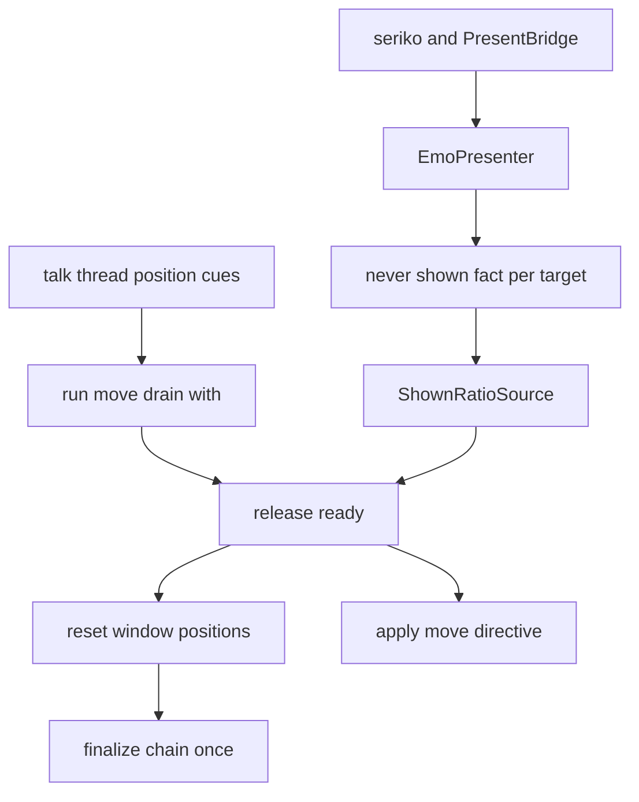
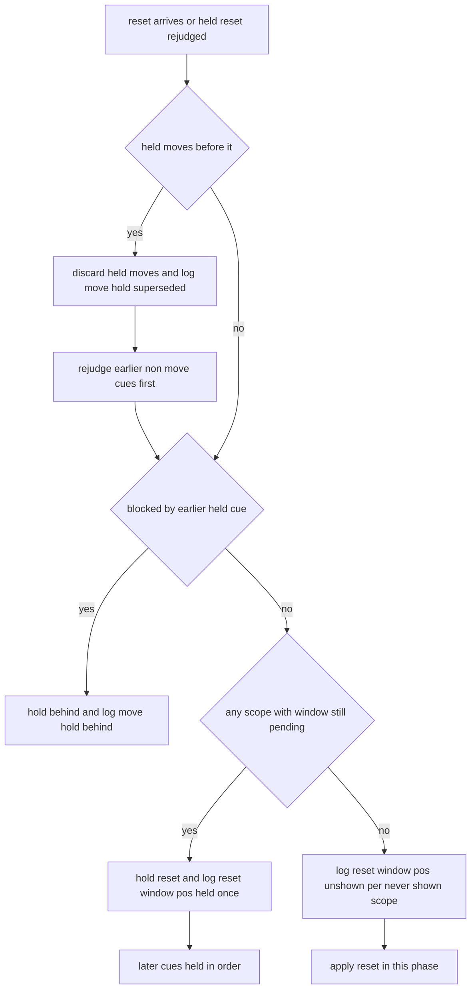
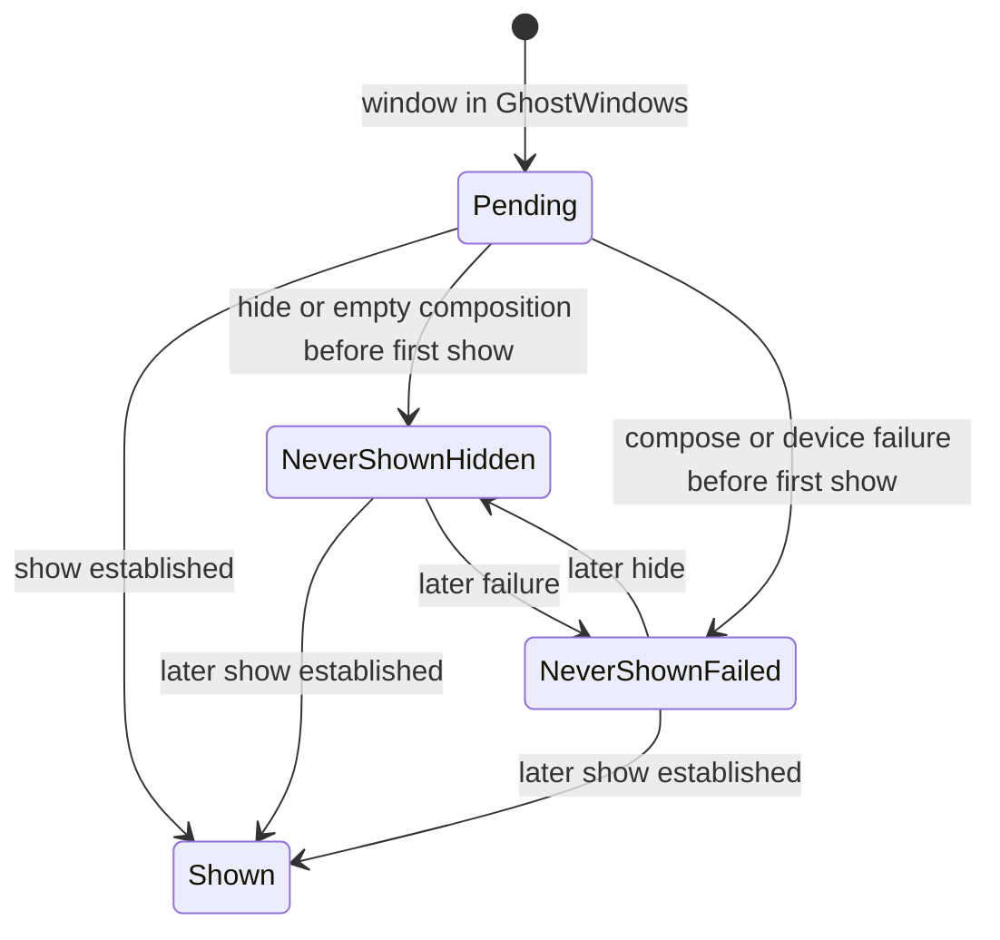

# 設計: window-resetwindowpos-hold

## Overview

この spec は、台本の並べ直し `\![execute,resetwindowpos]` を、`\![move]` と同じく「窓が最初の面を表示した後」に当てる直しである。起動の直後のトークで流した並べ直しは、今はキャラクター窓が最初の面を出す前の仮の大きさで並べる。起動の確定（`finalize_chain_once_with`）が窓どうしの隙間は後で埋めるが、先頭の窓は動かさないので、先頭の窓が作業領域の右端から「仮の幅と本当の幅の差の半分」だけ離れたまま残り、その位置が記憶にも書かれる（§「今のコードの読み」）。

**Purpose**: ゴーストの作者・利用者に、起動の直後に流した並べ直しでも、どの窓も最初の面を出した後の大きさで、一度で既定の並びに置く振る舞いを渡す。
**Users**: 起動のトークの先頭で並べ直しを流すゴーストの作者と、そのゴーストの利用者。
**Impact**: 位置の指令の預かり（`release_ready`）が、並べ直しも「窓のある全部のスコープの表示が決まるまで」預かるようになる。あわせて、表示層（`areka-emo-present`）がスコープごとに「最初の面を表示しないまま決まった」ことを覚え、最初の面を出さないと決まった窓への `\![move]` と並べ直しを預かり続けない。

### Goals
- 起動の直後の並べ直しを、表示の決まっていない窓がある間は預かり、全部の窓の表示が決まった巡の位置の指令の相で一度に当てる（1.1〜1.3・1.7）。
- 前に預かった移動を捨てる今の決まり・追い越さない・取りこぼさないを、預かる形でも保つ（2.1〜2.6）。
- 表示しないと分かった窓（最初の面の前に隠した・面を出せなかった）で、並べ直しと移動の列が止まらない（3.1〜3.4・4.1）。
- 待った・捨てた・待たなかったを記録に 1 件ずつ残す（5.1〜5.5）。

### Non-Goals
- 並べ直しの並べ方（既定の位置の式・記憶へ書く振る舞い）の変更（1.6）。
- メニューの「シェル位置初期化」・`OnResetWindowPos` の往復・バルーン位置初期化（6.4）。
- 起動のイベントを流す時機（6.3・kanade の持ち物）。
- 面の指令が来ない窓を、時間の上限・ゴーストの名前・SHIORI のイベントで「表示しない」と決める形（取らない。決めはトークの終わりまで遅らせる・設計の議題 1）。
- 拡大率の後の詰め直しの武装中の並べ直し（`research.md` §7 R4・範囲外）。

## Boundary Commitments

### This Spec Owns
- 位置の指令の預かりの判定（`crates/areka-runtime/src/frame/move_hold.rs` の `release_ready`）のうち、並べ直しの表示待ちと、表示しないと分かった窓への移動の扱い。
- スコープの表示の決まり方の読み口（`ShownRatioSource` に既定の実装つきで足す 1 メソッド）。
- 表示層の「最初の面を表示しないまま決まった理由」（`areka-emo-present` の `PresentTarget` の 1 欄・照会 1 本・公開の列挙 `NeverShown`）。表示層はこの事実の一次情報源である。
- 記録の語 `reset_window_pos_held`・`reset_window_pos_unshown`・`move_hold_unshown`。
- 決定論の檻（新しい兄弟のテストファイル 2 本と足場 1 本）と、今の檻 2 本の期待の改め。
- `doc/COMPAT_ARCHITECTURE.md` §8 の件 5 の行（452 行）の書き換え。

### Out of Boundary
- 並べ直しの本体 `crates/areka-placement/src/reset_pos.rs`（読むだけ。材料の無いスコープを外す `reset_window_pos_skipped` もそのまま）。
- 起動の確定・拡大率の後の詰め直し（`drain_resnap.rs` の `finalize_chain_once_with`・`realign_chain_once`・`crates/areka-placement/src/chain_finalize.rs`）。
- `\![move]` が対象と基準の窓の最初の表示を待つ決まり（`window-work-area-clamp`）。表示の決まっていない間は今どおり預かる（4.2）。
- フレームの相の順（`crates/areka-runtime/src/frame.rs` の 199〜238 行）・公開の入口 `run_move_drain_phase`・`run_move_drain_with` の形。
- 表示の指令の中身（合成・装置・可視性の決まり）。表示層に足すのは「結果を覚える 1 欄」だけで、表示の振る舞いは変えない。
- §8 の並べ直しの行（143 行）。この直しの後も「今表示している窓の大きさで解く」はそのまま正しいので書き換えない。

### Allowed Dependencies
- `areka-runtime` → `areka-emo-present`（今もある向き。`NeverShown` と照会 `EmoPresenter::never_shown` を読む）。
- `areka-runtime` → `areka-placement`（今もある向き。`GhostWindows`・`reset_window_positions`）。
- 逆向き（`areka-emo-present` が位置の指令や窓の在庫を読む）は取らない。表示層はスコープも位置の指令も知らず、`TargetId` ごとの事実だけを持つ。
- 本体 `crates/areka/` からは、今ある公開の `run_move_drain_with`・`all_shown` だけを使う（テスト 1 本の改め）。

### Revalidation Triggers
- `ShownRatioSource` の形の変更（足すメソッドの名前・既定の実装）: 実装しているのは `EmoPresenter` と閉包だけ。`balloon-script-offset-align`（`move_hold.rs` を触る・同じウェーブの外）は着地の後に読み直す。
- `PresentTarget` の欄の追加: 表示層を触る spec（置き換え `replace.rs` の引き継ぎの欄の並び）は読み直す。
- 記録の語の追加: 実機の確かめとログの grep を持つ道具・文書。
- 下流 `extra-character-windows`: 3 人目以降の窓も「窓のある全部のスコープ」として同じ判定で待たれる。窓の在庫に入った時点で `Pending` から始まる前提を崩さないこと。

## Architecture

### 今のコードの読み（R1・コードの読みで、実行で未確認）

起動の直後、本体（スコープ 0）と相方（スコープ 1）が最初の面を出す前に並べ直しが当たる場合を、`frame.rs`・`reset_pos.rs`・`drain_resnap.rs`・`chain_finalize.rs`・`persist_save.rs` の読みで追った。揃え方は下端・`defaultx` は 0、仮の幅を `w0p`・`w1p`、本当の幅を `w0`・`w1`、作業領域の右端を `R` とする。

| 巡 | 相 | 起きること |
|---|---|---|
| t0 | 位置の指令の相 | `reset_window_positions` が仮の大きさで解く: `x0 = R − w0p`、`x1 = x0 − w1p`。既定の位置をこの値に書き、`ScriptPlaced` を外し、記憶へ下端の中央の x を送る（`persist_unremembered_char_positions`） |
| t1 | 取り出し → 窓寸の照合 → 再スナップ | 両方が最初の面を出す。再スナップは揃え方（下端なら下端の中央）を保って大きさを変える: `x0' = x0 + (w0p − w0)/2`、`x1' = x1 + (w1p − w1)/2`。既定の位置も同じ量だけ運ばれる（`track_default_char_pos`） |
| t1 | 起動の確定 | 全スコープの実表示寸がそろうので 1 度だけ走る。**先頭は動かさない**。相方は「既定のまま・印なし」なので `JoinLeft` で `x1'' = x0' − w1` に解き直す（窓どうしの隙間は 0 になる）。最後に記憶へもう 1 度送る |

結論:
- **窓どうしの隙間は、今のコードでも同じ巡 t1 の起動の確定で消える見込み**。
- **残るのは先頭の窓の位置**: 右端は `R − (w0p − w0)/2`。本当の幅が仮の幅より狭いとき（emo2 の測り ⑸ の 868→764 なら 52px）、先頭は右端から離れ、鎖全体がその分だけ左へずれる。広いときは右へはみ出し、`place_chain_in_work_area` が作業領域へ寄せ戻す見込み（ずれは残らない）。
- **記憶**: 先頭の窓の下端の中央の x は再スナップで変わらないので、離れた位置がそのまま記憶に書かれ、次の起動もそこに出る。
- **並べ方が 2 度動く**: t0 の並べ直しと t1 の確定の 2 回で置かれる（要件 1.7 の「一度で当てる」に反する）。

よって赤の檻（7.1）は「位置の相だけ」でなく「再スナップ → 位置の指令の相 → 起動の確定」まで通した形で組み、(a) 先頭の窓の右端が `R` にそろうこと、(b) 起動の確定が窓を 1 つも動かさないこと（`chain_finalize: 実表示寸で連鎖を再解決` の行が出ない）、を見る。(a)(b) は直す前に赤、直した後に緑になる。窓どうしの隙間 0 は直す前も緑の見張りとして並べて見る。

### Architecture Pattern & Boundary Map



- 選んだ形: 今ある「読み口越しに表示の事実を引いて、預かりの判定で使う」形の延長（`research.md` の案 A＋案 C の 1・2 の合成）。新しい相・新しいチャネル・新しい資源は作らない。
- 表示の事実の持ち主は表示層だけ（第 2 の帳簿を作らない・`target_visible` と同じ考え）。位置の側は毎巡その場で読む（プル）。
- 待つ範囲は「スコープごとの表示の決まり」で、起動の確定の印 `ChainFinalized` は判定に使わない（案 B は取らない）。理由: 確定の後に窓の在庫へ入る窓（下流の `extra-character-windows`）も同じ決まりで待つため、印は起動の間だけの扱いに見えて 6.1 の趣旨から外れるため、開発者の決め（議題 2）が「各窓の表示が決まるまで」であるため。
- 依存の向き: `areka-emo-present`（表示の事実）→ `areka-runtime::frame::move_hold`（判定）→ `areka-runtime::frame::drain_resnap`（当てる相）→ `areka-placement`（並べ直しの本体）。左から右へだけ読む。

### Technology Stack

| Layer | Choice / Version | Role in Feature | Notes |
|-------|------------------|-----------------|-------|
| 表示層 | `areka-emo-present`（ワークスペース内） | スコープの target ごとに「最初の面を表示しないまま決まった理由」を覚えて答える | 欄 1 つ・照会 1 本・列挙 1 つを足す |
| 実行の相 | `areka-runtime`（ワークスペース内）・`bevy_ecs` | 預かりの判定と記録 | 新しい依存なし |
| 記録 | `tracing` | 新しい語 3 つ（info） | `logging.md` の語の形に合わせる |

新しい外部の依存は無い。

## File Structure Plan

### Directory Structure
```
crates/
├── areka-emo-present/src/
│   ├── presenter_never_shown_tests.rs        # 新: 表示しないまま決まった理由の檻（GPU 無し）
│   └── presenter/ (既存のファイルを改める・下の Modified Files)
└── areka-runtime/src/
    ├── frame_reset_hold_tests.rs             # 新: 並べ直しの預かりの檻（赤の檻 7.1 と順の決まり 7.2）
    └── frame_reset_hold_test_support.rs      # 新: 表示の決まりを答える偽の読み口 SettledSource
```

### Modified Files
- `crates/areka-emo-present/src/presenter.rs` — 列挙 `NeverShown` の定義と、新しい檻の `mod` の行。
- `crates/areka-emo-present/src/lib.rs` — `NeverShown` を公開（`pub use presenter::{…, NeverShown}`）。
- `crates/areka-emo-present/src/presenter/target.rs` — `PresentTarget` に欄 `never_shown: Option<NeverShown>` を足す。
- `crates/areka-emo-present/src/presenter/hub.rs` — `attach_target` で `None`。`apply` の `ShowSurface`・`Hide`・`ReplaceTarget` の 3 腕で、適用の結果を書く（書き方は「EmoPresenter の表示しないまま決まった理由」）。
- `crates/areka-emo-present/src/presenter/replace.rs` — 置き換えで `applied` と同じく `never_shown` を引き継ぐ。
- `crates/areka-emo-present/src/presenter/read.rs` — 照会 `never_shown(target) -> Option<NeverShown>`。
- `crates/areka-runtime/src/frame/move_hold.rs` — `ShownRatioSource` に既定の実装つきの `never_shown`、`EmoPresenter` の実装、スコープの決まり `Settle` の判定、並べ直しの表示待ち、表示しないと分かった窓への移動の扱い、記録 3 語。
- `crates/areka-runtime/src/frame.rs` — 新しい檻と足場の `#[cfg(test)]` の `mod` の行（2 行）。
- `crates/areka-runtime/src/frame_move_hold_tests.rs` — `a_reset_after_a_move_to_a_never_shown_window_supersedes_it` の相方を「隠した窓」に改める（7.3）。
- `crates/areka/src/runtime_tests/frame_move_order_tests.rs` — `a_script_reset_sends_nothing_to_kanade` の呼び出しを `run_move_drain_with(&wiring, &all_shown, …)` に改める（呼び出し 1 行と `use` 1 行・7.3）。同じウェーブの `session-module-gather` がこのファイルのパスを直すので、順を合わせる（Implementation Notes）。
- `doc/COMPAT_ARCHITECTURE.md` — §8 の件 5 の行（452 行）の第 2 列・第 3 列・第 4 列（7.6）。

- `crates/areka-runtime/src/frame/drain_resnap.rs` — `run_move_drain_with` の本体だけ（窓寸の着地を見る内側の読み口で包む・議題 2／トークの終わりの通し番号を読んで判定へ渡す・議題 1）。公開の形は変えない。
- `crates/areka-runtime/src/balloon_visibility_phase.rs` — `TalkEnded` を数えた通し番号を `RuntimeWiring` に置く（数行・設計の議題 1）。
- `crates/areka-runtime/src/frame/wiring.rs` — `RuntimeWiring` にトークの終わりの通し番号の欄を 1 つ足す（設計の議題 1）。

`reset_pos.rs`・`chain_finalize.rs`・`frame_test_support.rs`・`frame_shared_test_support.rs` は触らない。

## System Flows

### 並べ直しが届いたときの判定



- 「預かった移動を捨てる」腕は今のまま先に走る（2.1）。並べ直しを預かった後に届いた移動は並べ直しの後ろに並ぶので、その移動は捨てられない（後の並べ直しが来たときだけ捨てられる・結果は順のまま当てたのと同じ）。
- 預かった並べ直しは `Blocked.all` を立てるので、後の指令は全部追い越さずに預かられる（2.3）。並べ直しを当てた巡には、後の指令も同じ巡で届いた順に判定される（2.4）。
- 並べ直しより前に届いた指令は、並べ直しより先に判定されるので、関わりの無い窓への指令は待たずに当たる（3.3）。

### スコープの表示の決まり



- `Shown` は `applied_ratio` が `Some`（今の `shown_ratio`）で、**かつ窓の大きさが着地した**（窓寸 `WindowPos.size` が表示層の実表示寸 `target_physical_size` と一致する）こと。着地の材料は起動の確定が `ResnapNotLanded` で待つものと同じで、DPI の整合待ちの札（`DpiSyncHold`）で窓寸の照合が見送られた巡は、表示が成り立っていても `Pending` に数える（設計の議題 2・2026-11-21 承認）。判定の関数は 1 つなので、`\![move]` の待ちにも同じく効く（「表示の後の大きさで当てる」という `\![move]` の決まりの意図を満たす直し）。一度表示して着地した窓は、後で隠しても `Shown` のまま（今の `move` の待ちと同じ）。
- `Pending` は窓があり、面の指令を受けて結果がまだ出ていないか（表示の保留・大きさの未着地）、面の指令をまだ受けておらず、その位置の指令を運んだトークもまだ終わっていない状態。
- **面の指令を受けないままの決まり（設計の議題 1・2026-11-21 承認）**: 面の指令をまだ一度も受けていない窓（表示層の target が無い窓を含む）は、預かった位置の指令を運んだトークが終わった時点で `NeverShown(NotRequested)`＝「surface -1 のまま決まった（隠れたまま）」に数え、待たない。トークの途中で面の指令が来れば、その窓は普通に `Shown` へ進み、その巡のうちに当たる（決めを遅らせるだけで、当てる巡は遅らせない・6.2）。材料は areka 自身のトークの生き死にの合図（`TalkLifecycleSignal::TalkEnded`）だけで、時間の上限・ゴーストの名前・SHIORI のイベントは見ない（6.1）。
  - 表示層の側: `PresentTarget` に「面の指令を一度でも受けた」の印を持つ（`ShowSurface`・表示を伴う置き換えが届いた時点で立てる。保留・失敗でも立つ）。`never_shown` の照会は、印が立っていない target と未登録の target に `Some(NotRequested)` を答える。ただし `NotRequested` を「決まった」と読むのは位置の相がトークの終わりを見た後だけである（下）。
  - 位置の相の側: 預かりの列の各指令に、届いたときの「トークの終わりの通し番号」を添える。`run_move_drain_with` の本体がトークの終わりの通し番号を読み、番号が進んだ（運んだトークが終わった）指令についてだけ、`NotRequested` の窓を待たない。`Pending` との分かれは `settle` の 1 か所で決める。
  - トークの終わりの通し番号の持ち主: 今 `TalkEnded` を受けるのはバルーンの可視性の相だけ（`RuntimeWiring::lifecycle_rx` を `try_iter` で全件取り出す）。可視性の相が `TalkEnded` を数えた通し番号を `RuntimeWiring` に置き、位置の相がそれを読む（プル・一次情報源は線の受け手 1 つ）。フレームの順は `frame.rs` で可視性の相（`run_balloon_visibility_phase`）が位置の指令の相（`run_move_drain_phase`）より前に走るので、その巡に届いた `TalkEnded` は同じ巡の位置の相に見える（1 フレーム遅れない・2026-11-21 確かめた）。位置の相の側で同じ線を読み直す形は取らない（受け手を 2 つにしない）。
- 窓の無いスコープは判定に入れない（1.4）。

## Requirements Traceability

| Requirement | Summary | Components | Interfaces | Flows |
|-------------|---------|------------|------------|-------|
| 1.1 | 表示の決まっていない窓があれば並べ直しを預かる | MoveHold | `release_ready`・`Settle` | 並べ直しの判定 |
| 1.2 | 決まった巡の位置の相で当てる | MoveHold・フレームの順（既存） | `release_ready` | 並べ直しの判定 |
| 1.3 | 全部決まっていれば今どおりその巡で当てる | MoveHold | `release_ready` | 並べ直しの判定 |
| 1.4 | 窓の無いスコープは待たない | MoveHold | `pending_scopes` | 表示の決まり |
| 1.5 | 並べた後に仮の大きさ由来の隙間を残さない | MoveHold・赤の檻 | — | 今のコードの読み |
| 1.6 | 並べ方と記憶への書き方を変えない | 境界（`reset_pos.rs` は触らない） | — | — |
| 1.7 | 一度で当てる（確定に直させない） | MoveHold・赤の檻 (b) | — | 今のコードの読み |
| 2.1 | 前に預かった移動を捨てる | MoveHold（既存の腕） | `move_hold_superseded` | 並べ直しの判定 |
| 2.2 | 移動でない預かりは並べ直しの前で判定し直す | MoveHold（既存の腕） | — | 並べ直しの判定 |
| 2.3 | 後の指令に追い越させない | MoveHold（`Blocked.all`） | — | 並べ直しの判定 |
| 2.4 | 当てる巡に後の指令も届いた順に判定 | MoveHold | — | 並べ直しの判定 |
| 2.5 | 取りこぼさず順を保つ | MoveHold（`held` の列） | — | — |
| 2.6 | 捨てた移動は後で当てない | MoveHold（既存）・檻 | — | — |
| 3.1 | 表示しないと分かった窓を待ち続けない | NeverShownFact・SettledRead・MoveHold | `never_shown` | 表示の決まり |
| 3.2 | その窓を外さず今の大きさで入れて記録 | MoveHold・`reset_pos.rs`（読むだけ） | `reset_window_pos_unshown` | 並べ直しの判定 |
| 3.3 | 関わりの無い前の指令は先に当てる | MoveHold（既存） | — | 並べ直しの判定 |
| 3.4 | 表示しない窓 1 つで後の指令を際限なく預からない | MoveHold・NeverShownFact | — | 表示の決まり（OPEN QUESTION 1） |
| 4.1 | 表示しないと分かった窓への移動を預かり続けず 1 件ずつ記録 | MoveHold | `move_hold_unshown` | 表示の決まり |
| 4.2 | 決まっていない間は今どおり預かる | MoveHold（既存の `move_ratio_unset`） | — | — |
| 4.3 | SSP の測り | 測りの手順（`research.md` §10） | — | — |
| 5.1 | 待った記録を届いた巡に 1 度 | MoveHold | `reset_window_pos_held` | 並べ直しの判定 |
| 5.2 | 当てたときは今の並べ直しの記録 | `reset_pos.rs`（読むだけ） | `reset_window_pos` | — |
| 5.3 | 捨てた移動ごとの記録 | MoveHold（既存） | `move_hold_superseded` | — |
| 5.4 | 待たなかった窓・その窓への移動を 1 件ずつ | MoveHold | `reset_window_pos_unshown`・`move_hold_unshown` | — |
| 5.5 | 材料の不足は今どおり警告 | `reset_pos.rs`（読むだけ） | `reset_window_pos_skipped` | — |
| 5.6 | 失敗の道を足すなら `error!`＋`Err` | 全体（失敗の道を足さない） | — | Error Handling |
| 6.1 | ゴースト・初回・イベントを見ない | MoveHold・NeverShownFact | — | 表示の決まり |
| 6.2 | 1 フレーム遅らせない | フレームの順（既存）・赤の檻 | — | — |
| 6.3 | 起動のイベントの時機を変えない | 境界 | — | — |
| 6.4 | メニューの道・バルーン位置初期化を変えない | 境界（`menu/reset_pos_frame.rs` は直に呼ぶ） | — | — |
| 6.5 | 定常は待ちを足さない | MoveHold・檻 | — | 並べ直しの判定 |
| 7.1 | 直す前に赤・直した後に緑 | ResetHoldCage | — | 今のコードの読み |
| 7.2 | 順の決まりを GPU 無しで | ResetHoldCage・SettledSource | — | — |
| 7.3 | 今の檻 2 本の期待を改める | 2 本の改め | — | — |
| 7.4 | 実機で全部の表示の後に当たり隙間が無い | 実機の確かめ | — | Testing Strategy |
| 7.5 | 実機の根・環境変数 | 実機の確かめ | — | Testing Strategy |
| 7.6 | §8 の件 5 の行の書き足し | 文書 | — | — |

## Components and Interfaces

| Component | Domain/Layer | Intent | Req Coverage | Key Dependencies (P0/P1) | Contracts |
|-----------|--------------|--------|--------------|--------------------------|-----------|
| NeverShownFact | 表示層（`areka-emo-present`） | target ごとに「最初の面を表示しないまま決まった理由」を覚えて答える | 3.1, 3.4, 4.1, 6.1 | `PresentTarget`（P0） | Service, State |
| SettledRead | 実行の相（`move_hold.rs`） | 読み口 `ShownRatioSource` にスコープの「表示しないまま決まった理由」を足す | 3.1, 4.1, 7.2 | NeverShownFact（P0） | Service |
| MoveHold | 実行の相（`move_hold.rs`） | 並べ直しの表示待ち・表示しないと分かった窓への移動の扱い・記録 | 1.1〜1.5, 1.7, 2.1〜2.6, 3.1〜3.4, 4.1, 4.2, 5.1, 5.3, 5.4, 6.1, 6.2, 6.5 | SettledRead（P0）・`GhostWindows`（P0） | Service, State |
| ResetHoldCage | 檻（`frame_reset_hold_tests.rs`・`frame_reset_hold_test_support.rs`） | 赤の檻と順の決まりの檻 | 1.5, 1.7, 6.2, 6.5, 7.1, 7.2 | `FrameHarness`（P1） | — |
| 文書 | `doc/COMPAT_ARCHITECTURE.md` | §8 の件 5 の行 | 7.6 | — | — |

### 表示層

#### NeverShownFact（EmoPresenter の表示しないまま決まった理由）

| Field | Detail |
|-------|--------|
| Intent | target が最初の面を表示しないまま「隠した」か「面を出せなかった」に決まったことを覚え、照会に答える |
| Requirements | 3.1, 3.4, 4.1, 6.1 |

**Responsibilities & Constraints**
- 事実の一次情報源は表示層の適用の結果だけ。位置の側に第 2 の帳簿を作らない。
- 表示の振る舞い（合成・可視性・記録の行・応答）は変えない。足すのは結果を覚える欄だけ。
- `applied` が `Some`（一度表示が成り立った）の target では常に `None`。

**Dependencies**
- Inbound: `areka-runtime::frame::move_hold`（`ShownRatioSource` の実装）— スコープの決まりを読む（P0）
- Outbound: なし

**Contracts**: Service [x] / State [x]

##### Service Interface
```rust
/// 最初の面を表示しないまま決まった理由。
#[derive(Debug, Clone, Copy, PartialEq, Eq)]
pub enum NeverShown {
    /// 最初の面の前に隠した（`Hide`＝`\s[-1]`、または全透明の縮退で隠れた）。
    Hidden,
    /// 最初の面を出せなかった（合成の失敗・外形の上限越え以外の合成の失敗・描く装置の失敗）。
    Failed,
    /// 面の指令を一度も受けていない（未登録の target を含む）。位置の相はトークの終わりを見た後だけ「決まった」と読む。
    NotRequested,
}

impl EmoPresenter {
    /// target が最初の面を表示しないまま決まった理由。表示が一度成り立った・面の指令を受けて結果がまだの target は `None`。未登録と面の指令を受けていない target は `Some(NotRequested)`。
    pub fn never_shown(&self, target: TargetId) -> Option<NeverShown>;
}
```
- Preconditions: なし（未登録は `Some(NotRequested)`）。
- Postconditions: `applied_ratio(target).is_some()` なら `None`。
- Invariants: 欄を書くのは `apply` の 3 腕だけ（下の State Management）。

##### State Management
- 欄: `PresentTarget.never_shown: Option<NeverShown>`。`attach_target` で `None`。置き換え（`replace.rs`）は `applied` と同じく引き継ぐ。
- 書く点（`apply` の腕の結果を見て、その target の `applied` で決める）:
  - `ShowSurface`（`show_or_hold` の後）: `applied` が `Some` なら `None`。`applied` が `None` で結果が `Ok`（全透明・上限越えの縮退で隠れた）なら `Some(Hidden)`、`Err`（合成の失敗・装置の失敗）なら `Some(Failed)`。
  - `Hide`: `applied` が `None` なら `Some(Hidden)`（`Some` なら触らず `None` のまま）。未登録 target は今どおり `error!`＋`Err` で、欄は無い。
  - `ReplaceTarget`: 表示を伴う置き換えは `ShowSurface` と同じ規則で、伴わない置き換えは引き継いだ値のまま。
- 外形の上限越え（`ExtentTooLarge`）は今の表示層が `Ok` の縮退として返すので `Hidden` に入る。合成の側が `error!` を残しているので記録は失われない（判定は「隠れたまま決まった」で同じ）。
- 並行: 表示層は UI スレッド専有（`!Send`）。位置の相も同じスレッドで同じ巡に読む。

**Implementation Notes**
- Integration: 位置の相は表示の指令の取り出し（`run_drain_phase`）の後に走るので、同じ巡に適用した結果をその巡のうちに読む。
- Integration: 今は結果を捨てている `show_or_hold` と `apply_replace` の `let _ = apply_show` を、結果を受け取って欄を書く形へ改める（`show.rs` の早期の戻り 5 つを覆うため・`design-validation.md`）。
- Validation: 新しい檻 `presenter_never_shown_tests.rs`（GPU 無し）で、未表示の `Hide` → `Hidden`、未表示の合成の失敗 → `Failed`、表示の後の `Hide` → `None`、`Hidden` の後の表示 → `None`、置き換えの引き継ぎ、を見る。
- Risks: 装置の無い環境の `Failed` は「装置がいつか戻れば表示しうる」窓も含む。並べ直しはその窓を今の大きさで入れて当て、戻った後の表示は再スナップと起動の確定が直す（`ChainFinalized` は全部が表示するまで立たない）。

### 実行の相

#### SettledRead（読み口の拡張）

| Field | Detail |
|-------|--------|
| Intent | 位置の預かりがスコープの「表示しないまま決まった理由」を表示層から読む |
| Requirements | 3.1, 4.1, 7.2 |

**Contracts**: Service [x]

##### Service Interface
```rust
pub trait ShownRatioSource {
    fn shown_ratio(&self, scope: u32) -> Option<ScaleRatio>;
    /// スコープのシェルが最初の面を表示しないまま決まった理由（決まっていなければ `None`）。
    fn never_shown(&self, _scope: u32) -> Option<NeverShown> {
        None
    }
}

impl ShownRatioSource for EmoPresenter {
    // shown_ratio は今のまま。never_shown は EmoPresenter::never_shown(self, shell_target(scope))。
}
```
- 既定の実装があるので、閉包の実装（`impl<F: Fn(u32) -> Option<ScaleRatio>>`）・`all_shown`・`shown_only` はそのまま通る（閉包は「表示しないと決まった窓は無い」を答える）。
- 大きさの着地（議題 2）: 読み口に既定の実装つきの `fn physical_size(&self, _scope: u32) -> Option<(u32, u32)> { None }` を足し、`EmoPresenter` は `target_physical_size(shell_target(scope))` を答える。`run_move_drain_with` の本体（形は変えない）が `world` の窓寸を読み、`physical_size` が `Some` で窓寸と一致しないスコープの `shown_ratio` を `None` と答える内側の読み口で包んで `release_ready` へ渡す。`None`（閉包・材料なし）は着地済みとして扱うので、今の檻はそのまま通る。`drain_resnap.rs` は本体の数行だけを触る。
- 公開の入口 `run_move_drain_phase`・`run_move_drain_with` の形は変わらない（C24 の約束）。

#### MoveHold（預かりの判定）

| Field | Detail |
|-------|--------|
| Intent | 並べ直しを窓のある全部のスコープの表示が決まるまで預かり、表示しないと分かった窓への移動を預かり続けない |
| Requirements | 1.1〜1.5, 1.7, 2.1〜2.6, 3.1〜3.4, 4.1, 4.2, 5.1, 5.3, 5.4, 6.1, 6.2, 6.5 |

**Responsibilities & Constraints**
- 入力は今どおり、預かりの列・届いた指令・窓の在庫・読み口・組の帳簿だけ。ゴーストの名前・初回起動・イベント・時刻・巡の数を見ない（6.1）。
- 判定は位置の指令の相の中で完結し、当てる巡を遅らせない（6.2）。
- 失敗の道を持たない（`Vec` を返す今の形のまま・5.6）。

**Dependencies**
- Inbound: `run_move_drain_with`（`drain_resnap.rs`・変えない）— 今当てる指令を受け取る（P0）
- Outbound: SettledRead — スコープの決まり（P0）、`GhostWindows` — 窓のあるスコープ（P0）

**Contracts**: Service [x] / State [x]

##### Service Interface
```rust
/// スコープの表示の決まり（窓のあるスコープだけを判定する）。
enum Settle {
    Shown,
    NeverShown(NeverShown),
    Pending,
}

fn settle<S: ShownRatioSource + ?Sized>(scope: u32, shown: &S) -> Settle;

/// 窓があり、表示の決まっていないスコープ（昇順）。空なら並べ直しを当ててよい。
fn pending_scopes<S: ShownRatioSource + ?Sized>(windows: &GhostWindows, shown: &S) -> Vec<u32>;

// 公開の形は変えない（pub(super)）。
pub(super) fn release_ready<S: ShownRatioSource + ?Sized>(
    held: &mut VecDeque<PositionCue>,
    arrived: impl IntoIterator<Item = PositionCue>,
    windows: &GhostWindows,
    shown: &S,
    ledger: Option<&StickyGroupLedger>,
) -> Vec<PositionCue>;
```

##### 判定の規則（今の規則に足す分）

1. **並べ直し**（`PositionCue::ResetWindowPos`）: 今の「前に預かった移動を捨てる」腕と `Blocked` の判定の後に、`pending_scopes` を見る。
   - 空でなければ預かる。届いた巡（`just_arrived`）に 1 度だけ `info!(event = "reset_window_pos_held", waiting = ?scopes)` を残す（5.1）。`Blocked.all` が立つ（2.3）。
   - 空なら当てる。そのとき `settle` が `NeverShown(reason)` のスコープごとに `info!(event = "reset_window_pos_unshown", scope, reason)` を残す（3.2・5.4）。並べ直しの本体はその窓を今の大きさで入れる（`reset_pos.rs` は窓の大きさの揃うスコープを全部入れる・3.2）。
   - 全部が `Shown` の定常では、今と同じ巡に当たり、新しい行は出ない（1.3・6.5）。
2. **移動**（`PositionCue::Move`）: 今の `unshown_scope`（対象と基準のうち窓があってまだ表示していないもの）を、待つスコープの決まりで分ける。
   - `Pending` なら今どおり預かり、届いた巡に `move_ratio_unset` を残す（4.2）。
   - `NeverShown(reason)` なら預からず、**位置だけ置く**（今の大きさで当てる・`ready` へ積む）。`info!(event = "move_hold_unshown", scope, waiting, reason, handling = "placed")`。
     - 決めの根拠: SSP 2.9.34 の測り（`research.md` §10.7）で、隠した窓・まだ出していない窓への `\![move]` は捨てられず、窓の位置として残り、出した後もその位置に出た。隠した窓は基準としても使われた。並べ直しが表示しないと分かった窓を今の大きさで入れる決め（3.2）とも同じ扱いで、取りこぼさない（2.5）。捨てる形（旧の枝 A）は取らない。
   - 記録は扱った巡に、移動ごとに 1 件（4.1）。前の巡から `Pending` で預かっていた移動は、待つ窓が `NeverShown` に決まった巡にこの腕を通る。
3. `Blocked` と組の扱い・並べ直し以外の指令の判定は変えない（2.2・3.3）。

##### State Management
- 状態は今の `RuntimeWiring.move_held`（`RefCell<VecDeque<PositionCue>>`）だけ。新しい状態は持たない（記録の「1 度だけ」は今の `just_arrived` の印で足りる）。
- 預かった並べ直しの「待っているスコープ」は覚えない。毎巡 `pending_scopes` で読み直す（表示層が一次情報源・プル）。

**Implementation Notes**
- Integration: `run_move_drain_with` は変えない。並べ直しの腕（`drain_resnap.rs` 175 行）はそのまま `reset_window_positions(world)` を呼ぶ。
- Validation: 下の Testing Strategy。
- Risks: 相方に面の指令を出さないトークでは、並べ直しとそれに続く位置の指令がトークの終わりまで預かられ、終わった巡に当たる（本体はそこで動く）。トークをまたいで列が伸び続けることは無い。

### 檻

#### ResetHoldCage（summary）

- `frame_reset_hold_test_support.rs`: 偽の読み口 `SettledSource`（表示したスコープの集合と、`NeverShown` を答えるスコープの表）。`ShownRatioSource` を実装し、`never_shown` を上書きする。`frame_move_hold_tests.rs` の改めと新しい檻の両方が使う。
- `frame_reset_hold_tests.rs`: 下の Testing Strategy の檻。足場は今ある `FrameHarness`・`PerTargetSizes`・`placement_basis`・`frame_chain_finalize_align_tests.rs` の `spawn_resolved` の形を使い、`frame_test_support.rs` には足さない。

## Data Models

位置の記憶・設定の形は変えない。足すのは表示層の実行時の欄 `PresentTarget.never_shown: Option<NeverShown>`（保存しない・窓の一式とともに消える）だけである。

## Error Handling

### Error Strategy
- この直しは失敗の道を足さない（5.6）。照会は未登録で `None` を返し、預かりの判定は失敗しうる箇所を持たない。
- 表示の失敗そのものは今どおり表示層が `error!`／`warn!` と呼び手への `Err` で残す。足す欄はその結果を覚えるだけで、失敗を黙らせない。
- 並べ直しの材料の不在は今どおり `reset_window_pos_skipped` の `warn!`（5.5）。

### Monitoring
| 語 | 水準 | 出る時 | 欄 |
|---|---|---|---|
| `reset_window_pos_held` | info | 並べ直しを表示待ちで預かった、届いた巡に 1 度 | `waiting`（待っているスコープの並び） |
| `reset_window_pos_unshown` | info | 表示しないと分かった窓を待たずに並べ直したとき、スコープごとに 1 件 | `scope`・`reason`（`hidden`／`failed`／`not_requested`） |
| `move_hold_unshown` | info | 表示しないと分かった窓への移動を扱ったとき、移動ごとに 1 件 | `scope`・`waiting`・`reason`・`handling`（`placed`） |
| `move_ratio_unset`・`move_hold_behind`・`move_hold_superseded`・`reset_window_pos`・`reset_window_pos_skipped` | 今のまま | 今のまま | 今のまま |

語を `move_ratio_unset` の広げでなく新しく作るのは、`move_ratio_unset` が「移動の対象と基準」を欄に持つ測りの語で、並べ直しの待ち（スコープの並び）と形が違うためである。`reset_window_pos_` で始めるので、`grep reset_window_pos` で並べ直しの行が全部引ける。

## Testing Strategy

### 単体の檻（GPU 無し）
- `presenter_never_shown_tests.rs`: 未表示の target への `Hide` で `Hidden`／未表示の合成の失敗（無い面の番号）で `Failed`／表示の後の `Hide` で `None`／`Hidden` の後の表示の成立で `None`／置き換えが値を引き継ぐ（3.1・6.1）。
- `move_hold.rs` の判定は `frame_reset_hold_tests.rs` の檻で通して見る（`move_hold_tests.rs` の `Blocked` の檻は変わらない）。

### 相を通した檻（`frame_reset_hold_tests.rs`・GPU 無し）
1. **赤の檻（7.1・1.5・1.7・6.2）**: `ChainFinalized` の無い足場で、仮の大きさの 2 窓に既定の位置の材料を置く。巡 1: どのスコープも `Pending` で並べ直しを送り、位置の指令の相を回す。巡 2: 両方が本当の大きさ（仮より狭い）で表示し、再スナップ → 位置の指令の相 → 起動の確定の順に回す。見ること: (a) 先頭の窓の右端が作業領域の右端にそろう、(b) 起動の確定が窓を動かさない（`chain_finalize: 実表示寸で連鎖を再解決` の行が無い）、(c) 窓どうしの隙間が 0、(d) `reset_window_pos_held` が巡 1 に 1 行で `waiting` に 0 と 1。直す前は (a)(b)(d) が赤、(c) は緑。
2. **前の移動を捨てて預かる（2.1・2.6・5.3）**: 相方 `Pending` で移動を預けた後に並べ直し → 移動は `move_hold_superseded` で捨てられ、並べ直しは預かられる。相方の表示の巡に並べ直しが当たり、捨てた移動は当たらない。
3. **追い越さない・届いた順（2.3〜2.5）**: 並べ直しを預かっている間に届いた本体への移動は預かられ（`move_hold_behind`）、表示の巡に並べ直しの後で当たる（最後の位置は移動の位置）。
4. **表示しないと分かった窓で詰まらない（3.1〜3.4・5.4）**: 相方を `NeverShown(Hidden)` にした `SettledSource` で並べ直しを送る → その巡に当たり、`reset_window_pos_unshown scope=1 reason=hidden` が 1 行、後の本体への指令も同じ巡に当たる。`Pending` → `Hidden` に変わった巡に、預かっていた並べ直しが当たる形も見る。
5. **表示しないと分かった窓への移動（4.1・4.2）**: `Pending` の間は預かる（`move_ratio_unset`）。`Hidden` に決まった巡に預かりの列から出て、移動ごとに `move_hold_unshown` が 1 行で、今の大きさで置かれる。
6. **トークの終わりまで決めを遅らせる（設計の議題 1）**: 相方に面の指令が来ないまま並べ直しを送る → トークの途中は預かる（`reset_window_pos_held`）→ 途中で相方の面が出ればその巡に当たる／出ないままトークが終われば、その巡に `reset_window_pos_unshown scope=1 reason=not_requested` を 1 行残して当たる。`\![move]` も同じ形で、トークの先頭の移動が相方の面の後に当たる（前の spec の 52px の形が戻らない）。
7. **大きさの着地を待つ（議題 2）**: 表示は成り立ったが窓寸の照合が見送られた（窓寸が実表示寸と違う）スコープがある巡は、並べ直しも `\![move]` も預かり、窓寸が着地した巡のその相で当たる（足場で窓寸の着地を 1 巡遅らせる形を作る）。
8. **定常（6.5・1.3）**: 全部 `Shown` では並べ直しが届いた巡に当たり、`reset_window_pos_held`・`reset_window_pos_unshown` は出ない。

### 今の檻の改め（7.3）
- `frame_move_hold_tests.rs` の `a_reset_after_a_move_to_a_never_shown_window_supersedes_it`: 読み口を `shown_only(&[0])` から「相方が `NeverShown(Hidden)`」の `SettledSource` に替える。見る中身（捨てた記録・並べ直しがその巡に当たる・後の本体の指令が当たる・捨てた移動が後で当たらない）は変えない。名前は相方の状態に合わせて改めてよい。
- 本体の `a_script_reset_sends_nothing_to_kanade`: `run_move_drain_phase(&wiring, …)` を `run_move_drain_with(&wiring, &all_shown, …)` に替える。`steady_harness` は起動の確定の後の足場なので「全部が表示した」読み口がその足場と合う。見る中身（並べ直しが手続きへ届く・kanade へ何も送らない）は変えない。

### 実機の確かめ（7.4・7.5）
- 検体: `vendors\sample_ghost\emo2.nar` の原本をワークツリーの `target\` の下（例 `target\wrwh\root`）へ写し、記憶は `AREKA_USER_ROOT=target\wrwh\user`（毎回空・初回起動）。写しの `dic\boot.pasta` の `＊OnFirstBoot` のトークの先頭に `\![execute,resetwindowpos]` を足す。
- 起動: `AREKA_NO_ALERT=1`、ほかのぱすたがデバッグの口を持つときは `PASTA_DEBUG=0`（その起動の中だけ）、`RUST_LOG=info,areka::placement=debug`、有界の自動終了で 1 回。
- ログで見ること: `reset_window_pos_held`（並べ直しが最初の面の前に届いたことの印。出なければ同じ巡に届いた回で、この確かめにならないので記録して検体を見直す）→ 両方の窓の最初の面と窓寸の照合 → 同じ巡の `reset_window_pos`（スコープ 0 の `to_x` が作業領域の右端 − 本当の幅）→ `chain_finalize` の動かす行が無い。並べた後の 2 窓の矩形から隙間 0 と右端のそろいを確かめる。

## Implementation Notes（統合・順序）

- **本体のテストと `session-module-gather`**: `crates/areka/src/runtime_tests/frame_move_order_tests.rs` は同じウェーブの `session-module-gather` がパスを直す。こちらの改めは呼び出し 1 行と `use` 1 行だけである。実装の前に向こうのセッションへ、このファイルの 2 行を変えることと着地の順を伝える（先に着地した側の後に、もう片方が取り込んで合わせる。パスの移動と中身の 2 行は git の名前の追跡で重ならない見込み）。
- **`frame.rs` の `mod` の行**: 新しい檻と足場の 2 行を足す。同じウェーブの `test-crash-report-merge` が `frame.rs` のテストの `mod` の行を触るなら、行の並びだけの衝突になる。
- 実装の順: 表示層の事実（檻つき）→ 読み口の拡張 → 預かりの判定と記録（赤の檻を先に置いて赤を確かめる）→ 今の檻の改め → §8 → SSP の測り（設計の段で済ませ、枝を決めてからタスクへ）→ 実機の確かめ。

## Open Questions / Risks

1. ~~面の指令が一度も来ない窓~~: **決まった**＝その位置の指令を運んだトークが終わるまで待ち、終わっても面の指令が無ければ `NotRequested`（隠れたまま）として待たない（設計の議題 1・「スコープの表示の決まり」）。
2. ~~表示しないと分かった窓への移動の扱い~~（4.1）: **決まった**＝位置だけ置く（`research.md` §10.7 の SSP 2.9.34 の測り）。
3. ~~表示層の装着が来ないスコープ~~: **決まった**＝target が無い窓は面の指令を受けられないので、1 と同じくトークの終わりで `NotRequested` に数える。
