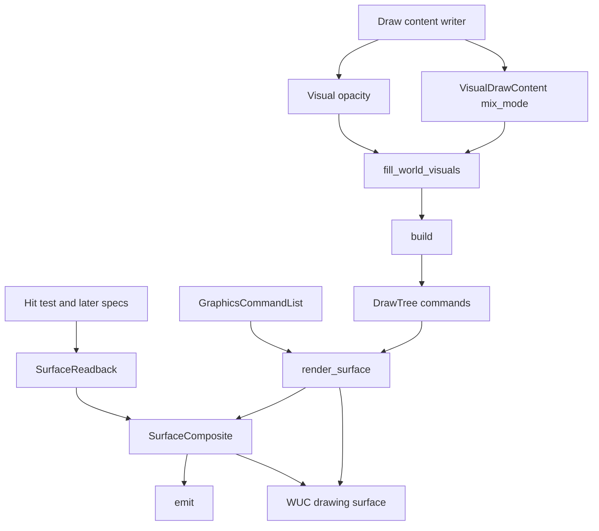
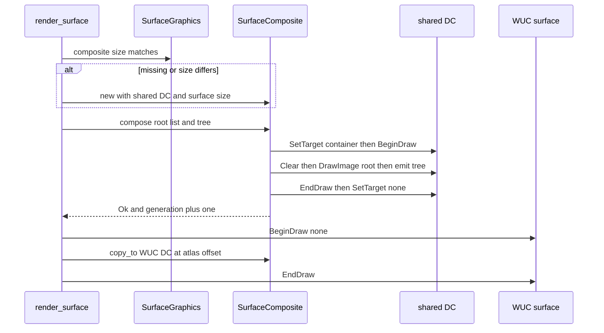
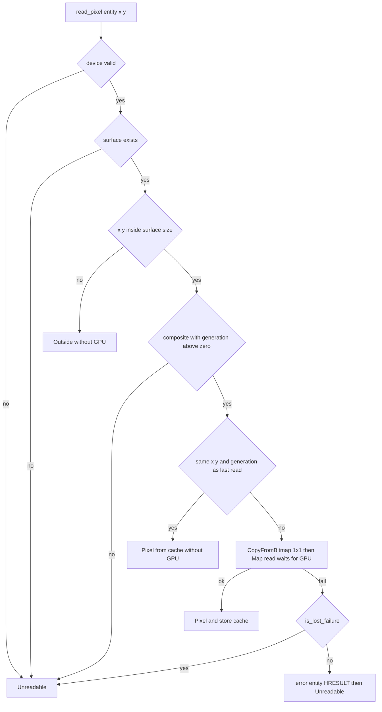
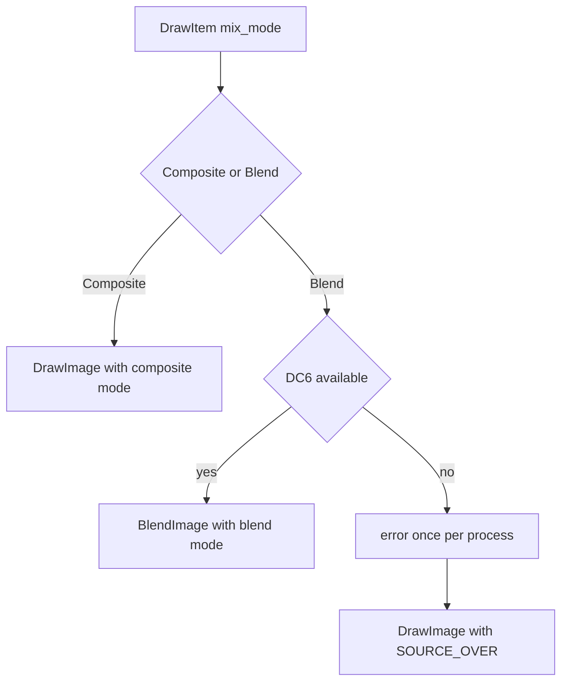

# 設計: wintf-d2d-composite-rules

## Overview

**Purpose**: wintf の描画の木（`wintf-visual-tree`）に、描く中身ごとのブレンド（D2D の 26 種）・節の不透明度の層・切り抜きの形に依らない重ね方とブレンドの効き先を足す。あわせて、描画面ごとの合成の結果を wintf の自前の入れ物（GPU の上の D2D のビットマップ）に持ち、そこから描画面へ写し、入れ物から 1 画素と全体を同期で読み戻す口を作る。

**Users**: wintf を使う描き手（節の `VisualDrawContent` と `Visual.opacity` を書く人）と、後の spec（`draw-methods-canon`・`draw-methods-blend`・`hit-id-pass`・`wintf-visual-damage-redraw`・`compose-f16-precision`）の作り手。

**Impact**: `render_surface` は WUC の描画面へ直接描くのをやめ、入れ物へ合成してから描画面へ写す。規則を指定しない描き手の画素は変わらない（設計の前の試しで、入れ物を通した答えと直接描いた答えのビット一致を WARP で確かめた・research.md §10.4）。公開の型 `VisualDrawContent` と `DrawItem` の欄 `composite_mode` は、重ね方かブレンドかの列挙 `MixMode` の欄 `mix_mode` に置き換わる（wintf は 0.x の版）。

### Goals

- 描く中身ごとに 26 種のブレンドを選べ、選ばなければ今の答えのまま（1.1〜1.8）。
- 節の不透明度を「節と子孫をまとめた 1 枚」に掛けて重ねる（2.1〜2.8）。
- 切り抜きの形（矩形・角丸・回転した矩形・任意の図形）で、`SOURCE_OVER` でない重ね方とブレンドの答えが変わらない（3.1〜3.5）。
- 描画面ごとの入れ物・写し・同期の読み戻し（4.1〜4.8・5.1〜5.10）。
- 合成の答えの画素を WARP で固定し、入れ物を通した描画面が実 GPU の描画面に出ることを確かめる（7.1〜7.10）。

### Non-Goals

- ukadoc の語と wintf の規則の対応・emo の合成の段の作り替え（`draw-methods-canon`・`draw-methods-blend`・`element-clipping-option`）。
- D2D に無いブレンド 3 種の自前の効果（`draw-methods-blend`）・α を無視して描く絵（`draw-methods-canon`）・元の矩形の指定の新しい口。
- 当たり判定の ID の描き先と読み戻し（`hit-id-pass`）・クリックの透過と CPU の画素の読み手 3 つの付け替え（`draw-methods-canon`）。
- 入れ物の f16 化（`compose-f16-precision`）・変わった範囲だけの描き直し（`wintf-visual-damage-redraw`）・描画面の自動の昇格と降格（`wintf-surface-auto-promotion`）・文字の層（`areka-emo-text`）・クロスフェード。

## Boundary Commitments

### This Spec Owns

- 混ぜ方の型 `MixMode`（重ね方 13 種かブレンド 26 種のどちらか 1 つ）と、それを持つ `VisualDrawContent.mix_mode`・`DrawItem.mix_mode`。
- 描く列の不透明度の層の命令（`DrawCommand::PushOpacity`／`PopOpacity`）と、それを組む規則（節の `clamped_opacity` が 0 より大きく 1.0 未満のとき）。
- 図形の切り抜きの層の旗（背景から始める層＋積むときだけ基本の混ぜ方を `COPY`）と、不透明度の層の旗（透明から始める）。この 2 つの決めを書いた公開の型の文書。
- ブレンドの描き方（`ID2D1DeviceContext6::BlendImage`）と、それが無い Windows での道（`error!` を 1 度・`SOURCE_OVER` で描く）。
- 不透明度の NaN を 1.0 として扱う共通の 1 か所（`Visual::set_opacity`・`Visual::clamped_opacity`）。
- 描画面ごとの入れ物 `SurfaceComposite`（作成・作り直し・合成・描画面への写し・放す）と、その置き場（`SurfaceGraphics` の欄）。
- 読み戻しの口 `SurfaceReadback`（1 画素 `read_pixel`・全体 `read_all`）と答えの型 `PixelRead`・`SurfaceImage`。
- 上の全部の WARP の決定論のテストと、実 GPU の「描画面に出る」テスト 1 本。
- `tech.md` の Testing の WARP の例外・支える Windows の下限、`structure.md` の描画の道の記述。

### Out of Boundary

- ukadoc の語・element定義・pattern定義の読み。wintf の公開の型と口は D2D と描画の語だけで名付ける（6.4）。
- 当たり判定の閾値（areka の α ≥ 0.5）。読み戻しは値だけを返す（5.8）。
- CPU の画素の読み手（`ecs/widget/bitmap_source/alpha_mask.rs`・`ecs/layout/hit_region/`・`areka-emo-present` の `presenter/budget.rs`・`cache.rs`・`presenter/read.rs`・`emo2_boot/balloon_background.rs`）。触らない。
- 描画面の持ち主の不透明度・切り抜き・可視（WUC の `visual_property_sync_system`・`clip_sync_system`）。NaN の扱いだけが共通の関数を通して持ち主にも効く（6.3）。
- 入れ物の形式（B8G8R8A8・α 掛け済み・8 ビット）を変えること・部分の合成。
- `crates/areka/` と、新しい外部の依存。

### Allowed Dependencies

- `windows` 0.62.2 の既存の機能（`Win32_Graphics_Direct2D`・`Win32_Graphics_Direct2D_Common`・`Win32_System_WinRT_Composition`）。`ID2D1DeviceContext6`・`D2D1_BLEND_MODE`・`D2D1_LAYER_OPTIONS1_INITIALIZE_FROM_BACKGROUND`・`D2D1_PRIMITIVE_BLEND_COPY`・`ICompositionDrawingSurfaceInterop2`（テストだけ）が在ることを確かめた。
- `wintf-visual-tree` が本番へ上げた描画の木（`fill_world_visuals`・`build`・`emit`・`DrawTree`・`WorldVisual`・WARP の足場と許容差）。
- `GraphicsCore`（D2D の装置・共有の DC・`note_draw_failure`・`is_device_lost`）と WUC の描画面（`SurfaceGraphics`・`com/wuc.rs` の `begin_draw`／`end_draw`）。
- 依存の向き: `visual/draw/`（型と命令の列）→ `graphics/composite.rs`（入れ物）→ `graphics/readback.rs`（読み戻しの口）→ `systems/render.rs`（係）。入れ物と読み戻しは係を呼ばず、`visual/draw/` は入れ物を知らない。

### Revalidation Triggers

- `MixMode`・`DrawItem` の欄・`DrawCommand` の命令の増減（`wintf-visual-damage-redraw` が列を読む）。
- 入れ物の大きさ・形式・寿命・中身を保つ決め（4.1・4.3〜4.5）の変更（`wintf-visual-damage-redraw`・`compose-f16-precision`）。
- `PixelRead`・`SurfaceImage` の答えの形と、読み戻しの決め（5.2〜5.6）の変更（`hit-id-pass`・`draw-methods-canon`）。
- 図形の切り抜きの層の旗と不透明度の層の旗（3.1〜3.4）の変更（`draw-methods-canon`・`element-clipping-option`）。
- 支える Windows の下限（Windows 10 1903）の変更。

## Architecture

### Existing Architecture Analysis

- `render_surface`（`systems/render.rs`）は `Changed<SurfaceGraphicsDirty>` の描画面ごとに WUC の `BeginDraw(None)` を開き、拡大＋atlas の offset の変換で透明に塗り、根の命令の列を `DrawImage(LINEAR, SOURCE_OVER)`、その後に木の列を `emit` で再生して `EndDraw` する。
- 描画の木: `fill_world_visuals`（世界の行列・可視・版）→ `build`（画家の順の `DrawCommand` の列・切り抜きの push／pop を深さで閉じる）→ `emit`（DC へ再生）。節の重ね方は `DrawImage` の composite mode、矩形の切り抜きは `PushAxisAlignedClip`、図形の切り抜きは `PushLayer(D2D1_LAYER_OPTIONS1_NONE)`。
- 変化の道: `Visual` か描く中身の変化 → `VisualVersion` が上がる → 列の組み直し → `Changed<DrawTree>` → `mark_dirty_surfaces` → `render_surface`。新しい欄（混ぜ方・不透明度）はこの道にそのまま乗る（1.8・2.7）。
- 寿命の道: 描画面は `deferred_surface_creation_system` が作り・大きさで作り直し（`set_surface`）、`cleanup_surface_on_commandlist_removed` と装置の失いの `invalidate_dependent_components` が `SurfaceGraphics::clear()` で放す。入れ物をこの部品の欄に持てば寿命が揃う（4.3・4.5）。
- 守る型: 失敗は `error!`（実体・HRESULT）＋戻り値・panic は致命のときだけ。`render_surface` は `GraphicsCore` を可変で触るのは装置の失いのときだけ（ふだん変化の印を立てない）。係が自分で立てた変化の印は次の回の自分に見えないので、描き直しは命令で `SurfaceGraphicsDirty` を立て直す。

### Architecture Pattern & Boundary Map



**Architecture Integration**:
- 選んだ形: 既存の描画の木の拡張＋描画面の部品に入れ物を持つ形（research.md §5 の選択肢 C）。入れ物の置き場は `SurfaceGraphics`（寿命を共有）、合成・写し・読み戻しの手順は WUC と ECS を知らない `SurfaceComposite` に置き、本番の係と WARP の足場の両方から同じ手順を呼ぶ。
- 境界: 混ぜ方・層の命令・層の旗は `visual/draw/` の中で閉じる。入れ物は `graphics/composite.rs`、読み戻しの公開の口は `graphics/readback.rs`。係（`render.rs`）は順番と失敗の道だけを持つ。
- 残す型: 画家の順と深さで閉じる push／pop・`ReportedIssues` の「1 度だけ記録」・`note_draw_failure` の失いの道・`bypass_change_detection` で変化の印を立てない書き込み。
- 新しい部品の理由: `SurfaceComposite`＝4・5 の入れ物と読み戻しの持ち主（描画面ごと）。`SurfaceReadback`＝ECS の使い手が実体と座標で読む口（装置の有無と実体の引きを 1 か所に）。`MixMode`＝1.5 を型で表す。
- steering の順守: 依存を足さない・`crates/areka/` に触らない・1 ファイル 1,000 行・テストは兄弟のファイル・失敗は `error!`・1 フレーム遅らせない（読み戻しは同期）・WARP は合成の答えの画素だけ。

### Technology Stack

| Layer | Choice / Version | Role in Feature | Notes |
|-------|------------------|-----------------|-------|
| 描画 | Direct2D 1.1〜（`ID2D1DeviceContext`）＋ `ID2D1DeviceContext6`（Windows 10 1903〜） | 重ね方・層・`BlendImage`・入れ物への合成・同期の読み戻し | 新しい依存なし。`windows` 0.62.2 |
| 合成 | Windows.UI.Composition（`CompositionDrawingSurface`） | 入れ物を写す先（今の描画面） | `BeginDraw(None)` の全面だけ（今のまま） |
| テスト | D3D11 WARP（`D3D_DRIVER_TYPE_WARP`）・実 GPU | 合成の答えの画素は WARP、描画面に出るかは実 GPU | `ICompositionDrawingSurfaceInterop2::CopySurface` は実 GPU のテストだけで使う |
| 実行の前提 | Windows 10 1903 以降 | `BlendImage`・`CopySurface` | 1903 より前は 1.7 の道（ブレンドを `SOURCE_OVER` で描く） |

## File Structure Plan

### Directory Structure

```
crates/wintf/src/ecs/graphics/
├── composite.rs                 # 新: 入れ物 SurfaceComposite（作成・合成・写し・1 画素と全体の読み）
├── composite_tests.rs           # 新: WARP（4.2・4.4・4.8 と入れ物の作り直し）
├── readback.rs                  # 新: 公開の口 SurfaceReadback・PixelRead・SurfaceImage
├── readback_tests.rs            # 新: WARP（5.1〜5.6・5.9）と答えの決めの純粋なテスト
├── components.rs                # 変: SurfaceGraphics に入れ物の欄（set_surface・clear で放す）
├── core.rs                      # 変: 失いの判定だけを返す is_lost_failure（記録も無効化もしない）
├── mod.rs                       # 変: composite・readback の mod と公開
├── systems/render.rs            # 変: 入れ物へ合成 → 描画面へ写す順と失敗の道
└── visual/
    ├── mod.rs                   # 変: NaN の扱い・型の文書・テスト足場の公開
    ├── draw_content.rs          # 変: MixMode と欄 mix_mode・new_blend
    ├── world_visual.rs          # 変: 不透明度 0 を見えないと同じに・warn! を消す
    ├── world_visual_opacity_tests.rs  # 新: 不透明度 0 と NaN の訪れ方・warn! が出ないこと
    └── draw/
        ├── mod.rs               # 変: 新しい兄弟のテストの mod・足場を pub(crate) に
        ├── command.rs           # 変: DrawItem.mix_mode・PushOpacity／PopOpacity・OpacityLayer
        ├── builder.rs           # 変: 不透明度の層の push／pop・hash_draw に混ぜ方
        ├── builder_opacity_tests.rs  # 新: 層の命令の順と深さ・間引き・入れ子
        ├── emit.rs              # 変: BlendImage・ブレンドが無いときの道・層の旗
        ├── emit_blend_tests.rs  # 新: WARP の 26 種・外形の外・変形と切り抜き・無いときの道
        ├── emit_layer_tests.rs  # 新: WARP の不透明度の層と切り抜きの形ごとの効き先
        └── emit_test_support.rs # 変: emit の新しい引数・WARP の装置の口
crates/wintf/tests/graphics/
└── composite_systems_test.rs    # 新: 実 GPU（描画面に出る・読み戻しが答える）
```

### Modified Files

- `crates/wintf/src/ecs/graphics/visual/draw_content.rs` — `composite_mode` を `mix_mode: MixMode` に置き換え、`new_blend` を足す。`new`／`new_ex` の引数は今のまま（`new_ex` の重ね方を `MixMode::Composite` に包む）。型の文書に 3.1〜3.4 の決め（3.5）。
- `crates/wintf/src/ecs/graphics/visual/draw/command.rs` — `DrawItem.composite_mode` を `mix_mode` に。`DrawCommand::PushOpacity(OpacityLayer)`・`PopOpacity` と `OpacityLayer { opacity, world_aabb }`。
- `crates/wintf/src/ecs/graphics/visual/draw/builder.rs` — 節ごとに、切り抜きより外側に不透明度の層を積む。`hash_draw` の引数を重ね方から混ぜ方へ。
- `crates/wintf/src/ecs/graphics/visual/draw/emit.rs` — 引数に `Option<&ID2D1DeviceContext6>`。`Draw` の混ぜ方の分岐・`PushOpacity`／`PopOpacity`・`PushClipGeometry` の旗と範囲。冒頭の注記（14〜15 行目）を決めた答えへ置き換える（3.5）。
- `crates/wintf/src/ecs/graphics/visual/draw/emit_test_support.rs` — `replay_to_pixels` が DC6 を渡す・`warp_device()` を足す。既存の足場の答えは変えない。
- `crates/wintf/src/ecs/graphics/visual/draw/mod.rs` — 新しい兄弟のテストの `mod`・`emit_test_support` を `pub(crate)`。
- `crates/wintf/src/ecs/graphics/visual/draw/emit_tests.rs` — 125 行目の `.composite_mode =` を `.mix_mode = MixMode::Composite(..)` へ（答えは変えない）。
- `crates/wintf/src/ecs/graphics/visual/draw/builder_tests.rs` — 406 行目の `hash_draw` の呼び出しを新しい引数へ。
- `crates/wintf/src/ecs/graphics/visual/world_visual.rs` — 177〜183 行目の `warn!` を消し（2.6）、`clamped_opacity() == 0.0` を見えないと同じ道へ（2.2）。関数の文書を直す。
- `crates/wintf/src/ecs/graphics/visual/mod.rs` — `set_opacity`・`clamped_opacity` の NaN（2.8）。`Visual` の型の文書の「節の不透明度は保留」を決めた答えへ（8.3）。`#[cfg(test)] pub(crate) use draw::emit_test_support;`。
- `crates/wintf/src/ecs/graphics/components.rs` — `SurfaceGraphics` に `composite: Option<SurfaceComposite>` と読む口・係だけが使う書く口。`set_surface`・`clear` で `None`（4.3・4.5）。
- `crates/wintf/src/ecs/graphics/core.rs` — `pub(crate) fn is_lost_failure(&self, error: &Error) -> bool`（`note_draw_failure` から判定だけを分ける・読み戻しの 5.6 用）。
- `crates/wintf/src/ecs/graphics/systems/render.rs` — 入れ物の確保 → 合成 → WUC の `BeginDraw` → 写し → `EndDraw` の順と、各段の失敗の道（4.1・4.5〜4.7）。
- `crates/wintf/src/ecs/graphics/mod.rs` — `mod composite; mod readback;`・`pub use readback::*;`・兄弟のテストの `mod`。
- `crates/wintf/src/ecs/graphics/visual/systems_tests.rs` — 混ぜ方と不透明度の変化で `DrawTree` が組み直されるテストを足す（1.8・2.7・1,000 行以内）。
- `crates/wintf/tests/visual/component_test.rs` — `set_opacity(NaN)`・`clamped_opacity` の NaN の答え（2.8）。
- `crates/wintf/tests/graphics.rs` — `composite_systems_test` の `#[path]` の行。
- `crates/wintf/src/ecs/graphics/visual/draw/README.md` — 層の旗と混ぜ方の 1 段落。
- `.kiro/steering/tech.md` — Testing の WARP の例外を「合成の答えの画素（描画の木・ブレンド・不透明度の層・入れ物・読み戻し）」へ（72・90 行目・8.1）。Required Tools の Windows の行に「Windows 10 1903 以降（ブレンドの口）」（106 行目・8.4）。
- `.kiro/steering/structure.md` — `graphics/visual/` の行（55 行目）に、入れ物を通して描画面へ写す道と読み戻しの口（8.2）。

触らないもの（C19 の約束・要件の Boundary）: `crates/areka/`・`ecs/widget/bitmap_source/alpha_mask.rs`・`ecs/layout/hit_region/`・`areka-emo-present` の `presenter/budget.rs`・`cache.rs`・どの `Cargo.toml` も。`com/wuc.rs`・`com/dxgi.rs`・`com/d2d/mod.rs` は roadmap の触るファイルに挙がっているが、本設計では変えない（`begin_draw` の `ID2D1DeviceContext3` を `ID2D1DeviceContext` として使えば足りる）。

## System Flows

### 描画面 1 枚の描画（`render_surface`）



- 入れ物の作成・合成・写しの各段の失敗は、`note_draw_failure` が装置の失いと答えれば `GraphicsCore` に変化の印を立てて係を抜け（残りの描画面を描かない・4.7）、そうでなければ `error!`（実体・HRESULT・段の名）を残し、その描画面の `SurfaceGraphicsDirty` を命令で立て直して次の描画面へ進む（4.6）。WUC の `EndDraw` の失敗も同じ道に乗せる（今は記録だけ）。
- 合成は WUC の `BeginDraw` より前に行う。合成に失敗した回は WUC の描画面に触らない（前の絵が残る）。合成に成功して写しに失敗した回は、入れ物の世代は上がっている（読み戻しは最後に合成し終えた答え＝5.1）。
- 入れ物への書き込みは `bypass_change_detection` で行い、`Changed<SurfaceGraphics>` を立てない（立てると `mark_dirty_surfaces` が毎回描き直しを求める）。

### 1 画素の読み戻し（`SurfaceReadback::read_pixel`）



- `Map(D2D1_MAP_OPTIONS_READ)` は GPU が合成と写しを終えるまで待つ（5.2）。待ちの長さは実 GPU で測った（Performance の節・5.10）。
- 装置の失いのときは記録しない（立ち直りの道が `note_draw_failure` で 1 度だけ記録する・5.6）。
- 全体の読み戻し（`read_all`）は同じ順で、座標の確かめと控えが無い（5.9）。写し先の CPU_READ のビットマップは呼び出しの中で作って捨てる。

### 描く 1 件の混ぜ方（`emit` の `Draw`）



## Requirements Traceability

| Requirement | Summary | Components | Interfaces | Flows |
|-------------|---------|------------|------------|-------|
| 1.1 | ブレンドで下の画素と混ぜる | MixMode・emit | `MixMode::Blend`・`BlendImage` | 描く 1 件の混ぜ方 |
| 1.2 | 26 種すべて | MixMode | `D2D1_BLEND_MODE` 0〜25 をそのまま通す | — |
| 1.3 | 外形の外を変えない | emit | `BlendImage(targetOffset None, imageRectangle None)` | — |
| 1.4 | 指定しなければ今のまま | MixMode・emit | `MixMode::Composite`（既定 `SOURCE_OVER`） | 描く 1 件の混ぜ方 |
| 1.5 | 両方を同時に効かせない | MixMode | 列挙で 1 つだけ持つ | — |
| 1.6 | 変形と切り抜きの下で混ぜる | emit | `SetTransform(world * root)` の後に `BlendImage` | — |
| 1.7 | ブレンドの描き方が無い Windows | emit | `draw_method`・`report_blend_unavailable` | 描く 1 件の混ぜ方 |
| 1.8 | 指定の変化で描き直す | fill_world_visuals・builder | `VisualVersion`・`hash_draw` に混ぜ方 | 既存の変化の道 |
| 2.1 | まとめた 1 枚に不透明度 | builder・emit | `PushOpacity`（透明から始める層） | — |
| 2.2 | 不透明度 0 は描かない | fill_world_visuals | 見えない節と同じ道 | — |
| 2.3 | 1.0 は今と同じ | builder | 層を出さない | — |
| 2.4 | `clamped_opacity` の値 | builder・Visual | `Visual::clamped_opacity` | — |
| 2.5 | 入れ子の層 | builder | 深さで閉じる push／pop | — |
| 2.6 | `warn!` を残さない | fill_world_visuals | 消す | — |
| 2.7 | 不透明度の変化で描き直す | fill_world_visuals | `Visual` の変化で版が上がる（既存） | 既存の変化の道 |
| 2.8 | NaN を 1.0・`warn!` | Visual | `set_opacity`・`clamped_opacity` | — |
| 3.1 | 切り抜きの内側は下の画素に効く | emit | 図形の層＝背景から始める＋積むときだけ `COPY` | — |
| 3.2 | 切り抜きの外を変えない | emit | 層を降ろすとき覆いで補間 | — |
| 3.3 | どの形でも同じ | builder・emit | 矩形＝軸の切り抜き・ほか＝図形の層 | — |
| 3.4 | 不透明度の層の中 | emit | 不透明度の層は透明から始め `SOURCE_OVER` で降ろす | — |
| 3.5 | 型の文書に書く | draw_content・emit・command | 文書 | — |
| 4.1 | 入れ物へ合成して写す | SurfaceComposite・render_surface | `compose`・`copy_to` | 描画面 1 枚の描画 |
| 4.2 | 画素は直接描いたときと同じ | SurfaceComposite | 原点で合成・整数の offset で `NEAREST_NEIGHBOR` | 描画面 1 枚の描画 |
| 4.3 | 1 枚だけ・放す | SurfaceGraphics | `composite` の欄・`clear` | — |
| 4.4 | 中身を保つ | SurfaceComposite | 写した後も保持 | — |
| 4.5 | 大きさ・失いで作り直す | SurfaceGraphics・render_surface | `set_surface` で放す・大きさの違いで作る | 描画面 1 枚の描画 |
| 4.6 | 失いでない失敗 | render_surface | `error!`＋描き直しの印 | 描画面 1 枚の描画 |
| 4.7 | 失い | render_surface | `note_draw_failure`→抜ける | 描画面 1 枚の描画 |
| 4.8 | 根の列は今どおり | SurfaceComposite | 透明に塗った後 `DrawImage(SOURCE_OVER)` | 描画面 1 枚の描画 |
| 5.1 | 同期の 1 画素 | SurfaceReadback・SurfaceComposite | `read_pixel` | 1 画素の読み戻し |
| 5.2 | 前の値を使い回さない | SurfaceComposite | 世代つきの控え・`Map` が待つ | 1 画素の読み戻し |
| 5.3 | 外は画素なし | SurfaceReadback | `PixelRead::Outside` | 1 画素の読み戻し |
| 5.4 | 同じ座標は GPU から読まない | SurfaceComposite | 控え `(x, y, generation)` | 1 画素の読み戻し |
| 5.5 | 未合成・失いは読めない | SurfaceReadback | `PixelRead::Unreadable` | 1 画素の読み戻し |
| 5.6 | GPU の失敗の記録 | SurfaceComposite・GraphicsCore | `is_lost_failure`・`error!` | 1 画素の読み戻し |
| 5.7 | 求めたときだけ | SurfaceReadback | 係を持たない口 | — |
| 5.8 | 閾値を持たない | PixelRead | 値だけ | — |
| 5.9 | 全体の読み戻し | SurfaceReadback・SurfaceComposite | `read_all`・`SurfaceImage` | 1 画素の読み戻し（同じ順） |
| 5.10 | 待ちの長さを測る | — | 実 GPU の測り（Performance の節） | — |
| 6.1 | 指定しない描き手の画素 | 全部 | 既定の道・既存のテスト | — |
| 6.2 | 描画の木の答えを変えない | builder・emit | 既存の WARP のテストを答えを変えずに通す | — |
| 6.3 | 持ち主は WUC のまま | Visual・builder | 根には層を出さない | — |
| 6.4 | 語 | 公開の型 | `MixMode`・`OpacityLayer`・`SurfaceReadback`・`PixelRead`・`SurfaceImage` | — |
| 6.5 | 依存を足さない・本体に触らない | — | File Structure Plan | — |
| 6.6 | 失敗の記録 | render_surface・SurfaceComposite・emit | `error!`（実体・HRESULT） | Error Handling |
| 6.7 | 1,000 行・兄弟のテスト | — | File Structure Plan | — |
| 7.1 | WARP で全体テストに常に | テスト | `emit_test_support` | Testing Strategy |
| 7.2 | 見本・境界から離す・±1 | テスト | `pixel_near` | Testing Strategy |
| 7.3 | 26 種を 1 点ずつ | emit_blend_tests | — | Testing Strategy |
| 7.4 | 外形の外・指定なし | emit_blend_tests | — | Testing Strategy |
| 7.5 | 不透明度の層 | emit_layer_tests・builder_opacity_tests | — | Testing Strategy |
| 7.6 | 切り抜きの形ごとの効き先 | emit_layer_tests | — | Testing Strategy |
| 7.7 | 入れ物と直接の一致・中身の保持 | composite_tests | — | Testing Strategy |
| 7.8 | 読み戻し | readback_tests | — | Testing Strategy |
| 7.9 | ブレンドが無い道の純粋なテスト | emit_blend_tests | `draw_method`・`report_blend_unavailable` | Testing Strategy |
| 7.10 | 実 GPU は画面に出るか | composite_systems_test | `CopySurface` | Testing Strategy |
| 8.1 | tech.md の WARP の例外 | 文書 | — | — |
| 8.2 | structure.md の描画の道 | 文書 | — | — |
| 8.3 | 公開の型と口の文書 | 文書 | — | — |
| 8.4 | Windows の下限 | 文書 | — | — |

## Components and Interfaces

| Component | Domain/Layer | Intent | Req Coverage | Key Dependencies (P0/P1) | Contracts |
|-----------|--------------|--------|--------------|--------------------------|-----------|
| MixMode | visual（型） | 重ね方かブレンドかの 1 つ | 1.1, 1.2, 1.4, 1.5, 3.5, 6.4 | D2D の列挙 (P0) | State |
| 不透明度の層の命令（command・builder） | visual/draw | 節の不透明度を層の push／pop に組む | 2.1, 2.3〜2.5, 3.4, 6.3 | fill_world_visuals (P0) | State |
| emit の拡張 | visual/draw | 混ぜ方・層・旗を DC へ再生 | 1.1, 1.3, 1.6, 1.7, 2.1, 3.1〜3.5, 6.6 | DC・DC6 (P0) | Service |
| fill_world_visuals の変更 | visual | 不透明度 0 を描かない・`warn!` を消す | 2.2, 2.6, 2.7, 1.8 | Visual (P0) | State |
| Visual の不透明度の NaN | visual | NaN を 1.0 にする共通の 1 か所 | 2.4, 2.8, 6.3 | — | Service |
| SurfaceComposite | graphics | 描画面ごとの入れ物と手順 | 4.1〜4.4, 4.8, 5.1, 5.2, 5.4, 5.6, 5.9 | 共有の DC (P0)・emit (P0) | Service, State |
| SurfaceGraphics の欄 | graphics | 入れ物の寿命を描画面に揃える | 4.3, 4.5 | 描画面の係 (P0) | State |
| render_surface の変更 | graphics/systems | 合成 → 写しの順と失敗の道 | 4.1, 4.5〜4.7, 6.6 | GraphicsCore (P0)・WUC (P0) | Batch |
| SurfaceReadback | graphics（公開の口） | 実体と座標で読む | 5.1〜5.9 | SurfaceGraphics (P0)・GraphicsCore (P0) | Service |

### visual/draw（型・命令の列・再生）

#### MixMode（`visual/draw_content.rs`）

| Field | Detail |
|-------|--------|
| Intent | 描く中身 1 つの混ぜ方を、重ね方かブレンドのどちらか 1 つで持つ |
| Requirements | 1.1, 1.2, 1.4, 1.5, 3.5, 6.4 |

**Contracts**: State [x]

```rust
/// 描く中身 1 つの混ぜ方。重ね方とブレンドを同時には持てない（1.5）。
#[derive(Clone, Copy, Debug, PartialEq, Eq)]
pub enum MixMode {
    /// `DrawImage` の重ね方（13 種）。既定は `SOURCE_OVER`。
    Composite(D2D1_COMPOSITE_MODE),
    /// `ID2D1DeviceContext6::BlendImage` のブレンド（26 種・`MULTIPLY`〜`DIVISION`）。
    Blend(D2D1_BLEND_MODE),
}

impl Default for MixMode { /* Composite(SOURCE_OVER) */ }

pub struct VisualDrawContent {
    pub local_aabb: Aabb,
    pub command_list: ID2D1CommandList,
    pub interpolation_mode: D2D1_INTERPOLATION_MODE,
    pub mix_mode: MixMode,
}

impl VisualDrawContent {
    pub fn new(local_aabb: Aabb, command_list: ID2D1CommandList) -> Self; // LINEAR・Composite(SOURCE_OVER)
    pub fn new_ex(local_aabb: Aabb, command_list: ID2D1CommandList,
                  interpolation_mode: D2D1_INTERPOLATION_MODE,
                  composite_mode: D2D1_COMPOSITE_MODE) -> Self;          // Composite(composite_mode)
    pub fn new_blend(local_aabb: Aabb, command_list: ID2D1CommandList,
                     interpolation_mode: D2D1_INTERPOLATION_MODE,
                     blend_mode: D2D1_BLEND_MODE) -> Self;                // Blend(blend_mode)
}
```

- 不変条件: wintf は D2D の値をそのまま通す（範囲の外の値は D2D の答えに任せる・`EndDraw` の失敗に出る）。
- 型の文書（3.5・8.3）に書く決め: 切り抜きの形に依らず、重ね方とブレンドは切り抜きの内側の下の画素に効き、外側を変えない（3.1〜3.3）。不透明度の層の内側では同じ層の中で先に描かれた画素に効き、層の外の下の画素は層を重ねるときの不透明度でだけ変わる（3.4）。重ね方が `SOURCE_OVER` でないとき絵の外も切り抜きの範囲まで変わる（D2D の既定・今の文書のまま）。ブレンドは絵の外の画素を変えない（1.3）。

#### 不透明度の層の命令（`visual/draw/command.rs`・`builder.rs`）

| Field | Detail |
|-------|--------|
| Intent | 節の不透明度を、節と子孫を包む層の push／pop にする |
| Requirements | 2.1, 2.3, 2.4, 2.5, 3.4, 6.3 |

**Contracts**: State [x]

```rust
pub enum DrawCommand {
    Draw(DrawItem),
    PushClipRect(ClipRect),
    PopClipRect,
    PushClipGeometry(ClipGeometry),
    PopClipGeometry,
    /// 節と子孫をまとめた 1 枚に不透明度を掛けて重ねる層（透明から始める）。
    PushOpacity(OpacityLayer),
    PopOpacity,
}

pub struct DrawItem { /* hash, entity, world_mat, world_aabb, command_list, interpolation_mode */ pub mix_mode: MixMode }

pub struct OpacityLayer {
    /// `Visual::clamped_opacity` の値（0 より大きく 1.0 未満）。
    pub opacity: f32,
    /// 層の中身の範囲（根からの DIP）。節の部分木の世界の外接矩形と、外側の有効な矩形の交わり。
    pub world_aabb: Aabb,
}

pub(crate) fn hash_draw(entity: Entity, version: u64, interpolation: D2D1_INTERPOLATION_MODE,
                        mix: MixMode, world: &Matrix3x2) -> u64; // 種類（重ね方かブレンドか）と値を混ぜる
```

- 組む規則（`build`）: 訪れた節ごとに、外側の有効な矩形 `eff` を求めた後、`clamped_opacity` が 1.0 未満なら（0 の節は `fill_world_visuals` が訪れない）`world.subtree_world_aabb ∩ eff` を範囲として `PushOpacity` を出し、同じ深さの閉じる命令 `PopOpacity` を `open` に積む。範囲が空なら部分木を間引く。その後に今の切り抜きの計画（`plan_clip`）を同じ深さで積む＝層は外が不透明度・中が切り抜き（同じ節の不透明度と図形の切り抜きを 1 枚の層にまとめない・research.md §4.3）。深さが戻れば積んだ順の逆に閉じる（2.5 の入れ子はこの仕組みで出る）。
- 根（描画面の持ち主）には層を出さない（持ち主の不透明度は WUC・6.3）。1.0 の節には出さない（2.3）。

#### emit の拡張（`visual/draw/emit.rs`）

| Field | Detail |
|-------|--------|
| Intent | 列を DC へ再生する。混ぜ方・層・層の旗を D2D の呼び出しに写す |
| Requirements | 1.1, 1.3, 1.6, 1.7, 2.1, 3.1〜3.5, 6.6 |

**Contracts**: Service [x]

```rust
pub(crate) fn emit(dc: &ID2D1DeviceContext, dc6: Option<&ID2D1DeviceContext6>,
                   root: Matrix3x2, commands: &[DrawCommand]);

/// 描く 1 件の描き方（純粋・7.9 のテストの的）。
pub(crate) enum DrawMethod { Image(D2D1_COMPOSITE_MODE), Blend(D2D1_BLEND_MODE), BlendUnavailable }
pub(crate) fn draw_method(mix: MixMode, blend_available: bool) -> DrawMethod;
/// ブレンドが無いことを、プロセスで初めて見たときだけ true（`error!` を残す番）。
pub(crate) fn report_blend_unavailable(reported: &AtomicBool) -> bool;
```

| 命令 | D2D の呼び出し |
|------|----------------|
| `Draw`（`Image`） | `SetTransform(world_mat * root)` → `DrawImage(list, None, None, interpolation, composite)`（今のまま） |
| `Draw`（`Blend`） | `SetTransform(world_mat * root)` → `dc6.BlendImage(list, blend, None, None, interpolation)` |
| `Draw`（`BlendUnavailable`） | `report_blend_unavailable(&BLEND_UNAVAILABLE)` が真なら `error!`（実体・ブレンドの値・「Windows 10 1903 より前」）→ `DrawImage(.., SOURCE_OVER)` |
| `PushOpacity` | `SetTransform(identity)` → `PushLayer(contentBounds = world_aabb を root で物理へ写し外向きに整数へ丸めた矩形, geometricMask None, opacity, layerOptions NONE)` |
| `PopOpacity` | `PopLayer()` |
| `PushClipGeometry` | `SetTransform(identity)` → `SetPrimitiveBlend(COPY)` → `PushLayer(contentBounds = 図形の世界の外接矩形を root で物理へ写し外向きに整数へ丸めた矩形, geometricMask, maskTransform = world_mat * root, opacity 1.0, layerOptions INITIALIZE_FROM_BACKGROUND)` → `SetPrimitiveBlend(SOURCE_OVER)` |
| `PopClipGeometry` | `PopLayer()` |
| `PushClipRect`／`PopClipRect` | 今のまま |

- 決め（3.1〜3.3）: 図形の切り抜きの層は背景の写しから始まり、中の重ね方とブレンドは下の画素に効く。層を降ろすとき、積んだときの基本の混ぜ方 `COPY` で、覆いの割合に応じて層と的の 4 チャネルを線形に補間する＝内側は切り抜きが無いときの答え、外側は的のまま、縁は両者の補間。基本の混ぜ方は積む時点の値が効き、積んだ直後に `SOURCE_OVER` へ戻しても答えは同じ（降ろす直前だけ `COPY` にすると誤る）。research.md §10.2 で WARP と実 GPU の両方で確かめた。
- 決め（3.4）: 不透明度の層は透明から始め、降ろすとき `SOURCE_OVER` で不透明度を掛けて重ねる（D2D の既定）。
- 戻るとき DC の変換は `root`・基本の混ぜ方は `SOURCE_OVER`。D2D の描画の呼び出しは HRESULT を返さず、失敗は呼び手の `EndDraw` に出る（6.6 は呼び手が記録）。
- `dc6` は呼び手が合成の回に 1 度 `dc.cast()` して渡す（R5: WARP と実 GPU の両方の DC で cast が通ることを確かめた）。

**Implementation Notes**
- Integration: `emit_test_support::replay_to_pixels` も `dc.cast::<ID2D1DeviceContext6>().ok()` を渡す。ブレンドが無い道の画素のテストは `None` を渡せば書ける。
- Validation: 既存の `emit_tests.rs` は答えを変えずに通る（図形の切り抜きの中の `SOURCE_OVER` は旗を変えても境界から離れた点で同じ・§10.2）。
- Risks: 層の `contentBounds` を絞ることの答えの不変は、7.6 のテスト（縁から離れた内外の点と、縁の近くの全画素の比べ）で固定する。

#### fill_world_visuals の変更（`visual/world_visual.rs`）

| Field | Detail |
|-------|--------|
| Intent | 不透明度 0 の節を見えない節と同じ道に乗せ、範囲外の `warn!` を消す |
| Requirements | 1.8, 2.2, 2.6, 2.7 |

- `if hidden || !visual.is_visible || visual.clamped_opacity() == 0.0` を見えない部分木の道にする（版は追い続ける・訪れない）。
- `visual.is_changed() && visual.opacity != 1.0` の `warn!` を消す（2.6）。関数の文書の「不透明度の `warn!`」を消す。
- 変化の道は今のまま（`Visual` の変化で版が上がる＝不透明度の変化も描き直しになる・2.7。描く中身の変化で版が上がる＝混ぜ方の変化も描き直しになる・1.8）。

#### Visual の不透明度の NaN（`visual/mod.rs`）

| Field | Detail |
|-------|--------|
| Intent | NaN を 1.0（不透明）として扱う共通の 1 か所 |
| Requirements | 2.4, 2.8, 6.3 |

**Contracts**: Service [x]

```rust
impl Visual {
    /// NaN は `warn!` を残して 1.0 を入れる。範囲外は今どおり `warn!` を残してクランプする。
    pub fn set_opacity(&mut self, value: f32);
    /// NaN（欄へ直に書かれた値）は `warn!` を残して 1.0 を返す。ほかは 0〜1 にクランプする。
    pub fn clamped_opacity(&self) -> f32;
}
```

- 持ち主（`visual_property_sync_system` の `SetOpacity`）・節（`build`）・当たり判定（`ecs/layout/hit_test` の `Bounds`）がこの関数を通るので、NaN の答えは全部 1.0 に揃う。
- `clamped_opacity` の `warn!` は、欄へ直に NaN を書いた使い手の誤りのときだけ出る（`set_opacity` は NaN を入れない）。NaN が欄に残る間は呼ばれるたびに出る（黙って消さない・2.8）。

### graphics（入れ物と読み戻し）

#### SurfaceComposite（`graphics/composite.rs`）

| Field | Detail |
|-------|--------|
| Intent | 描画面 1 枚の合成の結果を持ち、合成・写し・読みの手順を持つ（WUC と ECS を知らない） |
| Requirements | 4.1, 4.2, 4.3, 4.4, 4.8, 5.1, 5.2, 5.4, 5.6, 5.9 |

**Responsibilities & Constraints**
- 入れ物＝`D2D1_BITMAP_OPTIONS_TARGET`・`DXGI_FORMAT_B8G8R8A8_UNORM`・`D2D1_ALPHA_MODE_PREMULTIPLIED`・96 DPI・描画面と同じ物理ピクセルの大きさ。1 画素の写し先＝1×1 の `CPU_READ | CANNOT_DRAW`（入れ物と同時に作る）。増えるメモリは入れ物 1 枚と 4 バイト（4.3）。
- 世代＝合成し終えた回数（0＝まだ）。読みの控え＝最後に GPU から読んだ `(x, y, generation, 値)`。
- 中身は次の合成まで保つ（写しは入れ物を読むだけ・4.4）。

**Dependencies**
- Inbound: `render_surface` — 作成・合成・写し（P0）。`SurfaceReadback` — 読み（P0）。WARP のテスト（P0）。
- Outbound: `emit`（P0）。
- External: Direct2D（P0）。

**Contracts**: Service [x] / State [x]

```rust
pub(crate) struct SurfaceComposite {
    bitmap: ID2D1Bitmap1,
    pixel_staging: ID2D1Bitmap1,
    size: (u32, u32),
    generation: u64,
    last_read: std::sync::Mutex<Option<LastRead>>, // (x, y, generation, [u8; 4])
    gpu_reads: std::sync::atomic::AtomicU64,       // GPU から読んだ回数（5.4 のテストの的）
}

impl SurfaceComposite {
    /// `dc` で入れ物と 1×1 の写し先を作る。
    pub(crate) fn new(dc: &ID2D1DeviceContext, size: (u32, u32)) -> windows::core::Result<Self>;
    pub(crate) fn size(&self) -> (u32, u32);
    pub(crate) fn generation(&self) -> u64;
    /// 入れ物を透明に塗り、根の命令の列を SOURCE_OVER で、木の列を emit で描く（4.1・4.8）。
    /// `scale` は描画面の拡大（GlobalArrangement の拡大・offset なし）。成功したら世代を 1 上げる。
    /// 戻るとき dc は的なし・変換は恒等・基本の混ぜ方は SOURCE_OVER。
    pub(crate) fn compose(&mut self, dc: &ID2D1DeviceContext, scale: Matrix3x2,
                          root_list: Option<&ID2D1CommandList>, tree: &[DrawCommand])
                          -> windows::core::Result<()>;
    /// `dst`（BeginDraw の中の WUC の DC）を透明に塗り、入れ物を整数の `offset` に
    /// NEAREST_NEIGHBOR・SOURCE_OVER で 1 度描く（4.2）。失敗は dst の EndDraw に出る。
    pub(crate) fn copy_to(&self, dst: &ID2D1DeviceContext, offset: POINT);
    /// 1 画素（座標は呼び手が範囲の内と確かめ済み・世代は 1 以上）。控えが当たれば GPU から読まない。
    pub(crate) fn read_pixel(&self, x: u32, y: u32) -> windows::core::Result<[u8; 4]>;
    /// 全体（1 行＝幅×4 バイトに詰めた BGRA）。写し先は `device` の新しい DC で作って捨てる。
    pub(crate) fn read_all(&self, device: &ID2D1Device) -> windows::core::Result<Vec<u8>>;
    #[cfg(test)] pub(crate) fn gpu_reads(&self) -> u64;
}
```

- Preconditions: `compose` と `copy_to` は UI スレッドの係から呼ぶ（`render_surface` は `ResMut<GraphicsCore>` を持つので、共有の DC を同時に使う係は無い）。
- Postconditions: `compose` が `Ok` なら世代が 1 上がり、入れ物は根の列と木の列を合成し終えた絵。`Err` なら世代は変わらない。
- Invariants: 入れ物の大きさ＝作ったときの描画面の大きさ。控えの世代 ≤ 今の世代。

**Implementation Notes**
- Integration: `compose` は `SetTarget(bitmap)` → `SetDpi(96, 96)` → `BeginDraw` → `SetTransform(scale)` → `SetPrimitiveBlend(SOURCE_OVER)` → `Clear(透明)` → 根の列 `DrawImage(LINEAR, SOURCE_OVER)` → `emit(dc, dc.cast().ok().as_ref(), scale, tree)` → `EndDraw` → `SetTransform(identity)` → `SetTarget(None)`（`EndDraw` の結果に依らず後の 2 つを行う）。
- Validation: 入れ物を原点で合成して整数の offset に写した答えは、offset を変換に入れて直接描いた答えとビット一致（拡大 1・1.25・1.5 で WARP の差 0・research.md §10.4）。実 GPU の WUC の DC と共有の DC は DPI 96・単位・反り・文字の反り・基本の混ぜ方の既定が同じ（§10.5）。
- Risks: 共有の DC の状態（変換・的）を残すと、後で命令の列を記録する係の絵に入る＝戻すことを Postconditions に置き、7.7 のテストで確かめる。

#### SurfaceGraphics の欄（`graphics/components.rs`）

| Field | Detail |
|-------|--------|
| Intent | 入れ物の寿命を描画面に揃える |
| Requirements | 4.3, 4.5 |

**Contracts**: State [x]

```rust
pub struct SurfaceGraphics {
    inner: Option<CompositionDrawingSurface>,
    brush: Option<CompositionSurfaceBrush>,
    pub size: (u32, u32),
    composite: Option<SurfaceComposite>,
}
impl SurfaceGraphics {
    pub(crate) fn composite(&self) -> Option<&SurfaceComposite>;
    pub(crate) fn composite_slot(&mut self) -> &mut Option<SurfaceComposite>; // 係が bypass の下で使う
    // set_surface・clear は composite を None にする（大きさの変化・持ち主から外れる・装置の失い）
}
```

- `SurfaceGraphics` の `unsafe impl Send/Sync` の根拠に、入れ物（MULTI_THREADED の工場の系列の D2D の資源）と控えの `Mutex` を足す。`SurfaceGraphics` は `Debug`・`Default` を derive しているので、`SurfaceComposite` も `Debug` を持つ（`Default` は `Option` の欄なので要らない）。

#### render_surface の変更（`graphics/systems/render.rs`）

| Field | Detail |
|-------|--------|
| Intent | 描画面ごとに入れ物へ合成し、WUC の描画面へ写す。各段の失敗を今の道に乗せる |
| Requirements | 4.1, 4.5, 4.6, 4.7, 6.6 |

**Contracts**: Batch [x]

- Trigger: `Changed<SurfaceGraphicsDirty>`（今のまま）。問いは `&mut SurfaceGraphics`（書き込みは `bypass_change_detection` の下だけ）。
- 手順: 共有の DC を複製して持つ → 入れ物が無いか大きさが `SurfaceGraphics.size` と違えば `SurfaceComposite::new` → `compose` → WUC の `begin_draw(None)`（今の失敗の道）→ `copy_to(dc, offset)` → `end_draw`。
- 失敗: どの段も「失いなら `note_draw_failure`（記録はそちら）→ `set_changed` → 係を抜ける」「失いでなければ `error!`（実体・段・HRESULT）→ 描き直しの印を命令で立てる → 次の描画面へ」。
- Idempotency & recovery: 描き直しは毎回全面の合成なので、何度回しても同じ答え。大きさの変化と装置の失いの後は入れ物が無いので、その回に作って全部を合成する（4.5）。

#### SurfaceReadback（`graphics/readback.rs`）

| Field | Detail |
|-------|--------|
| Intent | 使い手が描画面の持ち主の実体と物理ピクセルの座標で、最後に合成し終えた画素を読む公開の口 |
| Requirements | 5.1〜5.9 |

**Contracts**: Service [x]

```rust
/// 1 画素の答え。透明の画素 `Pixel([0, 0, 0, 0])` と「画素なし」「読めない」を区別できる。
#[derive(Clone, Copy, Debug, PartialEq, Eq)]
pub enum PixelRead {
    /// α 掛け済みの 8 ビット BGRA。
    Pixel([u8; 4]),
    /// 座標が描画面の外（GPU から読まない）。
    Outside,
    /// 描画面が無い・まだ合成されていない・装置が無いか失われた・GPU の呼び出しが失敗した。
    Unreadable,
}

/// 全体の答え。
#[derive(Clone, Debug, PartialEq, Eq)]
pub enum SurfaceImage {
    /// 1 行＝幅×4 バイトに詰めた α 掛け済みの BGRA。
    Pixels { width: u32, height: u32, bytes: Vec<u8> },
    Unreadable,
}

#[derive(SystemParam)]
pub struct SurfaceReadback<'w, 's> {
    surfaces: Query<'w, 's, (&'static SurfaceGraphics, Option<&'static Name>)>,
    core: Option<Res<'w, GraphicsCore>>,
}

impl SurfaceReadback<'_, '_> {
    /// その呼び出しの中で同期して読む（GPU が合成を終えるまで待つ）。
    pub fn read_pixel(&self, surface_owner: Entity, x: u32, y: u32) -> PixelRead;
    pub fn read_all(&self, surface_owner: Entity) -> SurfaceImage;
}
```

- 判定の順（1 画素の読み戻しの図）: 装置が無効 → `Unreadable`。実体に描画面が無い → `Unreadable`。座標が `SurfaceGraphics.size` の外 → `Outside`（5.3）。入れ物が無いか世代 0 → `Unreadable`（5.5）。控えが当たる → 控えの値（5.4）。GPU の失敗 → `is_lost_failure` なら記録せず `Unreadable`、そうでなければ `error!`（実体・HRESULT）して `Unreadable`（5.6）。前の値や透明に化かさない。
- 係を持たない（呼ばれたときだけ読む・5.7）。閾値を持たない（5.8）。
- 型の文書（8.3）に書く決め: 最後に合成し終えた入れ物を読み、前のフレームの値を使い回さない（5.2）・外は `Outside`（5.3）・同じ座標で合成し直していなければ GPU から読まない（5.4）・未合成と装置の失いは `Unreadable`（5.5）・GPU の失敗は記録して `Unreadable`（5.6）・入れ物は描画面の大きさの物理ピクセルで、WUC の atlas の offset を含まない。
- 読むのは入れ物と自分の写し先のビットマップだけで、共有の DC の状態に触らない（`read_all` は装置から新しい DC を作る）。`Res<GraphicsCore>` を読む係どうしと並んで走ってよい。

## Data Models

### Domain Model

- 描画面 1 枚 ⇔ `SurfaceGraphics` 1 つ ⇔ 入れ物 0〜1 枚（描画面が在り、1 度でも作れていれば 1 枚）。
- 入れ物の世代は合成の成功ごとに 1 上がる単調な数。読みの控えは `(x, y, 世代)` が一致するときだけ使う。
- 描く列: `Draw`・`PushClipRect`／`PopClipRect`・`PushClipGeometry`／`PopClipGeometry`・`PushOpacity`／`PopOpacity`。push と pop は必ず対で入れ子になる（`build` が深さで閉じる）。同じ節では外から順に不透明度の層 → 切り抜き。

### Data Contracts & Integration

- 画素の形式: α 掛け済みの BGRA・1 色 8 ビット（WUC の描画面・入れ物・読み戻しで同じ）。
- 座標: 描画面の物理ピクセル（左上が (0, 0)・WUC の atlas の offset を含まない）。

## Error Handling

### Error Strategy

| 場所 | 失敗 | 答え | 記録 |
|------|------|------|------|
| 入れ物の作成（`CreateBitmap`） | 失いでない | その描画面を描かず、描き直しの印を立てる（4.6） | `error!`（実体・HRESULT・"composite create"） |
| 合成（`EndDraw`・中の `BlendImage`／層も含む） | 失いでない | 同上（WUC の描画面に触らない） | `error!`（実体・HRESULT・"composite"） |
| WUC の `BeginDraw` | 今のまま | 今のまま | 今のまま |
| 写し（WUC の `EndDraw`） | 失いでない | 描き直しの印を立てる | `error!`（実体・HRESULT・"EndDraw"） |
| 上の全部 | 装置の失い | `note_draw_failure` → `set_changed` → 係を抜ける（4.7） | `note_draw_failure` が 1 度 |
| ブレンド | DC6 が無い | `SOURCE_OVER` で描く（1.7） | `error!` をプロセスで 1 度 |
| 読み戻し（`CopyFromBitmap`・`Map`・`CreateBitmap`） | 失いでない | `Unreadable` | `error!`（実体・HRESULT） |
| 読み戻し | 装置の失い | `Unreadable` | 記録しない（立ち直りの道が 1 度・5.6） |
| 不透明度 | NaN | 1.0 | `warn!` |

- panic は使わない（6.6）。どの失敗も戻り値か答えの型で表す。

### Monitoring

- 記録は `tracing` の構造化の欄（`entity`・`error`・`hresult`）で、スコープの前置き（`[render_surface]`・`[composite]`・`[readback]`・`[emit]`）を付ける（`logging.md`）。

## Testing Strategy

見本はテストのコードの中の値で持ち、比べる画素は絵と切り抜きの境界から 2 画素以上離し、1 チャネル ±1 を許す（7.2）。WARP のテストは `#[test]` の普通のテストとして全体テストで常に回る（7.1）。

### Unit Tests（WARP・`emit_test_support` の足場）

- `emit_blend_tests.rs`（1.1〜1.4, 1.6, 1.7, 7.3, 7.4, 7.9）: 不透明な下の画素と半透明の下の画素の上に、26 種のブレンドを 1 種ずつ描き、各種 1 点の答えを固定する（dissolve は絵の α が 1 の点）。絵の外形の外の点が描く前と同じこと・`MixMode::Composite` の答えが今と同じこと。回転・負の拡大・拡大の下のブレンドが、白の上の `SOURCE_OVER` と同じ外形になること（research.md §10.3 の形）。矩形と図形の切り抜きの下のブレンド。`draw_method` の 3 つの答えと `report_blend_unavailable` が 2 度目に偽を返すこと（装置なし）。`dc6 = None` で描いたブレンドが `SOURCE_OVER` の答えになること。
- `emit_layer_tests.rs`（2.1〜2.3, 2.5, 3.1〜3.4, 7.5, 7.6）: 重なる 2 つの子を持つ不透明度 0.5 の節で、重なりの点が「まとめて 0.5」の値（互いに透けない）。0 で描かれない・1.0 で層なしと同じ・入れ子の 0.5×0.5。`DESTINATION_IN`・`DESTINATION_OUT`・`DESTINATION_OVER` と `MULTIPLY` を、矩形・角丸・回転した矩形・任意の図形（楕円）の切り抜きの中で描き、内側の点が切り抜き無しの答え・外側の点が描く前の値・形どうしで同じ答え。不透明度の層の中の `DESTINATION_OUT` と `MULTIPLY` が層の中で先に描いた画素に効くこと（§10.2 の形）。
- `builder_opacity_tests.rs`（2.1, 2.3, 2.5, 6.3）: 層の命令の順（不透明度の push → 切り抜きの push → 描く → 逆順の pop）・1.0 で出ない・根に出ない・入れ子・範囲が空なら間引く・`hash_draw` が混ぜ方の種類と値で変わる。
- `world_visual_opacity_tests.rs`（2.2, 2.6, 2.8）: 不透明度 0 の節と子孫が訪れられず版は上がる・1.0 でない不透明度で `warn!` が出ない・NaN の節が 1.0 として訪れられる。
- `tests/visual/component_test.rs`（2.8）: `set_opacity(NaN)` が 1.0 を入れる・`clamped_opacity` が NaN で 1.0 を返す。

### Integration Tests（WARP・入れ物と読み戻し）

- `composite_tests.rs`（4.1, 4.2, 4.4, 4.8, 7.7）: 根の命令の列だけの描画面と木を持つ描画面を、入れ物へ合成して別の的の整数の offset へ写した答えが、offset を変換に入れて直接描いた答え（今の道）と同じ（拡大 1 と 1.25）。写した後も入れ物の中身が残り、もう 1 度写しても同じ。`compose` の後で DC の的が無く変換が恒等。合成のたびに世代が上がる。
- `readback_tests.rs`（5.1〜5.6, 5.9, 7.8）: 読んだ 1 画素が同じ点の答えの画素と同じ。合成し直した直後に新しい答え。同じ座標で合成し直していないとき `gpu_reads` が増えない・座標を変えれば増える。外の座標で `Outside`・未合成で `Unreadable`（判定の順を、入れ物と大きさを差し替えた純粋なテストでも固定）。`read_all` の幅×4 の詰めた行と各点の値。
- `systems_tests.rs` に足す（1.8, 2.7）: 描く中身の混ぜ方と節の不透明度を変えた回に `DrawTree` が組み直される。

### E2E（実 GPU・`tests/graphics/composite_systems_test.rs`）

- 実の装置と WUC の資源で、木を持つ持ち主（ブレンドの節と不透明度 0.5 の節を含む）を `PreRenderSurface` と `RenderSurface` で描き、`error!` が 0・`SurfaceGraphicsDirty` が立ち直らない（描き直しが続かない）こと。
- WUC の描画面を `ICompositionDrawingSurfaceInterop2::CopySurface` で D2D のビットマップへ写して読み、`SurfaceReadback::read_all` の入れ物の画素とバイトで一致すること＝入れ物を通した絵が描画面（画面に出す元）に出ている（7.10・4.2 の実 GPU の側）。research.md §10.5 で `CopySurface` が描画面の座標の画素を返すことを確かめた。
- `read_pixel` が実 GPU で答えの点の値を返すこと。
- 既存の `surface_systems_test.rs`（`render_surface` の誤りなし・ふだんの描画で `GraphicsCore` に変化の印を立てない・失いでない `BeginDraw` の失敗）と `draw_tree_systems_test.rs`・`device_lost_recovery_test.rs` が答えを変えずに通ること（6.1・4.7）。

### Performance

- 1 画素の読み戻しの待ちの長さ（5.10）は設計の段で実 GPU で測った（下の節）。実装の段では測り直さない（`draw-methods-canon` が付け替えるときに使い手の頻度で測る）。

## Performance & Scalability

- **1 画素の読み戻しの待ち（5.10・実 GPU・2026-11-13・開発機の内蔵 GPU・512×512 の入れ物・200 回）**: 合成の直後に読む＝中央値 516 µs・95% 点 747 µs・最大 1.26 ms。GPU が空いているとき＝中央値 344 µs・95% 点 556 µs・最大 0.91 ms。全体の読み戻し（512×512・写し先の作成込み）＝中央値 1.88 ms。合成そのもの（楕円 50 個）＝中央値 667 µs。マウスが動くたびに 1 画素を読むと 1 回あたり 0.3〜0.8 ms を UI スレッドで待つ＝`draw-methods-canon` の付け替えの判断材料（5.4 の控えで同じ座標の再読は 0）。
- **入れ物で増える仕事**: 描き直しのたびに描画面 1 枚分の写しが 1 回。メモリは描画面と同じ大きさの 1 枚（4.3）。
- **層の範囲**: 図形の切り抜きの層（背景の写しを伴う）と不透明度の層は、内容の範囲を外接矩形に絞り、描画面の全部を写さない。

## Migration Strategy

- 公開の型の変更は `VisualDrawContent.composite_mode`・`DrawItem.composite_mode` → `mix_mode`。wintf の中の使い手（`emit`・`builder`・`emit_tests.rs`・`builder_tests.rs`）を同じ変更で直す。`new`／`new_ex` の引数は変えないので、`examples/visual_tree_demo.rs`・`tests/graphics/window_pos_systems_test.rs`・`draw_tree_systems_test.rs` は直さなくてよい。emo は `VisualDrawContent` を使っていない。
- 支える Windows の下限を Windows 10 1903 と `tech.md` に書く（8.4）。1903 より前ではブレンドだけが `SOURCE_OVER` になる（1.7）。
