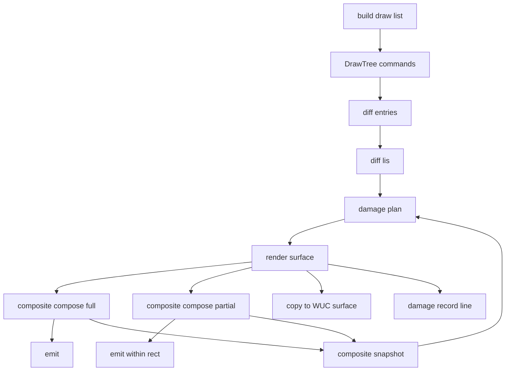
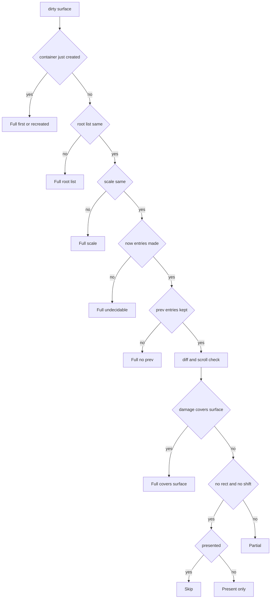
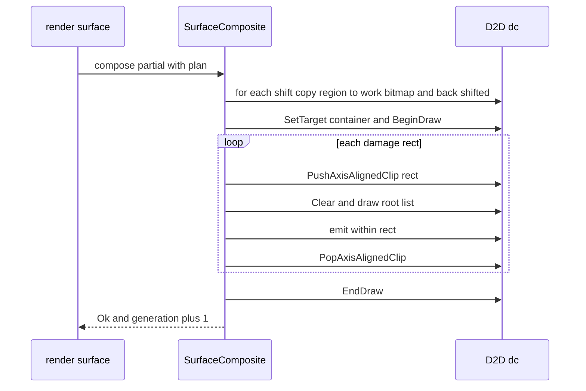
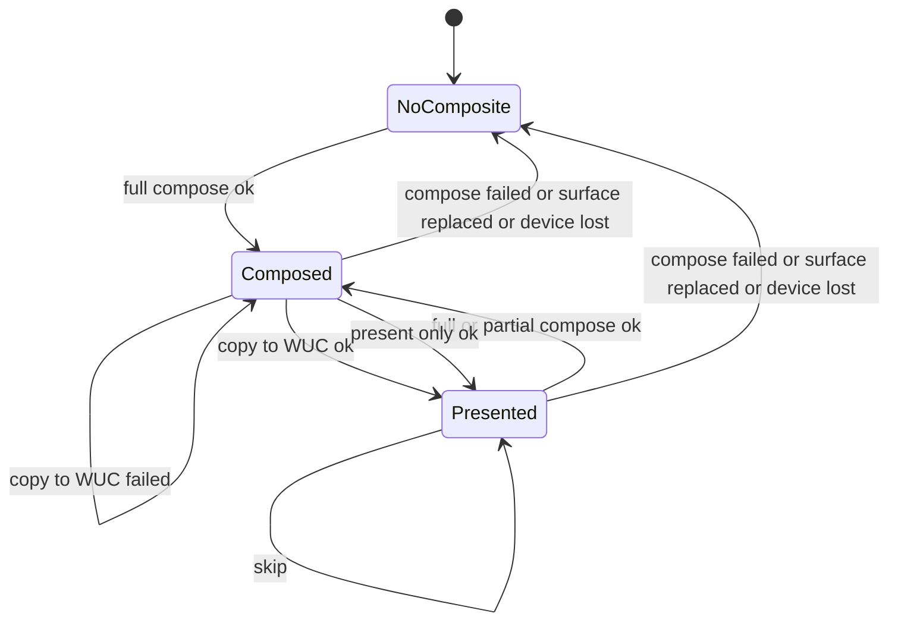

# Design Document: wintf-visual-damage-redraw

## Overview

**Purpose**: 描画の木を持つ描画面で、前の合成から変わった所だけを入れ物の中で描き直す（差分の描き直し）。描画面ごとに前の合成の描く列を比べの項の列として覚え、今の列と最長増加部分列で比べ、変わった件と層が画素を変えうる範囲だけを透明に塗って描き直す。範囲の外は前の合成の答えのまま残り、答えは毎回全部描いた答えとバイトで一致する。何も変わっていない回は入れ物にも描画面にも描かない。矩形の切り抜きの中が整数の物理ピクセルだけ平行移動しただけの回は、入れ物の中で写して露出した帯だけを描く。

**Users**: wintf の描き手（今は描画の木の使い手は wintf のテストと `examples/visual_tree_demo.rs` だけ。`draw-methods-canon` が emo のシェルを描画の木へ移すと効く）と、描き直しの量の記録を材料に使う後の spec（`wintf-surface-auto-promotion`・`present-emit-tail-latency`・件 1 の測りの spec）。

**Impact**: `SurfaceComposite::compose` の「全面を透明に塗って全部描く」は、全部描く方へ倒す回の道（＝毎回全部描いた答えの作り）としてそのまま残る。`render_surface` は合成の前に「どう描くか」の計画を立て、全部・範囲だけ・写すだけ・何もしないのどれかで描く。描く列の層の命令は実体と見た目の版を持つようになる。

### Goals

- 前と今の描く列の比べ（足された・消えた・動いた・動かなかった件と層）を、描く列の中身だけで決まる純粋な計算として持つ（1.1〜1.6）。
- 描き直す範囲だけを透明に塗って描き直し、答えを毎回全部描いた答えとバイトで一致させる（2.1〜2.8）。
- 決められない回は必ず全部合成へ倒し、7 種の理由を記録に残す（3.1〜3.6）。
- 描画の木を持たない描画面の画素を今と同じにする（4.1〜4.3）。
- 矩形の切り抜きの中の整数の平行移動を入れ物の中の写しで済ませる（5.1〜5.4）。
- 描き直しの量と所要を既存の性能の行と別の 1 行で記録する（6.1〜6.4）。
- 比べと範囲は純粋なテスト、画素の一致は WARP、画面に出ることは実 GPU で固定する（7.1〜7.5）。

### Non-Goals

- 描画の木の中身と、emo のシェルの合成を描画の木へ移すこと（`draw-methods-canon`）。
- 入れ物の大きさ・形式・枚数・寿命・中身を保つ決め（`wintf-d2d-composite-rules` 4.1・4.3〜4.5）の変更、形式の f16 化（`compose-f16-precision`）。
- 描画面へいつ出すか（`tick-gate-adoption`・`dola`）、描画面の自動の昇格・降格（`wintf-surface-auto-promotion`）、部分木を絵に焼くこと（`CACHE_AS_BITMAP`）、文字の層のスクロール（`areka-emo-text`・バルーンの文字の層を本 spec の写しへ寄せる spec は完了のときに起票＝要件の Out of scope）。
- 件 1（面 1002 で何もしていないあいだの CPU と WorkingSet の内訳の測りと直し）。本 spec は記録に所要を載せるだけ（6.1）。
- 離れた複数の変化を別々の矩形のまま描くこと（普通の変化は 1 つの外接矩形にまとめる・決め D5）。

## Boundary Commitments

### This Spec Owns

- 比べの項（`DamageEntry`）の定義と、描く列から項の列を作る規則（同一性の鍵・平行移動を除いた鍵・画素を変えうる範囲の求め方・にじみの余白・`SOURCE_OVER` でない重ね方の範囲）。
- 前と今の項の列の比べ（自前の最長増加部分列・同じ鍵が多いときの対の取り方）。
- 合成の計画（`ComposePlan`）: 何もしない・写すだけ・全部（7 種の理由）・範囲だけ（描き直す矩形の列と入れ物の中の写し）。平行移動の写しを使ってよい条件の判定。
- 入れ物の中の範囲だけの描き直しと平行移動の写しの手順（`SurfaceComposite` の範囲版の合成）と、前の合成の控え（項の列・根の命令の列の参照・拡大・描画面へ写し終えたか）の持ち方。
- 描き直しの量の記録の行（target `wintf::damage`）の文言と欄。
- 描く列の層の命令（`ClipRect`・`ClipGeometry`・`OpacityLayer`）の `entity`・`version` の欄と、`DrawItem` の `version` の欄（作るのは `build`・読むのは本 spec）。
- `SurfaceGraphics` の `composed_before`（その描画面が入れ物を持ったことがあるか＝理由の「初めて」と「作り直し」の見分け）。

### Out of Boundary

- 描く列の作り方（`build` の間引き・画家の順・層の積み方）と `emit` の層の旗（`wintf-visual-tree`・`wintf-d2d-composite-rules` の持ち物。本 spec は `emit` に「範囲と交わらない件を飛ばす」再生の口を足すだけで、層の作りは変えない）。
- 入れ物の大きさ・形式・枚数・寿命・中身を保つ決めと、読み戻しの答えの形（`wintf-d2d-composite-rules`）。本 spec は世代の上げ方（合成し終えたら +1・描かない回はそのまま）をそのまま使う。
- 描き直しの印（`mark_dirty_surfaces`）の立て方と、描画面の作成・作り直し（`deferred_surface_creation_system`）。
- WUC の描画面の中身が外から失われる場合（R6・`RenderingDeviceReplaced` を拾うこと）。
- `[tick]`・`perf(…)` の行と `tools/perf/` の台本と検体（C20 の約束）。

### Allowed Dependencies

- wintf の中: `ecs/graphics/visual/draw/`（`DrawCommand`・`build`・`emit`）、`ecs/graphics/composite.rs`、`ecs/graphics/systems/render.rs`、`ecs/graphics/components.rs`（`SurfaceGraphics`）、`numerics`（`Aabb`・`CalcHash`）。
- 外: 既に使っている `windows` の D2D（`ID2D1Bitmap1::CopyFromBitmap`・`ID2D1DeviceContext::CreateBitmap`・`PushAxisAlignedClip`・`Clear`）、`std::collections::HashMap`、`std::time::Instant`、`tracing`。
- 依存の向き: `numerics` → `visual::draw::{command, diff, emit}` → `graphics::damage` → `graphics::composite` → `graphics::systems::render`。左から右へだけ読む（`diff.rs` は `damage.rs` を読まない・`emit.rs` は `diff.rs` の `PxRect`・`DamageEntry` だけを読む）。
- 依存（crate）を足さない。最長増加部分列は自前で書く（C20 の約束）。

### Revalidation Triggers

- 比べの項の範囲の規則（にじみの余白・`SOURCE_OVER` でない重ね方の範囲・`local_aabb` を中身の範囲として信じる約束）の変更 → `draw-methods-canon`（描く中身の作り手）・`wintf-surface-auto-promotion`。
- 記録の行（target `wintf::damage`・欄の名と意味）の変更 → `wintf-surface-auto-promotion`・`present-emit-tail-latency`・件 1 の測りの spec。
- `DrawItem.version` と層の命令の `entity`・`version` の欄の変更 → 描く列を作る・読む spec 全部（`draw-methods-canon`・`element-clipping-option`）。
- 写しのための作業用の絵（決め D6: 合成の 1 回の中だけ持つ・形式は入れ物と同じ）の持ち方の変更 → `wintf-d2d-composite-rules`（入れ物の枚数の決め 4.3）・`compose-f16-precision`（入れ物の形式を変えれば作業用の絵も揃える）。
- 前の合成の控えの寿命（入れ物と一緒に捨てる）の変更 → 読み戻し（`readback.rs` の世代の意味）。
- `build` が層を積む位置・間引きの規則の変更 → 本 spec の比べ（同一性の鍵に親の層の鎖を含めている）。

## Architecture

### Existing Architecture Analysis

- `render_surface`（`systems/render.rs`）は `Changed<SurfaceGraphicsDirty>` の描画面だけを回し、入れ物（`SurfaceComposite`）が無いか大きさが違えば作り、`compose`（全面 `Clear` → 根の命令の列を `DrawImage(LINEAR, SOURCE_OVER)` → `emit`）で合成し、WUC の `begin_draw(None)` の中で `copy_to` で全面を写す。失敗は `on_stage_failure`（失いなら係を抜ける・失いでなければ `error!` と描き直しの印）。
- 入れ物は `SurfaceGraphics` の欄で、`set_surface`（描画面の作成・作り直し）・`clear`（放し・装置の失い）・合成の失敗（`compose_or_drop`）で捨てられる。読み戻しは世代 1 以上の入れ物を読み、控えは `(x, y, 世代)` で外れる。
- 描く列（`DrawTree.commands`）は `build` が画家の順に作る。`DrawItem.hash` は実体・見た目の版・補間・混ぜ方・世界の行列の hash（COM の番地に依らない）。層の命令は実体も版も持たない（本 spec で足す）。
- 見た目の版（`VisualVersion`）は描く中身・`Visual`（切り抜き・可視・不透明度）の変化で上がり、変形では上がらない。

### Architecture Pattern & Boundary Map



**Architecture Integration**:
- 選んだ形: 純粋な計算（項の列・比べ・計画）と D2D の手順（入れ物の合成）を分ける（gap §6 の案 B）。純粋な計算は COM を持たない入力（`DamageEntry`）だけを受け、GPU 無しで試せる（7.1・7.2）。
- 境: `diff.rs` は「列の比べ」、`damage.rs` は「描画面 1 枚の合成の計画」、`composite.rs` は「計画どおりに入れ物を描く」、`render.rs` は「係の分岐と記録」。持ち主の重なりは無い。
- 残す形: 全部の合成（`compose`）は今の手順のまま（毎回全部描いた答えの作り＝比べる相手）。失敗の道（`compose_or_drop`・`on_stage_failure`）と世代の数え方もそのまま。
- 前の合成の控えを入れ物に持たせる（gap §8 の 10）: 入れ物を捨てる道（大きさの変化・装置の失い・合成の失敗・描画面の作り直し）が、そのまま「前の列が無い＝全部合成」（3.1・3.3）と「新しい描画面へ必ず写す」（4.3）になる。

### Technology Stack

| Layer | Choice / Version | Role in Feature | Notes |
|-------|------------------|-----------------|-------|
| 描画 | Direct2D（`windows` 0.62.2・既存） | 範囲の切り抜き（`PushAxisAlignedClip`）・範囲の中の `Clear`・入れ物の中の写し（`CopyFromBitmap`・作業用の絵） | 新しい API は使わない |
| 比べ | 自前の最長増加部分列（std だけ） | 動いた件の判定 | crate を足さない（C20） |
| 記録 | `tracing`（既存） | `wintf::damage` の `debug!` 1 行 | 既存の行は変えない |
| テスト | WARP（既存の足場 `emit_test_support.rs`）・実 GPU（`tests/graphics/composite_systems_test.rs`） | バイトの一致・画面に出ること | 差分と全部の比べは ±1 でなくバイトの一致 |

## File Structure Plan

### Directory Structure

```
crates/wintf/src/ecs/graphics/
├── damage.rs                    # 新: 合成の計画（ComposePlan・FullReason・平行移動の写しの判定）・記録の target
├── damage_tests.rs              # 新: 計画の純粋なテスト（7.2・7.4 の判定）
├── composite_damage_tests.rs    # 新: WARP・範囲だけの描き直しと全部の答えのバイトの一致（7.3 の写し以外）
├── composite_scroll_tests.rs    # 新: WARP・平行移動の写しと全部の答えのバイトの一致（7.3 の平行移動・5.1）
└── visual/draw/
    ├── diff.rs                  # 新: 比べの項（DamageEntry・PxRect）・項の列の作り・比べ（diff・最長増加部分列）
    └── diff_tests.rs            # 新: 比べと項の作りの純粋なテスト（7.1）
```

### Modified Files

- `crates/wintf/src/ecs/graphics/visual/draw/command.rs` — `DrawItem` に `version: u64`、`ClipRect`・`ClipGeometry`・`OpacityLayer` に `entity: Entity`・`version: u64` を足す（層の同一性・1.5）。
- `crates/wintf/src/ecs/graphics/visual/draw/builder.rs` — 足した欄を埋める（節の実体と `VisualVersion`・無ければ 0）。`hash_draw` は変えない。
- `crates/wintf/src/ecs/graphics/visual/draw_content.rs` — `VisualDrawContent` の文書に「`local_aabb` の外へはみ出す中身は、間引きと差分の描き直しで欠ける」の 1 行（型と振る舞いは変えない）。
- `crates/wintf/src/ecs/graphics/visual/draw/emit.rs` — `emit_within`（範囲 1 つの中で、範囲と交わらない件を飛ばして再生）を足す。`emit` の振る舞いは変えない。
- `crates/wintf/src/ecs/graphics/visual/draw/mod.rs` — `diff`・`diff_tests` の宣言と `emit_within` の再公開。
- `crates/wintf/src/ecs/graphics/mod.rs` — `damage`・`damage_tests`・`composite_damage_tests`・`composite_scroll_tests` の宣言。
- `crates/wintf/src/ecs/graphics/composite.rs` — 前の合成の控え（`prev_entries`・`prev_root`・`prev_scale`・`presented`）と、範囲版の合成 `compose_partial`、控えの更新 `remember`・`mark_presented`。`compose_or_drop` を「入れ物への描き 1 回（閉包）を走らせ、失敗なら捨てる」形に広げる。
- `crates/wintf/src/ecs/graphics/systems/render.rs` — 計画を立てて 4 つの道に分ける・記録の 1 行と所要の計測。
- `crates/wintf/src/com/wuc.rs` — `begin_draw_roundtrip` の注記「部分の矩形は `E_INVALIDARG`」を「作りたての描画面では断られ、全面を 1 度描いた後は通る（2026-11-14 実測）」へ（コードは変えない）。
- `crates/wintf/src/ecs/graphics/components.rs` — `SurfaceGraphics` に `composed_before: bool`（初めてと作り直しの見分け・3.4）と、それを読み書きする口。
- `crates/wintf/src/ecs/graphics/composite_tests.rs` — `compose_or_drop` の呼び方の追随（1 件）。
- `crates/wintf/src/ecs/graphics/visual/draw/emit_blend_tests.rs`・`emit_layer_tests.rs` — 命令の構造体の足した欄の追随。
- `crates/wintf/tests/graphics/composite_systems_test.rs` — 実 GPU で、節を 1 つ変えた回と、変わらない回の画面の答え（7.5・7.4）と、範囲だけの道と全部の道のバイトの一致 3 件。
- `crates/wintf/src/ecs/graphics/visual/draw/README.md` — 構想の文を、作りの要点（項・比べ・計画・写し・記録）へ書き直す。平行移動の写しが効く木の形（スクロールの区画が自分の描画面を持ち、根の命令の列も下に重なる絵も無い）と、中身が描画面 1 枚に収まるなら中身を `OwnSurface` にして位置だけ動かせば描き直しも写しも 0 で済むこと（位置だけの変化では描き直しの印が立たない）を書く。
- `crates/wintf/src/ecs/graphics/visual/version.rs` — 注記の「フェーズ3 の blit」を「平行移動の写し（`damage.rs`）」へ。
- `.kiro/steering/tech.md` — Testing の節: 差分の描き直しの答えは全部描いた答えとバイトで一致（±1 でない）。
- `.kiro/steering/structure.md` — `graphics/visual/` の描画の道の記述に、比べ・計画・範囲だけの描き直しを足す。

## System Flows

### 描画面 1 枚の計画



- 全部（Full）と範囲だけ（Partial）は入れ物へ合成して世代を 1 上げる。描画面へは、Full は全面を、Partial は `PartialPlan.present_rect`（描く矩形と写しの先の外接矩形）だけを写す（2.6・2.9）。写すだけ（PresentOnly）は前の答えを描画面へ写すだけ（2.8）。何もしない（Skip）は合成も写しもしない（2.5）。
- どの道でも、合成（または Skip・PresentOnly）を終えたら控えの項の列を今の列に置き換える。今の列を項にできなかった回は控えを空にする（次の回は「前の列が無い」）。

### 範囲だけの合成（入れ物の中）



- 写しは `BeginDraw` の前に行う（入れ物が的に付いていない時点・`CopyFromBitmap` の注記の「的の批の流し」を避ける）。写しの元と先はどの写しでも重ならない（作業用の絵を通す・決め D6）。
- 描き直す矩形が重なれば重なった画素は 2 度描かれるが、どの回も「その矩形の中を透明に塗ってから全部を画家の順に描く」ので答えは同じ。

## Requirements Traceability

| Requirement | Summary | Components | Interfaces | Flows |
|-------------|---------|------------|------------|-------|
| 1.1 | 前の列を覚える | SurfaceComposite | `remember` | 計画 |
| 1.2 | 消えた・足された・動いた・動かなかった | Diff | `diff` | 計画 |
| 1.3 | 動いた＝最長増加部分列の外 | Diff | `lis_mask` | 計画 |
| 1.4 | 中身・変形・混ぜ方・補間・版が違えば別の件 | DamageEntries | `DamageEntry.id` | — |
| 1.5 | 層の出入りと範囲・値の変化 | DamageEntries・DrawCommand 欄 | `DamageEntry.id`（層） | — |
| 1.6 | 中身だけで決まる | DamageEntries・Diff | `entries`・`diff` | — |
| 2.1 | 画素を変えうる範囲の和 | DamageEntries・ComposePlanner | `DamageEntry.bounds`・`plan` | 計画 |
| 2.2 | 範囲だけ透明に塗り画家の順で描く | SurfaceComposite・EmitWithin | `compose_partial`・`emit_within` | 範囲だけの合成 |
| 2.3 | 範囲の外を残す | SurfaceComposite | `compose_partial` | 範囲だけの合成 |
| 2.4 | 全部の答えとバイトで一致 | 全体（不変条件 I1） | — | — |
| 2.5 | 変わらない回は描かない | ComposePlanner・RenderSurface | `ComposePlan::Skip` | 計画 |
| 2.6 | 変わった範囲だけ写し読み戻しを揃える | RenderSurface・SurfaceComposite | `present_rect`・`copy_rect_to`・世代 +1 | 計画 |
| 2.9 | 範囲だけの写しの答えは全面の写しと同じ | RenderSurface | `begin_draw(Some(present_rect))` | 計画 |
| 2.7 | 遅らせない | RenderSurface | 同じ回で描く | — |
| 2.8 | 写し終えていなければ写す | SurfaceComposite・ComposePlanner | `presented`・`ComposePlan::PresentOnly` | 計画 |
| 3.1 | 初めて・作り直しは全部 | ComposePlanner・SurfaceGraphics | `PlanInput.fresh`・`composed_before` | 計画 |
| 3.2 | 根の列・拡大の違いは全部 | ComposePlanner | `same_root`・`same_scale` | 計画 |
| 3.3 | 前の列が無い・決められないは全部 | ComposePlanner・DamageEntries | `FullReason::NoPrev`・`Undecidable` | 計画 |
| 3.4 | 倒した理由を記録 | DamageRecord | `FullReason::as_str` | — |
| 3.5 | 範囲版の失敗は今の失敗の道 | RenderSurface・SurfaceComposite | `compose_or_drop`・`on_stage_failure` | — |
| 3.6 | 途中の装置の失いは立ち直りの道 | RenderSurface | `on_stage_failure` | — |
| 4.1 | 木を持たない描画面 | ComposePlanner | 空の項の列 | 計画 |
| 4.2 | 画素は本 spec の前と同じ | 全体（不変条件 I1） | — | — |
| 4.3 | 新しい描画面へ必ず写す | SurfaceGraphics・SurfaceComposite | `set_surface` で控えごと捨てる | 計画 |
| 5.1 | 平行移動を入れ物の中で写す | ScrollCheck・SurfaceComposite | `RegionShift`・`compose_partial` | 範囲だけの合成 |
| 5.2 | 整数でない・決められないは写さない | ScrollCheck | 条件 S1〜S9 | 計画 |
| 5.3 | 変形で版を上げない約束を保つ | DamageEntries | `DamageEntry.shape` | — |
| 5.4 | 写しと露出した帯の面積を分けて記録 | DamageRecord | `shift_area`・`exposed_area` | — |
| 6.1 | 量と所要の記録 | DamageRecord・RenderSurface | 記録の行 | — |
| 6.2 | 描かなかった回の記録 | DamageRecord | `mode=skip` | — |
| 6.3 | 水準だけで出す・答えを変えない | DamageRecord | `tracing::enabled!` | — |
| 6.4 | 既存の行と別の行 | DamageRecord | target `wintf::damage` | — |
| 7.1 | 比べの純粋なテスト | diff_tests | — | — |
| 7.2 | 範囲と理由の純粋なテスト | damage_tests | — | — |
| 7.3 | 各場合の WARP のバイトの一致 | composite_damage_tests・composite_scroll_tests | — | — |
| 7.4 | 描かない回と全部へ倒す回 | damage_tests・composite_damage_tests・composite_systems_test | — | — |
| 7.5 | 実 GPU で画面に出る | composite_systems_test | — | — |

## Components and Interfaces

### 語

- **比べの項**（`DamageEntry`）: 描く列の件 1 つ、または層を積む命令（`PushClipRect`・`PushClipGeometry`・`PushOpacity`）1 つ。層を降ろす命令（`Pop*`）は項にしない（項の親の層の鎖から決まる）。
- **親の層の鎖**: 項を囲む層の項の並び（外から内）。描く列の push と pop の対は、項の列と各項の親の鎖から 1 通りに決まる。

| Component | Domain/Layer | Intent | Req Coverage | Key Dependencies | Contracts |
|-----------|--------------|--------|--------------|------------------|-----------|
| DrawCommand 欄 | draw | 層と件に実体と版を持たせる | 1.4, 1.5 | builder (P0) | State |
| DamageEntries | draw/diff.rs | 描く列を比べの項の列にする | 1.4, 1.5, 1.6, 2.1, 5.3 | command (P0) | Service |
| Diff | draw/diff.rs | 前と今の項の列を比べる | 1.2, 1.3, 1.6 | DamageEntries (P0) | Service |
| EmitWithin | draw/emit.rs | 範囲 1 つの中だけ再生する | 2.2 | DamageEntries (P0) | Service |
| ComposePlanner | graphics/damage.rs | 描画面 1 枚の合成の計画 | 2.1, 2.5, 2.8, 3.1〜3.4, 4.1, 5.1, 5.2 | Diff (P0) | Service |
| ScrollCheck | graphics/damage.rs | 平行移動の写しを使ってよいかの判定 | 5.1, 5.2 | Diff (P0) | Service |
| SurfaceComposite | graphics/composite.rs | 計画どおり入れ物を描く・控えを持つ | 1.1, 2.2, 2.3, 2.6, 2.8, 3.5, 4.3, 5.1 | D2D (P0) | Service, State |
| RenderSurface | graphics/systems/render.rs | 係の分岐・写し・記録 | 2.5〜2.7, 3.5, 3.6, 6.1〜6.4 | ComposePlanner (P0)・SurfaceComposite (P0) | Batch |
| DamageRecord | graphics/systems/render.rs | 記録の 1 行 | 3.4, 5.4, 6.1〜6.4 | tracing (P1) | Event |

### draw

#### DrawCommand 欄（`command.rs`・`builder.rs`）

| Field | Detail |
|-------|--------|
| Intent | 層と件の同一性の鍵の材料を描く列に載せる |
| Requirements | 1.4, 1.5 |

**Contracts**: State [x]

```rust
pub struct DrawItem { /* 既存の欄 */ pub version: u64 }
pub struct ClipRect { pub entity: Entity, pub version: u64, pub world_aabb: Aabb }
pub struct ClipGeometry { pub entity: Entity, pub version: u64, pub world_mat: Matrix3x2, pub geometry: ID2D1Geometry, pub world_aabb: Aabb }
pub struct OpacityLayer { pub entity: Entity, pub version: u64, pub opacity: f32, pub world_aabb: Aabb }
```

- `entity` は層を積んだ節、`version` はその節の `VisualVersion`（無ければ 0）。角丸の図形は組み直しのたびに作り直されるので、図形の形の変化は COM の番地でなく節の版（`Visual` の切り抜きの変化で上がる）で拾う（gap §8 の 3）。
- `DrawItem.hash` は今のまま（`wintf-visual-tree` 4.5）。`version` は平行移動を除いた鍵に使う。

#### DamageEntries（`diff.rs`）

| Field | Detail |
|-------|--------|
| Intent | 描く列と描画面の拡大から、COM を持たない比べの項の列を作る |
| Requirements | 1.4, 1.5, 1.6, 2.1, 5.3 |

**Responsibilities & Constraints**
- 項は描く列の Pop 以外の命令と 1 対 1（同じ順）。`emit_within` はこの対応で件の範囲を引く。
- 同一性の鍵 `id`: 種類の印・自分の材料・親の `id` の hash（`DefaultHasher::new()`・小数は `CalcHash`）。材料は 件＝`DrawItem.hash`、矩形の切り抜き＝`entity`・`version`・`world_aabb`、図形の切り抜き＝`entity`・`version`・`world_mat`・`world_aabb`、不透明度の層＝`entity`・`version`・`opacity`・`world_aabb`。親の `id` を含むので、件が切り抜きの中から外へ出る・層の入れ子が変わる・囲む層が変わると、中の項は別の項になる（1.4・1.5）。
- 平行移動を除いた鍵 `shape`: 種類の印・`entity`・`version`（件はさらに補間と混ぜ方・不透明度の層は `opacity`）・親の `shape` の hash。位置と大きさを含めない（5.3。大きさと線形の部分の一致は平行移動の判定 S5 で確かめる）。
- 物理の値: `exact`＝世界の外接矩形を拡大で物理へ写した f32 の矩形（丸め前）。`linear`・`origin`＝`world_mat × 拡大` の線形の部分と平行移動（件と図形の切り抜き。矩形の切り抜きと不透明度の層は `origin`＝`exact` の左上・`linear`＝恒等）。`emit` が D2D に渡すのと同じ f32 の掛け算で求める。
- 画素を変えうる範囲 `bounds`（物理・整数・外向き・2.1）:
  - 重ね方が `SOURCE_OVER` の件・ブレンドの件・範囲の外の混ぜ方の件（`SOURCE_OVER` で描かれる）: `exact` を外向きに丸め、補間が `NEAREST_NEIGHBOR` でなければ各辺に `ceil(2 × s)` 画素を足す（`s`＝`linear` の列の長さの大きい方・1 未満なら 1。補間の核の半径 2 素の画素を拡大した分＝R3 の決め）。そのうえで親の鎖の矩形の切り抜き・図形の切り抜きの `bounds` との交わりに切る（切り抜きの外は D2D が描かないので答えは変わらず、小さい切り抜きの中の大きい件の変化が全面へ倒れにくくなる。不透明度の層の範囲では切らない＝層の範囲は中身を切る保証が無い）。
  - 重ね方が `SOURCE_OVER` でない件（D2D は絵を今の軸に沿う切り抜きまで広げて合成する）: 親の鎖の矩形の切り抜きの `bounds` の交わり。矩形の切り抜きが無ければ描画面の全面（R2 の決め）。
  - 層: `exact` を外向きに丸めた矩形（中身の件は自分の範囲を持つので層に余白は足さない）。
- 中身の範囲は `VisualDrawContent.local_aabb` を信じる（今の間引き `build` も同じ約束に頼っている）。`local_aabb` の外へはみ出す中身は使い手の約束の破れで、差分の描き直しでも間引きでも答えが欠ける（`VisualDrawContent::new_ex` の文書に 1 行足す）。
- 値が有限でない・`i32` に収まらない項が 1 つでもあれば、列全体を項にしない（`None`＝決められない・3.3）。空の図形の外接矩形（D2D は裏返った無限の矩形を返す）もここに入る。
- 鍵と範囲の規則は、命令の構造体でなく素の値（hash・実体・版・行列・矩形・補間・混ぜ方）を受ける小さな関数（`item_entry`・`layer_entry`・`item_bounds`）に置く。`entries` は命令の欄を読んでそれらへ渡すだけにし、規則の純粋なテストが COM 無しで書けるようにする（7.2）。

**Contracts**: Service [x]

```rust
#[derive(Clone, Copy, Debug, Default, PartialEq, Eq)]
pub(crate) struct PxRect { pub left: i32, pub top: i32, pub right: i32, pub bottom: i32 }
// is_empty / intersect / union / area(u64) / offset(dx, dy) を持つ（空は right <= left か bottom <= top）

#[derive(Clone, Copy, Debug, PartialEq, Eq)]
pub(crate) enum EntryKind { Draw { unbounded: bool }, ClipRect, ClipGeometry, Opacity }

#[derive(Clone, Debug, PartialEq)]
pub(crate) struct DamageEntry {
    pub id: u64,
    pub shape: u64,
    pub kind: EntryKind,
    pub parent: Option<u32>,  // 囲む層の項の番号
    pub end: u32,             // 自分の部分木の終わり（含まない）。件は自分の番号 + 1
    pub bounds: PxRect,
    pub exact: [f32; 4],      // left, top, right, bottom（物理・丸め前）
    pub linear: [f32; 4],     // M11, M12, M21, M22（物理）
    pub origin: [f32; 2],     // M31, M32（物理）
}

pub(crate) fn entries(commands: &[DrawCommand], scale: (f32, f32), surface: (u32, u32)) -> Option<Vec<DamageEntry>>;
```
- Preconditions: `commands` は `build` の出した列（push と pop は対）。
- Postconditions: 同じ `commands`・`scale`・`surface` からはいつも同じ列（1.6）。COM を呼ばない。
- Invariants: `entries(…)[i]` は `commands` の i 番目の Pop でない命令に当たる。

#### Diff（`diff.rs`）

| Field | Detail |
|-------|--------|
| Intent | 前と今の項の列を、消えた・足された・動いた・動かなかったに分ける |
| Requirements | 1.2, 1.3, 1.6 |

**Responsibilities & Constraints**
- `id` で対を取る。同じ `id` が前と今に何度も在るときは、前の k 番目と今の k 番目を対にし、余りは消えた・足された（7.1 の「同じ件が多い列」・決まった答え）。
- 対の取れた今の項の、前の番号の列（今の順）に最長増加部分列を取り、入った項を動かなかった、入らない項を動いたとする（1.3）。最長増加部分列は O(n log n) の忍耐の並べ方で、長さの等しい答えが複数在るときも同じ入力から同じ答え（末尾の積みと前の印を使う標準の作り）。
- 前と今の `HashMap` は引くだけに使い、答えは列の番号の順で出す（並びが乱数の種に依らない）。

**Contracts**: Service [x]

```rust
pub(crate) struct Diff {
    pub removed: Vec<u32>,       // 前の番号
    pub added: Vec<u32>,         // 今の番号
    pub moved: Vec<u32>,         // 今の番号
    pub kept: Vec<(u32, u32)>,   // (前, 今)・動かなかった
}
impl Diff { pub fn is_unchanged(&self) -> bool } // removed・added・moved が空

pub(crate) fn diff(prev: &[DamageEntry], now: &[DamageEntry]) -> Diff;
pub(crate) fn lis_mask(seq: &[u32]) -> Vec<bool>; // seq は相異なる値
```

#### EmitWithin（`emit.rs`）

| Field | Detail |
|-------|--------|
| Intent | 描く矩形 1 つの中の再生で、その矩形と交わらない件を飛ばす |
| Requirements | 2.2 |

```rust
pub(crate) fn emit_within(
    dc: &ID2D1DeviceContext,
    dc6: Option<&ID2D1DeviceContext6>,
    root: Matrix3x2,
    commands: &[DrawCommand],
    entries: &[DamageEntry],
    rect: PxRect,
);
```
- 件の項の `bounds` と `rect` が交わらなければその `Draw` を飛ばす（範囲の外の画素は D2D の切り抜きが守るので、飛ばすのは性能のためだけ）。層の命令は全部そのまま積む・降ろす（作りは `emit` と同じ関数の中の分岐で持ち、層の旗を変えない）。
- 前提: `entries` は同じ `commands` から作った列。

### graphics

#### ComposePlanner（`damage.rs`）

| Field | Detail |
|-------|--------|
| Intent | 描画面 1 枚について、この回にどう描くかを決める |
| Requirements | 2.1, 2.5, 2.8, 3.1, 3.2, 3.3, 3.4, 4.1, 5.1, 5.2 |

**Responsibilities & Constraints**
- 判定の順は System Flows の図のとおり。理由は 7 種（3.4）で、全部の合成は必ずどれか 1 つの理由を持つ。
- 普通の範囲: 平行移動の写しに取られなかった、消えた項（前の `bounds`）・足された項（今の `bounds`）・動いた項（今の `bounds`）の `bounds` を項ごとに描画面の矩形で切ってから取った外接矩形 1 つ（決め D5）。先に外接矩形を取ってから切ると、描画面の外の離れた 2 つの変化の外接矩形が描画面をまたぎ、外だけの変化が範囲だけになる（3.1 の実装で見つけた）。それが描画面の全面に等しければ `Full(CoversSurface)`。
- 範囲も写しも空（変わった項が全部描画面の外）なら、画素は変わらないので Skip か PresentOnly（控えは今の列へ置き換える）。
- 描画の木を持たない描画面は、項の列が前も今も空なので、根の命令の列・拡大・入れ物が同じなら Skip か PresentOnly、違えば全部（4.1）。
- 描き直した件数は、件の項のうち `bounds` がどれかの描く矩形と交わるものの数（`emit_within` が実際に描く件と同じ数え方）。

**Contracts**: Service [x]

```rust
pub(crate) const DAMAGE_TARGET: &str = "wintf::damage";

#[derive(Clone, Copy, Debug, PartialEq, Eq)]
pub(crate) enum FullReason { First, Recreated, RootList, Scale, NoPrev, Undecidable, CoversSurface }
impl FullReason { pub fn as_str(self) -> &'static str } // "first" "recreated" "root_list" "scale" "no_prev" "undecidable" "covers_surface"

#[derive(Clone, Copy, Debug, PartialEq, Eq)]
pub(crate) struct RegionShift { pub src: PxRect, pub dst: (u32, u32) } // 入れ物の中の写し（左上へ）

#[derive(Clone, Debug, PartialEq)]
pub(crate) struct PartialPlan {
    pub rects: Vec<PxRect>,       // 描き直す矩形（描画面の中・空でない）
    pub shifts: Vec<RegionShift>,
    pub items_redrawn: u32,
    pub area: u64,                // rects の面積の和（重なりは重ねて数える）
    pub shift_area: u64,          // 写した面積
    pub exposed_area: u64,        // 写しの切り抜きの中で描き直した面積
    pub present_rect: PxRect,     // 描画面へ写す矩形＝rects と shifts の先の外接矩形（2.6）
}

#[derive(Clone, Debug, PartialEq)]
pub(crate) enum ComposePlan { Skip, PresentOnly, Full(FullReason), Partial(PartialPlan) }

pub(crate) struct PlanInput<'a> {
    pub fresh: Option<FullReason>,        // 入れ物を今作った回の理由（First か Recreated）
    pub same_root: bool,                  // 根の命令の列が前の合成と同じ参照（両方 None も同じ）
    pub same_scale: bool,                 // 拡大が前の合成とビットで同じ
    pub root_present: bool,               // 根の命令の列を持つ（写しの条件 S1）
    pub prev: Option<&'a [DamageEntry]>,
    pub now: Option<&'a [DamageEntry]>,
    pub presented: bool,                  // 前の合成の入れ物を描画面へ写し終えた
    pub surface: (u32, u32),
}

pub(crate) fn plan(input: &PlanInput<'_>) -> ComposePlan;
```
- Postconditions: `Partial` の `rects` と `shifts` のどちらかは空でない。`Partial` の各矩形は描画面の中。

#### ScrollCheck（`damage.rs` の中の関数）

| Field | Detail |
|-------|--------|
| Intent | 矩形の切り抜きの中の平行移動を、入れ物の中の写しで済ませてよいか決める |
| Requirements | 5.1, 5.2 |

**Responsibilities & Constraints**
- 描画面そのものの候補（2026-11-14 設計の討議・議題 3）: 根の命令の列を持たない描画面では、描画面の全面を暗黙の候補 E₀ とする（`R_out`＝`R_in`＝描画面の矩形・親の鎖は空・部分木は列の全部）。`build` は根（描画面の持ち主）の切り抜きを `PushClipRect` として出さないので、これが無いと写しが効く形（スクロールの区画が自分の描画面を持つ）でも矩形の切り抜きの節を 1 つ余分に挟む必要がある。E₀ は下の S1〜S9 を同じく満たすときだけ受け入れ、受け入れたら下の候補は見ない。最初の使い手の見込みはバルーンの文字の層（開発者「本来、バルーンが使うはず。使ってないなら使うべき」＝寄せるのは別 spec・要件の Out of scope）。行の高さが拡大で物理ピクセルの整数にならなければ S4 で写さない＝使い手はスクロールの量を物理ピクセルの整数に置く（README に書く）。
- 候補: 今の列の矩形の切り抜きの項 E で、比べで動かなかった（前に同じ `id` が在り、最長増加部分列に入った）もの。画家の順に見て、受け入れた候補の部分木の中の候補は見ない。E の `id` は親の鎖を含むので、親の鎖の層が前と今で同じときだけ候補になる（例: 中身の移動で範囲が変わる不透明度の層の中の切り抜きや、自分の不透明度が 1 未満の切り抜きの節は候補にならず、普通の範囲で描く）。
- 範囲: `R_out`＝E と親の鎖の矩形の切り抜きの `bounds` の交わりを描画面で切ったもの。`R_in`＝同じ矩形の `exact` を内向きに丸めた交わり（縁の部分の覆いの画素を写しから外す）。
- 写してよい条件（全部を満たすときだけ。1 つでも外れれば候補を捨て、部分木の項は普通の範囲へ回す＝5.2）:
  - S1 根の命令の列を持たない（下に何が描かれているか決められない）。
  - S2 親の鎖に図形の切り抜きが無い（覆いは平行移動で動かない）。
  - S3 前と今の部分木の項を `shape` で対にでき、対が 1 つ以上在り、対の前後の順が同じ。
  - S4 どの対も `origin` の差が同じ `(dx, dy)` で、`dx`・`dy` は f64 で差を取って整数（0 でない組・`|dx| < R_in の幅`・`|dy| < R_in の高さ`）。
  - S5 どの対も `linear` がビットで同じで、`exact` の 4 辺が `(dx, dy)` だけちょうどずれている。
  - S6 部分木に `SOURCE_OVER` でない重ね方の件が無い。
  - S7 対の取れない前の項は `bounds + (dx, dy)` が `R_out` と交わらない（切り抜きの外へ出た）。対の取れない今の項は `bounds − (dx, dy)` が `R_out` と交わらない（露出した帯に入っただけ）。
  - S8 部分木の外で E の親の鎖でもない項（前と今の両方）は、`bounds` が `R_out` と交わらない（下にも上にも重なる絵が無い）。
  - S9 写しの先 `D`＝`R_in ∩ (R_in + (dx, dy))` が空でない。
- 受け入れたら: `RegionShift { src: D − (dx, dy), dst: D の左上 }` を足し、`R_out` から `D` を除いた残り（上下左右の帯・最大 4 つ）を描く矩形に足す（露出した帯と縁の画素）。`shift_area`＝`D` の面積、`exposed_area`＝帯の面積の和（5.4）。部分木の項（前と今）は普通の範囲に数えない（5.3）。
- R5 の決め: 整数かどうかは `emit` が D2D へ渡すのと同じ f32 の物理の行列の平行移動の差を f64 で取って決める。拡大 1.25 などで差が整数にならなければ写さない（5.2）。整数の差で画素がずれないことは WARP のテスト（1.0 と 1.25・小数の位置を含む）で固める。ずれる組み合わせが見つかれば、条件を「`origin` 自身も整数」へ狭める（答えを崩さない側へ）。

#### SurfaceComposite（`composite.rs`）

| Field | Detail |
|-------|--------|
| Intent | 入れ物を計画どおりに描き、前の合成の控えを入れ物と同じ寿命で持つ |
| Requirements | 1.1, 2.2, 2.3, 2.6, 2.8, 3.5, 4.3, 5.1 |

**Contracts**: Service [x] / State [x]

```rust
pub(crate) fn compose_or_drop(
    slot: &mut Option<SurfaceComposite>,
    draw: impl FnOnce(&mut SurfaceComposite) -> windows::core::Result<()>,
) -> windows::core::Result<()>; // 失敗なら入れ物（と控え）を捨てる

impl SurfaceComposite {
    pub(crate) fn compose(&mut self, dc: &ID2D1DeviceContext, scale: Matrix3x2,
        root_list: Option<&ID2D1CommandList>, tree: &[DrawCommand]) -> windows::core::Result<()>; // 今のまま
    pub(crate) fn compose_partial(&mut self, dc: &ID2D1DeviceContext, scale: Matrix3x2,
        root_list: Option<&ID2D1CommandList>, tree: &[DrawCommand],
        entries: &[DamageEntry], plan: &PartialPlan) -> windows::core::Result<()>;
    pub(crate) fn prev_entries(&self) -> Option<&[DamageEntry]>;
    pub(crate) fn same_root(&self, root_list: Option<&ID2D1CommandList>) -> bool;
    pub(crate) fn same_scale(&self, scale: (f32, f32)) -> bool;
    pub(crate) fn presented(&self) -> bool;
    /// 合成か Skip・PresentOnly を終えた回に呼ぶ。`composed` なら `presented` を false にする。
    pub(crate) fn remember(&mut self, entries: Option<Vec<DamageEntry>>,
        root_list: Option<&ID2D1CommandList>, scale: (f32, f32), composed: bool);
    pub(crate) fn mark_presented(&mut self);
}
```
- `compose_partial` の手順: (1) 各 `RegionShift` について、`src` の大きさの作業用の絵（入れ物と同じ形式・`D2D1_BITMAP_OPTIONS_NONE`）を作り、入れ物 → 作業用の絵 → 入れ物の `dst` へ `CopyFromBitmap` で 2 度写す。(2) `SetTarget(入れ物)`・`SetDpi(96)`・`BeginDraw`。(3) 各矩形について、恒等の変換で `PushAxisAlignedClip(矩形, PER_PRIMITIVE)`（整数の縁なので覆いは 0 か 1）→ 拡大の変換で `Clear(透明)`（軸に沿う切り抜きの中だけを塗る）→ 根の命令の列を `DrawImage(LINEAR, SOURCE_OVER)` → `emit_within` → `PopAxisAlignedClip`。(4) `EndDraw`・変換を恒等・的なしへ戻す。成功で世代 +1。
- 状態: 控えは `prev_entries: Option<Vec<DamageEntry>>`・`prev_root: Option<ID2D1CommandList>`（参照を持つので番地の使い回しで取り違えない）・`prev_scale: (f32, f32)`・`presented: bool`。新しい入れ物は控え無し・`presented = false`。入れ物を捨てれば控えも消える（3.1・3.3・4.3）。
- `same_root` は COM の参照の同一性（`GraphicsCommandList` の `PartialEq` と同じ比べ・閉じた命令の列は中身が変わらない）。

#### RenderSurface（`systems/render.rs`）

| Field | Detail |
|-------|--------|
| Intent | 描画面ごとに計画を立て、4 つの道で描き、記録を残す |
| Requirements | 2.5, 2.6, 2.7, 3.5, 3.6, 6.1〜6.4 |

**Contracts**: Batch [x]

- Trigger: 今どおり `Changed<SurfaceGraphicsDirty>` の描画面（印の立て方は変えない）。
- 手順: (1) 入れ物を作る回は `SurfaceGraphics::note_composite_created()` が `First`（その `SurfaceGraphics` が入れ物を持ったことが無い）か `Recreated` を返し、`fresh` にする。(2)〜(5) は `composite.rs` の 1 つの関数 `compose_planned`（下）に任せる。(6) Skip 以外は描画面へ写す: Partial で `presented` が真の回だけ `begin_draw(Some(present_rect))` → `copy_rect_to(present_rect, offset)`（入れ物の `present_rect` を返された atlas の位置へ `NEAREST_NEIGHBOR` で 1 度描く・その矩形を透明に塗ってから）→ `end_draw`。Full・PresentOnly・`presented` が偽の回は今どおり `begin_draw(None)` → `copy_to` → `end_draw`。成功で `mark_presented`。作りたての描画面は部分の矩形を断る（実測 `E_INVALIDARG`）が、作りたての描画面は入れ物も作りたて＝必ず Full なので部分の写しに来ない。(7) 記録の 1 行。
- 部分の写しの前提（2026-11-14 設計の討議・議題 1 の実測・本開発機の実 GPU）: 作りたての描画面の部分の `BeginDraw` は `E_INVALIDARG`。全面を 1 度描いた後は部分の `BeginDraw`・`EndDraw` が 3 回続けて通り、返る atlas の位置は呼ぶたびに変わった（写しは毎回返る位置へ描く）。写した範囲の外の画素が前のまま残ることは、公式文書（DComp の面の `BeginDraw`）の記述に頼り、WUC では実 GPU のテスト（7.5・2.9）で固める。残らない組み合わせが見つかれば、テストを緩めず全面の写しへ戻す（`present_rect` を全面にする）。
- `compose_planned(slot, dc, fresh, scale, root_list, tree, size) -> windows::core::Result<(ComposePlan, Option<Vec<DamageEntry>>)>`: (2) `entries(tree, scale, size)` で今の項の列を作る（木が無ければ空の列）。(3) `plan`。(4) Full＝`compose_or_drop(slot, |c| c.compose(…))`・Partial＝`compose_or_drop(slot, |c| c.compose_partial(…))`・PresentOnly と Skip は合成しない。(5) 成功（Skip・PresentOnly を含む）で `remember`。本番の係と WARP のテストが同じ関数を呼ぶ（`composite.rs` の冒頭の約束と同じ形）ので、`remember` の呼び忘れや Skip・失敗の回の順の誤りを WARP のテストで見つけられる。`render.rs` に残るのは WUC への写し・`mark_presented`・記録だけ。
- 失敗: 範囲版の合成・作業用の絵の作成と写しの失敗は `compose_or_drop` が入れ物を捨て、`on_stage_failure(STAGE_COMPOSE)` に乗る（失いなら係を抜ける・失いでなければ `error!`＋実体名＋HRESULT と描き直しの印・3.5・3.6）。次の回は入れ物が新しいので `Recreated` で全部。
- 写しの失敗（`BeginDraw`・`EndDraw` の失いでない失敗）では入れ物と控えが残り `presented = false` のまま。次の回に比べが「変わらない」と答えても PresentOnly で写す（2.8）。
- 同じ回の中で描く（遅らせない・2.7）。

#### DamageRecord（`systems/render.rs` の中の関数）

| Field | Detail |
|-------|--------|
| Intent | 描画面 1 枚の 1 回の描き方と量を 1 行で残す |
| Requirements | 3.4, 5.4, 6.1, 6.2, 6.3, 6.4 |

**Contracts**: Event [x]

- 出す口: `debug!(target: "wintf::damage", …, "[render_surface] damage")`。履歴の層（info 以上）には入らない。
- 欄: `entity`（実体名）・`mode`（`full`・`partial`・`present`・`skip`）・`reason`（full のときだけ・`FullReason::as_str`）・`items_redrawn`・`items`（描く列の件の数）・`area`・`surface_area`・`shift_area`・`exposed_area`・`present_area`（描画面へ写した面積）・`compose_us`・`present_us`。
- 所要は係の頭で 1 度 `tracing::enabled!(target: DAMAGE_TARGET, Level::DEBUG)` を見て、出すときだけ `Instant` で測る。出すかどうかで計画・描く矩形・答えは変わらない（6.3）。
- `[tick]`・`perf(…)` の行の文言と欄は変えない（6.4）。`[tick]` の `rendersurface_us` は係の全体の所要のまま。

## Data Models

### Domain Model

- 描画面 1 枚の控え（入れ物と同じ寿命）: `prev_entries`・`prev_root`・`prev_scale`・`presented`。不変条件 **I1**: 控えが在るとき、入れ物の画素は `prev_entries` の元の描く列と `prev_root`・`prev_scale` を毎回全部描いた答えとバイトで同じ。
- I1 が範囲だけの描き直しで保たれる理由: 描く矩形の外の画素 p に効く項は、どれも比べで動かなかった項（消えた・足された・動いた項の `bounds` は描く矩形に入る）で、前と今で同じ材料・同じ親の鎖・同じ相対の順に並ぶ。根の命令の列と拡大も同じ。したがって p に効く描きの並びは前と今で同じで、全部描いた答えの p も変わらない。描く矩形の中の画素は、その矩形を透明に塗ってから全部を画家の順に描くので全部描いた答えと同じ。写しの先 `D` の画素は、条件 S1〜S9 により、前の答えを `(dx, dy)` だけずらしたものと今の全部描いた答えが同じ。

### State Transitions



## Error Handling

### Error Strategy

- 決められない回は答えを推さず全部へ倒す（3.3）。倒した理由は記録の `reason` に必ず載る（3.4）。全部へ倒すのは失敗でないので `error!` にしない。
- D2D の失敗（作業用の絵の作成・`CopyFromBitmap`・`EndDraw`）は `Err` で返し、`compose_or_drop` が入れ物を捨てて `on_stage_failure` が今の道で記録と描き直しの印を立てる（3.5）。装置の失いは今の立ち直りの道（3.6）。黙って捨てる道は作らない。
- 項にできない列（有限でない値）は `None` を返し、計画が `Full(Undecidable)` にする。

### Risks

- **R1（範囲の中の画素が全部の答えと同じか）**: `Clear` は軸に沿う切り抜きの中だけを塗る（D2D の `Clear` の文書）。層（不透明度・図形の切り抜き）が描く矩形の縁と交わるときの中間の面の取り方は WARP のテスト（7.3）で確かめる。一致しない組み合わせが見つかったら、テストを緩めず、その組み合わせを `entries`／`plan` の規則で全部へ倒す（理由 `undecidable`）か範囲を広げる。
  - 測った事実（WARP・2026-11-14）: 絵を変形して描く件（命令の列の中の変形を含む）は、D2D の描く範囲（絵の範囲 ∩ 切り抜き）で答えが 1 段変わる。描く矩形が件の縁を切るか件の中に在ると全部の合成と違い、件の範囲を丸ごと含めば一致する。縮める `HIGH_QUALITY_CUBIC` は範囲を丸ごと含んでも違う（先に縮めた絵を作る）。
  - 規則は 3 つ: (1) `plan` は描く矩形（写しの帯も）を、交わる件の範囲で閉じるまで広げる（全面になれば `covers_surface`）。(2) 根の命令の列を持つ描画面で変化の在る回は `undecidable`（列の中身は見えない）。(3) 宣言した補間が `HIGH_QUALITY_CUBIC` で、外の変形（件の物理の行列 `linear` の小さい方の特異値 < 1 − 1e-4）が縮める件は、`SOURCE_OVER` でない件と同じく範囲を矩形の切り抜きか全面にする。(3) が見るのは外の変形だけで、命令の列の中で縮める絵（`DrawBitmap` で大きな絵を小さな矩形へ描く・ビットマップの部品と同じ形）は (1) だけで扱う。16×16・32×32・12×12 の絵を 8×8 へ `HIGH_QUALITY_CUBIC` で描く件を外の変形を恒等にして動かし、拡大 1.0 と 1.25 で全部の答えとバイトで一致した（WARP）。
- **R5（整数の平行移動で画素がずれないか）**: ScrollCheck の決めのとおり、ずれる組み合わせが見つかれば条件を狭める。
- **hash の衝突**: `id` は 64 ビットの hash。衝突すると別の項を同じ項と取り違えうる。`DrawItem.hash`（`wintf-visual-tree`）と同じ前提で受け入れる。
- **R6（WUC の描画面の中身が外から失われる）**: 範囲の外。印の立たない描画面を描かないのは今と同じで、本 spec は Skip の回を足すだけ。

### Monitoring

- 量と道: `RUST_LOG` に `wintf::damage=debug`。失敗: 今の `[render_surface] draw stage failed`（同じ `(段, HRESULT)` の 2 回目から `debug!`）。

## Testing Strategy

### Unit Tests（純粋・GPU 無し）

- `diff_tests.rs`（7.1）: `lis_mask` の空・単調・逆順・既知の列の長さと答え。`diff` の空の列・全部が入れ替わる列・並べ替えだけの列（動いた件の数＝列の長さ − 最長増加部分列の長さ）・同じ `id` が多い列（k 番目どうしの対）・同じ入力で 2 度同じ答え（1.6）。
- `diff_tests.rs`（1.4・1.5・2.1・3.3）: 素の値を受ける規則の関数（`item_entry`・`layer_entry`・`item_bounds`）で、件が矩形の切り抜きの外へ出ると別の `id`・不透明度だけ変えた層と中の件が別の `id`・`SOURCE_OVER` でない件の `bounds` が囲む矩形の切り抜き（無ければ全面）・補間ごとの余白（`NEAREST_NEIGHBOR` は 0）・平行移動だけの件の `shape` が同じ・有限でない値で `None`。`entries` が命令の欄を規則の関数へ正しく渡すことは WARP のテスト（下）が通す。
- `damage_tests.rs`（7.2・7.4）: 理由 7 種のそれぞれ（初めて・作り直し・根の列・拡大・前の列が無い・決められない・全面）と、変わらない回の Skip と `presented = false` の PresentOnly。消えた・足された・動いた項の外接矩形。描画面の外だけの変化で Skip。木を持たない描画面（空の列）。
- `damage_tests.rs`（5.1・5.2）: 写しを受け入れる場合（矩形・帯の数と面積・`shift_area`・`exposed_area`）と、条件 S1〜S9 のそれぞれ 1 つだけを外して普通の範囲へ回る場合（根の列が在る・図形の切り抜きの親・順の入れ替え・整数でない差・ばらばらの差・線形の部分の違い・`SOURCE_OVER` でない件・下に重なる絵・切り抜きの中に足された件）。

### Integration Tests（WARP・バイトの一致・7.3）

- 足場: 前の列で全部合成した入れ物 A に、本番と同じ `compose_planned` で今の列を合成し（計画が `Partial` であることを毎回確かめる＝範囲だけの道を通ったことの証）、今の列で全部合成した入れ物 B と `read_all` のバイトで比べる。描く矩形の外の画素が前の答えのまま（A の前の写しと比べる・2.3）も確かめる。拡大 1.0 と 1.25。
- 続けて変える件: 5〜6 フレーム続けて木を変え（足す・動かす・何も変えない・層を変える・戻す）、毎フレーム `compose_planned` の入れ物を全部合成の答えとバイトで比べる（控えが古いと誤りが次の全部の合成まで残る＝1 回きりの比べでは見えない）。
- `composite_damage_tests.rs`: 足す・消す・動かす・描く中身を差し替える・並べ替える・矩形と図形の切り抜きを足す・外す・形を変える・不透明度の層を足す・外す・値を変える・ブレンドの件と `SOURCE_OVER` でない重ね方の件を変える・補間 `LINEAR`／`HIGH_QUALITY_CUBIC` の件を小数の位置で動かす・根の命令の列と木を両方持つ。範囲だけの回で世代が 1 上がり、Skip で世代と画素が変わらない（7.4）。
- `composite_scroll_tests.rs`: 矩形の切り抜きの中の件を整数の物理ピクセル（上下・左右・斜め・拡大 1.25 で整数になる量）だけ動かす・切り抜きの外へ出る件と入る件がある・小数の位置の件を含む、で写しを使い（計画に `RegionShift` が在ることを確かめる）全部の答えとバイトで一致。整数でない量・下に重なる絵が在る場合は写さずに一致。

### E2E Tests（実 GPU・7.5）

- `tests/graphics/composite_systems_test.rs`: 描画の木を持つ描画面で 1 フレーム描き、節を 1 つ動かしたフレームの WUC の描画面の画素が今の答えになる。続けて描き直しの印だけを立てた（何も変えない）フレームで、描画面の画素が前のまま残る。
- 範囲だけの写し（2.9）: 描画の木を持つ描画面を全部で 1 度写し、節を 1 つ動かして範囲だけを写した描画面と、同じ回に全面を写した描画面を `CopySurface` で読んでバイトで比べる（写した範囲の外の画素が前のまま残ること）。
- 実 GPU のバイトの一致（3 件）: 同じ装置の描画面 2 枚（前を全部描いてから範囲だけの道で今へ／初めから今を全部）を `SurfaceReadback::read_all` で読んでバイトで比べる。件は、小数の位置の `LINEAR` の件を動かす・描く矩形の縁をまたぐ不透明度の層・拡大 1.25 の整数の平行移動の写し。範囲だけの道は層の中間の面の原点が全部の道と違い、同じ GPU の中でも 1 段ずれうる＝WARP の緑では保証できない。ずれたら、テストを緩めずその組み合わせを全部へ倒す（R1・R5 と同じ方針）。

### 既存のテストの追随

- `emit_blend_tests.rs`・`emit_layer_tests.rs` の命令の構造体に足した欄。`composite_tests.rs` の `compose_or_drop` の呼び方（`failed_compose_drops_the_composite`）。既存の WARP の答え（全部の合成）は変わらない。

## Performance & Scalability

- 比べは項の数 n に O(n log n)（最長増加部分列）・項の作りと平行移動の判定は O(n)。COM を呼ばない。
- 範囲だけの回の D2D の仕事は、描く矩形の数（普通は 1・写しの回は最大 1 + 4×写しの数）× 根の命令の列と、矩形と交わる件の再生。層は全部積み直す（飛ばすのは件だけ・決め D7）。
- 写しの回は作業用の絵（写す範囲の大きさ）を 1 回の合成の中だけ持つ。入れ物 1 枚に加わるのは合成のあいだの一時の分だけで、フレームをまたいで持つ絵は増えない（決め D6）。
- WUC の描画面への写しは、範囲だけの回は `present_rect` だけ（2.6）。全部合成の回は全面のまま。

## Supporting References

### 決め（research.md §10 に経緯）

- **D1** 比べは COM を持たない項の列で行う（gap §8 の 9）。
- **D2** 項の同一性の鍵に親の層の鎖を含め、層を降ろす命令は項にしない（入れ子の変化を項の変化として拾う）。
- **D3** 層の鍵は節の実体と版（図形の番地を使わない・gap §8 の 3）。
- **D4** `SOURCE_OVER` でない重ね方の件の範囲は囲む矩形の切り抜き（無ければ全面）。にじみの余白は `ceil(2 × s)` 画素（R2・R3・gap §8 の 4・5）。
- **D5** 普通の範囲は 1 つの外接矩形にまとめる。矩形を列で持つのは平行移動の写しの帯だけ（gap §8 の 7）。
- **D6** 入れ物の中の写しは作業用の絵を通す（R4: D2D の `ID2D1Bitmap::CopyFromBitmap` は自分自身を元にできるかを文書に書いていない。D3D11 の `CopySubresourceRegion1` はドライバが `CopyWithOverlap` を支えれば同じ subresource の重なる写しを許すが、支えないドライバでは戻り値なしに捨てられる＝記録の無い失敗の道になるので使わない）。作業用の絵は合成 1 回の中だけ持つ。`wintf-d2d-composite-rules` 4.3 は入れ物の枚数の決めで、合成 1 回の中だけの絵は数えない（2026-11-14 設計の討議・議題 2・開発者承認）。記録の `compose_us` で重いと分かったら、プロセスに 1 枚の使い回し（大きくなる一方・装置の失いで捨てる）へ上げる。作業用の絵は 1 回の合成の中だけ持つので、入れ物の枚数と寿命の決め（`wintf-d2d-composite-rules` 4.3）は変えない。
- **D7** 描く矩形の中の再生は件だけを飛ばし、層は全部積む（層の作りに触らない）。中に描く件の無い層を飛ばすことは今は入れない（2026-11-14 設計の討議・議題 4）。記録の `compose_us` で層の積み降ろしが重いと分かってから、「空の図形の切り抜きの層が画素を変えない」ことを WARP で確かめて入れる。
- **D8** 根の命令の列を持つ描画面では平行移動の写しを使わない（根の列の範囲を決めない・条件 S1）。
