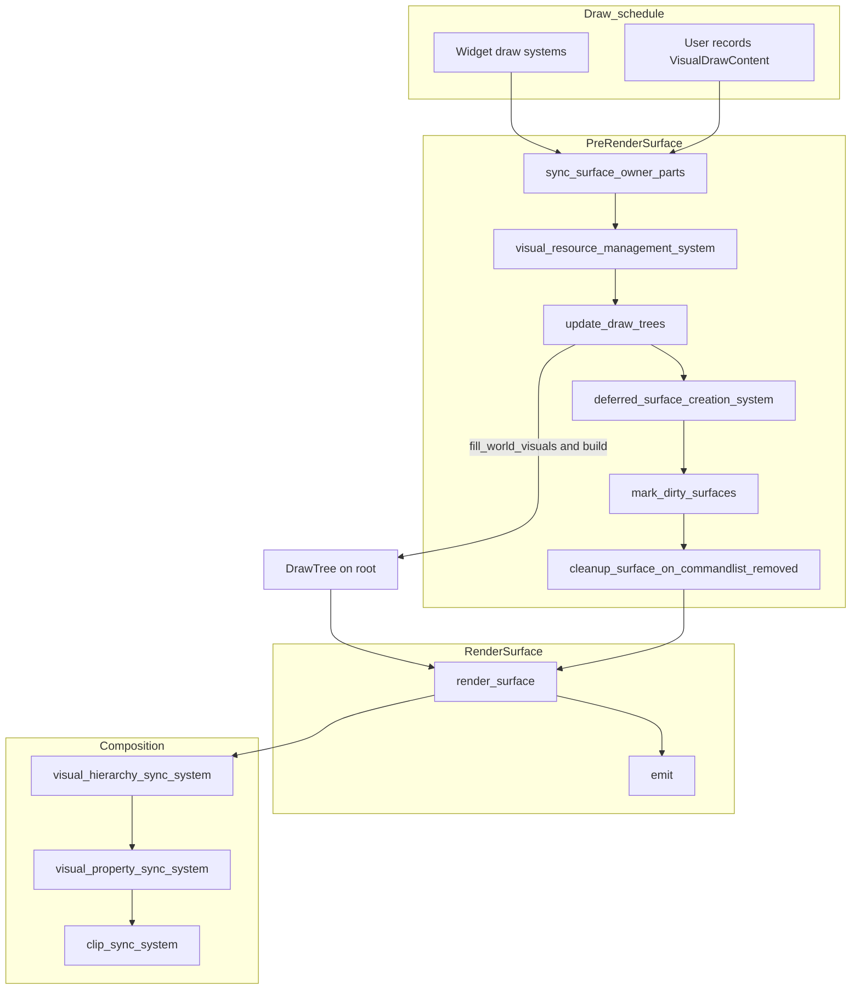
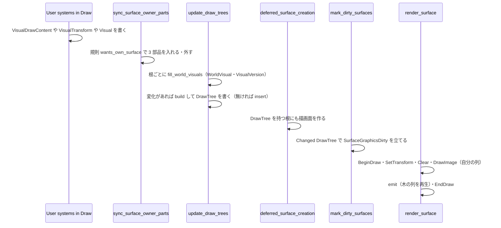
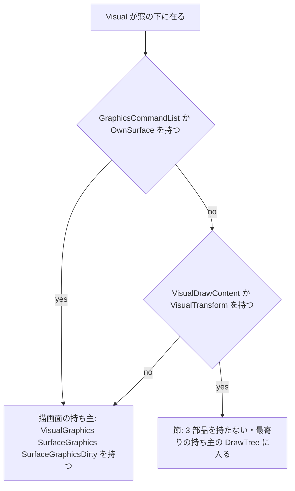
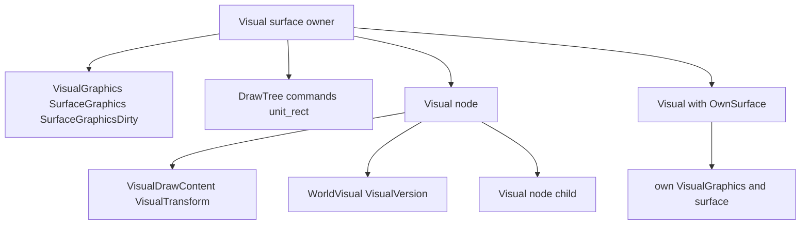

# 設計書: wintf-visual-tree

## Overview

**Purpose**: wintf の描画面（WUC の `CompositionDrawingSurface`）1 枚の下に描画の木を置き、節ごとに重ね方（`D2D1_COMPOSITE_MODE`）・補間・変形・切り抜きを効かせて画家の順で 1 枚に描く土台を、作りかけの `ecs/visual/` を本番へ上げる形で作る。木を持たない描画面は今と同じ道のまま。

**Users**: wintf を使う描き手（後の spec `wintf-d2d-composite-rules`・`draw-methods-canon`・`element-clipping-option`・`wintf-visual-damage-redraw` と、areka の外の使い手）。

**Impact**: `ecs/visual/`（外からの参照 0）を `ecs/graphics/visual/`（`Visual` の居場所）へまとめ、`VisualFlags`・`VisualClip` を捨てて `Visual.is_visible`・`Visual.clip`（`ClipShape::Geometry` を足す）へ一本化する。今の描画の道（`render.rs`・`surface.rs`・`visual.rs` のフック）には小さな口だけを足す。描画面の有無を Visual ごとに選べる形（新しい描き方の既定は「描画面なし」・目印 `OwnSurface` で手動の昇格）を作り、自動の昇格・降格は後の spec に残す。

### Goals

- 描画面の持ち主を根とし、子孫の節を深さ優先の前順で同じ描画面に描く（1.1〜1.11）。
- 節ごとの重ね方・補間・変形・切り抜きを D2D で正しく効かせる（2.1〜2.9）。
- 木を持たない描画面・WUC の木の側・既存の画素のテストを変えない（3.1〜3.9）。
- `WorldVisual`・`VisualVersion` を毎フレーム埋め、hash に番地を使わない（4.1〜4.6）。
- 傷 1〜8 と申し送り（30・21・22・23・88）を直し、使い手の無いコードを最後に棚卸しする（5.1〜5.13）。
- WARP の決定論のテストの足場と純粋なテストで答えを固定する（6.1〜6.8）。
- example 1 本と steering の記述（7.1〜7.3）。

### Non-Goals

- 差分の描き直し・前フレームとの比べ（`wintf-visual-damage-redraw`）。
- ブレンド・不透明度の層・自前の合成の入れ物・1 ピクセルの読み戻し（`wintf-d2d-composite-rules`）。
- emo の合成の移設と ukadoc の語の対応（`draw-methods-canon` 以後）。
- 描画面の持ち主の任意の図形の切り抜きを WUC で実現すること・節の不透明度（`warn!` 1 度で保留）。
- 更新の頻度による描画面の自動の昇格・降格（完了時の棚卸で起票）。
- 節の下に描画面の持ち主を置くこと（1.11＝`error!` で記録して切る・申し送り）。

## Boundary Commitments

### This Spec Owns

- `crates/wintf/src/ecs/graphics/visual/`（フォルダ化した `Visual` の居場所）の全体: `Visual` 部品とフック・描画面の持ち主の規則 `wants_own_surface`・目印 `OwnSurface`・新しい描き方の部品 `VisualDrawContent`／`VisualTransform`・`WorldVisual`／`VisualVersion`・根の部品 `DrawTree`・平らにする係 `build`・埋める係 `fill_world_visuals`・描く係 `emit`・2 つの system（`sync_surface_owner_parts`・`update_draw_trees`）。
- `crates/wintf/src/numerics/` の働きの整理（`axis_aligned` の 1 本化・`moved` の直し・使い手の無い働きの削除・純粋なテスト）。
- 今の描画の道への口: `render.rs` の木の分岐・`surface.rs` の 3 つの filter・`window_pos.rs` の無効化・`clip_sync.rs` の `Geometry` の読み飛ばし・`world/mod.rs` の登録。
- `ClipShape::Geometry(ID2D1Geometry)` の追加と、`Visual` の可視・切り抜き・不透明度を「描画面の持ち主では WUC・節では D2D が実現する」と定める公開の型の文書。
- WARP の決定論のテストの足場（wintf の `src/` の中・`#[cfg(test)]`）と画素の見本。
- example `visual_tree_demo` と steering（`structure.md`・`tech.md`）の記述。

### Out of Boundary

- `wintf-visual-damage-redraw`: 前の列の保持・LIS・描き直す範囲・写し。本 spec は `DrawTree.commands`（平らな列）・`DrawItem.hash`／`world_aabb`・`WorldVisual.subtree_world_aabb`・`VisualVersion`・`Matrix3x2Ext::moved` を**形のまま**残す。
- `wintf-d2d-composite-rules`: `D2D1_BLEND_MODE`・不透明度の層・自前の入れ物・読み戻し。層（`PushLayer`）の中で `SOURCE_OVER` でない重ね方がどう効くかの決め（本 spec は D2D の既定＝層は透明から始まる、で固定し、変える権限をあちらに渡す）。
- `audit-wintf-layout-widget`: `ecs/mod.rs`・`ecs/world/mod.rs` はあちらが触らない約束。本 spec は `ecs::graphics::Visual`・`VisualGraphics` の名前を変えない。**あちらのテスト `ecs/layout/systems/monitor_systems_transition_tests.rs:32` が `include_str!` で `ecs/world/mod.rs` を読み、`schedules.insert(Schedule::new(Update));` の字面（149 行目）を見張る**＝本 spec はこの行を変えない・動かない（触るのは `PreRenderSurface` の `add_systems` の塊だけ）。
- `placement-crate-split`（同じウェーブ・2026-11-06 棚卸セッションの申し送り）: `ecs/mod.rs` で外すのは `pub mod visual;` の 1 行だけ。`wintf::ecs::DPI`・`ZOrderPairStrategy` ほかの再公開は動かさず、`ecs/window/zorder_chain*.rs`・`zorder_pair_*.rs` は動かさない（配置のテストが文字として読む）。
- 節の下の描画面の持ち主を支えること（配置の伝播と WUC の木の同期が節をまたぐこと）＝自動の昇格の spec。
- `areka-emo-text` の文字の層・emo の合成（`areka-emo-compose`／`-present`）。

### Allowed Dependencies

- 上流: bevy_ecs 0.19（`#[require]`・`RemovedComponents`・`Ref`）・`windows` 0.62.2 の `Direct2D`／`Direct3D`／`Direct3D11`／`Dxgi`（WARP は `D3D_DRIVER_TYPE_WARP` の enum 値だけ・機能は入っている）・`windows-numerics`・`bitflags`（使わなくなれば import を外すだけ・`Cargo.toml` は触らない）。
- 共有の土台: `ecs::common::{ancestors, MAX_ANCESTOR_DEPTH}`・`ecs::graphics::{GraphicsCore, VisualGraphics, SurfaceGraphics, SurfaceGraphicsDirty, GraphicsCommandList, ClipShape}`・`ecs::layout::{Arrangement, GlobalArrangement}`・`com::d2d::D2D1DeviceContextExt`・`com::d3d11::d3d11_create_device`・`ecs::graphics::systems::init::format_entity_name`。
- 守る向き: `numerics` → `graphics/visual/{draw_content,transform,version,world_visual,draw_tree}` → `graphics/visual/draw/{command,builder,emit}` → `graphics/visual/systems` → `graphics/systems/{render,surface,window_pos,clip_sync}` → `world/mod.rs`。`com/d2d/` は ECS の型を知らない（描く係 `emit` は visual 層に置き、`com/d2d/` は触らない）。
- 依存は足さない（3.7）。

### Revalidation Triggers

- `DrawCommand`／`DrawItem` の欄（`hash`・`world_mat`・`world_aabb`・`command_list`）や `DrawTree.commands` の持ち方が変わる → `wintf-visual-damage-redraw`。
- `VisualDrawContent` の欄（`composite_mode`・`interpolation_mode`）や `emit` の層の作り（`D2D1_LAYER_OPTIONS1`）が変わる → `wintf-d2d-composite-rules`。
- `wants_own_surface` の規則（描画面の有無の既定）が変わる → 自動の昇格の spec・`draw-methods-canon`。
- `WorldVisual` の座標系（根からの DIP）が変わる → `wintf-visual-damage-redraw`・`shell-balloon-scale-setting`。
- WARP の足場の口（`warp_dc`・`read_back`）と許容差（±1）が変わる → `wintf-d2d-composite-rules`。
- 装置の失いで `VisualDrawContent` を外し `ClipShape::Geometry` を `None` へ戻す約束が変わる → 使い手全員。

## Architecture

### Existing Architecture Analysis

- 描画の道は 1 本: `Draw`（命令の列を作る）→ `PreRenderSurface`（`insert_graphics_parts_on_window_join` → `visual_resource_management_system` → `deferred_surface_creation_system` → `mark_dirty_surfaces` → `cleanup_surface_on_commandlist_removed` → `window_visual_integration_system`）→ `RenderSurface`（`render_surface`: `BeginDraw`→`SetTransform(拡大＋offset)`→`Clear`→`DrawImage(SOURCE_OVER)`→`EndDraw`・装置の失いの立ち直り込み）→ `Composition`（WUC の木・性質・切り抜き）。WUC を触る schedule は UI スレッド固定。
- 窓の下の `Visual` は全部が描画面の持ち主（`on_visual_add` と `insert_graphics_parts_on_window_join` が `VisualGraphics`・`SurfaceGraphics`・`SurfaceGraphicsDirty` を入れる）。描画面を作る係は `With<GraphicsCommandList>` でしか作らない。
- 装置の失い: `GraphicsSetup` の先頭で `invalidate_dependent_components` が GPU の部品を倒し `GraphicsCommandList` を全部外す。工場は作り直しのたびに新しくなる（`GraphicsCore::create` → `create_d2d_factory`）ので、**工場から作った図形（`ID2D1Geometry`）も装置から作った命令の列も、失いの後は使えない**。
- 変化の印の作法: 係は `Changed<T>` で読み、書くときは値が変わるときだけ書く（`bypass_change_detection` で控えを書く）。
- 作りかけの描画の木: 部品は揃い、描く係・配線・埋める係・テストが無い。傷 1〜8 と申し送りは `research.md` 3 節のとおり全部残る。

### Architecture Pattern & Boundary Map

案 C（`research.md` 4 節）: 木の層に係を置き、今の道には小さな口だけ足す。



**Architecture Integration**:

- Selected pattern: 既存の schedule の列に「持ち主の規則の同期」と「木の更新」の 2 つの係を差し込み、描く係は `render_surface` のループの中（`DrawImage` の直後）から 1 回呼ぶ。描画面 1 枚を描くのは今までどおり `render_surface` だけ（案 B の二重化を避ける・3.4）。
- Domain boundaries: 木の層（`graphics/visual/`）はデータ・純粋な計算・D2D の呼び出し（`emit` だけ）を持つ。`surface.rs`／`render.rs`／`window_pos.rs`／`clip_sync.rs` は filter と数行の口。`world/mod.rs` は登録だけ。
- Existing patterns preserved: `Changed<SurfaceGraphicsDirty>` による描き直し・`XxxGraphics` の無効化の列・`format_entity_name` での `error!`・`MAX_ANCESTOR_DEPTH` の上限・兄弟ファイルのテスト。
- New components rationale: `OwnSurface`（手動の昇格の口・1.2c）・`DrawTree`（木だけの根の印と平らな列の置き場・1.8・1.9・4.5）・`emit`（COM を呼ぶのはここだけ・層の向きを保つ）・`sync_surface_owner_parts`（後から足した部品にも規則を効かせる）・`update_draw_trees`（4.1〜4.4・1.9）。
- Steering compliance: 記録の無い失敗の道を作らない（`logging.md`）・1 ファイル 1,000 行・テストは兄弟ファイル・依存を足さない・GPU の実機テストは残し WARP は画素の答えだけ（`tech.md` に例外を書く）。

### Technology Stack

| Layer | Choice / Version | Role in Feature | Notes |
|-------|------------------|-----------------|-------|
| ECS | bevy_ecs 0.19 | 部品・`#[require]`・`Ref`／`Changed`／`RemovedComponents`・`Commands` | `#[require(WorldVisual, VisualVersion)]` を `VisualDrawContent`／`VisualTransform` に付け、節は必ず 2 つを持つ |
| 描画 | Direct2D 1.1（`ID2D1DeviceContext`） | `DrawImage(補間, 重ね方)`・`PushAxisAlignedClip`・`PushLayer(geometricMask, maskTransform)`・`ID2D1PathGeometry`（角丸） | 既存の `windows` 機能だけ。`DrawImage` は `SOURCE_OVER` 以外のとき「絵を今の軸に沿う切り抜きまで透明で広げて合成する」（Microsoft Learn の記述）＝D2D の意味論をそのまま通す |
| 装置（テスト） | D3D11 WARP（`D3D_DRIVER_TYPE_WARP`）＋ `D2D1CreateFactory(MULTI_THREADED)` → `CreateDevice` → DC | 画面に出さずに絵へ描き CPU で読み戻す | 足場だけ・`GraphicsCore` の公開面は増やさない |
| 数 | `numerics`（`Aabb`・`Matrix3x2Ext`・`Transform2D`・`CalcHash`） | 行列の合成・外接矩形・軸に沿うかの判定・hash | 使い手の無い働きは最後に消す（5.13 の表） |

## File Structure Plan

### Directory Structure

```
crates/wintf/src/
├── numerics/
│   ├── aabb.rs                 # Aabb（is_empty/intersect/union/transform・NaN と空は空）
│   ├── aabb_tests.rs           # 純粋なテスト（6.6）
│   ├── matrix3x2.rs            # Matrix3x2Ext::{axis_aligned（許容つき・90 度も沿う）, moved（矩形の角で比べる）}
│   ├── matrix3x2_tests.rs      # 純粋なテスト（6.6）
│   ├── transform2d.rs          # Transform2D（pivot_srt/to_affine）
│   ├── transform2d_tests.rs    # 合成の順と符号（6.6・pivot_srt の符号を裏返すと赤）
│   ├── calc_hash.rs            # 変更なし
│   └── mod.rs                  # Point2 の宣言を外す
└── ecs/graphics/visual/        # 旧 ecs/graphics/visual.rs をフォルダ化（5.9）
    ├── mod.rs                  # Visual 部品・フック・持ち主の規則 wants_own_surface・OwnSurface・子モジュールの宣言と再公開
    ├── visual_tests.rs         # wants_own_surface の真理値表（純粋）
    ├── draw_content.rs         # VisualDrawContent（Hash を外す・Send/Sync の注記・require）
    ├── transform.rs            # VisualTransform（require）
    ├── version.rs              # VisualVersion（変更なし）
    ├── world_visual.rs         # WorldVisual ＋ fill_world_visuals（前順で world・逆順で subtree の和）
    ├── world_visual_tests.rs   # 埋める答え・深さの上限・輪（純粋・World を組む）
    ├── draw_tree.rs            # DrawTree（根の印・平らな列・unit_rect）・Send/Sync の注記
    ├── systems.rs              # sync_surface_owner_parts・update_draw_trees・warn の 1 度
    ├── systems_tests.rs        # 規則の同期・根の印の出入り・同じフレームの印・RemovedComponents（純粋・World を組む）
    └── draw/
        ├── mod.rs              # builder・command・emit・clip_geometry の宣言
        ├── command.rs          # DrawCommand/DrawItem/ClipRect/ClipGeometry（dead_code を外す・命令の列と図形の複製を持つ）
        ├── builder.rs          # build（WorldVisual を読む・numerics へ寄せる・明示のスタック・GetBounds の失敗）
        ├── builder_tests.rs    # 描く順・切り抜きの出入り・間引き・見えない節・深さの上限（純粋・工場だけ）
        ├── clip_geometry.rs    # ClipShape → ID2D1Geometry（矩形→unit_rect・角丸→path geometry・Geometry→そのまま）
        ├── emit.rs             # emit（DC へ再生・SetTransform の規則・層の作り）
        ├── emit_test_support.rs# WARP の足場: warp_dc・render_tree_to_pixels・read_back・pixel_near
        ├── emit_tests.rs       # 画素の見本（6.3 の 12 件）
        └── README.md           # 戦略の文だけ残し、型の写しを外す（5.10）
crates/wintf/examples/
└── visual_tree_demo.rs         # 木で重ね方・回転・切り抜きを描く（7.1）
```

削除: `ecs/visual/`（全ファイル・移すものは上へ）・`ecs/visual/visual_flags.rs`・`ecs/visual/clip.rs`（`VisualClip`）・`numerics/point2.rs`。

### Modified Files

- `crates/wintf/src/ecs/mod.rs` — 14 行目の `pub mod visual;` を外す（`graphics::*` の再公開で `wintf::ecs::visual` は `graphics::visual` を指す）。
- `crates/wintf/src/ecs/graphics/mod.rs` — `pub mod visual;` はそのまま（フォルダになる）。`pub use visual::*` で新しい型も `wintf::ecs::*` に出る。
- `crates/wintf/src/ecs/graphics/clip.rs` — `ClipShape::Geometry(ID2D1Geometry)` を足す。`unsafe impl Send/Sync`（工場の根拠の注記）。`PartialEq` は COM の番地比べのまま（それは正しい）。
- `crates/wintf/src/ecs/graphics/systems/render.rs` — `RenderSurfaceData` に `Option<&DrawTree>` を足し、`DrawImage` の直後に `emit(&dc, transform, &tree.commands)` を 1 回呼ぶ。失敗は今の `EndDraw` の記録に乗る。
- `crates/wintf/src/ecs/graphics/systems/surface.rs` — `MarkDirtyFilter` に `Changed<DrawTree>`、`MarkDirtyData` に `Option<Ref<DrawTree>>`（中身の変化に数える）。`SurfaceCreationFilter` を `(Or<(With<GraphicsCommandList>, With<DrawTree>)>, Or<(…, Changed<DrawTree>)>)` へ。`cleanup_surface_on_commandlist_removed` に `RemovedComponents<DrawTree>` を足し、filter を `(Without<GraphicsCommandList>, Without<DrawTree>)` へ。
- `crates/wintf/src/ecs/graphics/systems/window_pos.rs` — `invalidate_dependent_components` に: `VisualDrawContent` を全部外す（命令の列は装置の持ち物）・`DrawTree` の中身を空にする（図形は工場の持ち物）・`Visual.clip` が `Geometry` の部品は `warn!`（実体名）を残して `None` へ戻す。
- `crates/wintf/src/ecs/graphics/systems/clip_sync.rs` — 鍵の計算で `Some(ClipShape::Geometry(_))` を「切り抜きなし」として扱い、鍵が変わる回に `warn!`（実体名・範囲外の旨）を 1 度出す（3.8）。
- `crates/wintf/src/ecs/graphics/visual_manager.rs` — 変更なし（`VisualGraphics` を持つ部品にだけ見た目を作る今の作りで足りる）。
- `crates/wintf/src/ecs/world/mod.rs` — `PreRenderSurface` の登録: `insert_graphics_parts_on_window_join` を `sync_surface_owner_parts` に置き換え、`update_draw_trees` を `visual_resource_management_system` の後・`deferred_surface_creation_system` の前に足す。
- `insert_graphics_parts_on_window_join` の名前を綴るのは `world/mod.rs:329` だけ（`init.rs`・`tests/visual/window_join_test.rs` は綴っていない・検証で確認）。`window_join_test.rs` は筋が同じなので緑のまま。
- `.kiro/steering/structure.md` — `ecs/` の節の `visual/` の行を `graphics/visual/` へ直し、描画の道（命令の列 1 本の道と木の道の分岐・描画面の有無の既定）を書く。
- `.kiro/steering/tech.md` — Testing の「GPU のテストは実のハードウェア GPU」に「描画の木の画素の答えに限って WARP」の例外を書く。

## System Flows

### 1 フレームの流れ（木を持つ描画面）



- 門: `update_draw_trees` は `GraphicsCore` が有効な回だけ木を組む（図形は工場から作る）。無効な回も `fill_world_visuals` だけは回す（装置は要らない・その回の `Ref` の変化を捨てると版が上がらず「版が違えば絵が違う」が崩れるため）が、組まず根の部品も入れない（立ち直りの後、`Res<GraphicsCore>` の変化で全部組み直す）。
- 同じフレームの約束（1.9）: 節の変化が `PreRenderSurface` より前（`Update`・`Draw`）なら同じ回に描く。`RenderSurface` より後の変化は次の回（今の `GraphicsCommandList` と同じ）。

### 持ち主の規則の判定



### 描く係 emit の変換の規則

| 命令 | DC の変換 `SetTransform` | 呼ぶもの |
|---|---|---|
| `Draw` | `world_mat * root` | `DrawImage(command_list, None, None, interpolation, composite)` |
| `PushClipRect` | `root` | `PushAxisAlignedClip(world_aabb〔DIP〕, PER_PRIMITIVE)` |
| `PopClipRect` | — | `PopAxisAlignedClip()` |
| `PushClipGeometry` | 恒等 | `PushLayer(D2D1_LAYER_PARAMETERS1 { geometricMask, maskTransform: world_mat * root, layerOptions: NONE, opacity: 1, contentBounds: 無限 }, None)` |
| `PopClipGeometry` | — | `PopLayer()` |

`root` は `render_surface` が今作る変換（`GlobalArrangement` の拡大＋`BeginDraw` の offset）。`PushAxisAlignedClip` は「渡した矩形を今の変換で変換し、その軸に沿う外接矩形で切る」（Microsoft Learn）ので、軸に沿う `world_mat` のときだけ使い、矩形の DIP を `root` で変換させる。回転・せん断のときは `build` が図形へ上げる。層の `maskTransform` は「層を合成するとき図形に掛ける変換」なので、DC を恒等にして局所→物理の全部を `maskTransform` で渡し、曖昧さを残さない。

## Requirements Traceability

| Requirement | Summary | Components | Interfaces | Flows |
|---|---|---|---|---|
| 1.1 | 根の列を先に・節を前順で | `render_surface`・`build`・`emit` | `DrawTree.commands` | 1 フレームの流れ |
| 1.2 | 持ち主＝根・下の持ち主は節でない | `fill_world_visuals`（`Has<VisualGraphics>` で止める） | — | 持ち主の規則 |
| 1.2a | 新しい部品あり・命令なし・目印なし＝節 | `wants_own_surface`・`on_visual_add`・`sync_surface_owner_parts` | `OwnSurface` | 持ち主の規則 |
| 1.2b | 命令あり・何も無し＝今どおり持ち主 | 同上 | — | 持ち主の規則 |
| 1.2c | 目印＝持ち主（手動の昇格） | 同上 | `OwnSurface` | 持ち主の規則 |
| 1.3 | 中身なしの節は描かず子孫は描く | `build` | — | — |
| 1.4 | 変形なし＝恒等 | `fill_world_visuals` | — | — |
| 1.5 | clip None＝切り抜きなし | `build`（`ClipKind::NoClip`） | — | — |
| 1.6 | 可視は `Visual.is_visible` | `fill_world_visuals`・`build` | `Visual` | — |
| 1.7 | 見えない節と子孫を描かない | `fill_world_visuals`（部分木を飛ばす） | — | — |
| 1.8 | 節だけの根でも描画面を作る | `update_draw_trees`（`DrawTree` を入れる）・`surface.rs` の filter | `DrawTree` | 1 フレームの流れ |
| 1.9 | 同じフレームで描き直す | `update_draw_trees`（`Ref::is_changed`・`RemovedComponents`）・`mark_dirty_surfaces` | `Changed<DrawTree>` | 1 フレームの流れ |
| 1.10 | 木なしは今と同じ画素 | `render_surface`（`Option<&DrawTree>` が `None` なら今の道） | — | — |
| 1.11 | 節の下の持ち主は `error!` で切る | `fill_world_visuals` | — | — |
| 2.1 | 重ね方・補間（既定 SOURCE_OVER・LINEAR） | `VisualDrawContent`・`emit` | `DrawItem` | emit の規則 |
| 2.2 | 根の変形×局所の変形（`VisualTransform × 平行移動(Arrangement.offset)`）・DIP | `fill_world_visuals`（DIP の world）・`emit`（`root` を掛ける） | `WorldVisual` | emit の規則 |
| 2.3 | 回転・拡大・反転 | `Transform2D::to_affine`・`emit` | — | — |
| 2.4 | 矩形・角丸の切り抜き（大きさは `Arrangement`） | `build`・`clip_geometry` | `ClipShape` | — |
| 2.5 | 回転した矩形は図形へ | `build`（`axis_aligned` でなければ `PushClipGeometry`） | — | emit の規則 |
| 2.6 | 任意の図形 | `ClipShape::Geometry`・`build`・`emit`（`PushLayer`） | `ClipShape` | emit の規則 |
| 2.7 | 入れ子の交わり | `build`（`eff` の交わり・層と切り抜きの入れ子） | — | — |
| 2.8 | 間引きは答えを変えない | `build`（`eff` で間引く）＋テスト | — | — |
| 2.9 | 局所は DIP・DPI は描くとき | `VisualDrawContent.local_aabb`・`WorldVisual`・`emit` | — | — |
| 3.1 | 木なしの描き方を変えない | `render_surface` | — | — |
| 3.2 | 持ち主の性質は WUC のまま | `visual_sync.rs`・`clip_sync.rs`（触らない） | — | — |
| 3.3 | 性質は `Visual` の 1 つ・文書 | `Visual` の doc | `Visual` | — |
| 3.8 | 持ち主の Geometry は `warn!` 1 度・切り抜かない | `clip_sync_system` | — | — |
| 3.9 | 節の opacity≠1 は `warn!` 1 度・1.0 | `fill_world_visuals` | — | — |
| 3.4 | 装置の失いの道に乗る | `render_surface`（同じループ）・`invalidate_dependent_components`・`update_draw_trees` | — | — |
| 3.5 | 既存の画素のテストが同じ答え | `render_surface` の分岐の位置（`DrawImage` の後ろだけ）＋全体テスト | — | — |
| 3.6 | 名前は汎用の語 | `OwnSurface`・`DrawTree`・`emit` ほか | — | — |
| 3.7 | 依存を足さない | Technology Stack | — | — |
| 4.1 | 毎フレーム world・軸・外接矩形・和 | `fill_world_visuals` | `WorldVisual` | — |
| 4.2 | 変形・親子・祖先の変化で埋め直す | `fill_world_visuals`（根ごとに全部埋め直す・値が同じなら書かない） | — | — |
| 4.3 | 中身・切り抜き・可視で版を上げる | `fill_world_visuals`（`Changed<Visual>`・`Changed<VisualDrawContent>`） | `VisualVersion` | — |
| 4.4 | 変形では上げない | `fill_world_visuals`（`VisualTransform` を見ない） | — | — |
| 4.5 | hash に番地を使わない | `build::hash_draw`（実体・版・補間・重ね方・world） | `DrawItem.hash` | — |
| 4.6 | 平らにする係は `WorldVisual` を使う | `build`（`NodeData` に `&WorldVisual`） | — | — |
| 5.1 | D2D の失敗は `error!` | `build`（`GetBounds`・図形の作成）・`render_surface`（`EndDraw`）・`update_draw_trees`（`unit_rect`） | — | — |
| 5.2 | `GetBounds` の失敗は記録して飛ばす | `build`（`Result` → `error!`＋`Culled`） | — | — |
| 5.3 | 深さ 1,024 で止める | `fill_world_visuals`・`build`（明示のスタック・`MAX_ANCESTOR_DEPTH`） | — | — |
| 5.4 | 親の輪で落ちない | 同上 | — | — |
| 5.5 | 軸に沿うかは 1 か所 | `Matrix3x2Ext::axis_aligned` | — | — |
| 5.6 | 矩形の働きは `numerics` の 1 つ | `Aabb::{is_empty, intersect, union, transform}` | — | — |
| 5.7 | NaN と空は空 | `Aabb` | — | — |
| 5.8 | Send/Sync の根拠 | `VisualDrawContent`・`ClipShape`・`DrawTree` の注記 | — | — |
| 5.9 | `ecs/graphics/visual/` へ・`VisualFlags`／`VisualClip` を捨てる | File Structure Plan | — | — |
| 5.10 | README の写しを外す | `draw/README.md` | — | — |
| 5.11 | `moved` は矩形の角で比べる | `Matrix3x2Ext::moved` | — | — |
| 5.12 | `allow(dead_code)` を外す | `command.rs`・`builder.rs` | — | — |
| 5.13 | 使い手の無いコードの棚卸 | 「残す・消す」の表 | — | — |
| 6.1 | WARP の足場 | `emit_test_support.rs` | `warp_dc`・`render_tree_to_pixels`・`read_back` | — |
| 6.2 | 全体テストで常に回る | `src/` の `#[cfg(test)]`（環境変数の門なし） | — | — |
| 6.3 | 12 件の画素の答え | `emit_tests.rs` | — | — |
| 6.4 | 見本はコードの中・境界を避け・±1 | `pixel_near`・見本の置き方 | — | — |
| 6.5 | WARP は画素の答えに限る・`tech.md` | `tech.md` の例外 | — | — |
| 6.6 | 数の部品の純粋なテスト | `aabb_tests.rs`・`matrix3x2_tests.rs`・`transform2d_tests.rs` | — | — |
| 6.7 | 平らにする係の純粋なテスト | `builder_tests.rs`・`world_visual_tests.rs` | — | — |
| 6.8 | 兄弟ファイル | File Structure Plan | — | — |
| 7.1 | example 1 本 | `examples/visual_tree_demo.rs` | — | — |
| 7.2 | steering の更新 | `structure.md`・`tech.md` | — | — |
| 7.3 | 1,000 行以内 | File Structure Plan（最大は `builder.rs` 約 300 行の見込み） | — | — |

## Components and Interfaces

| Component | Domain/Layer | Intent | Req Coverage | Key Dependencies (P0/P1) | Contracts |
|---|---|---|---|---|---|
| `Visual`（文書と `wants_own_surface`・`OwnSurface`） | graphics/visual | 持ち主か節かの規則と性質の置き場 | 1.2a〜2c, 3.3 | `VisualGraphics` ほか 3 部品 (P0) | State |
| `ClipShape::Geometry` | graphics | 任意の図形の切り抜き | 2.6, 3.8, 5.8 | `ID2D1Geometry` (P0) | State |
| `VisualDrawContent`／`VisualTransform` | graphics/visual | 節の描く中身と局所の変形 | 2.1, 2.2, 2.9, 5.8, 5.12 | `numerics` (P0) | State |
| `WorldVisual`＋`fill_world_visuals` | graphics/visual | 世界の行列・外接矩形・版・可視の判定 | 1.4, 1.6, 1.7, 1.11, 3.9, 4.1〜4.4, 5.3, 5.4 | `Children`／`ChildOf` (P0)・`MAX_ANCESTOR_DEPTH` (P1) | Service |
| `DrawTree` | graphics/visual | 根の印と平らな列の置き場 | 1.8, 1.9, 4.5 | `ID2D1Geometry`（unit_rect）(P1) | State |
| `build`＋`clip_geometry` | graphics/visual/draw | 木を `DrawCommand` の列にする | 1.1, 1.3, 1.5, 2.4〜2.8, 4.5, 4.6, 5.1〜5.7 | `WorldVisual` (P0)・`ID2D1Factory` (P0) | Service |
| `emit` | graphics/visual/draw | 列を DC へ再生 | 1.1, 2.1〜2.3, 2.5, 2.6 | `ID2D1DeviceContext` (P0) | Service |
| `sync_surface_owner_parts` | graphics/visual/systems | 規則を後からの変化にも効かせる | 1.2a〜2c | `Commands` (P0) | Batch |
| `update_draw_trees` | graphics/visual/systems | 根ごとに埋めて組み、印を立てる | 1.8, 1.9, 3.4, 4.1〜4.4 | `GraphicsCore` (P0) | Batch |
| 今の道の口（`render.rs`・`surface.rs`・`window_pos.rs`・`clip_sync.rs`） | graphics/systems | 木を持つ描画面を今の道に乗せる | 1.1, 1.8, 1.9, 1.10, 3.1, 3.4, 3.8 | `DrawTree` (P0) | Batch |
| `numerics` の整理 | numerics | 1 つの実装・NaN は空・`moved` | 5.5〜5.7, 5.11, 5.13, 6.6 | — | Service |
| WARP の足場と画素のテスト | graphics/visual/draw（test） | 決定論の答え | 6.1〜6.5 | `d3d11_create_device` (P0) | Service |
| example・steering | examples／.kiro/steering | 使い方と道の記述 | 7.1〜7.3 | — | — |

### graphics/visual（部品と規則）

#### `Visual`・`OwnSurface`・`wants_own_surface`

| Field | Detail |
|---|---|
| Intent | 描画面の有無を Visual ごとに決める規則と、可視・切り抜き・不透明度の置き場 |
| Requirements | 1.2a, 1.2b, 1.2c, 3.3 |

**Responsibilities & Constraints**
- `Visual` は今のまま（`is_visible`・`opacity`・`transform_origin`・`clip`）。doc に「可視・切り抜き・不透明度は `Visual` の 1 つの性質。描画面の持ち主では WUC（`visual_property_sync_system`・`clip_sync_system`）が、節では D2D（`fill_world_visuals`・`build`・`emit`）が実現する。`ClipShape::Geometry` は節だけが効かせ、持ち主では `warn!` 1 度で切り抜かない。節の `opacity` は `warn!` 1 度で 1.0」と書く（3.3）。
- `OwnSurface`: 印の部品（`#[derive(Component, Default)] pub struct OwnSurface;`）。在れば新しい描き方の部品の有無に依らず描画面の持ち主。
- 規則は 1 か所: `pub(crate) fn wants_own_surface(has_command_list: bool, has_own_surface: bool, is_node: bool) -> bool { has_command_list || has_own_surface || !is_node }`。`is_node` は **`Has<WorldVisual>`**（設計議題 2・検証の重大 2・開発者 2026-11-06「承認」）: `WorldVisual` は `VisualDrawContent`／`VisualTransform` の `#[require]` で必ず入り、装置の失い（`invalidate_dependent_components` は `VisualDrawContent` を外す）でも外れないので、失いの回に節が持ち主へ化ける往復が起きない。新しい描き方の部品を一度でも持った Visual は節のまま（要件 1.2b）。節を持ち主へ戻すには `OwnSurface` を付ける（`Visual` の doc に書く）。`sync_surface_owner_parts` が見る `Added`／`RemovedComponents` も `WorldVisual`・`OwnSurface`・`GraphicsCommandList` の 3 つになる。`on_visual_add` はこの規則で 3 部品を入れるか決める（bevy はバンドルを全部書いてからフックを呼ぶので、同じバンドルで入った部品が見える。着手の最初のタスクで `systems_tests.rs` の 1 本で確かめる）。`sync_surface_owner_parts` が後からの変化を直す。

**Contracts**: State [x]

- State model: 窓の下の `Visual` は `wants_own_surface` が真のとき、かつそのときだけ `VisualGraphics`・`SurfaceGraphics`・`SurfaceGraphicsDirty` を持つ。
- Persistence & consistency: 規則の答えが変わる回（部品の出入り・`ChildOf` の変化）に `sync_surface_owner_parts` が揃える。外すときは 3 部品を `remove`（根の部品 `DrawTree` も一緒に外す・`DrawTree` は根にだけ在る・`VisualGraphics` の on_remove フックが WUC の親から外す・`SurfaceGraphics` は捨てられる）。

**Implementation Notes**
- Integration: `insert_graphics_parts_on_window_join` の名前は `sync_surface_owner_parts` へ変わる（`world/mod.rs`・`tests/visual/window_join_test.rs` が追随）。
- Validation: `visual_tests.rs` に規則の真理値表。`tests/visual/graphics_auto_creation_test.rs` は「何も持たない Visual は持ち主」のまま緑。
- Risks: フックが同じバンドルの部品を見られない版の挙動なら、フックは今どおり無条件に入れ、`sync_surface_owner_parts` が同じ `PreRenderSurface` の先頭で外す（`visual_resource_management_system` より前なので WUC の見た目は作られない）。どちらでも規則は 1 か所。

#### `ClipShape::Geometry`

| Field | Detail |
|---|---|
| Intent | 節の任意の図形の切り抜き（局所の DIP） |
| Requirements | 2.6, 3.8, 5.8 |

- `ClipShape` に `Geometry(ID2D1Geometry)` を足す。`derive(Debug, Clone, PartialEq)` はそのまま（COM の `PartialEq` は番地比べ＝同じ図形かの判定として正しい）。`Hash` は付けない。
- `unsafe impl Send/Sync for ClipShape`: 注記「`ID2D1Geometry` は工場（`D2D1_FACTORY_TYPE_MULTI_THREADED`・`GraphicsCore::d2d_factory`）から作る装置に依らない資源で、同じ工場の系列への呼び出しは D2D が直列化する。別の工場で作った図形を入れる道は閉じられないので『`GraphicsCore::d2d_factory()` の工場で作る』を使い手の約束として書く」（`command_list.rs` の注記が手本）。
- 装置の失い: 工場が作り直されるので図形は使えなくなる。`invalidate_dependent_components` が `Geometry` を持つ `Visual.clip` を `None` へ戻し `warn!`（実体名・「装置の失いで図形を捨てた。`Res<GraphicsCore>` の変化を合図に作り直すこと」）を残す。黙って切らない。

#### `VisualDrawContent`・`VisualTransform`

| Field | Detail |
|---|---|
| Intent | 節の描く中身（閉じた命令の列・局所の外接矩形・補間・重ね方）と局所の変形 |
| Requirements | 2.1, 2.2, 2.3, 2.9, 5.8, 5.12 |

- 欄は今のまま（`local_aabb`〔96 DPI の DIP〕・`command_list`・`interpolation_mode`・`composite_mode`）。`impl Hash` は外す（番地を混ぜる元・使い手は `hash_draw` だけ・議題 11 ㋐）。`new_calc_aabb`／`new_calc_aabb_ex` は消す（96 DPI の計算専用 DC が本番に無く、使い手も見込みも無い＝5.13 の表）。`#[require(WorldVisual, VisualVersion)]` を付ける（節は必ず 2 つを持つ・`insert` でも効く）。
- `VisualTransform(Transform2D)`: `Hash` の derive を外す（使い手なし）。`#[require(WorldVisual, VisualVersion)]`。
- `unsafe impl Send/Sync for VisualDrawContent` の注記: 「`ID2D1CommandList` は `GraphicsCore` の装置（`MULTI_THREADED` の工場の `CreateDevice`）から作る。同じ工場の系列への呼び出しは D2D が直列化する」＋使い手の約束（同じ装置で作る・閉じてから入れる）。
- 装置の失い: `invalidate_dependent_components` が `GraphicsCommandList` と同じく全部外す。使い手は `Res<GraphicsCore>` の変化を合図に作り直す（`structure.md` の「下流の控え」と同じ約束）。外れても `VisualTransform` が残れば節のまま、両方外れれば持ち主の規則が変わる（`sync_surface_owner_parts` が揃える）。
- `DrawImage` の意味論（Microsoft Learn）: `composite_mode` が `SOURCE_OVER` でないとき、絵は今の軸に沿う切り抜きまで透明で広げられてから合成される（`DESTINATION_IN` などは絵の外の画素にも効く）。wintf は D2D の値をそのまま通し、doc にこの 1 文を写す。

### graphics/visual（世界の行列と根）

#### `WorldVisual`＋`fill_world_visuals`

| Field | Detail |
|---|---|
| Intent | 根ごとに節の世界の行列・軸に沿うか・外接矩形・部分木の和を埋め、版を上げ、可視と節の境界を判じる |
| Requirements | 1.2, 1.4, 1.6, 1.7, 1.11, 3.9, 4.1, 4.2, 4.3, 4.4, 5.3, 5.4 |

**Responsibilities & Constraints**
- 座標系は**根からの DIP**（DPI を含まない・議題 5 ㋐）。根の `WorldVisual` は恒等。`world = local * parent`（行ベクトル・`Transform2D` の規約）。`WorldVisual` の `Hash` impl は外す（使い手なし）。
- 前順で `world_mat`・`axis_aligned`（`Matrix3x2Ext::axis_aligned`）・`content_world_aabb`（`local_aabb.transform(world_mat)`・中身が無ければ `EMPTY`）を埋め、訪れた順の列を逆にたどって `subtree_world_aabb = content ∪ 子の subtree` を親へ積む。明示のスタック `(entity, depth)`・`depth > MAX_ANCESTOR_DEPTH` で `error!` 1 行（根の実体名・上限）を残して、それより深い節を訪れない（議題 13 ㋐・輪もここで止まる）。
- 節の境界: 子が `VisualGraphics` を持てば（＝描画面の持ち主）**その子と子孫を訪れない**。節の下で見つけたとき（親が節）は `error!`（実体名・「節の下の描画面の持ち主は支えない」）を残して切る（1.11）。根の直下の持ち主は今の WUC の木の子なので記録しない（1.2）。
- 可視: `Visual.is_visible == false` の節は自分も子孫も訪れない（`WorldVisual` は前の値のまま・`build` に渡す「見える節の集合」はこの走査が決める）。走査は見えない部分木を飛ばすので `build` は可視を読み直さない。ただし見えない部分木の中も版だけは追う（`Visual`・描く中身が変わった節の `VisualVersion` を上げ、不透明度の `warn!` を出す・`visited` には入れず行列も書かない）。隠れている間の変化を、また見えた回に失わないため（「版が違えば絵が違う」）。
- 版: `Ref<Visual>.is_changed() || Ref<VisualDrawContent>.is_changed()` の節は `VisualVersion.bump()`（4.3）。`VisualTransform` は読まない（4.4）。`Visual` の変化には `opacity`・`transform_origin` も含まれる（版が余分に上がるだけで約束は破らない・doc に書く）。
- 不透明度: `Ref<Visual>.is_changed()` かつ `opacity != 1.0` の節は `warn!`（実体名・「節の不透明度の層は `wintf-d2d-composite-rules` の範囲・1.0 で描く」）。変化の回だけ出るので 1 度（3.9）。
- 書き込みは値が変わるときだけ（`WorldVisual` の `PartialEq` を足して比べる）。
- 配置の変化（検証の重大 3）: 戻り値の「変化あり」には、根の `Arrangement` の変化（viewport）と、`Visual.clip` が `Some` の節の `Ref<Arrangement>.is_changed()`（切り抜きの大きさ）も数える。版は上げない（damage-redraw の約束は変えない）。

**Contracts**: Service [x]

```rust
/// 根 `root` の木を埋める。戻り値は「この回に木の中で変化があったか」（版が上がった・
/// 行列が変わった・節の入り〔`WorldVisual` が付いた〕・親子の変化・根の配置・切り抜きを持つ節の配置）。
/// 訪れた節の順の列は `visited` に入る（`build` が同じ順で使う）。節の出は `update_draw_trees` が
/// `RemovedComponents` で拾う。
pub(crate) fn fill_world_visuals(
    root: Entity,
    root_name: Option<&Name>,
    nodes: &mut Query<FillData>,            // (Ref<Visual>, Option<Ref<Arrangement>>, Option<&VisualTransform>,
                                            //  Option<Ref<VisualDrawContent>>, Option<&mut WorldVisual>,
                                            //  Option<&mut VisualVersion>, Option<Ref<Children>>,
                                            //  Has<VisualGraphics>, Option<&Name>)
                                            //  WorldVisual なし・VisualGraphics ありは持ち主（節でない）
    root_arrangement_changed: bool,         // 根の Ref<Arrangement>.is_changed()（viewport が変わる＝組み直す）
    children_of_root: &[Entity],            // 根の Children の並び（無ければ空）
    root_children_changed: bool,            // 根の Ref<Children>.is_changed()
    visited: &mut Vec<(Entity, usize)>,     // 前順の列と深さ（容量を使い回す）
) -> bool
```
- Preconditions: `root` は `VisualGraphics` を持つ。節は `WorldVisual`・`VisualVersion` を持つ（`#[require]`）。
- Postconditions: 訪れた節の `WorldVisual` が今の値。見えない部分木・持ち主の部分木・上限を越えた節は訪れない。見えない部分木の中で変わった節の版は上がっている。
- Invariants: `VisualTransform` の変化だけでは版が上がらない。

**Implementation Notes**
- Integration: `update_draw_trees` が根ごとに呼ぶ。`Query` の書き込みは `iter_many_mut` 相当の `get_mut` で 1 節ずつ。
- Validation: `world_visual_tests.rs`（純粋・`World` と `Schedule` を組む）: 2 段の変形の積・反転の外接矩形・部分木の和・見えない部分木を飛ばす・変形だけの変化で版が上がらない・中身の変化で 1 つ上がる・根の大きさを変えると「変化あり」になり版は上がらない・深さの上限で止まる・輪で落ちない・節の下の持ち主で `error!` が出る（`log-capture-kit`）。
- Risks: 毎フレーム根ごとに全節を訪れる（差分はしない）。節は数十〜数百の見込みで、今の `propagate_global_arrangements` と同じ桁。

#### `DrawTree`

| Field | Detail |
|---|---|
| Intent | 木を持つ根の印・平らな列の置き場・回転した矩形の切り抜きに使う単位矩形の図形 |
| Requirements | 1.8, 1.9, 4.5 |

```rust
#[derive(Component, Default, Debug)]
pub struct DrawTree {
    /// 平らにした列（画家の順）。`render_surface` が `emit` に渡す。
    pub commands: Vec<DrawCommand>,
    /// (0,0)-(1,1) の矩形の図形。回転した矩形の切り抜きを図形へ上げるとき共有する。
    /// 装置の失いで空に戻り、次の組み直しで工場から作り直す。
    unit_rect: Option<ID2D1Geometry>,
}
unsafe impl Send for DrawTree {}  // 注記: 中の COM は工場（図形）と装置（命令の列）の持ち物・ClipShape と同じ根拠
unsafe impl Sync for DrawTree {}
```
- 入れる・外すのは `update_draw_trees` だけ（使い手は置かない・研究 §7 の前文）。根に節が 1 つでも在れば入れ、無くなれば外す。
- `Changed<DrawTree>` が「木を描き直す」合図。`update_draw_trees` は列を組み直した回だけ書く（組み直さない回は触らない）。
- 装置の失い: `invalidate_dependent_components` が `commands.clear()`・`unit_rect = None`（`set_changed` は立てない・立ち直りの回の組み直しが立てる）。

### graphics/visual/draw（平らにする・描く）

#### `DrawCommand`（`command.rs`）

```rust
pub enum DrawCommand {
    Draw(DrawItem),
    PushClipRect(ClipRect),
    PopClipRect,
    PushClipGeometry(ClipGeometry),
    PopClipGeometry,
}
pub struct DrawItem {
    pub hash: u64,                       // (entity, VisualVersion, interpolation, composite, world_mat) から
    pub entity: Entity,
    pub world_mat: Matrix3x2,            // 根からの DIP
    pub world_aabb: Aabb,                // DIP
    pub command_list: ID2D1CommandList,  // VisualDrawContent の複製（AddRef だけ）
    pub interpolation_mode: D2D1_INTERPOLATION_MODE,
    pub composite_mode: D2D1_COMPOSITE_MODE,
}
pub struct ClipRect { pub world_aabb: Aabb }                                   // 軸に沿う・DIP
pub struct ClipGeometry { pub world_mat: Matrix3x2, pub geometry: ID2D1Geometry, pub world_aabb: Aabb }
```
- `PushClipGeometryEntity`／`PushClipGeometryRect` は `PushClipGeometry` 1 つにまとめる（単位矩形・角丸の path・使い手の図形のどれも「図形＋局所→世界の変換」で同じ）。`emit` は `Query` を要らない。
- 欄は `pub`（`wintf-visual-damage-redraw` が読む）。`#![allow(dead_code)]` は外す（5.12）。
- `DrawTree` が命令の列と図形の複製を持つので、節の中身を差し替えても古い列は次の組み直しまで生きる（1 フレーム以内）。

#### `build`＋`clip_geometry`

| Field | Detail |
|---|---|
| Intent | `fill_world_visuals` が埋めた `WorldVisual` を読み、見える節を画家の順で `DrawCommand` の列にする |
| Requirements | 1.1, 1.3, 1.5, 2.4, 2.5, 2.6, 2.7, 2.8, 4.5, 4.6, 5.1, 5.2, 5.3, 5.4, 5.5, 5.6, 5.7 |

```rust
pub(crate) fn build(
    out: &mut Vec<DrawCommand>,
    factory: &ID2D1Factory,
    unit_rect: &ID2D1Geometry,
    viewport: Aabb,                 // 根の Arrangement.size の矩形（DIP）
    nodes: &Query<NodeData>,        // (&Visual, &Arrangement, &WorldVisual, Option<&VisualDrawContent>,
                                    //  Option<&VisualVersion>, Option<&Children>, Has<VisualGraphics>)
    root: Entity,
    root_name: Option<&Name>,
    visited: &[(Entity, usize)],    // fill_world_visuals の前順の列と深さ（見える節だけ・境界で切ってある）
)
```
- 走査は `visited` の順をそのままたどる（深さ優先の前順・`Children` の並び順・1.1）。深さが戻ったところで、積んでおいた pop の命令（`PopClipRect`／`PopClipGeometry`）を出す。再帰しない（5.3・5.4 は `fill_world_visuals` と同じ上限）。
- 節の局所の変形は `VisualTransform × 平行移動(Arrangement.offset)`（設計議題 1・開発者 2026-11-06「承認」）: 位置の正本は持ち主も節も layout（`Arrangement.offset`・DIP）で、`VisualTransform` はその上の追加の変形（WinUI Composition の `Offset` と `TransformMatrix` の重ね方と同じ）。節に layout を使わなければ `offset` は 0 なので答えは変わらない。`Arrangement.scale` は描画に使わない（DPI の倍率は `emit` の `root`）。`Arrangement.size` は切り抜きの大きさ（2.4）。この積は `fill_world_visuals` が行う（`build` は `WorldVisual` を読むだけ）。
- 切り抜きの計画（`plan_clip`）: `Visual.clip` が `None` → `NoClip`。`Rectangle` かつ `world_mat.axis_aligned()` → `PushClipRect(local_rect.transform(world_mat))`。`Rectangle` で回転・せん断 → `PushClipGeometry { geometry: unit_rect, world_mat: unit_to_rect(local_rect) * world_mat }`。`RoundedRectangle*` → `clip_geometry::rounded_rect(factory, size, 4 つの半径)` で path geometry（4 角の弧・均一も個別も同じ 1 本の道・大きさは `Arrangement.size`・2.4）。`Geometry(g)` → `PushClipGeometry { geometry: g.clone(), world_mat }`。どの分岐でも `new_eff = eff ∩ clip_world_aabb`・空なら `Culled`（push も pop も出さない）。
- 図形の外接矩形は `ID2D1Geometry::GetBounds(Some(&world_mat))` を `Result` で受け、`Err` は `error!`（実体名・HRESULT）を残して `Culled`（5.2・0 の矩形に化かさない）。path geometry の作成の失敗も同じ（5.1）。
- 描く 1 件: 中身が在り `content_world_aabb` が `new_eff` と交わるときだけ `Draw` を出す（2.8 の間引き・1.3）。`hash_draw(entity, version, interpolation, composite, world_mat)`（`CalcHash` で小数を正規化・番地を使わない・4.5）。
- 矩形の働きは `Aabb::{is_empty, intersect, transform}` だけを使う（5.6）。`builder.rs` の `aabb_intersect`／`aabb_is_empty`／`aabb_intersects`／`transform_aabb`／`is_rect_preserving` は消す。`unit_to_rect` は残す（`numerics` に無い・使い手はここだけ）。

**Implementation Notes**
- Validation: `builder_tests.rs`（純粋・`World` と `D2D1CreateFactory` だけ・装置なし）: 兄弟の順・親→子の順・中身なしの節・切り抜きの push/pop の対応と入れ子・回転した矩形が図形へ上がる・角丸が図形へ・viewport の外の間引きと「viewport を無限にした列から間引かれた件を除いた列」との一致・見えない節が列に無い・深さの上限。
- Risks: `RoundedRectangleIndividual` の path geometry は 4 つの弧の書き方（`ID2D1GeometrySink::AddArc`）を間違えやすい → WARP の画素（角の内側と外側）で固定する。

#### `emit`

| Field | Detail |
|---|---|
| Intent | `DrawCommand` の列を `ID2D1DeviceContext` へ再生する（COM を呼ぶのはここだけ） |
| Requirements | 1.1, 2.1, 2.2, 2.3, 2.5, 2.6 |

```rust
/// `root` は描画面の変換（GlobalArrangement の拡大＋BeginDraw の offset）。
/// 戻ってきたとき DC の変換は `root` に戻してある。D2D の描画の呼び出しは HRESULT を返さず、
/// 失敗は呼び手の `EndDraw` の結果に出る。
pub(crate) fn emit(dc: &ID2D1DeviceContext, root: Matrix3x2, commands: &[DrawCommand])
```
- 変換の規則は System Flows の表。`PushLayer` の `layerOptions` は `D2D1_LAYER_OPTIONS1_NONE`（層は透明から始まる）・`maskAntialiasMode` は `PER_PRIMITIVE`（議題 8）・`opacity` 1.0・`opacityBrush` None・`contentBounds` は `D2D1_RECT_F` の無限（`D2D1::InfiniteRect` 相当）。`PushAxisAlignedClip` も `PER_PRIMITIVE`。
- 層の中の `SOURCE_OVER` でない重ね方: 層の中身に対して効く（層は透明から始まる）。これは D2D の既定の意味論で、本 spec はこれで固定する。背景から始める旗（`INITIALIZE_FROM_BACKGROUND`）は、透明な描画面で層を戻すときの合成が文書で定まらないので採らない。変えるのは `wintf-d2d-composite-rules`（Revalidation Triggers）。6.3 の「`SOURCE_OVER` でない重ね方」の見本は図形の切り抜きの外で取る。
- `PushAxisAlignedClip` の対と `PushLayer` の対は交差しない（`build` が入れ子で出す）。

### graphics/visual/systems（配線）

#### `sync_surface_owner_parts`

| Field | Detail |
|---|---|
| Intent | 窓の下の `Visual` に、規則 `wants_own_surface` の答えどおり 3 部品を入れる・外す |
| Requirements | 1.2a, 1.2b, 1.2c |

- 見る変化: `Or<(Changed<ChildOf>, Added<WorldVisual>, Added<OwnSurface>, Added<GraphicsCommandList>)>` の実体と、`RemovedComponents<OwnSurface | GraphicsCommandList>` の実体（`WorldVisual` は外れない＝設計議題 2）。`Changed<ChildOf>` の実体は子孫も見る（今の `insert_graphics_parts_on_window_join` の明示のスタック・上限つき）。
- 判定: 窓に属し（`has_window_ancestor`）、規則が真で 3 部品が無ければ `insert_if_new`、規則が偽で `VisualGraphics` を持てば 3 部品を `remove`。
- 置き場は `PreRenderSurface` の先頭（`visual_resource_management_system` の前・今と同じ）。
- Validation: `systems_tests.rs`: 後から `VisualDrawContent` を入れた持ち主が節になる・`OwnSurface` を入れた節が持ち主になる・`GraphicsCommandList` を入れた節が持ち主になる・窓へ後から付けた木（今の `window_join_test` の筋）。

#### `update_draw_trees`

| Field | Detail |
|---|---|
| Intent | 根ごとに `fill_world_visuals` → 変化があれば `build` → `DrawTree` を書く・入れる・外す |
| Requirements | 1.8, 1.9, 3.4, 4.1, 4.2, 4.3, 4.4, 5.1 |

- 読むもの: `Res<GraphicsCore>`（無効なら埋めるだけで組まない・`is_changed()` なら全部組み直す）・根の `Query<(Entity, Ref<Arrangement>, Option<&Children>, Option<&mut DrawTree>, Option<&Name>), With<VisualGraphics>>`・節の **`ParamSet<(Query<FillData>, Query<NodeData>)>`**（`FillData` は `&mut WorldVisual`／`&mut VisualVersion`、`NodeData` は `&WorldVisual`／`&VisualVersion` を持つので、同じ係に並べると bevy が B0001 で落とす。`visual_hierarchy_sync_system`（`visual_sync.rs:70`）と同じ `ParamSet` の形で `set.p0()` で埋め、`set.p1()` で組む・検証の重大 1）・`RemovedComponents<VisualDrawContent | VisualTransform | ChildOf | OwnSurface | VisualGraphics>`（`VisualGraphics` の外れ＝降格・`GraphicsCommandList` の外れでも起きる）・節に `VisualGraphics` が入った（昇格）`Query<(), (Added<VisualGraphics>, With<WorldVisual>)>`（この 6 つは `SystemParam` の `TreeEdits` にまとめ、`any()` で読み切る）・`Commands`。
- 手順（根ごと）: ① 根の直下に節（`VisualGraphics` を持たない `Children`）が無ければ `DrawTree` が在るとき `remove`・次へ。② `fill_world_visuals` を呼び「変化あり」を得る（根の `Arrangement` の変化＝viewport・切り抜きを持つ節の `Arrangement` の変化を含む・検証の重大 3）。③ 組み直す条件は純粋な関数 `fn needs_rebuild(changed: bool, removed_any: bool, core_changed: bool, has_tree: bool) -> bool`＝変化あり、または `RemovedComponents` が 1 件でも在るか節に `VisualGraphics` が入った（昇格）（議題 6 ㋐・全部の根）、または `Res<GraphicsCore>` が変わった、または `DrawTree` が無い（真理値表を `systems_tests.rs` で固定）。④ `unit_rect` が無ければ工場から `CreateRectangleGeometry((0,0,1,1))`（失敗は `error!`＋この根を飛ばす）。⑤ `build` → 在る `DrawTree` は `commands` を入れ替えて `Changed`、無ければ `commands.entity(root).insert(DrawTree { commands, unit_rect })`（同じ schedule の次の係から見える＝`deferred_surface_creation_system`・`mark_dirty_surfaces` が同じ回に拾う・1.8・1.9）。
- 置き場: `PreRenderSurface`・`visual_resource_management_system` の後・`deferred_surface_creation_system` の前。
- Validation: `update_draw_trees` は工場を `Res<GraphicsCore>` から取る（工場だけの別の資源は作らない・公開面を増やさない）ので、純粋なテストでは回せない。判断の分岐は `fill_world_visuals`・`build`・`needs_rebuild` の純粋なテストが持ち、`update_draw_trees` 自体の檻は「`DrawTree` の出入り」の 1 本だけを `tests/graphics/` の実 GPU の統合テストで持つ（`GraphicsCore::new()` を使う今の `surface_systems_test.rs` の形）。

### graphics/systems（今の道の口）

| 口 | 変更 | 要件 |
|---|---|---|
| `render_surface` | `RenderSurfaceData` に `Option<&DrawTree>`。`DrawImage` の直後に `if let Some(tree) = tree { emit(&dc, transform, &tree.commands) }`。`SetTransform`・`Clear`・`EndDraw`・失いの立ち直りは今のまま | 1.1, 1.10, 3.1, 3.4 |
| `mark_dirty_surfaces` | `MarkDirtyFilter` に `Changed<DrawTree>`・`MarkDirtyData` に `Option<Ref<DrawTree>>`・`content_changed` に `tree.is_some_and(|t| t.is_changed())` | 1.9 |
| `deferred_surface_creation_system` | `SurfaceCreationFilter = (Or<(With<GraphicsCommandList>, With<DrawTree>)>, Or<(Changed<GlobalArrangement>, Changed<GraphicsCommandList>, Changed<VisualGraphics>, Changed<DrawTree>)>)` | 1.8 |
| `cleanup_surface_on_commandlist_removed` | `RemovedComponents<DrawTree>` も読む・filter を `(Without<GraphicsCommandList>, Without<DrawTree>)` へ | 1.8 |
| `invalidate_dependent_components` | `VisualDrawContent` を全部外す・`DrawTree` を空にする・`Visual.clip` の `Geometry` を `None`＋`warn!` | 3.4 |
| `clip_sync_system` | 鍵の形で `Geometry` を `None` に読み替え、鍵が変わる回に `warn!`（実体名・範囲外の旨）を 1 度。`VisualGraphics.clip_key` は `ID2D1Geometry` を控えに持たない（doc に 1 行） | 3.8 |

### numerics（整理）

| 働き | 扱い | 根拠 |
|---|---|---|
| `Matrix3x2Ext::axis_aligned` | 残す・1 本化: `const EPS: f32 = 1e-4;` `no_skew = |M12|<EPS && |M21|<EPS; quarter = |M11|<EPS && |M22|<EPS; no_skew || quarter`。`Aabb::transform` の近道と `WorldVisual`・`build` がこれを使う。許容の説明: f32 の `sin_cos` は 90 度の倍数で 1e-7 程度の残りを出し、拡大率を掛けても 1e-4 DIP には届かない。1e-4 DIP は最大の DPI でも 1 画素の 1/1000 以下 | 5.5 |
| `Matrix3x2Ext::moved` | 残す・直す: `fn moved(self, dst: Matrix3x2, rect: Aabb, eps: f32) -> bool`＝`rect` の 4 角を両方で変換し差が `eps` を越えれば真（単位は `rect` と同じ・名前どおり）。使い手は `wintf-visual-damage-redraw`。純粋なテストで固定 | 5.11, 5.13 |
| `Aabb::{new, new_rect, EMPTY, left/top/right/bottom, width, height, is_empty, intersect, union, transform, From<D2D_RECT_F>, Hash/CalcHash}` | 残す。`transform` の近道は `axis_aligned()` を使う。`is_empty` は `!(r>l && b>t)`（NaN は空）のまま・`intersect` の結果も NaN なら空・`transform` は空なら `EMPTY`（5.7） | 5.6, 5.7 |
| `Aabb::contains`・`translate`・`BitOr/BitAnd/Add/Sub/Mul` と `*Assign` の演算子 | 消す（使い手 0・名指しの使い手なし） | 5.13 |
| `Point2`（`point2.rs`） | 消す。`Aabb::transform`・`moved` は私的な `fn transform_point(x, y, m) -> (f32, f32)` を `matrix3x2.rs` に持つ | 5.13 |
| `Transform2D::{identity, pivot_srt, to_affine}`・`From<Transform2D> for Matrix3x2` | 残す（`VisualTransform` → 行列の道）。`CalcHash`／`Hash` の impl は消す（使い手 0） | 5.13, 6.6 |
| `CalcHash`（`f32`・`Vector2`・`Matrix3x2`・`Aabb`） | 残す（`hash_draw`・`Aabb` の `Hash`） | 4.5 |
| `windows_numerics::*`・`D2D_RECT_F` の再公開 | 残す（公開の口・`wintf::numerics` の外からの使い手は 0 だが crates.io の口） | — |

### visual 層の「残す・消す」（5.13）

| 項目 | 扱い | 根拠 |
|---|---|---|
| `VisualDrawContent::{new, new_ex}` | 残す | 使い手: example・テスト・後の spec |
| `VisualDrawContent::{new_calc_aabb, new_calc_aabb_ex}` | 消す | 96 DPI の計算専用 DC が本番に無い（N3）・使い手 0 |
| `VisualDrawContent` の `impl Hash` | 消す | 議題 11 ㋐ |
| `VisualTransform` の `Hash` derive | 消す | 使い手 0 |
| `VisualVersion`・`bump` | 残す | `wintf-visual-damage-redraw` |
| `WorldVisual.{world_mat, axis_aligned, content_world_aabb, subtree_world_aabb}`・`PENDING`・`from_world_mat` | 残す（`subtree_world_aabb` は名指し） | `wintf-visual-damage-redraw` |
| `WorldVisual` の `impl Hash` | 消す | 使い手 0 |
| `DrawItem.{hash, world_aabb}`・`ClipRect.world_aabb`・`ClipGeometry.world_aabb` | 残す（名指し） | `wintf-visual-damage-redraw` の「描き直す範囲」 |
| `VisualFlags`・`VisualClip` | 消す | 議題 2 |
| `draw/README.md` の型の写し | 消す（戦略の文は残す） | 5.10 |

## Data Models

### Domain Model



- 集約の根は描画面の持ち主。`DrawTree` は根にだけ在り、`fill_world_visuals`／`build` が同じ回に根ごとに閉じて更新する（他の根に跨らない）。
- 不変条件: 節は `VisualGraphics` を持たない。節は `WorldVisual`・`VisualVersion` を持つ（`#[require]`）。`DrawTree.commands` の push と pop は対で入れ子。
- 座標: `VisualDrawContent.local_aabb`・`VisualTransform`・`WorldVisual`・`DrawCommand` の矩形と行列はすべて根からの DIP。物理への変換は `emit` の `root` だけ。

### Logical Data Model

- `hash_draw` の入力: `entity.to_bits()`・`VisualVersion.0`・`interpolation_mode.0`・`composite_mode.0`・`world_mat`（`CalcHash`・±0 をそろえる）。同じ実体の同じ版・同じ変形は同じ hash。命令の列が捨てられ同じ番地に別の絵が作られても版が違う。
- `VisualVersion` は `u64` の `wrapping_add`。巻き戻りは 2^64 回の変化の後。

## Error Handling

### Error Strategy

- 係には `Err` を返す先が無いので、失敗は `error!`（`entity = %format_entity_name(..)`・`error = ?e`・`hresult = 0x…`）を残して**その単位だけ飛ばす**（節と子孫・根・描画面）。panic は使わない。
- D2D の描画の呼び出し（`DrawImage`・`PushAxisAlignedClip`・`PushLayer`）は HRESULT を返さず `EndDraw` で出る → 今の `render_surface` の「EndDraw failed」の `error!` に乗る。装置の失いは `BeginDraw` の失敗を `note_draw_failure` が判じ、残りの描画面を描かずに抜ける（3.4）。
- `D2DERR_WRONG_FACTORY`／装置の失いの後の古い資源: `invalidate_dependent_components` が先に `VisualDrawContent`・`DrawTree`・`Geometry` の切り抜きを倒すので、作り直しの後に古い資源が `emit` に届く道は無い（使い手が `Res<GraphicsCore>` の変化の前に入れ直した資源は、使い手の約束違反として `EndDraw` の `error!` に出る）。

### Error Categories and Responses

| 場面 | 応答 | 要件 |
|---|---|---|
| `GetBounds` の失敗（切り抜きの図形） | `error!`（実体・HRESULT）・その節と子孫を飛ばす | 5.1, 5.2 |
| 角丸の path geometry・`unit_rect` の作成の失敗 | `error!`・その節（`unit_rect` は根）を飛ばす | 5.1 |
| 深さが 1,024 を越える・親の輪 | `error!` 1 行（根・上限）・それより深い節を訪れない | 5.3, 5.4 |
| 節の下に描画面の持ち主 | `error!`（実体名・支えない旨）・その実体と子孫を節と見ない | 1.11 |
| 持ち主の `ClipShape::Geometry` | `warn!` 1 度（実体名・範囲外）・切り抜かない | 3.8 |
| 節の `opacity != 1.0` | `warn!` 1 度（実体名・範囲外）・1.0 で描く | 3.9 |
| 装置の失い | `VisualDrawContent` を外す・`DrawTree` を空に・`Geometry` の切り抜きを `None`＋`warn!`（実体名）・立ち直りの後に全部組み直す | 3.4 |
| `BeginDraw`／`EndDraw` の失敗 | 今の `render_surface` のまま | 3.4 |

### Monitoring

- `trace!` を `update_draw_trees` に 1 行（根・節の数・列の長さ・組み直したか）。毎フレームの係なので `debug!` 以上は出さない。
- 見張りの正本は `logging.md`。新しい `error!`／`warn!` の文言は `[fill_world_visuals]`・`[build]`・`[update_draw_trees]`・`[clip_sync]` の接頭辞。

## Testing Strategy

### Unit Tests（装置なし・純粋）

- `numerics/aabb_tests.rs`: `is_empty`（NaN・退化・`EMPTY`）・`intersect`（離れた矩形は空・NaN は空）・`union`（`EMPTY` は単位元）・`transform`（軸に沿う近道と 4 角の一般・空と NaN は `EMPTY`・反転でも左上右下が揃う）（5.6, 5.7, 6.6）。
- `numerics/matrix3x2_tests.rs`: `axis_aligned`（0 度・90 度・180 度・270 度・1e-5 の残り＝沿う・45 度・せん断＝沿わない）・`moved`（平行移動 0.5 と `eps` 1.0 で偽・2.0 で真・矩形が遠いほど回転の差が大きく出る）（5.5, 5.11, 6.6）。
- `numerics/transform2d_tests.rs`: `pivot_srt`（anchor を中心に 90 度で (1,0) が (0,1) へ・`m21` の符号を裏返すと赤）・`to_affine`（`pivot_srt · mat · T(offset)` の順）・負の拡大（反転）（2.3, 6.6）。
- `graphics/visual/visual_tests.rs`: `wants_own_surface(has_command_list, has_own_surface, is_node)` の真理値表 8 通り（1.2a〜2c）。`systems_tests.rs` に「装置の失いの形で `VisualDrawContent` を外しても節のまま（3 部品が入らない）」の 1 本（検証の重大 2）。
- `graphics/visual/world_visual_tests.rs`・`draw/builder_tests.rs`・`systems_tests.rs`: Components の各 Validation のとおり（1.1〜1.7, 1.11, 2.7, 2.8, 4.1〜4.6, 5.2〜5.4, 6.7）。

### Integration Tests（実 GPU・画面に出さない・既存の `tests/graphics/` の形）

- `update_draw_trees` の `DrawTree` の出入り（節を足す→入る・全部外す→消える・描画面が作られる／片づく＝1.8）と `RemovedComponents` で全部組み直す（1.9）。
- 装置の失いの立ち直りで木を持つ描画面が描き直される（`device_lost_recovery_test.rs` の形・3.4）。
- 既存の `tests/graphics/*`・`tests/visual/*`・emo の画素のテストが緑のまま（3.5・全体テスト）。

### 画素のテスト（WARP・`draw/emit_tests.rs`・6.3）

足場 `emit_test_support.rs`: `warp_dc()`（`d3d11_create_device(None, D3D_DRIVER_TYPE_WARP, HMODULE::default(), BGRA_SUPPORT, …)` → `cast::<IDXGIDevice>` → `D2D1CreateFactory::<ID2D1Factory1>(MULTI_THREADED)` → `CreateDevice` → `CreateDeviceContext`・`SetDpi(96, 96)`。工場と装置は `OnceLock` で 1 度だけ作り、テストごとに作るのは DC と的のビットマップだけ＝14 件で装置を 14 回作らない）・`render_tree_to_pixels(world, root, w, h, root_transform)`（`fill_world_visuals`→`build`→ビットマップの的に `BeginDraw`・透明で塗り・`emit`・`EndDraw`→`CPU_READ|CANNOT_DRAW` の staging へ `CopyFromBitmap`→`Map(READ)`・行を詰める＝emo-present の `replay_and_read_back` と同じ形）・`pixel_near(actual, expected, x, y)`（1 チャネル ±1）。見本は単色の小さな絵（命令の列に `FillRectangle` 1 つ）をコードの値で持ち、比べる点は境界から 2 画素以上離す。

| # | 固定する答え | 要件 |
|---|---|---|
| 1 | 画家の順（赤の上に青の兄弟・重なりの点が青） | 1.1 |
| 2 | `SOURCE_OVER` と `DESTINATION_OVER` の違い（後の兄弟が下に入る） | 2.1 |
| 3 | 回転 90 度（長方形の向きが変わる） | 2.3 |
| 4 | 拡大 2 倍（はみ出した点が塗られる） | 2.3 |
| 5 | 反転（負の拡大・左右が入れ替わる） | 2.3 |
| 6 | 矩形の切り抜き（外の点が透明） | 2.4 |
| 7 | 角丸の切り抜き（角の外側が透明・内側が塗られる） | 2.4 |
| 8 | 回転した矩形の切り抜き（軸に沿う外接矩形には広がらない） | 2.5 |
| 9 | 任意の図形（楕円）の切り抜き | 2.6 |
| 10 | 入れ子の切り抜きの交わり | 2.7 |
| 11 | 見えない節の飛ばし（塗られない） | 1.7 |
| 12 | 木を持たない描画面との一致（同じ命令の列を根に置いた答えと、節 1 つに置いた答えが同じ） | 1.10, 3.1 |
| 13 | 間引きの有無で答えが同じ（viewport を無限にして組んだ列の答えと一致） | 2.8 |
| 14 | 同じ木を 2 度描いて全画素が一致（WARP の決定論の較正） | 6.4 |

### Performance

- 目標は置かない。`update_draw_trees` は根ごとに全節を訪れ、変化のある回だけ組み直す。差分は `wintf-visual-damage-redraw`。

## Supporting References

- `research.md` 9 節（設計の段の調べ: D2D の文書の逐語・WARP の作り・bevy のフックの前提）・10 節（議題 4〜13 の決め）・11 節（synthesis）。
- Microsoft Learn: `ID2D1RenderTarget::PushAxisAlignedClip`（矩形は今の変換で変換され、その軸に沿う外接矩形で切る）・`D2D1_LAYER_PARAMETERS1`（`maskTransform`＝層を合成するとき図形に掛ける変換）・`D2D1_LAYER_OPTIONS1`（`NONE`＝透明で始まる・`INITIALIZE_FROM_BACKGROUND`＝透明で塗らない）・`ID2D1DeviceContext::DrawImage`（`SOURCE_OVER` でなければ絵を今の軸に沿う切り抜きまで透明で広げる・`HIGH_QUALITY` は拡大率で拡大の方法が変わる）。
