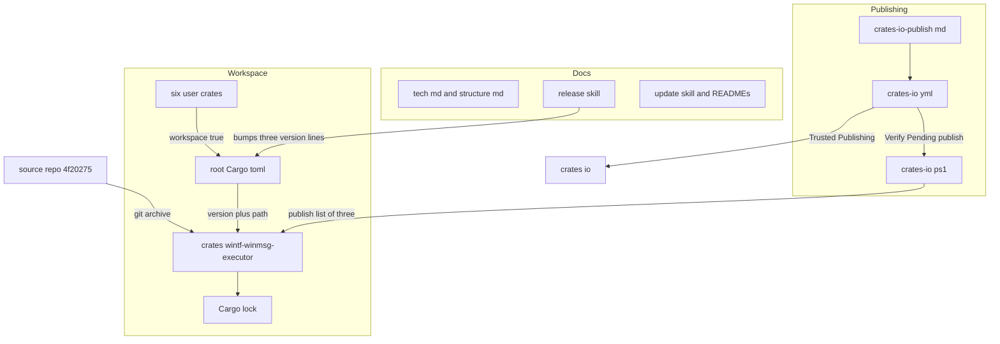
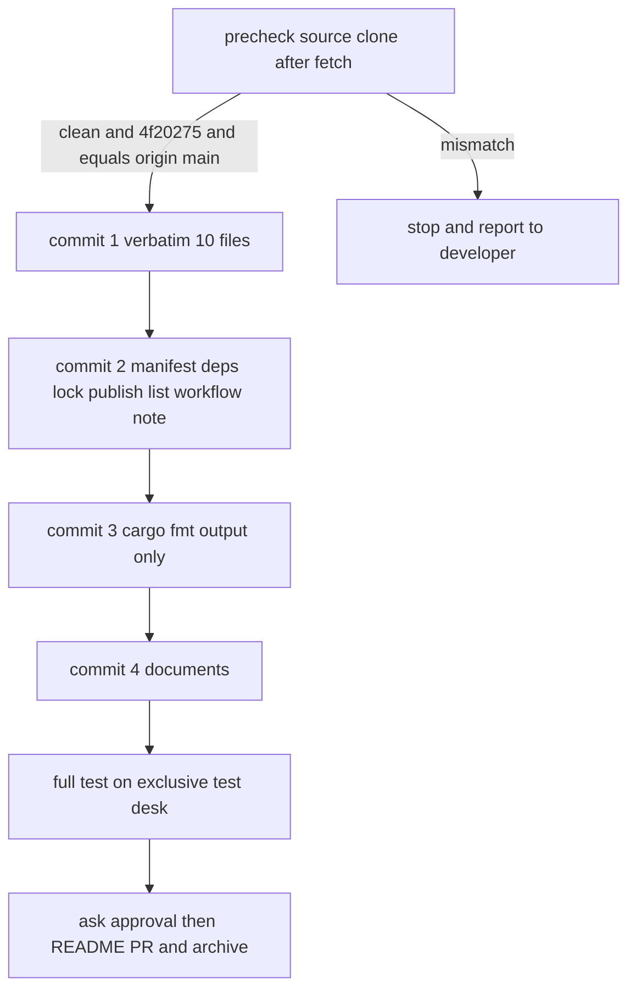
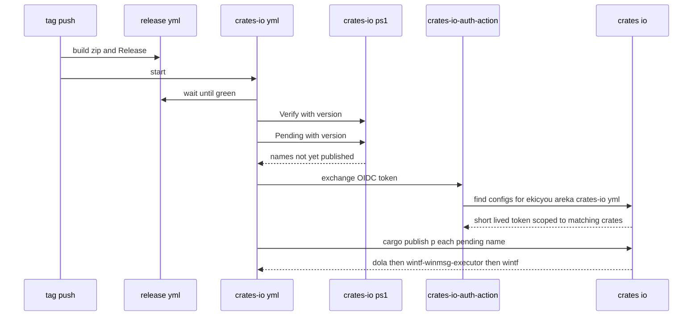

# 設計: wintf-winmsg-executor-import

## Overview

**Purpose**: 別リポジトリ `ekicyou/wintf-winmsg-executor` に在る開発者の持ち物のクレート `wintf-winmsg-executor` を、動きを変えずに areka のワークスペースの一員 `crates/wintf-winmsg-executor/` として写し、crates.io への公開を areka の公開の段（`.github/workflows/crates-io.yml`）へ引き継ぐ。着地すると、`wintf` とその土台を 1 つの PR で一緒に動かして確かめられる。

**Users**: 開発者（次のリリースで、手元から版を出さずに 3 つのクレートを出す）と、下流の windows-rs の移行の spec（先進坑 `pilot-windows-rs-next` と移行の本体）を回すセッション（木の中の写しを的にする）。

**Impact**: 今は根の `Cargo.toml` が crates.io の `wintf-winmsg-executor = "=0.0.5"` を固定し、`crates/pilot/Cargo.toml` が `"0.0.5"` を直書きしている。この spec の後は、6 つの使う側がすべて木の中の写しを使い、公開する一覧が `dola`・`wintf`・`wintf-winmsg-executor` の 3 つになり、版上げで動く根の `Cargo.toml` の行が 2 行から 3 行になる。

### Goals
- `4f202758ea4eaa25b68d7d88f52af529f96e75df`（以下 `4f20275`）の 10 個のファイルを、整形の差のほかは 1 字違わず `crates/wintf-winmsg-executor/` に置く。
- `Cargo.lock` から crates.io 由来の `wintf-winmsg-executor` が消え、外部のクレートの項は 1 つも動かない。
- 全体テスト（`tools/test-all.ps1 -Format -License`）が緑で、写しの単体テスト 15 本と doctest 1 本が全体テストの中で回る。
- `tools/crates-io.ps1` が 3 つの一覧で較正も実物の判定も緑になり、次のリリースで areka の CI が `wintf-winmsg-executor` をリリースの版で出せる。
- 手順書・steering・`/release`・古い記述が新しい形を説明する。

### Non-Goals
- クレートの動き・公開面の変更、`windows` 0.62 からの移行、edition の引き上げ、フォーク元への追随。
- crates.io の Trusted Publishing の設定そのもの（開発者の操作）と、この spec の間の crates.io への公開。
- `wintf`・`dola` の公開の仕組みの作り替え（道具の数を決め打ちしない形への一般化を含む）。
- 写したテストの直し（3 本が同じ題名を使う件を含む）。

## Boundary Commitments

### This Spec Owns
- `crates/wintf-winmsg-executor/` の中身（写した 10 個のファイル）と、その `Cargo.toml` の areka 向けの直し。
- 根の `Cargo.toml` の `[workspace.dependencies]` の `wintf-winmsg-executor` の 1 行・`crates/pilot/Cargo.toml` の依存の 1 行とその注記・`Cargo.lock` の `wintf-winmsg-executor` の項。
- `tools/crates-io.ps1` の較正値 `$PUBLISH` と、較正の正しい見本の JSON。
- `.github/workflows/crates-io.yml` の 1 行目の注記。
- 文書: `doc/crates-io-publish.md`・`.kiro/steering/tech.md`・`.kiro/steering/structure.md`・スキル `/release`（`SKILL.md`・`procedure.md`）・スキル `/update`（`SKILL.md`）・`README.md`・`doc/README.md` のうち、公開するクレートと写しの置き場を述べる行。
- 元のリポジトリの後始末（README の移転の案内・archive）を、開発者の許しの後に行うこと。
- 完了の報告での申し送り（Trusted Publishing の設定・後始末の済み／残り）。

### Out of Boundary
- 写しの `src`・`examples` の中身の変更（整形の段が動かす分を除く）と、`windows` 0.62 から `windows-bindgen` の束縛への移し（`pilot-windows-rs-next` とその後の移行の本体）。
- `wintf` の `runtime/` など使う側の作り。
- `tools/test-all.ps1`・`deny.toml`・`.github/workflows/release.yml` の変更（どれもクレートの名前の一覧を持たず、写しは自動で対象に入る）。`about.toml` は、検証で要件 3.9 が外れたときだけ触る（Implementation Notes の予備）。
- crates.io の Trusted Publishing の設定、crates.io への実際の公開、0.0.1〜0.0.5 の yank。
- v0.2.0 の公開の決め（`roadmap.md` 棚卸㊲の裁定 8・案 A／案 B）。案 B（移行のあいだ `wintf` を出さない）になったときに写しも一覧から外すかは、その決めを持つ下流の spec が決める。この spec は一覧を 3 つにする。
- `roadmap.md`・`roadmap-history.md`・`focus.md` の更新（`/kiro-complete` と `/kiro-next` の持ち場）。
- 完了 spec の記録・`crates/pilot/examples/` の中の報告書と例のコメントに残る「0.0.5」の記述（その時点の事実の記録として残す）。`crates/shiori-host32-helper/src/main.rs` の先頭の doc コメントの「0.0.5」も、確かめた版の記録として残す。

### Allowed Dependencies
- 写しの依存は `async-task = { version = "4.7.1", default-features = false }` と `windows = { version = "0.62", features = [4 つ] }` だけで、どちらも直書きのまま（ワークスペースの依存へ寄せない）。新しい外部クレートは足さない。
- 使う側 6 つ（`wintf`・`areka-actor`・`areka-emo-text`・`shiori-host32-host`・`shiori-host32-helper`・`pilot`）は、根の `[workspace.dependencies]` の行を `workspace = true` で使う。写しは areka のどのクレートにも依存しない（葉）。
- 道具の変更は、`tools/crates-io.ps1` の「較正値は冒頭の 1 か所」と「見本は道具の外の固定値」の決まりの内側に留める。
- 元のリポジトリへの書き込みは `gh` と一時の作業の写し（このワークツリーの `target\` の下）だけで行い、手元の写し `C:\home\maz\git\wintf-winmsg-executor` の作業木と `main` は動かさない（`git fetch` が追跡の枝を書くのは許す）。

### Revalidation Triggers
- `crates/wintf-winmsg-executor/` の置き場・クレートの名前・公開面が変わる → 下流の `pilot-windows-rs-next` と移行の本体が写しの取り方を見直す。
- 公開する一覧（`$PUBLISH`）の数が変わる → 較正の見本・手順書・`tech.md`・`/release` の行数・`crates-io.yml` の注記を合わせ直す。
- 根の `Cargo.toml` の版の置き場（今回 3 行）が増減する → `/release` の段 1.3・2.1・3.2・5.1・再開の表を直す（「見直すきっかけ」の覚え書き）。
- 写しの依存を `workspace = true` へ寄せる変更 → 公開する manifest の `windows` の機能が変わるので、要件 1.7 を読み直す。
- 写しの `LICENSE-MIT` の置き場・著作権の行が変わる → 謝辞（`THIRD-PARTY-NOTICES.md`）の塊を確かめ直す。

## Architecture

### Existing Architecture Analysis
- ワークスペースは `members = ["crates/*"]` で、`crates/` の下にフォルダを置けば一員になる。`dola` が「版＋path」の形（`dola = { version = "0.1.0", path = "crates/dola" }`）の先例で、`cargo set-version --workspace` はこの形の行の `version` も一緒に上げる（ギャップ分析の試し D）。
- 公開の仕組みは 3 層: 判定を集めた道具 `tools/crates-io.ps1`（較正 → 読み取り → 判定 → 包む）・全体テストの段（引数なし＝ネットを使わず包む）・公開の段 `crates-io.yml`（`-Verify` → `-Pending` → 鍵 → `cargo publish --locked --no-verify -p …`）。公開の順は cargo が決め、道具も公開の段も `-p` を並べるだけである。
- cargo 1.100 は、一緒に包むワークスペースのクレートを一時の置き場（`target\…\package\tmp-registry`）から引くので、crates.io にまだ無い版の写しでも、一覧に入っていれば `wintf` を包める。一覧から外すと、ネットを使わない形は `no matching package named ...` で落ちる。このため、依存の置き換え（要件 3.x）と一覧の 3 つ化（要件 4.1）は同じコミットに入れる。
- `/release` の `Cargo.lock` と謝辞の判定は数を決め打ちにせず `cargo metadata` の `packages` の数 `N` を使うので、写しが一員になれば自動で合う。決め打ちなのは根の `Cargo.toml` の版の行数（2 行）だけである。

### Architecture Pattern & Boundary Map

既に在る `dola` の型をなぞり、決め打ちの数を 2 から 3 へ直す（ギャップ分析の案 A）。数を決め打ちしない形への一般化（案 B）は取らない（較正の見本は道具の外の固定値である方が誤りを見逃さず、`/release` の判定の強さも保てる）。



- 依存の向き: 元のリポジトリ（読むだけ）→ 写し → 根の `Cargo.toml` → 使う側 6 つ。道具と公開の段は写しを読むだけで、写しは道具を知らない。文書は実物を説明するだけで、実物は文書に依存しない。
- 新しい部品は写しのクレート 1 つだけで、道具・公開の段・文書には新しい部品を足さない。
- steering の決まり（出さないクレートは `publish = false # 理由`・全体テストはネットを使わない・Trusted Publishing だけで認証）はそのまま保つ。

### Technology Stack

| Layer | Choice / Version | Role in Feature | Notes |
|-------|------------------|-----------------|-------|
| ビルド | cargo 1.100（stable）・resolver 2 | ワークスペースの一員として組む・包む・`--dry-run` で組み立てる | 一緒に包む兄弟を一時の置き場から引く挙動に頼る |
| 写しのクレート | edition 2021・`async-task` 4.7.1（既定の機能なし）・`windows` 0.62（機能 4 つ） | `wintf` の土台（メッセージループ・窓の生成・UI スレッドの async） | ワークスペースの edition 2024 を受け継がない。`Cargo.lock` の `windows`・`windows-core` は 0.62.2 の 1 版のまま |
| 道具 | PowerShell 7（`tools/crates-io.ps1`） | 公開前の確認（一覧・欄・理由・版・形・大きさ）と `-Pending` | 較正値と見本の 2 か所だけを直す |
| CI | GitHub Actions `crates-io.yml`・`rust-lang/crates-io-auth-action@v1` | タグ `v{版}` の push で release の緑を待ってから出す | 注記の 1 行だけを直す。認証は Trusted Publishing だけ |
| ライセンス | cargo-deny・cargo-about 0.9.2 | 全体テスト `-License` の段 | `MIT OR Apache-2.0` は両方受理済み。設定は変えない |
| 元のリポジトリの操作 | `git`・`gh`（`gh pr create`・`gh pr merge --squash`・`gh repo archive`） | README の移転の案内と archive | 開発者の許しの後だけ |

## File Structure Plan

### Directory Structure
```
crates/wintf-winmsg-executor/          # 新設。4f20275 の写し（整形の差のほかは 1 字違わず）
├── Cargo.toml                         # 写した後に areka 向けに直す（下の「写しの manifest の形」）
├── README.md                          # 写しのまま（フォークの告知・使い方）
├── LICENSE-MIT                        # 写しのまま（Timo Kröger と寄稿者・ekicyou と寄稿者の著作権の行）
├── LICENSE-APACHE                     # 写しのまま
├── src/
│   ├── lib.rs                         # MessageLoop・block_on・spawn_local と単体テスト 13 本・doctest 1 本
│   └── util/
│       ├── mod.rs
│       ├── msg_filter_hook.rs
│       └── window.rs                  # Window<S>（new_ex 等）と単体テスト 2 本
└── examples/
    ├── basic.rs
    └── threads.rs
```

### Modified Files
- `Cargo.toml`（根）— `[workspace.dependencies]` の 27 行目を `wintf-winmsg-executor = { version = "0.1.0", path = "crates/wintf-winmsg-executor" }` に替える（行の位置は動かさない。`version` はその時点のワークスペースの版）。
- `crates/pilot/Cargo.toml` — `wintf-winmsg-executor = "0.0.5"` を `wintf-winmsg-executor = { workspace = true }` に替え、その上の 0.0.5 を固定する旨の注記 2 行を「木の中の写しをワークスペースの依存で使う」旨に書き換える。
- `Cargo.lock` — `wintf-winmsg-executor` の項だけが、`version` がワークスペースの版になり `source`・`checksum` の行が消える形に変わる（cargo が書く）。
- `tools/crates-io.ps1` — 較正値 `$PUBLISH = @('dola', 'wintf', 'wintf-winmsg-executor')`。較正の正しい見本 JSON `$good` の `wintf` の項の次に `{"name":"wintf-winmsg-executor","version":"0.0.1","publish":null,"description":"d","license":"MIT OR Apache-2.0","repository":"r"}` を足す。冒頭の説明の文はクレートの名前を挙げていないので直さない。判定の関数・誤った見本・大きさの較正・包む段は変えない。
- `.github/workflows/crates-io.yml` — 1 行目の注記を「その版の wintf・dola・wintf-winmsg-executor を」に替える。きっかけ・権限・段は変えない。
- `doc/crates-io-publish.md` — 1〜6 節の 2 クレートの記述を 3 クレートへ（Components の「手順書」）。
- `.kiro/steering/tech.md` — Key Libraries 27 行目・「crates.io への公開」の節（135・140 行目）・154 行目の「UI スレッド基盤の外部クレ化」の文。
- `.kiro/steering/structure.md` — 新しい節「UI Thread Foundation Crate（wintf-winmsg-executor）」・「その他の最上位」の `workflows/crates-io.yml` の説明・「UI スレッド基盤 / Message Handling」の節の「外部クレ化完了」の語。
- `.claude/skills/release/SKILL.md` — 20 行目「root `Cargo.toml` (2 lines)」を 3 lines に。
- `.claude/skills/release/procedure.md` — 段 1.3・2.1・3.2・5.1・再開の表・「見直すきっかけ」の行数を 3 行に（Components の「`/release` の手順」）。
- `.claude/skills/update/SKILL.md` — 18・32・49・102 行目の、自分のクレート・版の表記・`=` の行・crates.io に出しているクレートの記述。
- `README.md` — 60 行目「crates.io に版を出しているのは、汎用のライブラリ `wintf`・`dola` だけ」を 3 つに（`wintf-winmsg-executor` は `wintf` の土台として出す旨）。
- `doc/README.md` — 34 行目の `crates-io-publish.md` の説明「`wintf`・`dola` を crates.io へ出す手順書」を 3 つに。
- `THIRD-PARTY-NOTICES.md` — 全体テスト `-License` の `cargo about generate` が作り直す（手で書かない）。差は `- wintf-winmsg-executor 0.0.5` の行の版だけの見込み。
- `about.toml` — **条件付き**。検証で `wintf-winmsg-executor` の塊から著作権の行が消えたときだけ、cargo-about の `clarify` で `LICENSE-MIT` を名指しする（要件 3.9 の予備）。

### areka の木のファイルを持たない部品
- 元のリポジトリの後始末 — 書く先は areka の外（`ekicyou/wintf-winmsg-executor` の既定の枝の `README.md` とリポジトリの設定）。作業の写しはこのワークツリーの `target\wintf-winmsg-executor-readme\` に一時に置き、git には入れない。
- 完了の報告 — `/kiro-complete` の最後の報告の文（チャット）。ファイルは書かない。

## System Flows

### 取り込みのコミットの切り方



- **前の確かめ**（要件 1.5）: 手元の写しで `git fetch origin` の後、`git status --porcelain` が 0 行・`git rev-parse main` が `4f202758ea4eaa25b68d7d88f52af529f96e75df`・`git rev-parse main` と `git rev-parse origin/main` が同じ、の 3 つを見る。1 つでも外れたら何も写さずに止まり、食い違いの中身を開発者へ報告する。作業木と `main` は動かさない。
- **コミット 1**（要件 1.1・1.2・1.4）: `git -C <手元の写し> archive 4f20275 src examples README.md LICENSE-MIT LICENSE-APACHE Cargo.toml` を `crates/wintf-winmsg-executor/` へ展開し、10 個だけを入れる。本文に `ekicyou/wintf-winmsg-executor` と `4f202758ea4eaa25b68d7d88f52af529f96e75df` を書く。このコミットの時点ではワークスペースが解決できなくてよい（確かめの地点ではない）。
- **コミット 2**（要件 2.x・3.1〜3.6・4.1・4.4・4.6）: 写しの manifest・根の 1 行・pilot の 1 行と注記・`Cargo.lock`・`$PUBLISH` と見本・公開の段の注記を 1 つのコミットにする（分けると間のコミットで全体テストの包む段が赤になる）。
- **コミット 3**（要件 1.3）: `cargo fmt --all` の出力だけ（`src/lib.rs` 7 か所・`src/util/window.rs` 1 か所の見込み）。ほかのクレートのファイルは動かない。
- **コミット 4**（要件 5.x）: 文書。コミット 2・3 と前後してもよい。
- PR は squash マージで 1 つになるが、PR の中ではコミットごとに確かめが読める。

### 次のリリースでの公開（要件 4.9・5.3）



- cargo の複数クレートの公開は、依存の無いクレートを先に、同じ段の中では名前の順（`dola` → `wintf-winmsg-executor`）に 1 つずつ上げ、`wintf` は両方が索引に載るのを待ってから上げる。
- 短命の鍵は、Trusted Publishing の設定がリポジトリ・ワークフローのファイル名・environment に合うクレートだけに効く（有効は 30 分）。合う設定が 1 つも無いと、段「鍵」で止まり何も上がらない。
- **`wintf-winmsg-executor` だけ設定が無いとき**: 鍵は `dola`・`wintf` に効く形で出る。cargo は `dola` を上げた後、`wintf-winmsg-executor` を crates.io に断られて止まり、`wintf` は「まだ出ていない」と示される。結果は「`dola` だけ上がった」状態。`dola` が既に出ている回のやり直しなら、何も上がらずに止まる。どちらも、設定を済ませてから同じ版で起動し直せば、段「残りの判定」が残りの 2 つだけを出す。

## Requirements Traceability

| Requirement | Summary | Components | Interfaces | Flows |
|-------------|---------|------------|------------|-------|
| 1.1 | 10 個を同じ相対パスで置く | 写しのクレート | `git archive` の指名 | コミット 1 |
| 1.2 | 写さない物 | 写しのクレート | `git archive` が指名しない | コミット 1 |
| 1.3 | 整形の差のほかは 1 字違わず | 写しのクレート | blob の番号の突き合わせ・整形だけのコミット | コミット 1・3 |
| 1.4 | コミットの本文に元とコミット番号 | 写しのクレート | コミット 1 の本文 | コミット 1 |
| 1.5 | 汚れ・先頭・食い違いで止まる | 写しのクレート | 前の確かめの 3 条件 | 前の確かめ |
| 1.6 | 公開面と動きが 0.0.5 と同じ | 写しのクレート | `src` を変えない | コミット 1・3 |
| 1.7 | edition・依存を保つ | 写しの manifest | 依存の直書き | コミット 2 |
| 2.1 | ワークスペースの版 | 写しの manifest | `version.workspace = true` | コミット 2 |
| 2.2 | license を自分で持つ | 写しの manifest | `license = "MIT OR Apache-2.0"` | コミット 2 |
| 2.3 | repository は areka | 写しの manifest | `repository.workspace = true` | コミット 2 |
| 2.4 | 説明の欄・include・docs.rs を保つ | 写しの manifest | 元の行のまま | コミット 2 |
| 2.5 | 道具の 4 判定を通る | 写しの manifest・公開前の確認の道具 | `publish = true`・`$PUBLISH` | コミット 2 |
| 2.6 | ライセンスの段を落とさない | 写しの manifest | deny・about の受理 | 全体テスト |
| 3.1 | 一員として組む | ワークスペースの組み込み | `members = ["crates/*"]` | コミット 2 |
| 3.2 | 6 つが写しを使う | ワークスペースの組み込み | `workspace = true` | コミット 2 |
| 3.3 | 版＋木の中の置き場の行 | ワークスペースの組み込み | 根の 27 行目 | コミット 2 |
| 3.4 | pilot の直書きをやめる | ワークスペースの組み込み | pilot の依存の行 | コミット 2 |
| 3.5 | crates.io 由来の項を持たない | ワークスペースの組み込み | `Cargo.lock` | コミット 2 |
| 3.6 | 外部の項を増やさず版も変えない | ワークスペースの組み込み | `Cargo.lock` の差分 | コミット 2 |
| 3.7 | i686 の補助 exe を組む | ワークスペースの組み込み | 全体テストの段 `build i686 artifacts` | 全体テスト |
| 3.8 | 全体テストが緑・写しのテストを外さず排他テストの机で | ワークスペースの組み込み | `cargo test --workspace` | 全体テスト |
| 3.9 | 謝辞に著作権の表示を残す | 写しのクレート・謝辞 | `LICENSE-MIT` を cargo-about が読む | 全体テスト `-License` |
| 4.1 | 一覧を 3 つ | 公開前の確認の道具 | `$PUBLISH` | コミット 2 |
| 4.2 | 写しの版も確かめる | 公開前の確認の道具 | `Test-Version`（変えない） | 公開の段 |
| 4.3 | `-Pending` で写しの名前を出す | 公開前の確認の道具 | `-Pending`（変えない） | 公開の段 |
| 4.4 | 較正を緑に・赤にできる力を保つ | 公開前の確認の道具 | 正しい見本に 1 項 | コミット 2 |
| 4.5 | 順は cargo に決めさせる | 公開前の確認の道具・公開の段 | `-p` を並べるだけ | 公開の段 |
| 4.6 | 注記で 3 つ・認証は Trusted Publishing だけ | 公開の段 | 1 行目の注記 | コミット 2 |
| 4.7 | この spec の間に出さない | 公開前の確認の道具 | `-Verify`（`--dry-run`）まで | 検証 |
| 4.8 | 取り下げない | 完了の報告 | yank の操作をしない | — |
| 4.9 | 次のリリースで CI が 3 つを出す | 公開の段・公開前の確認の道具 | タグの push → `-Verify` → `-Pending` → 公開 | 次のリリースでの公開 |
| 5.1 | 手順書: 3 つ・出す順・予備の手順の対象 | 手順書 | 1・3・4・6 節 | コミット 4 |
| 5.2 | 手順書: 写しの Trusted Publishing の設定と時期 | 手順書 | 2 節 | コミット 4 |
| 5.3 | 手順書: 設定が無いときに起きることとやり直し | 手順書 | 5 節 | 次のリリースでの公開 |
| 5.4 | 手順書: 0.0.5 から版が飛ぶ | 手順書 | 1 節 | コミット 4 |
| 5.5 | tech.md | steering の登記 | 27・135・140 行目 | コミット 4 |
| 5.6 | structure.md の登記 | steering の登記 | 新しい節 | コミット 4 |
| 5.7 | `/release` の行数 | `/release` の手順 | 段 1.3・2.1・3.2・5.1・再開の表・見直すきっかけ | コミット 4 |
| 5.8 | 版上げの後に 3 行を確かめて止まる | `/release` の手順 | 段 2.1 の判定・3.2 の表 | コミット 4 |
| 5.9 | 日本語・project の語 | すべての文書 | — | コミット 4 |
| 5.10 | 古い記述 4 か所 | 古い記述の書き換え | `/update`・structure.md・tech.md 154 行目・pilot の注記 | コミット 2・4 |
| 6.1 | 書く前に許しを得る | 元のリポジトリの後始末 | チャットで文と操作を示す | 後始末 |
| 6.2 | 許しが無ければ書かない | 元のリポジトリの後始末・完了の報告 | 残りとして報告 | 後始末 |
| 6.3 | README の先頭に移転先 | 元のリポジトリの後始末 | README の PR | 後始末 |
| 6.4 | README が入った後に archive | 元のリポジトリの後始末 | `gh repo archive` | 後始末 |
| 6.5 | 履歴とタグを消さない | 元のリポジトリの後始末 | 消す操作をしない | 後始末 |
| 7.1 | Trusted Publishing の申し送り | 完了の報告 | 報告の文 | — |
| 7.2 | 後始末の済み／残り | 完了の報告 | 報告の文 | — |

## Components and Interfaces

| Component | Domain/Layer | Intent | Req Coverage | Key Dependencies (P0/P1) | Contracts |
|-----------|--------------|--------|--------------|--------------------------|-----------|
| 写しのクレート | ワークスペース | 4f20275 の写しと areka 向けの manifest | 1.1〜1.7, 2.1〜2.6, 3.9 | 元のリポジトリ（P0）・cargo-about（P1） | State |
| ワークスペースの組み込み | ワークスペース | 使う側 6 つを写しへ向ける | 3.1〜3.8, 5.10 | 写しのクレート（P0） | State |
| 公開前の確認の道具 | 公開 | 一覧を 3 つにし較正を保つ | 2.5, 4.1〜4.5, 4.7 | 写しのクレート（P0） | Service |
| 公開の段 | 公開 | 注記を 3 つに・次のリリースで出す | 4.6, 4.9 | 公開前の確認の道具（P0）・Trusted Publishing（P0・開発者の操作） | Batch |
| 手順書 | 文書 | 3 つを出す手順と止まり方 | 5.1〜5.4, 5.9 | 公開の段（P1） | — |
| steering の登記 | 文書 | tech.md・structure.md | 5.5, 5.6, 5.9, 5.10 | — | — |
| `/release` の手順 | 文書 | 版上げの行を 3 行に | 5.7, 5.8 | ワークスペースの組み込み（P0） | — |
| 古い記述の書き換え | 文書 | `/update`・README・pilot の注記 | 5.10 | — | — |
| 元のリポジトリの後始末 | 外の操作 | 移転の案内と archive | 6.1〜6.5 | 開発者の許し（P0） | Batch |
| 完了の報告 | 報告 | 開発者の手に残る操作を伝える | 4.8, 6.2, 7.1, 7.2 | — | — |

### ワークスペース

#### 写しのクレート

| Field | Detail |
|-------|--------|
| Intent | `4f20275` の 10 個を写し、manifest だけを areka の決まりに合わせる |
| Requirements | 1.1, 1.2, 1.3, 1.4, 1.5, 1.6, 1.7, 2.1, 2.2, 2.3, 2.4, 2.5, 2.6, 3.9 |

**Responsibilities & Constraints**
- `src`・`examples`・`README.md`・`LICENSE-MIT`・`LICENSE-APACHE` は、コミット 3 の整形のほかは `4f20275` の blob と同じ。areka の作業木は `core.autocrlf=true` で索引は LF、元のリポジトリの索引も LF で、どちらも `.gitattributes` を持たないので、blob の番号で突き合わせられる。
- 写さない物（`.claude`・`.kiro`・`CLAUDE.md`・`.gitignore`）は `git archive` に指名しないことで入らない。`Cargo.lock` は元の木に無い。
- 公開面（型・関数・欄・モジュールの並び）は `src` を変えないことで保つ。

**Contracts**: State [x]

##### State Management（写しの manifest の形）

```toml
[package]
name = "wintf-winmsg-executor"
workspace = "../.."
description = "Per-thread async executor for Windows (fork of winmsg-executor)"
repository.workspace = true
version.workspace = true
edition = "2021"
license = "MIT OR Apache-2.0"
publish = true
readme = "README.md"
keywords = ["windows", "async", "executor", "winapi", "message-loop"]
categories = ["asynchronous", "os::windows-apis"]
include = [ ...元のまま 5 つ... ]

[dependencies]
async-task = { version = "4.7.1", default-features = false }
windows = { version = "0.62", features = [ ...元のまま 4 つ... ] }

[package.metadata.docs.rs]
...元のまま...
```

- 元の manifest から変えるのは 4 点だけ: `workspace = "../.."` を足す・`repository` を `repository.workspace = true`（`https://github.com/ekicyou/areka`）に・`version` を `version.workspace = true` に・`publish = true` を足す（`dola` に倣い、出すクレートであることを目に見える形にする）。
- `authors` は足さない（元に無く、足すと crates.io に出る説明が変わる）。`license` は受け継がない（ワークスペースは `MIT` だけ）。`edition` は 2021 のまま。
- 依存はワークスペースの依存へ寄せない。`windows = { workspace = true }` にすると、ワークスペースの 27 の機能が公開する manifest に乗り、要件 1.7 の 4 つと食い違う。ワークスペースの中では機能が合わさるので、組み立ては 4 つで足りる（単独で組めることはギャップ分析で確かめ済み）。`Cargo.lock` の `windows` は 0.62.2 の 1 版のままで、`windows` と `windows-core` の版の系列は揃ったまま。
- `publish = true` は `[package]` の途中に置く。`license` を受け継がないので cargo-about 0.9.2 の差し込みの件には当たらないが、`dola` と同じ並びにそろえる。

**Implementation Notes**
- Validation: コミット 1 の後に、`git ls-tree -r HEAD crates/wintf-winmsg-executor` と `git -C <手元の写し> ls-tree -r 4f20275` の blob の番号を 10 個（`Cargo.toml` を含む）で突き合わせる。コミット 3 の後に、`cargo fmt --all -- --check` が緑で、コミット 3 の差分が写しの `src` の下だけであることを見る。
- Validation（要件 3.9）: 全体テスト `-License` の後、`git diff -- THIRD-PARTY-NOTICES.md` が `- wintf-winmsg-executor 0.0.5` の行の版の差だけで、`Copyright (c) Timo Kröger and winmsg-executor contributors` と `Copyright (c) ekicyou and wintf-winmsg-executor contributors` の 2 行が同じ塊に残ること。cargo-about はクレートのフォルダのライセンスのファイルを出どころに依らず読むので残る見込み。
- Risks: 謝辞の塊が著作権の行の無い MIT の本文の塊へまとまったら、`about.toml` に `wintf-winmsg-executor` の `clarify`（`LICENSE-MIT` を名指し）を足して作り直す。

#### ワークスペースの組み込み

| Field | Detail |
|-------|--------|
| Intent | 根の 1 行・pilot の 1 行・`Cargo.lock` で、使う側 6 つを写しへ向ける |
| Requirements | 3.1, 3.2, 3.3, 3.4, 3.5, 3.6, 3.7, 3.8, 5.10 |

**Responsibilities & Constraints**
- 根の `Cargo.toml` の 27 行目を `{ version = "{ワークスペースの版}", path = "crates/wintf-winmsg-executor" }` に替える。`=` の固定はやめる（path の依存なので版は 1 つしか無い）。行の位置は動かさない。
- `crates/pilot/Cargo.toml` は `wintf-winmsg-executor = { workspace = true }`。注記 2 行（「0.0.5: クラス登録に CS_DBLCLKS…」「本坑 wintf 置換ではこの版を pin し…」）を、木の中の写しをワークスペースの依存で使う旨の 1〜2 行に書き換える（要件 5.10 の 4 か所の 1 つ）。
- `Cargo.lock` は `cargo update -w`（ワークスペースのクレートだけを解き直す）で揃える。外部のクレートの項は動かさない。

**Contracts**: State [x]

##### State Management
- 前: `Cargo.lock` に `name = "wintf-winmsg-executor"`・`version = "0.0.5"`・`source = "registry+…"`・`checksum = …` の項。
- 後: 同じ位置に `version = "{ワークスペースの版}"` だけの項（`source`・`checksum` の行が無い）。依存の名で引く 6 つの行は名前だけなので変わらない。

**Implementation Notes**
- Validation: `git diff -- Cargo.lock` が `wintf-winmsg-executor` の項の中だけ（`version` の 1 行の差と `source`・`checksum` の 2 行の消し）であること。`Cargo.lock` の `name = "windows"`・`name = "windows-core"`・`name = "async-task"` がそれぞれ 1 項であること。
- Validation（要件 3.8）: 全体テスト `tools/test-all.ps1 -Format -License` は排他テストの机を取ってから回す（`doc/impl-watch.md` の判定の基準の 1 行目）。写しの単体テストだけを回す確かめ（`cargo test -p wintf-winmsg-executor`）も、本物の MessageBox を画面に出すので UI テストとして同じ机を取る。全体テストの出力に写しの 15 本と doctest 1 本が緑で出ることを見る。並走で揺れが出たら、題名の取り違え（3 本が同じ題名 `reenter_filter_closure` を使う件）を `/kiro-discovery` で起票する。
- Risks: 同じ題名の 3 本は `FindWindowW` で窓を探さない（入れ子のメッセージループの終わりで MessageBox が閉じる）。`FindWindowW` で探す 2 本の題名は一意で、排他テストの机のもとでは別のワークツリーの全体テストとも重ならない。揺れの見込みは低い。

### 公開

#### 公開前の確認の道具（`tools/crates-io.ps1`）

| Field | Detail |
|-------|--------|
| Intent | 公開する一覧を 3 つにし、較正と実物の判定を緑のまま保つ |
| Requirements | 2.5, 4.1, 4.2, 4.3, 4.4, 4.5, 4.7 |

**Responsibilities & Constraints**
- 直すのは較正値 `$PUBLISH` と、較正の正しい見本 JSON `$good` に足す 1 項だけ。判定の関数（`Test-List`・`Test-Fields`・`Test-Reason`・`Test-Version`・`Test-Size`・`Test-Index`・`Test-Indexed`・`Test-Workflow`）と包む段は変えない。
- 誤った見本は足さない。「一覧から外れたクレート」を赤にする力は、今の `wintf does not publish` の見本が既に示している（正規表現 `("wintf","version":"0.0.1","publish"):null` は `"wintf"` の閉じの引用符まで含むので、足した `wintf-winmsg-executor` の項には当たらない）。「出せないクレート」「版の違い」「大きさの超過」の見本も今のまま通る。
- 公開の順は手で並べない（`$pArgs = $PUBLISH | ForEach-Object { '-p', $_ }` のまま）。

**Contracts**: Service [x]

##### Service Interface
- 呼び方と終了コードは変えない: 引数なし（ネットを使わず包む）・`-Verify`（`cargo publish --dry-run`）・`-Version {版}`・`-Pending`。終了コード 0 は緑、1 は失敗（判定の名前とクレートの名前を 1 行で示す）。
- 事後条件: 引数なしで `green (publish list: dola, wintf, wintf-winmsg-executor)`。`-Version` が違えば `check 'version'` の失敗の文に 3 つのクレートの名前と版が出る。`-Pending -Version {版}` は、その版が crates.io に無いクレートの名前だけを標準出力に出す。写しは crates.io に 0.0.1〜0.0.5 を持つので索引は 200 を返し、404 の枝（予備の手順の「最初の版」）には入らない。

**Implementation Notes**
- Validation: 引数なしで緑（較正の全部と実物の判定）。`-Version 9.9.9` で `wintf-winmsg-executor` の名前を含む失敗（終了コード 1）。`-Pending -Version {ワークスペースの版}` で `absent wintf-winmsg-executor {版}` が標準エラーに、名前が標準出力に出て終了コード 0。`-Verify -Version {ワークスペースの版}` で 3 つとも `aborting upload due to dry run` で止まり緑。`-Pending`・`-Verify` は crates.io の索引を読むので全体テストには入れず、確かめとして 1 回ずつ手で回す（要件 4.7・4.9 の後半）。
- Risks: 無し（ギャップ分析の試し A・C で、未公開の兄弟を一時の置き場から引けることを確かめ済み）。

#### 公開の段（`.github/workflows/crates-io.yml`）

| Field | Detail |
|-------|--------|
| Intent | 注記を 3 つに直し、次のリリースで 3 つを出す |
| Requirements | 4.6, 4.9 |

**Contracts**: Batch [x]

##### Batch / Job Contract
- Trigger: タグ `v{版}` の push（同じタグの `release.yml` の緑を最長 120 分待つ）と `workflow_dispatch`（入力 `version`）。変えない。
- Input / validation: `-Verify -Version {版}` → `-Pending -Version {版}`。3 つのどれかの版がリリースの版と違えば何も上げずに止まる（要件 4.2）。
- Output / destination: `-Pending` の名前だけを `cargo publish --locked --no-verify -p …` で crates.io へ。認証は `rust-lang/crates-io-auth-action@v1` の短命の鍵だけ（`secrets.` を参照しない形は `Test-Workflow` が判定し続ける）。
- Idempotency & recovery: 同じ版で何度起動し直してもよい（既に出たクレートは `-Pending` が飛ばす）。写しの Trusted Publishing が無いまま回ったときの止まり方は System Flows のとおりで、設定の後に Re-run か Run workflow で残りが出る。

**Implementation Notes**
- Integration: 直すのは 1 行目の注記だけ。前提は、開発者が `wintf-winmsg-executor` の crates.io の Settings に Trusted Publishing（`ekicyou`／`areka`／`crates-io.yml`／environment は空）を足すこと（取り込みが本線に入った後の最初のリリースのタグより前）。
- Validation: `Test-Workflow` が緑のまま（注記は判定に響かない）。`tools/encoding-check.ps1` が緑のまま（文字コードを変えない）。
- Risks: 設定の済む前にタグが打たれると、`dola` だけ上がった状態になりうる。手順書 2・5 節と完了の報告（要件 7.1）で手当てする。

### 文書

#### 手順書（`doc/crates-io-publish.md`）

| Field | Detail |
|-------|--------|
| Intent | 3 つを出す手順・写しの Trusted Publishing・止まり方とやり直しを示す |
| Requirements | 5.1, 5.2, 5.3, 5.4, 5.9 |

**Responsibilities & Constraints**
- 冒頭と 1 節: 出すのは `wintf`・`dola`・`wintf-winmsg-executor` の 3 つ。`wintf-winmsg-executor` は `wintf` の土台（areka の木の `crates/wintf-winmsg-executor/`・元は別リポジトリ）。出す順は `dola` と `wintf-winmsg-executor` の後に `wintf`（順は cargo が決める・手で並べない）。crates.io の `wintf-winmsg-executor` の版は、取り込みの後の最初のリリースで 0.0.5 からリリースの版へ飛ぶ（要件 5.4）。
- 2 節: 設定の対象を 3 つにする。`wintf-winmsg-executor` の設定は、取り込みが本線に入った後の最初のリリースのタグより前に済ませる（設定は今すぐでもできる。crates.io に既に版が在るので、最初の版を手元から出す手順は要らない）。「初回のリリースのタグ `v0.0.2` より前に」の文は、済んだ話として書き直す。
- 3 節の段の表「記録」と 4 節: 「2 クレート」を 3 クレートに（`present wintf-winmsg-executor {版}` を含む）。
- 5 節: 止まり方の 1 項を足す——「`wintf-winmsg-executor` の Trusted Publishing が無いまま回った」: 段「鍵」は通り、段「公開」で `dola` を上げた後に `wintf-winmsg-executor` が断られて止まりうる（`dola` だけ上がった状態・やり直しの回なら何も上がらない）。設定を足してから、その回を Re-run するか Run workflow で同じ版を渡す（既に出た物は飛ばす）。
- 6 節の予備の手順: 例を `cargo publish --locked -p dola -p wintf -p wintf-winmsg-executor` に。鍵の対象のクレートの例と、7 手順目の「2 クレートとも」を 3 つに。

#### steering の登記

| Field | Detail |
|-------|--------|
| Intent | `tech.md`・`structure.md` に新しい形を登記する |
| Requirements | 5.5, 5.6, 5.9, 5.10 |

**Responsibilities & Constraints**
- `tech.md` 27 行目（Key Libraries）: 「(=0.0.5)…完全 pin」を、木の中の `crates/wintf-winmsg-executor/`（ワークスペースの版・`dola` と同じ「版＋path」の依存・`MIT OR Apache-2.0`・crates.io へ出す・`windows` 0.62 の 4 つの機能を直書き）に書き直す。共有の窓のクラスの `CS_DBLCLKS`＋既定のカーソルの記述は残す。
- `tech.md`「crates.io への公開」: 「今は `wintf`・`dola`」を 3 つに。版上げで動かす根の `Cargo.toml` の行を 3 行（`[workspace.package]` の `version`・`[workspace.dependencies]` の `dola` と `wintf-winmsg-executor` の `version`）に。
- `tech.md` 154 行目: 「外部クレ化」の文を、置き場が木の中に移った（`wintf-winmsg-executor-import`）ことが分かる形に直す。写像（`MessageLoop`/`block_on`/`spawn_local`/`util::Window<S>`）の記述は残す。
- `structure.md`: 新しい節「UI Thread Foundation Crate（wintf-winmsg-executor）」を「Animation Definition Crate」の前後に足す（**Location** `/crates/wintf-winmsg-executor/`・**Purpose** `wintf` の土台＝メッセージループ・窓の生成・UI スレッドの async・**公開** crates.io へ出す・**ライセンス** `MIT OR Apache-2.0`（ワークスペースの `MIT` を受け継がない）・**edition** 2021・**由来** `ekicyou/wintf-winmsg-executor` の `4f20275` の写し）。「その他の最上位」の `workflows/crates-io.yml` の説明を 3 つに。「UI スレッド基盤 / Message Handling」の「外部クレ化完了」の語を直す。

#### `/release` の手順

| Field | Detail |
|-------|--------|
| Intent | 版上げで動かす根の `Cargo.toml` の行を 3 行に合わせる |
| Requirements | 5.7, 5.8 |

**Responsibilities & Constraints**
- `SKILL.md` 20 行目: `root Cargo.toml (3 lines)`。
- `procedure.md` 段 1.3: 3 行（`[workspace.package]` の `version`・`dola` の `version`・`wintf-winmsg-executor` の `version`）を読み、同じ値なら `{旧版}`。判定「3 行の版が一致し」。
- 段 2.1: いつものやり方（`cargo set-version --workspace`）は 3 行を動かす。代わりのやり方の条件を「`dola` の行か `wintf-winmsg-executor` の行が動かなかったとき」にし、3 行を Edit で直す。判定「根の `Cargo.toml` の 3 行がどれも `{版}` を読む。読まなければ止まる」（要件 5.8）。
- 段 3.2 の表の `Cargo.toml` の行: 「足した行 3・消した行 3。`[workspace.package]` の `version` の行と `wintf-winmsg-executor` の行と `dola` の行で、どれも `{旧版}` が `{版}` になっただけ」。`Cargo.lock` と謝辞の行は `N` を使う形のままで、写しの項（謝辞の `- wintf-winmsg-executor {版}`）も当てはまるので直さない。
- 段 5.1: 「`git show {sha}:Cargo.toml` の 3 行の版」。
- 再開の表: 「根の `Cargo.toml` の 3 行が同じ版」。
- 「見直すきっかけ」: 「今は根の `Cargo.toml` の 3 行だけ。4 行目が増えたら段 1.3・2.1・3.2・5.1 と再開の表を直す」。

#### 古い記述の書き換え

| Field | Detail |
|-------|--------|
| Intent | 同じ事実の古い記述を新しい形（木の中の写し・公開するクレートは 3 つ）にそろえる |
| Requirements | 5.10 |

**Responsibilities & Constraints**
- 要件 5.10 の 4 か所: `/update` の `SKILL.md`（18 行目の自分のクレートの例に `wintf-winmsg-executor` を足す・32 行目の版の表記に `wintf-winmsg-executor` の `version` を足す・49 行目の `=` の行の一覧から `wintf-winmsg-executor` を外す）・`structure.md` の `crates-io.yml` の説明・`tech.md` 154 行目・`crates/pilot/Cargo.toml` の注記。
- 同じ事実を述べる行として、設計で見つけた次の 3 か所も同じ PR で書き換える: `/update` の `SKILL.md` 102 行目（「`wintf` と `dola` は crates.io に出しており」を 3 つに）・`README.md` 60 行目・`doc/README.md` 34 行目。どれも 1 行の書き換えで、残すと次の `/update`・リリースの読み手が古い一覧を読む。
- 検証: `git grep -n -E '=0\.0\.5|"0\.0\.5"'` と、`wintf・dola`／`dola・wintf` の並びの grep が、完了 spec・`roadmap*.md`・`crates/pilot/examples/` の記録・`THIRD-PARTY-NOTICES.md` のほかで 0 件。

### 外の操作と報告

#### 元のリポジトリの後始末

| Field | Detail |
|-------|--------|
| Intent | 元のリポジトリを移転したと分かる状態にする |
| Requirements | 6.1, 6.2, 6.3, 6.4, 6.5 |

**Contracts**: Batch [x]

##### Batch / Job Contract
- Trigger: areka の側の変更が全体テストで緑になった後の最後のタスク。先に、README の先頭に足す文（日本語の文と英語の 1 文を並べる。移転先＝`https://github.com/ekicyou/areka` の `crates/wintf-winmsg-executor/`・以後の版は areka から出る）と、操作（README の PR → squash マージ → `gh repo archive ekicyou/wintf-winmsg-executor`）をチャットで示して許しを得る。
- Input / validation: 許しが無ければ何も書かず、完了の報告に残りとして載せる（要件 6.2）。リンクはリポジトリの根と置き場のパスの文字で示し、取り込みが本線に入る前でも切れない形にする。
- Output / destination: 一時の作業の写しを `target\` の下へ `git clone` し、枝を切って README の先頭だけを直し、push → `gh pr create` → `gh pr merge --squash` → 既定の枝に入ったことを確かめてから `gh repo archive`。手元の写し `C:\home\maz\git\wintf-winmsg-executor` は使わない。
- Idempotency & recovery: 履歴・タグ（`v0.2.0`〜`v0.3.2`）・枝を消す操作は含めない（要件 6.5）。archive は持ち主が戻せるが、戻す操作はこの spec では行わない。README の PR が入る前には archive しない。

#### 完了の報告

| Field | Detail |
|-------|--------|
| Intent | 開発者の手でしかできない操作を確実に伝える |
| Requirements | 4.8, 6.2, 7.1, 7.2 |

**Responsibilities & Constraints**
- 7.1: crates.io の `wintf-winmsg-executor` の Trusted Publishing の設定が残っていること・値（`ekicyou`／`areka`／`crates-io.yml`／environment は空）・取り込みが本線に入った後の最初のリリースのタグより前に済ませる必要。
- 7.2: 後始末（README の移転の案内・archive）が済んだか残っているか。
- 4.8: crates.io の 0.0.1〜0.0.5 を yank していないこと（操作をしていない）を一言添える。

## Error Handling

### Error Strategy
- **前の確かめの食い違い**（要件 1.5）: 汚れ・先頭の違い・`origin/main` との違いのどれでも、何も写さずに止まり、`git status --porcelain` の行・先頭の番号・2 つの番号を開発者へ示す。
- **道具の較正の失敗**: `calibration 'list': good sample … was rejected` が出たら、見本に足した項の綴りを直す（判定の関数は直さない）。
- **包む段の失敗**（`no matching package named 'wintf-winmsg-executor'`）: 一覧に写しが入っていない状態で包んでいる。依存の置き換えと一覧の 3 つ化が同じコミットに在るかを見る。
- **謝辞の塊の崩れ**: 要件 3.9 の Validation が外れたら `about.toml` の予備で直す。
- **公開の段の途中の止まり**（次のリリース）: 手順書 5 節の新しい項に従う。何も上げ直さない（既に出た物は `-Pending` が飛ばす）。
- **元のリポジトリの操作の失敗**: PR が入らないまま archive しない。失敗した操作と残りを完了の報告に載せる。

### Monitoring
- 全体テストの一覧（段ごとの合否）・`crates-io.ps1` の `OK check …` の行・公開の段の実行の要約（段「記録」の `present`・`absent`）。新しい見張りは足さない。

## Testing Strategy

### 写しの同一性（要件 1.1〜1.6）
- コミット 1 の後: 10 個の blob の番号を `4f20275` と突き合わせて全部同じ。`.claude`・`.kiro`・`CLAUDE.md`・`.gitignore`・`Cargo.lock` が `crates/wintf-winmsg-executor/` の下に無い。
- コミット 3: `git diff --stat` が写しの `src` の下のファイルだけで、`cargo fmt --all -- --check` が緑。
- 前の確かめの 3 条件をコマンドの出力で記録する（要件 1.5）。

### manifest と依存（要件 1.7・2.x・3.1〜3.6）
- `cargo metadata --no-deps --format-version 1 --locked` で、写しの `version` がワークスペースの版・`license` が `MIT OR Apache-2.0`・`repository` が `https://github.com/ekicyou/areka`・`publish` が null・`edition` が 2021。
- `cargo package --list -p wintf-winmsg-executor --allow-dirty --offline` に `LICENSE-MIT`・`LICENSE-APACHE`・`README.md`・`src/`・`examples/` の物が入る。
- `Cargo.lock` の差分が写しの項の中だけで、`windows`・`windows-core`・`async-task` が 1 項ずつ。
- `cargo tree -i wintf-winmsg-executor` が 6 つの使う側を path の写しから引く。

### 公開前の確認の道具（要件 2.5・4.1〜4.5・4.7・4.9）
- 引数なしで較正の全部と実物の判定が緑（`green (publish list: dola, wintf, wintf-winmsg-executor)`）。
- `-Version 9.9.9` で写しの名前を含む失敗。
- `-Pending -Version {版}` で `absent wintf-winmsg-executor {版}`・終了コード 0（索引を読む・1 回だけ手で）。
- `-Verify -Version {版}` で 3 つとも `--dry-run` で止まり緑（索引を読む・1 回だけ手で・何も上げない）。

### 全体テスト（要件 3.7〜3.9）
- 排他テストの机を取り、`tools/test-all.ps1 -Format -License` を 1 回。i686 の段・`x64 workspace tests`（写しの 15 本と doctest 1 本を含む）・`crates.io pre-publish check (package only)`・`cargo deny check`・`cargo about generate` が緑。
- `THIRD-PARTY-NOTICES.md` の差分が写しの行の版だけで、著作権の 2 行が残る。

### 文書（要件 5.x）
- 古い記述の grep が 0 件（「古い記述の書き換え」の検証）。
- `/release` の `procedure.md` に「2 行」の記述が残らない（段 1.3・2.1・3.2・5.1・再開の表・見直すきっかけ）。
- `tools/encoding-check.ps1` が緑（`crates-io.yml` と道具の文字コード）。

## Security Considerations
- 公開の認証は Trusted Publishing の短命の鍵だけのまま（長く使える鍵をリポジトリにも GitHub の秘密の置き場にも置かない）。`crates-io.yml` に `secrets.` を足さない（`Test-Workflow` が判定する）。
- 元のリポジトリの一時の作業の写しの操作で、接続先の URL や認証の情報を印字しない（`git remote -v` 等を呼ばない・手順書 7 節と同じ）。
- この spec の間は `cargo publish` を `--dry-run` でしか呼ばない。
