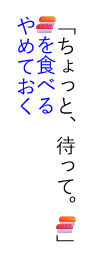

# pilot-windows-rs-next 一次記録

先進坑（使い捨て）。成果物はコードでなく知見。本書が正本で、design はここを参照し同じ結果を二重に書かない。

**判定は開発者が下す。** 各節の「判定」欄は空けてある。

## 第 1 幕: 動機

（未記入。対応する本坑〔移行の本体の各本・brief の Downstream 1〜8〕と、何が怪しくて掘るかを書く。置き場が二坑モデルの例外である理由〔1 つのパッケージが `windows_core` の名前で持てる版は 1 つ〕も書く。）

## 第 2 幕: 概要

### クレートの一覧と役

| クレート（フォルダ） | 問い | 依存（置き場の中・上流・借りる物） |
|---|---|---|
| `q1-winmsg` | 1・8 | `windows-link`・`async-task`・build に `windows-bindgen`。edition 2021・`[lib] name = "wintf_winmsg_executor"` |
| `q2-placement/plan1-wintf`・`plan1-emo` | 2（案 1） | `windows-core`・build に `windows-bindgen`（両方が自分の束縛を持つ）。emo → wintf |
| `q2-placement/plan2-wintf`・`plan2-emo` | 2（案 2） | `windows-core`。束縛は wintf 役だけ（build に `windows-bindgen`）。emo → wintf |
| `q2-placement/plan3-bind`・`plan3-wintf`・`plan3-emo` | 2（案 3） | `windows-core`。束縛は bind だけ（build に `windows-bindgen`）。wintf → bind・emo → bind と wintf |
| `q3-default`・`q3-minimal` | 3・8 | `windows-core`・build に `windows-bindgen` |
| `bind-next` | 4・6・7 の土台 | `windows-core`・build に `windows-bindgen`（兄弟は束縛が名指ししたときだけ 1.3 で足す） |
| `q4-wuc` | 4 | `bind-next`・`q1`（`q1-winmsg` を名前を変えて）・`windows-core`・`windows-numerics`・`png`・`tracing`・`tracing-subscriber`（`env-filter` なし。この 3 つは 7.2 の `q4-demo` で足した） |
| `q5-hwnd` | 5 | `windows-core`・`bevy_ecs`・build に `windows-bindgen` |
| `q6-com` | 6 | `bind-next`・`windows-core` |
| `q7-vertical` | 7・要件 13.5 | `bind-next`・`q4-wuc`・`q1`・`windows-core`・`windows-text`・借りる `wintf`・`areka-emo-text`・`areka-parsers`・`areka-sakura`・`png` |
| `q9-api-count` | 9 | `scip` |
| `q10-winmsg` | 10 | `q1-winmsg` と同じ形（`[[example]]` は 11.1 で足す） |

`q2-placement` の 7 つのパッケージ名は `q2-<フォルダ名>`（例 `q2-plan1-wintf`）。フォルダ名は本線のクレートと同じ名前を使わない。

### 引いた上流のコミットと確かめた日

- 固定の rev: `f37e2f9046cf9710fe00285436c4d22ad6053d72`
- 確かめた日: 2026-11-16（1.2 で取り寄せ、置き場の中で `cargo check --workspace` が骨組みのまま通った）

### `Cargo.lock` の種にした本線のコミット

- 本線（main）のコミット: `5b3a361c95c5fb494fdf7845576cf20f1aa20c07`（この作業木の土台も同じ。作業木の HEAD は `43381ae7842d826a15ee350028b2345eb61f8a6c`、`git diff main -- Cargo.lock` は空）
- `image-webp` は本線の根の `[patch.crates-io]`（git）が置き場に効かないので crates.io の版へ解き直される。解き直された版: crates.io の `image-webp` 0.2.4（本線の `Cargo.lock` は git の 0.2.5＝`image-rs/image-webp` rev `75f81091`）

### 取り寄せた兄弟のクレート・`cargo tree -d`・フィルターの行数と生成した行数

**取り寄せ（1.2・2026-11-16）**

- 上流の git は既定の `CARGO_HOME`（この機械では `c:\rust\cargo`）へ cargo がそのまま取り寄せた。`git/db/windows-rs-a5de4a2dc783ec71` が約 1.5 GB、取り出しは `git/checkouts/windows-rs-a5de4a2dc783ec71/f37e2f9`。解決は止まらず、rev は動かしていない（要件 2.5 の手順は使っていない）。
- 置き場の `Cargo.lock` の windows-rs の `source` は `git+https://github.com/microsoft/windows-rs?rev=f37e2f9046cf9710fe00285436c4d22ad6053d72#f37e2f9046cf9710fe00285436c4d22ad6053d72` の 1 つだけ（11 パッケージがこの source）。
- 取り出しの中に兄弟のクレートが在る: `windows-future`・`windows-collections`・`windows-reference`・`windows-time`（どれも `crates/libs/<名前>`・0.101.0）。どれも今はどのクレートも引いていないので `Cargo.lock` には出ない。
- `scip` は本線の `Cargo.lock` に無い。置き場で crates.io の `scip` 0.10.0 に解けた。
- 借りる `wintf`（推移で本物の `wintf-winmsg-executor`）と `q1-winmsg` は同じライブラリ名 `wintf_winmsg_executor` で `q7-vertical` の同じ木に入り、組めた（`q7-vertical` が直に引くのは `q1` だけ）。cargo は断らなかったので `q1-winmsg` のライブラリ名は変えていない。
- 気付き: 置き場の中で打つと、`.cargo/config.toml` の相対の `target-dir`（`../../../../target/...`）がそのままパスに残って長くなり、proc-macro のリンクで `LNK1104`（ファイルを開けない）で止まった。走らせ方の節のとおり `--target-dir` を絶対パスで渡すと通る。

**`cargo tree -d -e normal -p q7-vertical --depth 1`（抜粋・`windows-core` の 2 版が同じ木に並ぶ・要件 13.5 の材料）**

```
windows-core v0.62.2
├── areka-emo-text v0.1.0 (crates/areka-emo-text)
├── windows v0.62.2
├── windows-collections v0.3.2
├── windows-future v0.3.2
├── windows-numerics v0.3.1
└── wintf v0.1.0 (crates/wintf)

windows-core v0.101.0 (https://github.com/microsoft/windows-rs?rev=f37e2f9046cf9710fe00285436c4d22ad6053d72#f37e2f90)
├── bind-next v0.0.0 (crates/pilot/examples/pilot-windows-rs-next/bind-next)
├── q4-wuc v0.0.0 (crates/pilot/examples/pilot-windows-rs-next/q4-wuc)
├── q7-vertical v0.0.0 (crates/pilot/examples/pilot-windows-rs-next/q7-vertical)
├── windows-numerics v0.101.0 (https://github.com/microsoft/windows-rs?rev=f37e2f9046cf9710fe00285436c4d22ad6053d72#f37e2f90)
└── windows-text v0.101.0 (https://github.com/microsoft/windows-rs?rev=f37e2f9046cf9710fe00285436c4d22ad6053d72#f37e2f90)

windows-link v0.2.1
├── windows-core v0.62.2 (*)
├── ...（windows-future・windows-numerics・windows-result・windows-strings・windows-sys・windows-threading）

windows-link v0.100.1 (https://github.com/microsoft/windows-rs?rev=f37e2f9046cf9710fe00285436c4d22ad6053d72#f37e2f90)
├── q1-winmsg v0.0.0 (crates/pilot/examples/pilot-windows-rs-next/q1-winmsg)
├── windows-core v0.101.0 (...) (*)
├── windows-result v0.100.1 (...)
└── windows-strings v0.100.1 (...)
```

同じく 2 版が並ぶ物: `windows-implement` 0.60.2／0.101.0・`windows-interface` 0.59.3／0.101.0・`windows-numerics` 0.3.1／0.101.0・`windows-result` 0.4.1／0.100.1・`windows-strings` 0.5.1／0.100.1。パスは作業木の根からの相対に縮めた。

#### bind-next（1.3）

`build.rs` が `filters/*.txt`（`common`・`q4-wuc`・`q6-renderer`・`q7-text`）を全部読み、既定の形の束縛を `OUT_DIR/bindings.rs` へ書き、`lib.rs` が `include!` する（束縛はコミットしない）。名指しは関数・型の短い名前（`CoInitializeEx` のように）で、`Windows.Win32.…` の長い名前は「could not resolve filter entry」で断られた。

| フィルター | 名指しの行数 |
|---|---|
| `common.txt` | 11（COM の初期化 2・D3D11 3・D2D 4・DXGI 2） |
| `q6-renderer.txt` | 11（DirectWrite の関数 1・インターフェース 6・定数 4。6.2） |
| `q4-wuc.txt`・`q7-text.txt` | 0（各問いのタスクが足す） |

生成した `bindings.rs`: 7742 行（common の 11 件だけで。依存の型を自動で引くため名指しの約 700 倍）。束縛が名指しした兄弟は `windows-numerics`（`windows_numerics::Vector2`／`Matrix4x4`）だけで、`Cargo.toml` に足した。`windows-future` などは名指しされず足していない。`.implements`（下線の描き手の 3 つ）は 6.2 で足した（問い 6 の節）。6.2 の後の `bindings.rs` は 9402 行。

### RunCommands（走らせ方）

どのディレクトリからでも動く形（作業木の根が `C:/home/maz/git/areka` のとき。別の作業木では根を差し替える）:

```
cargo <run|build|test|clippy> --manifest-path C:/home/maz/git/areka/crates/pilot/examples/pilot-windows-rs-next/Cargo.toml --target-dir C:/home/maz/git/areka/target/pilot-windows-rs-next -j 4 -p <クレート> [--bin|--example <名前>] [--target <三つ組>]
```

- クロスのビルド（i686・aarch64）は PowerShell から打つ。
- 窓を出す例（`q4-demo`・`vt-balloon`）は排他テストの机を持ってから走らせる。
- ビルドの出力・`OUT_DIR`・`out\<問い>\` はどれも `--target-dir` の下に出る。

### ExitContract（窓を出す例の終了コード）

| コード | 意味 |
|---|---|
| 0 | 正常（上限時間に到達、または `vt-balloon` の当たりが一致） |
| 2 | 初期化の失敗（段の名前をログに出す） |
| 3 | 窓が外から閉じられた（判定に使わない） |
| 4 | `vt-balloon` の当たりが食い違った |

上限時間は環境変数 `AREKA_APP_SMOKE_EXIT_MS`（既定 30000 ms）。

### CopyLedger（写した量と手間）

写した量は元のファイルの本番の行（試験の行と問い 10 の写しを除く）を元のファイルごとに 1 回数える。書き換えの行数は `git diff --numstat <写した直後> <移した後> -- <クレートのフォルダ>`。

| 問い | 元のファイル | 写した行数 | 書き換えの行数 | 直しの回数 | 時間 |
|---|---|---|---|---|---|
| 1 | `src/lib.rs`（本番の部分のみ） | 270 | +15／−19 | | |
| 1 | `src/util/mod.rs` | 7 | 0 | | |
| 1 | `src/util/msg_filter_hook.rs` | 64 | +7／−9 | | |
| 1 | `src/util/window.rs` | 373 | +43／−32 | | |
| 1 | `examples/basic.rs` | 36 | 0（変えない） | | |
| 1 | `examples/threads.rs` | 37 | 0（変えない） | | |
| 1 | 新しく足した `build.rs`・`filters.txt` | — | +12・+32 | | |
| 1 | 計（2.2 の x64 まで） | 787 | 写しの書き換え +65／−60（新しいファイルを入れて +109／−60） | 4 | 約 12 分 |
| 3 | `wintf/src/com/dwrite.rs` | 154 | 既定: +28／−15（末尾の試験の 3 行を消した分を含む） | | |
| 3 | `wintf/src/com/d2d/mod.rs` | 158 | 既定: +3／−5 | | |
| 3 | 既定の形で新しく足した `build.rs`・`filters.txt`・`src/main.rs`（確かめの bin）・`Cargo.toml` | — | +11・+47・+214／−1・+2 | | |
| 3 | `.minimal()` で新しく足した `build.rs`・`filters.txt`・`src/bindings.rs`（束縛の取り込み＋手書きの包み）・`src/main.rs`（確かめの bin）・`Cargo.toml` | — | +12・+49・+78・+211／−1・+2 | | |
| 3 | 計（`q3-default` と `q3-minimal` は同じ元を写すので 1 回と数える） | 312 | 既定（3.1）: 写しの書き換え +31／−20（新しいファイルを入れて +305／−21）。`.minimal()`（3.2）: 写しの書き換え +31／−20（既定と同じ）（新しいファイルを入れて +383／−21） | 既定: 4・`.minimal()`: 1 | 既定: 約 7 分・`.minimal()`: 約 6 分 |
| 4 | `wintf/src/com/wuc.rs`（`7e0373f47`。本番の部分のみ。末尾の試験 126 行は写さない） | 127 | 写しの書き換え +22／−16（`wuc.rs`）。新しく書いた `capture.rs` +121・`tests/capture.rs` +19・`bind-next` の `filters/q4-wuc.txt` +43／−1・`Cargo.toml` +2 | 3 | 約 8 分（写し 約 2 分・移し 約 6 分） |
| 6 | `crates/shiori-abi/src/interface.rs`（`020fa1248`。先頭の属性と `use` 5・`IShiori` の定義 39・試験の中の定数 4 と実装 `MockBrain` 34・試験の中の呼び出し 15。間の空行 4 は数えない） | 97 | +69／−50（`shiori.rs` +66／−49・`main.rs` +3／−1。大半は試験の中から外へ出した字下げで、`IShiori` の定義は 0） | 1 | 約 6 分 |

1 行あたり・1 API あたりの手間 ＝ 手間 ÷ 書き換えの行数／フィルターの行数。問い 9 の全数に掛けて移行の本体の規模を見立てる。

## 第 3 幕: 検証結果

見立ての候補: go／違う／直す。

### 問い 1: C の関数だけのクレート（`.sys()`）

- 見立ての候補: go（x64・i686 の走行が元と一致し、aarch64 はリンクまで通った。写しの側の直しは 2.3 で 0）。
- 確かめた日: 2026-11-16（x64・2.2、i686・aarch64・2.3）
- 束縛: `q1-winmsg/build.rs` が `.sys().flat()` で `OUT_DIR/bindings.rs` を書く。フィルター `q1-winmsg/filters.txt` は **32 行**（関数 17・定数と型 15。`WM_CREATE`・`WM_DESTROY` は写した `window.rs` の試験のためだけ）。生成した `bindings.rs` は **151 行**。頼るのは `windows-link` だけ（`.sys()`＋`.flat()` は核の型を束縛の中に書く）。
- 書き換え（`git diff --numstat f75365db0 -- q1-winmsg`・作業木と写した直後の比べ）: `lib.rs` +15／−19・`util/msg_filter_hook.rs` +7／−9・`util/window.rs` +43／−32・`util/mod.rs` と例 2 本は 0。新しいファイルは `build.rs` +12・`filters.txt` +32。手間は直し 4 回・約 12 分。
- 比べ（x64・debug）: 写しは `target/pilot-windows-rs-next/debug/examples/{basic,threads}.exe`、元は本線の根で `cargo run -p wintf-winmsg-executor --example basic|threads`。
  - `basic`: 全文一致（14 行）・終了コード 0 と 0。
  - `threads`: `main` の行の並び（`main hello`→`main async hello`→`main async bye`→`main bye`）一致・終了コード 0 と 0。`thread` の側の行の集まり（2 本のスレッドが同じ文を出す `n_poll=` を含む）は両方とも `thread hello`・`thread async hello`・`thread async bye`・`thread bye` が各 1、`n_poll=0`〜`3` が各 2 で同じ。
- 学び:
  - この rev の `.sys()` は C のヘッダーの形で出る: `HWND = *mut HWND__`・`DWORD`／`UINT`・`LPVOID`。`windows` の新しい型の `WINDOW_EX_STYLE`／`WINDOW_STYLE` は無く `DWORD`（公開の `Window::new_ex` の引数の型も `DWORD` に変わった）。
  - `WM_*`・`CS_DBLCLKS`・`WH_MSGFILTER`・`GWLP_*` の定数は `i32` で出て、`UINT` を取る所（`PostMessageW` の `msg`・`WNDCLASSW::style`・wndproc の `msg` との比べ）に `as u32` が要る（7 か所）。書き換えの大半はこれと `Option`→ヌルのポインタ、`LRESULT(0)`→`0`、`.0` の剥がし。
  - 上流の穴: `IDC_ARROW` が `PCSTR` 型で出るのに `PCSTR` 自体は束縛に出ず、フィルターで名指しすると「type or namespace not found: `PCSTR`」で断られる。写しの束縛のモジュールに `pub type PCSTR = *const u8;` を 1 行足し、`LoadCursorW` へは `IDC_ARROW as _` で渡した（上流へ返す候補）。
  - `w!` は `.sys()` に無い（`windows-link` だけなので）。クラス名は NUL で終わる `[u16; 22]` の `static` を const の式で組んだ。
  - 失敗の扱いは元を保った: `CreateWindowExW` のヌル→`WindowCreationError`、`SetWindowsHookExW` のヌル→`assert!` で止める（元は `.unwrap()`）。
  - 写しの `lib.rs` の `#![doc = include_str!("../README.md")]` は消した（元の README は写さない。文書の中身は振る舞いに関わらず、置き場に余計なファイルを増やさないため）。
  - 束縛のモジュールには `#![allow(non_camel_case_types, non_snake_case, dead_code, clippy::all)]` が要った（無いと clippy の `upper_case_acronyms` が 26 件）。
  - i686 の `GetWindowLongPtrW`／`SetWindowLongPtrW` は、束縛が `#[cfg(target_arch = "x86")]` で `GetWindowLongW`／`SetWindowLongW` への別名を出す（`link!("user32.dll" "system" "GetWindowLongW" fn GetWindowLongPtrW(..) -> LONG)`。x64・aarch64・arm64ec は `LONG_PTR` の本来の口）。i686 の生成物（`target/pilot-windows-rs-next/i686-pc-windows-msvc/debug/build/q1-winmsg/<ハッシュ>/out/bindings.rs`）でも同じ 2 組を確かめた。写しの `window.rs` は 4 か所とも `as _`／`as *const _` で渡しているので、32bit の型（`LONG`＝`i32`）と 64bit の型（`LONG_PTR`＝`isize`）の差をそのまま吸い、**写しの側で的ごとに分ける `cfg` は 0 か所**で済んだ。
- 比べ（i686・debug・2.3）: PowerShell から `cargo build ... -p q1-winmsg --examples --target i686-pc-windows-msvc`（16.8 秒・直し 0 回）。出来た `target/pilot-windows-rs-next/i686-pc-windows-msvc/debug/examples/{basic,threads}.exe`（PE の machine＝`0x014C`）を x64 の Windows で走らせ、2.2 と同じ元（x64 の本線の例の出力）と比べた。
  - `basic`: 全文一致（14 行）・終了コード 0 と 0。
  - `threads`: `main` の行の並び（`main hello`→`main async hello`→`main async bye`→`main bye`）一致・終了コード 0 と 0。`main` 以外の行の集まり（`thread` の 4 行各 1、`n_poll=0`〜`3` 各 2）も同じ。
- aarch64（2.3・組んでリンクまで）: `cargo build ... -p q1-winmsg --examples --target aarch64-pc-windows-msvc`（7.9 秒・直し 0 回）。例 2 本ともリンクが通り、`target/pilot-windows-rs-next/aarch64-pc-windows-msvc/debug/examples/{basic,threads}.exe` の PE の machine は `0xAA64`。走らせる機械が無いので走行は見ていない（確定 5）。
- 止まった所・理由・代わりの見立て: 無し（i686・aarch64 とも止まらず、写しのコードもフィルターも変えていない）。
- 判定: （開発者が下す）

### 問い 2: 束縛の置き場所（3 案）

- 見立ての候補: 案 3（共有の束縛のクレート）を既定の形で組む（4.3）。判定は開発者が下す。
  - 理由 1（受け渡し）: 案 3 は `cast` の行 0・受け渡しの `from_raw` 0・重なった型 0。案 1 はこの写しでは入口 1 つに `cast` 1 行（入口が増えれば増える見込み）が要り、同じ型が 71 個 2 つの束縛に出て、生成した行も 1,548 行多い。しかも案 1 は emo-text 役の入口が wintf 役の型を名指すので wintf 役のクレートに頼ったままで、束縛を分けても依存は切れない（分ける見返りが無い）。
  - 理由 2（案 2 との違い）: 案 2 も手当て 0・重なり 0 で、生成した束縛は案 3 とバイトまで同じ。違いは置き場だけだが、案 2 では wintf 役のフィルターが emo-text 役の要る口（`filters-for-emo.txt`）まで抱え、wintf 役の公開の口が束縛の全部（`pub use`）になる。案 3 なら役ごとのフィルターのファイルを共有のクレートに並べて持て、wintf 役の公開の口は自分の口のままで済む。本線では wintf に頼るクレートが emo-text のほかにも在る（`areka-emo-present`・`areka-placement`・`areka`）ので、型の出どころを wintf の公開の口から外しておく方が、どのクレートからも同じ 1 つの束縛を名指せる（構造上の見立て・測っていない）。
  - 理由 3（形）: 問い 3 では、形を変えても呼ぶ側の書き換え・振る舞い・`==`・的ごとの結果は同じで、`.minimal()` は生成した行の約 9% と引き換えに手で守る包み（自由関数 4 本で 78 行）を足す。共有のクレート 1 つに束縛を集めるなら、生成した行は `build.rs` が出し直すだけなので、既定の形を推す。
  - 推さない物: 3 案とも組めたので「組めなかったから外す」案は無い。案 1 は組めたが、上の理由 1 で推さない。
  - `bind-next`（問い 4・6・7 の土台）は案 3 と同じ形だが、問い 2 の比べの材料ではない。上の理由は `q2-placement` の 3 案と問い 3 の 2 形の結果だけから取った。
- 3 案の比べ（4.3。数は 4.1・4.2 の結果）:

  | | 案 1（クレートごとに束縛） | 案 2（wintf 役が束縛を公開） | 案 3（共有の束縛のクレート） |
  |---|---|---|---|
  | 組めたか（x64・実の GPU） | 組めた・`ink=858`・直し 2 回 | 組めた・`ink=858`・直し 1 回 | 組めた・`ink=858`・直し 1 回 |
  | 受け渡しの `cast` の行 | 1（emo-text 役の入口） | 0 | 0 |
  | 受け渡しの `from_raw` | 0 | 0 | 0 |
  | 型を名指す口 | wintf 役が自分の束縛を `pub use`（依存は切れない） | wintf 役の公開の束縛 | 共有のクレートの束縛 |
  | 束縛の数 | 2 | 1（wintf 役の中） | 1（別のクレート） |
  | 同じ型が 2 つの束縛に出た数 | 71（インターフェース 29・構造体 16・別名と列挙 26） | 0 | 0 |
  | 生成した行 | 9,510（2,717＋6,793） | 7,962（案 3 とバイトまで同じ） | 7,962 |
  | フィルターの持ち方 | 役ごとに別（20 件・13 件。21 行・15 行のファイル） | wintf 役が両役の和（20 件・13 件。21 行・15 行のファイル） | 共有のクレートが両役の和（20 件・13 件。21 行・15 行のファイルを 2 つ読む） |

- 参照の口（4.3・要件 4.3）: 固定の rev（`f37e2f9046cf9710fe00285436c4d22ad6053d72`・`windows-bindgen` 0.101.0）に、ほかのクレートの束縛の型を参照させる公開の口は**無い**。根拠（cargo の git の取り寄せ `c:\rust\cargo\git\checkouts\windows-rs-a5de4a2dc783ec71\f37e2f9\crates\libs\bindgen`）:
  - 組み立ての口: `src/lib.rs` 76〜87 行の `pub struct Bindgen` の欄は `input`・`input_default`・`filter`・`output`・`derive`・`implement`・`compose`・`rustfmt`・`layout`・`style`・`dead_code` だけで、参照の欄が無い。`impl Bindgen`（184 行〜）の公開のメソッドも `new`・`input`・`input_default`・`input_bytes`・`input_byte_sets`・`inputs`・`output`・`filter`・`filter_file`・`filter_files`・`filters`・`derive`・`derives`・`rustfmt`・`flat`・`package`・`implement_all`・`implement`・`implements`・`compose`・`composes`・`sys`・`minimal`・`extern_fns`・`dead_code`・`write` だけで、どれも参照を受けない。
  - コマンドの口: `src/cli.rs` 106〜139 行が受けるのは `--in`・`--out`・`--filter`・`--filter-file`・`--rustfmt`・`--derive`・`--flat`・`--package`・`--sys`・`--minimal`・`--dead-code`・`--extern`・`--implement`・`--compose` だけで、ほかは 139 行の `panic!("invalid option ...")` で断る。0.62 の `--reference`（research.md 3.2・docs.rs の 0.62 のソース）は無い。
  - 中の仕組みは在るが閉じている: `src/references.rs`（78 行）が「この型はこのクレートが持つ」を表し、`src/paths.rs` 72〜80 行が当たった型に `クレート名::` を前に付けて書く。だが `mod references;`（`src/lib.rs` 16 行）は非公開で、表を埋めるのは `src/lib.rs` 491〜574 行の決め打ちの 5 つ（`windows_future`・`windows_collections`・`windows_reference`・`windows_time`・`windows_numerics`。`.sys()` では入れない）だけ。束縛が `windows_numerics::Vector2` を名指したのはこの決め打ちのため（1.3・3.1）で、利用者のクレート（`q2_plan1_wintf` など）を足す道は無い。
  - 文書: `readme.md` の「Choose output and inputs」の表（55〜90 行）にも参照の口は無く、84 行は「出力が名指す兄弟のクレートを依存に足せ」と言うだけ。
  - 案 1 への効き: 口が無いので、案 1 の重なり（71 個）と入口の `cast` は bindgen の側では消せない。
- 共通の描く本体（4.1）: `q2-placement/shared/draw_body.rs`（66 行）。DirectWrite の工場・書式・配置を作り、受け取った `ID2D1DeviceContext` へ文字を 1 行（`q2 placement 墨`・Segoe UI 20）描く `draw_line` と、premultiplied BGRA の α>0 の画素を数える `count_ink`。中身は案ごとに変えない。各案の emo-text 役の `src/lib.rs` が、型の出どころを `use <束縛>::*; use windows_core::*;` で決めてから `#[path = "../../shared/draw_body.rs"] mod draw_body;` で読む（本体の頭は `use super::*;`）。
- 確かめの bin: 各案の emo-text 役の `src/main.rs`。wintf 役の `create_target(256, 64)`（ハードウェアの D3D11 → D2D の装置と文脈 → 描く先の `ID2D1Bitmap1` を `SetTarget`・CPU で読む `ID2D1Bitmap1`）→ emo-text 役の `draw_line` → wintf 役の `read_back`（`CopyFromBitmap`＋`Map` で BGRA）→ `count_ink` を出す。墨が 0 なら `E_FAIL` で終了コード 2。どの失敗も `error=` を stderr に出して 2 で終わる（黙って通る道は無い）。
- 案 3（共有の束縛のクレート・4.1）:
  - 組めたか: 組めた。直し 1 回（clippy の `chunks_exact` の指摘を `as_chunks::<4>()` へ。束縛と型の受け渡しの直しは 0 回）。実の GPU（画面の外・机なし）で `cargo run -p q2-plan3-emo` が `[q2-plan3] ink=858`・終了コード 0。
  - 受け渡しの手当て: 無し。wintf 役（`q2-plan3-wintf`）と emo-text 役（`q2-plan3-emo`）が同じ `q2-plan3-bind` の `ID2D1DeviceContext` を使うので、`Target.context` をそのまま `&` で渡すだけ。`cast` の行 0・`from_raw` 0（wintf 役の中の `D2D1CreateFactory` の受け取りの `from_raw` 1 つは受け渡しでなく工場を作る口の形）。
  - 重なった束縛の量: 同じ型が 2 つの束縛に出た数 0（束縛は 1 つだけ）。フィルターは両役の和で、wintf 役の `filters-wintf.txt` 20 件・emo-text 役の `filters-emo.txt` 13 件（21 行・15 行のファイル）、両方に名指しした物は `ID2D1DeviceContext` の 1 つ（`build.rs` が `filter_files` で 2 つを読み、重なりは bindgen が 1 つにまとめる）。生成した `bindings.rs` は 7,962 行（既定の形・`.flat()`）。
  - 手で書いた行: `plan3-bind` 16 行（`build.rs` 13・`src/lib.rs` 3）・`plan3-wintf/src/lib.rs` 92 行・`plan3-emo` 37 行（`src/lib.rs` 7・`src/main.rs` 30）。
  - 学び: 継いだメソッド（`BeginDraw`・`Clear`・`DrawTextLayout`・`EndDraw`・`GetSize`）は emo-text 役の側で `ID2D1RenderTarget` を名指ししないと出ない（3.1 と同じ）。案 3 ではこの名指しが共有のクレートのフィルターに入るので、wintf 役も使わない基の口まで抱える（和にした分だけ束縛が太る）。
- 案 1（クレートごとに束縛・4.2）:
  - 組めたか: 組めた。直し 2 回（bin の `E_FAIL` が wintf 役の束縛に無く `q2_plan1_emo` から出すよう直した・clippy の 1 要素の `for` を `println!` 2 行へ。型の受け渡しの直しは 0 回）。実の GPU（画面の外・机なし）で `q2-plan1-emo` が `[q2-plan1] ink=858`・終了コード 0（案 3 と同じ数）。
  - 受け渡しの手当て: `cast` の行 1（`plan1-emo/src/lib.rs` の入口 `draw_line(context: &q2_plan1_wintf::ID2D1DeviceContext, …)` の中の `context.cast::<ID2D1DeviceContext>()?`。両方の型が同じ IID の `windows_core::Interface` なので、クレートをまたいでも `QueryInterface` で自分の型の参照が取れた）。受け渡しの `from_raw` 0。wintf 役の中の `D2D1CreateFactory` の受け取りの `from_raw` 1 つは、案 3 と同じく工場を作る口の形で受け渡しではない。emo-text 役の `DWriteCreateFactory` は描く本体の `.cast()` のままで `from_raw` は要らない。
  - 型を名指す口: emo-text 役の入口の引数が wintf 役の型なので、wintf 役は自分の束縛を `pub use bindings::*;` で公開し、emo-text 役は wintf 役のクレートに頼る（束縛は別でも依存は切れない）。emo-text 役の束縛は外へ出さない（bin が使う `E_FAIL` だけ `pub use`）。
  - 重なった束縛の量: 同じ型が 2 つの束縛に出た数 71（インターフェース 29〔`ID2D1DeviceContext`・`ID2D1RenderTarget`・`ID2D1Bitmap1`・`ID2D1Device`・`IDXGISurface`・`IWICBitmapSource` ほか〕・構造体 16〔`D2D1_PIXEL_FORMAT`・`D2D_SIZE_U`・`D2D1_BITMAP_PROPERTIES1` ほか〕・型の別名と列挙 26〔`DXGI_FORMAT`・`D2D1_ALPHA_MODE`・`IID` ほか〕。定数と関数の重なりは 0）。名指しは同じ 2 つのフィルター（wintf 役 20 件・emo-text 役 13 件、両方に名指しは `ID2D1DeviceContext` の 1 つ）でも、依存の型を自動で引くので、この写しでは名指し 1（両方に名指しした `ID2D1DeviceContext`）に対し重なり 71 が出た。
  - 生成した行数: wintf 役だけ 2,717 行・emo-text 役だけ 6,793 行・合わせて 9,510 行（案 3 の和の 7,962 行より 1,548 行多い＝重なりの分）。
  - 手で書いた行: `plan1-wintf` 108 行（`build.rs` 11・`src/lib.rs` 97〔案 3 の wintf 役の本体と同じ＋自分の束縛の `include!` と公開の 6 行〕）・`plan1-emo` 59 行（`build.rs` 11・`src/lib.rs` 18・`src/main.rs` 30）。フィルターは案 3 の 2 つを写した物（`filters-wintf.txt` 20 件・`filters-emo.txt` 13 件。21 行・15 行のファイル）。
- 案 2（wintf 役が束縛を公開・4.2）:
  - 組めたか: 組めた。直し 1 回（案 1 と同じ clippy の 1 要素の `for`。型の受け渡しの直しは 0 回）。実の GPU（画面の外・机なし）で `q2-plan2-emo` が `[q2-plan2] ink=858`・終了コード 0（案 3 と同じ数）。
  - 受け渡しの手当て: 無し。emo-text 役は自分の束縛を持たず（`build.rs` 無し）、`use q2_plan2_wintf::*; use windows_core::*;` で wintf 役が公開した型（`ID2D1DeviceContext`・`IDWriteFactory`・`IDWriteTextFormat`・`IDWriteTextLayout`・`DWriteCreateFactory` ほか）をそのまま使う。`cast` の行 0・受け渡しの `from_raw` 0（wintf 役の中の `D2D1CreateFactory` の `from_raw` 1 つは工場を作る口の形）。
  - 重なった束縛の量: 同じ型が 2 つの束縛に出た数 0（束縛は wintf 役の 1 つだけ）。wintf 役のフィルターは自分の `filters-wintf.txt`（20 件）に emo-text 役のための `filters-for-emo.txt`（13 件）を足した和で、wintf 役は自分で使わない DirectWrite の口まで抱えて公開する。生成した `bindings.rs` は 7,962 行で、案 3 の物とバイトまで同じ（フィルターの中身が同じ和のため）。
  - 手で書いた行: `plan2-wintf` 109 行（`build.rs` 12・`src/lib.rs` 97）・`plan2-emo` 37 行（`src/lib.rs` 7・`src/main.rs` 30）。案 3 との違いは、束縛の置き場が wintf 役のクレートの中か別のクレートかだけ。
- 学び（4.3）:
  - 3 案とも、COM の型は束縛をまたいでも同じ IID の `windows_core::Interface` なので、受け渡しの難しさは「型の名前がどこに在るか」だけに出た。振る舞い（墨の数）は 3 案で同じ。
  - bindgen は名指しの依存の型を自動で引くので、束縛を 2 つに分けると、この写しでは名指し 1（両方に名指しした `ID2D1DeviceContext`）に対し重なり 71 が出た。束縛は 1 つにまとめるのが安い。
  - 参照の口が無いので、束縛を分ける案は bindgen の側で重なりを消せない。
- 確かめた日: 2026-11-16（案 3・x64・4.1／案 1・案 2・x64・4.2／比べと上流のソースの確かめ・4.3）
- 止まった所・理由・代わりの見立て: 3 案とも無し。
- 判定: （開発者が下す）

### 問い 3: 束縛の形（既定か `.minimal()`）

- 見立ての候補: 既定の形が go。`.minimal()` は本線の既定の形としては「違う」（3.3）。
  - 2 形とも、x64・i686 で同じ墨の数（722）を出し、`==` の結果も同じ。aarch64 はどちらもリンクまで通った。形の違いは、的ごとの結果には出ない。
  - `.minimal()` で減るのは生成した行だけ（833 行・約 9%）。その代わり、自由関数の包みを 78 行手で書くことになる。生成した行は `build.rs` が出し直すので守る手間が要らないが、手書きの包みは守る手間が要る。自由関数が 4 本のこの写しでも 78 行あった。自由関数と取っ手が多い所（問い 1・5 の窓の取っ手）では、包みも呼ぶ側の書き換えも増えると見る。
  - 呼ぶ側の書き換えは 2 形で同じ（写しは +31／−20 で 1 字も違わない）。`.minimal()` で減る物は呼ぶ側には無い。
- 2 形の比べ（3.3）:

  | | 既定の形（`q3-default`） | `.minimal()`（`q3-minimal`） |
  |---|---|---|
  | フィルターの行（名指し） | 47（44） | 49（45。`ID3D11Device` を足した） |
  | 生成した束縛の行 | 8,889 | 8,056（−833） |
  | 手書きの包みの行 | 0 | 78（自由関数 4 本と束縛の取り込み） |
  | 写しの書き換え（`dwrite.rs`＋`d2d/mod.rs`） | +31／−20 | +31／−20（同じ） |
  | 確かめの bin の書き換え | +214／−1 | +211／−1（違いは `mod bindings;` と `HMODULE` の 1 行ずつ） |
  | 全部の差分 | +305／−21 | +383／−21 |
  | 直しの回数・時間 | 4 回・約 7 分 | 1 回・約 6 分（3.1 の書き換えを当てた後） |
  | 墨の数（x64・i686） | 722・722 | 722・722 |
  | `==`（番地の違う同じ物で真・別の物で偽） | 真・偽（x64・i686） | 真・偽（x64・i686） |
  | aarch64 | リンクまで通った | リンクまで通った |

- 確かめた日: 2026-11-16（既定の形・x64・3.1）／2026-11-16（`.minimal()` の形・x64・3.2）／2026-11-16（2 形の i686・aarch64・3.3）
- i686 と aarch64（3.3）:
  - PowerShell から `cargo build ... -p q3-default -p q3-minimal --target i686-pc-windows-msvc`（18.5 秒・直し 0 回）。出来た `target/pilot-windows-rs-next/i686-pc-windows-msvc/debug/{q3-default,q3-minimal}.exe`（PE の machine＝`0x014C`）を x64 の Windows で 3 回ずつ走らせた。画面の外の描画なので机は取らない。
    - 2 形とも、3 回とも終了コード 0。`clusters=12`・`overhang_right=-142.13281`・`ink=722` で、x64 の exe（同じ日に 3 回ずつ走らせ直した）と同じ。
    - `==` も x64 と同じ: `same_via_unknown=true`・`same_unknown=true`・`different_object_ne=true`・`same_object_other_address=true`（番地は `raw_d3d=0xf263b4`・`raw_dxgi=0xf25f3c` のように違う）。
  - `cargo build ... -p q3-default -p q3-minimal --target aarch64-pc-windows-msvc`（7.7 秒・直し 0 回）。2 形ともリンクが通り、`target/pilot-windows-rs-next/aarch64-pc-windows-msvc/debug/{q3-default,q3-minimal}.exe` の PE の machine は `0xAA64`。走らせる機械が無いので走行は見ていない（確定 5）。
  - 生成した `bindings.rs` は、x64・i686・aarch64 の 3 つで 1 バイトも違わない（既定 8,889 行・`.minimal()` 8,056 行とも中身の要約が一致）。`target_arch` の `cfg` は 0 か所。呼び出しの規約は `link!` と COM の表の `"system"` が的ごとに決めるので、束縛にも写しにも的ごとの分けは要らなかった。
  - 写し・包み・bin のコードは 3.3 で 1 行も変えていない。
- 既定の形（`q3-default`・3.1）:
  - 束縛: `q3-default/build.rs` が既定の形（`.flat()` だけ足す）で `OUT_DIR/bindings.rs` を書く。フィルター `q3-default/filters.txt` は 47 行で、名指しは 44（写しの分が 18・確かめの bin の分が 26・`//` の注が 3 行）。生成した `bindings.rs` は **8,889 行**。頼るのは `windows-core`・`windows-numerics`（`Matrix3x2`／`Vector2`／`Matrix4x4` を束縛がこの名で出す）と、写しの `tracing`。
  - 書き換え（`git diff --numstat a2288ed43 -- q3-default`。作業木と写した直後の比べで、まだ追跡していない新しいファイルも数えた）: 写しは `dwrite.rs` +28／−15・`d2d/mod.rs` +3／−5（計 +31／−20）。ほかに `Cargo.toml` +2、新しいファイルの `build.rs` +11・`filters.txt` +47、確かめの bin の `src/main.rs` +214／−1（骨組みの 1 行と差し替え）。全部で +305／−21。手間は直し 4 回（組み 3 回・clippy 1 回）・約 7 分。
  - 写しの末尾の `#[cfg(test)] #[path = "dwrite_cluster_tests.rs"] mod tests;`（3 行）は消した（試験は写さない）。上の −15 に入っている。
  - 確かめの bin（x64・debug・実の GPU・画面の外の描画なので机は取らない）: `target/pilot-windows-rs-next/debug/q3-default.exe` の終了コードは 0。ハードウェアの D3D11（`D3D_DRIVER_TYPE_HARDWARE`・`D3D11_CREATE_DEVICE_BGRA_SUPPORT`）→ `IDXGIDevice` → `ID2D1Factory1::CreateDevice` → 写しの `create_device_context` と進む。256×64 の `ID2D1Bitmap1`（TARGET）へ写しの `create_text_format`（Segoe UI・20 DIP・ja-jp）・`create_text_layout`（`q3 default 墨`）・`draw_text_layout` で黒く描き、CPU_READ の絵へ `CopyFromBitmap` して `Map` で読む。**α>0 の墨の画素は 722**（3 回走らせて 3 回とも同じ）・クラスタは 12。写しの残りの口（`set_transform`・`get_overhang_metrics`・`fill_rectangle`・`fill_ellipse`・`draw_bitmap`・`close`）も通した（後の 4 つは `ID2D1CommandList` へ記録した）。
  - `==`（`assert` は全部通った）:
    - `ID2D1CommandList` を `cast` で `IUnknown` へ移し、また `ID2D1CommandList` へ戻した参照と比べると真。
    - `IUnknown` へ `cast` した物と、QueryInterface を通らずに `into` で移した物を比べると真（この 2 つは番地も同じ）。
    - 別に作った `ID2D1CommandList` と比べると偽。
    - 番地の違う参照: 同じ D3D11 の装置を `ID3D11Device` と `IDXGIDevice` から `IUnknown` へ `into` で移すと番地が違うのに、`==` は真。番地でなく COM の同一性で比べている。
    - 中身: `define_interface!` が `PartialEq` を derive して、中の `IUnknown` の `eq` に任せる。その `eq` は番地が同じならすぐ真で、違えば両方を `IUnknown` へ `cast` してから番地を比べる（`windows-core` の `unknown.rs` 49〜55 行・`imp/mod.rs` 110 行）。既定の形では、`SurfaceComposite::same_root` と `GraphicsCommandList` の導出の `PartialEq` が頼っている COM の同一性の比べがそのまま残る。
- 学び（既定の形）:
  - この rev の既定の形は、0.62 の `windows` クレートより C のヘッダーに近い形で出る。
    - 戻り値の無い COM メソッドは `Result<()>` でなく `HRESULT` を返す（`Close`・`EndDraw`・`CopyFromBitmap`・`Unmap`・`GetClusterMetrics`）。`.ok()` が要る。
    - 戻り値を out の引数で返すメソッドは、値を返す形にならない（`GetOverhangMetrics(&mut)`・`Map(options, &mut)`）。
    - スライスの引数は「ポインタ＋長さ」に戻る（`CreateTextLayout(ptr, len, ..)`・`GetClusterMetrics(Option<*mut>, max, *mut)`）。
    - 文字列は `PCWSTR` でなく `*const WCHAR` で出る。写しは `Param<PCWSTR>` のまま受けて `.param().abi().0` で渡した。
    - 型の名前は `UINT32`・`FLOAT`・`DWORD`・`LPVOID` のまま出る。
    - ファクトリの関数は総称の形（`DWriteCreateFactory::<T>(type)`・`D2D1CreateFactory::<T>(type, opts)`）にならない。`DWriteCreateFactory(type, &IID) -> Result<IUnknown>` と `D2D1CreateFactory(type, &IID, opts, *mut *mut c_void) -> HRESULT` で出るので、前者は `cast`、後者は `from_raw` で受けた。
    - `#define` の定数（`COINIT_MULTITHREADED`・`D3D11_CREATE_DEVICE_BGRA_SUPPORT`・`D3D11_SDK_VERSION`・`ERROR_INSUFFICIENT_BUFFER`・`FACILITY_WIN32`）は `i32` で出て、`UINT` を取る所で `as u32` が要る。
    - `D3D11CreateDevice` には `featurelevels: UINT` の引数がある（0 を渡す）。
    - `windows_numerics` のフィールドは小文字（`Vector2 { x, y }`）。
  - 継いだメソッドは、基のインターフェースをフィルターで名指ししないと出ない。`ID2D1DeviceContext` の `Clear`／`DrawTextLayout` ほかは `ID2D1RenderTarget` の、`IDWriteFactory2` の `CreateTextFormat`／`CreateTextLayout` は `IDWriteFactory` の名指しが要った（`IDWriteFactory1` も足した）。足すと、`Deref` の鎖をたどって元と同じ呼び方で届く。
  - `HRESULT::from_win32` はこの rev の `windows-result` に無い。`HRESULT::from_components(1, FACILITY_WIN32, ERROR_INSUFFICIENT_BUFFER)` で組んだ。
  - 写しの `create_text_format` は 8 引数で、clippy の `too_many_arguments`（-D warnings）に止められる。写しは変えずに、bin の根に `#![allow(clippy::too_many_arguments)]` を置いた。
  - 写しの中の失敗の扱いは元を保った（`sizing_outcome` の `tracing::error!`＋`Err`）。bin の失敗は `[q3-default] error=` を出して終了コード 2 で終わる。墨が 0 ならそれも失敗にする。
- `.minimal()` の形（`q3-minimal`・3.2）:
  - 束縛: `q3-minimal/build.rs` が `.flat()`＋`.minimal()` で `OUT_DIR/bindings.rs` を書く（`.flat()` は 3.1 と同じ条件で比べるために付けた）。フィルター `q3-minimal/filters.txt` は 49 行で、3.1 の 47 行に `ID3D11Device` の名指しを 1 つ（と注を 1 行）足した。生成した `bindings.rs` は **8,056 行**（既定は 8,889 行）。`ID3D11Device` を名指ししないと 6,172 行だが、それでは包みが装置を型で受けられない。既定の形では `D3D11CreateDevice` の包みが `ID3D11Device` を引くので、名指ししなくても出る。
  - `.minimal()` が出さない物（この rev の `windows-bindgen` の `lib.rs` の `Style::Minimal`・`cpp_fn.rs` 192 行）: 自由関数は生の `link!` だけになる（ポインタと `HRESULT`。`Option`・`Param`・`Result` の包みなし）。取っ手は裸の別名になる（`HMODULE = *mut HINSTANCE__` で、`Default` が無い）。継いだメソッドの転送は出ない。文字列の包み（`&str`／`String`）は WinRT の `HSTRING` の引数と戻り値にだけ効く。COM のメソッドの包みは既定と同じ形で出る（`Option<*const T>`・`Result<T>`・`Param<T>`）。
  - 手書きの包み（`q3-minimal/src/bindings.rs`・**78 行**・束縛の取り込みの 5 行を含む）: 自由関数 4 本（`CoInitializeEx`・`D3D11CreateDevice`・`D2D1CreateFactory`・`DWriteCreateFactory`）を、既定の形と同じ呼び方で同じ名前のまま書いた。自分のモジュールに書いた名前は `pub use raw::*` の glob より強いので、写しも bin も `use bindings::*` のままで包みに届く。
    - 継いだメソッドの転送は書かずに済んだ。`.minimal()` も `interface_hierarchy!` と `Deref` の鎖は出す（`Deref` の impl は 69 個・既定は 43 個）。基のインターフェースを名指ししてあれば（3.1 と同じフィルター）、`ctx.Clear`・`ctx.BeginDraw`・`dw.CreateTextFormat` ほかは鎖をたどって元の呼び方で届く。
    - 文字列の包みも書かずに済んだ。Win32 の `PCWSTR`／`*const WCHAR` の引数は既定と同じ形で出る。
    - 取っ手の便利な口は包みにせず、bin の 1 行で受けた（`HMODULE::default()` を `core::ptr::null_mut()` にした）。
  - 書き換え（`git diff --numstat 09970d23a -- q3-minimal`。作業木と写した直後の比べで、まだ追跡していない新しいファイルも `wc -l` で数えた）: 写しは `dwrite.rs` +28／−15・`d2d/mod.rs` +3／−5（計 +31／−20。3.1 の書き換えをそのまま当てて 1 字も変わらない）。末尾の `#[cfg(test)] #[path = "dwrite_cluster_tests.rs"] mod tests;`（3 行）は 3.1 と同じく消した（−15 に入っている）。ほかに `Cargo.toml` +2、新しいファイルの `build.rs` +12・`filters.txt` +49・`src/bindings.rs` +78、確かめの bin の `src/main.rs` +211／−1。全部で +383／−21。bin が 3.1 と違うのは、`mod bindings { include! }` の 4 行を `mod bindings;` の 1 行にしたことと、`HMODULE::default()` の 1 行と、出力の名前（`[q3-minimal]`）だけ。手間は直し 1 回（組み 1 回で、自由関数 4 本の 8 つの誤り。包みを書いて次の組みで通った。clippy・fmt は一度で通った）・約 6 分。
  - 確かめの bin（x64・debug・実の GPU・画面の外の描画なので机は取らない）: `target/pilot-windows-rs-next/debug/q3-minimal.exe` の終了コードは 0。中身は 3.1 と同じ（Segoe UI・20 DIP・ja-jp・`q3 default 墨`・256×64）。**α>0 の墨の画素は 722**（3 回走らせて 3 回とも同じ。3.1 と同じ）・クラスタは 12・`overhang_right=-142.13281`（3.1 と同じ）。
  - `==`（`assert` は全部通った。`.minimal()` でも番地だけの比べに変わらない）:
    - `cast` で `IUnknown` を通って戻した `ID2D1CommandList` と比べると真。`IUnknown` の `cast` と `into` の比べも真。別の `ID2D1CommandList` とは偽。
    - 番地の違う参照: 同じ D3D11 の装置を `ID3D11Device` と `IDXGIDevice` から `IUnknown` へ `into` で移すと、番地が違うのに `==` は真だった（`raw_d3d=0x2cf5fc81770`・`raw_dxgi=0x2cf5fc80f78` ほか 3 回とも番地が違って真）。`PartialEq` は束縛でなく `windows-core` の `IUnknown::eq` の持ち物なので、束縛の形を変えても COM の同一性の比べは残る。
- 学び（`.minimal()` の形）:
  - この写しの範囲（COM のメソッドが主で、自由関数は 4 本）では、`.minimal()` で手書きが要ったのは自由関数の包みだけだった（78 行）。呼ぶ側は bin の 2 か所が変わっただけ。
  - `.minimal()` は自由関数が引く型を連れてこない（`D3D11CreateDevice` の `ID3D11Device`）。包みが型で受けたいなら、フィルターで名指しする。
  - 取っ手が裸のポインタの別名になるので、`HMODULE::default()` のような便利な口は使えない。取っ手を多く扱う写し（問い 1・5 の窓の取っ手）では、ここの書き換えが増えると見る。
- 学び（2 形の比べ・3.3）:
  - 形を選んでも、呼ぶ側の書き換え・振る舞い・`==`・的ごとの結果は変わらない。違いは「生成した行の量」と「手で守る包みの量」の取り替えだけ。
  - COM のメソッドが主の写しでは、`.minimal()` が省く物（自由関数の包み・取っ手の便利な口）が少ないので、減る生成の行も約 9% にとどまる。
  - 既定の形の束縛も 3 つの的で同じ物が出る。的ごとに束縛を出し直す手当ては要らない。
- 止まった所・理由・代わりの見立て: 無し（x64・i686 の走行、aarch64 のリンクとも止まらなかった）。
- 判定: （開発者が下す）

### 問い 4: WinRT（`windows-bindgen` で合成）

- 見立ての候補: go（`wintf` の合成の組み方〔DispatcherQueue → Compositor → DesktopWindowTarget → D2D の装置からの描画の装置 → 描画面 → SpriteVisual〕は、`windows-composition` に乗り換えずに `windows-bindgen` の既定の形の束縛のまま実の窓で全段通った。直しは型の決まり〔既定のインターフェースの名指し・相互運用の戻りの `cast`〕だけで、組み方は変わらない）
- 確かめた日: 2026-11-16（7.1・束縛と写しの移し）／2026-11-17（7.2・`q4-demo` の実の窓・x64・実の GPU・排他テストの机を持って 2 回走らせた）
- 段ごとの結果（7.2・`q4-demo`）:
  - 1 回目の走り（DPI の認識なし）: 全段が `ok` で終了コード 0。ところが進行役（主の会話）が撮った絵を目で見ると、256x256 の絵の左と上にデスクトップのアイコンが写り、マゼンタは (100,100) から右下の角までしか無かった。当時の確かめ（真ん中の 1 点だけ）は偶然に通っていた。
  - 原因: exe が DPI を認識しておらず、画面が 192 DPI（200%）だった。窓は論理の座標（(100,100)・256x256 → 物理では (200,200)・512x512）で置かれ、撮りの `GetWindowRect` と画面の DC からの `BitBlt` は物理の画素 (100,100)〜(356,356) を読んだので、窓の左上が絵の (100,100) にずれた。撮りの書き方と visual・描画面の大きさは原因ではない。
  - 直し: `q4-demo` の最初の段に `dpi_awareness`（`SetProcessDpiAwarenessContext(DPI_AWARENESS_CONTEXT_PER_MONITOR_AWARE_V2)`）を足した。確かめも、真ん中の 1 点から 5 点（4 隅を 4 px 内側に・真ん中）へ強めた（1 回目の絵なら (4,4) がデスクトップで落ちる）。
  - 2 回目の走り（直した後）: 終了コード 0（上限時間 30000 ms に着いて自分で終わった）。出た行:

    ```
    [q4] step=dpi_awareness ok
    [q4] step=out_dir ok
    [q4] step=window ok
    [q4] step=popup ok
    [q4] step=dispatcher_queue ok
    [q4] step=compositor ok
    [q4] step=desktop_window_target ok
    [q4] step=d2d_device ok
    [q4] step=graphics_device ok
    [q4] step=drawing_surface ok
    [q4] step=sprite_visual ok
    [q4] step=paint ok
    [q4] step=capture ok
    [q4] pixel x=4 y=4 rgb=255,0,255 ok
    [q4] pixel x=251 y=4 rgb=255,0,255 ok
    [q4] pixel x=4 y=251 rgb=255,0,255 ok
    [q4] pixel x=251 y=251 rgb=255,0,255 ok
    [q4] pixel x=128 y=128 rgb=255,0,255 ok
    [q4] step=check_color ok
    [q4] done exit_ms=30000
    ```

  - 撮った絵は作業木の `target\pilot-windows-rs-next\out\q4\q4-demo.png`（256x256・コミットしない）。真ん中の 64x64 を切って `evidence/q4-wuc.png` に置いた。進行役も撮った絵を目で見て、256x256 の全面がマゼンタだと確かめた。画面の DC からの撮りに WUC の中身は写る（DWM が合成した後の画素）。
- 学び（7.2・実の窓）:
  - DPI を認識しない exe は、拡大率が 100% より大きい画面で、窓の座標（論理）と画面の DC の撮り（物理）が食い違い、撮りがずれる。段は全部 `ok` で終わるので、行だけ見ても気付けない。撮った絵の確かめは 1 点でなく 4 隅と真ん中で見る。
  - `vt-balloon`（8.6）も、設計どおり Per Monitor v2 の DPI の認識が要る（無いと同じずれで当たりの位置も狂う）。
  - `q1` の束縛（`.sys()`）の `HWND` と `bind-next`（既定の形）の `HWND` は、どちらも `*mut HWND__` の別名だが `HWND__` が別の型なので、そのままでは渡せない。`window.hwnd().cast()`（ポインタの型だけ移す）が 1 か所要った。束縛を 2 つ持つと取っ手の受け渡しにこの手当てが要る（問い 2 の案 1 の重なりと同じ形）。
  - `q1` の窓は `new_ex` で拡張のスタイルしか取らない（スタイルは 0）ので、`WS_POPUP` は作った後に `SetWindowLongPtrW(GWL_STYLE)` と `SetWindowPos(SWP_FRAMECHANGED)` で付けた。`q1` の束縛は非公開なので、この名指しは `bind-next` に置いた。
  - 問い 4 のフィルターに 7.2 で 20 件を足した（足すだけ・消した物なし）: 装置の作り方の定数 4（`D3D_DRIVER_TYPE_HARDWARE`・`D3D11_CREATE_DEVICE_BGRA_SUPPORT`・`D3D11_SDK_VERSION`・`D2D1_FACTORY_TYPE_SINGLE_THREADED`）・塗りの基のインターフェース 1（`ID2D1RenderTarget`。`Clear` はこれを名指ししないと出ない）・窓の形と見せ方 9（`SetWindowLongPtrW`・`SetWindowPos`・`GWL_STYLE`・`WS_POPUP`・`WS_EX_NOREDIRECTIONBITMAP`・`HWND_TOPMOST`・`SWP_FRAMECHANGED`・`SWP_SHOWWINDOW`・`SWP_NOACTIVATE`）・メッセージの回し 4（`PeekMessageW`・`TranslateMessage`・`DispatchMessageW`・`PM_REMOVE`）・DPI 2（`SetProcessDpiAwarenessContext`・`DPI_AWARENESS_CONTEXT_PER_MONITOR_AWARE_V2`）。フィルターは 65 行（名指し 57・注 8）になった。`windows-numerics` の `Vector2` の欄はこの rev では小文字（`x`・`y`）。
  - 塗りは `BeginDraw` の文脈に `Clear` だけで、`BeginDraw` の返す位置の平行移動（atlas offset）は使っていない（描画面 1 枚では全面が塗られた）。図形を置く移行の本体では、その平行移動を足して描く。
  - 直しの回数（7.2）: 3（`Vector2` の欄の名前のビルドの失敗・clippy の「宣言した所で閉包を呼ぶ」・1 回目の走りの DPI のずれ）。
- 止まった所・理由・代わりの見立て: 無し（今の形のまま全段が通った。1 回目の撮りのずれは exe の DPI の認識の不足で、合成の段の問題ではない）
- 学び（7.1・束縛と写しの移し）:
  - WinRT の合成も Win32 の相互運用も、`bind-next` の 1 つのフィルターで既定の形の束縛に出た。名前空間のモジュールは WinRT が `bind_next::Windows::UI::Composition::Compositor`・`bind_next::Windows::System::DispatcherQueueController`、Win32 は全部 `bind_next::Windows::Win32::*` の 1 段（相互運用の `ICompositorInterop` ほか・`CreateDispatcherQueueController`・GDI も同じ段）。
  - WinRT のクラスの名指しだけでは、クラスの型・`new()`・`RuntimeName` は出るがメソッドは 1 つも出ない（既定のインターフェースの `ICompositor_Vtbl` が空）。メソッドはクラスの既定のインターフェース（`ICompositor`・`ICompositionTarget`・`ICompositionGraphicsDevice`・`IVisual`・`ISpriteVisual`）を名指ししたときに、クラスの `impl` に出る。Win32 の「継いだメソッドは基のインターフェースを名指ししないと出ない」と同じ型の決まり。名指しが欠けても build は通るので、呼ぶ側で初めて気付く。
  - 生成した束縛が実際に名指しした兄弟のクレート: `windows-collections` だけ（`ICompositor` から `Compositor` に出る `CreateEffectFactoryWithProperties` の `IIterable<HSTRING>` の 1 か所）。`windows-future`・`windows-reference`・`windows-time` は名指しされなかった。`ICompositor` を名指しする前（クラスだけ）は兄弟のクレートを 1 つも要らなかった。`bind-next/Cargo.toml` へ `windows-collections` を足した（消した物は無し）。ほかは `windows-core` と、`Vector2` ほかで既に在る `windows-numerics`。
  - 問い 4 のフィルターの行数: 43 行（名指し 37・注 6）。束縛の全体（4 つのフィルターの和）は 13,881 行。
  - 相互運用の戻りは、`windows` 0.62 の手書きの型と違い、インターフェースで出る: `CreateGraphicsDevice` は `ICompositionGraphicsDevice`、`CreateDesktopWindowTarget` は `IDesktopWindowTarget`、`CreateDispatcherQueueController` は `PDISPATCHERQUEUECONTROLLER`（＝`IDispatcherQueueController` の別名）。写しはクラスを返す口のまま、中で `?.cast()` してクラスへ移した（3 か所）。`BeginDraw` は `T: Interface` の総称で出るので、`let dc: ID2D1DeviceContext = …` の注釈のままで書き換えは要らなかった。`EndDraw` は `HRESULT` を返すので `.ok()` を足した（問い 3 と同じ）。`CreateCompositionSurfaceForSwapChain`／`CreateGraphicsDevice` の引数は `Param<IUnknown>` で、`&IDXGISwapChain1`・`&ID2D1Device` をそのまま渡せた。
  - `HWND` が裸のポインタの別名（問い 5）なので、`HWND` を取る安全な公開の関数（`create_desktop_window_target`・`capture_window_png`）に clippy の `not_unsafe_ptr_arg_deref` が立つ。取っ手は OS へ渡すだけなので関数ごとに `allow` した。移行の本体では 1 か所の決め（`allow` か newtype の包みか）が要る。
  - 定数の型: `DQTYPE_THREAD_CURRENT`・`DQTAT_COM_*` は `i32` の別名の型で出て、`DispatcherQueueOptions` の欄と合う。GDI の `BI_RGB`・`DIB_RGB_COLORS` は `i32` で出て、`DWORD`／`UINT`（`u32`）の欄へは `as u32` が要る。`SRCCOPY` は `DWORD`。
  - 画面の撮り（`src/capture.rs`・新しく書いた）: `GetWindowRect` → `GetDC(None)` → `CreateCompatibleDC`／`CreateCompatibleBitmap` → `BitBlt(SRCCOPY)` → `GetDIBits`（32 bpp・上から下）→ BGRA を RGBA に並べ替えて `png` 0.18.1 で書く。`cargo test -p q4-wuc`（`tests/capture.rs`＝窓を作らずデスクトップの窓の矩形を撮り、PNG の幅と高さが矩形と合うことを確かめる。一時の PNG は `CARGO_TARGET_TMPDIR` に書いてすぐ消す）が通る。WUC の中身が写るかは 7.2 の実の窓で確かめる。
  - 書き換えの行数（`git diff --numstat cd2fb49c7 <移した後> -- q4-wuc bind-next`、まだ積んでいない新しいファイルを含む）: `wuc.rs` +22／−16（`use` の入れ替えと、`?.cast()` 3 か所・`.ok()` 1 か所・`allow` 1 か所とそれぞれの注）・`capture.rs` +121（新しい）・`tests/capture.rs` +19（新しい）・`filters/q4-wuc.txt` +43／−1・`bind-next/Cargo.toml` +2。
  - 直しの回数: 3（`windows-collections` が無いビルドの失敗・新しい撮りの `BOOL` の must_use の警告・clippy の 3 件〔`not_unsafe_ptr_arg_deref` 2・`as_chunks_mut`〕）。写しの `wuc.rs` は `use` を入れ替えた最初のビルドで通った（clippy の `allow` を除く）。時間は約 8 分（写し 約 2 分・移し 約 6 分）。
  - 束縛の形は既定だけで確かめた。WinRT の `.minimal()`（class の口を出さない）は移行の本体の起票で確かめる点として残す。
- 判定: （開発者が下す）

### 問い 5: `HWND` の持ち方

- 見立ての候補: go（`HWND` は包めば bevy の Component に持たせられる。ただし包みの `Send`／`Sync` は自分で名乗る必要がある）
- 学び:
  - この rev では、既定・`.minimal()`・`.sys()` の 3 形とも `HWND` は `pub type HWND = *mut HWND__;`（`HWND__ { unused: i32 }`）という裸のポインタの別名で、newtype ではない（設計の「既定の形は newtype」という見込みは外れた）。3 形で違うのは周りの口だけ（既定の `IsWindow` は `Option<HWND>` を取り `windows_core::BOOL` を返す。`.minimal()` は自由関数を生の `link!` だけで出し、`IsWindow(HWND) -> BOOL`。`.sys()` の `HWND` は q1 の実物で同じ別名）。
  - 裸のポインタは `Send`／`Sync` でないので、`#[derive(Component)]` は包みを黙って受け取らず `*mut HWND__ cannot be sent between threads safely` で断る（RED に使った）。`unsafe impl Send/Sync` を包みに足すと通る。
  - 通した所: `q5-hwnd/src/lib.rs`（2 つの包み `WindowHandleDefault`・`WindowHandleMinimal`）。`cargo test -p q5-hwnd`（3 本: `wrappers_are_send_sync`＝`Send + Sync` の型の検査・`hwnd_is_raw_pointer_alias`＝両形の `HWND` が `*mut HWND__` そのものである型の一致を組んで確かめ、実物の取っ手が `!is_null()`・`desktop_handle_via_world`＝世界に入れて別のシステムが読み `IsWindow` が真）と `q5-verify`（世界を別スレッドへ渡して読み、`[q5] default IsWindow=true minimal IsWindow=true`・終了コード 0）が通る。机は不要（デスクトップの窓の取っ手を読むだけ）。
- `Send`／`Sync` を名乗ってよい根拠: `HWND` は OS の中でプロセスをまたいで通じる番号で、値（ポインタの数値）を別のスレッドから読んで持ち回るだけなら何も参照しないので安全。危ないのは「窓に触る呼び出し」（`SetWindowPos`・`DestroyWindow` など）で、窓を作ったスレッドへ送る決まりが要る。この決まりは型では守れないので包みの外（呼ぶ側の設計）で守る。今の `wintf` の `WindowHandle` が同じ根拠で名乗っているのと同じ。名乗るのは包みだけで、束縛の `HWND` 自体には足さない（孤児規則で足せない）。
- 形ごとの口（`HWND` に当たる物。包みの `Hash` の導出は通った（両方の包みに `Hash` を導出している）・`Default` と `is_invalid` は無い）:

| 口 | 既定 | `.minimal()` | `.sys()`（q1 の実物） |
|----|------|--------------|----------------------|
| `HWND` の型 | `*mut HWND__` の別名 | `*mut HWND__` の別名 | `*mut HWND__` の別名 |
| `Hash` | 在る（ポインタの `Hash`＝番地の値） | 在る（同） | 在る（同） |
| `Default` | 無い（`*mut T` に無い。`HWND__` の導出は在るが取っ手の側は無い） | 無い | 無い |
| 無効の判定（`is_invalid`） | 束縛は出さない。`.is_null()`（`std` のポインタの口）で代用 | 同 | 同 |
| `PartialEq`／`Eq`／`Debug`（包みの導出に要る） | 在る | 在る | 在る（ポインタの口。`HWND__` の `Debug`／`Eq` は出ない） |

  - 0.62 との違い: `windows` 0.62.2 の `HWND` は `pub struct HWND(pub *mut c_void)` の newtype で、導出は `Clone`・`Copy`・`Debug`・`PartialEq`・`Eq` だけ（`Hash` は無い）、`is_invalid` と `Default` は在った（`windows-0.62.2/src/Windows/Win32/Foundation/mod.rs` 5668〜5680 行）。この rev では逆に `Hash` が新しく在り（ポインタの `Hash`）、`Default`・`is_invalid` が無くなった。
  - 見立て: 「無い」口は `windows` 0.62 の newtype の `HWND`（`Default`・`is_invalid` が在った）と違う点なので、移行の本体で `HWND::default()`・`.is_invalid()` を使う所は `null_mut()`・`.is_null()` へ書き換える（対応表の `HWND` の 3 行の材料）。
- 確かめた日: 2026-11-16
- 止まった所・理由・代わりの見立て: 無し
- 判定: （開発者が下す）

### 問い 6: COM の実装（`#[interface]`・`#[implement]`）

- 見立ての候補（6.1・SHIORI の 1 組）: go。`IShiori` の宣言（`Get` が `HRESULT` を直に返す・`Notify` が `Result<()>`）は 1 字も変えずに `windows-core` 0.101 の `#[interface]` で組め、`#[implement(IShiori)]` の `IShiori_Impl` も宣言の戻り値のまま書けた。
  - 走らせた結果: `q6-com` の bin が `q6 IShiori::Get hr=0x00000000 response=pong` を出す（`Get` が実装の `MockBrain` まで届き、`S_OK` と move-out した応答の `HSTRING` が返る。続く `Notify` も `Ok`）。
  - 写しの書き換え（`429ddf9c5` からの numstat）: `shiori.rs` +66／−49・`main.rs` +3／−1。中身の書き換えは `use` の 1 行・`crate::error::SHIORI_S_PENDING` を写しの中の定数へ向けた 2 行・bin から呼ぶ `run()` の包みだけで、残りは試験の中から外へ出した字下げ。
- 学び（6.1）:
  - 0.101 の `#[interface]` は `IUnknown_Vtbl` を呼ぶ側の `use` に要らない（0.62 の写しの `use` に在ると「使っていない」の警告）。
  - 0.101 の `HSTRING` は `Display` を持たない（`hstring.rs` に `display()`・`to_string_lossy()`・`to_os_string()` と `Debug` は在る）。`{}` で出す所や `.to_string()` を呼ぶ所（`shiori-abi` の試験の `MockHost` の `key.to_string()` など）は書き換えが要る。これは構造上の見立てで、本線の呼び出しの数は数えていない。
- 見立ての候補（6.2・下線の描き手）: go。`IDWriteTextRenderer1`・`IDWriteTextRenderer`・`IDWritePixelSnapping` の `_Impl` を `q6-com/src/renderer.rs` に新しく書き（元の `viewbox_draw_underline.rs` は写していない）、`#[implement(IDWriteTextRenderer1)]` の 1 つの型で 3 つとも組めた。
  - 走らせた結果: 「下線 underline」の全体に下線を付けた `IDWriteTextLayout::Draw` にこの描き手を渡すと、`q6 DrawUnderline x=0 y=28 width=154.52344 thickness=1.3399279 orientation=0 renderer1=true` が 1 本集まる（Segoe UI 24・ja-jp・400×100。`y` は基線の y に `DWRITE_UNDERLINE::offset` を足した値）。DirectWrite は `IDWriteTextRenderer1` を問い合わせて見つけ、角つきの版の `DrawUnderline` を呼んだ（基の版は呼ばれない）。crate の試験 `renderer::tests::collects_at_least_one_underline` が 1 本以上・幅と太さが正を確かめる。
  - `bind-next` の変え方: `filters/q6-renderer.txt` に 11 の名指し（`DWriteCreateFactory`・`IDWriteFactory`・`IDWriteTextFormat`・`IDWriteTextLayout`・描き手の 3 つ・定数 4 つ）と、`build.rs` に `.implements([...])` の 1 呼び出し（3 つの名前）。兄弟の依存は増えなかった。
- 学び（6.2・対応表の材料）:
  - `.implements` の名前は `Windows.Win32.IDWriteTextRenderer1` の形（この rev のメタデータは名前空間が `Windows.Win32` の 1 段で、`Windows.Win32.Graphics.DirectWrite.…` の段が無い）。短い名前（`IDWriteTextRenderer1`）も段の在る長い名前も、合わなければ **何も言わずに** 無視され、`_Impl` のトレイトが出ないだけで build は通る（フィルターの長い名前が断られるのと逆）。最初の 1 回はこれで `_Impl` が 0 だった。
  - 既定の形の `_Impl` は、戻り値の無い COM メソッドも全部 `-> windows_core::HRESULT` を返す形で出る（0.62 の `windows` の `Result<()>` と違う）。書き方は `HRESULT(0)` を返し、失敗は `HRESULT(0x8000_4003u32 as i32)` のように値で返す（この rev に `S_OK`・`E_POINTER` の定数は名指ししないと無い）。`?` は使えないので、中で `Result` を使うなら最後に `.into()`／`match` で `HRESULT` へ落とす。
  - 引数の形: 出の引数は生のポインタ（`*mut BOOL`・`*mut DWRITE_MATRIX`・`*mut f32`）、入の構造体も `*const DWRITE_UNDERLINE`、COM の引数は `windows_core::Ref<IUnknown>`、文脈は `*const c_void`。`FLOAT` は `f32`、`DWRITE_GLYPH_ORIENTATION_ANGLE` ほかの列挙は `i32` の別名。
  - 継いだ版（`IDWriteTextRenderer1`）を実装すると、基の `IDWriteTextRenderer_Impl`（角の無い 4 つ）と `IDWritePixelSnapping_Impl` も実装が要る（同じ名前の `DrawUnderline` が 2 つのトレイトに並ぶので別々の `impl` に書く）。`#[implement]` に並べるのは一番下の 1 つでよい。
  - 呼ぶ側: `IDWriteTextLayout::Draw` は `Param<IDWriteTextRenderer>` を取り、`&IDWriteTextRenderer1` をそのまま渡せる。`SetUnderline`・`Draw` は `HRESULT` を返すので `.ok()?`。集めた物は `AsImpl::as_impl()` で実装の型へ戻して読む。
- 確かめた日: 2026-11-16（6.1・6.2）
- 止まった所・理由・代わりの見立て: 無し（6.1）。6.2 は上の `.implements` の名前の形で 1 回止まり、名前空間を直して通った。
- 判定: （開発者が下す）

### 問い 7: `windows-text` の縦書き

- 見立ての候補: （未記入）
- 学び: （未記入）
- 確かめた日: （未記入）
- 止まった所・理由・代わりの見立て: （未記入。無ければ「無し」）
- 判定: （開発者が下す）

#### 今の側で描く（8.2）

- 描き方: `q7-vertical/src/old_side.rs` の `draw(text) -> Result<Shot, String>`（`vt-compare` が呼ぶ口）。借りた `areka-emo-text` の公開の API だけで描く——文字列のバルーン定義を `areka_parsers::balloon::parse_str` に通し、`TextLayerRuntime::register_actor`（`TextSlotBinding::new(slot, window, 1.0, IMAGE, IMAGE)`・`ResolvedBalloonText::resolve`）→ `apply_cue`（`CueCommand::Text`）→ `present_frame(.., 100.0)` → `surface(..).read_back()`。装置は `wintf::ecs::{GraphicsCore, WucGraphicsResource}`、予約スロットは `bevy_ecs` の `Visual`＋`ChildOf` の 2 つの実体（本線の試験の `spawn_reserved_slot` と同じ形）。窓は出さない（画面の外のハードウェアの GPU だけ）。非公開の所へ手を入れた所は無い（止まった所は無し）。
- 借りた本線の中身: 作業木の `bb069a602`（`crates/areka-emo-text`・`crates/wintf` の最後の変更は `715f58198`）。
- 設定の出どころ: `crates/areka-emo-text/tests/decoration_readback/vertical.rs` の `shoot_column`（と `decoration_readback/mod.rs` の `model_with`・`shoot`）と同じ値——`font.name` はぱすたの候補列・`font.height,20`・`font.color` は 0,0,0・validrect は 4 辺とも 5 px 内側・`writing_mode,vertical_rl`・k=1。供給面は validrect の内側だけを持つので、列の先頭の字の枠の上端が面の y=0。
- 本線の試験と違えた所: 絵の高さだけ。本線の 320×200 だと面が 310×190 で、比べの文の 12 字（240 px）が 2 列に折り返した（墨の x が 268..287 と 290..309）。1 列にするため 320×260（面 310×250）にした。幅・原点・validrect は同じ。
- 測った値（`cargo test -p q7-vertical --lib old_side -- --nocapture`・2026-11-17）: 墨（α≠0）1020 画素・x=290..309（1 列）・y=12..225（開き括弧の墨は字の枠の下半分から）。色の付いた画素（B・G・R が揃わない）は絵文字ありで 289・絵文字なしで 0（字はグレースケールの塗り・絵文字は色つき）。
- COM: 借りた側は `windows` 0.62 を q7-vertical の直の依存に持たないので、OS の同じ `CoInitializeEx(None, COINIT_MULTITHREADED)` を `bind_next::Windows::Win32::CoInitializeEx(None, 0)` で呼んだ（アパートメントはスレッドの物なので、どの束縛から呼んでも同じ）。

描く条件の表（今の側が `present_frame` の経路で使う値。所は作業木 `bb069a602` の行。4 列目は 8.3 の新しい側＝○ 揃えた・△ 揃えられなかった所がある）:

| 条件 | 値 | 所 | 新しい側（8.3） |
|------|----|----|----|
| COM のアパートメント | MTA（`COINIT_MULTITHREADED`）。本番の UI スレッドも試験の World も同じ | `crates/wintf/src/runtime/mod.rs:123`・`crates/areka-emo-text/tests/support/fixture.rs:233` | ○ MTA（`CoInitializeEx(None, 0)`・`new_side::render` の頭） |
| D3D11 の装置 | `D3D_DRIVER_TYPE_HARDWARE`・`D3D11_CREATE_DEVICE_BGRA_SUPPORT`（debug 組みは `D3D11_CREATE_DEVICE_DEBUG` も・SDK の部品が無ければ外して作り直す） | `crates/wintf/src/ecs/graphics/core.rs:273`・`:276`・`:281` | △ `HARDWARE`＋`BGRA_SUPPORT` は同じ。debug 組みの `D3D11_CREATE_DEVICE_DEBUG` は付けない（検証の層で描く画素は変わらない見立て・測っていない） |
| D2D の工場・DWrite の工場 | `D2D1_FACTORY_TYPE_MULTI_THREADED`・`DWRITE_FACTORY_TYPE_SHARED` | `crates/wintf/src/ecs/graphics/core.rs:268`・`:162` | ○ D2D は `D2D1_FACTORY_TYPE_MULTI_THREADED`。DWrite は `windows-text` が内に持つ工場（`IDWriteFactory5`・`DWRITE_FACTORY_TYPE_SHARED`。取り出せない）で、SHARED どうし。別の工場の配置を自前の D2D の文脈で描けた |
| D2D の描く文脈 | 文字の層が自前で 1 つ作る（`D2D1_DEVICE_CONTEXT_OPTIONS_NONE`） | `crates/areka-emo-text/src/viewbox_draw.rs:199` | ○ 自前で 1 つ作る（`D2D1_DEVICE_CONTEXT_OPTIONS_NONE`） |
| 文字のアンチエイリアスの形 | 指定しない（`SetTextAntialiasMode` の呼び出しが経路に 0）＝ 文脈の既定 `D2D1_TEXT_ANTIALIAS_MODE_DEFAULT`。測ると黒い字の墨は B=G=R（グレースケール・ClearType ではない） | 呼び出し無し（`crates/areka-emo-text/src`・`crates/wintf/src` を grep）・測りは上 | ○ 指定しない |
| 描画の設定（`IDWriteRenderingParams`） | 指定しない（`SetTextRenderingParams` の呼び出しが 0）＝ 文脈の既定 | 呼び出し無し | ○ 指定しない |
| 図形のアンチエイリアス | 文脈の既定（per-primitive）。ダーティ矩形のクリップだけ `D2D1_ANTIALIAS_MODE_ALIASED` | `crates/areka-emo-text/src/viewbox_draw_render.rs:394`（`PushAxisAlignedClip`） | △ 文脈の既定は同じ。ダーティ矩形のクリップ（`PushAxisAlignedClip`・ALIASED）は掛けず面の全体へ 1 回描く（字の墨はクリップの内側なので画素は変わらない見立て） |
| DPI | 描き先の bitmap が 96×96。文脈に `SetDpi` は呼ばない（既定 96） | `crates/areka-emo-text/src/draw.rs:774`（`create_d2d_target_bitmap`・`viewbox_draw_render.rs:636` から） | ○ 描き先の bitmap は 96×96・`SetDpi` は呼ばない |
| 単位 | `SetUnitMode` は呼ばない＝既定の DIP。96 DPI なので 1 DIP＝1 画素。拡大は `SetTransform(scale(k))` の 1 か所（ここでは k=1） | `crates/areka-emo-text/src/viewbox_draw_render.rs:184`・`:400` | ○ `SetUnitMode` を呼ばない（DIP＝画素）。`SetTransform` は呼ばない（既定の単位行列＝今の側の k=1 と同じ） |
| 面の画素の形式 | 描き先の bitmap は `DXGI_FORMAT_B8G8R8A8_UNORM`＋`D2D1_ALPHA_MODE_PREMULTIPLIED`（`TARGET｜CANNOT_DRAW`）。描画面のテクスチャは B8G8R8A8・全 0 で初期化。供給面は合成の swap chain（B8G8R8A8・`DXGI_ALPHA_MODE_PREMULTIPLIED`・`FLIP_SEQUENTIAL`） | `crates/areka-emo-text/src/draw.rs:771`・`:772`・`crates/areka-emo-text/src/surface.rs:91`・`:364`・`crates/wintf/src/com/dxgi.rs:49`・`:58`・`:59` | △ 描画面のテクスチャ（B8G8R8A8・DEFAULT・RENDER_TARGET・全 0）と描き先の bitmap（同じ props）は同じ。合成の swap chain は作らない（読み戻しはどちらも描画面のテクスチャからなので比べには入らない） |
| 描く前の消し | ダーティ矩形ごとに `Clear(None)`（透明・premultiplied の全 0） | `crates/areka-emo-text/src/viewbox_draw_render.rs:397` | ○ `Clear(None)`（面の全体） |
| 筆の色 | 単色の筆。`font.color` を r/g/b ÷255・a=1.0（ここでは黒 0,0,0,1） | `crates/areka-emo-text/src/viewbox_draw.rs:347`〜`:353`・`crates/areka-emo-text/src/viewbox_draw_render.rs:367` | ○ 単色の黒（0,0,0,1） |
| `DrawTextLayout` の指定 | `D2D1_DRAW_TEXT_OPTIONS_ENABLE_COLOR_FONT`（本番は定数そのもの） | `crates/areka-emo-text/src/draw.rs:179`・`:180`・呼び出しは `crates/areka-emo-text/src/viewbox_draw_render.rs:424`〜`:429` | ○ `D2D1_DRAW_TEXT_OPTIONS_ENABLE_COLOR_FONT` |
| 読み戻し | front を staging へ `CopyResource` → `Map(READ)` → 密の BGRA（stride＝幅×4） | `crates/areka-emo-text/src/surface.rs:467` | ○ 同じ（staging へ `CopyResource` → `Map(READ)` → 行ごとに密へ） |

- 設計が名指した `crates/wintf/src/ecs/graphics/systems/surface.rs`（`CompositionDrawingSurface`）と `crates/wintf/src/com/wuc.rs` は、文字の層の経路では描き先にならない。文字の層の面は `wintf::com::dxgi::create_composition_swap_chain` の swap chain と自前の描画面のテクスチャ（上の表）で、wintf から借りるのは装置と工場と swap chain を作る関数だけ。

#### 新しい側で描く（8.3）

- 描き方: `q7-vertical/src/new_side.rs`。`vt-compare`（8.5）が呼ぶ口は `draw(text, Features) -> Result<Shot, String>`（`Features::None`＝字形の指定なし・`Features::Areka`＝areka の 10 個）。8.4 が範囲の色を付けてから描けるよう、`layout(text, Features) -> Result<TextLayout, String>` と `render(&TextLayout) -> Result<Shot, String>` にも分けてある。面の大きさは `new_side::SURFACE`＝`old_side::IMAGE` から validrect の内側（310×250）で、今の側の供給面と同じ。
- 流れ: `windows_text::TextFormat`（`WritingMode::VerticalRightToLeft`）→ `TextLayout::new` → `as_interface::<bind_next::…::IDWriteTextLayout>()` で借りる（QueryInterface なし）→ ハードウェアの D3D11（BGRA）＋ multi-threaded の D2D の文脈 → 描画面のテクスチャを `CreateBitmapFromDxgiSurface` で巻いて `SetTarget` → `Clear(None)` → `DrawTextLayout(.., ENABLE_COLOR_FONT)` → staging へ写して読み戻す。窓は出さない。
- 橋: 無し。借りた側（`windows` 0.62）の型は新しい側に 1 つも出ない。`windows-text` と `bind-next` は同じ `windows-core` 0.101 の上なので、`as_interface` の借用だけでつながり、生ポインタで渡した所は無い。
- 試験（実 GPU・机なし・`cargo test -p q7-vertical --lib new_side -- --nocapture`・2026-11-17）: 2 通りとも面が 310×250・墨が右端の 1 列・先頭の字が上端から・絵文字が色つき、を assert。測った値は下。今の側（8.2）と同じ数え方。

| 字形の指定 | 墨（α≠0） | 墨の x | 墨の y | 色の付いた画素 |
|---|---|---|---|---|
| 今の側（8.2・参考） | 1020 | 290..309 | 12..225 | 289 |
| 新しい側・無し | 1023 | 290..309 | 2..225 | 289 |
| 新しい側・areka の 10 個 | 1020 | 290..309 | 12..225 | 289 |

- 読み（数だけ・画素の比べは 8.5）: 字形の指定なしでは墨の上端が y=2（開き括弧が em の上半分に寄る＝既定の組の `vpal` 相当の位置の調整）。areka の 10 個を当てると上端が今の側と同じ y=12 に戻り、墨の数も 1020 で揃う。

配置の条件（今の側の上の表に無い、文字の配置を決める値。所は作業木 `bb069a602` の行）:

| 条件 | 今の側の値 | 所 | 新しい側（8.3） |
|---|---|---|---|
| 書体の解き方 | 候補ごとに家族名（顔は Regular）→ GDI の名前（`CreateFontFromLOGFONT`・太さ 400・DEFAULT_CHARSET・家族名は `GetFamilyNames` の先頭） | `crates/areka-emo-text/src/draw_catalog.rs:231`・`:311`・`:320`・`:343` | △ 家族名は `windows_text::FontCollection::find`。GDI の名前で引く口が `windows-text` に無いので、その枝は `bind-next` の DirectWrite（`IDWriteGdiInterop::CreateFontFromLOGFONT`）を直に呼んで写した。この機械では両側とも `游ゴシック Medium` が家族名に当たらず GDI の名前で `Yu Gothic`・太さ 500・Normal に解けた。全滅のときの既定の書体へ戻る枝は写していない（Err にする）。幅（stretch）は `windows-text` の書式が NORMAL に固定で、NORMAL でない顔は揃えられない（その候補は飛ばす） |
| 大きさ | `font.height`＝20（em） | `crates/areka-emo-text/src/draw.rs:415` | ○ 20 |
| 言語 | `ja-JP` | `crates/areka-emo-text/src/draw.rs:183` | ○ `with_locale("ja-JP")` |
| 行内方向・行送り方向・寄せ | TOP_TO_BOTTOM・RIGHT_TO_LEFT・LEADING・NEAR | `crates/areka-emo-text/src/draw.rs:360`・`:372` | ○ `VerticalRightToLeft`（同じ組）・寄せは既定（Leading・NEAR） |
| 箱 | （`block_extent`＝20, `PROBE_MAX_EXTENT`＝1e6） | `crates/areka-emo-text/src/draw.rs:496`・`:190`・`draw_line_store.rs:15` | ○ `TextLayout::new(text, .., 20, 1e6)` |
| 行間 | 配置に `SetLineSpacing(UNIFORM, 20, 10)` | `crates/areka-emo-text/src/draw.rs:507` | △ 値は同じ（`LineSpacing::Uniform { height: 20, baseline: 10 }`）。入れ所が違う: `windows-text` は書式の `IDWriteTextFormat2::SetLineSpacing`（`leadingBefore` 0・`fontLineGapUsage` 既定）で、配置はそれを受け継ぐ |
| 字形の指定 | 縦書きは常に 10 個を値 1 で全範囲 | `crates/areka-emo-text/src/draw.rs:456`・`:515` | ○ `Features::Areka` で `set_font_features(.., &VERTICAL_FEATURES)`。`Features::None` は今の側に無い比べの枝 |
| 縦の字形の向き・切り詰め・代替の書体 | 呼ばない（既定・既定・システムの代替） | 呼び出し無し | ○ `windows-text` が既定の値（DEFAULT・NONE・`SetFontFallback(None)`＝システムの代替）を明示で入れる |
| 原点 | `(dx + block_offset, dy)`（列の住人の平行移動） | `crates/areka-emo-text/src/viewbox_draw_render.rs:228` | △ 住人の平行移動は読み解かず、`(面の幅 − 20, 0)`＝(290, 0) を置いた。墨の x が今の側と同じ 290..309 に出たことで合わせを確かめた |

- `bind-next` のフィルター: `q7-text.txt` に 21 件（D2D の工場・文脈・色つきの字形の指定 3・描き先の bitmap 4・テクスチャと読み戻し 6・GDI の名前の枝 8。ほかに注の行）。問い 7 も使う名前は設計の決まりどおり `common.txt` へ移した: `q4-wuc.txt` から `D3D_DRIVER_TYPE_HARDWARE`・`D3D11_CREATE_DEVICE_BGRA_SUPPORT`・`D3D11_SDK_VERSION`・`ID2D1RenderTarget`、`q6-renderer.txt` から `IDWriteTextLayout`・`DWriteCreateFactory`・`IDWriteFactory`・`DWRITE_FACTORY_TYPE_SHARED`・`DWRITE_FONT_STRETCH_NORMAL`（束縛はフィルターの和なので中身は変わらず、q4・q6 も組めた）。`Cargo.toml` の兄弟の依存は足していない（要らなかった）。

#### 範囲の色・下線の位置・`TextLayout::new` の panic（8.4）

- 置き場: `q7-vertical/src/ranges.rs`（と試験 `ranges_tests.rs`）。新しい側の `new_side::render` に、描く直前の手を挟む `render_with(layout, |dc, raw| ..)` を足した（筆は描く文脈と同じ装置で作る要があるため）。`bind-next` のフィルターに足した名前は無い（`IDWriteTextLayout::SetDrawingEffect`・`ID2D1SolidColorBrush`・`DWRITE_TEXT_RANGE` は既に名指した物から出ていた）。
- 試験（実 GPU・画面の外・机なし・`cargo test -p q7-vertical --lib ranges -- --nocapture`・2026-11-17）。文は比べの文、範囲は「待って」（areka の文字の位置 6..9＝UTF-8 18..27＝UTF-16 6..9）、字形の指定は areka の 10 個。

範囲の色（要件 8.5）:
- `windows-text` に範囲の色の口は無い。借りた `IDWriteTextLayout`（`as_interface`）の `SetDrawingEffect(赤の単色の筆, DWRITE_TEXT_RANGE)` で付けられた。D2D の `DrawTextLayout` が描く効果として筆を拾う。
- 測った値: 赤の画素（premultiplied で B=G=0・R>0）は **299**（色なしの絵では 0）。黒の墨（B=G=R=0・α>0）は 731 → 432 で、減った 299 がちょうど赤の 299。範囲の y（`range_bounds` の 120..180）の中に黒は 0・外に赤は 0。範囲の外の字・絵文字はそのまま。

下線の位置（要件 8.4）:
- `set_underline(バイト範囲, true)` → `decorations()` で取れた。配置の座標で **x=-0.62..0.40・y=120..180**（太さ約 1.02）。列の箱（`range_bounds`）は x=0..20 なので、下線は **列の左** に出て、箱の左端をまたぐ。描いた絵でも同じ矩形（面の座標＝x に 290 を足す）の中に墨が 61 画素あり、`decorations()` の位置と描かれる所は合う。
- 手当て（`ranges::to_column_right`）: areka の決まり（選択肢の下線は列の右）には、DirectWrite の下線は描かせず（`set_underline` は位置を取るためだけ）、`decorations()` の矩形を列の箱の左右の中で鏡に映して自前で塗る（左端からの距離を右端からの距離にする）。鏡に映すと右端を約 0.6 越えるので、越えた分は内へ寄せる（列が面の右端に接すると越えた分が切れて細る。今の側の端の列の下線の寄せと同じ考え）。寄せた位置は x=18.98..20.00・y と太さはそのまま。列の箱の左右は `TextLayout::metrics()` の `left`・`left + width`（1 列の配置）で取った。何列もの配置では列ごとの箱が要り、`line_metrics` か `range_bounds` の列ごとの矩形から取る見立て（測っていない）。

`TextLayout::new` の panic（要件 8.6）:
- `windows-text` は DirectWrite の失敗を中で `unwrap` する。測った入力（`catch_unwind` で確かめた）: 箱の幅 NaN・幅 -1・高さ NaN は `CreateTextLayout` が `E_INVALIDARG`（0x80070057）で **panic**（`layout.rs:159`）。字の大きさ NaN の書式は、書式を初めて使う `TextLayout::new` の中の `CreateTextFormat` で panic（`format.rs:304`）。幅 +∞ は panic しない。上流の注は「負の大きさで panic」だけを書き、NaN は書いていない。
- 本体での扱いの見立て: 入る前に値を確かめる（`ranges::checked_layout` の候補: 字の大きさは正の有限・箱の幅と高さは NaN でなく負でない・文の UTF-16 の長さが u32 に収まる。だめなら `Err` を返し、本体は `error!` を書いて描かない）。`TextLayout::new` を呼ぶ所は境の 1 か所にまとめ、そこより外に panic を出さない。値を確かめても残る失敗（工場の失敗・メモリ不足）は確かめられないので、上流へ `try_new`（`Result` を返す口）を求める文案に載せる。`catch_unwind` で境で止める案は、本線の組みが `panic = 'unwind'`（根の `Cargo.toml`）なので効きはするが、`unwrap` の panic を通常の失敗の経路にする形になり、panic の時点の記録も `human-panic` 側へ流れるので、確かめの後ろの最後の網に留める見立て。
- 位置の換算の扱い: areka の文字の位置（拡張書記素クラスタの序数）を正本にし、DirectWrite／`windows-text` へ渡す所でだけ換算する。`windows-text` の範囲の口（`set_underline`・`range_bounds` ほか）は UTF-8 のバイト位置で、`choices::cluster_to_byte` で直す（クラスタの境目は必ず `char` の境目なので、`windows-text` の「`char` の境目でないと panic」には当たらない）。借りた DirectWrite の口（`SetDrawingEffect`）は UTF-16 で、`choices::cluster_to_utf16` で直す。戻り（`hit_test_point` の UTF-8 のバイト位置）は `choices::byte_to_cluster` で戻す。試験は絵文字（クラスタ 10＝UTF-8 30..34＝UTF-16 10..12）で 3 つの単位が別れることを固定した。

#### 旧と新の比べ（8.5・`vt-compare`）

- 走らせ方: `cargo run --manifest-path <置き場>/Cargo.toml --target-dir <作業木>/target/pilot-windows-rs-next -p q7-vertical --bin vt-compare`（画面の外の GPU だけ・窓は出さない・机は取らない）。終了コードは ExitContract のとおり（0＝出し終えた・2＝描く／書く段の失敗で段の名前を stderr に出す）。2026-11-17 の走りは 0。
- 流れ: 同じ過程・同じスレッドで MTA を始め、`old_side::draw(TEXT)` で 1 枚、`new_side::draw(TEXT, Features::None)`・`Features::Areka` で 2 枚を、呼ぶたびに作る別々の装置で描く。各新しい側を今の側と `diff::compare` で比べる。比べは 2 通り: ⑴ 同じ原点のまま（違う画素・最大の差）⑵ ±8 px の平行移動で違う画素が最も少ない所（2 枚の矩形の和で数える）。新旧の COM の型はつながない（渡したのは読み戻した BGRA だけ）。
- 出す物: `target\pilot-windows-rs-next\out\q7\`（`current_exe` から作業木の `target` の下に組む）に `q7-old.png`・`q7-new-none.png`・`q7-new-areka.png`（premultiplied を白の上に重ねた RGB）・差の絵 `q7-diff-<none|areka>-<origin|best>.png`（違う画素＝赤・同じ墨＝灰・それ以外＝白）・数の表 `q7-compare.md`。

| 新しい側の字形の指定 | 同じ原点: 違う画素 | 同じ原点: 最大の差 | 最良のずれ (dx, dy) | 最良のずれ: 違う画素 |
|---|---|---|---|---|
| 無し | 651 | 255 | (0, 0) | 651 |
| areka の 10 個 | 0 | 0 | (0, 0) | 0 |

面はどれも 310×250（大きさの違いは無し）。同じ原点で違う画素を字の枠（縦に 20 px）ごとに数えると（上から 13 枠・文は「「ちょっと、待って。🍣」」の 12 字）:

- 無し: `[92, 90, 89, 103, 78, 0, 0, 103, 96, 0, 0, 0, 0]`＝開き括弧・ち・ょ・っ・と・っ・て の 7 字が違い、、・待・。・🍣・」は同じ。
- areka の 10 個: 全部 0。`q7-old.png` と `q7-new-areka.png` はバイトまで同じファイルになった。

証拠の絵（`evidence/`・小さな物だけ写した。areka の 10 個の新しい側は今の側とバイトまで同じなので写していない。areka の差の絵は全部が灰と白）:

| 今の側 | 新しい側・無し | 差（無し・同じ原点＝最良のずれ） |
|---|---|---|
|  |  |  |

- 開き括弧の位置（要件 8.3）: areka の 10 個を当てると、開き括弧の枠（いちばん上の枠）の違う画素は 0 で、平行移動を探しても最良のずれは (0, 0)・違い 0。開き括弧は今の側と画素で同じ所に出る。字形の指定が無いと、開き括弧の墨は y=12..19 から y=2..9 へ 10 px 上がる（墨の文字の絵で読んだ）。これは ±8 px の探す幅の外で、しかも 1 字だけの動きなので、絵の全体の平行移動では吸えず最良のずれは (0, 0) のまま 651 が残る。ほかに小書きの ょ・っ が約 2〜4 px 上がり、ち・と・て は墨の形が少し違う。どの字形の指定の有無でこうなるか（既定で当たる指定の中身）は確かめていない。
- 読み方の注意: 新しい側の原点 (面の幅 − 20, 0)＝(290, 0) は第 1 列の自然な置き場として置いた値で、今の側の絵を見て合わせた値ではないが、今の側の列の住人の平行移動を読み解いて写した値でもない。だから「同じ原点で x のずれ 0」は列の置き場が揃う独立の証拠ではない（1 列・k=1・この面の大きさで、両側の自然な置き場が同じ値になった、と読む）。何列もの配置や k≠1 では列の置き場を別に確かめる要がある。y の原点 0 も同じく供給面の上端という自然な値。
- 同じと見るかは開発者が決める（合格の閾値は置かない・確定 4）。

#### 透過の窓のバルーンとクリックの当たり（8.6・`vt-balloon`）

- 走らせ方（排他テストの机を持ってから・どのディレクトリからでも動く）:
  - 組む: `cargo build --manifest-path C:\home\maz\git\areka\.claude\worktrees\kiro-start-pilot-windows-rs-next-86646c\crates\pilot\examples\pilot-windows-rs-next\Cargo.toml --target-dir C:\home\maz\git\areka\.claude\worktrees\kiro-start-pilot-windows-rs-next-86646c\target\pilot-windows-rs-next -p q7-vertical --bin vt-balloon`
  - 走らせる: `C:\home\maz\git\areka\.claude\worktrees\kiro-start-pilot-windows-rs-next-86646c\target\pilot-windows-rs-next\debug\vt-balloon.exe`（上限時間は `AREKA_APP_SMOKE_EXIT_MS`・既定 30000 ms。当たりを確かめ終えたらすぐ自分で終わる）
- 置き場: `q7-vertical/src/bin/vt-balloon.rs`。
- 流れ:
  1. Per Monitor v2 の DPI の認識を最初に宣言する。
  2. 問い 1 の写しの窓（`WS_EX_NOREDIRECTIONBITMAP | WS_EX_TOPMOST`・後から `WS_POPUP` と `HWND_TOPMOST`・92×272 px）に、問い 4 の合成（DispatcherQueue → Compositor → DesktopWindowTarget → D2D の装置 → 合成のグラフィックスの装置 → 描画面 → SpriteVisual）を通す。
  3. 描画面の `BeginDraw` の文脈へ自前の Direct2D で描く。白の角丸の背景・`DrawTextLayout`（`D2D1_DRAW_TEXT_OPTIONS_ENABLE_COLOR_FONT`）。文は比べの文の 1 列と選択肢 2 列（`🍣を食べる`・`やめておく`）。配置は `new_side::layout(.., Features::Areka)` を `set_max_size` で 3 列の幅にした物。選択肢は借りた `IDWriteTextLayout::SetDrawingEffect` で青。文脈の DPI は `SetDpi(96, 96)` に固定し、配置の座標＝窓の画素にした。
  4. 窓を画面の DC から撮り（`q4_wuc::capture`）、絵を確かめる。
  5. 選択肢ごとに、`range_bounds` の最初の矩形の中心へ `SendInput`（仮想画面の絶対の位置で動かし、左ボタンを押して離す）。`WM_LBUTTONDOWN` の lParam の位置から余白を引いて `windows-text` の `hit_test_point` に渡す。`is_inside` なら UTF-8 のバイト位置を `choices::byte_to_utf16` → `choices::choice_at` で選択肢の番号へ直し、`[q7] hit choice=<番号> target=<番号>` を出す。
  6. カーソルを `SetCursorPos` で元の位置へ戻す。カーソルの位置を取った後は、両方押し終えたときだけでなく、外から閉じられたとき・`range_bounds` が空のとき・`SendInput` が失敗したときも、同じ 1 か所を通って戻してから終わる。
- 終了コード（ExitContract）: 0＝両方の選択肢で当たりが一致・2＝初期化の失敗（段の名前と HRESULT を `tracing::error!` に出す。絵の確かめの失敗もここ）・3＝窓が外から閉じられた・4＝当たりが食い違った（2 秒の内にクリックが届かなかったときも含む）。
- 狙いは 1 つでなく選択肢 2 つとも押す。当たりの写しが定数でなく、押した所で選択肢を見分けていることまで 1 回の走りで見るため。
- 走った結果（2026-11-17・排他テストの机を持って 1 回）: 終了コード 0。出た行は下（全部）。

```
[q7] step=dpi_awareness ok
[q7] step=out_dir ok
[q7] step=layout ok
[q7] step=window ok
[q7] step=popup ok
[q7] step=dispatcher_queue ok
[q7] step=compositor ok
[q7] step=desktop_window_target ok
[q7] step=d2d_device ok
[q7] step=graphics_device ok
[q7] step=drawing_surface ok
[q7] step=sprite_visual ok
[q7] step=paint ok
[q7] step=capture ok
[q7] capture=C:\home\maz\git\areka\.claude\worktrees\kiro-start-pilot-windows-rs-next-86646c\target\pilot-windows-rs-next\out\q7\vt-balloon.png
[q7] pixel x=8 y=8 rgb=255,255,255 ok
[q7] pixel x=83 y=8 rgb=255,255,255 ok
[q7] pixel x=8 y=263 rgb=255,255,255 ok
[q7] pixel x=83 y=263 rgb=255,255,255 ok
[q7] pixels blue=461 warm=354
[q7] step=check_pixels ok
[q7] step=window_rect ok
[q7] step=cursor_pos ok
[q7] step=send_input ok
[q7] click x=46 y=65 aim x=46 y=65 range=45..48 inside=true
[q7] hit choice=1 target=1
[q7] step=send_input ok
[q7] click x=26 y=66 aim x=26 y=66 range=61..64 inside=true
[q7] hit choice=2 target=2
[q7] cursor restored x=1123 y=1009
```

- 当たりの結果: 選択肢 1 は狙い (46, 65) にクリックが届き、当たった字は UTF-8 の 45..48（`🍣を食べる` の「食」）で `hit choice=1 target=1`。選択肢 2 は (26, 66) に届き、61..64（`やめておく` の「て」）で `hit choice=2 target=2`。どちらも狙いの画素と `WM_LBUTTONDOWN` の位置が 1 px も違わなかった（Per Monitor v2 と `SetDpi(96, 96)` で、窓・描画面・配置・`SendInput` の座標が同じ物理の画素に揃った）。カーソルは元の位置へ戻った。
- 絵の確かめが示すこと: ⑴ 4 隅（角丸の 8 px 内側）が白＝描画面の中身が窓の矩形いっぱいに、ずれずに画面へ出た（DPI がずれると隅が白でなくなる・7.2 の学び）。真ん中の点は文字の列に当たって色が決まらないので、5 点目には使わず、代わりに次の 2 つを数えた。⑵ 青の画素 461＝`SetDrawingEffect` の範囲の色が合成を通っても選択肢に付いた。⑶ 暖色の画素（R が B より 48 超高い）354＝寿司の絵文字がカラーフォントのまま出た（黒の字と青のふちには出ない色）。
- 撮った絵は進行役（主の会話）も開いて目で確かめた: 白のバルーン・黒の縦書きの文（色つきの 🍣）・その左に青の選択肢 2 列で、描いた物と合う。
- 証拠の絵（`evidence/q7-balloon.png`・撮った絵そのまま 92×272）:



- COM: ここは DispatcherQueue に初期化させた ASTA（`DQTAT_COM_ASTA`・`q4-demo` と同じ）で、`vt-compare` の MTA と違う。`vt-compare` は今の側の GPU の World（MTA）と描く条件を揃えて画素を比べるために MTA にしたが、`vt-balloon` は画素を比べず、窓・DispatcherQueue・Compositor が同じ UI スレッドに要る（WUC は呼ぶスレッドの DispatcherQueue を求める）ので、本体の窓のスレッドと同じ形を取った。`windows-text` の配置と当たりの判定は ASTA でもそのまま動いた。
- `bind-next` のフィルター: `q7-text.txt` に 17 件足した（`WS_EX_TOPMOST`・`SendInput`・`INPUT`・`INPUT_MOUSE`・`MOUSEINPUT`・`MOUSEEVENTF_` の 5 つ・`GetSystemMetrics`・`SM_` の仮想画面の 4 つ・`GetCursorPos`・`SetCursorPos`）。問い 7 も直に名指す名前 31 件を、設計の決まりどおり `q4-wuc.txt` から `common.txt` へ移した（合成のクラスと既定のインターフェース・相互運用の 3 つ・`DQTAT_COM_ASTA`・`GetWindowRect`・窓の形と見せ方・メッセージの回し・DPI）。束縛はフィルターの和なので中身は変わらず、`q4-demo` も組めた。`D2D1_ROUNDED_RECT`・`D2D_RECT_F`・`INPUT_0` は名指さずに出た。第 2 幕のフィルターの行数の表は 12.2 で直す。
- 見立ての候補: go。`windows-text` の配置を借りた DirectWrite の型として WUC の描画面へ自前の D2D で描き、カラー絵文字・範囲の色・当たりの判定（UTF-8 のバイト位置 → UTF-16 → 選択肢）まで、本体のバルーンと同じ形の実の窓で通った。判定は開発者が下す。
- 学び:
  - `windows-text` の `hit_test_point` は UTF-8 のバイト範囲を返す（DirectWrite の UTF-16 でない）。`choices::choice_at` は UTF-16 を受けるので、バイト → UTF-16 の換算を 1 つ挟んだ。本体へ入れるなら、選択肢の範囲をバイトで持つか UTF-16 で持つかを 1 つに決めると換算が要らない。
  - `windows-text` の `Rect` は `left`・`top`・`right`・`bottom` の 4 辺（幅と高さの欄は無い）。
  - この rev の束縛の `SendInput` は入力の配列を `*mut INPUT` で受け、`INPUT_MOUSE` は `i32` で出る（`INPUT::type` は `u32`）。
  - 描画面の `BeginDraw` の文脈の DPI に頼らず `SetDpi(96, 96)` を置くと、配置の座標・窓の画素・クリックの位置が 1 つの座標に揃い、当たりの換算に倍率が要らない。
- 確かめた日: 2026-11-17。
- 止まった所・理由・代わりの見立て: 無し。

### 問い 8: 32bit と arm64 のリンク

- 見立ての候補: go（問い 1 の `.sys()`・問い 3 の既定と `.minimal()` の 3 つの束縛とも、i686 は x64 と同じに走り、aarch64 はリンクまで通った。写しの側の直しは 0）。
- 3 つの的の結果（2.3・3.3）:

  | クレート（束縛の形） | x64 | i686（x64 の Windows で走らせた） | aarch64 |
  |---|---|---|---|
  | `q1-winmsg`（`.sys()`） | 走った・元と一致 | 走った・例 2 本の出力と終了コードが x64 と同じ | 組めてリンクが通るまで |
  | `q3-default`（既定） | 走った・墨 722・`==` 通った | 走った・墨 722・`==` 同じ・終了コード 0 | 組めてリンクが通るまで |
  | `q3-minimal`（`.minimal()`） | 走った・墨 722・`==` 通った | 走った・墨 722・`==` 同じ・終了コード 0 | 組めてリンクが通るまで |

  - aarch64 は走らせる機械が無いので、確かめたのは「組めてリンクが通るまで」（PE の machine＝`0xAA64`）。走行は見ていない（確定 5）。
  - 組みの時間（debug）: i686 は `q1-winmsg` 16.8 秒・`q3-*` 2 本 18.5 秒、aarch64 は 7.9 秒・7.7 秒。直しはどれも 0 回。
- 学び:
  - 問い 1（2.3）: i686 は組めて x64 の Windows で走り、例 2 本の出力と終了コードが元と同じ。aarch64 は例 2 本ともリンクまで通った（走らせていない）。`.sys()` の束縛は `*LongPtrW` の 32bit の別名を `cfg(target_arch = "x86")` で自分で出すので、呼ぶ側に的ごとの分けは要らなかった。取り込みは `windows-link` の `link!` だけで、的ごとの import ライブラリの指定も要らなかった。
  - 問い 3（3.3）: 既定の形と `.minimal()` の確かめの bin は、i686 で x64 と同じ墨の数・`==` の結果・終了コードになった。aarch64 は 2 本ともリンクまで通った（走らせていない）。COM の束縛（DirectWrite・Direct2D・D3D11・DXGI）も、生成した `bindings.rs` は 3 つの的で 1 バイトも違わず、`target_arch` の `cfg` は 0 か所。COM の表と `link!` の `"system"` が x86 の `stdcall` を吸うので、的ごとの分けも import ライブラリの指定も要らなかった。
- 確かめた日: 2026-11-16（問い 1・2.3）／2026-11-16（問い 3・3.3）
- 止まった所・理由・代わりの見立て: 無し（問い 1・問い 3 とも）。
- 判定: （開発者が下す）

### 問い 9: 規模（API の全数）

- 見立ての候補: （未記入）
- 学び: （未記入）
- 確かめた日: （未記入）
- 止まった所・理由・代わりの見立て: （未記入。無ければ「無し」）
- 判定: （開発者が下す）

### 問い 10: 機械的に回せるか（Sonnet）

- 見立ての候補: （未記入）
- 学び: （未記入）
- 確かめた日: （未記入）
- 止まった所・理由・代わりの見立て: （未記入。無ければ「無し」）
- 判定: （開発者が下す）

### 刻み方の案と規模の見立て

（未記入。問い 9 の全数 ×「写した分の 1 行・1 API あたりの手間」）

### 段階の移行の可否の材料

本線で `windows-core` 0.62 と 0.101 を同じ依存の木に並べ、クレートごとに移す段階の移行ができるかの材料（要件 13.5）。可否は開発者が決める。

- 同じ過程で並んで動いた（8.5・2026-11-17）: `vt-compare` は 1 つの過程・1 つのスレッドで、借りた `areka-emo-text`＋`wintf`（`windows` 0.62・`windows-core` 0.62.2）で 1 枚、`windows-text`＋`bind-next`（`windows-core` 0.101.0）で 2 枚を描いて終了コード 0 で終わった。COM は MTA を 1 回始め（`bind-next` の束縛で呼んだ・アパートメントはスレッドの物）、両側はそれぞれ自分の D3D11・D2D の装置を作った。新旧の COM の型は 1 度もつながず（橋は無し）、渡したのは読み戻した BGRA の `Vec<u8>` だけ。
- 組めた（1.2・8.5）: 2 版は同じ木に入って cargo が断らず、同じ名前の型（`IUnknown` ほか）は版ごとに別の型として共存した。`wintf-winmsg-executor` と同じライブラリ名の `q1-winmsg` も同じ木に入った。
- `cargo tree -d -e normal -p q7-vertical --depth 1`（8.5 の時点・置き場の中で打った・抜粋・パスは作業木の根からの相対に縮めた）:

```
windows-collections v0.3.2
└── windows v0.62.2

windows-collections v0.101.0 (https://github.com/microsoft/windows-rs?rev=f37e2f9046cf9710fe00285436c4d22ad6053d72#f37e2f90)
└── bind-next v0.0.0 (crates/pilot/examples/pilot-windows-rs-next/bind-next)

windows-core v0.62.2
├── areka-emo-text v0.1.0 (crates/areka-emo-text)
├── windows v0.62.2 (*)
├── windows-collections v0.3.2 (*)
├── windows-future v0.3.2
├── windows-numerics v0.3.1
└── wintf v0.1.0 (crates/wintf)

windows-core v0.101.0 (https://github.com/microsoft/windows-rs?rev=f37e2f9046cf9710fe00285436c4d22ad6053d72#f37e2f90)
├── bind-next v0.0.0 (crates/pilot/examples/pilot-windows-rs-next/bind-next) (*)
├── q4-wuc v0.0.0 (crates/pilot/examples/pilot-windows-rs-next/q4-wuc)
├── q7-vertical v0.0.0 (crates/pilot/examples/pilot-windows-rs-next/q7-vertical)
├── windows-collections v0.101.0 (...) (*)
├── windows-numerics v0.101.0 (...)
└── windows-text v0.101.0 (...)

windows-link v0.2.1
├── windows-core v0.62.2 (*)
├── ...（windows-future・windows-numerics・windows-result・windows-strings・windows-sys・windows-threading）

windows-link v0.100.1 (...)
├── q1-winmsg v0.0.0 (crates/pilot/examples/pilot-windows-rs-next/q1-winmsg)
├── windows-core v0.101.0 (...) (*)
├── windows-result v0.100.1 (...)
└── windows-strings v0.100.1 (...)
```

  ほかに 2 版が並ぶ物: `windows-implement` 0.60.2／0.101.0・`windows-interface` 0.59.3／0.101.0・`windows-numerics` 0.3.1／0.101.0・`windows-result` 0.4.1／0.100.1・`windows-strings` 0.5.1／0.100.1。1.2 の時点から増えたのは `windows-collections` 0.101.0（`bind-next` が引く）。
- 並べる代わりに払う物（構造上の見立て・測っていない）: 2 版の `windows-core` 系の 7 つのクレートを 2 度組む時間と exe の大きさ。境では COM の型を渡せないので、移す途中のクレートどうしは画素・数・生ポインタのような版に依らない物で受け渡すことになる（`as_interface` は同じ版の中だけ）。
- 確かめていない事: 本線のワークスペース（根の `Cargo.lock`）での解決。ここは独立の置き場の `Cargo.lock` での結果で、本線の `cargo deny`（`deny.toml` の重複の版の扱い）にも通していない。

### レビューが見る点の一覧（問い 10）

（未記入）

### 公開の後の注意

（未記入。公開の後に結果が変わりうること）

### 総合の判定

判定は開発者が下す。
