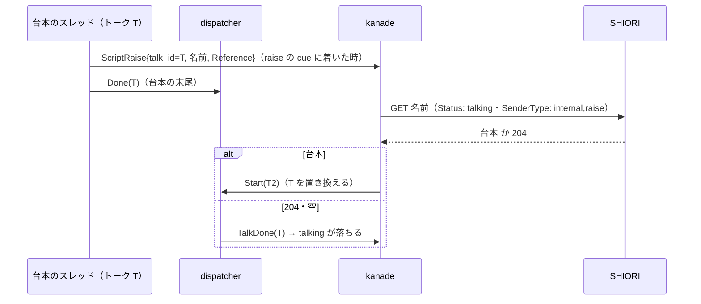

# 暫定の設計: ノベルの進行と入力の残り・バックログと巻き戻し（novel-play-flow・仮の名前）

> **作り直し済み（2026-11-20）**: この暫定の設計は、開発者の決め（`doc/ideas/novel-decisions-2026-11-20.md`）の前の物である。決めで作り直した物は `doc/ideas/novel-redesign-2026-11-20/`（骨組みは `00-architecture.md`）。この文書は、確かめた事実（`path:行`）の控えとして残す。

## 1. 前置き

- **暫定である。** 2026-11-19 に、main `49b6f3ab5` を読んで書いた。正式な `design.md` ではない。spec も brief もまだ無い（roadmap の「受け口（pasta の `novel-areka-contract` の依頼書を待つもの・brief なし）」の 2 項目＝`.kiro/steering/roadmap.md:1723-1724`）。
- 目的は、上位の決定（pasta の骨子・取り決め）へ差し戻しが要る矛盾を、今のうちに見つけること。細部は磨いていない。
- 実行して確かめた物は 0 件。コードは読んだだけ。areka も SSP も起動していない。
- 読んだ物:
  - pasta: `novel-areka-contract/final-model-2026-11-19.md`（以下「骨子」）・同 `brief.md` の「決定（2026-11-19…最終形）」の節（以下「取り決めの brief」）。
  - areka の見立て（参考）: `areka-novel-final-form-check`・`mark-and-talk-unit`・`settings-entrance`・`clickwait-answers`（どれも 2026-11-19）。
  - areka の brief: `talk-fast-forward`・`parallel-visual-script`・`sakura-time-directives`・`sound-canon-tags`・`shell-multi-compose`（境を見るため）。
  - コード: 3 章に `path:行` で挙げた所。ukadoc は MCP で引いた（5 章に URL と引用）。
- 言葉: 「1 本」は pasta がイベント 1 回に返すさくらスクリプト（areka では 1 つのトーク）。「受け口」は cue を受ける `CueSink`。「項目」は、この文書で、バックログの 1 本ぶんのまとまりを指す。

## 2. 暫定の要件

出どころの略: 骨＝骨子の節、取＝取り決めの brief の「決定」の小節。

| # | 要件 | 出どころ |
|---|------|----------|
| R1 | 台本が `\![raise,イベント名,r0,r1,…]` に着いたとき、areka は、そのイベントを GET で 1 回送り、第 3 引数からを Reference0 から順に載せる。イベント名は任意（`On` で始まらなくてよい） | 骨 2.8・取「命令の表」・ukadoc |
| R2 | `\![raise]` を打った 1 本が終わってから返事が届くまで、areka は Status の talking を立てたままにする。返事が 204 か空なら、そこで talking を落とす | 骨 2.8・取「1 本の形」 |
| R3 | `\![raise]` に着く前に、その 1 本が別の 1 本に置き換わったら、areka はその `\![raise]` を送らない。着いた後に置き換わったときも、古い 1 本の `\![raise]` は送らない | 取「待ちの解き方」・骨 6（遅れて届いた続き） |
| R4 | イベント名か Reference に CR・LF・NUL が在るとき、名前が空のとき、areka は送らずに記録に出す | areka の決まり（黙って捨てない） |
| R5 | どのゴーストでも、さくらスクリプトを再生すれば、areka はバックログに貯める（顔・話者・文）。字の無い 1 本は貯めない。`\__v[disable]` の区間の字は貯めない | 骨 2.5・取「バックログと目印」・ukadoc `\__v` |
| R6 | 1 本に `\![play,mark,イベント名,ID]` が在れば、areka は、その 1 本の項目に目印を付ける。目印の無い項目は選べない | 取「命令の表」「バックログと目印」 |
| R7 | 遊ぶ人が目印の在る項目を選んだら、areka は、そのイベントを GET で送り Reference0 に ID を載せ、選ばれた項目を含めて後ろを捨てる | 取「バックログと目印」・骨 4 章 E（今のまま） |
| R8 | 舞台を閉じたとき、areka は、バックログの目印を全部外す（文は残す） | 取「舞台の窓と箱」 |
| R9 | `\![open,backlogviewer]` で、areka はバックログの一覧の窓を開く | ukadoc・骨 2.5（一覧はベースウェアの機能） |
| R10 | 1 本に `\![play,again]` が在れば、areka は、その 1 本を貯めず、字を一度に出し、`\w`・`\_w` を飛ばし、`\x` はふつうに待つ | 取「命令の表」 |
| R11 | `\![play,again]` の 1 本の頭で、areka は、鳴っている途中の単発の音と声を止め、並走を全部止め、残る命令の値を全部既定へ戻してから、続く命令を当てる | 取「命令の表」・骨 4 章（承認が要らない整理） |
| R12 | `\![play,speaker,名前]` が打たれたスコープの、その 1 本の中の後ろの字は、バックログでその名前を話者にする。打たれていなければ descript の名前 | 取「命令の表」「舞台の窓と箱」 |
| R13 | areka の窓が手前でキーが押されたとき、areka は `OnKeyPress` を送る（Alt+Enter も自分で切り替えずに送る） | 取「設定の画面への入口」・ukadoc |
| R14 | SHIORI がリソース `sakura.popupmenu.visible`（相方は `kero.…`）に `0` と答えたとき、areka は右クリックのメニューを出さず、右クリックを `OnMouseClick`（Reference5＝1）で送る | 取「設定の画面への入口」・ukadoc |
| R15 | どの受け口も拾わない `\![play,…]` を、areka は記録に出す。`check_script` は「知らない命令」と答える | 進行役の割り当て 7・areka の決まり |
| R16 | ロードなどで pasta が控えを全部捨てた後、古い ID の項目を選んでも、バックログだけが欠けない | 骨 6・取「要件定義へ送ること」 |

## 3. 今の作り（確かめた事実）

### 3.1 1 つのトークと Status

- 再生の枠は 1 つ。`DispatcherState{active: Option<ActiveTalk>}`（`crates/areka-ghost/src/dispatcher.rs:116-118`）。`on_start` は古いトークを閉じて join してから新しいトークを立てる（同 `328-364`・`420-436`）。古いトークからの完了は捨てる（同 `368-387`）。
- 閉じられたトークは、残りの cue を配らない（`crates/areka-sakura/src/drive.rs:483-500`「落として残 entry を捨てる」）。受け口は、完了を知らせる前に落ちる（同コメント）。
- 台本は 1 回でコンパイルされ、最初の Tick で起点が押される（`drive.rs:311-338`）。Tick は 50 ms の格子（`crates/areka-ghost/src/ticker.rs:57-70`）。同じ時刻の cue は書いた順に 1 回で配られる（`crates/dola/src/cue/schedule.rs:155-170`）。
- kanade は、SHIORI との往復を 1 つの伝言の処理の中で閉じる（同期・同時進行 1 本まで・`crates/areka-kanade/src/actor.rs:6-17`）。
- talking は「運行の相から、再生中のトークの番号が引けること」（`schedule/mod.rs:376-378`・`status.rs:175-178`・`228-232`）。トークの完了を受けて初めて落ちる（`schedule/mod.rs:458-463`）。
- 再生中に GET の返事で台本が来たら、`OnSecondChange` と倍率の 2 語のほかは今のトークを置き換える。204 は何もしない（`schedule/events.rs:308-313`・`schedule/steady.rs:805-837`）。置き換えの時、古い番号を 1 世代だけ控える（`schedule/mod.rs:127-145`）。
- `OnSecondChange` は、トークが在れば NOTIFY（Reference3＝0・talking）、無ければ GET（Reference3＝1）（`schedule/events.rs:470-479`）。

### 3.2 台本からイベントを起こす道（前例）

- `\![名前,引数…]` は、`CueCommand` の汎用の入れ物で全部の受け口へ配られる（`crates/areka-sakura/src/compile.rs:282-288`）。受け口が名前で自分の分を選ぶ。
- `\![get,property,イベント名,…]` の受け口 `PropGetCueSink` が、台本のスレッドから kanade へ `KanadeMsg::PropertyEvent` を送り、kanade が逐語の名前の GET を 1 つ送る（`crates/areka-ghost/src/prop_get_sink.rs:44-138`・`schedule/change.rs:121-136`・`schedule/events.rs:847-857`）。返事は定常の返事の腕へ流れる。登録は 1 か所（`crates/areka-ghost/src/runtime.rs:786-796`）。
- イベントの出所の種類は `EventId` の 5 つ（`Static`・`Choice`・`Sstp`・`Translate`・`Property`・`crates/areka-kanade/src/msg.rs:363-376`）。送ってよいかは種類ごとに決まる。`Static` は許可の表、`Choice` は `On` 始まり、`Sstp` と `Property` は名前と Reference の検査だけ（`actor.rs:708-735`）。
- `ALLOWED_EVENT_IDS` は「スケジューラ起源の、ukadoc の固定名だけ」の表（`schedule/events.rs:112-126`）。任意の名前は、この表でなく、出所ごとの決まりで通す前例が 3 つ在る（上の `Choice`・`Sstp`・`Property`）。
- MCP の `raise_event` は `KanadeMsg::SstpNotify`（`crates/areka/src/mcp/raise_event.rs:51-56`）。送り手は MCP、出どころは `external,sstp`（`request_origin.rs:59-62`）、返事を待つ口と控え（`schedule/sstp.rs:94-148`）を持つ。起動の挨拶の間は受け付けない（同 `29-37`）。
- `SenderType` の語に `raise` はもう在る（`crates/areka-talk/src/origin.rs:68-76`）。本番のコードで使う所は 0 件（`SenderWord::Raise` を `crates/` で grep。当たるのは定義と、テスト `origin_tests.rs:16` だけ）。
- 出どころで止めるタグの表は 5 行で、`\![raise]` は無い（`crates/areka-runtime/src/script_restriction.rs:47-100`）。
- 受け口は、トークごとに複製され、番号と出どころを受け取る（`dispatcher.rs:339-347` の `begin_talk`）。

### 3.3 `\!` の受け口の台帳

- 台帳は（名前, 第 1 引数）→ 担当の表。「1 コマンド出現に高々 1 担当」を檻で固定している（`crates/areka-runtime/src/consumer_ledger.rs:30-42`・行は `340-399`）。
- 一致のテストは、「表が担当を言う行は、その担当の受け口だけに届く」「表に無い組は、どの受け口にも届かない」を、実際に配って確かめる（`crates/areka/src/runtime_tests/consumer_ledger_agreement_tests.rs:7-12`）。
- `check_script` と strict の判定は、この表を引いて「拾う担当が居るか」を答える（`consumer_ledger.rs:44-48`）。

### 3.4 まだ無い物

| 物 | 今 | 根拠 |
|----|----|------|
| `\![raise,…]` | 無い（持ち主なし） | `doc/ukadoc-coverage/ledger/sakura-script.toml:2631-2646` |
| バックログ・`\![open,backlogviewer]` | 無い（持ち主なし） | 同 `1929-1932`。`backlog` を `crates/` で grep（大小を区別しない）すると、当たるのは `areka-actor` のテストの「積み残し」の意味の語だけ |
| `\__v[…]` | 無い（持ち主なし） | 同 `4046-4049` |
| `\x` の待ち | 素通し（`talk-fast-forward` の持ち物）。dola の区切り `WaitForInput` は在る | `talk-fast-forward/brief.md:8`・`crates/dola/src/cue/command.rs:81` |
| `OnKeyPress` | 無い（持ち主なし）。wintf にキーの受け口は在る | `ledger/shiori.toml:3519-3523`・`crates/wintf/src/ecs/window_proc/keyboard.rs:1-4` |
| 話者の名前 | descript の `sakura.name`・`sakura.name2`・`kero.name` だけ | `crates/areka-parsers/src/package/model.rs:96-101` |

### 3.5 もう在る物

- 右クリックのメニューを止める道。右ボタンを離すたびに `sakura.popupmenu.visible`／`kero.popupmenu.visible` を照会し、返事で出すかを決める（`crates/areka/src/menu/trigger.rs:3-5`・`145-157`・`menu/captions.rs:68-76`）。台帳は `implemented`（`ledger/shiori.toml:13383-13386`・`14460-14463`）。`char*.popupmenu.visible` は照会しない（`captions.rs:78-94`）。
- 右クリックは、メニューと関係なく `OnMouseUp`（Reference5＝1）→ `OnMouseClick`（同）で届く（`schedule/mouse_events.rs:33`・`crates/areka-input/src/click.rs:155-162`）。話の最中かどうかで分けない（`mouse_events.rs:8`）。

## 4. 設計

### 4.1 構成（どこに何を足すか）

| 層 | 足す物 |
|----|--------|
| `areka-parsers`（sakura） | `\__v[…]` と裸の `\__v` を、運搬名つきの汎用コマンドにする腕（`\v`・`\j` と同じ流儀） |
| `areka-sakura`（compile） | 1 本の先頭の `\![play,again]` を読み、その 1 本の字と待ちの長さを 0 にする（`\x` の区切りは残す） |
| `areka-talk` | `ScriptOrigin::RAISE`（`internal,raise`・SSTP でない・`local`） |
| `areka-ghost` | `RaiseCueSink`（`prop_get_sink.rs` の隣・登録は `runtime.rs:786-796` の同じ 1 点） |
| `areka-kanade` | `EventId::Raise(String)`・`KanadeMsg::ScriptRaise`・`KanadeMsg::MarkSelect`・`KanadeMsg::KeyPress` と、運行表の腕（新しいファイル。`steady.rs` は 940 行で上限に近い）。許可の表に `OnKeyPress` の 1 行（ukadoc の固定名なので、表の決まりのまま） |
| `areka-runtime` | バックログの模型（純粋）と受け口 `BacklogCueSink`・台帳の行・知らない `play` を記録する受け口 |
| `areka`（本体） | バックログの置き場（UI スレッド）・一覧の窓・キーの配線（wintf の `OnKeyDown` → kanade）・`check_script` の見本 |

### 4.2 `\![raise]`

**道は `\![get,property]` と同じ形にする。MCP の `raise_event` の道（`SstpNotify`）は使わない。** 送り手が MCP・出どころが `external,sstp`・返事を待つ口つき・起動の挨拶の間は断る、のどれも `\![raise]` に合わないため。共有するのは検査（`validate_notify`）と、GET を組み立てる関数の形だけ。



- 受け口: 名前 `raise` を選別子なしで拾う。第 1 引数がイベント名、残りが Reference。空の名前・CR・LF・NUL は送らずに `warn!`。`begin_talk` で受けたトークの番号と出どころを、伝言に載せる。
- kanade の腕（順に）: 定常でない・終了や切替の保留中 → `warn!` で捨てる（積まない。`PropertyEvent` と同じ `drop_reason`）。**伝言の番号が今のトークの番号と違う → `info!`（`script_raise_stale`）で捨てる**（R3 の後半）。それ以外は GET を 1 つ送る。返事は定常の返事の腕へ流れ、台本なら今のトークを置き換える（`value_replaces_active_talk` は真になる）。
- **talking が立ち続ける理由（状態は足さない）**: (1) 受け口が kanade へ送るのは、同じスレッドが完了を dispatcher へ送るより前。完了は dispatcher を 1 つ余計に通るので、kanade の箱には必ず `ScriptRaise` が先に並ぶ。(2) kanade は `ScriptRaise` の処理の中で SHIORI と往復し、返事まで同じ処理で扱う。その間、ほかの伝言（毎秒の刻みも）は処理されない。(3) だから、GET を送る時点で T は「再生中」で、返事が台本なら切れ目なく T2 が再生中になり、204 なら、その後で T の完了を受けて落ちる。遅らせる仕掛けも、新しい相も要らない。
- T の完了が後から届く場合（置き換えの後）は、今の「1 世代の控え」と dispatcher の stale の棄却で足りる（3.1）。
- R3 の前半（着く前の置き換え）は、今の作りで満たす（閉じたトークは残りの cue を配らない）。
- イベント名と `ALLOWED_EVENT_IDS`: 表は触らない。`EventId::Raise` を足し、送ってよいかは `Sstp`・`Property` と同じ「名前と Reference の検査だけ」にする（`actor.rs:727-732` の腕に並べる）。表の決まり「ukadoc の固定名だけ」は、スケジューラ起源の話のまま残る。roadmap の申し送り（`roadmap.md:1729`「表の決まりを広げる」）は、要らなくなる。
- セキュリティ: 要求の出どころは、送り手 areka・`internal,raise`・レベルは「`\![raise]` を打った台本の実効のレベル」（下げるだけ）。返事の台本は、それを引き継ぐ。出どころで止める表（5 行）に `\![raise]` は無いので、外部扱いの台本でも実行する。
- 途中の `\![raise]`（末尾でない）: 着いた時に送る。返事が台本なら今のトークを置き換え、204 なら続きを再生する。

### 4.3 `play` の命令の入口

- **入口（配る係）は作らない。** `\![play,下位の名前,…]` は、今の作りのまま全部の受け口へ配られ、各単位の受け口が（`play`, 下位の名前）で自分の分を選ぶ。台帳に、単位ごとに行を足す（`("play", Some("mark"))` など）。`check_script` は、表を引くので、そのまま「知らない命令」を答える（R15 の後半）。
- 知らない `play` の記録（R15 の前半）: 受け口を 1 つ足す。台帳を引き、名前が `play` で担当の無い組を `warn!`（`play_command_unknown`）で出す。同じ下位の名前は、ゴーストの起動ごとに 1 回だけ。
- **複数の単位が同じ命令を見る物が、3 つ在る。** 今の台帳の檻（1 出現に高々 1 担当）と、そのままではぶつかる。

| 命令 | 見る受け口 |
|------|------------|
| `play,again` | compile（字と待ち）・バックログ（貯めない）・音（単発を止める）・並走（全部止める）・舞台（残る命令を既定へ） |
| `play,speaker` | 舞台（名前の箱）・バックログ（話者の欄） |
| 舞台を閉じる命令 | 舞台・バックログ（目印を外す）・並走（全部止める） |

- **設計（仮）: 台帳に「合図の行」を足す。** 1 つの組に、見る受け口を並べて登記する。檻の言い方は「1 出現に効くのは、表に登記した担当だけ」に替わる。一致のテストは「登記した受け口の全部に届き、ほかには届かない」に替える。意図しない二重の結線を見つける、という檻の役目は残る。型のある cue（`ClearAll`・サーフェス）は、今も複数の受け口が見ている。
- **`again` を束ねる所は、作らない。** 合図 1 つを、各単位の受け口が受けて、自分の持ち物だけを既定へ戻す。順は cue の並びが保証する（先頭・同じ時刻・書いた順に 1 回で配る）。「どの単位が何を戻すか」の一覧は、台帳の行と取り決めの文書に 1 つ持つ。
- この形が通らないとき（開発者が檻を今のままにすると決めたとき）の代わりの形: `again` は 1 本の先頭に限り、dispatcher が台本の先頭を読んで `begin_talk` の引数で各受け口へ渡す。`speaker` は担当を 1 つにし、もう一方へは担当が値を渡す。場合ごとの手当てが 2 つに増える（8 章の問 1）。

### 4.4 バックログ（模型・貯め方）

- 置き場: `BacklogCueSink`（台本のスレッド）が合図を送り、UI スレッドの置き場が持つ（バルーンの寿命の合図と同じ流し方）。値は変わった時点が分かるので、プッシュ。
- 形: **1 本＝1 項目。項目の中に行を持つ。**

```
項目 { トークの番号, 目印: 無し か (イベント名, ID), 行の並び }
行   { スコープ, 話者の名前, 顔（そのスコープの直近のサーフェスの値）, 文 }
```

- 行の切り方: 字を出すスコープが替わるごとに、新しい行を開く。話者の名前の命令が打たれたときも、新しい行を開く。`\n` は行の中の改行、`\c` は行の中の改ページ。pasta のふつうの 1 本は行 1 つ。待たない印の 1 本（2 人の台詞が入る）は、項目 1 つに行 2 つ。ほかの SHIORI の掛け合い（`\0…\1…`）は、項目 1 つに行が並ぶ。
- **目印は項目に付く。** 1 本に 1 つ。項目の中のどの行を選んでも、同じ目印のイベントを送り、項目ごと捨てる。「目印はバックログの行と 1 対 1」（骨子 1 章）は、「項目と 1 対 1」と読む。
- 項目は、最初の字が来た時に作る。字が来ないまま受け口が落ちたら、作らない（R5）。目印の命令は、最初の字より前に打つ（5 章）。字の無い 1 本に目印が在っても、項目が無いので捨てる（`debug!`）。
- `\__v[disable]` から次の `\__v` までの字は貯めない。`\__v[alternate,文字列]` は、その区間の字の代わりに文字列を貯める（ukadoc の SSP の振る舞い）。
- `play,again` の 1 本は、項目を作らない。
- 中断された 1 本は、配られた分までを項目に残す（字の cue は、かたまりで配られる）。
- 持ち方: ゴーストごと・メモリだけ・上限つき（古い項目から捨てる）。値は 7 章の仮定。

### 4.5 目印の行を選ぶ（R7・R16）

1. 一覧の窓が、選ばれた項目の（イベント名, ID）を `KanadeMsg::MarkSelect` で送る。
2. kanade: 定常でない・終了や切替の保留中 → `warn!` で断り、「断った」を知らせる。**バックログは何も捨てない。**
3. 送れるとき: 「送った」を知らせ（バックログは、選ばれた項目を含めて後ろを捨てる）、GET を 1 つ送る（Reference0＝ID）。イベントの種類は、選択肢の任意名（`EventId::Choice`）と同じ決まりで通す（`On` 始まり・作者が書いた名前を、遊ぶ人の 1 操作で 1 回）。
4. 返事が台本なら、今の 1 本を置き換える（待っていた `\x` の後ろの `\![raise]` は、R3 で送られない）。pasta の 1 本目（`again`）は項目を作らず、2 本目が同じ ID の目印で貯め直る。

**今の決まり（選ばれた時に捨てる）のままで、欠けを小さくする作り（仮）: 取り消しの控え。** 手順 3 で捨てた項目を、1 回ぶんだけ控える。返事が 204・空・失敗なら、控えを戻す。台本なら、控えを捨てる。kanade の往復は同期なので、「送った」と「戻す」は同じ処理の中で続けて出て、遊ぶ人には、捨てて戻すところは見えない。

- 決まりの文面（選ばれた時に捨てる）は変えない。pasta が台本を返したときの結果は、今の決まりと同じ。変わるのは、pasta が何も返さなかったときだけ（欠けない）。
- 骨子 4 章 E で取り下げた案（捨てる時を、同じ目印の行を貯め直す時へ移す）とは別の作り。ただし、E の 2 つ目の理由と同じ所を直すので、入れるかどうかは開発者に諮る（8 章の問 2）。
- 控えを入れない場合も、手順 2（送れなかった選択では捨てない）は入れる。

**ロードの後の古い ID（R16）**: 上の控えが在れば、古い ID の項目を選んでも欠けない（選んでも何も起きない行が残るだけ）。それでも、pasta が ID を重ねると、違う行へ飛ぶ。作りは 2 つを受けられる形にする。

- 目印を外す口を 1 つ持つ（舞台を閉じる時の R8 と同じ操作）。呼ぶのは、(a) 舞台を閉じる命令、(b) SHIORI を降ろす時・読み直す時（areka が時点を知っている。pasta の控えはメモリなので、そこで全部消える）、(c) 取り決めに足すなら、台本の合図（仮 `\![play,mark,clear]`。引数で「目印だけ外す」「項目ごと消す」を選ぶ）。
- (c) を足すかどうかと、外すか消すかは、取り決めの要件定義で決まる（8 章の問 3）。

### 4.6 `\![play,again]`（この単位の持ち分）

- compile: 1 本の先頭（最初の字より前）に `play,again` が在れば、その 1 本の字の長さと、`\w`・`\_w` の長さを 0 にして時刻を焼く。`\x` の区切りは残す。字の後ろに在る `play,again` は効かせず、`warn!` を出す。字を一度に出す仕組みは、`\_q`（`sakura-time-directives`）と同じ物を使う。
- バックログ: 項目を作らない（4.4）。
- 音・並走・舞台: それぞれの単位の受け口が、合図を受けて自分の物を戻す（4.3・6 章）。

### 4.7 話者の名前

- `BacklogCueSink` は、`play,speaker` を受けたスコープについて、名前を覚え、次の行から話者にする。覚えるのは、その 1 本の間だけ（受け口はトークごとに複製されるので、何もしなくても次の 1 本へ持ち越さない）。
- 打たれていないスコープは、descript の名前（0＝`sakura.name`・1＝`kero.name`）。舞台の並びの名前が在れば、そちらを先に引く（並びの名前を渡す口は `shell-multi-compose`）。どれも無ければ空。
- 名前の箱に出す仕事は `shell-multi-compose`。同じ合図を、舞台とバックログの 2 つが見る（4.3）。

### 4.8 `OnKeyPress`

- wintf の `OnKeyDown`（窓ごとの関数）→ 本体の配線 → `KanadeMsg::KeyPress` → 定常でだけ GET を 1 つ送る（マウスと同じ受け方。話の最中かどうかで分けない）。`ALLOWED_EVENT_IDS` に `OnKeyPress` を 1 行足す（ukadoc の固定名・URL つき）。
- Reference は ukadoc のとおり（5 章に引用）: 0＝キートップの文字、1＝Win32 の仮想キーコード、2＝押しっぱなしの回数、3＝キーが来たキャラクターの窓の ID、4＝修飾キーのカンマ区切り。Alt+Enter は `WM_SYSKEYDOWN` で届く（wintf は受けている）。areka は窓の形を替えずに、Reference4 に `alt` を載せて送る。
- areka が自分で使うキー（送りのキー）は作らない。待ちを解くのは、pasta が返す次の 1 本（今の待ちを置き換える）。
- 文字を打つ箱（入力欄）が手前のときは送らない（境は `inputbox-user-input`）。

### 4.9 右クリックのメニュー

- 足す物は無い（スコープ 0・1）。3.5 のとおり、もう照会している。
- 舞台の窓と 3 人目からのアクターで、どの名前を照会するかは決まっていない（`char*.popupmenu.visible` は今は照会しない）。`shell-multi-compose` と `extra-character-windows` の境。

### 4.10 時刻・失敗

- 新しい時計は作らない。`\![raise]` は cue の時刻に着いた時に送り、次の 1 本の起点は、今と同じ「最初の Tick」。
- 1 本と 1 本の間に、50 ms の格子が入る（次の 1 本の最初の Tick を待つ）。字を一度に出す 1 本（`\_q` と `\![raise]` だけ）を続けると、1 秒に 20 本ほどが上限になる（3.1 の事実からの見立て）。
- 失敗は全部、記録に出す: 名前の検査の失敗（`warn!`）・定常でない時の棄却（`warn!`）・古い `\![raise]`（`info!`）・知らない `play`（`warn!`）・字の後ろの `again`（`warn!`）・目印の引数の不足（`warn!`）。メッセージボックスは出さない。

### 4.11 `\x` と `\![play,xtimeout]`（境だけ）

設計は `talk-fast-forward` の係。この単位が当てにする事は 3 つ。(1) `\x` は区切りで、解けるまで後ろの cue（`\![raise]` を含む）を配らない。(2) 待つ間、トークの枠は占めたまま（talking）。(3) 時間で解けたときも、クリックで解けたときと同じに、後ろの cue へ進む。

## 5. pasta に期待する事

| # | 期待する事 | 骨子・取り決めと |
|---|------------|------------------|
| P1 | 1 本の末尾は `\x\![raise,イベント名]`。areka は GET で送り、引数を Reference0 から載せる。`SenderType` は `internal,raise` | 合っている（取「1 本の形」） |
| P2 | `\![raise]` の返事が 204 か空なら、そこで止まる（talking が落ち、次の `OnSecondChange` は GET・Reference3＝1 で届く）。pasta は、演劇の間、それにランダムトークを返さない | 合っている（骨 2.1・2.8） |
| P3 | 待っている 1 本が消えたら、`OnSecondChange` が GET で届く。pasta は `again` 付きで出し直す。待っている間は NOTIFY（Reference3＝0）で届く | 合っている（骨 2.5） |
| P4 | areka では、置き換えられた 1 本の `\![raise]` は、遅れても届かない（トークの番号で捨てる）。`\![raise,OnPlayNext,ID]` の ID は、areka のためには要らない。付けても Reference0 に載るだけで害は無い（SSP のために付けてよい） | 合っている（骨 6 の候補と両立） |
| P5 | 目印は 1 本に 1 つ。最初の字より前に打つ。イベント名は `On` で始める | 合っている。**足す決まり**: 位置と `On`（文書に無い） |
| P6 | 字の無い 1 本の目印は、areka では何も起こさない | **上位の文書どうしが食い違う**: 骨 2.5「演劇のどの 1 本にも、目印が付く」／取「命令の表」の目印の行「字の無い 1 本には付けない」。areka はどちらでも動く |
| P7 | 待たない印で 2 人の台詞が 1 本に入るとき、バックログは項目 1 つに行 2 つ。選ぶと、その 1 本の頭へ戻る | **言い換えが要る**: 骨 1 章「目印…バックログの行と 1 対 1 になる」は、「1 本ぶんの項目と 1 対 1」と読む |
| P8 | `\![play,again]` は、1 本の先頭（最初の字より前）に打つ。pasta は、その 1 本に画面の状態を全部書く | 合っている（取「命令の表」）。**足す決まり**: 位置 |
| P9 | 戻るときの 1 本目は `again`＋状態だけ＋末尾の `\![raise]`、2 本目は同じ ID の目印でふつうに再生 | 合っている（取「バックログと目印」） |
| P10 | 設定のモードの 1 本を貯めたくないなら、pasta が `\__v[disable]` で包む。areka は、pasta の走り方（設定）を知らない | 合っている（取「原則」「命令の表」）。骨 2.1 の「記録しない」は pasta の中の記録の話、と読んだ |
| P11 | ID は、areka が起動している間、重ねない。または、控えを全部捨てた 1 本に「目印を外す」合図を付ける | 取「要件定義へ送ること」の未決のまま |
| P12 | `\![play,speaker,名前]` は、その話者の最初の字より前に打つ。効くのは、打ったスコープの、その 1 本の中 | 合っている（取「命令の表」の「その 1 本」） |
| P13 | `OnKeyPress` は GET で届く。キーは Reference0（キートップの文字）、修飾キーは Reference4。Alt+Enter は Reference4 に `alt` | 合っている（取「設定の画面への入口」の `＊OnKeyPress　＆＄ｒ０＝「…」`）。Reference0 の綴り（Enter など）は SSP を測ってから決める |
| P14 | メニューを止めるには、リソース `sakura.popupmenu.visible`（相方は `kero.…`）に `0` と答える。右クリックのたびに、照会が 1 回と、`OnMouseUp`・`OnMouseClick`（Reference5＝1）が届く。pasta は `OnMouseUp` に 204 を返す | 合っている。照会とマウスのイベントの前後は確かめていない |
| P15 | 字を一度に出す 1 本を続ける高速再生は、areka では 1 秒に 20 本ほどが上限（今の刻み） | 食い違いではない。知らせる事 |
| P16 | `\x` が時間で解けた直後に、絵の上のクリックが届くと、pasta の「進める」で 2 行進む（`\![raise]` の後に `OnMouseClick` が届く順）。areka は順に送るだけで、見分けない | 骨 6 の 1 つ目（遅れて届いた続き）の逆の形。持ち主は `novel-talk-flow`。SSP でも同じはず（確かめていない） |

ukadoc の引用（URL は `https://ukatech.shillest.net/ukadoc-spec/`）:

- `\![raise,…]`（`list_sakura_script.html#bang-raise-r0-r1-r2`）: 「イベントを実行する。第3引数以降はReference0以降に順番に格納される。」
- `OnKeyPress`（`list_shiori_event.html#OnKeyPress`）: 「本体がアクティブな状態でキーが入力された際に発生。」Reference0「入力されたキー。(キートップに書かれた文字)」・Reference1「入力されたキー。(Win32仮想キーコード)」・Reference2「※SSPのみ　キーの押しっぱなしカウント。」・Reference3「※SSPのみ　キーイベントが来たキャラクターウインドウID。」・Reference4「※SSPのみ　修飾キーがカンマ区切りで列挙される。例："ctrl,alt"」。NOTIFY の印は無い（GET）。
- `sakura.popupmenu.visible`（`list_shiori_resource.html#sakura.popupmenu.visible`）: 「本体側のオーナードローメニューの表示。1で表示、0で非表示。応答がない場合は表示。」
- `\__v[オプション]`（`list_sakura_script.html#__v`）: 「\__v[disable]の区間は音声合成だけでなくバックログへの記録も行われなくなる。」
- `\![open,backlogviewer]`（`list_sakura_script.html#bang-open-backlogviewer`）: 「バックログ(発言履歴)ウィンドウを開く。」
- Status（`list_propertysystem.html#note-1`）: 「talking: 現在スクリプトを実行中（喋り中）。」

## 6. ほかの単位に期待する事

| 単位 | 期待する事 |
|------|------------|
| `talk-fast-forward` | 4.11 の 3 つ。`play,xtimeout` の台帳の行。箱のクリックで待ちを解くときは SHIORI へ送らない |
| `sakura-time-directives` | `\_q`（字を一度に出す）の仕組みを、`again` の 1 本まるごとにも使える形で作る。先に着地した方が作り、後の方が使う |
| `sound-canon-tags` | `again` の合図で、鳴っている途中の単発の音と声だけを止める（ループは止めない）。「単発だけ止める」口が要る |
| `parallel-visual-script` | **並走は、1 本の置き換えを越えて走り続ける**（pasta は 1 行ごとに 1 本を返すので、次の行でトークの枠が替わる）。`again` の合図と、舞台を閉じる合図で、全部止める。並走の区間の中の `\![raise]` は読み捨てて記録する |
| `shell-multi-compose` | `again` の合図で、残る命令の値を全部既定へ戻し、同じ時刻の命令を全部当ててから最初の絵を出す（戻して当て直しても、同じ値ならちらつかない）。`play,speaker` を名前の箱に出す。舞台を閉じる命令を、バックログも見られる合図にする。並びの名前をバックログへ渡す。舞台の窓の右クリックで照会するリソースの名前と、`OnKeyPress` の Reference3 の値を決める。止まった舞台から出られる道を持つ |
| `inputbox-user-input` | 入力欄が手前の間は、キーを `OnKeyPress` にしない |
| `talk-anchor-interrupt-ticks` ほか時刻の spec | 1 本の起点が 50 ms の格子で決まる今の作りを直すなら、行と行の間の遅れも縮む |

同じファイルを触る所（同じウェーブに置けない相手の見立て）:

- `crates/areka-sakura/src/compile.rs`・`crates/areka-parsers/src/sakura/decode.rs`: `talk-fast-forward`（`\x`）・`sakura-time-directives`（`\_q`）・`parallel-visual-script`（区間）。
- `crates/areka-kanade/src/msg.rs`・`schedule/mod.rs`・`schedule/events.rs`: `talk-fast-forward`・`parallel-visual-script`・`mcp-shiori-query`。
- `crates/areka-runtime/src/consumer_ledger.rs` と一致のテスト・`check_script` の見本: `play` の行を足す単位の全部。**「合図の行」（4.3）は、最初に着地する単位が作る。**
- `crates/areka-ghost/src/runtime.rs:786-796`（受け口の登録の 1 点）・`dispatcher.rs`: `parallel-visual-script`。

## 7. 置いた仮定

1. `\![raise]` は、SSP でも「着いた時に送り、返事の台本は今の台本を置き換える」。途中の `\![raise]` の SSP の振る舞いは測っていない。
2. `\![raise]` の要求の `SecurityLevel` は、打った台本の実効のレベルを引き継ぐ（SSP の実測は無い。ukadoc の見本は `internal,raise` と `local`）。
3. 目印のイベントは、選択肢の任意名と同じ出どころ（送り手 areka・`internal`）で送る。イベント名は `On` 始まりに限る。
4. バックログは、ゴーストごと・メモリだけ。上限は 1000 項目。ゴーストの切り替えと areka の終了で消える。
5. 顔は、サーフェスの値とスコープを控えるだけ。絵にするのは一覧の窓。
6. 中断された 1 本は、配られた字までを貯める。
7. `\__v[alternate,…]` も、バックログの分だけ作る。声で読む働きは作らない。
8. 選択肢は、表示の文を 1 行として項目に貯める。選んだ答えは貯めない（並べ方は未決。8 章の問 5）。
9. `OnKeyPress` は、押しっぱなしの繰り返しも送る（Reference2 に回数）。
10. 一覧の窓は、areka が自前で描く窓として見積もった（描き方は未決。8 章の問 4）。
11. 「合図の行」（4.3）が通る。
12. `talk-fast-forward` が `\x` を区切りにし、待つ間トークの枠を占める。

## 8. 決まっていない所

| # | 問い | 答えで変わる所 |
|---|------|----------------|
| 1 | `\!` の受け口の台帳の檻「1 出現に高々 1 担当」を、「登記した複数の受け口が見る合図の行」へ広げてよいか | `again`・`speaker`・舞台を閉じる合図の配り方。だめなら、4.3 の代わりの形（`begin_talk` で渡す・担当が値を渡す）になり、3 つの単位の受け口の作りが変わる |
| 2 | 「選ばれた時に捨てる」のまま、返事が台本でなかったら戻す「取り消しの控え」を入れてよいか | 4.5 の控えと、kanade の知らせ 2 つ（2〜3 タスク）。入れないなら、戻れない行でバックログが欠ける |
| 3 | ロードの後: 台本の合図を足すか。足すなら、目印だけ外すか、項目ごと消すか。足さないなら、pasta は ID を重ねない | 4.5 の (c) と、取り決めの命令の表 |
| 4 | 一覧の窓を、何で描くか（windows-reactor を待つ／舞台の窓の中に描く／自前の窓）。全画面の舞台の上で、どう出すか | 一覧の窓のタスクの数（4〜6）と、着手の時期。`shell-multi-compose` との境 |
| 5 | 選択肢の行と、選んだ答えを、バックログにどう並べるか（取り決めの brief でも未決） | 行の種類と、kanade からバックログへの知らせ |
| 6 | `OnKeyPress`: 押しっぱなしの繰り返しを送るか・Reference0 の綴り・話の最中も送るか（SSP を測る） | キーの配線と、pasta の高速再生の入口 |
| 7 | バックログの上限・切り替えで消すか・`\__v[alternate]` を作るか | 4.4 の持ち方 |
| 8 | 中断された 1 本の文を、配られた分までにするか、全文にするか（設定の画面へ入った行が、途中までで残る） | 受け口が字を取る所（配られた cue か、先渡しの全文か） |
| 9 | この受け口を、何本の spec に切るか（10 章） | 起票の本数と順 |
| 10 | 1 本と 1 本の間の 50 ms の格子を、ノベルの前に縮めるか | 高速再生の速さ。時刻の spec の順 |

## 9. 差し戻しが要りそうな所

**無い。** 上位の決定を変えないと成り立たない所は、見つからなかった。取り決めの要件定義で文面を整える所が 4 つ在る（どれも決定の中身は変えない）。

1. 目印と字の無い 1 本（5 章 P6）: 骨子 2.5「演劇のどの 1 本にも、目印が付く」と、取り決めの brief「命令の表」の「字の無い 1 本には付けない」。どちらかにそろえる。
2. 「バックログの行と 1 対 1」（骨子 1 章）: 待たない印（骨子 2.2）で 1 本に 2 人の台詞が入ると、表示の行は 2 つになる。「1 本ぶんの項目と 1 対 1」と書く（5 章 P7）。
3. 目印と `again` を打つ位置（最初の字より前）と、目印のイベント名（`On` 始まり）を、取り決めに書く（5 章 P5・P8）。
4. 骨子 6 章「遅れて届いた続きのイベント」: areka の側では、トークの番号で捨てるので起きない（5 章 P4）。逆の形（P16）を、同じ項目に足す。

## 10. 規模の見立て

| かたまり | タスク |
|----------|--------|
| A. `\![raise]`（受け口・kanade の腕・出どころ・台帳・検査の見本・テスト） | 5〜7 |
| B. `play` の入口（知らない `play` の記録・台帳の「合図の行」・一致のテスト） | 2〜3 |
| C. バックログの模型と受け口（項目と行・`\__v`・目印・話者・`again` の貯めない・上限） | 6〜8 |
| D. 目印を選ぶ道（kanade の腕・捨てる・取り消しの控え・目印を外す口） | 4〜5 |
| E. 一覧の窓と `\![open,backlogviewer]` | 4〜6（描き方しだい） |
| F. `again` の compile の部分 | 2 |
| G. `OnKeyPress`（配線・kanade・台帳・SSP の測り） | 4〜5 |
| H. 右クリック（舞台の窓での照会の名前の確かめだけ） | 0〜1 |
| 計 | 27〜37 |

- brief は無いので、比べる見立ては roadmap の 2 行（「ノベルの進行と入力の残り」「バックログと巻き戻し…」）だけ。数は書かれていない。
- 20 を超えるので、起票のときに切る。案: (1) `\![raise]`（A）、(2) `OnKeyPress`（G）、(3) バックログ（C・D・E・F と `speaker` の欄）。B は、最初に着地する物に入れる。
- **A と G は正典の拾い残しで、pasta の依頼書を待たずに起票できる**（取り決めの名前に左右されない）。A は `talk-fast-forward` が無くても成り立つ。

## 11. 確かめた物と机の上だけの物

**実行して確かめた物: 0 件。**

コードを読んで確かめた物:

- 3 章の事実の全部（`path:行` つき）。
- 4.2 の「talking が立ち続ける理由」の 3 つの前提: 受け口は完了より前に落ちる・配られる（`drive.rs:483-500` と同コメント）、kanade の往復は同期（`actor.rs:6-17`）、talking は相から導く（`schedule/mod.rs:376-378`）。
- 閉じたトークは残りの cue を配らない（`drive.rs:491-493`）。
- 任意の名前を、許可の表でなく出所ごとの決まりで通す前例（`actor.rs:721-735`）。
- 右クリックの照会と、右クリックのイベントが別々の道で出ること（`menu/trigger.rs`・`crates/areka-input/src/click.rs`）。
- ukadoc の 6 項目（5 章の引用）。

読んでいない・机の上だけの物:

- `\![raise]`・バックログ・`OnKeyPress`・`\__v`・`\x` の待ちは、areka に無い。4 章の流れは、どれも動かしていない。
- 「`ScriptRaise` が、T の完了より必ず先に kanade に並ぶ」は、スレッドと箱の順からの読み。テストは無い。
- 置き換えの後に届く T の完了の扱い（1 世代の控え）は、今のテストが在る道と同じ、と読んだだけ。
- 定常の返事の腕は、相で分ける所（`schedule/steady.rs:788-840`＝再生中の台本は置き換え・204 は何もしない）だけ読んだ。その前の、選択待ちの帳簿を扱う所は読んでいない（選択肢を待つ 1 本に `\![raise]` は無い前提）。
- 右クリックで、照会とマウスのイベントのどちらが先に届くか。
- 1 秒に 20 本の見立て（50 ms の格子からの算術）。
- SSP の振る舞い（途中の `\![raise]`・`OnKeyPress` の Reference0 の綴りと繰り返し・`\![raise]` の `SecurityLevel`）。
- 兄弟の単位の暫定の設計（まだ無かった。`doc/ideas/` に在るのは `novel-platform.md` と `usage-stats.md` だけ）。
